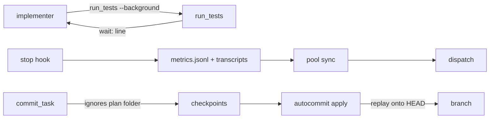
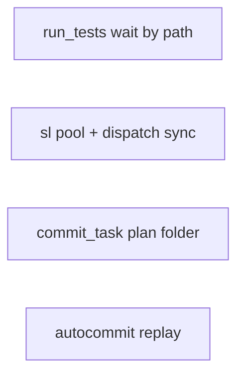

# Superlite 1.2.2: coordinator cost fixes

**Review plan:** docs/plans/2026-10-26-coordinator-cost.review.md
**Goal:** the coordinator stops doing bookkeeping and hand commits: each agent waits on its own test run, `sl pool` keeps pool.json with real context numbers, the plan's folder never blocks a checkpoint, and `autocommit apply` replays checkpoints onto a moved HEAD.
**Architecture:** four independent edits to the stdlib Python scripts under `skills/subagent-driven-development/scripts/` (one new script, `pool.py`), each with its own pytest file under `tests/scripts/`; prompt and doc text updated where the behaviour changes.
**Tech stack:** Python 3 stdlib only; pytest via `uv run --with pytest` (no project venv).
**Spec path:** docs/plans/2026-10-26-coordinator-cost.spec.md
**Detail:** contracts
**Target-min:** 11

Global constraints (copied from the repo):
- Every line of a script carries a trailing `# O(...)` complexity comment, as the existing lines do; LF line endings.
- Stdlib only; `subprocess` for git. Every write to `.superlite/*.json` is atomic (write `<name>.tmp`, then `replace`).
- Existing tests in `tests/scripts/` stay green; new tests go into the files named in `Owns`, run with `bash "$SL" run_tests --fast <file> --background` then the printed `--wait <path>` line.
- `skills/using-superlite/SKILL.md` stays under 1,500 characters and is not touched.
- Versions change only with `scripts/bump-version.sh 1.2.2`; `scripts/bump-version.sh --audit` must be clean.
- Checkpoint state: `.superlite/checkpoints.json` is `{"plan","run","head","branch","entries":[{"task","sha","title","files"}]}`; the newest entry is the last.
- Metrics: `.superlite/metrics.jsonl` lines `{"ev":"launch","t":ms,"agent_id","type","model","desc"}` and `{"ev":"stop","t":ms,"agent_id","type","transcript","last"}`; an agent transcript is JSONL whose `{"type":"assistant","timestamp":iso,"message":{"id","usage":{"input_tokens","cache_read_input_tokens","cache_creation_input_tokens","cache_creation":{"ephemeral_5m_input_tokens","ephemeral_1h_input_tokens"}}}}` lines carry usage (a message id may repeat: use the last line per id).

## File structure

- `skills/subagent-driven-development/scripts/run_tests.py`: `--wait PATH` and the `wait:` line (T1); `agents/*.md`, `fixing.md`: prompts say `--wait <path>` (T1).
- `skills/subagent-driven-development/scripts/pool.py` (new): `add|busy|free|list|sync` on pool.json (T2); `dispatch.py`: calls `pool.sync` before planning (T2); `SKILL.md`, `docs/tools.md`, version files (T2).
- `skills/subagent-driven-development/scripts/commit_task.py`: plan-folder paths ignored (T3).
- `skills/subagent-driven-development/scripts/autocommit.py`: `apply` replays onto a moved HEAD (T4).
- `tests/scripts/test_run_tests_wait.py`, `test_pool.py`, `test_commit_plan_folder.py`, `test_autocommit.py`: one per task.

```mermaid
%% schedule
gantt
  title Predicted schedule (mm:ss)
  dateFormat X
  axisFormat %M:%S
  section lane 1
  T2 sl pool  dispatch sync  docs  version :t2, 0, 351s
  section lane 2
  T4 autocommit  apply replays onto a move :t4, 0, 194s
  section lane 3
  T1 run_tests  wait by path  prompts :t1, 0, 190s
  section lane 4
  T3 commit_task  plan folder never blocks :t3, 0, 183s
```

critical path: T2 (5.8 min) · peak width 4 · predicted build 5.8 min · predicted total ≈ 9.3 min (target ✓)

## Predicted schedule

(generated by `plan_tools prune` / `schedule --insert`)

## Section A: scripts

### T1 run_tests: wait by path, prompts · Complexity 3 · Est. context 36k
**Owns:** skills/subagent-driven-development/scripts/run_tests.py, tests/scripts/test_run_tests_wait.py, agents/implementer.md, agents/implementer-haiku.md, agents/fixer-sonnet.md, agents/fixer-sonnet-high.md, agents/fixer-opus.md, agents/package-reviewer.md, skills/subagent-driven-development/fixing.md
**Covers:** 1
**Components:** 1
**LOC owned:** 60
**Tests:** fast
**Model:** sonnet
**Est. time:** 2.5 min (1 component, about 60 LOC, fast tests)
**Consumes:** existing `run_tests.start_background(a, argv)`, `run_tests.wait_background(a)`, `run_tests.read_pointer(summary)`, `run_tests.run_summary_path(summary, run_id)`
**Produces:** run_tests.wait_target(a) -> Path | None (the summary file `--wait` polls: `a.wait_path` when given, else the pointer's summary, else None) · run_tests.wait_line(path: Path) -> str (the second line `--background` prints)
e.g. `wait_target(args with wait_path="/p/.superlite/test-summary-x.json")` -> `Path("/p/.superlite/test-summary-x.json")`
e.g. `wait_target(args with no wait_path, pointer {"id":"r1","summary":"/p/.superlite/test-summary-r1.json"})` -> `Path("/p/.superlite/test-summary-r1.json")`; no pointer -> `None`
e.g. `wait_line(Path("/p/.superlite/test-summary-r1.json"))` -> `'wait: bash "$SL" run_tests --wait /p/.superlite/test-summary-r1.json'`
**Review Focus:** `test_wait_path_returns_that_run_only`: two `--background` runs started back to back in one tmp project (runner = a script writing a junit with 1 pass for run A and 1 failure for run B, via `.superlite/test-cmd.json`); `--wait <A path>` exits 0 and prints A's summary, `--wait <B path>` exits 1 with B's failure, whichever finished first; `test_background_prints_wait_line`: stdout of `--background` is exactly `summary: <path>` then `wait: bash "$SL" run_tests --wait <path>`; `test_bare_wait_uses_pointer`: bare `--wait` after one background run still returns that run (existing behaviour); `test_wait_missing_path_times_out`: `--wait /nope.json --timeout 1` exits 2 with `timed out` on stderr; prompts: every file in Owns that says `run_tests --wait` now says `run_tests --wait <path>` (the path from the `wait:` line), checked by `test_prompts_say_wait_path` (grep over the owned .md files: no bare `` --wait` `` followed by a backtick or newline).
**Steps:** 1 failing tests, 2 run: FAIL, 3 implement, 4 update prompts, 5 run: PASS
**Notes:** `--wait` becomes `nargs="?"` with `dest="wait_path"` plus a `const` sentinel so bare `--wait` still works; argparse: `--wait` must be last or followed by another flag, document that in the module docstring. The `wait:` line uses the literal text `bash "$SL" run_tests --wait ` + the absolute path.

### T2 sl pool, dispatch sync, docs, version 1.2.2 · Complexity 5 · Est. context 52k
**Owns:** skills/subagent-driven-development/scripts/pool.py, skills/subagent-driven-development/scripts/dispatch.py, skills/subagent-driven-development/scripts/sl, tests/scripts/test_pool.py, skills/subagent-driven-development/SKILL.md, docs/tools.md, package.json, .hermes-plugin/plugin.yaml, .claude-plugin/plugin.json, .cursor-plugin/plugin.json, .codex-plugin/plugin.json, .devin-plugin/plugin.json, .kimi-plugin/plugin.json, .muse-plugin/plugin.json, .claude-plugin/marketplace.json, .muse-plugin/marketplace.json, gemini-extension.json
**Covers:** 2
**Components:** 2
**LOC owned:** 200
**Tests:** fast
**Model:** sonnet
**Est. time:** 3.5 min (2 components, about 200 LOC, fast tests)
**Consumes:** existing `dispatch.load_pool(path)`, `dispatch.run(plan, pool_path, ledger, committed, running, cap)`, `metrics.read_jsonl(path)`, `assign.DEFAULT_CONTEXT_K`
**Produces:** pool.load(path: str | Path) -> dict · pool.save(path, data: dict) -> None (atomic) · pool.add(data: dict, aid: str, tier: str, current: str | None = None) -> dict (the agent record; existing id: updated in place) · pool.busy(data: dict, aid: str, task: str, now_ms: int) -> dict · pool.free(data: dict, aid: str) -> dict · pool.context_k(transcript: str | Path) -> float | None (last assistant message: input + cache_read + cache_creation 5m + 1h, in thousands, one decimal) · pool.sync(data: dict, sl_dir: str | Path, now_ms: int) -> dict (fills context_k, idle_min, clears busy; returns the pool) · pool.main(argv) -> int · dispatch.run(...) (calls pool.sync and saves the pool before planning when the pool file exists)
e.g. `add({"agents": []}, "a5be", "sonnet", "T3")` -> `{"id": "a5be", "tier": "sonnet", "tasks": [], "files": [], "context_k": 20.0, "idle_min": 0, "busy": True, "current": "T3"}`; without `current` -> `busy: False` and no `current` key
e.g. `busy(pool, "a5be", "T4", 1700000000000)` -> the record with `busy: True, current: "T4", busy_since: 1700000000000`; `free(pool, "a5be")` -> `busy: False`, `current` removed, `busy_since` removed
e.g. `context_k("tests/scripts/fixtures/capture_real/agent.jsonl")` -> the fixture's last assistant message usage summed in thousands, one decimal (compute it in the test from the fixture, assert equality); a file without assistant lines -> `None`
e.g. `sync(pool with agent a5be busy_since 1000, sl_dir whose metrics.jsonl has a stop for a5be at t 5000 with transcript X, now_ms 65000)` -> a5be `context_k` = `context_k(X)`, `idle_min` = `1.0`, `busy: False`, `current` kept (commit_task clears it); a stop older than `busy_since` leaves `busy: True`; an agent with no stop record keeps its `context_k` and `idle_min` unchanged
**Review Focus:** `test_add_busy_free_roundtrip`: the e.g. values above through `main` (`add a5be --tier sonnet --current T3`, `free a5be`, `busy a5be T4`, `list` prints one line per agent `a5be tier=sonnet busy=True current=T4 tasks=0 context_k=20.0 idle_min=0`); `test_sync_reads_real_context`: the e.g. `sync` case; `test_sync_keeps_busy_when_stop_is_older`; `test_sync_without_metrics_is_noop`: no metrics.jsonl -> the pool is unchanged and `sync` prints `synced 0 agent(s)`; `test_dispatch_syncs_before_planning`: a pool with `context_k: 95` for an idle agent whose metrics stop names a transcript with 30k usage: `dispatch --plan <fixture plan> --pool 
` prints no `evict=` line for it and the saved pool shows `context_k` 30.x; `test_unknown_agent_exits_2`: `busy nope T1` exits 2 with one stderr line; docs: `SKILL.md` scheduling loop says sending a task is `bash "$SL" pool busy ID Tn` (a fresh agent: `pool add ID --tier T --current Tn`), step 4 drops "Mark reporters busy: false" (sync does it), step 3's verify command says `--wait <path>` (the printed `wait:` line); `docs/tools.md` gets a `pool` entry and the `--wait PATH` form; the `sl` launcher comment lists `pool`; `scripts/bump-version.sh 1.2.2` run, `--audit` clean.
**Steps:** 1 failing tests, 2 run: FAIL, 3 implement pool.py, 4 wire dispatch.run, 5 docs and bump, 6 run: PASS
**Notes:** `sync` matches a metrics `agent_id` to a pool `id` exactly, else when the transcript path's basename is `agent-<id>.jsonl`; `idle_min` = (now_ms - latest stop t) / 60000 rounded to one decimal, never negative; `now_ms` defaults to `time.time()*1000`. `dispatch.run` saves the pool only when `sync` changed a value. `pool.json` lives next to the plan's `.superlite` (`--pool`, default `.superlite/pool.json`); `sl_dir` is the pool file's parent.

### T3 commit_task: plan folder never blocks · Complexity 3 · Est. context 34k
**Owns:** skills/subagent-driven-development/scripts/commit_task.py, tests/scripts/test_commit_plan_folder.py
**Covers:** 3
**Components:** 1
**LOC owned:** 40
**Tests:** fast
**Model:** sonnet
**Est. time:** 2 min (1 component, about 40 LOC, fast tests)
**Consumes:** existing `commit_task.changed_files()`, `commit_task.commit_one(a, tid, info, own_files)`, `commit_task.ignored(path)`
**Produces:** commit_task.plan_folder(plan: str | Path) -> str (the plan's directory relative to the repo root, forward slashes, trailing slash; `""` when the plan is at the root or outside the repo) · commit_task.changed_files(skip_prefix: str = "") -> list[str] (paths under `skip_prefix` dropped) · commit_task.commit_one(...) (passes `plan_folder(a.plan)` and still commits a plan-folder path a task Owns)
e.g. `plan_folder("docs/plans/2026-10-26-x.md")` -> `"docs/plans/"`; `plan_folder("plan.md")` -> `""`; `plan_folder("/tmp/elsewhere/plan.md")` (outside the repo) -> `""`
e.g. `changed_files("docs/plans/")` with status lines `docs/plans/x.spec.md`, `src/a.py` -> `["src/a.py"]`
**Review Focus:** `test_untracked_sibling_spec_does_not_block`: a repo whose plan is `docs/plans/p.md` with an untracked `docs/plans/p.spec.md` and T1's `src/a.py` changed: `commit_task T1 --plan docs/plans/p.md` exits 0, prints the sha, stdout has no `out-of-scope`, the commit (or checkpoint) holds `src/a.py` and not the spec; `test_modified_plan_itself_does_not_block`: the same with the plan file edited; `test_owned_path_in_plan_folder_is_committed`: a task that Owns `docs/plans/notes.md` commits it; `test_root_plan_keeps_blocking_unowned_files`: plan at the root, an unowned `other.txt` still prints `out-of-scope other.txt` and exits 1.
**Steps:** 1 failing tests, 2 run: FAIL, 3 implement, 4 run: PASS
**Notes:** the ownership check comes first: a file matched by the task's Owns is `mine` even under the plan folder; only unowned, non-other-task files under the folder are dropped. The repo root is `git rev-parse --show-toplevel` (already available through `nt`/`state` helpers or one `git` call). Use the fixture plan under `tests/scripts/fixtures/run_plan/` copied into `docs/plans/` of the tmp repo.

### T4 autocommit: apply replays onto a moved HEAD · Complexity 5 · Est. context 40k
**Owns:** skills/subagent-driven-development/scripts/autocommit.py, tests/scripts/test_autocommit.py
**Covers:** 4
**Components:** 1
**LOC owned:** 70
**Tests:** fast
**Model:** sonnet
**Est. time:** 2.5 min (1 component, about 70 LOC, fast tests)
**Consumes:** existing `autocommit.load_state()`, `autocommit.dirty_outside(files)`, `autocommit.clean()`, `autocommit.apply()`
**Produces:** autocommit.moved_overlap(base: str, head: str, files: set[str]) -> list[str] (checkpointed files touched by commits in `base..head`, sorted; `[]` when HEAD did not move) · autocommit.replay_tree(parent: str, entry: dict) -> str (a tree = parent's tree with each file in `entry["files"]` taken from `entry["sha"]`'s tree, removed when absent there) · autocommit.apply() -> int (replays when `moved_overlap` is empty; refuses naming the files otherwise)
e.g. `moved_overlap(base, head, {"src/a.py"})` with one commit between them touching `README.md` -> `[]`; touching `src/a.py` -> `["src/a.py"]`; `base == head` -> `[]`
e.g. `replay_tree(HEAD', {"sha": ck, "files": ["src/a.py", "src/gone.py"]})` where ck has `src/a.py` and no `src/gone.py` -> a tree equal to HEAD' except `src/a.py` from ck and `src/gone.py` absent
**Review Focus:** `test_apply_replays_onto_moved_head`: two checkpoints (T1 `src/a.py`, T2 `src/b.py`), then a manual commit of `README.md`; `apply` exits 0, `git log --oneline -3` is `T2: ...`, `T1: ...`, the README commit, each task commit's diff holds only its files, the tree still has the README change, the refs are gone; `test_apply_refuses_when_moved_commit_touched_a_checkpointed_file`: the manual commit edits `src/a.py`; `apply` exits non-zero, stderr names `src/a.py` and nothing is committed; `test_apply_unmoved_head_unchanged` (existing `test_apply_makes_one_commit_per_task_and_cleans_up` stays green); `test_apply_still_refuses_branch_change` (existing branch check).
**Steps:** 1 rewrite `test_apply_refuses_when_head_moved` into the two tests above, 2 run: FAIL, 3 implement, 4 run: PASS
**Notes:** `replay_tree` uses a temporary index (`GIT_INDEX_FILE`, as `checkpoint` does): `read-tree <parent>`, then per file `update-index --add --cacheinfo <mode>,<blob>,<path>` from `git ls-tree <sha> -- <path>` or `update-index --force-remove <path>` when `ls-tree` prints nothing, then `write-tree`. The unmoved case keeps today's exact behaviour (`commit-tree` of the checkpoint's own tree).

## Review Focus

Package A (CLI scripts): protocol (CLI output lines and exit codes), file (summary files, pool.json, checkpoints), state (busy flags, moved HEAD). Specific risks: a stale pointer after a run is deleted; a `sync` that resets context_k to the default when the transcript is unreadable (it must keep the old value); a plan folder of `""` dropping everything; a replay that silently drops a deletion. All cases are named tests in the tasks above.

## Self-review

Coverage: spec 1 (T1), 2 (T2), 3 (T3), 4 (T4), Validation (T2 bump + every task's tests). No placeholders. Consumes name only existing functions. No edges: no task's tests run another task's new code (T2's dispatch test runs a fixture plan and pool only). No two tasks share a file. Every task has Components, LOC owned, Tests, Model.
