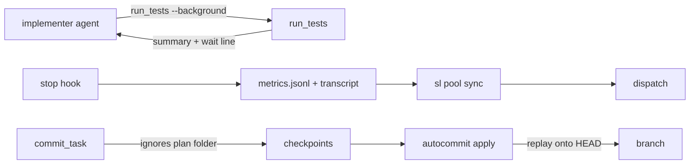
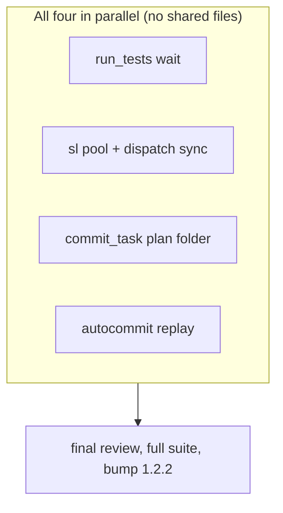

# Coordinator cost: review plan

## Summary
Four fixes that cut the coordinator's hand work during a superlite build: a test wait that cannot return another
agent's result (#14), an `sl pool` command that keeps the agent pool and its real context sizes so the coordinator
stops editing JSON by hand and stops evicting healthy agents (#13), and two refusals that forced hand-made commits
last time: the plan's sibling files blocking a checkpoint (#18) and `autocommit apply` refusing after HEAD moved (#17).

## What you will get
- `sl run_tests --background` prints the exact `--wait <path>` line; each agent waits on its own run only.
- `sl pool add|busy|free|list|sync`; `dispatch` syncs context and idle time from the agents' transcripts itself.
- `commit_task` never blocks on files in the plan's own folder (spec, report, progress next to the plan).
- `sl autocommit apply` replays the checkpoints onto a moved HEAD when the new commits touched none of their files.
- Tests for each, full suite green, version 1.2.2.

## What will be built
| Part | What it does (one sentence) | Size | Built by |
|---|---|---|---|
| run_tests wait by path | `--wait PATH` polls that summary file; bare `--wait` keeps the shared pointer; prompts updated | S | a careful helper |
| sl pool | add/busy/free/list/sync on pool.json; sync reads context_k and idle_min from metrics + transcripts; dispatch calls it | M | a careful helper |
| commit_task plan folder | files under the plan's directory are ignored like `.superlite/` unless a task owns them | S | a careful helper |
| autocommit replay | apply builds each task commit on the current HEAD from the checkpoint's own files; refuses only on a real overlap | M | a careful helper |

## How it fits together

## How it gets built

## Decisions you can change
- Wait target: `--wait <path>` copied from the printed line (default) | a pointer keyed by the test paths
- Context source: last assistant message usage of the agent transcript (default) | the metrics peak
- `busy` reset: cleared by `sync` when a stop record is newer than the `busy` call (default) | only by `free`
- Plan folder: ignored unless a task owns it (default) | always staged with the first checkpoint
- Replay rule: refuse only when the moved-to commits touched a checkpointed file (default) | always cherry-pick, last write wins

## Risks
- Agents may still type bare `--wait`: it then uses the shared pointer as today; the printed line makes copying easier than retyping.
- Transcript usage fields differ by harness version: `sync` keeps the old `context_k` when it finds none.
- Replay rewrites nothing: it only adds commits on top of HEAD; a refusal names the overlapping files.

## Out of scope
Issues #8, #10, #11, #12, #15, #16, #19; the 80k ceiling and the assign scoring.

## How we will know it works
- Two background fast runs started together: each `--wait <path>` returns its own result (test).
- `sl pool sync` on a fixture transcript sets `context_k` to the real number; `dispatch` no longer prints `evict ... context over 80k` for it.
- An untracked `docs/plans/x.spec.md` next to the plan: `commit_task T1` commits T1's files and prints no `out-of-scope`.
- A manual commit on an unrelated file after two checkpoints: `autocommit apply` makes two commits on top of it; a manual commit on a checkpointed file: refusal naming it.

## Rough time and cost
Four tasks in parallel, about 10 to 15 minutes wall clock, agents about $2, coordinator about $3 (rough until the machine plan is linted).
