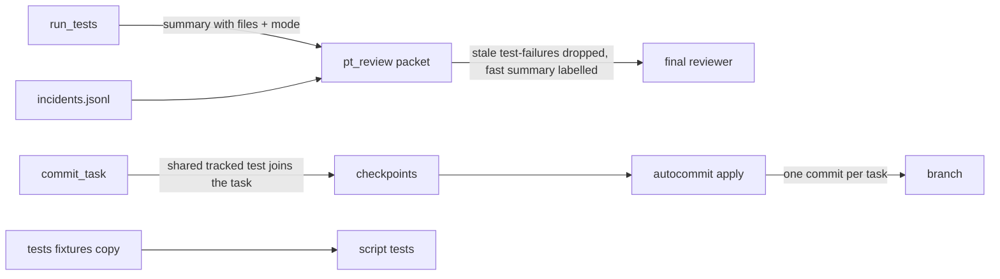
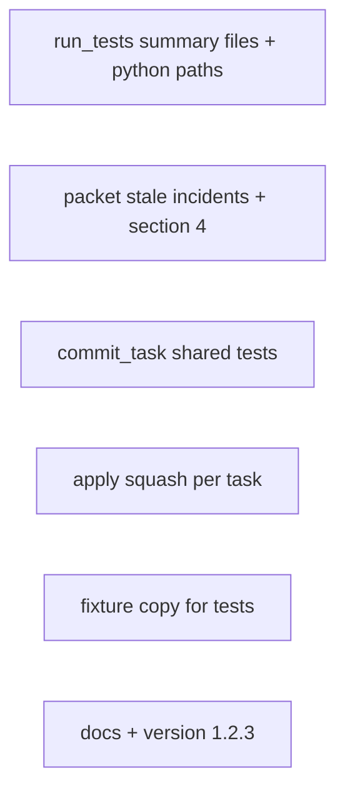

# Superlite 1.2.3: packet, commit and apply fixes

**Goal:** the final review packet stops reporting stale TDD-red incidents and a fast summary as the suite result, a Python full run never collects `bench/`, `commit_task` accepts a fixer's edit to a shared test, `autocommit apply` makes one commit per task, and script tests never read the checkout's live `.superlite`.
**Architecture:** five independent edits to the stdlib Python scripts under `skills/subagent-driven-development/scripts/` and the script tests, each with its own new pytest file under `tests/scripts/`, plus one docs-and-version task.
**Tech stack:** Python 3 stdlib only; pytest via `uv run --with pytest` (no project venv).
**Spec path:** docs/plans/2026-10-26-packet-commit-fixes.spec.md
**Detail:** contracts
**Target-min:** 11

Global constraints (copied from the repo):
- Every line of a script carries a trailing `# O(...)` complexity comment where the file already does (run_tests.py, testcmd.py, pt_review.py, commit_task.py); autocommit.py has none. LF line endings.
- Stdlib only; `subprocess` for git. Every write to `.superlite/*.json` is atomic (write `<name>.tmp`, then `replace`).
- Existing tests in `tests/scripts/` stay green; new tests go into the files named in `Owns`, run with `bash "$SL" run_tests --fast <file> --background` then the printed `wait:` line.
- New tests never read `tests/scripts/fixtures` by path of their own: they build tmp repos, or use helpers from `test_run_scripts.py` / `test_autocommit.py` (T5 redirects those to a copy).
- `skills/using-superlite/SKILL.md` and `skills/subagent-driven-development/SKILL.md` are not touched (size caps).
- Versions change only with `scripts/bump-version.sh 1.2.3`; `scripts/bump-version.sh --audit` must be clean.
- Test summary (`.superlite/test-summary*.json`): `{"passed","failed","skipped","seconds","mode":"fast|full","failures":["file::test: msg"],"skipped_tests":[...],"files":{"file":[passed,failed]}}`. Pointer `test-summary.latest`: `{"id","summary","started","mode"}`.
- Checkpoint state `.superlite/checkpoints.json`: `{"plan","run","head","branch","entries":[{"task","sha","title","files"}]}`, newest last; each entry's sha is a commit whose tree is cumulative.



## File structure

- `scripts/run_tests.py`, `scripts/testcmd.py`: per-file results in the summary, mode in the pointer, Python full-run paths (T1); tests `tests/scripts/test_run_tests_summary.py`.
- `scripts/pt_review.py`: stale incident filter, §4 label, wait on an older in-flight full run (T2); tests `tests/scripts/test_packet_stale.py`.
- `scripts/commit_task.py`: shared test edits (T3); tests `tests/scripts/test_commit_shared_test.py`.
- `scripts/autocommit.py`: squash per task, `--no-squash` (T4); tests `tests/scripts/test_autocommit_squash.py`.
- `tests/scripts/_fixtures.py` (new), `conftest.py` and the test modules that read fixtures (T5).
- `docs/tools.md`, version files (T6).

```mermaid
%% schedule
gantt
  title Predicted schedule (mm:ss)
  dateFormat X
  axisFormat %M:%S
  section lane 1
  T2 packet  stale test incidents  §4 labe :t2, 0, 341s
  section lane 2
  T1 run_tests  per-file summary  pointer  :t1, 0, 338s
  section lane 3
  T4 autocommit apply  one commit per task :t4, 0, 211s
  section lane 4
  T3 commit_task  a shared test edit joins :t3, 0, 204s
  section lane 5
  T5 script tests read a fixture copy  nev :t5, 0, 200s
  section lane 6
  T6 docs and version 1.2.3 :t6, 0, 181s
```





critical path: T2 (5.7 min) · peak width 6 · predicted build 5.7 min · predicted total ≈ 9.2 min (target ✓)

## Predicted schedule

(generated by `plan_tools prune` / `schedule --insert`)

## Section A: scripts

### T1 run_tests: per-file summary, pointer mode, Python full paths · Complexity 4 · Est. context 40k
**Owns:** skills/subagent-driven-development/scripts/run_tests.py, skills/subagent-driven-development/scripts/testcmd.py, tests/scripts/test_run_tests_summary.py
**Covers:** 1
**Components:** 2
**LOC owned:** 110
**Tests:** fast
**Model:** sonnet
**Est. time:** 3 min (2 components, about 110 LOC, fast tests)
**Consumes:** existing `run_tests.write_summary(path, mode, counts, failures, seconds, error=None)`, `run_tests.start_background(a, argv)`, `run_tests.finish_run(...)`, `run_tests.run(a)`, `testcmd.resolve(root, paths)`
**Produces:** testcmd.python_full_args(root: Path) -> list[str] (extra pytest args for a Python full run without configured testpaths) · run_tests.write_summary(path, mode, counts, failures, seconds, error=None, files=None) -> None (adds `"files": {file: [passed, failed]}`, `{}` when None) · run_tests.start_background(a, argv) -> int (pointer gains `"mode": "fast"` when `--fast` is in argv, else `"full"`)
e.g. `python_full_args(root with tests/ and bench/, no config)` -> `["tests"]`
e.g. `python_full_args(root with pytest.ini "[pytest]\ntestpaths = src")` -> `[]`; pyproject `[tool.pytest.ini_options]` with `testpaths = ["t"]` -> `[]`
e.g. `python_full_args(root with bench/ only)` -> `["--ignore=bench"]`; neither -> `[]`
e.g. summary after a full run of two files -> `"files": {"tests/test_a.py": [2, 0], "tests/test_b.py": [0, 1]}`
**Review Focus:** `test_full_run_skips_bench`: tmp project with `tests/test_ok.py` (1 pass) and `bench/tasks/x/hidden/test_bad.py` (import error), no config; `run_tests --full` exits 0, summary `passed 1, failed 0`; `test_configured_testpaths_win`: same tree plus `pytest.ini` with `testpaths = bench` -> the bench error is collected (exit 1); `test_summary_has_files`: fast run of one file with 1 pass, 1 fail -> `files == {"test_x.py": [1, 1]}` (key as `case_file` returns it); `test_pointer_records_mode`: `--fast f --background` writes pointer `mode: fast`, `--full --background` writes `mode: full` (wait on both with their `wait:` lines); `test_python_full_args_cases`: the four e.g. cases, plus setup.cfg `[tool:pytest]` and tox.ini `[pytest]` testpaths -> `[]`.
**Steps:** 1 failing tests, 2 run: FAIL, 3 implement, 4 run: PASS
**Notes:** apply `python_full_args(Path("."))` in `run()` only when `paths` is empty; a `.superlite/test-cmd.json` command is never changed. testpaths detection: a line matching `^\s*testpaths\s*=` inside the right section of the file (read with `configparser` for ini/cfg; for pyproject a regex over the `[tool.pytest.ini_options]` block is enough). `finish_run` passes `files` from `parse_junit`/`merge_junit`; the no-results and no-command paths write `files={}`. Update the module docstring's summary format.

### T2 packet: stale test incidents, §4 label, wait on older full run · Complexity 5 · Est. context 46k
**Owns:** skills/subagent-driven-development/scripts/pt_review.py, tests/scripts/test_packet_stale.py
**Covers:** 2
**Components:** 2
**LOC owned:** 120
**Tests:** fast
**Model:** sonnet
**Est. time:** 3 min (2 components, about 120 LOC, fast tests)
**Consumes:** existing `pt_review.read_incidents(path)`, `pt_review.incident_items(entries)`, `pt_review.read_test_summary(path)`, `pt_review.cmd_packet(a)`, `pt_review.build_parser()`; T1's summary `files` key and pointer `mode` key (formats in Global constraints)
**Produces:** pt_review.load_summary(path: Path) -> dict | None · pt_review.stale_test_failure(entry: dict, summary: dict | None) -> bool · pt_review.read_test_summary(path: Path) -> tuple[str, int] (fast mode labelled) · pt_review.wait_for_full(summary: Path, timeout: float, min_age: float = 5.0) -> None · `packet --wait-timeout S` (default 600)
e.g. `stale_test_failure({"kind": "test-failure", "file": "tests/a.py", "context": "test_x: AssertionError"}, {"files": {"tests/a.py": [3, 0]}, "failures": []})` -> `True`
e.g. same entry, summary `{"files": {"tests/a.py": [2, 1]}, "failures": ["tests/a.py::test_x: AssertionError"]}` -> `False`; failures naming `test_y` only -> `True`
e.g. entry context `"next_tasks fails; shared state"` (no `test_` token): files `[4, 0]` -> `True`, `[3, 1]` -> `False`; file absent from `files` -> `False`; `kind: "exception"` -> `False`; summary `None` or without `files` -> `False`
e.g. `read_test_summary(fast summary passed 16 failed 0)` -> (`"- full suite not run yet (it runs alongside this review); newest fast run:\n- passed 16 · failed 0 · skipped 0"`, 0)
**Review Focus:** `test_packet_drops_green_tdd_red_incidents`: tmp project with a minimal plan (write it in the test), incidents.jsonl holding three `test-failure` entries for `tests/a.py` tests that the summary shows green, and one `exception`; packet output lists the exception and none of the three; `test_packet_keeps_still_failing_incident`; `test_fast_summary_labelled_and_failures_count`: fast summary with 1 failure -> §4 has the label and `FAILING:`, header `REVIEW REQUIRED`; `test_full_summary_unchanged`: full summary -> §4 starts `- passed`; `test_packet_waits_for_older_full_run`: pointer `mode: full`, `started` 10 s ago, summary missing; a thread writes it after 1 s; packet (`--wait-timeout 5`) shows its counts; `test_packet_ignores_fresh_full_run`: `started` now -> no wait (returns under 1 s), §4 from `test-summary.json`; `test_wait_timeout_falls_back`: older pointer, never written, `--wait-timeout 1` -> packet still written, stderr says `timed out`.
**Steps:** 1 failing tests, 2 run: FAIL, 3 implement, 4 run: PASS
**Notes:** `cmd_packet` loads the summary once (after `wait_for_full`), filters `entries` with `stale_test_failure` before `incident_items` and `uncovered_items`, and prints `dropped N stale test-failure incident(s)` in the packet's §1 when N > 0. `wait_for_full` reads the pointer `<summary stem>.latest` next to the summary path; it waits only when `mode == "full"`, the pointed summary file is missing and `time.time() - started >= min_age`; poll every 0.5 s. Test name = first match of `\btest_\w+` in the context; a failure matches when it starts with `f"{file}::{name}"`.

### T3 commit_task: a shared test edit joins the task · Complexity 3 · Est. context 36k
**Owns:** skills/subagent-driven-development/scripts/commit_task.py, tests/scripts/test_commit_shared_test.py
**Covers:** 3
**Components:** 1
**LOC owned:** 70
**Tests:** fast
**Model:** sonnet
**Est. time:** 2.5 min (1 component, about 70 LOC, fast tests)
**Consumes:** existing `commit_task.changed_files(skip_prefix="")`, `commit_task.commit_one(a, tid, info, own_files)`, `commit_task.log_incidents(log, task, items)`, `next_tasks.add_incidents(log, items)`
**Produces:** commit_task.changed_entries(skip_prefix: str = "") -> list[tuple[str, str]] (sorted `(path, XY)` from porcelain status; `changed_files` returns its paths) · commit_task.shared_test(path: str, code: str) -> bool (tracked, modified, under a `tests/` folder)
e.g. `shared_test("tests/scripts/test_a.py", " M")` -> `True`; `"M "` and `"MM"` -> `True`
e.g. `shared_test("tests/x.py", "??")` -> `False`; `"A "` -> `False`; `" D"` -> `False`; `shared_test("src/a.py", " M")` -> `False`; `shared_test("pkg/tests/t.py", " M")` -> `True`
**Review Focus:** `test_modified_shared_test_joins_task`: repo with the fixture plan (via `test_run_scripts.make_repo`), a committed `tests/test_shared.py` no task owns, T1's owned file changed and the shared test modified; `commit_task T1` exits 0, prints the sha, the checkpoint holds both files, stderr has `shared-test tests/test_shared.py`, incidents.jsonl has a `workaround` entry `T1: shared test adjusted` with resolution `accepted`; `test_new_unowned_test_still_blocks`: an untracked `tests/test_new.py` -> `out-of-scope`, exit 1; `test_deleted_shared_test_still_blocks`; `test_unowned_source_still_blocks`: modified tracked `src/other.py` -> exit 1; `test_shared_test_cases`: the e.g. cases.
**Steps:** 1 failing tests, 2 run: FAIL, 3 implement, 4 run: PASS
**Notes:** the check runs only for files that would be `out_of_scope` (owned and other-task files keep today's path; T0 never takes shared tests). Incident via `nt.add_incidents(log, [(f, 0, f"{tid}: shared test adjusted", "workaround", "commit_task", "accepted")])`. Update the module docstring's scope rules.

### T4 autocommit apply: one commit per task · Complexity 5 · Est. context 40k
**Owns:** skills/subagent-driven-development/scripts/autocommit.py, tests/scripts/test_autocommit_squash.py
**Covers:** 4
**Components:** 1
**LOC owned:** 90
**Tests:** fast
**Model:** sonnet
**Est. time:** 2.5 min (1 component, about 90 LOC, fast tests)
**Consumes:** existing `autocommit.load_state()`, `autocommit.replay_tree(parent, entry)`, `autocommit.apply()`, `autocommit.main(argv)`; test helpers `make_repo`, `checkpoint`, `write`, `git` from `tests/scripts/test_autocommit.py`
**Produces:** autocommit.squash_entries(entries: list[dict]) -> list[dict] (one entry per task in first-seen order: newest sha, first title, union of files in first-seen order) · autocommit.apply(squash: bool = True) -> int · `autocommit.py apply [--no-squash]`
e.g. `squash_entries([{"task": "T1", "sha": "a", "title": "T1: p", "files": ["x"]}, {"task": "T2", "sha": "b", "title": "T2: l", "files": ["y"]}, {"task": "T1", "sha": "c", "title": "T1: p", "files": ["x", "z"]}])` -> `[{"task": "T1", "sha": "c", "title": "T1: p", "files": ["x", "z"]}, {"task": "T2", "sha": "b", "title": "T2: l", "files": ["y"]}]`
e.g. `squash_entries([])` -> `[]`; no repeated task -> the same entries
**Review Focus:** `test_apply_squashes_repeated_task`: checkpoints T1 (a.py), T2 (b.py), T1 again (a.py changed, c.py new); `apply` exits 0, `git log --format=%s base..HEAD` is `T2: ...`, `T1: ...` (two commits), T1's commit holds a.py at its newest content and c.py, the final tree equals the last checkpoint's tree, refs are gone; `test_no_squash_keeps_each_checkpoint`: same with `apply --no-squash` -> three commits; `test_squash_falls_back_on_interleave`: T1 edits s.py, T2 edits s.py, T1 edits a.py -> squash would change s.py; `apply` makes three commits and stdout says `squash skipped: tasks interleave on s.py`; `test_squash_on_moved_head`: a manual README commit after the checkpoints, repeated T1 -> two task commits on top of the README commit; `test_squash_entries_cases`: the e.g. cases.
**Steps:** 1 failing tests, 2 run: FAIL, 3 implement, 4 run: PASS
**Notes:** build squashed commits with `replay_tree(parent, group)` from the start head; compare the result's tree with the unsquashed result (unmoved HEAD: the last entry's `sha^{tree}`; moved: the replay chain of all entries); on a difference use the unsquashed chain. Interleave file for the message: the first file whose blob differs between the two trees (`git diff --name-only`). When no task repeats keep today's exact path. `main` passes `squash="--no-squash" not in argv[1:]`; the printed list shows the commits actually made.

### T5 script tests read a fixture copy, never the live .superlite · Complexity 3 · Est. context 38k
**Owns:** tests/scripts/_fixtures.py, tests/scripts/conftest.py, tests/scripts/test_fixture_isolation.py, tests/scripts/test_0_3_1_scripts.py, tests/scripts/test_autocommit.py, tests/scripts/test_probe_run.py, tests/scripts/test_metrics_history.py, tests/scripts/test_pt_review.py, tests/scripts/test_pt_review_declarations.py, tests/scripts/test_run_scripts.py, tests/scripts/test_spawn_free.py, tests/scripts/test_plan_tools.py, tests/scripts/test_pool.py
**Covers:** 5
**Components:** 1
**LOC owned:** 60
**Tests:** fast
**Model:** sonnet
**Est. time:** 2.5 min (1 component, about 60 LOC, fast tests)
**Consumes:** existing `state.plan_dir(plan_or_dir)`
**Produces:** `_fixtures.FIXTURES: Path` (a copy of `tests/scripts/fixtures`, made once per process with `shutil.copytree` into `tempfile.mkdtemp()`, removed at exit; never inside a git repository)
e.g. `state.plan_dir(_fixtures.FIXTURES / "run_plan" / "plan.md")` -> `_fixtures.FIXTURES / "run_plan" / ".superlite"`
**Review Focus:** `test_fixture_copy_is_outside_git`: `git -C FIXTURES rev-parse` fails and FIXTURES is not under the repo root; `test_fixture_plan_resolves_to_copy`: the e.g. case; `test_no_module_reads_live_fixtures`: a grep over `tests/scripts/test_*.py` finds no `/ "fixtures"` path built from `__file__` or `HERE` (only `_fixtures`); `test_fake_sl_keeps_exec_bit`: `FIXTURES/run_plan/fake_sl` is executable. The full `tests/scripts` suite stays green.
**Steps:** 1 failing tests, 2 run: FAIL, 3 switch every module's fixture constant to `from _fixtures import FIXTURES`, 4 run the whole `tests/scripts`: PASS
**Notes:** if `TMPDIR` lies inside a git repo, fall back to `/tmp` (or `tempfile.gettempdir()` checked with `git rev-parse`). Keep `conftest.py`'s existing fixture; it may import `_fixtures` so the copy is made before collection. `test_spawn_free.py` already copies to tmp_path: just switch its source constant.

### T6 docs and version 1.2.3 · Complexity 1 · Est. context 22k
**Owns:** docs/tools.md, package.json, .hermes-plugin/plugin.yaml, .claude-plugin/plugin.json, .cursor-plugin/plugin.json, .codex-plugin/plugin.json, .devin-plugin/plugin.json, .kimi-plugin/plugin.json, .muse-plugin/plugin.json, .claude-plugin/marketplace.json, .muse-plugin/marketplace.json, gemini-extension.json
**Covers:** Validation
**Kind:** mechanical
**Components:** 1
**LOC owned:** 12
**Tests:** fast
**Model:** haiku
**Est. time:** 1.5 min (1 component, about 12 LOC, fast tests)
**Consumes:** none
**Produces:** none
**Review Focus:** `scripts/bump-version.sh 1.2.3` run, then `scripts/bump-version.sh --audit` prints no missed file; `docs/tools.md`: the `commit_task` row adds "a modified, tracked test under `tests/` that no task owns joins the task (logged)"; the `autocommit` row says "`apply` makes one commit per task (`--no-squash`: one per checkpoint)"; the `pt_review` row adds "the packet drops `test-failure` incidents the newest summary shows green and labels a fast summary `full suite not run yet`"; the `testcmd` row adds "a Python full run without testpaths runs `tests/` (else ignores `bench/`)".
**Test code (verbatim):**
```bash
scripts/bump-version.sh --audit                      # expect: exit 0, no file listed
grep -c '"version": "1.2.3"' package.json            # expect: 1
grep -c 'no-squash' docs/tools.md                    # expect: 1
grep -c 'full suite not run yet' docs/tools.md       # expect: 1
grep -c 'joins the task' docs/tools.md               # expect: 1
grep -c 'ignores `bench/`' docs/tools.md             # expect: 1
```
**Steps:** 1 bump, 2 audit, 3 edit the four rows, 4 run the test code above: every line as expected, then `bash "$SL" run_tests --fast tests/scripts/test_orchestrator.py --background` and its `wait:` line: PASS
**Notes:** change nothing in the version files by hand; the bump script writes them.

## Review Focus

Package A (CLI scripts): protocol (stdout/stderr lines, exit codes, `--no-squash`, `--wait-timeout`), file (summary and pointer JSON, checkpoints), state (stale incidents vs newest summary, squash vs final tree). Specific risks: a packet that drops a still-failing incident; a wait that blocks the coordinator's parallel full run; a squash that silently changes the final tree; a shared-test rule that takes a new or deleted file; a fixture copy that lands inside a git repository. All cases are named tests in the tasks above.

## Self-review

Coverage: spec 1 (T1), 2 (T2), 3 (T3), 4 (T4), 5 (T5), Validation (T6). No placeholders. Consumes name only existing functions or T1's documented formats (examples given). No edges: no task's tests run another task's new code. No two tasks share a file (T3 and T4 tests import helpers from T5-owned modules without editing them). Every task has Components, LOC owned, Tests, Model.
