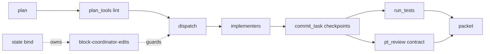
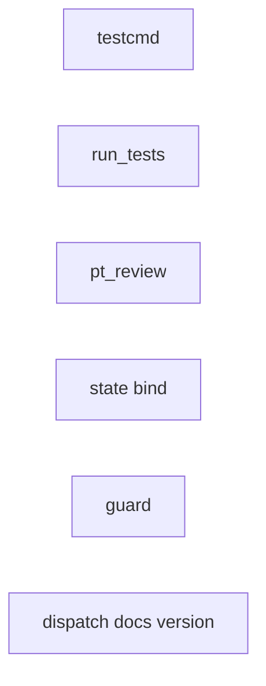

# Superlite 1.2.1: session friction fixes

**Goal:** the checkers around a build stop producing false alarms on Swift packages, git worktrees and checkpoint mode: sidecar JUnit reports are counted, non-Python Produces lines are checked by declaration, the packet diffs against the newest checkpoint, the build session takes over the planning session's `.superlite`, the coordinator guard judges directory targets and `sys.argv` writers correctly, and a `skip T0` ruling silences dispatch.
**Architecture:** six independent edits to the stdlib Python scripts under `skills/subagent-driven-development/scripts/` and one bash hook under `hooks/`, each with its own pytest file under `tests/scripts/`.
**Tech stack:** Python 3 stdlib only; bash builtins only in hooks; pytest via `uv run --with pytest` (no project venv).
**Spec path:** docs/plans/2026-10-26-session-friction.spec.md
**Detail:** contracts
**Target-min:** 11

Global constraints (copied from the repo):
- Every line of a script carries a trailing `# O(...)` complexity comment, as the existing lines do; hooks use bash builtins only, exit 0 on malformed input (fail open), exit 2 to block, LF line endings.
- Stdlib only; `subprocess` for git. Never spawn in the hook scripts.
- Existing tests in `tests/scripts/` stay green; new tests go into the new files named in `Owns`, run with `bash "$SL" run_tests --fast <file> --background` then `--wait` (pytest resolves through `uv run --with pytest` when the system Python lacks it).
- Versions change only with `scripts/bump-version.sh 1.2.1`; `scripts/bump-version.sh --audit` must be clean.
- Checkpoint state: `.superlite/checkpoints.json` is `{"plan","run","head","branch","entries":[{"task","sha","title","files"}]}`; the newest entry is the last.

## File structure

- `skills/subagent-driven-development/scripts/testcmd.py`: resolve the test command (T1).
- `skills/subagent-driven-development/scripts/run_tests.py`: run it, parse JUnit, write the summary (T2).
- `skills/subagent-driven-development/scripts/pt_review.py`: contract check and review packet (T3).
- `skills/subagent-driven-development/scripts/state.py`, `orchestrator.py`: session binding (T4).
- `hooks/block-coordinator-edits`: the coordinator write guard (T5).
- `skills/subagent-driven-development/scripts/dispatch.py`: ready tasks and the Wave 0 line (T6).

```mermaid
%% schedule
gantt
  title Predicted schedule (mm:ss)
  dateFormat X
  axisFormat %M:%S
  section lane 1
  T3 pt_review  declaration contract  chec :t3, 0, 372s
  section lane 2
  T6 dispatch skip T0  docs  version 1.2.1 :t6, 0, 353s
  section lane 3
  T4 state  own-project session takes over :t4, 0, 350s
  section lane 4
  T1 testcmd  Swift detection  names  work :t1, 0, 253s
  section lane 5
  T2 run_tests  sidecar JUnit merge  ANSI- :t2, 0, 249s
  section lane 6
  T5 guard  dir targets and argv writers :t5, 0, 249s
```

- `tests/scripts/test_<topic>.py`: one new test file per task, plus the existing `test_testcmd.py` and `test_block_coordinator_edits.py`.

critical path: T3 (6.2 min) · peak width 6 · predicted build 6.2 min · predicted total ≈ 9.7 min (target ✓)

## Predicted schedule

## Section A: scripts and hook

**Probe entry:** none (Python CLIs and a bash hook, tested through pytest; cases are named tests).
App type: CLI. Categories: protocol, file, state. Risks: a sidecar report counted twice; a declaration regex matching a comment; a takeover that breaks two sessions from one checkout; a guard rule that loosens an existing block case.

### T1 testcmd: Swift detection, names, worktree fallback · Complexity 3 · Est. context 32k
**Owns:** skills/subagent-driven-development/scripts/testcmd.py, tests/scripts/test_testcmd.py
**Covers:** 1
**Components:** 1
**LOC owned:** 70
**Tests:** fast
**Model:** sonnet
**Est. time:** 3 min (1 component, about 70 LOC, fast tests)
**Consumes:** existing `testcmd.detect(root)`, `testcmd.read_config(root)`, `testcmd.resolve(root, paths)`
**Produces:** testcmd.names_filter(paths: list[str]) -> str · testcmd.main_checkout_config(root: Path) -> dict | None · testcmd.detect(root: Path) -> dict | None (Package.swift after Cargo.toml, before csproj) · testcmd.resolve(root, paths) (also replaces `{names}` with names_filter(paths))
e.g. `names_filter(["Tests/PixKitTests/NotificationModelTests.swift", "Tests/X/PushPayloadTests.swift"])` -> `"NotificationModelTests|PushPayloadTests"`
e.g. `detect(root with Package.swift)` -> `{"language": "swift", "test": "swift test --xunit-output {junit}", "test_file": "swift test --xunit-output {junit} --filter {names}", "junit": "{junit}", "setup": ""}`
e.g. `read_config(worktree without .superlite/test-cmd.json)` -> the dict from `<git common dir parent>/.superlite/test-cmd.json`; main checkout without one -> `None`; outside git -> `None`
**Review Focus:** `test_swift_package_detected`: a root with only `Package.swift` resolves to the swift dict above; `test_names_placeholder_builds_filter`: `resolve(root, ["Tests/A/FooTests.swift"])` with that config gives `swift test --xunit-output {junit} --filter FooTests`; `test_worktree_falls_back_to_main_checkout_config`: a real `git worktree add` under a tmp repo whose main `.superlite/test-cmd.json` says `{"language":"x","test":"echo x"}` resolves `source == "test-cmd.json"` and `command == "echo x"` from the worktree; `test_main_checkout_without_config_is_none`: the same repo without the file falls through to markers; `test_marker_detection_table` (existing) keeps every row.
**Steps:** 1 failing tests, 2 run: FAIL, 3 implement, 4 run: PASS
**Notes:** the fallback uses `git -C root rev-parse --git-common-dir` (stdlib subprocess, 10 s timeout); a result equal to `root/.git` means the main checkout, so no fallback.

### T2 run_tests: sidecar JUnit merge, ANSI-free log · Complexity 3 · Est. context 34k
**Owns:** skills/subagent-driven-development/scripts/run_tests.py, tests/scripts/test_run_tests_sidecars.py
**Covers:** 1
**Components:** 1
**LOC owned:** 60
**Tests:** fast
**Model:** sonnet
**Est. time:** 3 min (1 component, about 60 LOC, fast tests)
**Consumes:** existing `run_tests.parse_junit(xml_path)`, `run_tests.run_other(a, spec, paths, label)`, `testcmd.parse_output(text, rc)`
**Produces:** run_tests.junit_reports(xml_path: Path, literal: Path | None) -> list[Path] · run_tests.merge_junit(paths: list[Path]) -> tuple[dict, list, dict] · run_tests.strip_ansi(text: str) -> str
e.g. `junit_reports(tmp/junit.xml, None)` with `tmp/junit.xml` (1 byte) and `tmp/junit-swift-testing.xml` (non-empty) -> `[tmp/junit-swift-testing.xml, tmp/junit.xml]` (sorted, empty files dropped)
e.g. `merge_junit([a.xml with 1 passed, b.xml with 2 passed 1 failed])` -> counts `{"passed": 3, "failed": 1, "skipped": 0, ...}`; a file that is not XML is skipped
e.g. `strip_ansi("\x1b[0;36m7 |\x1b[0;0m x")` -> `"7 | x"`
**Review Focus:** `test_sidecar_junit_counted`: a runner that copies `sample-junit.xml` to `{junit}` (1 case) and writes `{junit stem}-swift-testing.xml` with 3 cases gives summary `passed 4`; `test_unparseable_sidecar_is_ignored`: a sidecar holding `not xml` leaves the count at the main report's; `test_log_has_no_ansi_escapes`: a runner without JUnit that prints `\x1b[1;33mwarning\x1b[0m` and exits 1 leaves no `\x1b` in `.superlite/test-output.log` nor in `failures`.
**Steps:** 1 failing tests, 2 run: FAIL, 3 implement, 4 run: PASS
**Notes:** `run_other` replaces its single `report` with `junit_reports` + `merge_junit`; the fallback branch strips ANSI from `text` before `parse_output`.

### T3 pt_review: declaration contract, checkpoint diff · Complexity 5 · Est. context 46k
**Owns:** skills/subagent-driven-development/scripts/pt_review.py, tests/scripts/test_pt_review_declarations.py, tests/scripts/fixtures/review_swift/plan.md, tests/scripts/fixtures/review_swift/Sources/Kit/Notifications.swift, tests/scripts/fixtures/review_swift/Sources/Kit/Client.swift
**Covers:** 2, 3
**Components:** 2
**LOC owned:** 130
**Tests:** fast
**Model:** sonnet
**Est. time:** 4.5 min (2 components, about 130 LOC, fast tests)
**Consumes:** existing `pt_review.check_interfaces(plan, root, task_ids)`, `pt_review.locate`, `pt_review.compare_sig(p, real)`, `pt_review.git_diff_stat(root, base)`, `pt_review.source_excerpts(root, base, files)`, `autocommit.STATE`
**Produces:** pt_review.DECL_PATTERNS: dict[str, str] · pt_review.find_declaration(root: Path, files: list[str], name: str) -> tuple[str, int] | None · pt_review.diff_head(root: Path) -> str | None · pt_review.check_interfaces(plan, root, task_ids) -> tuple[list[Mismatch], int] (declaration path for producers without Python sources)
e.g. `find_declaration(root, ["Sources/Kit/Notifications.swift"], "NotificationPreferences")` with `public struct NotificationPreferences: Sendable {` on line 47 -> `("Sources/Kit/Notifications.swift", 47)`; a name only inside a `// comment` or a string -> `None`
e.g. `check_interfaces(plan, root, ["T1"])` where T1 owns the Swift file and Produces `NotificationPreferences.level(for: NotificationCategory) -> NotificationLevel` -> `([], 1)`; Produces `Missing.thing() -> Int` -> one `Mismatch(1, "Sources/Kit/Notifications.swift", 1, "T1 Produces: `Missing` not declared in Sources/Kit/Notifications.swift")`
e.g. `diff_head(root)` with checkpoints entries `[{"sha": "a1"}, {"sha": "b2"}]` -> `"b2"`; no checkpoints file -> `None`
**Review Focus:** `test_swift_produces_declared_is_verified`: the swift fixture's contract run logs a `verified` entry and prints `part1: ... checked by declaration`; `test_swift_produces_missing_is_mismatch`: an undeclared Produces becomes exactly one `MISMATCH part1` line naming the symbol; `test_declaration_ignores_comments_and_strings`; `test_python_fixture_unchanged`: `review_basic` still introspects (the existing param-order mismatch test passes untouched); `test_diff_uses_newest_checkpoint_sha`: a tmp git repo with a committed base, an untracked `new.py` committed only on `refs/superlite/r/T1` and listed in `checkpoints.json`, gives a packet diff stat that names `new.py`; `test_diff_without_checkpoints_uses_working_tree`.
**Steps:** 1 failing tests, 2 run: FAIL, 3 implement, 4 run: PASS
**Notes:** DECL_PATTERNS keys are extensions; `.swift`: `(struct|class|enum|actor|protocol|func|typealias|let|var)\s+{name}\b`; `.ts .tsx .js .mjs .jsx`: `(class|function|interface|type|enum|const|let|var)\s+{name}\b`; `.go`: `(func(\s*\([^)]*\))?|type|var|const)\s+{name}\b`; `.rs`: `(fn|struct|enum|trait|type|const|static|mod)\s+{name}\b`; `.kt .java .cs .rb .php`: `(class|interface|enum|fun|func|def|function|struct|record|trait)\s+{name}\b`. Lines whose first non-blank characters are `//`, `#` or `*` are skipped. A declared-only real is `{"ok": True, "declared": True, "file": ..., "line": ...}` and `compare_sig` returns `[]` for it. Test files (TEST_PATH_RE or a `Tests/` component) are not searched. `git_diff_stat` and `source_excerpts` take the right side from `diff_head`.

### T4 state: own-project session takes over · Complexity 4 · Est. context 40k
**Owns:** skills/subagent-driven-development/scripts/state.py, skills/subagent-driven-development/scripts/orchestrator.py, tests/scripts/test_session_handover.py
**Covers:** 4
**Components:** 2
**LOC owned:** 70
**Tests:** fast
**Model:** sonnet
**Est. time:** 3.5 min (2 components, about 70 LOC, fast tests)
**Consumes:** existing `state.bind(sd, sid, force)`, `state.live_owner(sd, sid)`, `state._binding(sid)`, `state._abs(path)`, `orchestrator.sl_dir(plan_or_dir)`
**Produces:** state.launch_dir() -> Path · state.owner_launch_dir(sid: str) -> Path | None · state.own_project(sd: Path) -> bool · state.bind(sd, sid=None, force=False) -> str | None (takeover rule) · orchestrator `bind` without `--plan` targets `launch_dir()/.superlite`
e.g. `launch_dir()` with `CLAUDE_PROJECT_DIR=/w` -> `/w`; unset, `PWD=/w/sub` -> `/w/sub`
e.g. `bind(wa/.superlite, "B")` when A (launched in `main`) owns it -> `"B"`, `owner(wa/.superlite) == "B"`, `bound("A") is None`
e.g. `bind(main/.superlite, "B")` when A (launched in `main`) owns it and B is launched in `main` -> raises `Owned`
e.g. binding file lines -> `[path, pid or "", launch dir]`; `owner_launch_dir("A")` -> that third line as a Path, `None` for a two-line binding
**Review Focus:** `test_build_session_in_worktree_takes_over_plan_sessions_binding`: A runs `set ai --plan wa/docs/superpowers/plans/p.md` from `main`; B launched in `wa` runs `set ai` with no plan and owns `wa/.superlite`; `test_two_sessions_from_one_launch_dir_still_never_share` (A and B both launched in `main`: B's `set human` is refused for `main/.superlite` and lands in B's private folder, as the existing test_session_state cases require); `test_old_binding_without_launch_dir_needs_force`; `test_bind_without_plan_targets_launch_dir`: B in `wa` runs `bind` and the output names `wa/.superlite`, not `sessions/B.d`; `test_force_still_takes_over_from_elsewhere`.
**Steps:** 1 failing tests, 2 run: FAIL, 3 implement, 4 run: PASS
**Notes:** the launch directory is `CLAUDE_PROJECT_DIR`, else the logical `PWD` through `_abs`; a takeover leaves the old owner's binding file in place (`bound()` already yields `None` for it) and `_move_gate` keeps its current rule. `hooks/superlite-state.sh` needs no change: after the takeover the folder's `session` file names the new session.

### T5 guard: dir targets and argv writers · Complexity 4 · Est. context 38k
**Owns:** hooks/block-coordinator-edits, tests/scripts/test_block_coordinator_edits.py
**Covers:** 5
**Components:** 1
**LOC owned:** 60
**Tests:** fast
**Model:** sonnet
**Est. time:** 3 min (1 component, about 60 LOC, fast tests)
**Consumes:** existing functions in the hook: `project_code PATH`, `writer_target EXPR`, the `cp|mv|tee` case
**Produces:** hook rule: `cp`, `mv` and `tee` whose target ends with `/`, is `.`, or is an existing directory are judged by `<dir>/<basename of the first source>` · hook rule: `writer_target` resolves `sys.argv[N]` (also `argv[N]` after `from sys import argv`) to the N-th positional argument after the script spec (`-`, a path, or `-c CODE`) of the interpreter command, a `$VAR`/`"$VAR"` argument through exactly one `VAR=literal` assignment in the command; unresolvable stays unknown
e.g. `cp ../../.superlite/test-cmd.json .superlite/` -> exit 0; `cp /tmp/x.py src/` -> exit 2; `mv a.txt .superlite/` -> exit 0
e.g. `P=docs/plans/p.md; python3 - "$P" <<'EOF'\nimport sys\np=sys.argv[1]\nopen(p,'w').write('x')\nEOF` -> exit 0; `python3 - src/a.py <<'EOF'\nimport sys\nopen(sys.argv[1],'w').write('x')\nEOF` -> exit 2; `python3 - <<'EOF'\nimport sys\nopen(sys.argv[1], 'w').write('x')\nEOF` -> exit 2 (unchanged existing case)
**Review Focus:** `test_cp_into_state_dir_allowed`, `test_cp_into_source_dir_blocked`, `test_mv_into_existing_source_dir_blocked` (the dir exists, no trailing slash), `test_argv_target_through_variable_allowed`, `test_argv_target_to_source_blocked`, `test_argv_without_argument_still_blocks`; every existing parametrized case in `test_blocks_bash_writes`, `test_allows_bash_reads_and_safe_writes`, `test_allows_interpreter_writes_to_allowed_targets`, `test_blocks_interpreter_writes_with_project_or_unknown_targets` keeps its verdict, and `test_typical_allowed_call_is_fast` stays under its bound.
**Steps:** 1 failing tests, 2 run: FAIL, 3 implement, 4 run: PASS
**Notes:** bash builtins only (`[[ -d ]]` is a builtin); the positional arguments are taken from the stripped command segment that starts with the interpreter, after dropping `-` flags except `-c CODE`, whose CODE is skipped as one argument.

### T6 dispatch skip T0, docs, version 1.2.1 · Complexity 3 · Est. context 36k
**Owns:** skills/subagent-driven-development/scripts/dispatch.py, tests/scripts/test_dispatch_skip.py, skills/subagent-driven-development/SKILL.md, skills/subagent-driven-development/orchestrator.md, docs/hooks.md, docs/language.md, docs/tools.md, package.json, .hermes-plugin/plugin.yaml, .claude-plugin/plugin.json, .cursor-plugin/plugin.json, .codex-plugin/plugin.json, .devin-plugin/plugin.json, .kimi-plugin/plugin.json, .muse-plugin/plugin.json, .claude-plugin/marketplace.json, .muse-plugin/marketplace.json, gemini-extension.json
**Covers:** 6, 7
**Components:** 2
**LOC owned:** 80
**Tests:** fast
**Model:** sonnet
**Est. time:** 3.5 min (2 components, about 80 LOC, fast tests)
**Consumes:** existing `dispatch.run(plan, pool_path, ledger, committed, running, cap)`, `wave0.synth_info(plan)`
**Produces:** dispatch.skip_t0(ledger: str | Path) -> bool · dispatch.run(...) (no `T0` line when skip_t0)
e.g. `skip_t0(ledger with "- Ruling: skip T0 - plan rules no Wave 0 - cost: none")` -> `True`; ledger without such a line -> `False`; missing file -> `False`
**Review Focus:** `test_t0_omitted_after_skip_ruling`: a plan with a synthesized wave0 (`briefs/wave0.json` present) and the ruling in `progress.md` prints no `T0` line and keeps the other lines; `test_t0_offered_without_ruling`; docs: the SKILL.md Setup bullet says `Ruling: skip T0 ...` silences the line; `orchestrator.md` bind text says a session launched in the folder's project takes it over when the owner was launched elsewhere; `docs/hooks.md` sentence on takeover updated; `docs/language.md` gets a Swift paragraph (Package.swift detected, `--filter` from file basenames, `-swift-testing.xml` sidecar counted, no test-cmd.json needed, worktree fallback); `docs/tools.md` lists `{names}` and the guard's directory and argv rules; `scripts/bump-version.sh 1.2.1` run, `scripts/bump-version.sh --audit` prints nothing missed.
**Steps:** 1 failing tests, 2 run: FAIL, 3 implement, 4 docs and bump, 5 run: PASS
**Notes:** keep `skills/using-superlite/SKILL.md` under 1,500 characters (do not touch it); the docs describe the behaviour as this plan specifies it.

## Review Focus

Package A (CLI scripts and hook): protocol (CLI output lines and exit codes), file (JUnit sidecars, bindings, checkpoints), state (ownership takeover). Specific risks: double counting a sidecar; a regex matching a declaration inside a comment; takeover between two sessions launched in the same directory; a loosened guard case. All cases are named tests in the tasks above.

## Self-review

Coverage: spec 1 (T1, T2), 2 and 3 (T3), 4 (T4), 5 (T5), 6 and 7 (T6). No placeholders. Consumes name only existing functions. No edges: no task's tests run another task's new code. No two tasks share a file. Every task has Components, LOC owned, Tests, Model.
