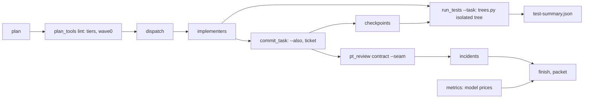
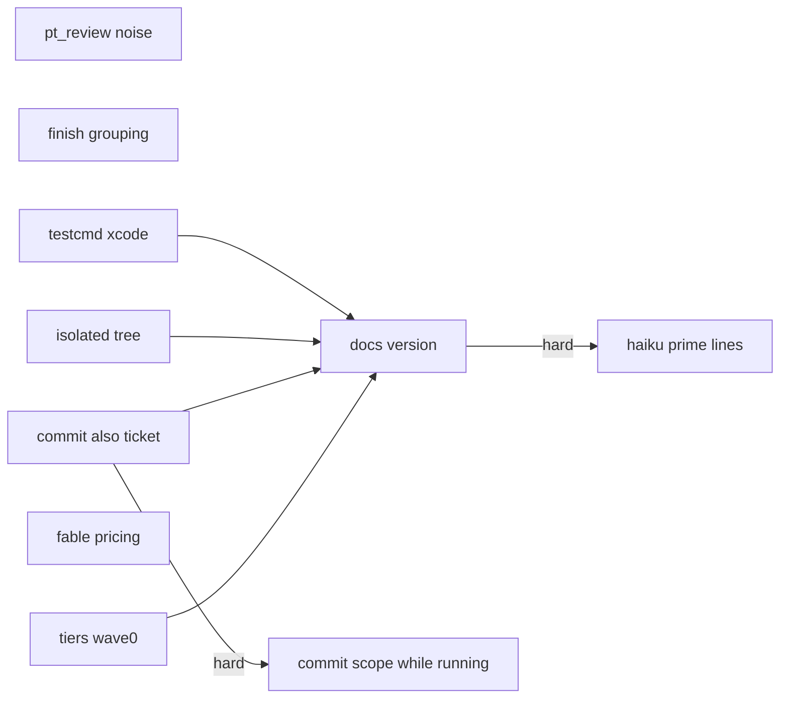

# Superlite 1.2.5: field report fixes (pix-app PIX-1277)

**Goal:** a Swift/Xcode run produces no checker noise and real test data, parallel agents stop breaking each other's compiles, and the coordinator spends fewer tokens: one Produces parser, xcodebuild-aware test runs in an isolated tree per task, the prime as a file pointer, `commit_task --also`, an absolute `sl` path in briefs, Fable pricing, tier reasons, a `Wave0: none` header and a ticket key in commits.
**Architecture:** independent edits to the stdlib Python scripts under `skills/subagent-driven-development/scripts/`, one new module `trees.py`, and one docs task; each script task has its own pytest file under `tests/scripts/`.
**Tech stack:** Python 3 stdlib only; pytest via `uv run --with pytest` (no project venv).
**Issues:** #30 #31 #32 #33 #34 #35 #36 #37 (source: the pix-app field report, 2026-10-27)
**Detail:** contracts
**Target-min:** 11
**Wave0:** none

Global constraints:
- Every script line carries a trailing `# O(...)` complexity comment, as the existing lines do. Stdlib only; `subprocess` for git. CLI contract: results on stdout, notes and errors on stderr, exit 0 ok, 1 check failed, 2 usage error.
- Existing tests in `tests/scripts/` stay green; new tests go into the files named in `Owns`. Verify with the command in your brief (`run_tests --fast <file> --background`, then its `wait:` line).
- Checkpoint state: `.superlite/checkpoints.json` is `{"plan","run","head","branch","entries":[{"task","sha","title","files"}]}`; the newest entry is the last.
- Plan header fields are `**Name:** value` lines before the first `## ` heading.
- Versions change only through `scripts/bump-version.sh 1.2.5`; `scripts/bump-version.sh --audit` must print nothing missed.

## File structure

- `scripts/pt_review.py`: contract check, adapter, packet (T1).
- `scripts/finish.py`: run summary, open incidents (T2).
- `scripts/testcmd.py`: resolve the test command, parse runner output (T3).
- `scripts/trees.py` (new), `scripts/run_tests.py`: isolated per-task test tree (T4).
- `scripts/commit_task.py`, `scripts/autocommit.py`: `--also`, ticket key (T5).
- `scripts/metrics.py`, `config/models.json`: model families and prices (T6).
- `scripts/plan_tools.py`, `scripts/routing.py`, `scripts/dispatch.py`: tier reasons, `Wave0: none` (T7).
- Skills, agents, docs, `scripts/wave0.py`, version files (T8).
(`scripts/` = `skills/subagent-driven-development/scripts/`.)

```mermaid
%% schedule
gantt
  title Predicted schedule (mm:ss)
  dateFormat X
  axisFormat %M:%S
  section lane 1
  T4 isolated test tree per task for compi :t4, 0, 354s
  T8 docs  prime pointer  absolute sl path :t8, 354, 338s
  section lane 2
  T1 pt_review  one Produces parser  membe :t1, 0, 343s
  section lane 3
  T3 testcmd  xcodebuild  Swift Testing an :t3, 0, 336s
  section lane 4
  T5 commit_task --also  ticket key in com :t5, 0, 334s
  section lane 5
  T7 lint  tier reasons  Wave0 none header :t7, 0, 330s
  section lane 6
  T2 finish  group open incidents :t2, 0, 171s
  section lane 7
  T6 metrics  Fable family and prices :t6, 0, 171s
```

critical path: T4 → T8 (11.5 min) · peak width 7 · predicted build 11.5 min · predicted total ≈ 15.0 min (target ✗ 11.0)

## Predicted schedule

## Section A: scripts

**Probe entry:** none (Python CLIs tested through pytest; cases are named tests).
App type: CLI / file I/O. Categories: protocol (flags, exit codes), file (git trees, copies), encoding (parsed output), state (incident log, checkpoints).

### T1 pt_review: one Produces parser, member names, no duplicate incidents · Complexity 5 · Est. context 48k
**Owns:** skills/subagent-driven-development/scripts/pt_review.py, tests/scripts/test_pt_review_noise.py, tests/scripts/test_pt_review.py, tests/scripts/test_pt_review_declarations.py, tests/scripts/fixtures/review_noise/
**Components:** 2
**LOC owned:** 140
**Tests:** fast
**Kind:** design
**Model:** sonnet
**Est. time:** 4.5 min (2 components, about 140 LOC, fast tests)
**Consumes:** existing `plan_tools.EG_RE`, `pt_review.check_interfaces`, `pt_review.cmd_contract`, `pt_review.append_log`
**Produces:** pt_review.Task.produces() -> list[str] (no `e.g.` lines) · pt_review.check_declarations(plan, root, p) -> list[Mismatch] (checks the last dotted name) · pt_review.code_owns(plan, tid) -> list[str]
e.g. a task with `**Produces:** Strings.libraryMoreTags(_ n: Int) -> String · Theme.Symbol.libraryTag` and the next line `  e.g. Strings.libraryMoreTags(2) -> "+2"` -> `produces() == ["Strings.libraryMoreTags(_ n: Int) -> String", "Theme.Symbol.libraryTag"]`
e.g. `check_declarations` for `Theme.Symbol.libraryTag` with `extension Theme.Symbol { static let libraryTag = "tag" }` in an owned file -> `[]`; for `Theme.Symbol.missing` -> one Mismatch naming `missing`
e.g. `code_owns(plan, "D11")` where D11 owns only `README.md, docs/a.md` -> `[]`
**Review Focus:** `test_eg_lines_not_produces`: the fixture plan's contract run prints no mismatch naming `e`; `test_dotted_member_checked_by_leaf`: `Theme.Symbol.libraryTag` declared via `extension` + `static let` passes, an undeclared leaf is exactly one MISMATCH line naming the leaf; `test_swift_extension_and_case_declare`: `extension Foo` and `case bar` count as declarations; `test_docs_only_task_skipped`: a task owning only `.md` files gets the note `part1: T3 has no code files; Produces not checked` and no mismatch; `test_seam_run_does_not_duplicate_open_incident`: two `contract --seam` runs with the same mismatch leave one open `pt_review` incident; `test_packet_counts_distinct_items`: two identical open incidents count as one packet item; `test_adapter_without_probe_entries_exits_0`: stdout says `adapter: no Probe entry lines; probes skipped`, exit 0, no file written; existing `test_pt_review*.py` stay green.
**Steps:** 1 failing tests, 2 run: FAIL, 3 implement, 4 run: PASS
**Notes:** reuse `plan_tools.EG_RE` (import lazily if a module-level import is circular); do not write a second `e.g.` regex. Swift `DECL_PATTERNS` gains `extension` and `case`. For a name-only (non-Python) Produces item the checked name is the last dotted component before `(` or `:`; Python signatures keep the existing introspection. `code_owns` = owned non-test files whose suffix is a `DECL_PATTERNS` key or `.py`. Duplicate key for incidents: same `file` and an open `pt_review` entry whose context ends with the same mismatch message.

### T2 finish: group open incidents · Complexity 2 · Est. context 26k
**Owns:** skills/subagent-driven-development/scripts/finish.py, tests/scripts/test_finish_grouping.py
**Components:** 1
**LOC owned:** 40
**Tests:** fast
**Kind:** mechanical
**Model:** haiku
**Est. time:** 1.5 min (1 component, about 40 LOC, fast tests)
**Consumes:** existing `finish.open_incidents(path)`
**Produces:** finish.group_incidents(incidents: list[dict], limit: int = 15) -> list[str]
e.g. `group_incidents([{"file":"a.swift","line":1,"kind":"exception","context":"x"}]*3 + [{"file":"b.swift","line":2,"kind":"flaky","context":"y"}])` -> `["- 3x a.swift:1 [exception] x", "- b.swift:2 [flaky] y"]`
e.g. 20 distinct incidents with `limit=15` -> 15 lines then `"- (+5 more)"`
**Review Focus:** `test_groups_identical_incidents`; `test_most_frequent_first` (ties keep log order); `test_limit_adds_more_line`; `test_header_counts_total_and_distinct`: the summary line reads `open incidents: 4 (2 distinct)`.
**Steps:** 1 failing tests, 2 run: FAIL, 3 implement, 4 run: PASS

### T3 testcmd: xcodebuild, Swift Testing and XCTest output, isolate flag · Complexity 4 · Est. context 40k
**Owns:** skills/subagent-driven-development/scripts/testcmd.py, tests/scripts/test_testcmd_xcode.py
**Components:** 2
**LOC owned:** 110
**Tests:** fast
**Kind:** design
**Model:** sonnet
**Est. time:** 3.5 min (2 components, about 110 LOC, fast tests)
**Consumes:** existing `testcmd.resolve`, `testcmd.parse_output`, `testcmd.names_filter`
**Produces:** testcmd.parse_output(text: str, rc: int) -> dict (Swift Testing + XCTest) · testcmd.only_testing(paths) -> str · testcmd.resolve(root, paths) -> dict (adds `"isolate": bool`) · testcmd.missing_reason(root: Path) -> str
e.g. `parse_output("✔ Test run with 12 tests in 3 suites passed after 0.5 seconds.", 0)` -> `passed 12, failed 0`
e.g. `parse_output("✘ Test tagsSorted() failed after 0.1 seconds with 1 issue.\n✘ Test run with 5 tests in 1 suite failed after 0.2 seconds with 1 issue.", 1)` -> `passed 4, failed 1, names ["tagsSorted()"]`
e.g. `parse_output("Test Case '-[KitTests.FooTests testBar]' failed (0.01 seconds).\nExecuted 3 tests, with 1 failure (0 unexpected) in 0.1 (0.1) seconds", 65)` -> `passed 2, failed 1, names ["FooTests.testBar"]`
e.g. `only_testing(["Packages/Kit/Tests/CoreTests/LibraryTests.swift"])` -> `"-only-testing:CoreTests/LibraryTests"`
e.g. `resolve` with `.superlite/test-cmd.json` `{"language":"swift","test":"xcodebuild test -scheme X"}` -> `isolate True`; a pytest project -> `isolate False`; `"isolate": false` in the config wins
e.g. `missing_reason(root)` with `App.xcodeproj` at the root -> text containing `xcodebuild test -scheme` and `{only_testing}`
**Review Focus:** `test_swift_testing_summary`; `test_swift_testing_failure_names`; `test_xctest_uses_last_executed_line` (a per-suite `Executed 1 test` line before the total `Executed 3 tests` counts 3, not 4); `test_xcodebuild_both_frameworks_summed`; `test_only_testing_placeholder` in `test_file`; `test_isolate_defaults`: swift, go, rust, csharp True, python and javascript False; `test_missing_reason_xcode_hint`; existing `test_testcmd.py` stays green.
**Steps:** 1 failing tests, 2 run: FAIL, 3 implement, 4 run: PASS
**Notes:** Swift Testing: total from the last `Test run with N tests` line, failed = distinct `✘ Test <name> failed` lines, passed = total - failed. XCTest: counts from the last `Executed N tests, with F failure(s)` line. A run printing both sums both. `{only_testing}` joins one `-only-testing:<Target>/<File stem>` per path, Target = the directory right under `Tests/`.

### T4 isolated test tree per task for compiled stacks · Complexity 6 · Est. context 55k
**Owns:** skills/subagent-driven-development/scripts/trees.py, skills/subagent-driven-development/scripts/run_tests.py, tests/scripts/test_trees.py, tests/scripts/test_run_tests_wait.py, tests/scripts/test_0_3_1_scripts.py
**Components:** 2
**LOC owned:** 190
**Tests:** fast
**Kind:** design
**Model:** sonnet
**Est. time:** 5.5 min (2 components, about 190 LOC, fast tests)
**Consumes:** testcmd.missing_reason(root: Path) -> str (T3) · existing `testcmd.resolve` (T3 adds the `isolate` key to its dict; read it with `.get("isolate", False)`) · existing `next_tasks.owns_match`, `autocommit.STATE`, `commit_task.DEFAULT_LEDGER`
**Produces:** trees.base_commit(root: Path) -> str · trees.prepare(root: Path, task: str, owns: list[str]) -> Path · trees.clean(root: Path) -> int · run_tests `--task Tn [--plan PLAN]`
e.g. `base_commit(root)` with checkpoint entries `[{"sha":"a1"},{"sha":"b2"}]` -> `"b2"`; no checkpoints file -> `git rev-parse HEAD`
e.g. `prepare(root, "T2", ["src/b.swift"])` where the main tree has an edited `src/b.swift` and a half-edited `src/a.swift` owned by T1 -> `root/.superlite/trees/T2`, whose `src/b.swift` is the edited one and whose `src/a.swift` is the base version
e.g. `run_tests --fast Tests/X/BTests.swift --task T2 --plan p.md` with `isolate` True -> the command runs with cwd `.superlite/trees/T2`; the summary is written to the main `.superlite/test-summary.json`
e.g. `trees.py clean` with two trees -> stdout `removed 2`, `git worktree list` shows neither
**Review Focus:** `test_sibling_half_edit_invisible`: a tmp git repo where T1's file has a syntax error in the main tree; T2's isolated run (a runner `python -c` that imports both) passes; `test_own_edit_visible`; `test_own_delete_applied`; `test_tree_reused_keeps_untracked_build_output` (a file in `build/` survives a second `prepare`); `test_stale_overlay_removed` (a file overlaid once and later reverted to base is base again); `test_base_follows_new_checkpoint`; `test_isolate_false_runs_in_place`; `test_no_task_runs_in_place`; `test_clean_removes_worktrees`; existing `test_run_tests*.py` stay green.
**Steps:** 1 failing tests, 2 run: FAIL, 3 implement, 4 run: PASS
**Notes:** a tree is `git worktree add --detach .superlite/trees/<task> <base>` once, then on every `prepare`: `git -C tree checkout --force --detach <base>`, delete the files listed in `.superlite/trees/<task>.overlay.json` that are untracked at base, copy every main-tree path that matches the task's Owns and differs from base (modified or untracked; deleted ones are deleted), and rewrite the overlay list. Untracked build output (`.build/`, `DerivedData/`, `target/`) is never deleted, so builds stay incremental. The setup marker becomes per tree (`<tree>/.superlite-setup.done`). Owns come from the plan via `next_tasks` as `commit_task` reads them. The summary, log and incidents stay in the main `.superlite`. `sl trees clean` is the CLI (`trees.py clean|path Tn`). The missing-command reason comes from `testcmd.missing_reason`.

### T5 commit_task --also, ticket key in commits · Complexity 4 · Est. context 44k
**Owns:** skills/subagent-driven-development/scripts/commit_task.py, skills/subagent-driven-development/scripts/autocommit.py, tests/scripts/test_commit_also.py
**Components:** 2
**LOC owned:** 100
**Tests:** fast
**Kind:** design
**Model:** sonnet
**Est. time:** 3.5 min (2 components, about 100 LOC, fast tests)
**Consumes:** existing `commit_task.commit_one`, `autocommit.checkpoint`
**Produces:** commit_task `Tn --also FILE [--also FILE] --ruling TEXT` · autocommit.ticket(plan: str | None) -> str | None · autocommit.message(tid: str, title: str, plan: str | None) -> str
e.g. `commit_task T2 --also Tests/Doubles/FakeService.swift --ruling "protocol change in T2 breaks the double"` -> T2's commit includes the file although T7 owns it; `.superlite/progress.md` gains `- Ruling: T2 also commits Tests/Doubles/FakeService.swift - protocol change in T2 breaks the double`
e.g. `commit_task T2 T3 --also x` -> stderr `error: --also takes exactly one task`, exit 2; `--also x` without `--ruling` -> exit 2
e.g. plan header `**Ticket:** PIX-1277` -> `message("T2", "tag counts", plan) == "PIX-1277 T2: tag counts"`; no header -> `"T2: tag counts"`
**Review Focus:** `test_also_commits_other_tasks_file`; `test_also_commits_unowned_file`; `test_also_unchanged_file_noted_and_ignored`; `test_also_needs_one_task_and_ruling`; `test_ruling_line_written`; `test_checkpoint_message_has_ticket`; `test_real_commit_message_has_ticket` (autocommit on); existing `test_autocommit*.py` and `test_commit_*.py` stay green.
**Steps:** 1 failing tests, 2 run: FAIL, 3 implement, 4 run: PASS
**Notes:** `ticket` reads the first `**Ticket:**` header line; both commit paths (checkpoint and autocommit on) build their message with `message`.

### T6 metrics: Fable family and prices · Complexity 2 · Est. context 28k
**Owns:** skills/subagent-driven-development/scripts/metrics.py, skills/subagent-driven-development/config/models.json, tests/scripts/test_metrics_fable.py
**Components:** 1
**LOC owned:** 40
**Tests:** fast
**Kind:** mechanical
**Model:** haiku
**Est. time:** 1.5 min (1 component, about 40 LOC, fast tests)
**Consumes:** existing `metrics.family`, `metrics.load_prices`
**Produces:** metrics.FAMILIES (adds "fable", "mythos") · metrics.family(model) -> str | None · models.json `fable` and `mythos` entries
e.g. `family("claude-fable-5-1") == "fable"`; `family("claude-mythos-5-1") == "mythos"`
e.g. `load_prices()["fable"]` -> input 10.00, output 50.00, cache_write_5m 12.50, cache_write_1h 20.00, cache_read 0.25, output_tps 45
e.g. a coordinator record with model `claude-new-9` -> cost_by_model key `unknown:claude-new-9`, priced at the highest known input price (not sonnet)
**Review Focus:** `test_fable_family_and_price`; `test_mythos_same_prices`; `test_unknown_model_not_labelled_sonnet`; existing `test_metrics_history.py` and `test_report.py` stay green.
**Steps:** 1 failing tests, 2 run: FAIL, 3 implement, 4 run: PASS

### T7 lint: tier reasons, Wave0 none header · Complexity 3 · Est. context 42k
**Owns:** skills/subagent-driven-development/scripts/plan_tools.py, skills/subagent-driven-development/scripts/routing.py, skills/subagent-driven-development/scripts/dispatch.py, tests/scripts/test_tier_reason_wave0.py
**Components:** 2
**LOC owned:** 80
**Tests:** fast
**Kind:** design
**Model:** sonnet
**Est. time:** 3 min (2 components, about 80 LOC, fast tests)
**Consumes:** existing `routing.compute_tiers`, `routing.task_features`, `dispatch.skip_t0`, `plan_tools` lint `TIERS:` line
**Produces:** routing.tier_note(ft: dict, tier: str, planned: str | None, gated: bool) -> str | None · dispatch.skip_t0(ledger, plan=None) -> bool · plan_tools.wave0_off(plan_path) -> bool
e.g. `tier_note({"critical_path": True, "mechanical": True}, "sonnet", "haiku", False)` -> `"critical path"`; mechanical False -> `"not mechanical"`; gated -> `"history gate"`; tier equals planned -> `None`
e.g. lint prints `TIERS: D1=haiku D11=sonnet (planned haiku: critical path)`
e.g. a plan with `**Wave0:** none` -> lint writes no `briefs/wave0.md` and prints no `START FIRST`; `dispatch` prints no T0 line; `skip_t0(ledger, plan)` True
**Review Focus:** `test_tier_note_reasons`; `test_lint_prints_planned_tier_reason`; `test_wave0_none_no_brief_no_start_first`; `test_wave0_none_dispatch_no_t0`; `test_skip_ruling_still_works`; existing `test_routing.py`, `test_dispatch_skip.py`, `test_wave0.py` stay green.
**Steps:** 1 failing tests, 2 run: FAIL, 3 implement, 4 run: PASS
**Notes:** `planned` is the task's `**Model:**` field.

### T8 docs: prime pointer, absolute sl path, new flags; version 1.2.5 · Complexity 3 · Est. context 50k
**Owns:** skills/subagent-driven-development/SKILL.md, skills/subagent-driven-development/scripts/wave0.py, skills/subagent-driven-development/metrics.md, skills/subagent-driven-development/orchestrator.md, skills/writing-plans/SKILL.md, skills/brainstorming/SKILL.md, agents/implementer.md, agents/implementer-haiku.md, agents/package-reviewer.md, agents/fixer-sonnet.md, agents/fixer-sonnet-high.md, agents/fixer-opus.md, agents/final-reviewer.md, docs/language.md, docs/tools.md, docs/config.md, docs/how-a-run-works.md, tests/scripts/test_docs_contract.py, tests/scripts/test_wave0.py, package.json, .hermes-plugin/plugin.yaml, .claude-plugin/plugin.json, .cursor-plugin/plugin.json, .codex-plugin/plugin.json, .devin-plugin/plugin.json, .kimi-plugin/plugin.json, .muse-plugin/plugin.json, .claude-plugin/marketplace.json, .muse-plugin/marketplace.json, gemini-extension.json
**Components:** 2
**LOC owned:** 120
**Tests:** fast
**Kind:** design
**Model:** sonnet
**Est. time:** 4 min (2 components, about 120 LOC, fast tests)
**Consumes:** run_tests `--task Tn` (T4) · trees.py `clean` (T4) · testcmd `{only_testing}`, `isolate` (T3) · commit_task `--also --ruling` (T5) · `**Ticket:**`, `**Wave0:** none` headers (T5, T7)
**Produces:** wave0.agent_line(brief: Path, tid: str) -> str (absolute sl path, no `SUPERLITE=` text)
e.g. `agent_line(Path("/r/.superlite/briefs/wave0.md"), "T0")` -> text containing `bash /abs/.../scripts/sl` and not containing `$SUPERLITE`
**Review Focus:** `test_no_shell_variable_in_agent_commands`: no `agents/*.md` command uses `$SUPERLITE` or `$SL`; they say to type the absolute `sl` path from the brief in every command; `test_skill_prime_is_file_pointer`: SKILL.md tells the coordinator to send "Read <abs>/.superlite/prime.md, then reply READY" and never to paste the prime, and the red-flag row matches; `test_implementer_reads_prime_file`; `test_skill_verify_command_has_task`: the task-message verify command is `run_tests --fast PATHS --task Tn --background`; `test_wave0_agent_line_absolute`; docs: SKILL.md names `commit_task Tn --also F --ruling "..."`, `sl trees clean` at finish, the zsh quoting note for the pool loop; writing-plans names the `**Ticket:**` and `**Wave0:** none` headers and `.superlite/test-cmd.json` for xcodebuild with `{only_testing}`; `docs/language.md` gets the Xcode paragraph and the isolated tree; `docs/tools.md` lists `trees`, `--task`, `--also`; `scripts/bump-version.sh 1.2.5` run and `--audit` clean; `skills/using-superlite/SKILL.md` untouched (1,500-char cap).
**Steps:** 1 failing tests, 2 run: FAIL, 3 implement, 4 run: PASS
**Notes:** each Bash call starts a fresh shell, so briefs carry the literal absolute `sl` path and agents type it in every command. Keep SKILL.md at its current length or shorter.

## Section B: follow-ups from the final review (#38, #39)

**Probe entry:** none (Python CLIs tested through pytest; cases are named tests).

### T9 build_prime: haiku prime keeps whole lines and the constraints · Complexity 4 · Est. context 40k
**Owns:** skills/subagent-driven-development/scripts/build_prime.py, skills/subagent-driven-development/scripts/wave0.py, tests/scripts/test_build_prime_mini.py
**Components:** 1
**LOC owned:** 70
**Tests:** fast
**Kind:** design
**Model:** sonnet
**Est. time:** 3 min (1 component, about 70 LOC, fast tests)
**Consumes:** existing `build_prime.build_mini(plan, tier)`, `wave0.constraint_lines(plan)`, `wave0.stub_spec(plan)`
**Produces:** build_prime.build_mini(plan, tier) -> bytes (whole lines, constraints kept) · wave0.constraint_lines(plan) -> list[str]
e.g. this run's plan (`docs/plans/2026-10-27-field-report-fixes.md`, header `Global constraints:` followed by `- ` bullets) -> `constraint_lines` returns its five bullets; the mini prime's `## Constraints` holds them
e.g. a Consumes item `existing \`finish.open_incidents(path)\`` -> the mini prime line `Consumes: existing \`finish.open_incidents(path)\`` with balanced backticks
**Review Focus:** `test_constraints_bullets_after_label_kept`: a `Global constraints:` line followed by bullets yields those bullets; `test_no_line_cut_mid_word`: every line of the mini prime for this run's plan is a whole line of the plan or a generated label (no fragment such as `one docs ta`); `test_backticks_balanced_in_interfaces`; `test_mini_prime_still_small`: under 8 KB for an 8-task plan; existing `test_wave0.py` stays green.
**Steps:** 1 reproduce with this run's plan (`bash <abs sl> build_prime --plan docs/plans/2026-10-27-field-report-fixes.md --tier haiku --out <tmp>`), 2 failing tests, 3 fix the cause, 4 PASS
**Notes:** diagnose first: find where text is cut (a character cap, a sentence split on `.`, a backtick strip) and fix it at the source; never pad the output.

### T10 commit_task: a running task's stray file does not block others · Complexity 4 · Est. context 40k
**Owns:** skills/subagent-driven-development/scripts/commit_task.py, tests/scripts/test_commit_running_scope.py
**Components:** 1
**LOC owned:** 60
**Tests:** fast
**Kind:** design
**Model:** sonnet
**Est. time:** 3 min (1 component, about 60 LOC, fast tests)
**Consumes:** existing `commit_task.commit_one`, `.superlite/pool.json` (`agents[].busy`, `agents[].current`)
**Produces:** commit_task.others_running(pool_path: str, tids: list[str]) -> list[str]
e.g. pool with agents `{busy: true, current: "T1"}` and `{busy: false}`, committing `["T5"]` -> `["T1"]`; committing `["T1"]` -> `[]`
e.g. `commit_task T5` while T1 runs and an unowned `tests/fixtures/x/new.swift` exists -> T5 commits its own files, stderr `left uncommitted (another task is running: T1): tests/fixtures/x/new.swift`, exit 0, no incident
e.g. the same unowned file with no other task running -> blocked as today (`out-of-scope ...`, incident, `T5 FAILED`)
**Review Focus:** `test_unowned_file_warns_while_other_task_runs`; `test_unowned_file_blocks_when_none_running`; `test_missing_pool_means_none_running`; `test_own_files_still_committed`; existing `test_commit_*.py` and `test_autocommit*.py` stay green.
**Steps:** 1 failing tests, 2 run: FAIL, 3 implement, 4 run: PASS
**Notes:** `--pool` already exists (default `.superlite/pool.json`); a missing or unreadable pool means none running.

## Review Focus

Per package (Section A, CLI / file I/O): protocol (new flags and exit codes), file (git worktrees under `.superlite/trees`, overlay copies, deletes), encoding (runner output with ✔/✘ and ANSI), state (incident log de-duplication, checkpoints, ledger rulings). Specific risks: a tree that silently tests stale code (base not following the newest checkpoint), deleting build output, double-counting XCTest per-suite lines, a duplicate filter that hides a new mismatch at a different file.

## Self-review

Coverage: #30 T1+T2, #31 T3+T4+T1 (adapter), #32 T4, #33 T8, #34 T5, #35 T8, #36 T6, #37 T5+T7+T8. No two tasks share a file. Edges only into the docs task.
