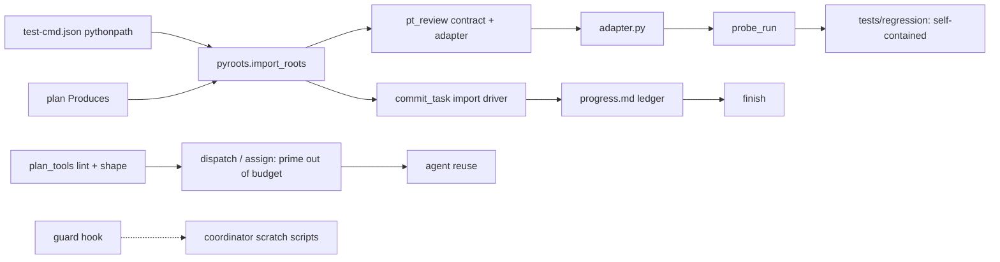
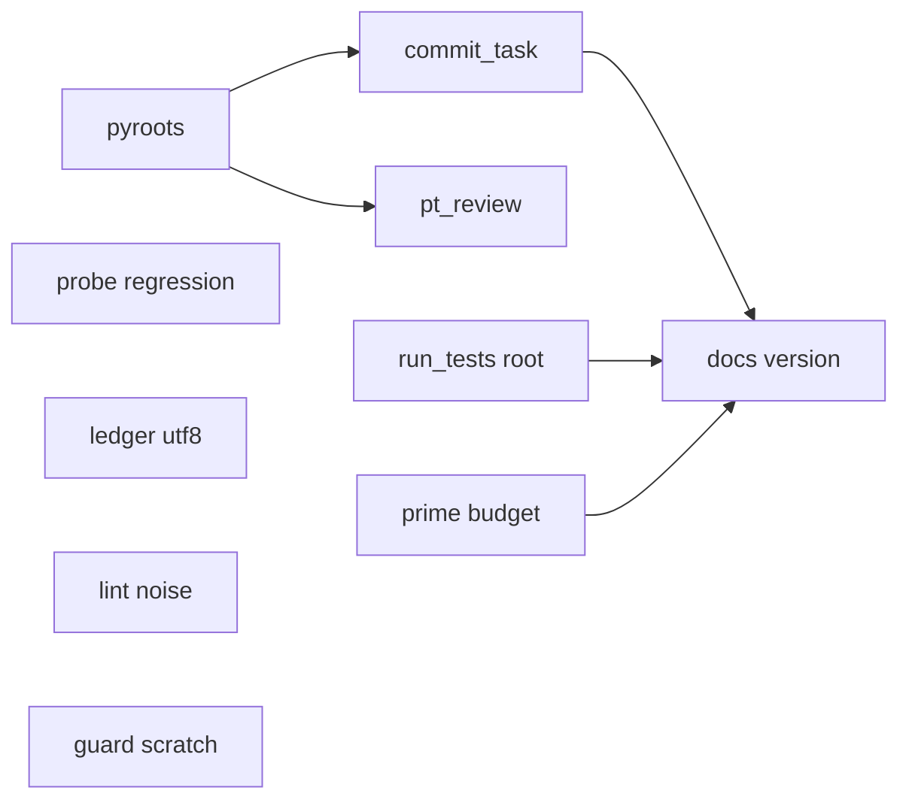

# Superlite 1.2.6: field report fixes (piX reviewing-periods v2)

**Goal:** the ten findings of `docs/feedback/2026-10-27-pix-reviewing-periods-v2.md` stop costing rounds: Python packages under hyphenated directories import in every check, the probe adapter passes bytes, regression tests are committable, the prime no longer evicts agents, untracked docs no longer block commits, `run_tests` works from a subdirectory, a bad ledger byte no longer crashes, lint stops three false positives, and the guard lets a scratchpad script edit the plan.
**Architecture:** independent edits to the stdlib Python scripts under `skills/subagent-driven-development/scripts/` and `probes/`, one new module `pyroots.py`, one hook fix, one docs and version task; each code task has its own new pytest file under `tests/scripts/`.
**Tech stack:** Python 3 stdlib only; bash for the hook; pytest through `run_tests`.
**Spec:** docs/feedback/2026-10-27-pix-reviewing-periods-v2.md
**Detail:** contracts
**Target-min:** 11
**Wave0:** none

Global constraints:
- Every script line carries a trailing `# O(...)` complexity comment, as the existing lines do. Stdlib only; `subprocess` for git. CLI contract: results on stdout, notes and errors on stderr, exit 0 ok, 1 check failed, 2 usage error.
- Existing tests in `tests/scripts/` stay green; new tests go into the files named in `Owns`. Verify with the command in your brief (`run_tests --fast <file> --task Tn --background`, then its `wait:` line).
- Import roots: `.superlite/test-cmd.json` may carry `"pythonpath": ["config/skills/reviewing-periods/scripts"]`, a list of repository-relative directories put on `sys.path` after the repository root and `src/`. `pyroots.import_roots` is the one reader; no script parses that key itself.
- Ledger = `.superlite/progress.md` (any path passed as `--ledger`). Every reader opens it with `errors="replace"`; every writer turns lone surrogates into U+FFFD before writing.
- Versions change only through `scripts/bump-version.sh 1.2.6`; `scripts/bump-version.sh --audit` must print nothing missed.

## File structure

- `scripts/pyroots.py` (new): import roots from test-cmd.json, else derived from the plan's Produces names (T1).
- `scripts/commit_task.py`: import driver roots, docs never block, hint line, UTF-8-safe ledger (T2).
- `scripts/pt_review.py`: contract checks with import roots, bytes-safe adapter `run`, `--seam` error text (T3).
- `probes/probe_run.py`: self-contained regression tests (T4).
- `scripts/run_tests.py`: runs from the repository root when started below it (T5).
- `scripts/finish.py`, `scripts/incident.py`: UTF-8-safe ledger and incident log (T6).
- `scripts/assign.py`, `scripts/dispatch.py`: the prime counted out of the context budget (T7).
- `scripts/plan_tools.py`, `scripts/shape.py`: lint false positives (T8).
- `hooks/block-coordinator-edits`: scratchpad script heredocs (T9).
- Skills, docs, `scripts/wave0.py`, version files (T10).
(`scripts/` = `skills/subagent-driven-development/scripts/`, `probes/` = `skills/subagent-driven-development/probes/`.)

```mermaid
%% schedule
gantt
  title Predicted schedule (mm:ss)
  dateFormat X
  axisFormat %M:%S
  section lane 1
  T7 dispatch  assign  prime out of the co :t7, 0, 302s
  T10 docs  pythonpath  prime budget  run_ :t10, 643, 298s
  section lane 2
  T8 lint  placeholder  spec headings  fro :t8, 0, 302s
  section lane 3
  T6 finish  incident  UTF-8-safe ledger a :t6, 0, 294s
  section lane 4
  T1 pyroots  import roots from test-cmd.j :t1, 0, 192s
  T2 commit_task  import roots  docs never :t2, 192, 451s
  section lane 5
  T4 probe_run  self-contained regression  :t4, 0, 184s
  T3 pt_review  import roots  bytes-safe a :t3, 192, 447s
  section lane 6
  T5 run_tests  run from the repository ro :t5, 0, 181s
  section lane 7
  T9 guard  scratchpad scripts that edit t :t9, 0, 177s
```

critical path: T1 → T2 → T10 (15.7 min) · peak width 7 · predicted build 15.7 min · predicted total ≈ 19.2 min (target ✗ 11.0)

## Predicted schedule

## Section A: scripts

**Probe entry:** none (Python CLIs tested through pytest; cases are named tests).
App type: CLI. Categories: protocol (commands and args), encoding, state, file.

### T1 pyroots: import roots from test-cmd.json or Produces · Complexity 3 · Est. context 30k
**Owns:** skills/subagent-driven-development/scripts/pyroots.py, tests/scripts/test_pyroots.py
**Covers:** 1
**Components:** 1
**LOC owned:** 90
**Tests:** fast
**Kind:** design
**Model:** sonnet
**Est. time:** 2 min (1 component, about 90 LOC, fast tests)
**Produces:** pyroots.import_roots(root: Path, plan: str | None = None) -> list[str]
e.g. test-cmd.json `{"test": "pytest", "pythonpath": ["a/b"]}` -> `["a/b"]` (plan ignored when the key is present)
e.g. no key, plan line `**Produces:** review.shell.run_json(argv: list[str]) -> dict` and file `config/skills/reviewing-periods/scripts/review/shell.py` -> `["config/skills/reviewing-periods/scripts"]`
e.g. no key, no plan or no Produces name that resolves -> `[]`
**Review Focus:** `test_config_key_wins`; `test_derived_from_produces_hyphen_dir` (the second example); `test_root_and_src_never_returned` (a package directly under the root or `src/` gives `[]`); `test_skips_hidden_venv_node_modules` (a `review/shell.py` copy under `.venv/` or `node_modules/` is not a root); `test_deduped_sorted` (two Produces under one root give it once); `test_bad_json_or_non_list_key` returns `[]` derived as if the key were absent; `test_missing_plan_file_is_empty`.
**Steps:** 1 failing tests, 2 run: FAIL, 3 implement, 4 run: PASS
**Notes:** Produces names are the dotted identifiers before `(` on `**Produces:**` lines (a regex, no pt_review import: commit_task imports this module). A directory D is a root for `a.b.c` when `D/a/b.py` or `D/a/b/__init__.py` exists (two parts: `D/a.py` or `D/a/__init__.py`). Walk depth at most 8; skip dot directories, `node_modules`, `__pycache__`, `site-packages`, `.superlite`.

### T2 commit_task: import roots, docs never block, hint, UTF-8 ledger · Complexity 5 · Est. context 45k
**Owns:** skills/subagent-driven-development/scripts/commit_task.py, tests/scripts/test_commit_pix_v2.py
**Covers:** 5
**Components:** 3
**LOC owned:** 150
**Tests:** fast
**Kind:** design
**Model:** sonnet
**Est. time:** 4 min (3 components, about 150 LOC, fast tests)
**Produces:** commit_task.import_errors(files: list[str], roots: list[str] | None = None) -> list[tuple[str, int, str]]
**Review Focus:** `test_hyphen_package_imports` (tmp git repo, package `config/skills/reviewing-periods/scripts/review/` whose `shell.py` does `from review.model import X`, test-cmd.json pythonpath set: `commit_task T1` prints a SHA, not `import ... ModuleNotFoundError`); `test_hyphen_package_derived_from_plan` (same without the key, plan Produces `review.shell.run_json(...)`); `test_untracked_docs_not_blocking` (untracked `docs/spec.md` and `docs/research/x.md`: the task commits, the docs stay untracked and unstaged); `test_owned_doc_still_committed` (a task owning `docs/guide.md` commits it); `test_hint_once_for_two_tasks` (`commit_task T1 T2` with an unowned `src/stray.py`: each task prints `out-of-scope src/stray.py`, and stdout has exactly one line `hint: commit or exclude these files, they are outside every Owns: src/stray.py`); `test_ledger_with_ff_byte` (a ledger line holding byte 0xff: `commit_task` commits and appends); `test_ruling_with_surrogate_written_utf8` (`--ruling` text carrying a lone surrogate is written as U+FFFD, the ledger decodes as strict UTF-8); existing `test_commit_*.py` stay green.
**Steps:** 1 failing tests, 2 run: FAIL, 3 implement, 4 run: PASS
**Notes:** roots come from T1's `pyroots.import_roots(Path("."), plan)` (committed before this task starts; see its examples in T1). The driver gets the absolute roots after the root and `src`, and maps a file under a root (longest root first) to its dotted name relative to that root, so the normal `import_module` path runs; the `spec_from_file_location` fallback stays only for files under no root. `docs/**/*.md` is treated like the plan folder: unowned changes are neither staged nor blocking.

### T3 pt_review: import roots, bytes-safe adapter, seam usage text · Complexity 5 · Est. context 50k
**Owns:** skills/subagent-driven-development/scripts/pt_review.py, tests/scripts/test_pt_review_pix_v2.py
**Covers:** 2, 3
**Components:** 3
**LOC owned:** 140
**Tests:** fast
**Kind:** design
**Model:** sonnet
**Est. time:** 4 min (3 components, about 140 LOC, fast tests)
**Produces:** pt_review.project_env(root: Path, roots: list[str] | None = None, **extra: str) -> dict[str, str]
**Review Focus:** `test_contract_hyphen_package` (fixture plan whose Produces `review.shell.run_json(argv: list[str]) -> dict` lives under `config/skills/reviewing-periods/scripts/review/shell.py`, pythonpath set: `contract` prints `PASS`, no `AttributeError: review not found`); `test_docs_producer_seam_quiet` (pix shape: T9 owns `config/skills/x/SKILL.md` with `**Produces:** SKILL.md sections "Voice"`, T10a owns `config/skills/x/references/a.md`; `contract --seam T9,T10a` prints no `not declared` line); `test_adapter_run_bytes_stdin` (generated adapter with `run=python -c "import sys; sys.stdin.buffer.read(); print('ok')"`: `run((), b"\xff\xfe")` returns `(0, "ok\n", "")`); `test_adapter_run_str_stdin_unchanged`; `test_adapter_has_import_roots` (generated adapter puts each pythonpath root on `sys.path` and `PYTHONPATH`); `test_seam_error_names_comma_form` (`--seam T1` exits 2 and stderr contains `Ta,Tb`); existing `test_pt_review*.py` stay green.
**Steps:** 1 failing tests, 2 run: FAIL, 3 implement, 4 run: PASS
**Notes:** roots come from T1's `pyroots.import_roots(root, plan)` (committed before this task starts; see its examples in T1). `find_module_file` and `module_name` try `src`, the root, then each import root. Adapter roots are embedded at generation time, relative to ROOT. Bytes stdin: no `text=True`; decode stdout and stderr as UTF-8 with `errors="replace"`, so callers still get `str`.

### T4 probe_run: self-contained regression tests · Complexity 3 · Est. context 38k
**Owns:** skills/subagent-driven-development/probes/probe_run.py, tests/scripts/test_probe_regression_portable.py
**Covers:** 3
**Components:** 1
**LOC owned:** 70
**Tests:** fast
**Kind:** design
**Model:** sonnet
**Est. time:** 2.5 min (1 component, about 70 LOC, fast tests)
**Review Focus:** `test_regression_imports_local_adapter_copy` (after `_write_regression`, `tests/regression/_probe_adapter.py` exists and the test file names no `.superlite` path); `test_copy_root_points_at_repo` (the copy's ROOT resolves to the repository root: its first `ROOT = ` line is rewritten to `Path(__file__).resolve().parents[2]`); `test_copy_refreshed_when_adapter_changes`; `test_regression_runs_without_superlite_dir` (delete `.superlite/`, run the generated test with pytest: it executes, it does not fail on a missing adapter); existing `test_probe_run.py` stays green.
**Steps:** 1 failing tests, 2 run: FAIL, 3 implement, 4 run: PASS
**Notes:** the location stays `tests/regression/` (commit_task's shared owns). The same-content check (`body`) keeps working.

### T5 run_tests: run from the repository root · Complexity 3 · Est. context 34k
**Owns:** skills/subagent-driven-development/scripts/run_tests.py, tests/scripts/test_run_tests_root.py
**Covers:** 6
**Components:** 1
**LOC owned:** 60
**Tests:** fast
**Kind:** design
**Model:** sonnet
**Est. time:** 2 min (1 component, about 60 LOC, fast tests)
**Produces:** run_tests.project_root(start: Path) -> Path | None
e.g. `project_root(Path("/r/config/skills/x"))` with `/r/.superlite/` -> `Path("/r")`
e.g. no `.superlite` directory above -> `None`
**Review Focus:** `test_fast_from_subdirectory` (tmp project with `.superlite/`, a passing `config/skills/x/tests/test_a.py`; run from `config/skills/x` with `--fast tests/test_a.py`: passed 1, stderr has `run_tests: running from <root>`); `test_background_from_subdirectory` (the detached child and its `wait:` line work from the subdirectory); `test_absolute_paths_kept`; `test_root_cwd_unchanged` (no note when started at the root); existing `test_run_tests*.py` stay green.
**Steps:** 1 failing tests, 2 run: FAIL, 3 implement, 4 run: PASS
**Notes:** rewrite each relative `--fast` path against the original cwd before `chdir`, and before `--background` builds the child's argv.

### T6 finish, incident: UTF-8-safe ledger and log · Complexity 2 · Est. context 28k
**Owns:** skills/subagent-driven-development/scripts/finish.py, skills/subagent-driven-development/scripts/incident.py, tests/scripts/test_ledger_utf8.py
**Covers:** 7
**Components:** 2
**LOC owned:** 50
**Tests:** fast
**Kind:** design
**Model:** sonnet
**Est. time:** 1.5 min (2 components, about 50 LOC, fast tests)
**Review Focus:** `test_finish_ledger_ff_byte` (a progress.md `Ruling:` line holding byte 0xff: `finish --plan P` exits 0 and prints that ruling with U+FFFD); `test_finish_second_reader_ff_byte` (the reader at finish.py line 104 also tolerates it); `test_incident_add_surrogate_context` (`incident add --context` with a lone surrogate from argv: the jsonl line decodes as strict UTF-8 and holds U+FFFD); existing `test_finish_grouping.py` and `test_incident.py` stay green.
**Steps:** 1 failing tests, 2 run: FAIL, 3 implement, 4 run: PASS
**Notes:** readers: `read_text(encoding="utf-8", errors="replace")`; writers: `s.encode("utf-8", "surrogateescape").decode("utf-8", "replace")`.

### T7 dispatch, assign: prime out of the context budget · Complexity 3 · Est. context 34k
**Owns:** skills/subagent-driven-development/scripts/assign.py, skills/subagent-driven-development/scripts/dispatch.py, tests/scripts/test_dispatch_prime_budget.py
**Covers:** 4
**Components:** 2
**LOC owned:** 70
**Tests:** fast
**Kind:** design
**Model:** sonnet
**Est. time:** 2.5 min (2 components, about 70 LOC, fast tests)
**Produces:** dispatch.prime_k(sl_dir: Path, tier: str) -> float
e.g. `.superlite/prime.md` of 44000 bytes, tier `sonnet` -> `11.0`
e.g. tier `haiku` reads `prime-haiku.md`; a missing file -> `0.0`
**Produces:** assign.eligibility(agent: dict, est_context: float, limits: dict | None = None, prime_k: float = 0.0) -> str | None
e.g. `eligibility({"context_k": 85}, 6, None, 11.0)` -> `None`
e.g. `eligibility({"context_k": 85}, 6)` -> `"context over 80k"`
**Review Focus:** `test_prime_k_from_size` (bytes / 4000); `test_agent_reused_after_one_task` (pool agent with context_k 85 after one task, prime 44000 bytes, next task Est. context 6k: dispatch prints `agent=ID`, no `evict=`); `test_still_evicts_over_budget` (context_k 120: evicted); `test_assign_cli_uses_prime`; existing `test_dispatch_skip.py`, `test_pool.py` stay green.
**Steps:** 1 failing tests, 2 run: FAIL, 3 implement, 4 run: PASS
**Notes:** the agent's context counts as `max(0, context_k - prime_k)`; the task's Est. context stays as written.

### T8 lint: placeholder, spec headings, frozen EXAMPLE hint · Complexity 3 · Est. context 40k
**Owns:** skills/subagent-driven-development/scripts/plan_tools.py, skills/subagent-driven-development/scripts/shape.py, tests/scripts/test_lint_pix_v2.py
**Covers:** 8
**Components:** 2
**LOC owned:** 70
**Tests:** fast
**Kind:** design
**Model:** sonnet
**Est. time:** 2.5 min (2 components, about 70 LOC, fast tests)
**Review Focus:** `test_obsidian_callout_not_placeholder` (a Global constraint line quoting the Obsidian callout from spec finding 8, and the same word in lower case inside plain prose: no `placeholder`); `test_uppercase_marker_still_flagged` (the uppercase to-do marker followed by a colon in prose: flagged); `test_backticked_marker_ignored` (the uppercase to-be-decided marker inside backticks: not flagged); `test_spec_heading_prefixes_exempt` (spec headings `Decisions (Max, 2026-10-27)`, `Acceptance (countable, on the W44 transcript)`, `Open for Max`, `Validation: manual` give no `SPEC section` issue; `Openers` still needs a task); `test_example_hint_for_frozen_producer` (producer dispatched per the ledger `unblocked:` line, consumer lacks an example: the `EXAMPLE:` line ends with `(producer T1 is dispatched and frozen: drop this Consumes entry or move it to a follow-up task)`); existing `test_plan_tools.py` and lint tests stay green.
**Steps:** 1 failing tests, 2 run: FAIL, 3 implement, 4 run: PASS
**Notes:** the two marker patterns (the first two `PLACEHOLDERS` entries) match case-sensitively as whole uppercase words; all placeholder patterns skip text inside backticks. A spec title is exempt when it equals a `SPEC_SKIP` key or starts with one followed by a space, `(` or `:`; add `acceptance` and `open` to the prefix keys.

### T9 guard: scratchpad scripts that edit the plan · Complexity 4 · Est. context 40k
**Owns:** hooks/block-coordinator-edits, tests/scripts/test_guard_scratch_script.py
**Covers:** 9
**Components:** 1
**LOC owned:** 50
**Tests:** fast
**Kind:** design
**Model:** sonnet
**Est. time:** 2.5 min (1 component, about 50 LOC, fast tests)
**Review Focus:** `test_scratch_script_edits_plan_allowed` (active run, project P, scratch dir S outside P; the one Bash command `cat > S/patch.py <<'EOF'` / `import sys` / `from pathlib import Path` / `plan = Path(sys.argv[1])` / `plan.write_text(plan.read_text().replace('a','b'))` / `EOF` / `python3 S/patch.py docs/superpowers/plans/x.md` exits 0; today it exits 2 with target `cat > S/patch.py <<'EO`); `test_scratch_script_on_source_blocked` (same with `src/app.py` as the argument: exit 2); `test_heredoc_to_outside_path_allowed` (`cat > S/p.py <<'EOF'` with `open('src/a.py','w')` in the body, no run line: exit 0); `test_heredoc_into_project_code_blocked` (`cat > p.py <<'EOF'`: exit 2); existing `test_block_coordinator_edits.py` stays green.
**Steps:** 1 reproduce with the first test (exit 2), 2 find which rule names the `cat` line as the target, 3 fix, 4 run: PASS
**Notes:** run the hook with cwd = P and `CLAUDE_PROJECT_DIR=P`, as `test_block_coordinator_edits.py` does. A write whose resolved target lies outside the project root is never project code.

## Section B: docs and release

**Probe entry:** none (documentation).

### T10 docs: pythonpath, prime budget, run_tests root; 1.2.6 · Complexity 3 · Est. context 40k
**Owns:** skills/subagent-driven-development/SKILL.md, skills/subagent-driven-development/scripts/wave0.py, skills/writing-plans/SKILL.md, docs/tools.md, tests/scripts/test_wave0.py, package.json, .hermes-plugin/plugin.yaml, .claude-plugin/plugin.json, .cursor-plugin/plugin.json, .codex-plugin/plugin.json, .devin-plugin/plugin.json, .kimi-plugin/plugin.json, .muse-plugin/plugin.json, .claude-plugin/marketplace.json, .muse-plugin/marketplace.json, gemini-extension.json
**Covers:** 10
**Components:** 2
**LOC owned:** 60
**Tests:** fast
**Kind:** design
**Model:** sonnet
**Est. time:** 2.5 min (2 components, about 60 LOC, fast tests)
**Review Focus:** `test_wave0_brief_names_pythonpath` (the wave0 brief tells the skeleton task to add `"pythonpath": [...]` to `.superlite/test-cmd.json` when the package root is neither the repository root nor `src/`); SKILL.md step 2 says the 80k context ceiling does not count the prime; writing-plans step 2 adds "(the hook checks your typed reply; an AskUserQuestion answer does not count)"; `docs/tools.md` rows: `pyroots` (new), `testcmd` (`pythonpath`), `run_tests` (any subdirectory), `commit_task` (`docs/**/*.md` never blocks, one `hint:` line); `scripts/bump-version.sh 1.2.6` run and `--audit` clean; `skills/using-superlite/SKILL.md` untouched.
**Steps:** 1 failing test, 2 run: FAIL, 3 edit, 4 run: PASS

## Review Focus

Package `scripts` (CLI): protocol (`--seam` form, `--fast` paths from a subdirectory), encoding (bytes stdin, 0xff ledger byte, lone surrogates from argv), state (prime budget, frozen producers), file (hyphenated package roots, untracked docs, regression test location). Specific risks: the import driver must still import plain `src/` and root packages unchanged; docs passing must not swallow an owned doc; the guard must still block project code written through a scratch script argument. Each case is a named test in its task.

## Self-review

Coverage: findings 1-10 map to T1-T10 (`Covers`); 10's notes are T3 (seam text), T7 (eviction), T10 (approval wording, pythonpath in wave0). Finding 2 was fixed in 1.2.5; T3 adds the pix-shaped regression test. No placeholders. Consumes match T1's Produces. Edges are execution (T2, T3 import pyroots) or docs-after-code (T10). No two parallel tasks share a file.
