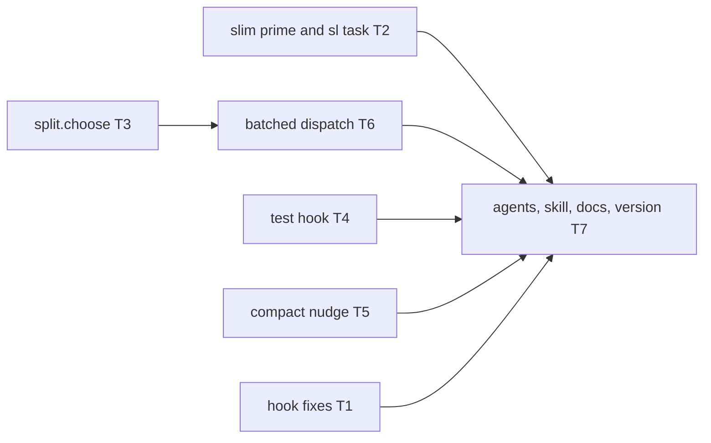
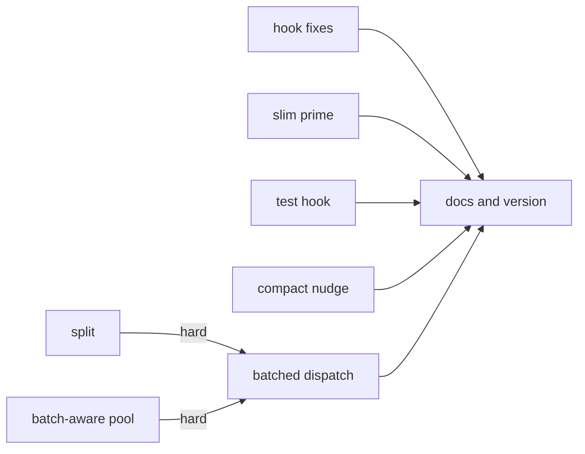

# Port five upstream features into superlite 1.3.0

**Goal:** Lower implementer token cost and run time by porting five features from upstream `iha2/superlite` 2.0.5 into our fork, keeping our skill names, `state.py` session model and Swift support.
**Architecture:** Hand ports onto our paths. Upstream source is read with `git show upstream/main:<path>`; upstream `skills/swarm/` is our `skills/subagent-driven-development/`, upstream `checkpoint` is our `commit_task`. No cherry-picks.
**Tech stack:** Python 3.10+ stdlib, bash that also runs on macOS bash 3.2, pytest.
**Spec:** none; the approved scope is the five features named in the Goal of each section below.
**Detail:** contracts
**Wave0:** none
**Max chars:** 20000

## Global constraints

- Test command: `.superlite/test-cmd.json` (uv + pytest). Baseline before this plan: 888 passed, 1 skipped; no existing test may be dropped.
- Hooks resolve run state through `hooks/superlite-state.sh` (`superlite_state`, `$SL_SD`), never `$proj/.superlite`.
- Hook code must run on bash 3.2: no `${x,,}`, no `$'\u'`, EPOCHREALTIME needs a `date` fallback.
- Out of scope, do not port: skill renames, `session.py`, project_config, host_models, gitignore.py, cost-report, capture-host-usage, dispatch.json and the batch guard in block-coordinator-edits, testprobe, `--tier` removal.
- Keep our additions: `pool.sync`, `skip_t0`, `prime_k` in eligibility, `pyroots`, `trees`, `feedback`, `state`.

## Main diagram

## File structure

- `hooks/*`: coordinator guard, capture hooks, test rewrite, compact nudge.
- `skills/subagent-driven-development/scripts/build_prime.py`: prime kinds; `task.py`: task lookup; `split.py`: packing; `dispatch.py`: batches; `compact_due.py`: nudge timing.
- `skills/subagent-driven-development/config/routing.json`: tier prime kinds and limits.
- `agents/implementer*.md`, `skills/*/SKILL.md`, `docs/`: the contract the new behaviour needs.

## Task graph

```mermaid
%% schedule
gantt
  title Predicted schedule (mm:ss)
  dateFormat X
  axisFormat %M:%S
  section lane 1
  T4 Scoped test rewrite and hidden wait d :t4, 0, 379s
  T7 Agents  skills  docs and version 1.3. :t7, 544, 321s
  section lane 2
  T2 Slim prime and sl task :t2, 0, 371s
  section lane 3
  T5 Compact nudge that actually fires :t5, 0, 354s
  section lane 4
  T1 Hook parser and bash 3.2 fixes :t1, 0, 330s
  section lane 5
  T8 Batch-aware pool and commit release :t8, 0, 321s
  T6 Batched dispatch :t6, 321, 223s
  section lane 6
  T3 Exact implementer split :t3, 0, 247s
```

critical path: T8 → T6 → T7 (14.4 min) · peak width 6 · predicted build 14.4 min · predicted total ≈ 17.9 min

## Hook fixes

Upstream commits `f6dc516` and `3db3cf8`.

**Probe entry:** none (bash hooks; cases are pytest tests).

### T1 Hook parser and bash 3.2 fixes · Complexity 4 (O-1) · Est. context 45k

**Owns:** hooks/block-coordinator-edits, hooks/capture-agent-launch, hooks/capture-agent-stop, hooks/record-human-reply, hooks/superlite-state.sh, tests/scripts/test_block_coordinator_edits.py, tests/scripts/test_hooks_bash32.py
**Components:** 2
**LOC owned:** 110
**Tests:** fast
**Model:** sonnet
**Est. time:** 3 min
**Produces:** hooks/block-coordinator-edits lower(S) sets LOWER
**Review Focus:** `test_redirect_not_operand`: `cp a b 2>/dev/null` with a read-only target is allowed; `test_real_write_stays_blocked`: `cp x src/a.py 2>/dev/null` stays blocked; `test_escaped_quote_blocked`: `echo "x\"y" > src/a.py` stays blocked; `test_multiline_quote_blocked`: a multi-line quoted `echo … > src/a.py` stays blocked
**Test code (verbatim):** `tests/scripts/test_hooks_bash32.py` from upstream with `ROOT / "skills" / "subagent-driven-development" / "scripts" / "sl"` as the sl path; the three allow and three block cases from `f6dc516` in `tests/scripts/test_block_coordinator_edits.py`.
**Steps:** 1 port the tests, 2 run: FAIL, 3 apply both commits by hand (`git show f6dc516 3db3cf8 -- hooks/`; skip hooks we do not have), including `${a,,}` in hooks/superlite-state.sh, 4 run: PASS
**Notes:** `capture-agent-launch` and `capture-agent-stop` use our existing `now` line; replace it with upstream's four-line fallback.

## Slim prime

Upstream commit `0dbbd18`, final text from `upstream/main`.

**Probe entry:** call=build_prime.build_slim

### T2 Slim prime and sl task · Complexity 5 (O-1) · Est. context 55k

**Owns:** skills/subagent-driven-development/scripts/build_prime.py, skills/subagent-driven-development/scripts/task.py, skills/subagent-driven-development/scripts/routing.py, skills/subagent-driven-development/scripts/sl, skills/subagent-driven-development/config/routing.json, tests/scripts/test_slim_prime.py, tests/scripts/test_routing.py
**Components:** 2
**LOC owned:** 210
**Tests:** fast
**Model:** sonnet
**Est. time:** 4 min
**Produces:** build_prime.build_slim(plan: str) -> bytes · build_prime.prime_kind(tier: str) -> str · task.render(plan: Plan, tid: str) -> str
**Review Focus:** `test_slim_omits_plan_body`: a task's Steps text is absent from the slim prime; `test_slim_is_byte_stable`: two builds are identical; `test_task_reads_current_plan`: editing the plan changes `sl task T1` output with no rebuild; `test_task_unknown_exits_2`: `sl task T99` exits 2 and lists the tasks; `test_full_override`: `--prime full` still embeds the plan and `--sections`
**Test code (verbatim):** `tests/scripts/test_slim_prime.py` from upstream at `0dbbd18`, script path changed to ours, cases on the git-ignored section removed.
**Steps:** 1 port the tests, 2 run: FAIL, 3 add PREAMBLE_SLIM, `prime_kind`, `header_lines`, `build_slim`, `--prime`, 4 add `task.py`, 5 set routing.json `sonnet.prime` to `slim`, `sonnet.max_tasks` and `haiku.max_tasks` to 20, add `"batch": {"critical_path_solo": true}`, remove `batch_note_max_min` only if nothing reads it, update the `_comment`, 6 run: PASS
**Notes:** Omit the gitignore section of `build_slim`. Keep `wave0.raw_items` in `build_mini`, keep our `select_sections` and `main` behaviour for `--tier`. In PREAMBLE_SLIM use our paths and `commit_task`: "Do not commit. The coordinator commits through commit_task.py." `--spec` is ignored by slim. Add `task` to the tool list in the `sl` header comment. Update the `max_tasks 6` comment and worn-agent fixture in `tests/scripts/test_routing.py` for the new limit.

## Packing

Upstream commit `34cdc8f`.

**Probe entry:** call=split.choose

### T3 Exact implementer split · Complexity 3 (O-1) · Est. context 30k

**Owns:** skills/subagent-driven-development/scripts/split.py, tests/scripts/test_split.py
**Components:** 1
**LOC owned:** 210
**Tests:** fast
**Model:** sonnet
**Est. time:** 2 min
**Produces:** split.tenths(minutes: float) -> int · split.choose(ms: list, busy: tuple, ctx: list, cap: float, cp: tuple) -> tuple
e.g. split.tenths(1.26) -> 13
e.g. split.choose([10, 10, 10, 10, 10]) -> (3, 20, 3, three batches of sizes 2, 2, 1)
e.g. split.choose([]) -> None
**Review Focus:** `test_five_equal_split`: the second example above; `test_cp_alone`: `cp=(0,)` keeps index 0 in a batch of its own; `test_context_cap`: no batch's summed ctx exceeds cap; `test_brute_agrees`: `choose` matches `brute` on random small inputs; `test_sixty_tasks_fast`: 60 tasks finish under 2 s
**Test code (verbatim):** `tests/scripts/test_split.py` from upstream with the scripts path changed.
**Steps:** 1 copy test, 2 run: FAIL, 3 copy `split.py` unchanged, 4 run: PASS

## Test hook

Upstream `hooks/rewrite-test-runs` at `upstream/main`, plus `91fecf8` for `testcmd` and `run_tests`.

**Probe entry:** none (bash hook; cases are pytest tests).

### T4 Scoped test rewrite and hidden wait denial · Complexity 6 (O-1) · Est. context 60k

**Owns:** hooks/rewrite-test-runs, skills/subagent-driven-development/scripts/testcmd.py, skills/subagent-driven-development/scripts/run_tests.py, tests/scripts/test_rewrite_test_runs.py, tests/scripts/test_session_cost_rewrite.py, tests/scripts/test_session_cost_testcmd.py
**Components:** 2
**LOC owned:** 230
**Tests:** fast
**Model:** sonnet
**Est. time:** 5 min
**Produces:** testcmd.resolve_related(root: str, src: str) -> list · testcmd.is_test_path(path: str) -> bool
**Review Focus:** `test_named_path_goes_fast`: `pytest tests/a.py` rewrites to `run_tests --fast tests/a.py`; `test_bare_runner_stays_full`: bare `pytest` rewrites to `--full`; `test_until_loop_denied`: `until pytest; do sleep 1; done` exits 2; `test_until_curl_passes`: `until curl x; do sleep 1; done` is untouched; `test_devnull_denied`: `pytest > /dev/null` exits 2; `test_subagent_bare_full_denied`: a call with agent_id running bare `pytest` exits 2; `test_subagent_named_file_passes`: a call with agent_id running `pytest tests/a.py` is untouched; `test_project_runner_loop_denied`: a test-cmd.json runner inside `while` exits 2; `test_rewrite_needs_state_dir`: run markers are read from `$SL_SD`, not `$proj/.superlite`; `test_ampersand_literal`: a path with `&` survives on bash 5.2
**Test code (verbatim):** upstream `tests/scripts/test_session_cost_rewrite.py` and `test_session_cost_testcmd.py` with paths changed; port the new cases of upstream `test_rewrite_test_runs.py` additively into ours.
**Steps:** 1 port the tests, 2 run: FAIL, 3 port `resolve_related`, `is_test_path`, `expand_fast_paths` from `91fecf8`, 4 port the hook diff, 5 run: PASS
**Notes:** Keep our `superlite_state` block; `deny`, `deny_subagent_full`, `load_project_runner` and the rewrite log use `$sd`. The `sl_base` path is ours. Our `run_tests.py` has no SUSPECT HANG: drop both mentions of it from the denial text and keep the rest. A subagent's bare `run_tests` is not a test segment; check `run_tests --fast` from a subagent still passes.

## Compact nudge

Upstream `91fecf8`, with two fixes upstream lacks.

**Probe entry:** call=compact_due.is_due

### T5 Compact nudge that actually fires · Complexity 4 (O-1) · Est. context 35k

**Owns:** hooks/compact-nudge, hooks/hooks.json, skills/subagent-driven-development/scripts/compact_due.py, tests/scripts/test_compact_due.py
**Components:** 2
**LOC owned:** 170
**Tests:** fast
**Model:** sonnet
**Est. time:** 3 min
**Produces:** compact_due.is_due(sl_dir: str, now: float, window_s: float = 1800.0) -> bool · compact_due.nudge_line() -> str · compact_due.mark(sl_dir: str) -> None
e.g. is_due(sl, now=2000.0) with a launch t of 100000 (ms) -> True
e.g. is_due(sl, now=1000.0) with a launch t of 100000 (ms) -> False
**Review Focus:** `test_launch_t_is_ms`: the first two examples; `test_due_when_stale`, `test_not_due_when_fresh`, `test_opt_out_env`, `test_nudge_line_mentions_compact` from upstream; `test_nudge_once_per_window`: a second hook call in the same window prints nothing; `test_claude_output_shape`: with CLAUDE_PLUGIN_ROOT set, stdout is `hookSpecificOutput.additionalContext`; `test_no_superlite_dir_silent`: no state folder, exit 0 and no output
**Test code (verbatim):** upstream `tests/scripts/test_compact_due.py` with paths changed, plus the new cases.
**Steps:** 1 port the tests, 2 run: FAIL, 3 port the script and hook, 4 register the hook under UserPromptSubmit in hooks.json, 5 run: PASS
**Notes:** Upstream bugs to fix: metrics `t` is epoch ms but `now` is seconds, so `_launch_t` must convert ms to s and the nudge never fires otherwise; the hook checks `CLAUDE_CODE=1`, which Claude Code never sets, so use the same Claude test as `hooks/session-start`. `mark` writes `last-compact`; the CLI marks after printing, so the nudge shows once per window and needs no model action. `nudge_line` asks the agent to tell the user to run `/compact` when convenient; remove "Stamp .superlite/last-compact". Resolve the state folder with `superlite-state.sh`.

## Batched dispatch

Upstream commits `0a85288` and `34cdc8f`, final `dispatch.py` at `upstream/main`.

**Probe entry:** call=dispatch.make_batches

### T8 Batch-aware pool and commit release · Complexity 4 (O-1) · Est. context 35k

**Owns:** skills/subagent-driven-development/scripts/commit_task.py, skills/subagent-driven-development/scripts/pool.py, tests/scripts/test_commit_running_scope.py, tests/scripts/test_pool.py
**Components:** 2
**LOC owned:** 90
**Tests:** fast
**Model:** sonnet
**Est. time:** 3 min
**Produces:** pool.currents(ag: dict) -> list
e.g. currents({"current": "T1,T2"}) -> ["T1", "T2"]
e.g. currents({"current": ["T1"]}) -> ["T1"]
e.g. currents({}) -> []
**Review Focus:** `test_commit_releases_batch_member`: committing T1 of `T1,T2` leaves `current: "T2"`, `busy` true; committing T2 clears `current`, `busy` false, both in `tasks`; `test_pool_busy_accepts_batch`: `pool busy ID T1,T2` stores the batch; `test_commit_running_scope_batch`: the running-task check at `commit_task.py` line 372 sees both members of a batch
**Test code (verbatim):** the three named cases, in the two owned test files.
**Steps:** 1 failing tests, 2 run: FAIL, 3 add `pool.currents` as in upstream `dispatch.py`, 4 release members one by one in `commit_task` (lines 266-281) as upstream `checkpoint.py` lines 249-274 do, and use `currents` at line 372, 5 run: PASS
**Notes:** `currents` lives in `pool.py` so `dispatch` and `commit_task` share it with no circular import.

### T6 Batched dispatch · Complexity 6 (O-2) · Est. context 45k

**Owns:** skills/subagent-driven-development/scripts/dispatch.py, tests/scripts/test_batching.py
**Components:** 1
**LOC owned:** 150
**Tests:** fast
**Model:** sonnet
**Est. time:** 4 min
**Consumes:** split.tenths(minutes: float) -> int (T3) · split.choose(ms: list, busy: tuple, ctx: list, cap: float, cp: tuple) -> tuple (T3) · pool.currents(ag: dict) -> list (T8)
**Produces:** dispatch.make_batches(ready: list, tier: object, info: dict, times: dict, max_ctx: object, cp: tuple, busy_left: tuple, solo_mode: bool) -> list
e.g. make_batches(["T1", "T2"], tier, info, times, max_ctx, (), (), True) -> [["T1"], ["T2"]]
e.g. make_batches([], tier, info, times, max_ctx, (), (), False) -> []
**Review Focus:** `test_batch_line_format`: two ready non-critical tasks of one tier print one `T1,T2 fresh tier=sonnet ...` line when packing chooses it; `test_batch_flag_one`: `--batch 1` prints one task per line; `test_cp_task_alone`: a task in stable.json `critical_path` is never in a batch; `test_batch_single_tier`: haiku and sonnet tasks never share a line; `test_running_from_batch`: `current: "T1,T2"` marks both running; `test_batch_context_budget`: summed `est_context` over `max_context_k` splits the batch; `test_score_uses_members`: a batch's score and eligibility use all members' owns, deps and summed context
**Test code (verbatim):** upstream `tests/scripts/test_batching.py` at `upstream/main`, with `checkpoint` names changed to ours, plus the named cases.
**Steps:** 1 port the tests, 2 run: FAIL, 3 port `stable_cp`, `predicted_minutes`, `busy_left_tenths`, `make_batches`, `--batch` and the batch logic of `plan_dispatch`, using `pool.currents`, 4 run: PASS
**Notes:** Keep our `run`, `pool.sync`, `skip_t0`, `load_pool`, `prime_k` in eligibility, and `poolmod`. Do not port `write_dispatch_json`, `project_config`, `host_models`. `asg.score` receives the batch key as task id and ignores it, so that call stays.

## Docs and version

**Probe entry:** none (documents).

### T7 Agents, skills, docs and version 1.3.0 · Complexity 3 (O-1) · Est. context 40k

**Owns:** agents/implementer.md, agents/implementer-haiku.md, skills/subagent-driven-development/SKILL.md, skills/writing-plans/SKILL.md, docs/tools.md, docs/hooks.md, docs/how-a-run-works.md, .version-bump.json, .claude-plugin/plugin.json, .claude-plugin/marketplace.json, .codex-plugin/plugin.json, .cursor-plugin/plugin.json, .devin-plugin/plugin.json, .hermes-plugin/plugin.yaml, .kimi-plugin/plugin.json, .muse-plugin/plugin.json, .muse-plugin/marketplace.json, gemini-extension.json, package.json
**Components:** 2
**LOC owned:** 90
**Tests:** fast
**Model:** sonnet
**Est. time:** 3 min
**Consumes:** build_prime.build_slim(plan: str) -> bytes (T2)
**Review Focus:** `test_docs_contract.py` stays green; the skill size tests in `test_orchestrator.py` stay green; `scripts/bump-version.sh --audit` is clean
**Test code (verbatim):** no new tests; run `tests/scripts/test_docs_contract.py` and `tests/scripts/test_orchestrator.py`.
**Steps:** 1 edit the text, 2 run `scripts/bump-version.sh 1.3.0` and `--audit`, 3 run the tests
**Notes:** Implementers: the prime is rules and interfaces, not the plan; get task text with `sl task Tn --plan PLAN`; a message may hold a batch: build in the order given, one report block per task (port from upstream `agents/implementer.md`, leaving out pre-impl specs, SUSPECT HANG and git-ignored paths). SKILL.md: the dispatch line may be a batch; sending a line sets `current: Tn,Tm`; the task message gives `PLAN` and `sl task Tn` instead of the task text (haiku keeps the full block); `build_prime` needs no `--spec` for slim. writing-plans: a plan no longer rides in the prime. docs: add `task`, `--batch`, `compact-nudge`, the test hook denials. Plain style, no history notes.

## Review Focus

- Library (`split`, `dispatch`, `build_prime`, `task`, `compact_due`): numeric, state. Risks: exponential packing on large inputs, ms versus seconds, a batch left half released in the pool.
- CLI (`sl task`, `sl dispatch --batch`): protocol, state.
- Hooks: protocol. Risks: fail-closed denials on normal commands, a guard silently off on bash 3.2.

## Self-review

Coverage: each of the five features has a task; T7 carries the contract text. No placeholders. Edges are execution or docs-after-code only. Files are disjoint across tasks.
