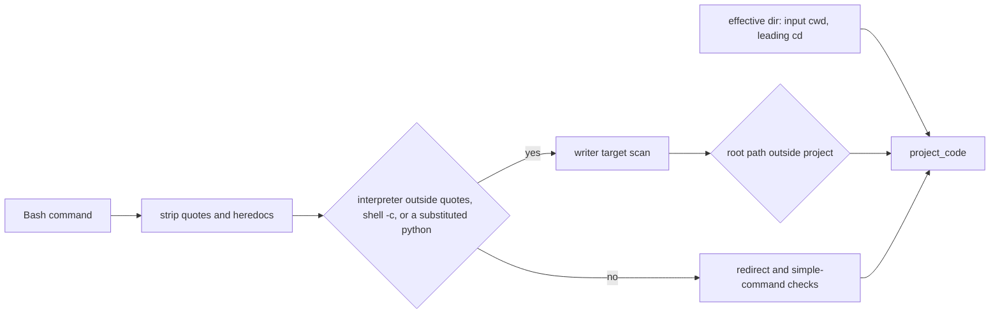
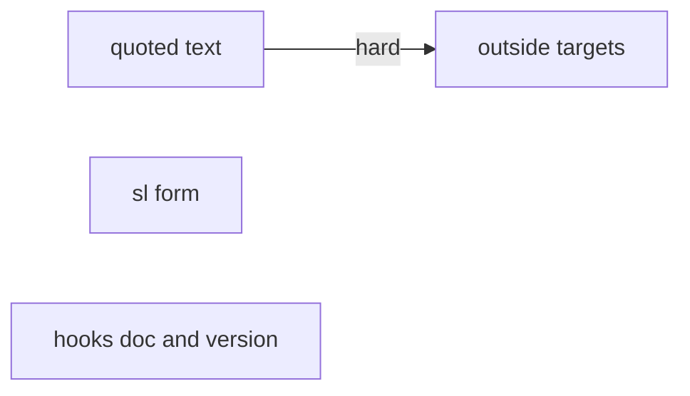

# Superlite 1.3.2: guard false positives and the executable sl form

**Goal:** the coordinator guard stops blocking text that only quotes code and writes that leave the project, third-party Stop hooks can detect a run from a documented contract, and every brief runs `sl` in the form the Claude Code worktree guard accepts.
**Architecture:** two sequential edits to `hooks/block-coordinator-edits` (one file, so an edge), each with its own new pytest file; one sweep of the `bash <sl>` wording across agents, skills, commands and the scripts that print briefs; one docs task that also bumps the version.
**Tech stack:** bash that runs on macOS bash 3.2 (builtins only in the hook); Python 3.10+ stdlib; pytest.
**Issues:** #8 #43 #16 #57
**Detail:** contracts
**Target-min:** 11
**Wave0:** none

Global constraints:
- Hook code runs on bash 3.2: no `${x,,}`, no `$'\u'`, no `|&`, no external process in the hot path. LF line endings. `tests/scripts/test_hooks_bash32.py` stays green.
- Every Python script line carries a trailing `# O(...)` complexity comment, as the existing lines do.
- Existing tests in `tests/scripts/test_block_coordinator_edits.py` and `tests/scripts/test_human_gate.py` stay green unchanged. New tests go into the files named in `Owns`.
- The guard stays best-effort but a real project write must never become allowed: every `test_blocks_*` case keeps exit 2.
- Run `sl` as an executable (`<abs>/sl ...`), not as `bash <abs>/sl ...`: this session's worktree guard refuses `bash <script>`.
- Versions change only through `scripts/bump-version.sh 1.3.2`; `scripts/bump-version.sh --audit` must report nothing missed.

Ruling: #43(b) mechanism - absolute paths outside the project already pass `project_code`, so the block comes from relative targets judged against the project while the shell sits elsewhere; the fix judges them from the effective directory - the original command is not on record, cost if wrong: #43(b) reopens with its command.
Ruling: #43(a) scratchpad - no scratchpad special case; the hook does not know the path, and any absolute path outside the project is already allowed, so a writer whose target expression starts at such a path passes - cost if wrong: a scratchpad write through `os.environ` or `tempfile` still blocks.
Ruling: #8 command substitution - `$(python ...)` inside double quotes counts as a real invocation; backtick substitution does not, because backticks in issue bodies are almost always markdown - cost if wrong: a backtick-substituted writer goes unseen.
Ruling: #57 scope - agents, skills, commands, `docs/tools.md` and the scripts that print briefs change; `hooks/rewrite-test-runs` and the other harnesses' reference files keep `bash`, because PowerShell and Windows need it - cost if wrong: a rewritten test run is refused in a worktree session.
Ruling: nested repositories - a path under the project stays project code even if it is another repository's checkout - cost if wrong: one false positive, the same as today.

## File structure

- `hooks/block-coordinator-edits`: the coordinator guard (T1, then T2).
- `tests/scripts/test_guard_quoted.py`: #8 cases (T1).
- `tests/scripts/test_guard_outside.py`: #43 cases (T2).
- `tests/scripts/test_sl_form.py`: #57 cases (T3).
- `agents/*.md`, `skills/*/SKILL.md`, `skills/subagent-driven-development/fixing.md`, `commands/commit.md`, `docs/tools.md`, `skills/using-superlite/references/claude-code-tools.md`, and three scripts: the `sl` wording (T3).
- `docs/hooks.md`: run-detection contract and guard wording (T4).

## Task graph

```mermaid
%% schedule
gantt
  title Predicted schedule (mm:ss)
  dateFormat X
  axisFormat %M:%S
  section lane 1
  T3 sl form  executable in every brief :t3, 0, 121s
  section lane 2
  T1 guard  quoted text is not an interpre :t1, 0, 101s
  T2 guard  judge targets from where the s :t2, 101, 101s
  section lane 3
  T4 docs  run detection and version 1.3.2 :t4, 0, 93s
```

critical path: T1 → T2 (3.4 min) · peak width 3 · predicted build 3.4 min · predicted total ≈ 6.9 min (target ✓)

## Guard

**Probe entry:** none (a hook; its Review Focus cases are named pytest cases)

App type: file I/O guard. Categories: encoding (quoting), file (path resolution), state (cwd). Specific risks: a real write hidden by the stripper; a `cd` back into the project.

### T1 guard: quoted text is not an interpreter call · Complexity 4 · Est. context 36k
**Owns:** hooks/block-coordinator-edits, tests/scripts/test_guard_quoted.py
**Components:** 1
**LOC owned:** 90
**Tests:** fast
**Model:** sonnet
**Est. time:** 2.5 min (1 component, about 90 LOC, fast tests)
**Produces:** none consumed by another task; T2 builds on the same file.
**Review Focus:** every name below as a test in `tests/scripts/test_guard_quoted.py`, run through the `bash()` helper pattern of `tests/scripts/test_block_coordinator_edits.py` with a `proj` fixture holding `.superlite/pool.json`:
- `test_issue_body_double_quoted`: `gh issue create --body "see python3 -c \"open('src/a.py','w')\""` exits 0.
- `test_issue_body_heredoc_substitution`: `gh issue create --title t --body "$(cat <<'EOF'\npython3 -c "open(sys.argv[1],'w')"\nEOF\n)"` exits 0.
- `test_commit_message_quotes_writer`: `git commit -m "fix python3 Path('a.py').write_text('x')"` exits 0.
- `test_heredoc_into_plan_quotes_writer`: `cat > docs/plans/p.md <<'EOF'\npython3 -c "open('src/a.py','w')"\nEOF` exits 0.
- `test_feedback_add_quotes_writer`: `bash "$SL" feedback add "guard hit node -e writeFileSync('a.js')"` exits 0.
- `test_quoted_protected_name_not_flagged`: `gh issue comment 1 --body "python3 wrote orchestrator.json via open('x','w')"` exits 0.
- `test_real_interpreter_still_blocked`: `python3 -c "open('src/a.py','w').write('x')"` exits 2.
- `test_shell_c_wrapper_blocked`: `bash -c "python3 -c \"open('src/a.py','w').write('x')\""` exits 2; same with `sh -c` and `zsh -lc`.
- `test_eval_wrapper_blocked`: `eval "python3 -c \"open('src/a.py','w').write('x')\""` exits 2.
- `test_dollar_paren_substitution_blocked`: `echo "$(python3 -c "open('src/a.py','w').write('x')")"` exits 2.
- `test_pipe_into_interpreter_blocked`: `cat <<'EOF' | python3\nopen('src/a.py','w').write('x')\nEOF` exits 2.
- `test_command_after_quoted_heredoc_judged`: `gh issue create --body "$(cat <<'EOF'\nbody\nEOF\n)" && rm src/a.py` exits 2.
- `test_interpreter_after_quoted_heredoc_judged`: the same prefix followed by ` && python3 -c "open('src/a.py','w').write('x')"` exits 2.
- `test_protected_write_through_shell_c_blocked`: `sh -c "python3 -c \"open('.superlite/orchestrator.json','w')\""` exits 2 and stderr names `sl orchestrator`.
**Steps:** 1 failing tests, 2 run: FAIL, 3 implement, 4 run: PASS, then run `tests/scripts/test_block_coordinator_edits.py` and `tests/scripts/test_human_gate.py`.
**Notes:** Move the quote and heredoc stripping (the loop that builds `stripped`) into a function so it runs before the writer scan when the fast precheck (`$lc` matches `re_interp`, `$cmd` matches `re_writer`) passes, and at most once per call. The writer scan fires only when the lowercased stripped text matches `re_interp`, or `(bash|sh|zsh|dash)` followed by a flag group containing `c`, or `eval`, or the raw text matches `$(` followed by an optional path and an interpreter name. Writer targets are still read from the full `$cmd`. Fix the stripper so a double quote opened before a heredoc closes at the first `"` after the heredoc tag line, and the text after it stays in `stripped`. Update the header comment of the hook in the same words.

### T2 guard: judge targets from where the shell is · Complexity 5 · Est. context 40k
**Owns:** hooks/block-coordinator-edits, tests/scripts/test_guard_outside.py
**Components:** 1
**LOC owned:** 90
**Tests:** fast
**Model:** sonnet
**Est. time:** 2.5 min (1 component, about 90 LOC, fast tests)
**Produces:** none consumed by another task.
**Review Focus:** every name below as a test in `tests/scripts/test_guard_outside.py`; `other` is a `tmp_path_factory` directory outside `proj`, and `cwd` cases add `cwd=str(...)` to the hook JSON through `run(..., cwd=...)`:
- `test_cd_other_repo_relative_edit_allowed`: `cd <other> && sed -i s/a/b/ src/x.py` exits 0.
- `test_cd_other_repo_interpreter_allowed`: `cd <other> && python3 -c "open('src/x.py','w').write('x')"` exits 0.
- `test_cd_other_repo_git_apply_allowed`: `cd <other> && git apply f.patch` exits 0; same with `patch -p1 < f.patch`.
- `test_input_cwd_outside_allowed`: `sed -i s/a/b/ src/x.py` with `cwd=<other>` exits 0.
- `test_input_cwd_inside_blocked`: the same with `cwd=<proj>/src` exits 2.
- `test_cd_inside_project_blocked`: `cd <proj> && sed -i s/a/b/ src/x.py` exits 2.
- `test_cd_back_blocked`: `cd <other> && ls; cd <proj> && rm src/a.py` exits 2.
- `test_relative_cd_keeps_base`: `cd src && rm a.py` exits 2.
- `test_outside_absolute_into_project_blocked`: `cd <other> && rm <proj>/src/a.py` exits 2.
- `test_protected_file_absolute_blocked_from_outside`: `cd <other> && echo x > <proj>/.superlite/orchestrator.json` exits 2.
- `test_fstring_root_outside_allowed`: `python3 - <<'EOF'\nimport json\nopen(f"/tmp/s/{1}.json",'w').write('x')\nEOF` exits 0.
- `test_path_of_name_outside_allowed`: `python3 - <<'EOF'\nfrom pathlib import Path\np = '/tmp/s/x.json'\nPath(p).write_text('x')\nEOF` exits 0.
- `test_path_join_root_outside_allowed`: `python3 -c "import os; open(os.path.join('/tmp/s','x'),'w').write('x')"` exits 0.
- `test_name_join_root_outside_allowed`: `uv run python - <<'EOF'\nfrom pathlib import Path\nd = Path('/tmp/s')\n(d / 'x.json').write_text('x')\nEOF` exits 0.
- `test_fstring_root_in_project_blocked`: `python3 -c "open(f'{d}/a.py','w').write('x')"` exits 2; `open(f"src/{n}.py",'w')` exits 2; `open(f"{d}/a.py",'w')` with `d = '<proj>/src'` exits 2.
- `test_unresolved_root_blocked`: `python3 -c "import os; open(os.environ['X'],'w').write('x')"` exits 2.
**Steps:** 1 failing tests, 2 run: FAIL, 3 implement, 4 run: PASS, then run the T1 tests and `tests/scripts/test_block_coordinator_edits.py`.
**Notes:** Effective directory: the JSON `cwd` of the hook input, overridden by a leading `cd <absolute path>` (quoted or not), which applies only when the command contains exactly one `cd` outside quotes; a relative `cd` leaves it alone. When it lies outside the project (case-insensitive, as `projl` compares), `project_code` returns 1 for relative paths and the unconditional `patch` and `git apply` hits do not fire; absolute paths into the project are still judged. Protected-file checks of absolute paths are unchanged. Writer roots: when `writer_target` finds no target, take the expression's root: the first string literal or identifier after dropping `f`, `Path(`, `os.path.join(`, `(`, `{`, and resolve an identifier through the existing literal-assignment logic. The root counts only when it is an absolute path outside the project; then the writer is allowed; anything else stays unknown and blocks. `Path(name).write_text` and `(name / 'x').write_text` must be parsed writers, or the `got < want` check blocks them.

## Wording and docs

**Probe entry:** none (text and docs; covered by named tests)

App type: CLI docs. Categories: protocol (command form).

### T3 sl form: executable in every brief · Complexity 2 · Est. context 30k
**Owns:** agents/fixer-opus.md, agents/fixer-sonnet-high.md, agents/fixer-sonnet.md, agents/implementer-haiku.md, agents/implementer.md, commands/commit.md, docs/tools.md, skills/brainstorming/SKILL.md, skills/finishing-a-development-branch/SKILL.md, skills/subagent-driven-development/SKILL.md, skills/subagent-driven-development/fixing.md, skills/subagent-driven-development/scripts/build_prime.py, skills/subagent-driven-development/scripts/run_tests.py, skills/subagent-driven-development/scripts/sl, skills/subagent-driven-development/scripts/wave0.py, skills/systematic-debugging/SKILL.md, skills/test-driven-development/SKILL.md, skills/using-superlite/SKILL.md, skills/using-superlite/references/claude-code-tools.md, skills/verification-before-completion/SKILL.md, skills/writing-plans/SKILL.md, tests/scripts/test_sl_form.py
**Components:** 2
**LOC owned:** 110
**Tests:** fast
**Kind:** mechanical
**Model:** haiku
**Est. time:** 2.5 min (2 components, about 110 LOC, fast tests)
**Produces:** none consumed by another task.
**Review Focus:** none in deep, numeric, state or protocol; named tests below.
**Test code:** `tests/scripts/test_sl_form.py`, with `ROOT = Path(__file__).resolve().parents[2]`:
- `test_no_bash_form_in_owned_docs`: no file among `agents/*.md`, `skills/*/SKILL.md`, `skills/subagent-driven-development/fixing.md`, `commands/*.md`, `docs/tools.md` matches the regex `bash ("?\$SL"?|<abs|<skill-dir>|"<superlite-root>)`.
- `test_wave0_prompt_executable`: `wave0.py` source has no `bash {sl}` and no `bash "$SL"`.
- `test_prime_task_line_executable`: `build_prime.py` source has no `bash $SUPERLITE`.
- `test_wait_line_executable`: importing `run_tests` from the scripts folder, the function holding line 129 (`wait: ...`) returns a string starting `wait: /x/sl run_tests --wait` for sl `/x/sl`, and `wait: "/a b/sl" run_tests --wait` for sl `/a b/sl`.
- `test_sl_has_exec_bit`: `os.access(<sl path>, os.X_OK)` is true on POSIX; skipped on Windows.
- `test_fallback_named`: `skills/using-superlite/references/claude-code-tools.md` and `docs/tools.md` both contain `Permission denied` and `bash`.
- `test_using_superlite_under_cap`: `len(skills/using-superlite/SKILL.md text) < 1500`.
**Steps:** 1 write the tests, 2 run: FAIL, 3 replace `bash <abs sl>` with `<abs sl>`, `bash "$SL"` with `"$SL"`, `bash <skill-dir>/...` with `<skill-dir>/...` and `bash "<superlite-root>/...` with `"<superlite-root>/...` in the owned files, 4 add to `docs/tools.md` and `claude-code-tools.md` one line: "`sl` runs as an executable (the Claude Code worktree guard refuses `bash <script>`). `Permission denied` or a shell without shebang support, such as PowerShell: prefix `bash`." and the same sentence in `## Rules` or the first rule list of `agents/implementer.md` and `agents/implementer-haiku.md`, 5 run the new file plus `tests/scripts/test_docs_contract.py`: PASS.
**Notes:** The `sl` launcher's own header comment changes to the executable form too. `hooks/rewrite-test-runs` and the `references/*-tools.md` of other harnesses stay as they are. `skills/writing-plans/SKILL.md` needs no other change. If a test outside the owned list asserts the old wording, report it rather than editing it.

### T4 docs: run detection and version 1.3.2 · Complexity 2 · Est. context 26k
**Owns:** docs/hooks.md, tests/scripts/test_hooks_doc.py, .version-bump.json
**Components:** 1
**LOC owned:** 50
**Tests:** fast
**Kind:** mechanical
**Model:** haiku
**Est. time:** 2 min (1 component, about 50 LOC, fast tests)
**Produces:** none consumed by another task.
**Review Focus:** none in deep, numeric, state or protocol; named tests below.
**Test code:** `tests/scripts/test_hooks_doc.py`:
- `test_run_detection_section`: `docs/hooks.md` has a heading `## Detecting an active run` containing `~/.superlite/sessions/<session_id>`, `pool.json`, `prime.md`, `stable.json` and `sl orchestrator end`.
- `test_guard_line_names_new_rules`: the `block-coordinator-edits` bullet contains `outside the project`, `quoted`, and `cd`.
**Steps:** 1 write the tests, 2 run: FAIL, 3 add the section and extend the bullet, 4 run `scripts/bump-version.sh 1.3.2` and `scripts/bump-version.sh --audit`, 5 run the tests plus `tests/scripts/test_docs_contract.py`: PASS.
**Notes:** Section text, in order: for a third-party hook, read `session_id` from the hook input; read the first line of `${SUPERLITE_HOME:-$HOME/.superlite}/sessions/<session_id>` as the bound `.superlite` folder; no such file or folder means no bound run; a run is active while that folder holds `pool.json`, `prime.md` or `stable.json`; `sl orchestrator end` archives those markers. Add a warning line that checkpoint mode leaves the tree dirty during a run by design, so a Stop hook that polices uncommitted files should stay silent while a run is active. The bullet adds: text inside quotes or heredocs is not an interpreter call; relative targets are judged from the effective directory (input `cwd`, a leading `cd`), so writes outside the project pass; a writer whose target starts at an absolute path outside the project passes. `scripts/bump-version.sh` edits the files named in `.version-bump.json`; commit them with `commit_task T4 --also <file> --ruling "version bump"` wording left to the coordinator: report the changed file list in your DONE message.

## Review Focus

- Guard (T1, T2): file guard; encoding, file, state. Cases are copied into the tasks. Package review on commit, both tasks touch a security-relevant hook.
- Wording and docs (T3, T4): CLI docs; protocol. One package review.

## Self-review

Coverage: #8 quoted string T1, #43 T2, #57 T3, #16 T4. The landed #8 cases keep their tests. T1 and T2 share a file through a hard edge; no other tasks share a file. Every task has Components, LOC owned, Tests, Model.
