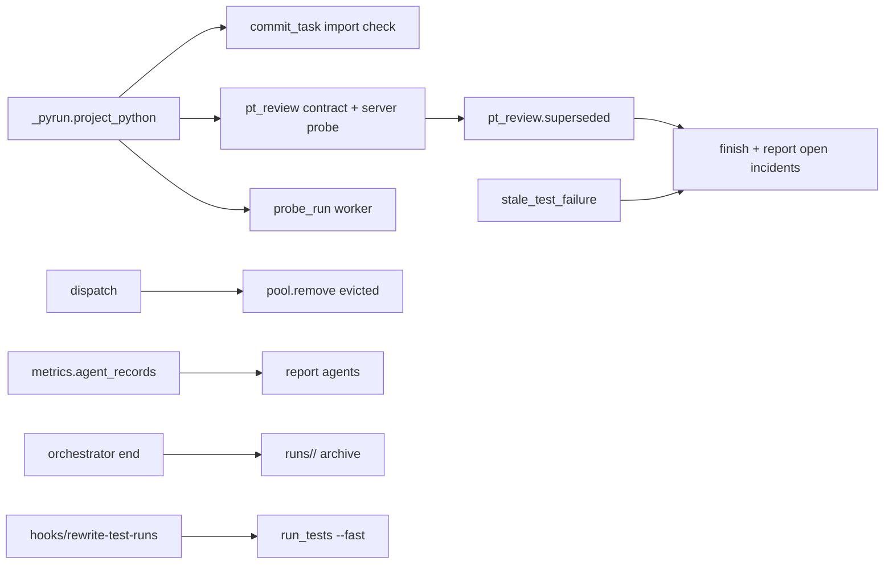
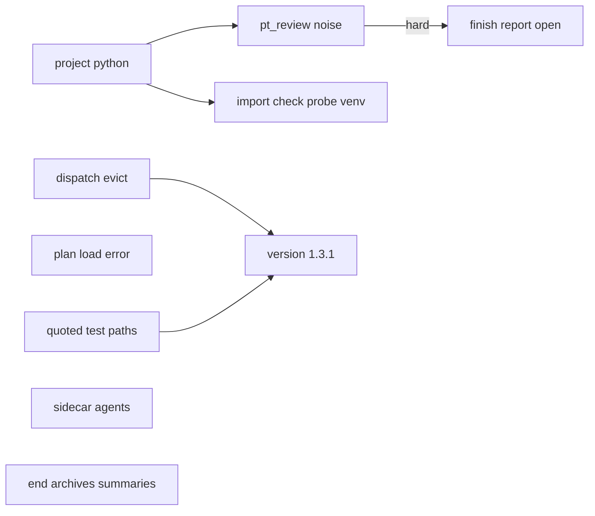

# Superlite 1.3.1: false-incident noise batch

**Goal:** a run reports only incidents that are real: checks run in the project's Python, plan prose is not read as symbols, a fixed location stays fixed, stale TDD-red failures and sidecar agents are not counted, an evicted agent is never offered, an unreadable plan is a clean error, quoted test paths are not split, and per-run test summaries are archived.
**Architecture:** independent edits to the stdlib Python scripts under `skills/subagent-driven-development/scripts/`, one in `skills/subagent-driven-development/probes/probe_run.py` and one in `hooks/rewrite-test-runs`; each task has its own new pytest file under `tests/scripts/`.
**Tech stack:** Python 3.10+ stdlib; bash that also runs on macOS bash 3.2; pytest (auto-detected, `uv run --no-project --with pytest`).
**Issues:** #41 #48 #26 #25 #11 #46 #51 #52 #27
**Detail:** contracts
**Target-min:** 11
**Wave0:** none

Global constraints:
- Every script line carries a trailing `# O(...)` complexity comment, as the existing lines do. Stdlib only. CLI contract: results on stdout, notes and errors on stderr, exit 0 ok, 1 check failed, 2 usage error.
- Existing tests in `tests/scripts/` stay green; new tests go into the files named in `Owns`. Reuse `tests/scripts/_fixtures.py` and `conftest.py` helpers.
- Hook code runs on bash 3.2: no `${x,,}`, no `$'\u'`, builtins only in the hot path.
- Run `sl` as an executable (`<abs>/sl ...`), not as `bash <abs>/sl ...`: this session's worktree guard refuses `bash <script>`.
- Versions change only through `scripts/bump-version.sh 1.3.1`; `scripts/bump-version.sh --audit` must report nothing missed.

## File structure

(`scripts/` = `skills/subagent-driven-development/scripts/`.)
- `scripts/_pyrun.py`: pick the project interpreter (T1).
- `scripts/pt_review.py`: symbol names from Produces, superseded locations, project interpreter for introspection and server probes (T2).
- `scripts/commit_task.py`, `skills/subagent-driven-development/probes/probe_run.py`: project interpreter for the import check and the probe worker (T3).
- `scripts/finish.py`, `scripts/report.py`: open incidents without superseded or stale entries (T4).
- `scripts/dispatch.py`, `scripts/pool.py`: evicted agents leave the pool (T5).
- `scripts/plan_tools.py`: unreadable plan raises PlanError (T6).
- `hooks/rewrite-test-runs`: quoted test paths pass unchanged (T7).
- `scripts/metrics.py`: sidecar agents are not agents (T8).
- `scripts/orchestrator.py`: `end` archives per-run test summaries (T9).
- Version files (T10).

```mermaid
%% schedule
gantt
  title Predicted schedule (mm:ss)
  dateFormat X
  axisFormat %M:%S
  section lane 1
  T5 dispatch  an evicted agent is never o :t5, 0, 121s
  T4 finish and report  open incidents mat :t4, 222, 121s
  section lane 2
  T1 _pyrun  project interpreter :t1, 0, 92s
  T2 pt_review  prose is not a symbol  new :t2, 92, 130s
  section lane 3
  T6 plan_tools  unreadable plan raises Pl :t6, 0, 91s
  T3 commit_task and probe_run  project in :t3, 92, 121s
  section lane 4
  T7 rewrite-test-runs  quoted test paths  :t7, 0, 91s
  section lane 5
  T8 metrics  sidecar agents are not count :t8, 0, 91s
  section lane 6
  T9 orchestrator end  archive per-run tes :t9, 0, 91s
  section lane 7
  T10 version 1.3.1 :t10, 0, 90s
```

critical path: T1 → T2 → T4 (5.7 min) · peak width 7 · predicted build 5.7 min · predicted total ≈ 9.2 min (target ✓)

## Predicted schedule

## Section A: scripts

**Probe entry:** none (Python CLIs and a bash hook, tested through pytest; cases are named tests).
App type: CLI / file I/O. Categories: protocol (flags, exit codes, hook stdout), file (venv paths, archives), encoding (quoted shell words), state (incident log, pool.json, metrics log).

### T1 _pyrun: project interpreter · Complexity 2 · Est. context 22k
**Owns:** skills/subagent-driven-development/scripts/_pyrun.py, tests/scripts/test_project_python.py
**Components:** 1
**LOC owned:** 40
**Tests:** fast
**Kind:** mechanical
**Model:** haiku
**Est. time:** 1.5 min (1 component, about 40 LOC, fast tests)
**Consumes:** none
**Produces:** _pyrun.project_python(root) -> str
e.g. `root/.venv/bin/python` exists (POSIX; Windows `root/.venv/Scripts/python.exe`) -> `str(root / ".venv/bin/python")`
e.g. no `root/.venv`, env `VIRTUAL_ENV=/x/venv` and `/x/venv/bin/python` exists -> `"/x/venv/bin/python"`
e.g. neither exists -> `sys.executable`
**Review Focus:** `test_root_venv_wins`: both `root/.venv` and `VIRTUAL_ENV` exist -> the root one; `test_virtual_env_used`; `test_falls_back_to_sys_executable`; `test_missing_interpreter_file_ignored`: a `.venv` folder without the python file -> fallback.
**Steps:** 1 failing tests, 2 run: FAIL, 3 implement, 4 run: PASS
**Notes:** `root` may be a str or Path. Check with `is_file()`, never run the interpreter. Update the module docstring.

### T2 pt_review: prose is not a symbol, newest entry wins, project interpreter · Complexity 5 · Est. context 48k
**Owns:** skills/subagent-driven-development/scripts/pt_review.py, tests/scripts/test_pt_review_noise_batch.py
**Components:** 2
**LOC owned:** 130
**Tests:** fast
**Kind:** design
**Model:** sonnet
**Est. time:** 4.5 min (2 components, about 130 LOC, fast tests)
**Consumes:** _pyrun.project_python(root) -> str (T1) · existing `pt_review.planned_items`, `pt_review.incident_items`, `pt_review.read_real`, `pt_review.RESOLVED`, `pt_review.DECL_PATTERNS`
**Produces:** pt_review.symbol_names(item: str) -> list[str] · pt_review.superseded(entries: list[dict]) -> set[tuple[str, int]]
e.g. `symbol_names("`Theme.Symbol.libraryTag`")` -> `["Theme.Symbol.libraryTag"]`
e.g. `symbol_names("Package.swift platforms [.iOS(.v17)], targets Kit, init order")` -> `[]`
e.g. `symbol_names("Strings.libraryMoreTags(_ n: Int) -> String")` -> `["Strings.libraryMoreTags"]`
e.g. `symbol_names("`Foo.bar` and `Baz`")` -> `["Foo.bar", "Baz"]`
e.g. `symbol_names("LibraryView: View")` -> `["LibraryView"]`
e.g. `superseded([{"file":"a.py","line":3,"kind":"exception","resolution":"open"}, {"file":"a.py","line":3,"kind":"exception","resolution":"fixed"}])` -> `{("a.py", 3)}`; the same two in reverse order -> `set()`
**Review Focus:** `test_backticked_symbols_only`; `test_prose_item_yields_nothing`: a Swift task whose Produces is `Package.swift platforms [...]` gives no `not declared` mismatch for `swift`, `targets` or `init`; `test_file_name_is_not_a_symbol`: `` `Package.swift` `` -> `[]`; `test_signature_item_still_checked`: an undeclared `Foo.missing(x: Int) -> Int` is still exactly one mismatch naming `missing`; `test_fixed_after_open_is_resolved`: `incident_items` on the open-then-fixed pair gives no item marked unresolved; `test_open_after_fixed_stays_open`; `test_verified_entries_ignored_by_superseded`; `test_read_real_uses_project_python` and `test_server_probe_uses_project_python`: argv[0] is `project_python(root)` (monkeypatch); existing `test_pt_review*.py` stay green.
**Steps:** 1 failing tests, 2 run: FAIL, 3 implement, 4 run: PASS
**Notes:** `symbol_names` rule: backticked spans that start with an identifier give their leading dotted name (up to `(`, `:`, `<` or a space); without backticks, only the leading dotted identifier and only when it is followed by the end, `(`, `:`, `<` or ` ->`; anything else is prose and gives `[]`. Drop a name whose last dotted part is a known file suffix (`DECL_PATTERNS` keys, plus `py md json yml yaml toml txt`). `planned_items` makes one Planned per name in its name-only branch; Python signature parsing (`parse_sig`) is unchanged. `superseded` ignores `kind == "verified"`, compares resolutions case-insensitively against `RESOLVED`; `incident_items` sets `unresolved` from the newest entry only (repeated and low-confidence stay as they are). Replace `sys.executable` in `read_real` and the server probe Popen with `pyrun.project_python(root)`; leave `_ADAPTER_RUN` alone. Do not touch `parse_plan` or `plan_tools.py`.

### T3 commit_task and probe_run: project interpreter · Complexity 4 · Est. context 40k
**Owns:** skills/subagent-driven-development/scripts/commit_task.py, skills/subagent-driven-development/probes/probe_run.py, tests/scripts/test_project_python_callers.py
**Components:** 2
**LOC owned:** 60
**Tests:** fast
**Kind:** design
**Model:** sonnet
**Est. time:** 3 min (2 components, about 60 LOC, fast tests)
**Consumes:** _pyrun.project_python(root) -> str (T1) · existing `commit_task.import_errors(files, roots=None)`
**Produces:** commit_task.import_errors(files, roots=None, root=".") -> list (runs under project_python(root))
e.g. a uv project fixture whose `.venv/bin/python` is a stub script recording its argv -> `import_errors(["pkg/a.py"])` invokes that stub, not `sys.executable`
e.g. no `.venv` -> argv[0] is `sys.executable` (unchanged behaviour)
**Review Focus:** `test_import_check_uses_project_venv`; `test_import_check_without_venv_unchanged`; `test_probe_worker_uses_project_python`: the probe worker spawn's argv[0] is `project_python(root)` (monkeypatch `subprocess.Popen` or the spawn helper); `test_failed_import_check_names_interpreter`: a crash message includes the interpreter path; existing commit and probe tests stay green.
**Steps:** 1 failing tests, 2 run: FAIL, 3 implement, 4 run: PASS
**Notes:** `probe_run.py` lives in `probes/`; import `_pyrun` from `../scripts` the way that file already reaches script modules (add the path once if it does not). Change only the worker spawn (the `--worker` command); the self-respawn for `--commit` stays on `sys.executable`. The venv interpreter keeps `-I` in the import check.

### T4 finish and report: open incidents match the packet · Complexity 3 · Est. context 34k
**Owns:** skills/subagent-driven-development/scripts/finish.py, skills/subagent-driven-development/scripts/report.py, tests/scripts/test_finish_open_incidents.py
**Components:** 2
**LOC owned:** 60
**Tests:** fast
**Kind:** design
**Model:** sonnet
**Est. time:** 2.5 min (2 components, about 60 LOC, fast tests)
**Consumes:** pt_review.superseded(entries: list[dict]) -> set[tuple[str, int]] (T2) · existing `pt_review.stale_test_failure(entry, summary)`, `pt_review.load_summary(path)`, `pt_review.newest_summary_path(path)`, `finish.open_incidents(path)`
**Produces:** finish.open_incidents(path, summary: dict | None = None) -> list[dict]
e.g. log: `test-failure` open at `tests/test_a.py:1` context `tests/test_a.py::test_x failed`, summary `{"files": {"tests/test_a.py": [3, 0]}, "failures": []}` -> `[]`
e.g. log: `exception` open then `exception` fixed at `a.py:3` -> `[]`
e.g. log: one open `exception` at `b.py:2`, no summary -> that entry
**Review Focus:** `test_stale_tdd_red_dropped`; `test_superseded_location_dropped`; `test_open_kept_without_summary`; `test_summary_header_matches_filtered_count`: `finish.summary` with a `.superlite/test-summary.json` prints `open incidents: 1` for a log of one real and two stale entries; `test_report_open_incidents_filtered`: the report's `open_incidents` uses the same filter.
**Steps:** 1 failing tests, 2 run: FAIL, 3 implement, 4 run: PASS
**Notes:** `superseded` runs over all parsed entries (resolved ones included), before the open filter. `finish.summary` and `report` load the summary as the packet does: `load_summary(newest_summary_path(sl_dir / "test-summary.json"))`. Import `pt_review` lazily inside the function.

### T5 dispatch: an evicted agent is never offered · Complexity 4 · Est. context 40k
**Owns:** skills/subagent-driven-development/scripts/dispatch.py, skills/subagent-driven-development/scripts/pool.py, tests/scripts/test_dispatch_evict.py
**Components:** 2
**LOC owned:** 60
**Tests:** fast
**Kind:** design
**Model:** sonnet
**Est. time:** 3 min (2 components, about 60 LOC, fast tests)
**Consumes:** existing `dispatch.plan_dispatch`, `dispatch.run`, `pool.load`, `pool.save`
**Produces:** pool.remove(data: dict, aid: str) -> bool · dispatch.run(...) removes every evicted agent from pool.json before it returns
e.g. pool: idle sonnet agent `a1` with 3 tasks done, one ready sonnet task -> stderr `evict=a1 3 tasks done`, stdout `T2 fresh tier=sonnet agent=superlite:implementer`, `a1` no longer in pool.json
e.g. `pool.remove(data, "zz")` for an unknown id -> `False`, data unchanged
**Review Focus:** `test_evicted_not_on_any_line`: across `agent=`, `poll` and lane lines; `test_evicted_removed_from_pool_file`; `test_second_run_does_not_reevict`; `test_commit_task_dispatch_never_offers_evicted`: `commit_task Tn --dispatch` output, same assertion; `test_pool_remove_unknown_id`; `test_pool_cli_remove`: `sl pool remove ID` prints one line and exits 0.
**Steps:** 1 reproduce the issue as a failing test, 2 run: FAIL, 3 implement, 4 run: PASS
**Notes:** Try to reproduce first through `commit_task --dispatch` and through two ready tasks of different tiers; if no path reproduces the overlap, the removal from pool.json is the fix and the test asserts disjointness. Save through `pool.save` (atomic) only when something was removed. Add `remove` to the pool CLI subcommands.

### T6 plan_tools: unreadable plan raises PlanError · Complexity 1 · Est. context 20k
**Owns:** skills/subagent-driven-development/scripts/plan_tools.py, tests/scripts/test_plan_load_errors.py
**Components:** 1
**LOC owned:** 30
**Tests:** fast
**Kind:** mechanical
**Model:** haiku
**Est. time:** 1.5 min (1 component, about 30 LOC, fast tests)
**Consumes:** existing `plan_tools.Plan.load(path)`, `plan_tools.PlanError(message, code=2)`
**Produces:** plan_tools.Plan.load(path) -> Plan (raises PlanError on OSError and UnicodeDecodeError)
e.g. a plan file with mode 000 -> `PlanError` whose message starts `plan not readable: <path>`, `code == 2`
e.g. a directory path -> `PlanError` (`plan not found: <path>`, unchanged)
e.g. invalid UTF-8 bytes -> `PlanError` starting `plan not readable: <path>`
**Review Focus:** `test_unreadable_plan_is_plan_error` (skip on Windows and when running as root); `test_invalid_utf8_is_plan_error`; `test_cli_unreadable_plan_no_traceback`: `sl plan_tools lint --plan <unreadable>` exits 2, stderr has no `Traceback`.
**Steps:** 1 failing tests, 2 run: FAIL, 3 implement, 4 run: PASS

### T7 rewrite-test-runs: quoted test paths pass unchanged · Complexity 2 · Est. context 28k
**Owns:** hooks/rewrite-test-runs, tests/scripts/test_rewrite_quoted_paths.py
**Components:** 1
**LOC owned:** 30
**Tests:** fast
**Kind:** mechanical
**Model:** haiku
**Est. time:** 1.5 min (1 component, about 30 LOC, fast tests)
**Consumes:** existing `files_from_seg` in `hooks/rewrite-test-runs`
**Produces:** a test-runner segment whose arguments contain `"` or `'` is left unrewritten (coordinator: exit 0, no stdout, no `rule-rewrite` incident; subagent: not denied)
e.g. coordinator `pytest "tests/my dir/a.py"` -> exit 0, empty stdout
e.g. coordinator `pytest tests/a.py` -> rewritten to `run_tests --fast tests/a.py` as today
e.g. subagent `pytest 'tests/my dir/a.py'` -> exit 0 (not the full-suite denial)
**Review Focus:** `test_double_quoted_path_unchanged`; `test_single_quoted_path_unchanged`; `test_unquoted_path_still_rewritten`; `test_subagent_quoted_not_denied`; `test_chained_quoted_segment_unchanged`: `cd x && pytest "a b/t.py"` passes unchanged; the hook runs under `/bin/bash` 3.2 on macOS (`test_hooks_bash32.py` stays green).
**Steps:** 1 failing tests, 2 run: FAIL, 3 implement, 4 run: PASS
**Notes:** Drive the hook as `tests/scripts/test_rewrite_test_runs.py` does (same run-marker setup). Builtins only.

### T8 metrics: sidecar agents are not counted · Complexity 2 · Est. context 26k
**Owns:** skills/subagent-driven-development/scripts/metrics.py, tests/scripts/test_metrics_sidecar.py
**Components:** 1
**LOC owned:** 25
**Tests:** fast
**Kind:** mechanical
**Model:** haiku
**Est. time:** 1.5 min (1 component, about 25 LOC, fast tests)
**Consumes:** existing `metrics.agent_records(sl_dir)`
**Produces:** metrics.agent_records(sl_dir) -> list (skips ids with no launch event whose stop events all have an empty `type`)
e.g. metrics.jsonl: launch+stop for `i1` type `superlite:implementer`, stop only for `s1` type `""` -> one record, agent `i1`
e.g. stop only for `i2` type `superlite:implementer` -> kept (the launch hook missed it)
**Review Focus:** `test_sidecar_stop_skipped`; `test_stop_only_with_type_kept`; `test_launch_without_type_kept`; `test_report_agent_count_ignores_sidecars`: `report` on the fixture counts 1 agent; existing `test_metrics_*.py` stay green.
**Steps:** 1 failing tests, 2 run: FAIL, 3 implement, 4 run: PASS

### T9 orchestrator end: archive per-run test summaries · Complexity 2 · Est. context 24k
**Owns:** skills/subagent-driven-development/scripts/orchestrator.py, tests/scripts/test_orchestrator_end_summaries.py
**Components:** 1
**LOC owned:** 20
**Tests:** fast
**Kind:** mechanical
**Model:** haiku
**Est. time:** 1.5 min (1 component, about 20 LOC, fast tests)
**Consumes:** existing `orchestrator.end(sd)`, `orchestrator.RUN_FILES`
**Produces:** orchestrator.end(sd: Path) -> str (also moves `test-summary-*.json`, `test-summary-*.log` and `test-summary.latest`)
e.g. sd with `pool.json`, `test-summary.json`, `test-summary-a.json`, `test-summary-a.log`, `test-summary.latest` -> all five in `runs/<time>/`, line `orchestrator: run ended; 5 files moved to ...`
e.g. sd with only `test-summary-a.json` -> it is moved (a run with nothing else still archives its summaries)
**Review Focus:** `test_end_moves_run_summaries`; `test_end_only_summaries`; `test_end_keeps_config_and_probes`: `test-cmd.json`, `probes/` and `checkpoints.json` stay; `test_end_nothing_to_end`: an empty sd still prints `nothing to end`.
**Steps:** 1 failing tests, 2 run: FAIL, 3 implement, 4 run: PASS

### T10 docs and version 1.3.1 · Complexity 2 · Est. context 25k
**Owns:** docs/tools.md, docs/hooks.md, package.json, .hermes-plugin/plugin.yaml, .claude-plugin/plugin.json, .cursor-plugin/plugin.json, .codex-plugin/plugin.json, .devin-plugin/plugin.json, .kimi-plugin/plugin.json, .muse-plugin/plugin.json, .claude-plugin/marketplace.json, .muse-plugin/marketplace.json, gemini-extension.json
**Components:** 1
**LOC owned:** 20
**Tests:** fast
**Kind:** design
**Model:** sonnet
**Est. time:** 1.5 min (docs rows and version strings)
**Consumes:** none
**Produces:** none
**Review Focus:** `docs/tools.md` `pool` row lists `remove ID`; `docs/hooks.md` `rewrite-test-runs` line says a test command with a quoted argument passes unchanged; `scripts/bump-version.sh 1.3.1` run and `scripts/bump-version.sh --audit` clean; `tests/scripts/test_docs_contract.py` stays green.
**Steps:** 1 edit the two doc lines, 2 run `scripts/bump-version.sh 1.3.1` and `--audit`, 3 run `tests/scripts/test_docs_contract.py`

## Self-review

Coverage: #41 T1 T2 T3; #48 T2; #26 T2 T4; #25 T4; #11 T8; #46 T5; #51 T6; #52 T7; #27 T9; version T10. No two parallel tasks share a file. Edges are execution dependencies only (T2 and T3 call T1's function; T4 calls T2's).
