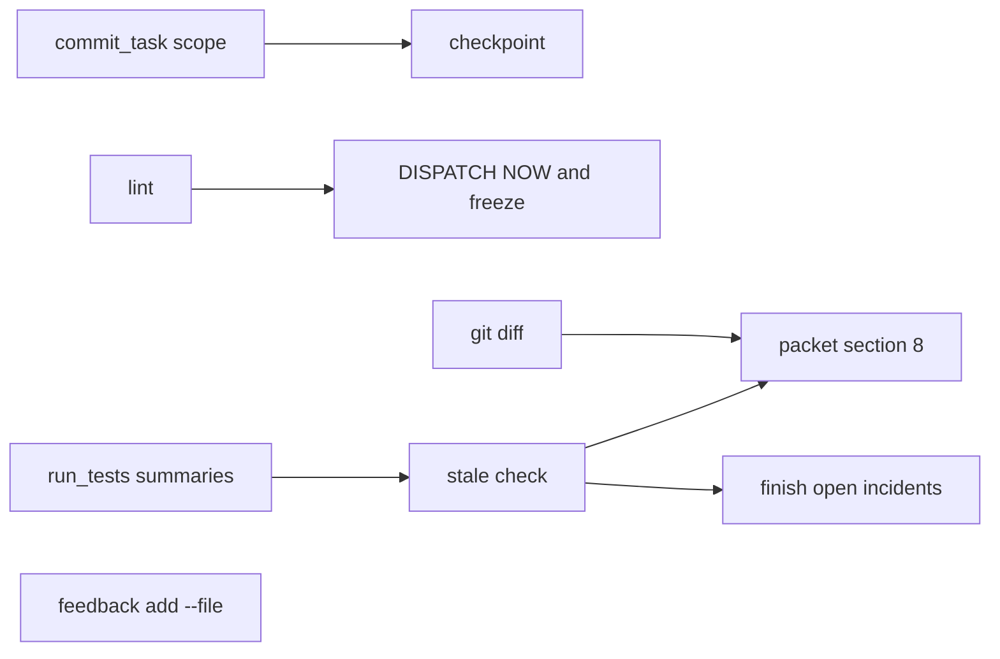
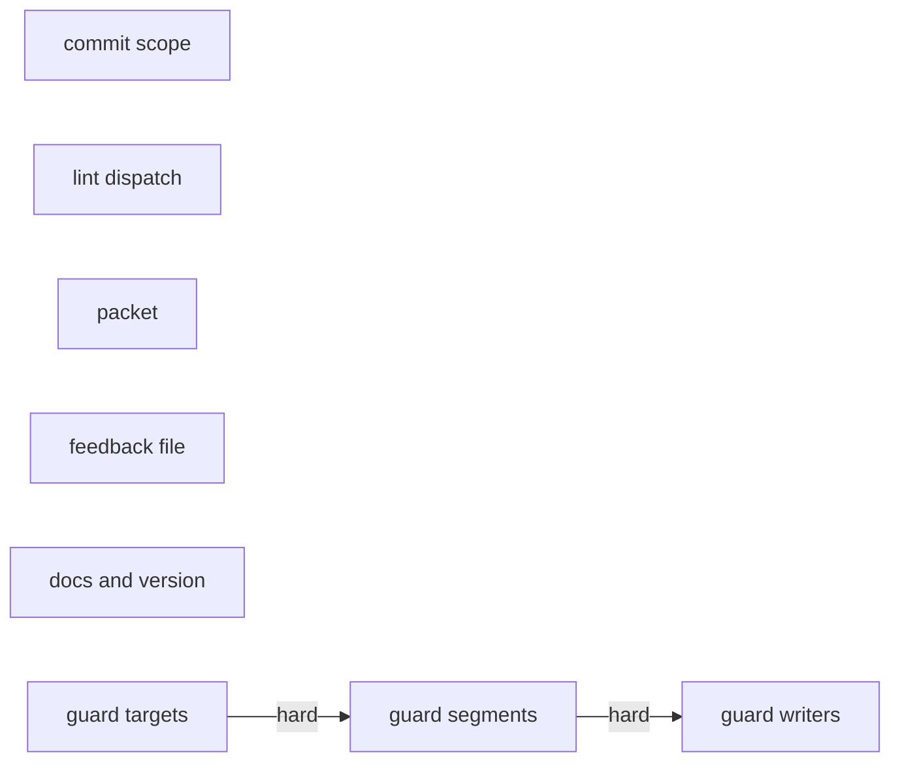

# Superlite 1.3.3: run-tool friction

**Goal:** the friction that cost the 1.3.2 run the most is gone: `commit_task` stops re-asking for files already recorded, lint names only tasks that can start, the review packet shows the changed files that matter and reads the whole run's summaries, and the worktree limits are documented.
**Architecture:** one task per script group, no shared files, no edges: `commit_task.py` (T1), `plan_tools.py` (T2), `pt_review.py` with `finish.py` (T3), `feedback.py` (T4), docs, config and version (T5). A separate independent review of `hooks/block-coordinator-edits` runs alongside; its findings, if any, become a follow-up task.
**Tech stack:** Python 3.10+ stdlib; pytest; bash 3.2 for hooks.
**Spec:** the issue bodies of #61 #44 #59 #42 #62 #55 #63 #56 #58.
**Issues:** #61 #44 #59 #42 #62 #55 #63 #56 #58
**Detail:** contracts
**Target-min:** 11
**Wave0:** none

Global constraints:
- Every Python script line carries a trailing `# O(...)` complexity comment, as the existing lines do.
- Existing tests stay green unchanged, except where a task names a change. New tests go into the files named in `Owns`.
- Stdlib only in `skills/subagent-driven-development/scripts/`.
- Run `sl` as an executable (`<abs>/sl ...`), never as `bash <abs>/sl ...`; no `sl` inside a for loop.
- Versions change only through `scripts/bump-version.sh 1.3.3`; `scripts/bump-version.sh --audit` must report nothing missed.

Ruling: #61 mechanism - a file that is out of scope but unchanged against the parent checkpoint was already recorded, so it no longer blocks; no ledger parsing - a real later edit of that file still needs `--also` - cost if wrong: one extra `--also`.
Ruling: #44 option - a `docs.md` in the folder of an owned path, or in any parent folder, joins the task's commit instead of a lint warning, because the project rule forces these edits - another task's explicit Owns wins - cost if wrong: two parallel tasks both record the root `docs.md`.
Ruling: #62 cap - hook files get 400 diff lines per file, others keep 120, the 600-line total stays; the `Left out:` list comes first in the section so no cap can cut it - cost if wrong: a large hook diff still gets truncated, and says so.
Ruling: #55 option - the newest summary that covers a test file decides whether its failure is stale; the packet does not wait for the run started in the same message - cost if wrong: a failure covered only by an older green run reads as stale.
Ruling: #42 freeze - a task freezes only once the ledger or pool shows it was sent; being listed by lint no longer freezes it - cost if wrong: a task sent without its `THEN LOG` line can be rewritten.
Ruling: guard review - an extra `superlite:final-reviewer` pass on the hook, approved by Max against the fixing.md default of no extra reviewer; findings become task T6, written when they arrive; no findings, no T6 - cost if wrong: one Opus call.

## File structure

- `skills/subagent-driven-development/scripts/commit_task.py`, `tests/scripts/test_commit_scope_batch.py`: T1.
- `skills/subagent-driven-development/scripts/plan_tools.py`, `tests/scripts/test_lint_dispatch_now.py`: T2.
- `skills/subagent-driven-development/scripts/pt_review.py`, `skills/subagent-driven-development/scripts/finish.py`, `tests/scripts/test_packet_batch.py`: T3.
- `skills/subagent-driven-development/scripts/feedback.py`, `tests/scripts/test_feedback_file.py`: T4.
- `.version-bump.json`, the manifests it lists, `docs/tools.md`, `skills/subagent-driven-development/SKILL.md`, `skills/using-superlite/references/claude-code-tools.md`, `tests/scripts/test_tool_notes.py`: T5.

## Task graph

```mermaid
%% schedule
gantt
  title Predicted schedule (mm:ss)
  dateFormat X
  axisFormat %M:%S
  section lane 1
  T3 packet  hunks of changed files  summa :t3, 0, 132s
  section lane 2
  T1 commit_task  recorded files stay acce :t1, 0, 130s
  section lane 3
  T2 lint  DISPATCH NOW names startable ta :t2, 0, 101s
  section lane 4
  T5 docs  audit exclude and version 1.3.3 :t5, 0, 92s
  section lane 5
  T4 feedback add reads its text from a fi :t4, 0, 92s
```

critical path: T3 (2.2 min) · peak width 5 · predicted build 2.2 min · predicted total ≈ 5.7 min (target ✓)

## Run scripts

**Probe entry:** none (run tools covered by named pytest cases)

### T1 commit_task: recorded files stay accepted, docs.md joins its folder's task · Complexity 5 · Est. context 40k
**Owns:** skills/subagent-driven-development/scripts/commit_task.py, tests/scripts/test_commit_scope_batch.py
**Components:** 2
**LOC owned:** 130
**Tests:** fast
**Model:** sonnet
**Est. time:** 3 min (2 components, about 130 LOC, fast tests)
**Covers:** #61, #44
**Produces:** none consumed by another task.
**Review Focus:** state, file: `test_also_file_changed_again_blocks`, `test_also_deleted_file_accepted`, `test_docs_md_owned_by_other_left_alone`.
**Test code:** `tests/scripts/test_commit_scope_batch.py`, using the helpers of `tests/scripts/test_commit_also.py`, checkpoint mode unless named:
- `test_also_file_stays_accepted`: T1 owns a.py, T2 owns b.py, x.md is unowned. `commit_task T1 --also x.md --ruling r` exits 0. After changing b.py, `commit_task T2` with no `--also` exits 0, prints no `out-of-scope`, and the T2 checkpoint entry's files are exactly `["b.py"]`.
- `test_also_file_changed_again_blocks`: same, but x.md changes again before T2: exit 1, prints `out-of-scope x.md`.
- `test_also_deleted_file_accepted`: tracked x.md deleted, recorded with `--also` by T1; T2 commits with exit 0.
- `test_deleted_file_not_recorded_blocks`: tracked x.md deleted, never recorded; T2 exits 1 with `out-of-scope x.md`.
- `test_also_several_files_one_flag`: `commit_task T1 --also x.md y.md --ruling r` records both; the ledger has two `Ruling: T1 also commits` lines.
- `test_also_repeated_flag_still_works`: `--also x.md --also y.md --ruling r` records both.
- `test_folder_docs_md_joins_task`: T1 owns src/pkg/a.py; root `docs.md`, `src/docs.md` and `src/pkg/docs.md` changed: all three are in T1's checkpoint.
- `test_other_folder_docs_md_blocks`: `lib/docs.md` changed, T1 owns src/pkg/a.py: exit 1, `out-of-scope lib/docs.md`.
- `test_docs_md_owned_by_other_left_alone`: T2 owns `src/pkg/docs.md`: T1's checkpoint leaves it out, exit 0.
- `test_blocked_incident_resolved_by_later_commit`: T1 blocked on stray.py (exit 1, open incident at `(stray.py, 0)`), then `commit_task T1 --also stray.py --ruling r` exits 0; `finish.open_incidents` no longer lists stray.py.
- `test_commit_mode_unchanged`: with `SUPERLITE_AUTOCOMMIT=0` an out-of-scope file still blocks.
**Steps:** 1 failing tests, 2 run: FAIL, 3 implement, 4 run: PASS.
**Notes:** In `commit_one`, filter `out_of_scope` through `changed_vs_parent` before the block, only outside autocommit. `changed_vs_parent` runs `git hash-object` on every path, which fails on a deleted file: treat a deleted path as changed when the parent tree has it and unchanged when it does not. `--also` becomes `action="extend", nargs="+"`. The `docs.md` rule is an `elif` after the `nt.owns_match(f, other)` branch: name is exactly `docs.md`, and an entry of `owns` lies under its folder (root `docs.md`: any owned path). After a successful commit or checkpoint, each file in `mine` with an open `blocked by commit_task` incident gets a resolved entry at the same location through `log_incidents`' route with resolution `resolved`.

### T2 lint: DISPATCH NOW names startable tasks, freeze keys on dispatch · Complexity 4 · Est. context 38k
**Owns:** skills/subagent-driven-development/scripts/plan_tools.py, tests/scripts/test_lint_dispatch_now.py
**Components:** 1
**LOC owned:** 90
**Tests:** fast
**Model:** sonnet
**Est. time:** 2.5 min (1 component, about 90 LOC, fast tests)
**Covers:** #59, #42
**Produces:** none consumed by another task.
**Review Focus:** state, protocol: `test_listed_never_sent_not_frozen`, `test_sent_task_still_frozen`.
**Test code:** `tests/scripts/test_lint_dispatch_now.py`, run through `plan_tools lint --stable`:
- `test_waiting_task_not_in_dispatch_now`: T1, T2 stable, edge T1 --> T2, nothing committed: output has `DISPATCH NOW: T1`; `STABLE: T1 T2` is unchanged; the `THEN LOG` line names T1 and not T2.
- `test_ready_after_commit`: ledger holds `- commit T1 abc123`: `DISPATCH NOW: T2`.
- `test_send_before_edit_ready_only`: plus a FIX task T3: `SEND BEFORE ANY PLAN EDIT:` names T1 and not T2.
- `test_pending_field_ready_only`: `pending` in the lint record is `["T1"]`.
- `test_draft_not_dispatched`: T2 has `**Status:** draft`, no edges: `DISPATCH NOW: T1`.
- `test_listed_never_sent_not_frozen`: lint, then change T2's `Produces` and lint again, with no `unblocked:` line and no pool: no `FROZEN` in the output.
- `test_sent_task_still_frozen`: ledger holds `- unblocked: dispatched T1 at 10:00:00; waiting on fixes: none`; change T1's `Produces`: `FROZEN: T1 interface changed after dispatch`.
- `test_finish_no_false_never_dispatched`: T1 logged as dispatched, T2 waiting on it at the last lint: `finish`'s unblocked line starts `unblocked: yes`.
**Steps:** 1 failing tests, 2 run: FAIL, 3 implement, 4 run: PASS.
**Notes:** `pending` near line 1442 keeps stable, unsent tasks whose taskgraph dependencies are all in the ledger's `- commit Tn` lines and which are not drafts; use the same committed source as `dispatch`. `stable` itself and `stable.json`'s `stable` list do not change. `frozen_ids` near line 1418 becomes `sent` alone. `tests/scripts/test_stable_split.py` stays green; a case that relied on listed-means-frozen is the one named change: seed it with an `unblocked:` line and say so in your report.

### T3 packet: hunks of changed files, summaries of the whole run · Complexity 5 · Est. context 44k
**Owns:** skills/subagent-driven-development/scripts/pt_review.py, skills/subagent-driven-development/scripts/finish.py, tests/scripts/test_packet_batch.py
**Components:** 2
**LOC owned:** 140
**Tests:** fast
**Model:** sonnet
**Est. time:** 3.5 min (2 components, about 140 LOC, fast tests)
**Covers:** #62, #55
**Produces:** none consumed by another task.
**Review Focus:** file, state: `test_left_out_survives_size_cap`, `test_newest_covering_summary_decides`, `test_checkpoint_diff_used`.
**Test code:** `tests/scripts/test_packet_batch.py`, on a temporary git repo as in `tests/scripts/test_packet_stale.py`:
- `test_changed_file_without_item_gets_hunks`: `hooks/guard` (no extension) changed, no incidents: section 8 has `### hooks/guard` and a changed line of it.
- `test_order_hot_hooks_code_rest`: hot `src/a.py`, changed `hooks/guard`, `src/b.py`, `tests/test_b.py`, `README.md`: headings appear in that order.
- `test_hook_cap_400`: a 300-line hook diff is shown whole; a 500-line one stops at 400 with the existing `(truncated: ...)` note; a non-hook stops at 120.
- `test_left_out_named`: total cap exhausted: section 8 starts with one line `Left out: <files>` naming each changed file with no hunks shown.
- `test_left_out_survives_size_cap`: small `--max-tokens`: the `Left out:` line is still present.
- `test_nothing_left_out_no_line`: all fit: no `Left out:` line.
- `test_checkpoint_diff_used`: with a checkpoint entry the file list comes from `git diff --name-only base <checkpoint>`.
- `test_focused_summary_keeps_stale`: failure incident for `tests/a.py::test_x`; `test-summary-1.json` shows tests/a.py green; newest `test-summary.json` covers only tests/b.py: the incident is stale, the packet counts 0 open.
- `test_newest_covering_summary_decides`: an older summary green, a newer one red on tests/a.py: the incident stays open.
- `test_no_covering_summary_stays_open`: no summary covers the file: open.
- `test_finish_matches_packet`: `finish.open_incidents` gives the same result on both cases above.
**Steps:** 1 failing tests, 2 run: FAIL, 3 implement, 4 run: PASS.
**Notes:** New `pt_review.run_summaries(path: Path) -> list[dict]`, newest first: `newest_summary_path(path)`, then `path`, then `test-summary-*.json` beside it by mtime, unreadable ones skipped, no duplicates. New `pt_review.stale_in_run(entry: dict, summaries: list[dict]) -> bool`: the first summary with the entry's file in `files` decides through `stale_test_failure`; none covers it: False. A non test-failure entry stays False. The packet's line 1732 and `finish.open_incidents` use these; `read_test_summary` keeps reading the newest summary. `wait_for_full` does not change. Excerpt order: hot files, then changed paths under `hooks/`, then other changed code, then tests and `*.md`. Add `EXCERPT_HOOK_LINES = 400`.

### T4 feedback add reads its text from a file or stdin · Complexity 2 · Est. context 24k
**Owns:** skills/subagent-driven-development/scripts/feedback.py, tests/scripts/test_feedback_file.py
**Components:** 1
**LOC owned:** 40
**Tests:** fast
**Kind:** mechanical
**Model:** haiku
**Est. time:** 1.5 min (1 component, about 40 LOC, fast tests)
**Covers:** #63
**Produces:** none consumed by another task.
**Review Focus:** none in deep, numeric, state or protocol; named tests below.
**Test code:** `tests/scripts/test_feedback_file.py`, with `SUPERLITE_HOME` set to `tmp_path` as `tests/scripts/test_feedback.py` does:
- `test_add_from_file`: `feedback add --file note.txt`, note.txt holding `slow lint`: exit 0, the stored entry's text is `slow lint`.
- `test_add_from_stdin`: `feedback add --file -` with stdin `slow lint`: same.
- `test_add_text_still_works`: `feedback add "slow lint"`: same.
- `test_add_both_refused`: `feedback add "x" --file note.txt`: exit 2, stderr has `give the text or --file, not both`.
- `test_add_neither_refused`: `feedback add`: exit 2, stderr has `feedback text is empty`.
- `test_add_missing_file`: `--file nope.txt`: exit 2, stderr has `cannot read nope.txt`.
**Steps:** 1 failing tests, 2 run: FAIL, 3 implement, 4 run: PASS.
**Notes:** `text` becomes `nargs="?"`; add `--file PATH`, `-` for stdin. Read it at the top of `cmd_add`; the rest of `cmd_add` is unchanged.

### T5 docs, audit exclude and version 1.3.3 · Complexity 2 · Est. context 26k
**Owns:** .version-bump.json, package.json, .hermes-plugin/plugin.yaml, .claude-plugin/plugin.json, .cursor-plugin/plugin.json, .codex-plugin/plugin.json, .devin-plugin/plugin.json, .kimi-plugin/plugin.json, .muse-plugin/plugin.json, .claude-plugin/marketplace.json, .muse-plugin/marketplace.json, gemini-extension.json, docs/tools.md, skills/subagent-driven-development/SKILL.md, skills/using-superlite/references/claude-code-tools.md, tests/scripts/test_tool_notes.py
**Components:** 1
**LOC owned:** 45
**Tests:** fast
**Kind:** mechanical
**Model:** haiku
**Est. time:** 2 min (1 component, about 45 LOC, fast tests)
**Covers:** #56, #58
**Produces:** none consumed by another task.
**Review Focus:** none in deep, numeric, state or protocol; named tests below.
**Test code:** `tests/scripts/test_tool_notes.py`:
- `test_audit_excludes_run_state`: `audit.exclude` in `.version-bump.json` contains `.superlite`.
- `test_claude_code_fallback`: `claude-code-tools.md` contains `general-purpose` and `minus the frontmatter`.
- `test_claude_code_limits`: `claude-code-tools.md` contains `for loop` and `feedback add --file`.
- `test_also_doc`: the `commit_task` row in `docs/tools.md` contains `several files` and `docs.md`.
**Steps:** 1 write the tests, 2 run: FAIL, 3 edit, 4 run `scripts/bump-version.sh 1.3.3` and `scripts/bump-version.sh --audit`, 5 run the tests plus `tests/scripts/test_docs_contract.py`: PASS.
**Notes:** Add `.superlite` to `audit.exclude`. In `claude-code-tools.md`, after the plugin-agents line add: `` Agent types missing (plugin installed mid-session): `general-purpose` with the full text of `agents/<name>.md` minus the frontmatter, on the tier from its frontmatter. `` After the `sl` line add: `` In a worktree session the guard also refuses `sl` inside a for loop and a long free-text argument: one call per command, and `sl feedback add --file -` for long text. `` In `docs/tools.md` extend the `commit_task` row: `--also` takes several files, a file already recorded stays accepted until it changes again, and a `docs.md` in the folder of an owned path or a parent joins the task. In `SKILL.md` step 4 change the last sentence to: `` A task that must touch another task's file: `commit_task Tn --also F G --ruling "..."`; once recorded, it stays accepted until it changes again. ``

## Coordinator guard

Findings of the independent guard review, each reproduced on the real hook. Bash 3.2, builtins only in the hot path, LF. Every `test_blocks_*` case stays exit 2 and every existing allow case stays exit 0. T6, T7, T8 share the hook, so they run in order. `/proj` below is the test's project.

**Probe entry:** none (a hook; its Review Focus cases are named pytest cases)

### T6 guard: judge real targets · Complexity 6 · Est. context 40k
**Owns:** hooks/block-coordinator-edits, tests/scripts/test_guard_targets.py
**Components:** 2
**LOC owned:** 140
**Tests:** fast
**Model:** sonnet
**Est. time:** 3.5 min (2 components, about 140 LOC, fast tests)
**Produces:** none consumed by another task.
**Review Focus:** file, encoding: `test_quoted_target_judged`, `test_dots_resolved`, `test_join_absolute_part`.
**Test code:** `tests/scripts/test_guard_targets.py`, on the `proj` fixture and `bash`/`run` helpers of `tests/scripts/test_block_coordinator_edits.py`, with `T` an existing folder outside the project. Each command gives the named exit:
- `test_quoted_target_judged`: `cd T && echo x > "/proj/.superlite/orchestrator.json"` 2; `cd T && rm "/proj/src/a.py"` 2; `rm "T/x"` 0.
- `test_cd_only_when_it_moves`: `cd /nonexistent-dir; rm src/a.py` 2; `cd T | true; rm src/a.py` 2; `cd T; rm src/a.py` 0; `cd T && rm src/a.py` 0.
- `test_dots_resolved`: `cd src && rm ../b.py` 2; `rm ../<project folder name>/src/a.py` 2; `cd T && rm ../x` 0.
- `test_protected_dots_when_idle`: no `pool.json`: `echo x > .superlite/./orchestrator.json` 2.
- `test_project_variable_expanded`: `echo x > $CLAUDE_PROJECT_DIR/.superlite/orchestrator.json` 2; `echo x > ${CLAUDE_PROJECT_DIR}/src/a.py` 2.
- `test_join_absolute_part`: `python3 -c "import os; open(os.path.join('T','/proj/src/a.py'),'w')"` 2; `python3 -c "from pathlib import Path; (Path('T') / '/proj/src/a.py').write_text('x')"` 2; `python3 -c "import os; open(os.path.join('T','a.py'),'w')"` 0.
**Steps:** 1 failing tests, 2 run: FAIL, 3 implement, 4 run: PASS.
**Notes:** `project_code` receives `Q` for a quoted word near lines 109-123: keep the quoted text and judge it; a quoted word holding `$` or a backtick counts as unknown. A `cd X` moves the effective directory only when `[ -d X ]`, judged from the current effective directory, and it is not in a pipeline. Resolve `.` and `..` from the effective directory before both the protected check and the project check. Expand only `CLAUDE_PROJECT_DIR`, in both spellings. `RT_OUT` near line 215 holds only when no later path part is absolute, has `..` or is unresolved.

### T7 guard: every command segment is judged · Complexity 6 · Est. context 40k
**Owns:** tests/scripts/test_guard_segments.py
**Components:** 2
**LOC owned:** 150
**Tests:** fast
**Model:** sonnet
**Est. time:** 3.5 min (2 components, about 150 LOC, fast tests)
**Produces:** none consumed by another task.
**Review Focus:** protocol, encoding: `test_quoted_heredoc_marker`, `test_shell_c_body_judged`, `test_harmless_stays_allowed`.
**Test code:** `tests/scripts/test_guard_segments.py`, helpers as in T6. Each command exits 2 unless named:
- `test_trailing_comment`: `rm src/a.py # don't`.
- `test_quoted_heredoc_marker`: `echo "<<EOF"` newline `rm src/a.py`; `cat <<< hi` newline `rm src/a.py`; the same two with `python3 -c "open('src/a.py','w')"` on the second line.
- `test_unterminated_heredoc`: `cat <<EOF` newline `rm src/a.py`, with no terminator, counts as unsure and exits 2.
- `test_background_and_groups`: `true & rm src/a.py`; `(rm src/a.py)`; `{ rm src/a.py; }`; `if x; then rm src/a.py; fi`; `while x; do rm src/a.py; done`.
- `test_clobber_redirect`: `echo x >| src/a.py`.
- `test_shell_c_body_judged`: `bash -c "rm src/a.py"`; `sh -c 'rm src/a.py'`; `bash -o pipefail -c "rm src/a.py"`; `ksh -c "rm src/a.py"`; `zsh -c "rm src/a.py"`.
- `test_substitution_body_judged`: `echo "$(true; python3 -c "open('src/a.py','w')")"`; `echo "$(rm src/a.py)"`; `` echo `rm src/a.py` ``.
- `test_harmless_stays_allowed`, each exit 0: `echo "a & b"`; `echo "if x; then rm src/a.py; fi"`; `git commit -m "rm src/a.py"`; `cat <<EOF` newline `rm src/a.py` newline `EOF`; `echo hi # rm src/a.py`; `grep '<<EOF' src/a.py`; `gh issue create --title 'x > y' --body-file -`.
**Steps:** 1 failing tests, 2 run: FAIL, 3 implement in the hook under T6's Ruling below, 4 run: PASS.
**Notes:** The open-line branch near line 302 must emit the line; a comment is cut only outside quotes. Ignore `<<` inside quotes and treat `<<<` as a here-string. Split segments on an unquoted `&`, not `&&` or `>&`; drop leading `(`, `{`, `then`, `do`, `else`, `elif`, `if`, `while`, `until`, `!`. Parse `>|` as a redirect. Bodies of `sh|bash|zsh|ksh|dash -c` and of `$( )` and backtick substitution go through the same segment check, one level deep. Backticks stay unjudged inside double quotes when the content has no writer, as the #8 ruling says.
Ruling: T7 ownership - `hooks/block-coordinator-edits` is T6's in Owns; T7 and T8 record it with `commit_task Tn --also hooks/block-coordinator-edits --ruling "guard review, hard edge"` - one owner per file keeps lint clean - cost if wrong: one extra flag.

### T8 guard: more writers · Complexity 5 · Est. context 36k
**Owns:** tests/scripts/test_guard_writers.py, docs/hooks.md
**Components:** 1
**LOC owned:** 80
**Tests:** fast
**Model:** sonnet
**Est. time:** 2.5 min (1 component, about 80 LOC, fast tests)
**Produces:** none consumed by another task.
**Review Focus:** protocol: `test_sed_every_operand`, `test_read_open_stays_allowed`.
**Test code:** `tests/scripts/test_guard_writers.py`, helpers as in T6. Each command exits 2 unless named:
- `test_sed_clusters`: `sed -Ei s/a/b/ src/a.py`; `sed -ni s/a/b/ src/a.py`; `perl -0pi -e s/a/b/ src/a.py`.
- `test_sed_every_operand`: `sed -i s/a/b/ src/a.py docs/plans/p.md`; `sed -i s/a/b/ docs/plans/p.md src/a.py`.
- `test_ruby_php_writers`: `ruby -e "File.write('src/a.py','x')"`; `php -r "file_put_contents('src/a.py','x');"`.
- `test_open_update_mode`: `python3 -c "open('src/a.py','r+')"`.
- `test_read_open_stays_allowed`, each exit 0: `python3 -c "open('src/a.py').read()"`; `python3 -c "open('src/a.py','r')"`; `sed -n 1,5p src/a.py`; `sed -E s/a/b/ src/a.py`; `perl -ne 'print' src/a.py`; `ruby -e "puts File.read('src/a.py')"`.
- `test_hooks_doc_names_limit`: the `block-coordinator-edits` bullet in `docs/hooks.md` contains `best-effort` and `one level`.
**Steps:** 1 failing tests, 2 run: FAIL, 3 implement in the hook, 4 run: PASS.
**Notes:** An `-i` inside a cluster of short flags counts, and every non-flag operand after the script is judged. `ruby` and `php` join the interpreter gate. Extend the bullet in `docs/hooks.md`: the guard is best-effort, judges `-c` and substitution bodies one level deep, and does not parse every shell form.

## Review Focus

- Guard (T6, T7, T8): file guard; encoding, file, protocol. One package review after T8, then the independent final review with the hook diff.
- commit_task (T1): CLI; state, file. Package review on commit.
- lint (T2): CLI; state, protocol. Package review on commit.
- packet and finish (T3): file generator; file, state. Package review on commit.
- feedback, docs, version (T4, T5): CLI and docs; protocol. One package review.
- Guard review runs outside the task list: patch file `.superlite/guard.patch`, fresh `superlite:final-reviewer`.

## Self-review

Coverage: #61 #44 T1, #59 #42 T2, #62 #55 T3, #63 T4 and T5, #56 #58 T5. No two tasks share a file; no edges. Every task has Components, LOC owned, Tests, Model.
