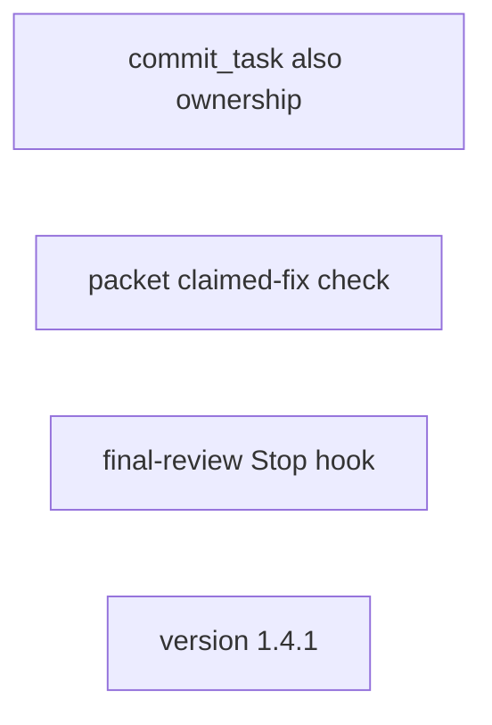

# Superlite 1.4.1: --also ownership, claimed-fix check, final-review Stop hook

**Goal:** close the gaps left in #68 and #69 after 1.3.3 and add #70: a file committed with `--also` stays owned by its task, `--also` works with several tasks, the review packet flags a fix a reviewer logged that is not on disk, and a Stop hook stops a turn once per branch when a sizeable branch has no final-reviewer verdict.
**Architecture:** `commit_task.py` reads the ledger's `Ruling: Tn also commits F` lines into task ownership (T1); `pt_review.py` packet adds a `claimed` section from `resolution: fixed` incidents whose file has no change since `--base` (T2); `hooks/final-review-check` (new Stop hook) plus `hooks/capture-agent-stop` recording final-reviewer stops outside a run (T3); version 1.4.1 (T4).
**Tech stack:** Python 3.10+ stdlib, pytest, bash 3.2-compatible hooks (builtins plus `git`).
**Spec:** this file, sections 1 to 3 under Design.
**Detail:** contracts
**Target-min:** 11
**Max chars:** 20000
**Wave0:** none

Global constraints:
- Scripts stay stdlib only, every line keeps its `# O(...)` comment (repo convention).
- Hooks: bash 3.2 syntax (`tests/scripts/test_hooks_bash32.py`), LF endings, `printf` never heredoc, exit 0 on any internal error (fail open).
- Unit command: `sl run_tests --fast PATHS --task Tn --background`; layers per `python3 scripts/test_layers.py check` (AGENTS.md "Testing layers").
- Versions change only through `scripts/bump-version.sh 1.4.1` in T4; `--audit` must print `All clear`.

## Design

### 1. --also ownership (#68)
A ledger line `- Ruling: Tn also commits F - <why>` makes F owned by Tn for the rest of the run, exactly like an `Owns` path (a trailing `/` keeps directory semantics). Consequences: Tn's later commits take F when it changed again; another task's commit leaves F alone (silently, as for any other task's file), never `out-of-scope`. `--also` with several task ids is allowed: the files go with the first listed task and the ruling lines name that task. `--ruling` stays required.

### 2. Claimed-fix check (#69)
In `plan_tools packet`, an incident whose newest entry for its (file, line) has `resolution: fixed` and whose file shows no change between `--base` and the working tree (tracked diff plus untracked files) becomes an open item in a new section `claimed`: `file:line  claimed fixed by <agent>, file unchanged since base`. It counts toward `REVIEW REQUIRED`. A deleted file counts as changed.

### 3. Final-review Stop hook (#70)
`hooks/final-review-check` runs on Stop. It does nothing (exit 0, no output) when: `stop_hook_active` is true in the input; `SUPERLITE_FINAL_REVIEW=off`; not inside a git work tree; HEAD is detached or on the default branch (`origin/HEAD` target, else `main`, else `master`); the branch is already in `.superlite/final-review-warned`; the branch diff is small (fewer than 5 files and fewer than 150 changed lines, counting `git diff --numstat <merge-base>` of the working tree, excluding `docs/` and `.superlite/`); or `.superlite/metrics.jsonl` has a stop record with `"type":"superlite:final-reviewer"` whose `t` (epoch ms) is newer than the merge-base commit time. Otherwise it appends the branch to `.superlite/final-review-warned` and prints `{"decision":"block","reason":"..."}` naming the branch, the file and line counts, and the two ways out: run `superlite:final-reviewer` on a packet, or state why not. `hooks/capture-agent-stop` writes the stop record for `superlite:final-reviewer` even when no run state exists (it creates `.superlite/` under the project dir if missing); other agent types keep the current gate.

## File structure
- `skills/subagent-driven-development/scripts/commit_task.py`, `tests/scripts/test_commit_scope_batch.py`, `tests/scripts/test_commit_also_owned.py`, `skills/subagent-driven-development/SKILL.md`: T1.
- `skills/subagent-driven-development/scripts/pt_review.py`, `tests/scripts/test_packet_claimed_fix.py`: T2.
- `hooks/final-review-check`, `hooks/hooks.json`, `hooks/capture-agent-stop`, `tests/scripts/test_final_review_check.py`, `docs/hooks.md`: T3.
- `.version-bump.json` and the manifests it lists: T4.

## Task graph

```mermaid
%% schedule
gantt
  title Predicted schedule (mm:ss)
  dateFormat X
  axisFormat %M:%S
  section lane 1
  T3 final-review Stop hook :t3, 0, 342s
  section lane 2
  T1 commit_task  --also files stay owned  :t1, 0, 208s
  section lane 3
  T2 packet  claimed fixes not on disk :t2, 0, 204s
  section lane 4
  T4 version 1.4.1 :t4, 0, 159s
```

critical path: T3 (5.7 min) · peak width 4 · predicted build 5.7 min · predicted total ≈ 9.2 min (target ✓)

## Commit and packet

**Probe entry:** none (CLI scripts driven through `sl`; their Review Focus cases are named pytest cases)

### T1 commit_task: --also files stay owned, several tasks · Complexity 4 · Est. context 40k
**Owns:** skills/subagent-driven-development/scripts/commit_task.py, tests/scripts/test_commit_scope_batch.py, tests/scripts/test_commit_also_owned.py, skills/subagent-driven-development/SKILL.md
**Components:** 1
**LOC owned:** 120
**Tests:** fast
**Model:** sonnet
**Est. time:** 3 min (1 component, about 120 LOC, fast tests)
**Covers:** 1
**Produces:** commit_task.also_owned(ledger: str) -> dict[str, str]
e.g. also_owned(".superlite/progress.md") with lines `- Ruling: T1 also commits x.md - needed` and `- Ruling: T2 also commits lib/ - shared` -> {"x.md": "T1", "lib/": "T2"}
e.g. also_owned("missing.md") -> {}
**Review Focus:** state: `test_also_file_changed_again_commits_with_owner` (T1 `--also x.md`, then x.md changed again: `commit_task T2` exits 0 and leaves x.md uncommitted, `commit_task T1` exits 0 and its checkpoint lists x.md); `test_also_owned_by_other_task_not_out_of_scope` (same setup, T2 stdout has no `out-of-scope`); `test_also_multi_task_goes_to_first` (`commit_task T1 T2 --also x.md --ruling r` exits 0, ledger has `Ruling: T1 also commits x.md`, T1's checkpoint lists x.md); `test_also_owned_parses_ledger` (the two `e.g.` cases); `test_also_dir_entry_keeps_prefix` (`--also lib/` then `lib/b.py` changed: owned by that task).
**Test code:** new tests in `tests/scripts/test_commit_also_owned.py`, reusing the helpers of `test_commit_scope_batch.py` (`make_repo`, `write`, `run`, `CP`); in `test_commit_scope_batch.py` replace `test_also_file_changed_again_blocks` by the first Review Focus case (move it, do not keep both).
**Steps:** 1 failing tests, 2 run: FAIL, 3 implement, 4 run: PASS, 5 SKILL.md: replace "once recorded, it stays accepted until it changes again" with "once recorded, that task owns it for the rest of the run; `--also` with several tasks gives the files to the first".
**Notes:** in `main()` drop the `--also takes exactly one task` refusal; build `also_owned(a.ledger)` once and append each path to `info[tid]["owns"]` before the commit loop (also after each commit that records new rulings). Only the first task of a multi-task call receives `a.also`; later tasks get none. Regex: `^\s*[-*+]?\s*Ruling:\s*([A-Z]{1,3}\d+[A-Za-z]?) also commits (\S+) - `.

### T2 packet: claimed fixes not on disk · Complexity 4 · Est. context 42k
**Owns:** skills/subagent-driven-development/scripts/pt_review.py, tests/scripts/test_packet_claimed_fix.py
**Components:** 1
**LOC owned:** 110
**Tests:** fast
**Model:** sonnet
**Est. time:** 3 min (1 component, about 110 LOC, fast tests)
**Covers:** 2
**Produces:** pt_review.changed_since(root: Path, base: str) -> set[str] · pt_review.claimed_fix_items(entries: list[dict], changed: set[str]) -> list[Item]
e.g. changed_since(repo, base) after editing a.py and adding new.py -> {"a.py", "new.py"}
e.g. claimed_fix_items([{"file": "a.py", "line": 3, "resolution": "fixed", "agent": "package-reviewer", "context": "x"}], {"b.py"}) -> one Item, section "claimed", header "a.py:3  claimed fixed by package-reviewer, file unchanged since base"
e.g. claimed_fix_items(same entries, {"a.py"}) -> []
**Review Focus:** state: `test_claimed_fix_unchanged_file_listed` (packet text contains `claimed fixed by package-reviewer` and the header says `REVIEW REQUIRED`); `test_claimed_fix_changed_file_not_listed` (file edited after base: no claimed item, `FAST PATH` when nothing else is open); `test_claimed_fix_newest_entry_wins` (an `open` entry after the `fixed` one for the same location: no claimed item); `test_claimed_fix_deleted_file_counts_changed`; `test_changed_since_includes_untracked`.
**Test code:** `tests/scripts/test_packet_claimed_fix.py`: build a temp repo with `make_repo` from `tests/scripts/test_run_scripts.py`, a minimal plan, an `incidents.jsonl`, and run `sl plan_tools packet --plan P --base SHA` for the packet cases; call the two functions directly for the rest.
**Steps:** 1 failing tests, 2 run: FAIL, 3 implement, 4 run: PASS.
**Notes:** compute `changed_since` once in `cmd_packet` (`git diff --name-only <base>` plus `git ls-files --others --exclude-standard`, paths relative to root); add the claimed items to `items` before the sort, add `"claimed"` to `counts`, and give the section its own heading in the packet next to the incidents section. Rank the claimed items after contract mismatches. Use the newest entry per (file, line) as `superseded` does.

## Hooks and release

**Probe entry:** none (bash hook and version files)

### T3 final-review Stop hook · Complexity 5 · Est. context 45k
**Owns:** hooks/final-review-check, hooks/hooks.json, hooks/capture-agent-stop, tests/scripts/test_final_review_check.py, docs/hooks.md
**Components:** 2
**LOC owned:** 150
**Tests:** fast
**Model:** sonnet
**Est. time:** 4 min (2 components, about 150 LOC, fast tests)
**Covers:** 3
**Produces:** hooks/final-review-check (Stop hook, stdin JSON, stdout `{"decision":"block","reason":"..."}` or nothing)
**Review Focus:** protocol: `test_blocks_once_on_big_branch` (branch with 6 changed files, no metrics: first run prints a block whose reason names the branch and `superlite:final-reviewer`; second run prints nothing); `test_silent_on_default_branch`; `test_silent_on_small_diff` (2 files, 20 lines); `test_silent_when_reviewer_stopped_after_base` (metrics stop record of type `superlite:final-reviewer`, `t` after merge-base); `test_blocks_when_reviewer_stop_is_older_than_base`; `test_silent_when_stop_hook_active`; `test_silent_when_env_off`; `test_docs_only_diff_is_small` (8 files under `docs/`); file: `test_capture_stop_records_final_reviewer_without_run` (no pool/prime/stable: `capture-agent-stop` with `agent_type` `superlite:final-reviewer` appends one line to `.superlite/metrics.jsonl`; another type appends nothing).
**Test code:** `tests/scripts/test_final_review_check.py`: temp repo with `main` and a feature branch, run the hook with `bash hooks/final-review-check` and `CLAUDE_PROJECT_DIR` set, JSON on stdin; follow `tests/scripts/test_capture_hooks.py` for invoking hooks.
**Steps:** 1 failing tests, 2 run: FAIL, 3 implement the hook, 4 register it in `hooks/hooks.json` under `Stop` (`bash "${CLAUDE_PLUGIN_ROOT}/hooks/final-review-check"`, `shell: bash`), 5 the `capture-agent-stop` change, 6 add a `- \`final-review-check\`` line to `docs/hooks.md` (what it checks, the thresholds, `SUPERLITE_FINAL_REVIEW=off`), 7 run: PASS.
**Notes:** the project dir is `CLAUDE_PROJECT_DIR`, else the input `cwd`, else `PWD` (reuse `_sl_launch` from `hooks/superlite-state.sh`). Merge-base time: `git log -1 --format=%ct <merge-base>` (seconds; compare with `t/1000`). Keep the reason under 300 characters. Not registered in `hooks/hooks-cursor.json`.

### T4 version 1.4.1 · Complexity 1 · Est. context 20k
**Owns:** .version-bump.json, package.json, .hermes-plugin/plugin.yaml, .claude-plugin/plugin.json, .cursor-plugin/plugin.json, .codex-plugin/plugin.json, .devin-plugin/plugin.json, .kimi-plugin/plugin.json, .muse-plugin/plugin.json, .claude-plugin/marketplace.json, .muse-plugin/marketplace.json, gemini-extension.json
**Components:** 1
**LOC owned:** 12
**Tests:** fast
**Kind:** mechanical
**Model:** haiku
**Est. time:** 1 min (1 component, about 12 LOC, fast tests)
**Produces:** none
**Review Focus:** none
**Test code:** `test_version_bump_audit_clean`: `scripts/bump-version.sh --audit` prints `All clear` (run it directly, no new test file).
**Steps:** 1 `scripts/bump-version.sh 1.4.1`, 2 `scripts/bump-version.sh --audit`: All clear.

## Review Focus

- Commit and packet (CLI scripts): categories state, file, protocol. Risks: an `--also` path that is a directory entry, a ruling line for a task id not in the plan (ignore it), a deleted file claimed fixed, a base SHA that no longer exists (packet must still render; `changed_since` returns an empty set and claimed items are skipped, not all listed).
- Hooks (Stop hook): categories protocol, state, file. Risks: an infinite block loop (`stop_hook_active`, the warned file), a repo with no `origin/HEAD`, detached HEAD, an unreadable metrics file, slow `git diff` on a big tree (one `--numstat` call).

## Self-review
Coverage: section 1 T1, 2 T2, 3 T3. No placeholders. No edges: T1 to T3 touch disjoint files and T4 only version files. Every task has the measured fields.
