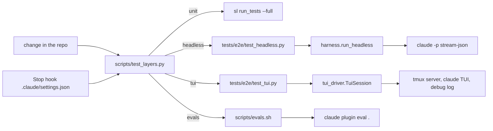
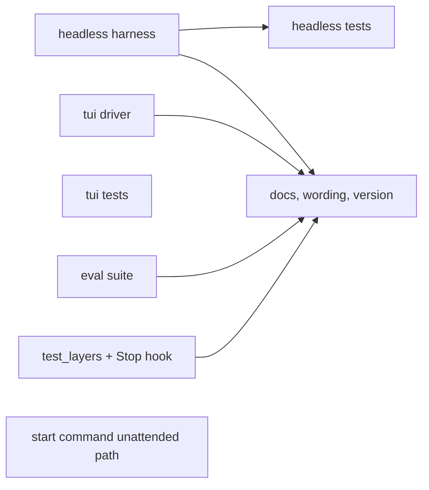

# Superlite 1.4.0: testing layers

**Goal:** every change to this plugin can be verified by the agent that makes it, in the kind of session the change affects: script contracts (unit), a full headless Claude Code session with the plugin loaded (headless), a real interactive terminal session driven through tmux (tui), and behaviour scored by `claude plugin eval` against a no-plugin baseline (evals). A repo Stop hook refuses to end a turn while a required layer has not run green since the change.
**Architecture:** `tests/e2e/harness.py` runs `claude -p` with the plugin and parses its stream-json (T1); `tests/e2e/test_headless.py` asserts plugin load, the SessionStart injection and two run hooks (T2); `tests/e2e/tui_driver.py` drives `claude` in an isolated tmux server (T3); `tests/e2e/test_tui.py` asserts the interactive-only facts, the agent-summary timer among them (T4); `evals/` holds three cases plus `scripts/evals.sh` (T5); `scripts/test_layers.py` maps changed paths to layers, stamps green runs and backs the Stop hook in `.claude/settings.json` (T6); docs and the corrected summary wording (T7).
**Tech stack:** Python 3.10+ stdlib, pytest, bash, tmux 3.x (macOS and Linux), Claude Code 2.1.317 or later (`claude plugin eval` needs 2.1.269).
**Spec:** this file, sections 1 to 6 under Design.
**Detail:** contracts
**Target-min:** 11
**Max chars:** 40000
**Wave0:** none

Global constraints:
- `tests/e2e/harness.py`, `tests/e2e/tui_driver.py` and `scripts/test_layers.py` carry the repo's trailing `# O(...)` complexity comment on every line; test files do not.
- Every e2e test runs the agent on `--model haiku`, caps turns (`--max-turns` at most 8) and keeps one run of the whole e2e layer under about $0.30 and 6 minutes.
- Session isolation, in every e2e session: pass `--setting-sources ""` and `--plugin-dir <repo root>`; unset `CLAUDE_CODE_SESSION_ID`, `CLAUDE_CODE_MESSAGING_SOCKET`, `CLAUDE_CODE_MESSAGING_TOKEN`, `CLAUDE_CODE_BRIDGE_SESSION_ID`, `CLAUDE_CODE_CHILD_SESSION`, `CLAUDE_CODE_ENTRYPOINT`, `CLAUDE_CODE_PLUGIN_DIRS`, `SUPERLITE_SESSION_ID`, `SUPERLITE_STATE_DIR`, `CLAUDE_ENV_FILE`; stdin from `/dev/null` (headless); the working directory is a fresh temporary directory.
- e2e tests are skipped unless `SUPERLITE_E2E=1` (marker `e2e`, see T1); `tui` tests also skip when `tmux` is not on PATH. The plain suite (`sl run_tests --full`) must stay green and quota-free.
- Existing tests stay green unchanged. Stdlib only. Run `sl` as an executable (`<abs>/sl ...`).
- Versions change only through `scripts/bump-version.sh 1.4.0` in T7; `--audit` must report nothing missed.

Ruling: detail contracts - the e2e tests are integration-shaped and the harness API in Produces is the contract - cost if wrong: an implementer asks one NEEDS_CONTEXT.
Ruling: the third eval case is the debug flow, not a small rename - a trivial rename fires no skill, so it would measure nothing against the baseline - cost if wrong: one case to rewrite.
Ruling: the Stop hook blocks once per turn only (it stays silent when the Stop input has `stop_hook_active: true`) and never during an active superlite run - cost if wrong: one unblocked turn.
Ruling: accept predicted 15.7 min - T2's tests execute T1's harness, so the chain T1 -> T2 is sequential - cost if wrong: about 4 minutes of wall-clock.
Ruling: summary wording - on 2.1.317 the interactive timer ran in the server-served `short` mode here (a few hundred characters of notes, two requests per minute per active agent, Sonnet and Haiku alike); docs say "the transcript, or notes in short mode" and drop the 5-12% figure - cost if wrong: an understated README.

## Design

### 1. Layers and the matrix

| Layer | Runs | Required when a change touches |
|---|---|---|
| unit | `sl run_tests --full` | `skills/**/scripts/**`, `hooks/**`, `tests/scripts/**`, `tests/bench/**`, `bench/*.py`, `scripts/*.py` |
| headless | `SUPERLITE_E2E=1 python3 -m pytest tests/e2e -k headless -q` | `hooks/**`, `skills/**` (not `scripts/`), `agents/**`, `commands/**`, `.claude-plugin/**`, `tests/e2e/harness.py`, `tests/e2e/test_headless.py` |
| tui | `SUPERLITE_E2E=1 python3 -m pytest tests/e2e -k tui -q` | `hooks/session-start`, `hooks/hooks.json`, `tests/e2e/tui_driver.py`, `tests/e2e/test_tui.py`, and any file whose diff mentions `CLAUDE_CODE_FORK_SUBAGENT` or `agent_summary` |
| evals | `scripts/evals.sh` | `skills/*/SKILL.md`, `commands/**`, `agents/**`, `evals/**` |

A layer is stale when the SHA-256 over the current contents of all files it maps to differs from the hash stamped at its last green run (`.superlite/test-layers.json`, git-ignored through `.superlite/`). `check` prints the stale layers and exits 2; `run <layer...>` runs them in order and stamps each green one; `stamp <layer> --ruling "<why>"` records a deliberate skip (the ruling line is appended to `.superlite/progress.md`).

### 2. Headless harness

`run_headless` spawns `claude -p <prompt> --output-format stream-json --verbose --include-hook-events --setting-sources "" --plugin-dir <repo> --model <model> --max-turns N [--allowedTools ...] [--settings <json>]` with the isolation constraints, parses one JSON object per stdout line and returns a `Session`: `init` (the `system/init` event), `hooks` (every `hook_response` event), `events` (all), `result` (the `result` event), `cost_usd`, `text` (the final result text). Malformed lines are skipped and counted in `Session.skipped`. A missing `result` raises `HarnessError` with the stderr tail.

### 3. Interactive driver

`TuiSession` starts `claude` inside `tmux -L sl-e2e-<pid>` with `--debug-file <tmp>/debug.log` and a `--settings` JSON whose `Stop` and `SubagentStop` hooks append `STOPPED` and `SUBAGENT_STOPPED` lines to `<tmp>/marker.txt`. It answers the folder-trust dialog (pane contains `I trust this folder`: send `Down`, then `Enter`), waits for the input prompt (pane contains `? for shortcuts`), types a prompt through `set-buffer` and `paste-buffer -p` followed by `Enter`, and waits for marker lines. `close()` sends `C-c` twice and kills the server. The debug log is the oracle: `summary_counts(text)` counts `[AgentSummary] Timer fired`, `Forking for summary`, `Asking for summary from` and `Stopping summarization` lines.

### 4. Eval suite

Three cases under `evals/`, each `model: sonnet`, `runs: 2`, `timeout_seconds: 600`:
- `brainstorm-first`: prompt `Let's make a react todo list`; graders `skill-fired` (`tool_used` Skill, `input_match` `superlite:)?brainstorming`), `no-code-yet` (`file_exists`, path `**/*.{js,jsx,ts,tsx,html,css}`, `exists: false`, `arm: both`), `allowed_tools: [Read, Glob, Grep, Skill, AskUserQuestion]`, `max_turns: 12`.
- `setup-report`: `case.yaml` with a `scaffold_script` that writes a minimal Python project (`pyproject.toml`, `src/app/__init__.py`, `tests/test_app.py`); prompt `Run the superlite first-run check for this project and give a pass or fix line per item.`; graders `regex` on `last_message` for `(?i)python 3`, `(?i)superpowers`, `(?i)gitignore`, and `tool_used` Skill `superlite:)?setup` (`arm: with-only`); `max_turns: 15`.
- `debug-flow`: scaffold a Python project where `src/calc/core.py` `def days_in_feb(year)` returns 28 for every year and `tests/test_core.py` asserts `days_in_feb(2024) == 29`; prompt `tests/test_core.py fails: find the root cause and fix it`; graders `skill-fired` (`tool_used` Skill `superlite:)?systematic-debugging`), `fixed` (`regex`, `{source: file, path: src/calc/core.py}`, pattern `% *4`), `tests-ran` (`tool_used` Bash, `input_match` `pytest|run_tests`); `max_turns: 25`.

`scripts/evals.sh [args]` runs `claude plugin eval . --trust-plugin --no-publish --scaffold --judge-model haiku --max-cost-usd 5 --allow-tools "Bash(pytest:*)" "Bash(python3:*)" Edit Write --json evals/results/last.json "$@"` from the repo root and exits with its code. `evals/results/` is git-ignored.

### 5. Enforcement

`.claude/settings.json` (project scope, committed): a `Stop` hook running `python3 "$CLAUDE_PROJECT_DIR/scripts/test_layers.py" check --hook`. In hook mode the script reads the Stop input from stdin, exits 0 silently when `stop_hook_active` is true, when `SUPERLITE_TEST_LAYERS=off`, when the project's `.superlite` holds a run marker (`stable.json`, `prime.md` or `pool.json`) or when nothing is stale; otherwise prints `{"decision":"block","reason":"<layers> not run since the last change: run `python3 scripts/test_layers.py run <layers>` or `stamp <layer> --ruling \"<why>\"`"}` and exits 0.

### 6. Docs and wording

`docs/testing.md` explains the four layers, the commands, the cost per run and the stamps. `AGENTS.md` gets a "Testing layers" section with the matrix and the rule that a change ends only after its layers ran green or a ruling was stamped. README's "Agent status summaries" bullet, `commands/setup.md` and the `SUMMARIES_NOTE` text in `budget.py` get the corrected wording from the ruling above (keep the substrings `SUMMARIES ON` and `CLAUDE_CODE_FORK_SUBAGENT=0`).

## File structure

- `tests/e2e/__init__.py` (empty), `tests/e2e/conftest.py` (e2e marker skip), `tests/e2e/harness.py`, `tests/e2e/fixtures/headless-pong.jsonl`, `tests/e2e/test_harness_parse.py`: T1.
- `tests/e2e/test_headless.py`: T2.
- `tests/e2e/tui_driver.py`, `tests/e2e/test_tui_driver_parse.py`: T3.
- `tests/e2e/test_tui.py`: T4.
- `evals/brainstorm-first/**`, `evals/setup-report/**`, `evals/debug-flow/**`, `scripts/evals.sh`, `.gitignore`, `tests/scripts/test_evals_suite.py`: T5.
- `scripts/test_layers.py`, `.claude/settings.json`, `tests/scripts/test_test_layers.py`: T6.
- `docs/testing.md`, `AGENTS.md`, `README.md`, `commands/setup.md`, `skills/subagent-driven-development/scripts/budget.py`, `.version-bump.json` and the manifests it lists: T7.
- `commands/start.md`, `skills/using-superlite/SKILL.md`, `tests/scripts/test_start_unattended.py`: T8.

## Task graph

```mermaid
%% schedule
gantt
  title Predicted schedule (mm:ss)
  dateFormat X
  axisFormat %M:%S
  section lane 1
  T6 test_layers script and the repo Stop  :t6, 0, 373s
  T7 docs  corrected summary wording  vers :t7, 373, 306s
  section lane 2
  T4 tui tests  injection and the agent-su :t4, 0, 368s
  section lane 3
  T3 tui driver :t3, 0, 360s
  section lane 4
  T1 headless harness and e2e skip marker :t1, 0, 352s
  T2 headless tests  plugin load  injectio :t2, 352, 381s
  section lane 5
  T5 eval cases and runner :t5, 0, 344s
```

critical path: T1 → T2 (12.2 min) · peak width 5 · predicted build 12.2 min · predicted total ≈ 15.7 min (target ✗ 11.0)

## Headless layer

**Probe entry:** none (session harness; its Review Focus cases are named pytest cases)

### T1 headless harness and e2e skip marker · Complexity 4 · Est. context 36k
**Owns:** tests/e2e/__init__.py, tests/e2e/conftest.py, tests/e2e/harness.py, tests/e2e/fixtures/headless-pong.jsonl, tests/e2e/test_harness_parse.py
**Components:** 2
**LOC owned:** 170
**Tests:** fast
**Model:** sonnet
**Est. time:** 3 min (2 components, about 170 LOC, fast tests)
**Covers:** 2
**Produces:** harness.run_headless(prompt: str, *, cwd: Path, model: str = "haiku", allowed_tools: list[str] = (), settings: dict | None = None, env: dict | None = None, max_turns: int = 6, timeout: int = 300) -> Session · harness.parse_stream(lines: list[str], stderr: str = "") -> Session · harness.Session (fields init: dict, hooks: list[dict], events: list[dict], result: dict, cost_usd: float, text: str, skipped: int; method hook_outputs(event: str) -> list[str]) · harness.scrubbed_env(extra: dict | None = None) -> dict · harness.REPO_ROOT: Path
e.g. parse_stream(['{"type":"system","subtype":"init","plugins":["superlite"]}', '{"type":"result","subtype":"success","result":"PONG","total_cost_usd":0.005}']) -> Session(init={...,"plugins":["superlite"]}, text="PONG", cost_usd=0.005, hooks=[], skipped=0)
e.g. parse_stream(['not json', '{"type":"system","subtype":"hook_response","hook_event":"SessionStart","output":"You have superlite"}', '{"type":"result","subtype":"success","result":"ok","total_cost_usd":0}']).hook_outputs("SessionStart") -> ["You have superlite"]
e.g. scrubbed_env({"X": "1"})["X"] -> "1" and "CLAUDE_CODE_SESSION_ID" not in scrubbed_env()
**Review Focus:** protocol: `test_parse_skips_malformed_lines` (one bad line, `skipped == 1`, the rest parsed); `test_parse_without_result_raises` (`HarnessError` whose message contains the stderr tail); `test_hook_outputs_filters_by_event` (two hook events, only the named one returned); file: `test_scrubbed_env_drops_session_vars` (every variable in the isolation list absent, `PATH` kept).
**Test code:** `tests/e2e/test_harness_parse.py`, no network, no quota: the four Review Focus tests plus `test_fixture_pong_parses` (the recorded `fixtures/headless-pong.jsonl`, a real `claude -p` stream with the plugin loaded: `init["plugins"]` contains `superlite`, `text == "PONG"`, one SessionStart hook output containing `You have superlite`). `tests/e2e/conftest.py`: `pytest_configure` registers the `e2e` marker; `pytest_collection_modifyitems` adds `pytest.mark.skip(reason="set SUPERLITE_E2E=1")` to every item marked `e2e` unless `os.environ.get("SUPERLITE_E2E")`. `test_e2e_marker_skipped_without_env`: a tiny `pytester`-free check that an item marked `e2e` in this module is skipped when the variable is unset (use `pytest.mark.e2e` on a test that asserts False, and assert via `request.node` in a second test that the marker-skip ran: simplest is `@pytest.mark.e2e def test_never_runs(): assert False` plus the env unset in the plain suite).
**Steps:** 1 failing tests, 2 run: FAIL, 3 implement, 4 run: PASS.
**Notes:** `run_headless` builds the command list, runs `subprocess.run` with `stdin=subprocess.DEVNULL`, `capture_output=True`, `timeout=timeout`, `cwd=cwd`, `env=scrubbed_env(env)`; `--allowedTools` takes the tools as separate arguments after the prompt, so place the prompt right after `-p` and the variadic flags last. `settings` is written to `<cwd>/.e2e-settings.json` and passed with `--settings`. `--setting-sources ""` is passed as two argv items. `REPO_ROOT = Path(__file__).resolve().parents[2]`. Record the fixture with one real run of the harness during implementation (`SUPERLITE_E2E=1`), trimmed to the init, one SessionStart hook_response, and the result lines; redact `session_id`, `uuid`, `cwd` and socket paths.

### T2 headless tests: plugin load, injection, run hooks · Complexity 5 · Est. context 40k
**Owns:** tests/e2e/test_headless.py
**Components:** 1
**LOC owned:** 140
**Tests:** slow
**Model:** sonnet
**Est. time:** 3 min (1 component, about 140 LOC, slow tests)
**Covers:** 2
**Consumes:** harness.parse_stream(lines: list[str], stderr: str = "") -> Session (T1) · harness.scrubbed_env(extra: dict | None = None) -> dict (T1)
**Produces:** none consumed by another task.
**Review Focus:** protocol: `test_plugin_loads_clean`; state: `test_run_hooks_record_agent_metrics`; file: `test_session_start_reports_project_state`.
**Test code:** every test marked `pytest.mark.e2e`, each in a fresh `tmp_path` working directory:
- `test_plugin_loads_clean`: prompt `Reply with the single word PONG. Do not use tools.`, `max_turns=2`: `init["plugins"]` contains `superlite`, `init.get("plugin_errors")` is falsy, `init["agents"]` contains all seven `superlite:` agent names (`implementer`, `implementer-haiku`, `package-reviewer`, `final-reviewer`, `fixer-sonnet`, `fixer-sonnet-high`, `fixer-opus`), `text.strip() == "PONG"`, `cost_usd < 0.05`.
- `test_session_start_reports_project_state`: same prompt in an empty directory: exactly one SessionStart hook output contains `You have superlite` and `Project state: empty folder`; in a directory after `git init` the output says `Project state: existing code`.
- `test_rewrite_test_runs_during_a_run`: `tmp_path/.superlite/stable.json` holds `{}` (run marker), `tmp_path/tests/test_one.py` holds `def test_one(): assert True`; prompt `Use the Bash tool to run exactly: pytest -q` with `allowed_tools=["Bash(pytest:*)", "Bash(*sl*)"]`, `max_turns=4`: one `PreToolUse` hook_response output contains `run_tests` and `"run_in_background":true` (the raw run was rewritten), and `tmp_path/.superlite/incidents.jsonl` has a `rule-rewrite` line.
- `test_run_hooks_record_agent_metrics`: the same run marker; prompt `Launch exactly one general-purpose subagent with run_in_background set to true whose only task is to reply with the word PONG, wait for it, then reply DONE.`, `allowed_tools=["Agent"]`, `max_turns=6`: `tmp_path/.superlite/metrics.jsonl` has one `"ev":"launch"` and one `"ev":"stop"` record with the same `agent_id`, and the stop record's `transcript` path exists.
**Steps:** 1 failing tests, 2 run: FAIL (skip without the env; with `SUPERLITE_E2E=1` the tests must pass against the real CLI), 3 adjust prompts until stable over two runs, 4 run: PASS.
**Notes:** Every test calls `harness.run_headless(...)` (same module as `parse_stream`; its `Session` is what `parse_stream` returns) with `cwd=tmp_path`. The run hooks bind the legacy `<cwd>/.superlite` because no session binding exists in a fresh temp directory; the `SUPERLITE_HOME` variable must point at `tmp_path/_home` (through `env`) so no real binding is read. Hook outputs in the stream are JSON strings; search them as text.

## Interactive layer

**Probe entry:** none (tmux driver; its Review Focus cases are named pytest cases)

### T3 tui driver · Complexity 5 · Est. context 40k
**Owns:** tests/e2e/tui_driver.py, tests/e2e/test_tui_driver_parse.py
**Components:** 2
**LOC owned:** 190
**Tests:** fast
**Model:** sonnet
**Est. time:** 3.5 min (2 components, about 190 LOC, fast tests)
**Covers:** 3
**Produces:** tui_driver.TuiSession(cwd: Path, *, model: str = "haiku", allowed_tools: list[str] = (), env: dict | None = None, ready_timeout: int = 90) -> TuiSession (context manager; methods start() -> None, send(prompt: str) -> None, wait_marker(line: str, min_seconds: int = 0, timeout: int = 240) -> bool, pane() -> str, debug_log() -> str, close() -> None; attributes marker_path: Path, debug_path: Path, socket: str) · tui_driver.needs_trust(pane: str) -> bool · tui_driver.is_ready(pane: str) -> bool · tui_driver.summary_counts(log: str) -> dict
e.g. needs_trust("... Yes, I trust this folder ...") -> True and needs_trust("? for shortcuts") -> False
e.g. is_ready("Try \"how do I log an error?\"\n? for shortcuts") -> True
e.g. summary_counts("[AgentSummary] Timer fired for agent a1\n[AgentSummary] Asking for summary from 382 characters of notes\n") -> {"timer_fired": 1, "forking": 0, "notes": 1, "stopped": 0}
**Review Focus:** protocol: `test_needs_trust_and_ready_detection` (the two e.g. panes, plus a pane with neither returns False for both); state: `test_summary_counts_counts_each_kind` (a log with 2 timers, 1 forking, 1 notes, 1 stopping gives `{"timer_fired": 2, "forking": 1, "notes": 1, "stopped": 1}`); file: `test_settings_json_has_marker_hooks` (`TuiSession.settings_json(marker_path)` returns a dict whose `hooks.Stop[0].hooks[0].command` appends `STOPPED` to the marker path and `hooks.SubagentStop[0].hooks[0].command` appends `SUBAGENT_STOPPED`).
**Test code:** `tests/e2e/test_tui_driver_parse.py`: the three Review Focus tests, no tmux, no quota.
**Steps:** 1 failing tests, 2 run: FAIL, 3 implement, 4 run: PASS.
**Notes:** `start()`: `tmux -L <socket> kill-server` (ignore errors), then `new-session -d -x 180 -y 50 -c <cwd> "<env prefix> claude --model M --plugin-dir <repo> --setting-sources '' --settings <cwd>/.e2e-settings.json --debug-file <debug_path> [--allowedTools ...]; sleep 2"`; the env prefix is `env -u VAR ...` for the isolation list plus `KEY=VAL` for `env`, and `E2E_MARKER=<marker_path>` is exported in the same prefix because the marker hooks use `$E2E_MARKER`. Poll `capture-pane -p` once a second: `needs_trust` -> `send-keys Down`, `send-keys Enter`; `is_ready` -> return; after `ready_timeout` raise `TuiError` with the last pane. `send()`: `set-buffer`, `paste-buffer -p`, one second, `send-keys Enter`. `wait_marker`: poll every 2 s until the marker file contains `line` and at least `min_seconds` passed; return False on timeout. `close()` kills the server even when start failed. The socket name is `sl-e2e-<pid>-<counter>` so parallel sessions never share a server. Verify once by hand with `SUPERLITE_E2E=1` that a session reaches the prompt and that `send` submits.

### T4 tui tests: injection and the agent-summary timer · Complexity 5 · Est. context 38k
**Owns:** tests/e2e/test_tui.py
**Components:** 1
**LOC owned:** 110
**Tests:** slow
**Model:** sonnet
**Est. time:** 2.5 min (1 component, about 110 LOC, slow tests)
**Covers:** 3
**Consumes:** tui_driver.TuiSession (T3) · tui_driver.summary_counts(log: str) -> dict (T3)
**Produces:** none consumed by another task.
**Review Focus:** state: `test_fork_switch_silences_summary_timer`; protocol: `test_summary_timer_runs_for_a_background_agent`.
**Test code:** every test marked `pytest.mark.e2e` and skipped without `tmux` on PATH (`shutil.which`); each uses a fresh `tmp_path`, `allowed_tools=["Agent", "Bash(sleep:*)"]`, and the prompt `Launch exactly one subagent of type general-purpose with run_in_background set to true. Its task: run the Bash command \`sleep 12\` six times, one call at a time, then reply "done". Do nothing else yourself; wait for its completion notification, then reply with the single word DONE.`:
- `test_tui_session_start_injects_skill`: after `start()`, `debug_log()` contains `Hook SessionStart` and `You have superlite` (a prompt is not needed; close right away).
- `test_summary_timer_runs_for_a_background_agent`: send the prompt; `wait_marker("SUBAGENT_STOPPED", min_seconds=75, timeout=240)` is True; `summary_counts(debug_log())["timer_fired"] >= 1`; record the mode in the assertion message (`forking` or `notes` is at least 1).
- `test_fork_switch_silences_summary_timer`: same with `env={"CLAUDE_CODE_FORK_SUBAGENT": "0"}`: `wait_marker("SUBAGENT_STOPPED", min_seconds=75, timeout=240)` is True and `summary_counts(debug_log())["timer_fired"] == 0`.
**Steps:** 1 failing tests, 2 run: FAIL, 3 run with `SUPERLITE_E2E=1` against the real CLI until both pass twice, 4 run: PASS.
**Notes:** A Haiku main agent may reply DONE before the subagent ends, hence the wait on `SUBAGENT_STOPPED` with `min_seconds=75` (two timer ticks at 30 s). The two timer tests take about 90 s each; run them sequentially.

## Eval suite

**Probe entry:** none (eval cases; the layout test is a named pytest case)

### T5 eval cases and runner · Complexity 4 · Est. context 34k
**Owns:** evals/brainstorm-first/prompt.md, evals/brainstorm-first/graders/skill-fired.md, evals/brainstorm-first/graders/no-code-yet.md, evals/setup-report/case.yaml, evals/setup-report/prompt.md, evals/setup-report/scaffold.sh, evals/setup-report/graders/python-line.md, evals/setup-report/graders/superpowers-line.md, evals/setup-report/graders/gitignore-line.md, evals/setup-report/graders/setup-fired.md, evals/debug-flow/case.yaml, evals/debug-flow/prompt.md, evals/debug-flow/scaffold.sh, evals/debug-flow/graders/skill-fired.md, evals/debug-flow/graders/fixed.md, evals/debug-flow/graders/tests-ran.md, scripts/evals.sh, .gitignore, tests/scripts/test_evals_suite.py
**Components:** 2
**LOC owned:** 150
**Tests:** fast
**Model:** sonnet
**Est. time:** 3 min (2 components, about 150 LOC, fast tests)
**Covers:** 4
**Produces:** none consumed by another task.
**Review Focus:** file: `test_every_case_has_prompt_and_grader`, `test_scaffold_scripts_are_executable_bash`; protocol: `test_frontmatter_keys_are_known`.
**Test code:** `tests/scripts/test_evals_suite.py`, stdlib only (no YAML library: parse `---` frontmatter as `key: value` lines and `case.yaml` with the same line parser plus two-space indentation):
- `test_every_case_has_prompt_and_grader`: each directory under `evals/` with a `prompt.md` or `case.yaml` has at least one `graders/*.md`; exactly three cases exist: `brainstorm-first`, `setup-report`, `debug-flow`.
- `test_frontmatter_keys_are_known`: every `prompt.md` frontmatter key is in `{schema_version, name, description, tags, plugins, runs, expected_outcome, model, max_turns, timeout_seconds, allowed_tools, append_system_prompt, env}`; every grader `type` is in `{regex, tool_used, tool_order, file_exists, llm, baseline}`; every case sets `model: sonnet` and `runs: 2`.
- `test_scaffold_scripts_are_executable_bash`: each `scaffold.sh` starts with `#!/usr/bin/env bash`, has the executable bit, and `bash -n` accepts it; running it in a `tmp_path` creates the files section 4 names (for `debug-flow`: `src/calc/core.py` containing `return 28` and `tests/test_core.py` containing `2024`).
- `test_runner_flags`: `scripts/evals.sh` contains `--trust-plugin`, `--no-publish`, `--scaffold`, `--judge-model haiku`, `--max-cost-usd` and `--json evals/results/last.json`; `.gitignore` lists `evals/results/`.
**Steps:** 1 failing tests, 2 run: FAIL, 3 write the cases and runner, 4 run: PASS, 5 run `scripts/evals.sh --case brainstorm-first --runs 1 --ablation none` once and paste its summary line into your report.
**Notes:** `case.yaml` needs `schema_version: "1.1"` and `name`; `context.scaffold_script: scaffold.sh`; `execution:` holds `model`, `max_turns`, `timeout_seconds`, `allowed_tools`. The `regex` grader frontmatter is `type`, `pattern`, optional `flags: i` and `target`; a `file_exists` grader takes `path` and `exists: false`; `tool_used` takes `tool` and `input_match` (JSON-encoded input, so match `"skill":\s*"(superlite:)?brainstorming"`). `debug-flow`'s scaffold writes a `pyproject.toml` with `[tool.pytest.ini_options] pythonpath = ["src"]`.

## Enforcement

**Probe entry:** run=python3 scripts/test_layers.py

### T6 test_layers script and the repo Stop hook · Complexity 6 · Est. context 42k
**Owns:** scripts/test_layers.py, .claude/settings.json, tests/scripts/test_test_layers.py
**Components:** 2
**LOC owned:** 220
**Tests:** fast
**Model:** sonnet
**Est. time:** 4 min (2 components, about 220 LOC, fast tests)
**Covers:** 1, 5
**Produces:** test_layers.layers_for(paths: list[str], diffs: dict[str, str] | None = None) -> list[str] · test_layers.layer_hash(layer: str, root: Path) -> str · test_layers.stale_layers(root: Path, state: Path) -> list[str] · CLI `python3 scripts/test_layers.py check [--hook] | run <layer>... | stamp <layer> --ruling TEXT [--state PATH] [--root PATH]`
e.g. layers_for(["hooks/session-start"]) -> ["unit", "headless", "tui"]
e.g. layers_for(["skills/brainstorming/SKILL.md"]) -> ["headless", "evals"]
e.g. layers_for(["docs/testing.md"]) -> []
e.g. layers_for(["README.md"], {"README.md": "+ set CLAUDE_CODE_FORK_SUBAGENT=0"}) -> ["tui"]
**Review Focus:** state: `test_stamp_then_clean_is_not_stale`, `test_change_after_stamp_is_stale`, `test_hook_silent_when_stop_hook_active`, `test_hook_silent_during_active_run`; protocol: `test_hook_blocks_with_layers_and_commands`, `test_check_exit_codes`; file: `test_layer_hash_ignores_untracked_results`.
**Test code:** `tests/scripts/test_test_layers.py`, using a temporary git repository (`git init`, commit a copy of the mapped layout: `hooks/x`, `skills/a/SKILL.md`, `agents/a.md`, `commands/a.md`, `tests/e2e/harness.py`, `evals/c/prompt.md`, `scripts/test_layers.py` itself not needed) and `--root`/`--state` pointing at it:
- `test_layers_for_matrix`: the four e.g. lines plus `["tests/scripts/test_x.py"] -> ["unit"]`, `["agents/implementer.md"] -> ["headless", "evals"]`, `["evals/c/graders/g.md"] -> ["evals"]`, order always `unit, headless, tui, evals`.
- `test_check_exit_codes`: with no state file every layer that has files is stale: `check` prints them one per line and exits 2; after `stamp unit --ruling r` and the others stamped, `check` exits 0 and prints nothing.
- `test_stamp_then_clean_is_not_stale` and `test_change_after_stamp_is_stale`: stamp `headless`; unchanged tree is clean; appending a line to `hooks/x` makes `headless` (and `unit`, `tui`) stale again.
- `test_layer_hash_ignores_untracked_results`: a file under `evals/results/` does not change `layer_hash("evals")`.
- `test_hook_blocks_with_layers_and_commands`: `check --hook` with stdin `{"stop_hook_active": false, "cwd": "<root>"}` and a stale `headless` prints one JSON line with `"decision": "block"` and a `reason` naming `headless` and `python3 scripts/test_layers.py run headless`, exit 0.
- `test_hook_silent_when_stop_hook_active`: stdin `{"stop_hook_active": true}` prints nothing, exit 0; the same with `SUPERLITE_TEST_LAYERS=off` in the environment.
- `test_hook_silent_during_active_run`: `<root>/.superlite/pool.json` exists: prints nothing, exit 0.
- `test_run_stamps_only_green_layers`: `run` with `--command-override "unit=true" "headless=false"` (a test-only flag mapping a layer to a shell command) stamps `unit`, leaves `headless` stale, exits 1, and prints `unit: green` and `headless: red`.
- `test_stamp_ruling_appends_progress_line`: `stamp tui --ruling "no tmux here"` appends `Ruling: skip tui - no tmux here` to `<root>/.superlite/progress.md`.
**Steps:** 1 failing tests, 2 run: FAIL, 3 implement, 4 run: PASS.
**Notes:** Mapped files per layer come from `git ls-files` plus untracked files not ignored (`git ls-files --others --exclude-standard`) under the root, filtered by the matrix globs with `fnmatch` on POSIX paths; `evals/results/` and `.superlite/` are excluded before hashing. `layers_for` takes an optional `diffs` map (path -> diff text) for the `tui` keyword rule; `stale_layers` feeds it `git diff HEAD -- <path>` for changed tracked files. The `check --hook` run marker check reads `<root>/.superlite/{stable.json,prime.md,pool.json}` where root is the Stop input's `cwd`, else the current directory. Default layer commands: `unit` -> `bash skills/subagent-driven-development/scripts/sl run_tests --full` followed by `--wait` on the printed summary path; `headless` -> `python3 -m pytest tests/e2e -k headless -q` with `SUPERLITE_E2E=1`; `tui` -> the same with `-k tui`; `evals` -> `bash scripts/evals.sh`. `.claude/settings.json`: `{"hooks": {"Stop": [{"hooks": [{"type": "command", "command": "python3 \"$CLAUDE_PROJECT_DIR/scripts/test_layers.py\" check --hook", "timeout": 20}]}]}}`.

## Docs

**Probe entry:** none (docs and a version bump)

### T7 docs, corrected summary wording, version 1.4.0 · Complexity 2 · Est. context 30k
**Owns:** docs/testing.md, AGENTS.md, README.md, commands/setup.md, skills/subagent-driven-development/scripts/budget.py, .version-bump.json, package.json, .hermes-plugin/plugin.yaml, .claude-plugin/plugin.json, .cursor-plugin/plugin.json, .codex-plugin/plugin.json, .devin-plugin/plugin.json, .kimi-plugin/plugin.json, .muse-plugin/plugin.json, .claude-plugin/marketplace.json, .muse-plugin/marketplace.json, gemini-extension.json
**Components:** 2
**LOC owned:** 110
**Tests:** fast
**Model:** haiku
**Kind:** mechanical
**Est. time:** 2 min (2 components, about 110 LOC, fast tests)
**Covers:** 6
**Produces:** none consumed by another task.
**Review Focus:** file: `test_budget_notes_agent_summaries_only_in_the_interactive_cli` (existing, must stay green: the note still contains `SUMMARIES ON` and `CLAUDE_CODE_FORK_SUBAGENT=0`).
**Test code:** no new test file; the named existing test and `tests/scripts/test_docs_contract.py` must pass; `scripts/bump-version.sh --audit` must print `All clear`.
**Steps:** 1 run the named tests: PASS, 2 write `docs/testing.md` (the four layers from section 1 with their commands, cost per run: unit free, headless about $0.10, tui about $0.05, evals about $1-3; the stamps file; the Stop hook; `SUPERLITE_TEST_LAYERS=off`), 3 add the `## Testing layers` section to `AGENTS.md` (the matrix table from section 1, then: "A change is done only when every layer its paths require ran green since the change, or `python3 scripts/test_layers.py stamp <layer> --ruling \"<why>\"` recorded why not. The Stop hook enforces it; e2e and evals spend quota, so run them once per change, not per edit."), 4 replace the README "Agent status summaries" bullet, the `commands/setup.md` check bullet and `SUMMARIES_NOTE` in `budget.py` with the ruling's wording ("Claude Code asks every background agent's model for a 3-5 word status line every 30 s, sending the agent's transcript, or a few hundred characters of notes when the server serves the short mode; superlite never reads it and the requests appear in no transcript, so the budget cannot count them"), keeping `SUMMARIES ON` and `CLAUDE_CODE_FORK_SUBAGENT=0`, 5 `scripts/bump-version.sh 1.4.0` and `--audit`, 6 run the named tests: PASS.
**Notes:** `docs/testing.md` is linked from the README's "More" line after `hooks`. Do not touch `docs/plans/`.

## Start command

**Probe entry:** none (command and skill text; named pytest cases)

### T8 start command and using-superlite: the unattended path · Complexity 3 · Est. context 26k
**Owns:** commands/start.md, skills/using-superlite/SKILL.md, tests/scripts/test_start_unattended.py
**Components:** 2
**LOC owned:** 40
**Tests:** fast
**Model:** sonnet
**Est. time:** 1.5 min (2 components, about 40 LOC, fast tests)
**Covers:** 4
**Produces:** none consumed by another task.
**Review Focus:** file: `test_start_names_the_unattended_rule`, `test_using_superlite_stays_under_cap`, `test_using_superlite_says_a_new_app_is_never_trivial`.
**Test code:** `tests/scripts/test_start_unattended.py`:
- `test_start_names_the_unattended_rule`: `commands/start.md` contains `AskUserQuestion is unavailable`, `sl orchestrator set ai`, `Ruling:` and `superlite:brainstorming`.
- `test_using_superlite_stays_under_cap`: `len(skills/using-superlite/SKILL.md) <= 1500` (the existing cap).
- `test_using_superlite_says_a_new_app_is_never_trivial`: the skill text contains `new app` and `never trivial` within one sentence.
**Steps:** 1 failing tests, 2 run: FAIL, 3 edit the two texts, 4 run: PASS, 5 run `bash scripts/evals.sh --case brainstorm-first --runs 1 --ablation none` (about $0.10) and confirm in `evals/results/<newest>/aggregate-result.json` that the `skill-fired` grader passed; paste the grader line in your report; if it still fails, tighten the wording once and rerun once.
**Notes:** Observed on 2.1.317 headless with the plugin: `Let's make a react todo list` ran `Skill superlite:start`, hit `AskUserQuestion ... disabled for this session`, then said "This is a small request, so I'll build it directly" and started writing files. Fix in `commands/start.md` step 2: when AskUserQuestion is unavailable (tool error, headless, or the user said they are away), do not ask: mode Regular unless the arguments name one, orchestrator AI (`sl orchestrator set ai`, one `Ruling:` line), then step 4 at once; a new app or project is architectural, never trivial. In `skills/using-superlite/SKILL.md` (1496 bytes, cap 1500: shorten elsewhere to fit) add that a new app is never trivial and that an unavailable AskUserQuestion means AI orchestrator and `brainstorming` without a menu. Keep every other sentence's meaning.

## Review Focus

- **tests/e2e (harness, driver):** app type CLI / file I/O; categories protocol, state, file. Specific risks: a stream line that is not JSON; a session without a `result` event (crash, timeout); hook outputs that are JSON strings inside JSON; tmux panes with box-drawing characters around the prompt; the trust dialog's default being "No, exit"; a Haiku main agent replying before its subagent ends.
- **evals:** app type file I/O; categories file, protocol. Risks: unknown frontmatter keys (a load error), a case without a grader, a scaffold without the executable bit, `--allow-tools` reading the target path as a tool name (keep the target first in `scripts/evals.sh`).
- **scripts/test_layers.py:** app type CLI; categories protocol, state, file. Risks: a Stop hook that blocks forever (`stop_hook_active`), blocking during a run (checkpoint mode leaves the tree dirty by design), hashing `evals/results/` or `.superlite/`, Windows paths in `git ls-files` output, a `cwd` in the Stop input that is a worktree.

## Self-review

Coverage: sections 1 to 6 each map to a task (1 and 5 to T6, 2 to T1 and T2, 3 to T3 and T4, 4 to T5, 6 to T7). Placeholders: none. Types: `Session`, `TuiSession`, `summary_counts` and `layers_for` are named identically in Produces and Consumes. Graph: T2 runs T1's code, T4 runs T3's code, T7 describes T1, T3, T5 and T6; T1, T3, T5 and T6 share no file and run at once. Fields: every task has Components, LOC owned, Tests, Model. Limits: near 15k chars; no task over the band.
