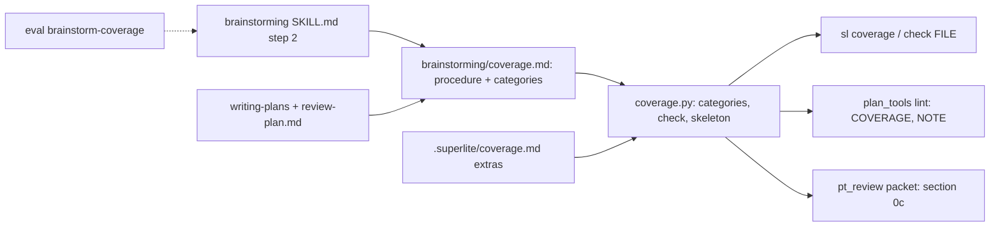
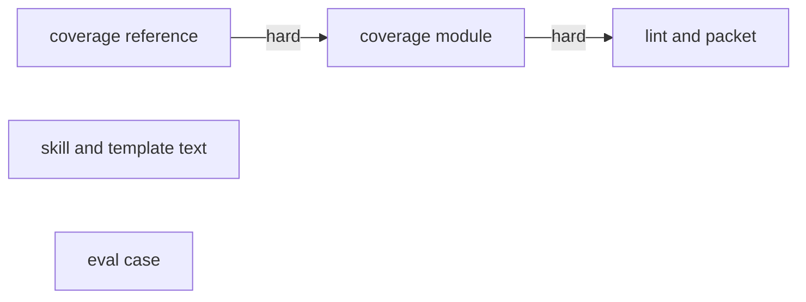

# Brainstorming coverage pass (#144)

**Goal:** before the question batch of an architectural brainstorm, check the request against a fixed list of decision categories, so gaps (migration, error recovery, rollout, ...) surface as questions or rulings before the plan, not mid-build. Lint and the review packet carry the result.
**Architecture:** `skills/brainstorming/coverage.md` holds the procedure and the category table (T1); `scripts/coverage.py` parses it, plus a project's `.superlite/coverage.md`, and checks a doc's `## Coverage` table; `sl coverage` prints the skeleton, `sl coverage check FILE` checks a file (T2); `plan_tools lint` reports `COVERAGE:` as plan-level issues and the review packet shows the table as section 0c (T3); brainstorming, writing-plans and the review-plan template point at the pass (T4); an eval case with a thin spec (T5).
**Tech stack:** Python 3.10+ stdlib, pytest, bash; `claude plugin eval` for T5.
**Spec:** this file, sections 1 to 6 under Design; issue #144.
**Detail:** contracts
**Target-min:** 11
**Max chars:** 32000
**Wave0:** none

## Understood

From the issue and Max's answers: an on-by-default coverage pass for architectural size; a fixed, per-project extensible category list; per category one of settled, assumed (a `Ruling:`) or open (a question); open items asked in as few 4-question calls as possible until none is open; research unknowns become spike tasks; the table sits in the doc under `## Coverage`; lint reports `COVERAGE:` (plan-level, never blocking stable tasks); the packet carries the table; unattended runs rule the defaults and list them; the human orchestrator's review plan shows the table. Max ruled: a plan without the section gets a `NOTE`, not an issue; one eval case (thin spec), the settled-spec acceptance is covered by lint unit tests.

Assumptions (rulings below): two extra states (`n/a`, `spike`); bounded and trivial work skip the pass; the category table is a markdown reference file that a script also parses.

## Design

### 1. Categories, states and the table

The category list is the `## Categories` table in `skills/brainstorming/coverage.md` (`| Category | Asks about |`, 14 rows, T1). A project adds rows with the same two-column table in `.superlite/coverage.md`. The doc's table is `| Category | State | Basis |` under an unfenced `## Coverage` heading (level 2, title starting with "Coverage"); the section ends at the next heading of level 1 or 2. States: `settled` (basis: where it is answered), `ruled` (basis: the decision; a `Ruling:` line in the doc), `n/a` (basis: why), `spike` (basis: the spike task id), `open` (basis: the question). Matching is case-insensitive with `*` and backticks stripped and spaces collapsed. A cell split honours `\|`. Extra rows with unknown categories are allowed.

### 2. `sl coverage`

`sl coverage [--root DIR]` prints the skeleton table (header, separator, one row per category with state `open` and the "Asks about" text as basis). `sl coverage check FILE [--root DIR]` prints the COVERAGE and NOTE lines of `check` for that file (no task ids: a spike row needs only a basis); exit 1 when any COVERAGE line, else 0; a missing FILE prints `coverage: not found: FILE` to stderr and exits 2. A missing or rowless category file makes `check` return the single issue `COVERAGE: category list not found: <path>`.

### 3. Lint

`lint_plan` calls `coverage.check(plan.text, task ids, stable root)` unless the `--spec` file says `**Coverage:** off`, and adds each message as `Issue(msg, scope="plan")` and each note as a warning. `coverage` joins `SPEC_SKIP`, so a spec's `## Coverage` heading needs no task.

### 4. Review packet

In plan mode (not `--inline`), when the plan has a Coverage section, the packet gets `## 0c. Coverage (decision categories from the plan)` with the section body, capped at 3,000 chars, after sections 0 and 0b. An inline packet is unchanged: its section 0 already shows the spec's table.

### 5. Skill and template text

Brainstorming step 2 names the pass and points at `coverage.md`; the batch rule allows as many 4-question calls as open rows need for architectural work; the AI-orchestrator unattended rule covers open rows. writing-plans: `**Coverage:** off` header, `## Coverage` in the plan shape after the header, spike tasks at the front, `COVERAGE:` among plan-level issues, the machine plan copies the review plan's table. review-plan.md: a required `## Coverage` section after "Decisions you can change". Brainstorming SKILL.md gets a cap test of 9,000 chars.

### 6. Eval case

`evals/brainstorm-coverage`: a scaffolded notes app on a JSON store with two existing notes and a thin `docs/spec.md` (SQLite storage plus tags) that never mentions migration or failures. Graders: brainstorming fired; an AskUserQuestion input mentions migration; one mentions errors or failure; no `.py` file created. AskUserQuestion behaviour in eval runs is undocumented, so the graders read the call inputs, which are recorded whatever the tool returns.

## Coverage

| Category | State | Basis |
|---|---|---|
| Scope and success criteria | settled | issue #144 Proposal and Acceptance, Max's two answers |
| Domain and data model | settled | Design 1 |
| Persistence and migration | settled | plain markdown in the plan, no stored state; old plans stay lint-clean (NOTE only) |
| Interfaces and contracts | settled | FROZEN list under Global constraints |
| UI states | n/a | no UI, CLI output only |
| Concurrency and state ownership | n/a | read-only checks of one file |
| Error handling and recovery | settled | Design 2: missing file exits 2, a missing category list is one COVERAGE issue |
| Security and privacy | n/a | reads local plan files only |
| Performance and limits | settled | one pass over the lines; packet section capped at 3,000 chars |
| Observability | settled | lint ISSUE and NOTE lines, `sl coverage check` |
| Testing strategy | settled | named pytest cases per task; one eval case (Max) |
| Compatibility | settled | NOTE for plans without the section (Max); FROZEN interfaces |
| Rollout | ruled | ships with the next release, no flag; `**Coverage:** off` is the opt-out |
| Research unknowns | ruled | eval AskUserQuestion behaviour: graders read call inputs, no spike |

## Rulings

- Ruling: the category list lives in `skills/brainstorming/coverage.md` and `coverage.py` parses it (because the coordinator reads it without Bash and lint reads the same file; cost if wrong: one file read per lint).
- Ruling: `.superlite/coverage.md` uses the same two-column table (because one parser serves both).
- Ruling: states `settled`, `ruled`, `n/a`, `spike`, `open` (because "does not apply" and spike rows are neither settled nor assumed; cost if wrong: a rename).
- Ruling: lint reads the table from the plan only, the `--spec` file only for `**Coverage:** off` (because the design+plan doc and the machine plan both carry the table).
- Ruling: packet section 0c in plan mode only (because the inline packet's section 0 already shows the spec).
- Ruling: bounded and trivial work skip the pass (because the issue scopes it to architectural size).
- Ruling: `**Detail:** contracts` (because the core is string parsing with its messages fixed below).
- Ruling: brainstorming SKILL.md cap 9,000 chars (9,500 after merging #151), tested (because it had no cap and the issue asks growth to stay inside one).
- Ruling: shipped in a release by `scripts/bump-version.sh` later, not in this change.

## Global constraints

- Python 3.10+ stdlib only. Every code line in `skills/subagent-driven-development/scripts/*.py` ends with a `# O(...)` complexity comment, as in the existing scripts. Results to stdout, errors to stderr. LF line endings.
- `coverage.py` lives in `skills/subagent-driven-development/scripts/`, imports `scan_fences` from `plan_tools` at module top for fence detection (reuse, no second fence scanner); `plan_tools` and `pt_review` import `coverage` lazily inside the function that uses it (as `shape` is imported).
- Category source: `Path(__file__).resolve().parents[2] / "brainstorming" / "coverage.md"`.
- Exact messages (`<C>` = category name as in the category table, `<s>` = the state cell as written, `<b>` = the basis cell):
  - `COVERAGE: no row for '<C>'; add it as settled, ruled, n/a, spike or open`
  - `COVERAGE: '<C>' is open; ask it or rule it (<b>)`
  - `COVERAGE: '<C>' has state '<s>'; use settled, ruled, n/a, spike or open`
  - `COVERAGE: '<C>' is <state> but gives no basis` (`<state>` normalised, lower case)
  - `COVERAGE: '<C>' is spike but names no task of this plan`
  - `COVERAGE: category list not found: <path>`
  - `NOTE: no ## Coverage section; brainstorming's coverage pass writes it (sl coverage prints the table), or set **Coverage:** off`
- Issues come in category-table order, one per category at most (the first matching row counts).
- `**Coverage:** off` = a line matching `^\*\*Coverage:\*\*\s*off\b` (multiline, case-insensitive) anywhere outside fences; it silences issues and the NOTE.
- FROZEN: `plan_tools.lint_plan(plan, args) -> (issues, warnings)`, `Issue` and its scopes, `plan_tools lint` exit codes (0 clean, 1 issues), packet sections 0, 0b and 1 to 8 with their titles, the ten existing review-plan required section names, brainstorming steps 1 to 4, `sl` dispatch.
- Tests run with `<sl> run_tests --fast PATHS --task Tn --background`, then its `wait:` line.

## Main diagram



## File structure

| File | Responsibility |
|---|---|
| `skills/brainstorming/coverage.md` | the pass procedure and the category table (T1) |
| `tests/scripts/test_coverage_reference.py` | the reference file's table and states (T1) |
| `skills/subagent-driven-development/scripts/coverage.py` | categories, table parse, check, skeleton, CLI (T2) |
| `tests/scripts/test_coverage.py` | coverage.py contracts (T2) |
| `skills/subagent-driven-development/scripts/sl` | header comment names `coverage` (T2) |
| `docs/tools.md` | `coverage` row (T2); packet section 0c in the `pt_review` row (T3) |
| `skills/subagent-driven-development/scripts/plan_tools.py` | lint wiring, `SPEC_SKIP` (T3) |
| `skills/subagent-driven-development/scripts/pt_review.py` | packet section 0c (T3) |
| `tests/scripts/test_coverage_lint.py` | lint and packet behaviour (T3) |
| `skills/brainstorming/SKILL.md`, `skills/writing-plans/SKILL.md`, `skills/writing-plans/review-plan.md` | pointers to the pass (T4) |
| `tests/scripts/test_coverage_docs.py` | skill texts and the brainstorming cap (T4) |
| `evals/brainstorm-coverage/*`, `tests/scripts/test_evals_suite.py` | the thin-spec eval case (T5) |

## Task graph

```mermaid
%% schedule
gantt
  title Predicted schedule (mm:ss)
  dateFormat X
  axisFormat %M:%S
  section lane 1
  T5 thin-spec eval case :t5, 0, 139s
  T3 lint COVERAGE and packet section 0c :t3, 336, 185s
  section lane 2
  T4 skill and template text :t4, 0, 139s
  section lane 3
  T1 coverage reference file :t1, 0, 134s
  T2 coverage module and sl coverage :t2, 134, 202s
```





critical path: T1 → T2 → T3 (8.7 min) · peak width 3 · predicted build 8.7 min · predicted total ≈ 12.2 min (target ✗ 11.0)

## Coverage reference

**Probe entry:** none (markdown reference; its cases are named pytest cases)

### T1 coverage reference file · Complexity 2 · Est. context 27k
**Owns:** skills/brainstorming/coverage.md, tests/scripts/test_coverage_reference.py
**Components:** 1
**LOC owned:** 70
**Tests:** fast
**Kind:** mechanical
**Model:** haiku
**Covers:** 1
**Produces:** none
**Test code:** `test_categories_table`: read the file, take the unfenced lines after `## Categories` that start with `|`, drop the header and the `|---|` row; assert 14 rows, first cell of row 1 `Scope and success criteria`, of row 3 `Persistence and migration`, of row 7 `Error handling and recovery`, of row 14 `Research unknowns`; every row has two non-empty cells. `test_procedure_names_states_and_rules`: the text contains each of `` `settled` ``, `` `ruled` ``, `` `n/a` ``, `` `spike` ``, `` `open` ``, `## Coverage`, `AskUserQuestion`, `**Coverage:** off`, `.superlite/coverage.md`, `sl coverage check`, `COVERAGE:`, `Unattended`.
**Steps:** 1 failing tests, 2 run: FAIL, 3 write the file, 4 run: PASS.
**Notes:** write `skills/brainstorming/coverage.md` exactly as below (without the outer fence):

````markdown
# Coverage pass (brainstorming step 2, architectural size)

Before the question batch, check the request against every decision category below, so gaps surface before the plan instead of mid-build. It is on for architectural work in every mode; bounded and trivial work skip it. To turn it off, put `**Coverage:** off` in the spec or plan header (with a one-line reason), also when the user asks for that.

1. Read the spec, the code and the user's messages first. Add the project's own categories from `.superlite/coverage.md` (the same two-column table as below) when it exists.
2. Write the table into the design doc under `## Coverage` (`sl coverage` prints it with every row open): one row per category, `| Category | State | Basis |`. States:
   - `settled`: the spec, the code or the user answers it; the basis says where (spec section, `file:line`, the user's words).
   - `ruled`: you assume a default; the basis is the decision, and the doc gets a `Ruling: <decision> (because <reason>; cost if wrong: <cost>)` line.
   - `n/a`: the category does not apply; the basis says why, in a few words.
   - `spike`: a research unknown nobody can answer yet; the basis names the spike task (`S1`). Spikes are small tasks at the front of the plan, never questions.
   - `open`: a question for the user; the basis is the question.
3. Ask the open rows with `AskUserQuestion`: 4 per call, recommended option first, as few calls as possible, repeated until no row is open; each answered row becomes `settled` (the answer) or `ruled`. Never ask what the spec or code already answers. AI orchestrator: only major or uncertain rows become questions; minor and medium ones are `ruled`.
4. Unattended (AI orchestrator with the user away, a headless run, or `AskUserQuestion` unavailable): rule every open row with its sensible default; the closing report lists those rulings.
5. Human orchestrator: the review plan carries the table under `## Coverage`, in plain words, with no row open; the machine plan copies it unchanged.
6. `plan_tools lint` reports `COVERAGE:` for a missing, open or malformed row (plan-level: it never blocks stable tasks) and a `NOTE:` for a plan without the section. `sl coverage check FILE` runs the same check on a review plan or spec.

## Categories

| Category | Asks about |
|---|---|
| Scope and success criteria | what is in, what is out (non-goals), how success is measured |
| Domain and data model | entities, fields, relations and invariants |
| Persistence and migration | storage, schema, and migration of existing data |
| Interfaces and contracts | calls to and from existing modules, APIs and formats that must not break |
| UI states | empty, loading, error, offline, permissions, accessibility, localisation |
| Concurrency and state ownership | who owns which state, parallel access, ordering |
| Error handling and recovery | failures, retries, partial writes, corrupt input, messages the user sees |
| Security and privacy | access control, secrets, personal data, untrusted input |
| Performance and limits | sizes, latency, quotas, timeouts |
| Observability | logs, metrics, how a failure gets noticed |
| Testing strategy | test levels, test data and fixtures |
| Compatibility | platforms, versions, backward compatibility |
| Rollout | release order, feature flags, rollback |
| Research unknowns | what nobody knows yet: a spike task, never a question |
````

## Coverage module

**Probe entry:** none (script module; its Review Focus cases are named pytest cases)

### T2 coverage module and sl coverage · Complexity 4 · Est. context 34k
**Owns:** skills/subagent-driven-development/scripts/coverage.py, tests/scripts/test_coverage.py, skills/subagent-driven-development/scripts/sl, docs/tools.md
**Components:** 2
**LOC owned:** 260
**Tests:** fast
**Model:** sonnet
**Covers:** 1, 2
**Produces:** coverage.categories(root: Path | None = None, source: Path | None = None) -> list[tuple[str, str]] · coverage.coverage_off(text: str) -> bool · coverage.section_span(lines: list[str]) -> tuple[int, int] | None · coverage.check(text: str, task_ids: set[str] | None = None, root: Path | None = None, source: Path | None = None) -> tuple[list[str], list[str]] · coverage.skeleton(root: Path | None = None, source: Path | None = None) -> str · coverage.main(argv: list[str] | None = None) -> int
e.g. `categories()[0] -> ("Scope and success criteria", "what is in, what is out (non-goals), how success is measured")`
e.g. `section_span(["# P", "## Coverage", "| a | b | c |", "## Next"]) -> (1, 3)`; `section_span(["```", "## Coverage", "```"]) -> None`
e.g. `check("# P\n") -> ([], ["NOTE: no ## Coverage section; brainstorming's coverage pass writes it (sl coverage prints the table), or set **Coverage:** off"])`; `check("**Coverage:** off\n") -> ([], [])`
**Review Focus:** encoding: `test_escaped_pipe_cell` (`| Rollout | ruled | Ruling: a \| b |` parses state `ruled`, no issue for Rollout); `test_crlf_text` (the full-table text with `\r\n` gives the same result as with `\n`); file: `test_extras_file` (root with `.superlite/coverage.md` holding `| Category | Asks about |`, `|---|---|`, `| Billing | invoices and refunds |` gives 15 categories, the last `("Billing", "invoices and refunds")`, and a full built-in table without a Billing row gives exactly the missing-row issue for `Billing`); `test_missing_source` (`check("## Coverage\n", source=tmp/"none.md")` gives `(["COVERAGE: category list not found: <that path>"], [])`); state: `test_fenced_heading_ignored` (a `## Coverage` only inside a fence gives the NOTE).
**Test code:** `tests/scripts/test_coverage.py`, importing `coverage` from the scripts dir as the other script tests do. Helper `table(rows)` builds `## Coverage\n\n| Category | State | Basis |\n|---|---|---|\n` plus rows; `full(state="settled", basis="spec 1", skip=(), override={})` gives one row per built-in category. Named tests: `test_categories_builtin` (14, first and last as in T1); `test_coverage_off` (`"**Coverage:** off\n"` True, `"**Coverage:** on\n"` False, `"Coverage: off"` False); `test_section_span` (the two `e.g.` cases, `["### Coverage"]` -> None, `["## Coverage table", "x"]` -> (0, 2)); `test_check_no_section_note` and `test_check_off` (the `e.g.` results); `test_check_full_table_ok` (`check(full())` -> `([], [])`); `test_check_missing_and_open` (full table without the Persistence row and with Error handling `open` basis `what if the file is corrupt?` -> exactly the missing-row issue for `Persistence and migration` then `COVERAGE: 'Error handling and recovery' is open; ask it or rule it (what if the file is corrupt?)`); `test_check_bad_state_and_empty_basis` (Rollout `maybe` -> bad-state issue with `'maybe'`; Observability `settled` with empty basis -> `COVERAGE: 'Observability' is settled but gives no basis`); `test_check_spike` (Research unknowns `spike` basis `S1`: task_ids `{"S1", "T1"}` ok, `{"T1"}` -> the spike issue, `None` ok); `test_state_case_and_markup` (`| **UI states** | N/A | CLI only |` and `` | `Rollout` | Ruled | Ruling: ship dark | `` give no issue); `test_skeleton_round_trip` (first line `| Category | State | Basis |`; `check("## Coverage\n\n" + skeleton())` gives 14 open issues); `test_cli` (`main([])` returns 0 and prints the skeleton; `main(["check", str(f)])` on a file with one open row returns 1 and prints that issue; a missing file returns 2 with `coverage: not found:` on stderr; `main(["--root", str(tmp)])` with the Billing extras prints a Billing row); `test_sl_coverage_runs` (`bash <scripts>/sl coverage` exits 0, stdout contains `| Category | State | Basis |`); plus the Review Focus tests above.
**Steps:** 1 failing tests, 2 run: FAIL, 3 implement, 4 run: PASS.
**Notes:** table rows: unfenced lines in the span starting with `|`; split on `|` not preceded by `\`; first cell `category` (normalised) is the header, a row whose cells are only `-`, `:` and spaces is the separator. `categories` reads the `## Categories` table of `source` (default the category source path), then the first table of `<root>/.superlite/coverage.md` when that exists; a name already present is not added twice. `check` returns NOTE-only results before reading the category list. `sl` header comment: add `coverage` to the tool name list. `docs/tools.md`: a row after `plan_tools`: `` | `coverage` | Decision coverage for brainstorming's pass (`skills/brainstorming/coverage.md`): prints the `## Coverage` table skeleton, every row open (categories from that file plus the project's `.superlite/coverage.md`); `check FILE` prints the `COVERAGE:` and `NOTE:` lines lint would, exit 1 when any `COVERAGE:` | ``.

## Lint and packet

**Probe entry:** none (plan tooling; its Review Focus cases are named pytest cases)

### T3 lint COVERAGE and packet section 0c · Complexity 4 · Est. context 48k
**Owns:** skills/subagent-driven-development/scripts/plan_tools.py, skills/subagent-driven-development/scripts/pt_review.py, tests/scripts/test_coverage_lint.py, docs/tools.md
**Components:** 2
**LOC owned:** 170
**Tests:** fast
**Model:** sonnet
**Covers:** 3, 4
**Consumes:** coverage.check(text: str, task_ids: set[str] | None = None, root: Path | None = None, source: Path | None = None) -> tuple[list[str], list[str]] (T2) · coverage.coverage_off(text: str) -> bool (T2) · coverage.section_span(lines: list[str]) -> tuple[int, int] | None (T2)
**Produces:** none
**Review Focus:** protocol: `test_open_coverage_is_plan_level` (a one-task plan whose Coverage table has Error handling `open`: `lint_plan` issues contain that COVERAGE message as an `Issue` with `scope == "plan"` and `tasks == ()`, and `stable_partition` keeps the task stable); `test_lint_exit_codes` (`plan_tools lint` on that plan exits 1 and prints `ISSUE: COVERAGE:`; on the same plan without the section exits 0 and prints the NOTE).
**Test code:** `tests/scripts/test_coverage_lint.py`, reusing the existing plan-writing fixtures in `tests/scripts/_fixtures.py` or `test_plan_tools.py` for a minimal lint-clean plan. Named tests: the two Review Focus tests; `test_full_table_lints_clean` (every built-in row `settled`: no COVERAGE issue, no NOTE); `test_off_in_plan_or_spec` (`**Coverage:** off` in the plan header: no NOTE; plan without it, `--spec` file with it: no NOTE); `test_spec_coverage_heading_needs_no_task` (a `--spec` file with `## Coverage` and no task covering it: no `SPEC section 'Coverage'` issue); `test_packet_carries_coverage` (`pt_review packet --plan P` for a plan with a Coverage table: the packet contains `## 0c. Coverage (decision categories from the plan)` and the row `| Rollout | ruled |`; for a plan without one: no `## 0c.`); `test_inline_packet_unchanged` (`packet --inline --spec S` with a spec holding a Coverage table: no `## 0c.` heading, the table text appears once).
**Steps:** 1 failing tests, 2 run: FAIL, 3 implement, 4 run: PASS.
**Notes:** in `lint_plan`, place the call after the SPEC coverage block; the stable root comes from `stable_root(str(plan.path))` inside a try (OSError, ValueError -> `None`). Add `"coverage"` to `SPEC_SKIP`. In `cmd_packet`, add `COVERAGE_CHARS = 3000` next to `SPEC_CHARS` and append the 0c section to `front` after 0b only when not inline, so the default cap grows with it. `docs/tools.md` `pt_review` row: after the `--previous` sentence add `a plan's `## Coverage` table rides as section 0c (plan packets only, capped at 3,000 chars)`.

## Skill text

**Probe entry:** none (docs)

### T4 skill and template text · Complexity 3 · Est. context 45k
**Owns:** skills/brainstorming/SKILL.md, skills/writing-plans/SKILL.md, skills/writing-plans/review-plan.md, tests/scripts/test_coverage_docs.py
**Components:** 1
**LOC owned:** 60
**Tests:** fast
**Model:** sonnet
**Covers:** 5
**Produces:** none
**Test code:** `tests/scripts/test_coverage_docs.py`: `test_brainstorming_points_at_the_pass` (brainstorming SKILL.md contains `coverage.md`, `**Coverage:** off`, `## Coverage` and `spike`, and is at most 9000 chars); `test_writing_plans_names_coverage` (writing-plans SKILL.md contains `**Coverage:** off`, `## Coverage`, `COVERAGE:` and `spike`); `test_review_plan_has_coverage_section` (review-plan.md contains `` `## Coverage` `` and it appears after `` `## Decisions you can change` `` and before `` `## Risks` `` in the required list).
**Steps:** 1 failing tests, 2 run: FAIL, 3 edit, 4 run: PASS.
**Notes:** brainstorming step 2: after "Do not ask what the repo or the request already answers." add one paragraph: architectural work first runs the coverage pass in `coverage.md` (one `## Coverage` row per decision category: settled, ruled, n/a, spike or open; research unknowns become spike tasks, never questions; the open rows are the questions; `**Coverage:** off` in the spec, or the user saying so, skips it). In the ONE-call sentence keep "Bounded work gets at most one batch" and add that architectural work asks the open rows in as few 4-question calls as possible until none is open. In the AI-orchestrator paragraph, "A second batch only when ..." also allows open coverage rows. Step 4 Architectural item 1: the doc includes the `## Coverage` table. "AI orchestrator" section: unattended runs rule the open rows too. writing-plans: plan shape item 1 header gains `**Coverage:** off`; a new item 2 `**Coverage:** the `## Coverage` table from brainstorming (`../brainstorming/coverage.md`); spike tasks (`S1`, ...) come first` (renumber the rest); the plan-level issue list in "Lint, extract what's stable" and the "Every other error must be fixed" list gain `COVERAGE:`; human step 4 says the machine plan copies the review plan's `## Coverage` table unchanged. review-plan.md: new required item 7 `## Coverage` (the coverage table in plain words: settled with where, ruled with the default, not applicable, spike, or open with the question; no row open when asking for approval), items 7 to 10 become 8 to 11. Keep the existing wording the tests in `tests/scripts/test_orchestrator.py` check.

## Eval case

**Probe entry:** none (eval suite)

### T5 thin-spec eval case · Complexity 2 · Est. context 30k
**Owns:** evals/brainstorm-coverage/case.yaml, evals/brainstorm-coverage/prompt.md, evals/brainstorm-coverage/scaffold.sh, evals/brainstorm-coverage/graders/skill-fired.md, evals/brainstorm-coverage/graders/raises-migration.md, evals/brainstorm-coverage/graders/raises-errors.md, evals/brainstorm-coverage/graders/reads-coverage.md, evals/brainstorm-coverage/graders/no-code-yet.md, tests/scripts/test_evals_suite.py
**Components:** 1
**LOC owned:** 120
**Tests:** fast
**Kind:** mechanical
**Model:** haiku
**Covers:** 6
**Produces:** none
**Test code:** in `tests/scripts/test_evals_suite.py`: `CASES` gains `"brainstorm-coverage"`; the scaffold set in `test_scaffold_scripts_are_executable_bash` gains it; add `test_coverage_scaffold_spec_is_thin` (run the scaffold in `tmp_path`; `docs/spec.md` exists and its lower-cased text contains none of `migrat`, `error`, `corrupt`, `fail`, `recover`; `notes.json` holds 2 notes; `src/notes/store.py` contains `json.load`).
**Steps:** 1 failing tests, 2 run: FAIL, 3 write the files, 4 run: PASS.
**Notes:** `case.yaml` copies `evals/debug-flow/case.yaml` with `name: brainstorm-coverage`, `description: A thin spec for an architectural change gets its missing decision categories asked before any plan.`, `max_turns: 25`, `timeout_seconds: 900`, `allowed_tools: [Read, Glob, Grep, Skill, AskUserQuestion]`. `prompt.md`: `Feature mode, AI orchestrator. Build docs/spec.md for this notes app: it replaces the storage layer the CLI depends on. I am at my desk and will answer your questions before you plan.` `scaffold.sh` (bash, `set -euo pipefail`, executable): `pyproject.toml` as in debug-flow with `name = "notes"`; `src/notes/__init__.py` empty; `src/notes/store.py` with `load(path)` (`json.load`) and `save(path, notes)` (`json.dump`) over a list of `{"id": int, "text": str}`; `src/notes/cli.py` with argparse `add TEXT` and `list` over `notes.json`; `tests/test_store.py` with one round-trip test; `notes.json` with two notes; `docs/spec.md` with title `# Notes: SQLite storage and tags`, the line `Notes move from notes.json to a SQLite database, notes.db, next to it.`, a `## Commands` list (`notes add TEXT [--tag TAG]...` prints the new id; `notes list [--tag TAG]` prints `id  text  [tags]`, newest first; `notes tag ID TAG` adds a tag) and a `## Store` line (`Store.add(text, tags) -> int`, `Store.list(tag=None) -> list[Note]`, `Store.tag(id, tag) -> None` replace the JSON store; `cli.py` keeps its commands). Graders: `skill-fired.md` as in brainstorm-first (`arm: with-only`); `asks-migration.md` `type: tool_used`, `tool: AskUserQuestion`, `input_match: '(?i)migrat'`; `asks-errors.md` the same with `input_match: '(?i)error|fail|corrupt|recover'`; `no-code-yet.md` `type: regex`, `target: files`, `pattern: '\.py$'`, `match: not_contains`. Each grader body is one sentence saying what passed.

## Review Focus

- coverage module: library / parser: encoding (escaped pipes, CRLF, markup in cells), file (missing category list, extras file), state (fenced headings). Cases in T2.
- lint and packet: CLI: protocol (issue scope, exit codes, packet section only in plan mode). Cases in T3.
- docs and eval: no probes; named tests in T1, T4, T5.

## Self-review

Coverage: sections 1 to 6 map to T1 to T5. Placeholders: none. Types: T3's Consumes lines match T2's Produces. Graph: T1 -> T2 -> T3 are hard (tests read the file and run the module); T2 and T3 share `docs/tools.md` but never run at once. Fields: every task has Components, LOC owned, Tests, Model.
