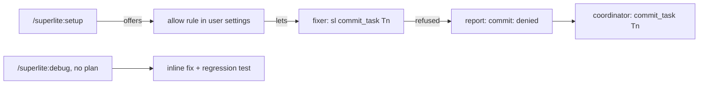
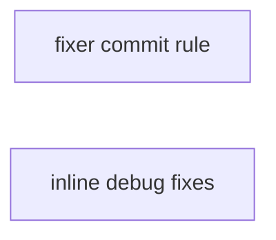

# Superlite: fixer commits and inline debug fixes

**Goal:** fixer agents can commit in Claude Code auto mode once the user adds one allow rule, which `/superlite:setup` offers, and a denied commit is reported instead of lost (#161); `/superlite:debug` without a plan fixes inline, and fixers run only inside a plan run (#105).
**Architecture:** wording only. T1 changes the three fixer agent files, the fixing contract, the setup command and the config doc. T2 changes the debug command and the debugging skill. Each task pins its rules with one wording test file.
**Tech stack:** Markdown, Python 3.10+ stdlib, pytest.
**Spec:** this file, section Design.
**Detail:** contracts
**Target-min:** 6
**Wave0:** none
**Coverage:** off

Global constraints:
- The allow rule is exactly `Bash(*/skills/subagent-driven-development/scripts/sl commit_task *)`, written in `permissions.allow` of the user settings (`$CLAUDE_CONFIG_DIR/settings.json`, default `~/.claude/settings.json`).
- The fixer's report token for a refused commit is exactly `commit: denied`.
- Markdown edits are exact replacements from the task Notes; touch no other line. Keep LF line endings.
- Tests are plain pytest reading files relative to `ROOT = Path(__file__).resolve().parents[2]`, in the style of `tests/scripts/test_isolation_wording.py`.
- Run `sl` as an executable. Verify with `<abs sl> run_tests --fast <test file> --task Tn --background`, then the printed `wait:` line.
- No version bump in a task (the coordinator runs `scripts/bump-version.sh` at finish).

Ruling: allow rule `*/skills/subagent-driven-development/scripts/sl commit_task *` - matches the plugin cache and a checkout alike; verified 2026-11-05 with `claude -p --permission-mode default`: denied without it, ran with it - cost if wrong: fixers keep being denied and the coordinator commits, as today.
Ruling: a denied fixer commit becomes the report token `commit: denied` and the coordinator commits - the denial is no longer silent and the run never stalls - cost if wrong: one extra coordinator call per fix.
Ruling: detail contracts, both tasks mechanical - every edit is an exact replacement and every test names its strings - cost if wrong: one NEEDS_CONTEXT per task.

## Design

1. **#161 (Max chose: allow fixer commits).** Auto mode's classifier denies `sl commit_task` from fixer subagents. Claude Code checks allow rules before the classifier, for subagents too, and plugins cannot ship permission rules. So: `/superlite:setup` checks the user settings for the rule and offers to add it, `docs/config.md` documents it, and the fixers keep committing. A refused commit is reported as `commit: denied`; the coordinator then runs `commit_task Tn` itself and names `/superlite:setup`.
2. **#105 (Max chose: fix inline).** `/superlite:debug` has no plan and no task id, so fixers there cannot commit. The debug command fixes inline under `systematic-debugging` and commits on the worktree branch. Fix-only agents run only inside a plan run. The debugging skill says so in one line.

## Main diagram

## File structure

- `agents/fixer-sonnet.md`, `agents/fixer-sonnet-high.md`, `agents/fixer-opus.md`: the Commit rule and the report line (T1).
- `skills/subagent-driven-development/fixing.md`: the fixer contract's fallback (T1).
- `commands/setup.md`: the allow-rule check (T1).
- `docs/config.md`: a Permissions section (T1).
- `tests/scripts/test_fixer_commit_wording.py`: T1's rules (T1).
- `commands/debug.md`, `skills/systematic-debugging/SKILL.md`: inline debug fixes (T2).
- `tests/scripts/test_debug_inline_wording.py`: T2's rules (T2).

## Task graph

```mermaid
%% schedule
gantt
  title Predicted schedule (mm:ss)
  dateFormat X
  axisFormat %M:%S
  section lane 1
  T1 fixer commit rule :t1, 0, 102s
  section lane 2
  T2 inline debug fixes :t2, 0, 100s
```

critical path: T1 (1.7 min) · peak width 2 · predicted build 1.7 min · predicted total ≈ 5.2 min (target ✓)

## Wording

**Probe entry:** none (Markdown and wording tests only).

### T1 fixer commit rule · Complexity 2 · Est. context 30k
**Owns:** agents/fixer-sonnet.md, agents/fixer-sonnet-high.md, agents/fixer-opus.md, skills/subagent-driven-development/fixing.md, commands/setup.md, docs/config.md, tests/scripts/test_fixer_commit_wording.py
**Components:** 1
**LOC owned:** 60
**Tests:** fast
**Kind:** mechanical
**Model:** haiku
**Est. time:** 2 min (1 component, about 60 LOC, fast tests)
**Covers:** Design 1
**Consumes:** nothing.
**Produces:** none consumed by another task.
**Review Focus:** file: `test_fixer_commit_lines_match`.
**Test code:** in `tests/scripts/test_fixer_commit_wording.py`, `RULE = "Bash(*/skills/subagent-driven-development/scripts/sl commit_task *)"`, `FIXERS = ["agents/fixer-sonnet.md", "agents/fixer-sonnet-high.md", "agents/fixer-opus.md"]`:
- `test_setup_offers_the_allow_rule`: `commands/setup.md` contains `RULE` and `permissions.allow`.
- `test_config_doc_names_the_rule`: `docs/config.md` contains the line `## Permissions (Claude Code)` and `RULE`.
- `test_fixers_report_a_denied_commit`: each file in `FIXERS` contains `` `commit: denied` `` twice (Commit rule and report line) and still contains `commit_task <Tn>`.
- `test_fixer_commit_lines_match`: the line starting `- Commit:` is identical in all three `FIXERS`.
- `test_fixing_contract_names_the_fallback`: `skills/subagent-driven-development/fixing.md` contains `` `commit: denied` `` and `/superlite:setup`.
**Steps:** 1 failing tests, 2 run: FAIL, 3 edit, 4 run: PASS.
**Notes:** exact replacements.
- In each of the three fixer files, the line starting `- Commit:`: after the closing `)` of its parenthesis, insert ` If the harness refuses the call (a permission denial), do not retry it or commit another way: put `` `commit: denied` `` in your report instead of the commit id.` Keep the rest of the line.
- In each fixer file, the report sentence `Then the test summary line and the commit id.` becomes `Then the test summary line and the commit id, or `` `commit: denied` ``.`
- `fixing.md`, the **Fixer contract** bullet: after `report a closed list.` insert ` A report with `` `commit: denied` `` means the harness refused the fixer's commit: run `` `commit_task Tn` `` yourself, and tell the user `/superlite:setup` offers the allow rule (`docs/config.md`, Permissions).`
- `commands/setup.md`: a new bullet after the `CLAUDE_CODE_FORK_SUBAGENT` bullet: `- in Claude Code only: whether the user settings (`$CLAUDE_CONFIG_DIR/settings.json`, default `~/.claude/settings.json`) let fixer agents commit: `permissions.allow` holds `Bash(*/skills/subagent-driven-development/scripts/sl commit_task *)`. Without it, auto mode's classifier denies the fixers' `sl commit_task` calls and the coordinator commits for them. Allow rules are checked before the classifier, for subagents too, and a plugin cannot ship one. The fix line offers to add that rule to `permissions.allow` (keep the other entries and keys).` (all names in code spans).
- `docs/config.md`: a new section before `## Environment`: heading `## Permissions (Claude Code)`, then one bullet: `- `Bash(*/skills/subagent-driven-development/scripts/sl commit_task *)` in `permissions.allow` of the user settings (`~/.claude/settings.json`): lets fixer agents run `sl commit_task` in auto mode, whose classifier otherwise denies the call from a subagent. Allow rules are checked before the classifier and apply to subagents; a plugin cannot ship permission rules, so `/superlite:setup` offers it. Without it a fixer reports `commit: denied` and the coordinator commits.`

### T2 inline debug fixes · Complexity 2 · Est. context 25k
**Owns:** commands/debug.md, skills/systematic-debugging/SKILL.md, tests/scripts/test_debug_inline_wording.py
**Components:** 1
**LOC owned:** 35
**Tests:** fast
**Kind:** mechanical
**Model:** haiku
**Est. time:** 1.5 min (1 component, about 35 LOC, fast tests)
**Covers:** Design 2
**Consumes:** nothing.
**Produces:** none consumed by another task.
**Review Focus:** file: `test_ensure_precedes_inline_fix`.
**Test code:** in `tests/scripts/test_debug_inline_wording.py`:
- `test_debug_command_fixes_inline`: `commands/debug.md` contains `Fix inline` and does not contain `Fixes go to fix-only agents by tier`.
- `test_debug_command_scopes_fixers_to_plan_runs`: `commands/debug.md` contains `only inside a plan run`.
- `test_debugging_skill_names_the_inline_rule`: `skills/systematic-debugging/SKILL.md` contains `/superlite:debug` and `only inside a plan run`.
- `test_ensure_precedes_inline_fix`: in `commands/debug.md`, the index of `worktree ensure` is below the index of `Fix inline`.
**Steps:** 1 failing tests, 2 run: FAIL, 3 edit, 4 run: PASS.
**Notes:** exact replacements; `tests/scripts/test_isolation_wording.py` must stay green (it needs `worktree ensure` before `write the failing regression test` in `commands/debug.md`).
- `commands/debug.md`: the sentence `Fixes go to fix-only agents by tier.` becomes `Fix inline: you write the regression test and the fix yourself and commit them on the worktree's branch. Fix-only agents (`fixer-*`) run only inside a plan run, where `commit_task` has a task id to commit against.`
- `skills/systematic-debugging/SKILL.md`: after the paragraph that starts `Find the root cause before fixing.`, insert a new paragraph: `In `/superlite:debug` without a plan you make the fix yourself; fix-only agents run only inside a plan run (`subagent-driven-development/fixing.md`).`

## Review Focus

Package wording: app type file (Markdown read by agents); category file. Risks: a fixer file drifting from the other two (`test_fixer_commit_lines_match`); the debug command losing the worktree-first order (`test_ensure_precedes_inline_fix`).

## Self-review

1. Coverage: Design 1 is T1, Design 2 is T2.
2. Placeholders: none.
3. No Consumes or Produces; no edges; the tasks share no file.
4. Every task has Components, LOC owned, Tests, Model.
5. Layers after both tasks: unit (`tests/scripts/**`), headless (`agents/**`, `commands/**`, `skills/**`), evals (`agents/**`, `commands/**`, `skills/*/SKILL.md`); tui untouched.
