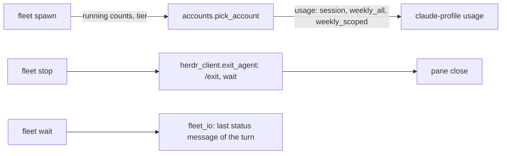
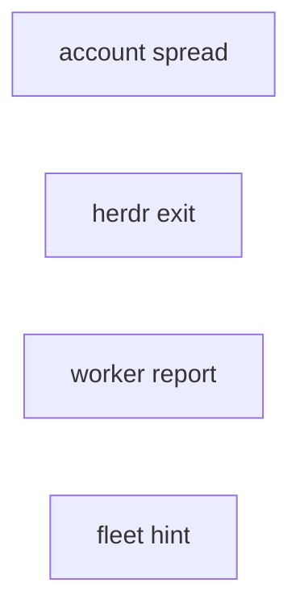

# Superlite: fleet fixes from the first fleet runs

**Goal:** workers of one run spread over the accounts with headroom (#166); the 5-hour cap applies (#168); a stopped worker gets a real `/exit` before its pane closes (#167); `fleet wait` reads the worker's status even when the user's own Stop hooks add a later message (#174); the verify line lists only test files; every coordinator learns that "use fleet" means `sl fleet on` and that an inline build starts no worker (#169).
**Architecture:** four independent tasks: T1 account choice and its use in `fleet spawn` and `fleet status`; T2 the herdr exit call and the fake herdr; T3 the worker report and task message in `fleet_io`; T4 the root skill line.
**Tech stack:** Python 3.10+ stdlib, pytest, Markdown.
**Spec:** this file, section Design.
**Detail:** contracts
**Target-min:** 7
**Wave0:** none
**Coverage:** off

Global constraints:
- Python 3.10+ stdlib. Follow the existing style of `skills/subagent-driven-development/scripts/`, including the per-line `# O(...)` complexity comments.
- The usage report is `claude-profile usage --json` schema 1: each account has `name`, `n` and `limits`, each limit `kind` (`session` = the 5-hour window, `weekly_all`, `weekly_scoped`), `label`, `percent`, `severity`, `resets_at`, `cap_percent` (null or a number).
- Verify with `<abs sl> run_tests --fast <your test files> --task Tn --background`, then the printed `wait:` line.
- No version bump in a task.

Ruling: spread = rank accounts by (live workers of this run on the account, weekly_all percent, n) - the issue's first option; headroom still breaks ties - cost if wrong: a busier account gets a worker while an idle one waits.
Ruling: `weekly_scoped` counts only when its `label` names the worker's tier model (case-insensitive substring, e.g. label `Sonnet` for tier sonnet), and skips the account at `percent >= cap_percent` (100 when the cap is null); today's labels (`Fable`) never match sonnet or haiku workers - cost if wrong: a scoped limit for another model blocks nothing, as today.
Ruling: the 5-hour cap reads kind `session`, and also the old `five_hour*` kinds - cost if wrong: none, the old kinds no longer appear.
Ruling: `fleet status` lists only live workers; `fleet status --all` adds stopped and blocked rows (#167 "also observed") - cost if wrong: a stopped worker is one flag away.
Ruling: `/exit` is sent without `--timeout`; the stop then waits up to 10 s for the agent to leave (`agent wait <name> --until unknown --timeout 10000`, a HerdrError from the wait counts as gone) before the pane closes - cost if wrong: up to 10 s per stopped worker.
Ruling: the report status comes from the last assistant message of the worker's latest turn that holds a status line, not the turn's final message (#174: the user's session-leftovers Stop hook makes the worker end with an uncommitted-work block) - cost if wrong: an older status line from the same turn wins; the turn boundary keeps earlier tasks out.

## Design

1. **#168 5-hour cap.** `accounts._skip` reads kind `session` (plus `five_hour*`); reason text `5-hour <N>%`.
2. **#166 spread.** `accounts.pick_account(usage, allowed, running=None, tier=None)` ranks by running count first. `fleet.spawn` passes the counts of live (not stopped) workers of this run per account, and its tier.
3. **#167 exit.** `herdr_client.exit_agent` sends `/exit` without `--timeout`, then waits for the agent to leave. The fake `herdr` rejects `--timeout` on `agent prompt` without `--wait`, as herdr 0.9.5 does (`--timeout requires --wait`).
4. **#174 status.** `fleet_io` takes the report from the worker's latest turn: the last assistant text in that turn that contains a status line (`Status: X` or a leading status word), else the turn's last assistant text.
5. **Verify line.** The task message's verify command lists the Owns entries that lie under a `tests/` (or `test/`) folder; only when there are none, the `is_test_path` matches; only when there are none, all Owns (seen 2026-11-05: `scripts/test_layers.py` matched `is_test_path` by its basename and landed in the verify line).
6. **#169 hint.** `skills/using-superlite/SKILL.md` gets one sentence: a user asking for fleet means `sl fleet on` before the first dispatch; fleet runs only the implementer tasks of a taskgraph plan, so an inline build says it starts no worker. The file stays under 1,500 characters (tests assert `< 1500`), so shorten other lines without dropping a rule.

## Main diagram

## File structure

- `skills/subagent-driven-development/scripts/accounts.py`, `.../scripts/fleet.py`, `tests/scripts/test_accounts.py`, `tests/scripts/test_fleet.py`: T1.
- `skills/subagent-driven-development/scripts/herdr_client.py`, `tests/scripts/test_herdr_client.py`, `tests/scripts/fixtures/fleet/herdr`: T2.
- `skills/subagent-driven-development/scripts/fleet_io.py`, `tests/scripts/test_fleet_io.py`: T3.
- `skills/using-superlite/SKILL.md`, `tests/scripts/test_fleet_hint_wording.py`: T4.

## Task graph

```mermaid
%% schedule
gantt
  title Predicted schedule (mm:ss)
  dateFormat X
  axisFormat %M:%S
  section lane 1
  T1 account spread :t1, 0, 129s
  section lane 2
  T3 worker report :t3, 0, 107s
  section lane 3
  T2 herdr exit :t2, 0, 103s
  section lane 4
  T4 fleet hint :t4, 0, 100s
```

critical path: T1 (2.2 min) · peak width 4 · predicted build 2.2 min · predicted total ≈ 5.7 min (target ✓)

## Fleet scripts

**Probe entry:** none (herdr and claude-profile are external; unit tests use the fakes in `tests/scripts/fixtures/fleet/`).

Package review focus: app type CLI and concurrency. Categories: state (live versus stopped workers, a worker whose spawn was blocked), protocol (herdr flags, the usage report shape), encoding (transcript JSONL with odd lines).

### T1 account spread · Complexity 4 · Est. context 40k
**Owns:** skills/subagent-driven-development/scripts/accounts.py, skills/subagent-driven-development/scripts/fleet.py, tests/scripts/test_accounts.py, tests/scripts/test_fleet.py
**Components:** 2
**LOC owned:** 110
**Tests:** fast
**Kind:** design
**Model:** sonnet
**Est. time:** 3 min (2 components, about 110 LOC, fast tests)
**Produces:** accounts.pick_account(usage: dict, allowed: list, running: dict | None = None, tier: str | None = None) -> str | None
e.g. pick_account({"accounts": [{"name": "a", "n": 1, "limits": [{"kind": "weekly_all", "percent": 10}]}, {"name": "b", "n": 2, "limits": [{"kind": "weekly_all", "percent": 30}]}]}, ["a", "b"]) -> "a"
e.g. the same usage with running={"a": 1} -> "b"; with running={"a": 1, "b": 1} -> "a"
e.g. account a with an extra limit {"kind": "session", "percent": 90} -> "b"
**Review Focus:** `test_three_spawns_spread`: `fleet on` without `--accounts`, three `spawn --tier sonnet` against a fake usage report with three accounts that have headroom; the three workers end on three different accounts. `test_stopped_worker_frees_account`: a stopped worker's account counts 0.
**Test code (contracts):**
- `test_session_kind_is_the_5_hour_cap`: `session` at 90 skips the account with reason `5-hour 90%`; at 89 it is usable; a legacy `five_hour` kind at 95 still skips.
- `test_spread_prefers_unused_account`, `test_spread_ties_by_weekly`: the first two `e.g.` lines.
- `test_weekly_scoped_counts_for_its_model`: `{"kind": "weekly_scoped", "label": "Sonnet", "percent": 50, "cap_percent": 50}`: skipped for tier `sonnet`, usable for tier `haiku` and for tier None; label `Fable` at 60 with cap 50: usable for `sonnet`; cap null at 100 with label `Sonnet`: skipped for `sonnet`.
- `test_fixtures_use_real_shape`: every limit in the test fixtures (and in `tests/scripts/fixtures/fleet/` usage JSON, if any) carries `kind`, `label`, `percent`, `severity`, `resets_at`, `cap_percent`; update the fixtures that do not.
- `test_three_spawns_spread`, `test_stopped_worker_frees_account`: as in Review Focus.
- `test_status_hides_stopped_rows`: after `stop W1`, `fleet status` omits W1; `fleet status --all` lists it as stopped; a blocked spawn row shows only with `--all`.
**Steps:** 1 failing tests, 2 run: FAIL, 3 implement, 4 run: PASS
**Notes:** `reasons(usage, allowed, tier=None)` passes the tier on, so `BLOCKED:` lines name the scoped limit. Leave `stop()` itself unchanged except what `status` needs (T2 changes the herdr exit call).

### T2 herdr exit · Complexity 3 · Est. context 28k
**Owns:** skills/subagent-driven-development/scripts/herdr_client.py, tests/scripts/test_herdr_client.py, tests/scripts/fixtures/fleet/herdr
**Components:** 1
**LOC owned:** 50
**Tests:** fast
**Kind:** design
**Model:** sonnet
**Est. time:** 2 min (1 component, about 50 LOC, fast tests)
**Produces:** herdr_client.exit_agent(name: str) -> None
**Review Focus:** `test_exit_sends_no_bare_timeout`: the recorded herdr calls of `exit_agent("sl-x-w1")` are `agent prompt sl-x-w1 /exit` (no `--timeout`), then `agent wait sl-x-w1 --until unknown --timeout 10000`.
**Test code (contracts):**
- `test_exit_sends_no_bare_timeout`: as in Review Focus.
- `test_exit_wait_error_counts_as_gone`: the fake herdr fails the `agent wait` call; `exit_agent` returns without raising.
- `test_fake_herdr_rejects_bare_timeout`: the fake `herdr agent prompt X hi --timeout 5000` exits non-zero with `--timeout requires --wait` on stderr; with `--wait` added it succeeds.
- Existing tests stay green (`tests/scripts/test_fleet.py` and `tests/scripts/test_fleet_io.py` use the same fake: run them too, but do not edit them).
**Steps:** 1 failing tests, 2 run: FAIL, 3 implement, 4 run: PASS
**Notes:** `exit_agent` raises `HerdrError` only when the `/exit` prompt itself fails (the caller already catches it). Check `herdr agent prompt --help` and `herdr agent wait --help` if herdr is installed; the fake must model 0.9.5's flags.

### T3 worker report · Complexity 4 · Est. context 32k
**Owns:** skills/subagent-driven-development/scripts/fleet_io.py, tests/scripts/test_fleet_io.py
**Components:** 1
**LOC owned:** 70
**Tests:** fast
**Kind:** design
**Model:** sonnet
**Est. time:** 2.5 min (1 component, about 70 LOC, fast tests)
**Produces:** fleet_io.report_text(transcript: str) -> str
e.g. a transcript whose latest turn has the assistant texts "Status: DONE\nFiles: a.py" then "> ⚠️ **Uncommitted work. Do /commit-merge now?**" -> "Status: DONE\nFiles: a.py"
e.g. a latest turn with only "working..." and "All set" -> "All set"
e.g. an earlier turn holds "Status: DONE" and the latest turn only "Status: BLOCKED - no tests" -> "Status: BLOCKED - no tests"
**Review Focus:** `test_report_skips_trailing_user_block`: the first `e.g.` line, from a JSONL transcript written by the test (user message, assistant tool_use, user tool_result, assistant text, user message from a Stop hook, assistant text); `fleet wait` then prints `DONE`, not `UNKNOWN`.
**Test code (contracts):**
- `test_report_skips_trailing_user_block`: as in Review Focus.
- `test_report_falls_back_to_last_text`, `test_report_stays_in_latest_turn`: the second and third `e.g.` lines. A turn starts at the last user message whose content is a plain string (or holds a text block) that is not a tool_result and not a Stop-hook feedback message; read the transcript format from the existing tests and `last_assistant_text`.
- `test_verify_line_lists_test_folder_files`: a plan task owning `scripts/test_layers.py`, `tests/scripts/test_test_layers.py` and `docs/testing.md` gives the verify command `run_tests --fast tests/scripts/test_test_layers.py --task T2 --background`; a task owning only `src/a_test.go` keeps it; a task with no test file keeps all Owns.
**Steps:** 1 failing tests, 2 run: FAIL, 3 implement, 4 run: PASS
**Notes:** `_finish` and the pane fallback use `report_text` where they used `last_assistant_text`. Keep `last_assistant_text` if other modules import it (grep).

### T4 fleet hint · Complexity 2 · Est. context 22k
**Owns:** skills/using-superlite/SKILL.md, tests/scripts/test_fleet_hint_wording.py
**Components:** 1
**LOC owned:** 30
**Tests:** fast
**Kind:** design
**Model:** sonnet
**Est. time:** 1.5 min (1 component, about 30 LOC, fast tests)
**Review Focus:** `test_root_skill_under_cap`: `len(text) < 1500` and every rule of the old text is still present (the tests that pin it: grep `using-superlite` under `tests/scripts/`).
**Test code (contracts):**
- `test_root_skill_names_fleet_on`: the text holds `sl fleet on` and `inline` and `no worker`.
- `test_root_skill_under_cap`: as in Review Focus.
**Steps:** 1 failing tests, 2 run: FAIL, 3 implement, 4 run: PASS
**Notes:** Add one sentence (about 110 characters), e.g. `**Fleet** (user asks): \`sl fleet on\` before the first dispatch; it runs taskgraph implementers only, so an inline build says it starts no worker.` To make room, shorten wording elsewhere (for example the Orchestrator paragraph) without dropping a rule, a command or a skill name. Run every test file under `tests/scripts/` that reads `skills/using-superlite/SKILL.md` and keep them green.

## Review Focus

- Fleet scripts: a blocked or stopped worker never counts as running; the fake herdr models 0.9.5 flags; a transcript with a broken JSON line, a tool_result-only user message, or no assistant text at all.
- Root skill: no rule lost, size under the cap.

## Self-review

- #166 (design 2, T1), #167 (3, T2), #168 (1, T1), #169 (6, T4), #174 (4, T3), the verify-line feedback (5, T3).
- No two tasks share a file; no edges (T2 changes only `exit_agent`, whose callers already catch `HerdrError`).
