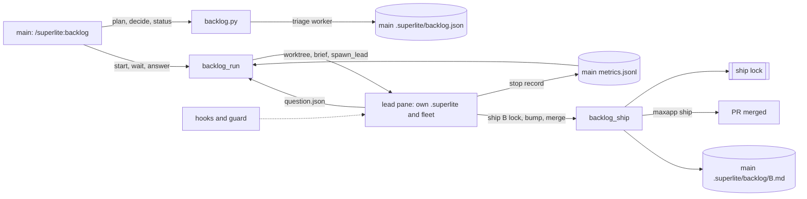
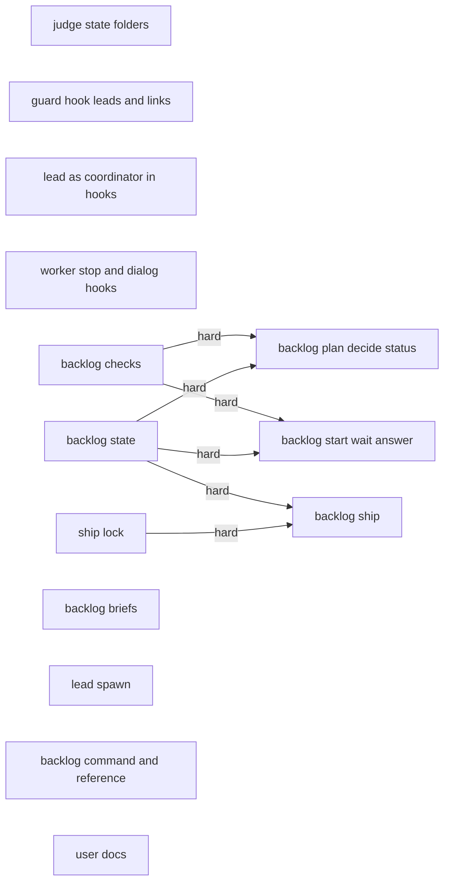
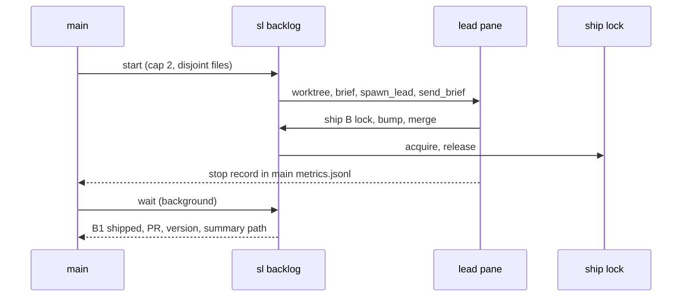

# Superlite: batch leads and backlog mode (phase 3)

**Goal:** main works a whole issue backlog through batch leads: `sl backlog plan` (a triage worker proposes file-disjoint batches), `decide` (Max's answers, one ship approval), `start` (per batch a worktree and a lead worker with its own run and fleet), `wait` (one line per lead that ends), `answer` (resumes an escalated lead); a lead ships with `sl backlog ship` under a machine-wide ship lock. Hooks treat a lead as a coordinator, fleet panes answer permission dialogs with no, and the guard protects run files outside `<project>/.superlite` by absolute path (#190).
**Architecture:** new `backlog_checks`, `backlog_state`, `ship_lock`, `backlog_brief`, `fleet_lead`; CLIs `backlog` (router, plan, decide, status), `backlog_run` (start, wait, answer), `backlog_ship`; hook and guard changes; `/superlite:backlog` with `backlog.md`; user docs.
**Tech stack:** Python 3.10+ stdlib, bash, pytest, Markdown.
**Spec:** `docs/plans/2026-11-05-fleet-leads.md` (Understanding, Design, Levels and roles, Units 6-11 and 13, Data flow of one batch, Error handling, Rulings, Coverage, Phases (one issue each, umbrella #183): phase 3); spikes `~/.superlite/handoffs/2026-11-05-spike-S1-nested-fleet.md`, `-S3-ship-permissions.md` (all; facts override the design), `-S2-one-turn-workers.md` (spawn shapes). Issues: #188, #190.
**Detail:** tests
**Wave0:** none
**Orchestrator:** AI
**Max chars:** 100000

Global constraints:
- Builds on batch 6 (`docs/plans/2026-11-05-run-tooling-2.md`) and phase 2 (`~/.superlite/handoffs/plans/2026-11-05-fleet-roles.md`), merged first; keep their tests green. Calls existing `fleet.choose_account/open_pane/stop/spawn/main/_blocked/_launch_line/TRUST/SCREEN_ROWS`, `fleet_io.send_brief/latest_stop/wait/main`, `fleet_state`, `herdr_client.agents/agent_states/HerdrError`, `worktree.ensure`, `state.home`, `incident`.
- Python 3.10+ stdlib, the scripts' style with per-line `# O(...)`; bash hooks: builtins on the common path, bash 3.2 safe, `printf`. Verify with `<abs sl> run_tests --fast <your test files> --task Tn --background`, then its `wait:` line, plus the existing tests the task names. No version bump in a task; headless, tui (`session-start`, `hooks.json`) and evals (`commands/backlog.md`) are the coordinator's step.
- Wave0 none: `backlog.py`, `backlog_run.py`, `backlog_ship.py` import `fleet`, `fleet_io`, `fleet_state`, `herdr_client`, `worktree` and this plan's other modules inside functions; tests swap them via `monkeypatch.setitem(sys.modules, ...)`, the pure `backlog_brief` only when `SUPERLITE_REAL` is not `1`. Tests reuse `test_plan_tools.SCRIPTS`, `test_fleet.world`, `test_fleet_hooks.run_hook`, `test_block_coordinator_edits.BASH/HOOK`, T6's `backlog_fixtures`.
- Lead = fleet worker of main's run, role `lead`. Env `SUPERLITE_FLEET_WORKER=Wn`, `SUPERLITE_FLEET_AGENT=lead`, `SUPERLITE_FLEET_ROLE=lead`, `SUPERLITE_STATE_DIR=<wt>/.superlite`, `SUPERLITE_FLEET_PARENT_DIR=<main .superlite>`, `CLAUDE_CODE_ENABLE_PROMPT_SUGGESTION=0`, `SUPERLITE_FLEET_ACCOUNTS` (when main's fleet has accounts), `CLAUDE_CONFIG_DIR` (non-default), pass-through; never `SUPERLITE_FINAL_REVIEW`. Argv `--model <m> --permission-mode auto --allowedTools "Bash(maxapp ship *)" "Bash(<abs sl> backlog ship *)" --disallowedTools AskUserQuestion`; cwd its worktree; no prime, no pool; record adds `role`, `one_turn: false`, `lead_sd`, `worktree`.
- Files: `<main root>/.superlite/backlog.json` (main root = parent of `git rev-parse --path-format=absolute --git-common-dir`; lock `backlog.json.lock`), `.../backlog/<B>.md`, `.../briefs/triage.md`; worktree `.superlite/`: `briefs/lead.md`, `question.json` (`{"questions": [...]}`, AskUserQuestion shape), `answer-<n>.json`, `notes.md`, `pr-body.md`; ship lock `<state.home()>/locks/ship-<repo slug>.lock` = `{batch, lead, agent, repo, time}` (ms, mode 0600).
- `backlog.json` = `{version: 1, repo, approved_ship: null|{by, time}, titles: {"<n>": title}, outside: [{number, title, author}], admitted, skipped, batches}`; batch = `{id: "B<n>", topic, issues, files, depends, decisions: [{questions}], state: planned|running|needs_decision|parked|shipped, answers, lead, agent, worktree, branch, since, pr, merged, version, reason, ship_runs, questions}`.
- `sl backlog`: `status`; `plan [--tier sonnet] [--timeout-min 60] [--reset]`; `decide --print [--batch B]` | `--file F` (`{"answers": {question: answer}}`); `start [B] [--cap 2] [--model opus]`; `wait [--timeout 21600] [--poll 10]`; `answer B --file F`; `ship B lock [--wait 500] | bump [--version X] | merge [--title T] [--body-file F] | release [--park R]`. Exit 0 done, 2 refused, 3 BLOCKED, 4 WAIT/RERUN, 5 CONFLICT, 6 RED; lines exactly as the tests pin them.

Ruling: leads start only via `sl backlog start` (`fleet_lead.spawn_lead`); phase 2's role table keeps rejecting `lead`.
Ruling: lead argv and a `PermissionRequest` deny for every fleet worker, as S3 recommends; no `--agent`, prime or `--effort` for a lead.
Ruling: shipping is four steps (`lock`, `bump`, `merge`, `release`) so each Bash call stays under 10 min (S3 point 3); stale layers run between `lock` and `bump` via `fleet run --layer`.
Ruling: `maxapp ship` runs in the worktree, never removing the lead's cwd; `wait` stops a shipped lead and reruns `maxapp ship -C <wt>` from the main root to clean up (S3 point 4). Summaries live in the main run, not the removed worktree.
Ruling: `wait` reads a lead's end from files (fresh valid `question.json`, recorded merge, else park with the stop record text), not from its status line.
Ruling: a lock is stale when its holder's Herdr agent is gone; without Herdr or a readable holder, after 2 h; takeover logs a `workaround` incident; re-entrant per batch; released by a `merge` success, `release`, the 5th timeout, or `wait` parking its lead.
Ruling: `sl backlog ship` runs only in the batch's own lead and only with `approved_ship` recorded; the approval is Max's answer to `SHIP_Q` in the up-front AskUserQuestion round, recorded by `decide` (open question in the hand-back).
Ruling: `backlog.json` joins the protected run files; #190: run files of `$sd` and `$SUPERLITE_FLEET_PARENT_DIR` are protected by absolute path (the judge reads the parent from its env) and idle Edit/Write runs the worktree and symlink checks.
Ruling: a lead is the coordinator in `block-coordinator-edits`, `rewrite-test-runs`, `session-start` (S1); `inline-worktree-guard`, `mark-inline-flow` keep skipping all workers (a lead's linked worktree passes them anyway); `record-human-reply` ignores every worker (S1: a brief counted as a human approval).
Ruling: triage = research worker on sonnet; its proposal is an extra `batches` key in its report JSON block. On a public repo, issues not by an OWNER, MEMBER or COLLABORATOR never reach it and become admit questions; titles lose control characters.
Ruling: unordered batches sharing a file merge into the lowest id; `plan` refuses while a batch is not shipped (`--reset` drops planned and parked ones); new ids follow the kept ones.
Ruling: cap 2 (#178 ships in batch 6); lead model opus; bump = patch + 1 of the first `.json` entry of `.version-bump.json` when `scripts/bump-version.sh` exists.
Ruling: `maxapp ship` fast-forwards the main checkout, so later leads of superlite's own backlog run merged hooks (S1 Q4.3); accepted, documented (if wrong: one lead at a time).
Ruling: hard edges T5, T6 -> T10, T11 and T6, T7 -> T12 (tests use the real file, checks, lock); other producers faked with their `e.g.` values; no integration task (seam runs, smoke steps, acceptance backlog); docs take names from Global constraints, no edges.
Ruling: no `SKILL.md` or `using-superlite` change (both at their caps); main's peak context is read from the acceptance run (#112), no new code.

## Coverage

| Category | State | Basis |
|---|---|---|
| Scope and success criteria | settled | #188 units 6-11, 13 and #190; built when tests and smoke steps pass; accepted by a real 7-batch backlog (main under 60k, no lead compacting). Out: delegated planning, cross-machine backlogs, account swap. |
| Domain and data model | ruled | `backlog.json`, batch, `question.json`, lock record (Global constraints). |
| Persistence and migration | ruled | New files only; `fleet.json` records gain `lead_sd`, `worktree`. |
| Interfaces and contracts | ruled | `sl backlog` CLI, lines, exit codes; lead env and argv; hook output. |
| UI states | ruled | `status` on one screen; lead panes in main's workspace; `NEEDS_DECISION` via main's AskUserQuestion. |
| Concurrency and state ownership | ruled | `backlog.json` only through `sl backlog`, locked, guard-protected; one ship lock per repo; leads file-disjoint, cap 2. |
| Error handling and recovery | ruled | Park on BLOCKED, gone pane, bad question, 5th timeout; lock freed on park; stale takeover; `start B` resumes. |
| Security and privacy | ruled | Outside issues never reach triage; inputs cleaned and validated; narrow allow rules; dialogs denied; ship only by the batch's lead with approval; run files protected by path. Security review required. |
| Performance and limits | ruled | Background `wait`, 10 s polls; Bash calls under 10 min; 2 leads. |
| Observability | ruled | Status table, wait lines, summaries, takeover incident. |
| Testing strategy | ruled | Unit tests faking herdr, gh, git, maxapp; S1 env shapes; layers by the coordinator; smoke steps. |
| Compatibility | ruled | Claude Code 2.1.318, Herdr 0.9.5; fleet off and non-backlog runs unchanged. |
| Rollout | ruled | One PR after batch 6 and phase 2; opt-in via `/superlite:backlog`. |
| Research unknowns | settled | Spikes S1-S3, 2026-11-05. |

## Main diagram



## File structure

Scripts in `skills/subagent-driven-development/scripts/`: `guard_judge.py` (T1), `backlog_checks.py` (T5), `backlog_state.py` (T6), `ship_lock.py` (T7), `backlog_brief.py` (T8), `fleet_lead.py` and `fleet.py` (T9), `backlog.py` (T10), `backlog_run.py` (T11), `backlog_ship.py` (T12). Hooks: `block-coordinator-edits` (T2); `session-start`, `rewrite-test-runs` (T3); `capture-worker-stop`, `record-human-reply`, `deny-worker-permission`, `hooks.json` (T4). Docs: `commands/backlog.md`, `skills/subagent-driven-development/backlog.md`, `fleet.md` (T13); `docs/fleet.md`, `docs/hooks.md`, `docs/tools.md` (T14). One test file per task; `tests/scripts/backlog_fixtures.py` (T6).

## Task graph

```mermaid
%% schedule
gantt
  title Predicted schedule (mm:ss)
  dateFormat X
  axisFormat %M:%S
  section lane 1
  T6 backlog state :t6, 0, 194s
  T11 backlog start wait answer :t11, 194, 201s
  section lane 2
  T5 backlog checks :t5, 0, 169s
  T12 backlog ship :t12, 194, 199s
  section lane 3
  T9 lead spawn :t9, 0, 155s
  T10 backlog plan decide status :t10, 194, 174s
  section lane 4
  T4 worker stop and dialog hooks :t4, 0, 141s
  section lane 5
  T7 ship lock :t7, 0, 139s
  section lane 6
  T8 backlog briefs :t8, 0, 137s
  section lane 7
  T13 backlog command and reference :t13, 0, 133s
  section lane 8
  T2 guard hook leads and links :t2, 0, 132s
  section lane 9
  T14 user docs :t14, 0, 132s
  section lane 10
  T3 lead as coordinator in hooks :t3, 0, 128s
  T1 judge state folders :t1, 128, 128s
```





critical path: T6 → T11 (6.6 min) · peak width 10 · predicted build 6.6 min · predicted total ≈ 10.1 min

## Guard (#190 and leads)

**Probe entry:** none (a bash hook and a four-parameter judge; tests replay payloads).

### T1 judge state folders · Complexity 3 · Est. context 40k
**Owns:** skills/subagent-driven-development/scripts/guard_judge.py, tests/scripts/test_judge_state_dirs.py
**Components:** 1
**LOC owned:** 90
**Tests:** fast
**Model:** sonnet
**Est. time:** 2 min
**Produces:** guard_judge.judge(command: str, cwd: str, project: str, mode: str, sds: tuple = ()) -> Verdict | None
e.g. judge("printf x > /h/s1/orchestrator.json", "/p", "/p", "idle", sds=("/h/s1",)) -> Verdict(rel="/h/s1/orchestrator.json", abs="/h/s1/orchestrator.json", kind="protected"); without `sds` -> None
**Review Focus:** `test_symlinked_folder_and_backlog_name`: a symlinked state folder resolves; `test_cli_takes_the_parent_folder_from_the_environment`: the parent counts only while its variable is set.
**Test code (verbatim):**
```python
# tests/scripts/test_judge_state_dirs.py
import io, json, sys
import pytest
from test_plan_tools import SCRIPTS
sys.path.insert(0, str(SCRIPTS))
import guard_judge as gj  # noqa: E402

@pytest.fixture
def d(tmp_path):
    proj, sd, parent = tmp_path / "proj", tmp_path / "home" / "sessions" / "s1", tmp_path / "main" / ".superlite"
    for p in (proj / ".superlite", sd, parent):
        p.mkdir(parents=True)
    return proj, sd, parent

@pytest.mark.parametrize("mode", ["idle", "active", "human"])
def test_state_folder_files_are_protected_by_absolute_path(d, mode):
    proj, sd, _ = d
    for name in ("orchestrator.json", "human-replies.jsonl", "backlog.json"):
        assert gj.judge(f"printf x > {sd / name}", str(proj), str(proj), mode, sds=(str(sd),)).kind == "protected", name
        assert gj.judge(f"printf x > {sd / name}", str(proj), str(proj), mode) is None, name
    assert gj.judge(f"printf x > {sd / 'progress.md'}", str(proj), str(proj), mode, sds=(str(sd),)) is None

def test_symlinked_folder_and_backlog_name(d, tmp_path):
    proj, sd, _ = d
    (tmp_path / "alias").symlink_to(sd)
    assert gj.judge(f"printf x > {tmp_path / 'alias' / 'orchestrator.json'}", str(proj), str(proj), "idle", sds=(str(sd),)).kind == "protected"
    assert gj.judge("printf x > .superlite/backlog.json", str(proj), str(proj), "idle").kind == "protected"
    assert gj.judge("printf x > .superlite/backlog/B1.md", str(proj), str(proj), "active") is None

def test_cli_takes_the_parent_folder_from_the_environment(d, monkeypatch, capsys):
    proj, sd, parent = d
    def run(target):
        cmd = {"tool_name": "Bash", "tool_input": {"command": f"printf x > {target}"}, "cwd": str(proj)}
        monkeypatch.setattr(sys, "stdin", io.StringIO(json.dumps(cmd)))
        return gj.main(["--mode", "idle", "--project", str(proj), "--sd", str(sd)]), capsys.readouterr().err
    monkeypatch.delenv("SUPERLITE_FLEET_PARENT_DIR", raising=False)
    assert run(sd / "orchestrator.json")[0] == 2 and run(parent / "backlog.json")[0] == 0
    monkeypatch.setenv("SUPERLITE_FLEET_PARENT_DIR", str(parent))
    rc, err = run(parent / "backlog.json")
    assert rc == 2 and "sl backlog" in err and run(parent / "backlog" / "B1.md")[0] == 0
```
**Steps:** 1 failing tests, 2 run: FAIL, 3 implement, 4 run: PASS
**Notes:** `NAMES` and `PROTECTED` gain `backlog.json`. `_Ctx(..., sds=())` builds `prot_abs`: the lowered `<folder>/<name>` and its `os.path.realpath`, per folder and protected name. In `_judge_path`, right after `real = _real(full)`: `real` or `full` in `prot_abs` -> `Verdict(real, real, "protected")`, before the outside-the-project return. `main` passes `(sd,)` plus `$SUPERLITE_FLEET_PARENT_DIR` when set. `MESSAGES["protected"]` keeps its line and adds: "`.superlite/backlog.json` is written only by `sl backlog`; the run files of a state folder outside the project are protected by their absolute path." Keep `test_guard_judge.py` and all `test_guard_*.py` green.

### T2 guard hook leads and links · Complexity 4 · Est. context 44k
**Owns:** hooks/block-coordinator-edits, tests/scripts/test_lead_guard_190.py
**Components:** 1
**LOC owned:** 110
**Tests:** fast
**Model:** sonnet
**Est. time:** 2.5 min
**Review Focus:** `test_idle_writes_to_run_files_in_a_worktree_or_through_a_link_block`: #190 point 1, while ordinary files through the same link still pass.
**Test code (verbatim):**
```python
# tests/scripts/test_lead_guard_190.py
import json, os, subprocess
import pytest
from test_block_coordinator_edits import BASH, HOOK

@pytest.fixture
def proj(tmp_path):
    p = tmp_path / "proj"; (p / ".superlite").mkdir(parents=True); return p

def hook(proj, tool, inp, env=None):
    e = {k: v for k, v in os.environ.items() if not k.startswith("SUPERLITE_")}
    e.update({"CLAUDE_PROJECT_DIR": str(proj), "SUPERLITE_HOME": str(proj.parent / "slhome"), **(env or {})})
    raw = json.dumps({"session_id": "s190", "tool_name": tool, "tool_input": inp, "cwd": str(proj)})
    return subprocess.run([BASH, str(HOOK)], input=raw, capture_output=True, text=True, env=e)

def w(proj, path, env=None):
    return hook(proj, "Write", {"file_path": str(path), "content": "x"}, env).returncode

def lead(sd, **kw):
    return {"SUPERLITE_FLEET_WORKER": "W2", "SUPERLITE_FLEET_ROLE": "lead", "SUPERLITE_STATE_DIR": str(sd), **kw}

def test_lead_is_guarded_like_a_coordinator(proj):
    sd = proj / ".superlite"; (sd / "pool.json").write_text("{}")
    assert w(proj, proj / "app.py", lead(sd)) == 2 and w(proj, proj / "docs" / "plans" / "p.md", lead(sd)) == 0
    assert hook(proj, "Bash", {"command": "sed -i s/a/b/ app.py"}, lead(sd)).returncode == 2
    for env in (lead(sd, SUPERLITE_FLEET_ROLE="implementer"), {"SUPERLITE_FLEET_WORKER": "W2", "SUPERLITE_STATE_DIR": str(sd)}):
        assert w(proj, proj / "app.py", env) == 0 and hook(proj, "Bash", {"command": "sed -i s/a/b/ app.py"}, env).returncode == 0

def test_state_and_parent_folders_are_protected_by_absolute_path(proj, tmp_path):
    sd = proj.parent / "slhome" / "sessions" / "s190"; sd.mkdir(parents=True)
    r = hook(proj, "Write", {"file_path": str(sd / "orchestrator.json"), "content": "x"}, {"SUPERLITE_STATE_DIR": str(sd)})
    assert r.returncode == 2 and "never written directly" in r.stderr and w(proj, sd / "progress.md", {"SUPERLITE_STATE_DIR": str(sd)}) == 0
    parent = tmp_path / "main" / ".superlite"; parent.mkdir(parents=True); (tmp_path / "alias").symlink_to(tmp_path / "main")
    env = lead(proj / ".superlite", SUPERLITE_FLEET_PARENT_DIR=str(parent))
    assert w(proj, parent / "backlog.json", env) == 2 and w(proj, tmp_path / "alias" / ".superlite" / "human-replies.jsonl", env) == 2
    assert w(proj, parent / "backlog" / "B1.md", env) == 0

def test_idle_writes_to_run_files_in_a_worktree_or_through_a_link_block(proj):
    wt = proj / ".claude" / "worktrees" / "w1"; (wt / ".superlite").mkdir(parents=True); (wt / ".git").write_text("gitdir: /x/.git/worktrees/w1\n")
    assert w(proj, wt / ".superlite" / "orchestrator.json") == 2 and w(proj, wt / ".superlite" / "progress.md") == 0 and w(proj, wt / "a.py") == 0
    (proj / "docs" / "plans").mkdir(parents=True); (proj / "docs" / "plans" / "up").symlink_to(proj)
    assert w(proj, proj / "docs" / "plans" / "up" / ".superlite" / "orchestrator.json") == 2
    assert w(proj, proj / "docs" / "plans" / "up" / "README.md") == 0

def test_backlog_json_in_the_project_is_protected(proj):
    r = hook(proj, "Write", {"file_path": ".superlite/backlog.json", "content": "x"})
    assert r.returncode == 2 and "backlog.json" in r.stderr
```
**Steps:** 1 failing tests, 2 run: FAIL, 3 implement, 4 run: PASS
**Notes:** (1) The worker exit runs only when `SUPERLITE_FLEET_ROLE` is not `lead`. (2) Every protected-name `case` adds `.superlite/backlog.json`; `mentions` adds `*backlog.json*`. (3) New `prot_abs PATH` (called in `project_code` right after `cache_hit`; a match sets `prot=1`, returns 0): when the base name is protected, compare the normalized lowered folder with `$sd` and `${SUPERLITE_FLEET_PARENT_DIR:-}`, then, only on no match, both sides resolved with `cd -P ... && pwd -P` in a subshell. (4) The idle return in `project_code` becomes: a protected `WREL` from `wt_rel`, or new `link_prot REL` (a symlinked component: the target's folder resolved with `cd -P` plus the base name is a protected name project-relative, also below a linked worktree, or matches `prot_abs`) -> `prot=1`, return 0; else return 1. (5) The `prot=1` message adds T1's line. Keep `test_block_coordinator_edits.py`, `test_guard_*.py`, `test_hooks_bash32.py`, `test_fleet_hooks.py`, `test_human_gate.py` green.

## Lead hooks

**Probe entry:** none (bash hooks; tests replay payloads with S1's env shapes).

### T3 lead as coordinator in hooks · Complexity 2 · Est. context 34k
**Owns:** hooks/session-start, hooks/rewrite-test-runs, tests/scripts/test_lead_hooks.py
**Components:** 2
**LOC owned:** 50
**Tests:** fast
**Kind:** mechanical
**Model:** haiku
**Est. time:** 1.5 min
**Review Focus:** `test_session_start_gives_a_lead_its_note_and_the_full_context`: `SUPERLITE_FLEET_WORKER='W2" x'` gives `batch lead W?.` in valid JSON.
**Test code (verbatim):**
```python
# tests/scripts/test_lead_hooks.py
import json
from test_fleet_hooks import run_hook

def env(sd, **kw):
    return {"SUPERLITE_FLEET_WORKER": "W2", "SUPERLITE_FLEET_AGENT": "lead", "SUPERLITE_FLEET_ROLE": "lead", "SUPERLITE_STATE_DIR": str(sd), **kw}

def start(sd, **kw):
    r = run_hook("session-start", json.dumps({"session_id": "s1", "source": "startup", "cwd": str(sd.parent)}), env(sd, **kw), sd.parent)
    return r.stdout, json.loads(r.stdout)["hookSpecificOutput"]["additionalContext"]

def test_session_start_gives_a_lead_its_note_and_the_full_context(tmp_path):
    sd = tmp_path / "wt" / ".superlite"; sd.mkdir(parents=True)
    t = start(sd)[1]
    assert "You are superlite batch lead W2." in t and "using-superlite" in t and "fleet worker" not in t
    assert "Never end your turn while your fleet workers run" in t and "NEEDS_DECISION" in t
    assert "fleet worker W2" in start(sd, SUPERLITE_FLEET_ROLE="implementer")[1]
    raw, t = start(sd, SUPERLITE_FLEET_WORKER='W2" x')
    assert "batch lead W?." in t and 'W2" x' not in raw

def test_lead_test_runs_are_rewritten_like_the_coordinators(tmp_path):
    sd = tmp_path / "wt" / ".superlite"; sd.mkdir(parents=True); (sd / "pool.json").write_text("{}")
    call = json.dumps({"session_id": "s1", "tool_name": "Bash", "tool_input": {"command": "pytest"}, "cwd": str(sd.parent)})
    out = json.loads(run_hook("rewrite-test-runs", call, env(sd), sd.parent).stdout)["hookSpecificOutput"]
    assert out["permissionDecision"] == "allow" and "run_tests --full" in out["updatedInput"]["command"]
    r = run_hook("rewrite-test-runs", call, env(sd, SUPERLITE_FLEET_ROLE="fixer"), sd.parent)
    assert r.returncode == 2 and "must not run the full test suite" in r.stderr
```
**Steps:** 1 failing tests, 2 run: FAIL, 3 implement, 4 run: PASS
**Notes:** `session-start`: the fleet-worker branch runs only when the role is not `lead`. For a lead, `lid="$SUPERLITE_FLEET_WORKER"`, `[[ $lid =~ ^W[0-9]{1,4}$ ]] || lid="W?"`, and `session_context` starts with this paragraph plus `\n\n`: `You are superlite batch lead ${lid}. Your brief arrives as your first message; follow it as an AI orchestrator. AskUserQuestion is off: write a new major decision to .superlite/question.json and end your turn with Status: NEEDS_DECISION. Never end your turn while your fleet workers run.` `rewrite-test-runs`: near the top `fleet_worker=""; [ "${SUPERLITE_FLEET_ROLE:-}" = lead ] || fleet_worker="${SUPERLITE_FLEET_WORKER:-}"`; `$fleet_worker` replaces every read of `SUPERLITE_FLEET_WORKER`. Keep `test_session_start.py`, `test_session_start_roles.py`, `test_fleet_hard_stop.py`, `test_rewrite_test_runs.py`, `test_fleet_hooks.py`, `test_hooks_bash32.py` green.

### T4 worker stop and dialog hooks · Complexity 3 · Est. context 35k
**Owns:** hooks/capture-worker-stop, hooks/record-human-reply, hooks/deny-worker-permission, hooks/hooks.json, tests/scripts/test_worker_plumbing_hooks.py
**Components:** 2
**LOC owned:** 80
**Tests:** fast
**Model:** sonnet
**Est. time:** 2 min
**Review Focus:** `test_lead_stop_record_goes_to_the_parent_run`: a missing parent folder is never created; `test_permission_dialogs_are_denied_in_every_fleet_pane`: silent outside a worker.
**Test code (verbatim):**
```python
# tests/scripts/test_worker_plumbing_hooks.py
import json
from test_fleet_hooks import HOOKS, run_hook

def test_lead_stop_record_goes_to_the_parent_run(tmp_path):
    main, lsd = tmp_path / "main" / ".superlite", tmp_path / "wt" / ".superlite"
    for d in (main, lsd):
        d.mkdir(parents=True)
    env = {"SUPERLITE_FLEET_WORKER": "W2", "SUPERLITE_FLEET_AGENT": "lead", "SUPERLITE_FLEET_ROLE": "lead", "SUPERLITE_STATE_DIR": str(lsd)}
    stdin = json.dumps({"session_id": "s1", "transcript_path": "/t/l.jsonl", "last_assistant_message": "Status: DONE"})
    run_hook("capture-worker-stop", stdin, {**env, "SUPERLITE_FLEET_PARENT_DIR": str(main)}, lsd.parent)
    rec = json.loads((main / "metrics.jsonl").read_text().splitlines()[-1])
    assert (rec["agent_id"], rec["type"], rec["last"]) == ("W2", "fleet:lead", "Status: DONE") and not (lsd / "metrics.jsonl").exists()
    run_hook("capture-worker-stop", stdin, {**env, "SUPERLITE_FLEET_PARENT_DIR": str(tmp_path / "gone")}, lsd.parent)
    assert (lsd / "metrics.jsonl").exists() and not (tmp_path / "gone").exists()

def test_worker_prompts_are_never_human_replies(tmp_path):
    sd = tmp_path / ".superlite"; sd.mkdir(); (sd / "orchestrator.json").write_text('{"mode": "human", "approved": false}')
    stdin = json.dumps({"session_id": "s1", "prompt": "go ahead and ship it"})
    run_hook("record-human-reply", stdin, {"SUPERLITE_FLEET_WORKER": "W2", "SUPERLITE_FLEET_ROLE": "lead", "SUPERLITE_STATE_DIR": str(sd)}, tmp_path)
    assert not (sd / "human-replies.jsonl").exists()
    run_hook("record-human-reply", stdin, {"SUPERLITE_STATE_DIR": str(sd)}, tmp_path)
    assert json.loads((sd / "human-replies.jsonl").read_text())["approves"] is True

def test_permission_dialogs_are_denied_in_every_fleet_pane(tmp_path):
    req = json.dumps({"session_id": "s1", "hook_event_name": "PermissionRequest", "tool_name": "Bash", "tool_input": {"command": "rm -rf x"}})
    for role in ("lead", "implementer", "final-reviewer"):
        d = json.loads(run_hook("deny-worker-permission", req, {"SUPERLITE_FLEET_WORKER": "W2", "SUPERLITE_FLEET_ROLE": role}, tmp_path).stdout)
        dec = d["hookSpecificOutput"]
        assert (dec["hookEventName"], dec["decision"]["behavior"]) == ("PermissionRequest", "deny") and "No human watches this pane" in dec["decision"]["message"]
    assert run_hook("deny-worker-permission", req, {}, tmp_path).stdout == ""
    cfg = json.loads((HOOKS / "hooks.json").read_text())
    assert [h["command"] for e in cfg["hooks"]["PermissionRequest"] for h in e["hooks"]] == ['bash "${CLAUDE_PLUGIN_ROOT}/hooks/deny-worker-permission"']
```
**Steps:** 1 failing tests, 2 run: FAIL, 3 implement, 4 run: PASS
**Notes:** `capture-worker-stop`: an existing `SUPERLITE_FLEET_PARENT_DIR` folder is the target (skip `superlite_state`); else today's path. `record-human-reply`: right after reading input, `[ -n "${SUPERLITE_FLEET_WORKER:-}" ] && exit 0`. New `hooks/deny-worker-permission` (mode 755, header cites spike S3): silent exit 0 unless `SUPERLITE_FLEET_WORKER` is set; then read stdin and print `{"hookSpecificOutput":{"hookEventName":"PermissionRequest","decision":{"behavior":"deny","message":"No human watches this pane: permission dialogs are answered no. Do not retry: a lead writes .superlite/question.json and ends with Status: NEEDS_DECISION; any other worker ends with Status: BLOCKED and the command it needed."}}}`. `hooks.json`: a `PermissionRequest` entry, one command hook, `"shell": "bash"`, no matcher. Keep `test_fleet_hooks.py`, `test_capture_hooks.py`, `test_human_gate.py`, `test_hooks_bash32.py`, `test_test_layers.py` green.

## Backlog core

**Probe entry:** call=backlog_checks.proposal_from

### T5 backlog checks · Complexity 4 · Est. context 31k
**Owns:** skills/subagent-driven-development/scripts/backlog_checks.py, tests/scripts/test_backlog_checks.py
**Components:** 2
**LOC owned:** 200
**Tests:** fast
**Model:** sonnet
**Est. time:** 2.5 min
**Produces:** backlog_checks.check_question(q: dict) -> list[str]
e.g. check_question(T6's backlog_fixtures.Q) -> []; check_question({"questions": []}) -> ["questions: 1 to 4 entries"]
**Produces:** backlog_checks.check_proposal(obj: dict, known: set[int]) -> tuple[list[dict], list[str]]
e.g. check_proposal({"batches": [{"id": "B1", "topic": "first", "issues": [2, 1], "files": ["a.py"], "depends": [], "decisions": []}]}, {1, 2}) -> ([B1 with issues [1, 2] plus the batch defaults of Global constraints: state "planned", answers {}, lead/agent/worktree/branch/pr/version None, since 0, merged False, reason "", ship_runs 0, questions 0], []); with issue 9 -> ([], ["B1: unknown issue #9"])
**Produces:** backlog_checks.separate(batches: list[dict]) -> list[dict]
e.g. separate([B1 a.py #1, B2 a.py b.py #2]) -> [B1 issues [1, 2] files ["a.py", "b.py"]]
**Produces:** backlog_checks.proposal_from(text: str) -> dict | None
e.g. proposal_from('Status: DONE\n```json\n{"status": "DONE", "batches": []}\n```') -> {"status": "DONE", "batches": []}; proposal_from("no block") -> None
**Review Focus:** `test_one_error_rejects_the_whole_proposal`: path traversal and unknown issues reject everything; `test_proposal_from_takes_the_last_block_with_batches`: 5000 nested `[` give None.
**Test code (verbatim):**
```python
# tests/scripts/test_backlog_checks.py
import sys
import pytest
from test_plan_tools import SCRIPTS
sys.path.insert(0, str(SCRIPTS))
import backlog_checks as bc  # noqa: E402

OPT = [{"label": "Keep (Recommended)", "description": "no break"}, {"label": "Drop", "description": "smaller"}]
Q0 = {"question": "Keep the v1 API?", "header": "API", "options": OPT, "multiSelect": False}
DEFAULTS = {"state": "planned", "answers": {}, "lead": None, "agent": None, "worktree": None, "branch": None, "since": 0,
            "pr": None, "merged": False, "version": None, "reason": "", "ship_runs": 0, "questions": 0}

def bt(bid, issues, files, depends=(), decisions=()):
    return {"id": bid, "topic": "t" + bid[1:], "issues": list(issues), "files": list(files), "depends": list(depends), "decisions": list(decisions)}

def norm(*bs):
    return bc.check_proposal({"batches": list(bs)}, {1, 2, 3, 4})[0]

def test_questions():
    assert bc.check_question({"questions": [Q0, {**Q0, "question": "Other?", "multiSelect": True}]}) == []
    for q, err in [({"questions": []}, "questions: 1 to 4 entries"), ({"questions": [Q0] * 5}, "questions: 1 to 4 entries"),
                   ({"questions": [{**Q0, "header": "a much too long header"}]}, "q1 header: 1 to 12 characters"),
                   ({"questions": [{**Q0, "options": OPT[:1]}]}, "q1 options: 2 to 4 entries"),
                   ({"questions": [{**Q0, "question": "Keep?\x1b[2J"}]}, "q1 question: control character"),
                   ({"questions": [{**Q0, "options": [OPT[0], OPT[0]]}]}, "q1 options: duplicate label Keep (Recommended)"),
                   ({"questions": [{**Q0, "multiSelect": "yes"}]}, "q1 multiSelect: true or false"), ([], "not an object with questions")]:
        assert err in bc.check_question(q), err

def test_proposal_is_normalised():
    assert norm(bt("B1", [2, 1], ["./b.py", "a.py", "a.py"])) == [{**bt("B1", [1, 2], ["a.py", "b.py"]), **DEFAULTS}]

@pytest.mark.parametrize("bad,err", [
    ([bt("B1", [9], ["a.py"])], "B1: unknown issue #9"),
    ([bt("B1", [1], ["/etc/passwd"])], "B1: file '/etc/passwd' is not a plain relative path"),
    ([bt("B1", [1], ["src/../../x"])], "B1: file 'src/../../x' is not a plain relative path"),
    ([bt("B1", [1], ["a.py"], ["B7"])], "B1: depends on unknown batch B7"),
    ([bt("B1", [1], ["a.py"]), bt("B2", [1], ["b.py"])], "#1 is in B1 and B2"),
    ([bt("B1", [1], ["a.py"], ["B2"]), bt("B2", [2], ["b.py"], ["B1"])], "dependency cycle: B1 B2"),
    ([{**bt("B1", [1], ["a.py"]), "id": "X1"}], "batch 1: id must be B<n>"),
    ([{**bt("B1", [1], ["a.py"]), "topic": "Bad Topic!"}], "B1: topic must be lowercase words joined by -"),
    ([bt("B1", [1], ["a.py"], decisions=[{"questions": []}])], "B1 decision 1: questions: 1 to 4 entries"),
    ([], "batches: 1 to 20 entries")])
def test_one_error_rejects_the_whole_proposal(bad, err):
    batches, errors = bc.check_proposal({"batches": bad + ([bt("B9", [4], ["z.py"])] if bad else [])}, {1, 2, 3, 4})
    assert batches == [] and err in errors
    assert bc.check_proposal([], {1}) == ([], ["proposal: not an object with batches"])

def test_separate_merges_unordered_clashes_only():
    ids = lambda bs: [(b["id"], b["issues"], b["files"], b["depends"]) for b in bs]
    out = bc.separate(norm(bt("B1", [1], ["a.py"], decisions=[{"questions": [Q0]}]), bt("B2", [2], ["a.py", "b.py"]), bt("B3", [3], ["b.py"]),
                           bt("B4", [4], ["c.py"], ["B2"])))
    assert ids(out) == [("B1", [1, 2, 3], ["a.py", "b.py"], []), ("B4", [4], ["c.py"], ["B1"])] and out[0]["decisions"] == [{"questions": [Q0]}]
    chain = norm(bt("B1", [1], ["a.py"]), bt("B2", [2], ["b.py"], ["B1"]), bt("B3", [3], ["a.py"], ["B2"]))
    assert bc.separate(chain) == chain

def test_proposal_from_takes_the_last_block_with_batches():
    text = 'x\n```json\n{"batches": [1]}\n```\nStatus: DONE\n```json\n{"status": "DONE", "batches": []}\n```'
    assert bc.proposal_from(text) == {"status": "DONE", "batches": []}
    assert bc.proposal_from('```json\n{"status": "DONE"}\n```') is None and bc.proposal_from("```json\n" + "[" * 5000 + "\n```") is None
```
**Steps:** 1 failing tests, 2 run: FAIL, 3 implement, 4 run: PASS
**Notes:** `check_question`: `questions` 1-4; per `q<i>`: `question` 1-300 characters and unique, `header` 1-12, `options` 2-4 with unique `label` (1-60) and string `description` (0-200), `multiSelect` absent or bool; a control character in any string -> `q<i> <field>: control character`. `check_proposal`: `batches` 1-20; id `^B[1-9][0-9]?$` unique; topic `^[a-z0-9][a-z0-9-]{0,39}$`; issues non-empty ints in `known`, each in one batch; files without NUL, `\`, a leading `/` or `~` or a `..` segment, `./` dropped, sorted unique; depends known other ids, no cycle (cycle ids sorted); decisions pass `check_question` (prefix `<id> decision <k>: `). Any error -> `([], errors)`. `separate`: repeat until no two batches share a file unless one reaches the other through `depends`: merge into the lower id (sorted unions, decisions in id order, its topic), drop internal dependencies, rewrite others' `depends`; a cycle a merge creates merges too. `proposal_from`: last json fence that parses (catch `ValueError`, `RecursionError`) to a dict with `batches`.

### T6 backlog state · Complexity 5 · Est. context 38k
**Owns:** skills/subagent-driven-development/scripts/backlog_state.py, tests/scripts/backlog_fixtures.py, tests/scripts/test_backlog_state.py
**Components:** 3
**LOC owned:** 240
**Tests:** fast
**Model:** sonnet
**Est. time:** 3 min
**Produces:** backlog_state.main_root(start: Path) -> Path
**Produces:** backlog_state.path(root: Path) -> Path
**Produces:** backlog_state.default() -> dict
**Produces:** backlog_state.load(p: Path) -> dict
**Produces:** backlog_state.update(p: Path, fn: Callable[[dict], Any]) -> Any
**Produces:** backlog_state.batch(data: dict, bid: str) -> dict
**Produces:** backlog_state.startable(data: dict, cap: int = 2) -> list[str]
e.g. startable(B1 running on a.py, B2 planned on a.py, B3 planned on c.py; cap 2) -> ["B3"]
**Produces:** backlog_state.open_questions(data: dict) -> list[dict]
**Produces:** backlog_state.answer(data: dict, answers: dict, by: str, now: str) -> list[str]
**Produces:** backlog_state.status_lines(data: dict) -> list[str]
e.g. status_lines(default()) -> ["backlog: 0 batches, 0 running, 0 shipped, ship not approved"]
**Review Focus:** `test_main_root_load_update_and_batch`: 40 threaded updates keep 40 entries; `test_questions_and_answers`: free text never approves shipping.
**Test code (verbatim):**
```python
# tests/scripts/backlog_fixtures.py
Q = {"questions": [{"question": "Keep the v1 API?", "header": "API", "options": [{"label": "Keep (Recommended)", "description": "no break"},
                                                                              {"label": "Drop", "description": "smaller"}], "multiSelect": False}]}
APPROVED = {"by": "AskUserQuestion", "time": "2026-11-05T10:00:00Z"}

def batch(bid, files, state="planned", **kw):
    return {"id": bid, "topic": "t", "issues": [int(bid[1:])], "files": list(files), "depends": [], "decisions": [], "state": state,
            "answers": {}, "lead": None, "agent": None, "worktree": None, "branch": None, "since": 0, "pr": None, "merged": False,
            "version": None, "reason": "", "ship_runs": 0, "questions": 0, **kw}
```
```python
# tests/scripts/test_backlog_state.py
import subprocess, sys
from concurrent.futures import ThreadPoolExecutor
import pytest
from backlog_fixtures import APPROVED, Q, batch as b
from test_plan_tools import SCRIPTS
sys.path.insert(0, str(SCRIPTS))
import backlog_state as bs  # noqa: E402

def data(*batches, **kw):
    return {**bs.default(), "repo": "o/r", "batches": list(batches), **kw}

def test_main_root_load_update_and_batch(tmp_path):
    m = tmp_path / "m"; m.mkdir()
    git = lambda *a: subprocess.run(["git", "-c", "user.email=a@b", "-c", "user.name=a", *a], cwd=m, check=True, capture_output=True)
    git("init", "-q"); git("commit", "-q", "--allow-empty", "-m", "x"); git("worktree", "add", "-q", "-b", "l", str(tmp_path / "wt"))
    assert bs.main_root(tmp_path / "wt") == m.resolve() == bs.main_root(m)
    with pytest.raises(RuntimeError, match="not in a git repository"):
        bs.main_root(tmp_path)
    p = bs.path(m); assert p == m / ".superlite" / "backlog.json"
    assert bs.load(p) == bs.default() == {"version": 1, "repo": "", "approved_ship": None, "titles": {}, "outside": [], "admitted": [], "skipped": [], "batches": []}
    with ThreadPoolExecutor(8) as ex:
        list(ex.map(lambda i: bs.update(p, lambda d: d["admitted"].append(i)), range(40)))
    assert sorted(bs.load(p)["admitted"]) == list(range(40)) and bs.update(p, lambda d: "ok") == "ok"
    with pytest.raises(KeyError, match="unknown batch B9"):
        bs.batch(bs.load(p), "B9")
    p.write_text("{broken"); assert bs.load(p) == bs.default()

def test_startable_respects_cap_clash_depends_and_decisions():
    d = data(b("B1", ["a.py"], "running"), b("B2", ["a.py"]), b("B3", ["c.py"]), b("B4", ["d.py"], depends=["B1"]), b("B5", ["e.py"], decisions=[Q]), b("B6", ["f.py"]))
    assert bs.startable(d, 2) == ["B3"] and bs.startable(d, 3) == ["B3", "B6"]
    d["batches"][4]["answers"] = {"Keep the v1 API?": "Drop"}; d["batches"][0]["state"] = "shipped"
    assert bs.startable(d, 9) == ["B2", "B3", "B4", "B5", "B6"]

def test_questions_and_answers():
    d = data(b("B2", ["a.py"], decisions=[Q]), outside=[{"number": 7, "title": "Add\nX", "author": "eve"}, {"number": 8, "title": "Y", "author": "mal"}])
    a7, a8 = "Admit outside issue #7 (Add X, by eve) into the backlog?", "Admit outside issue #8 (Y, by mal) into the backlog?"
    qs = bs.open_questions(d)
    assert [q["question"] for q in qs] == [bs.SHIP_Q, a7, a8, "B2: Keep the v1 API?"] and bs.open_questions(data()) == []
    assert [o["label"] for o in qs[0]["options"]] == ["Approve shipping", "Not yet"] and (qs[1]["header"], qs[3]["header"]) == ("#7", "API")
    assert bs.answer(d, {bs.SHIP_Q: "sure"}, "AskUserQuestion", "T") == ["ship: answer must be Approve shipping or Not yet"]
    errs = bs.answer(d, {bs.SHIP_Q: "Approve shipping", a7: "Admit", a8: "Skip", "B2: Keep the v1 API?": "Drop, and log it", "B9: x?": "y"}, "AskUserQuestion", "T")
    assert errs == ["no open question: B9: x?"] and d["approved_ship"] == {"by": "AskUserQuestion", "time": "T"}
    assert (d["admitted"], d["skipped"], d["batches"][0]["answers"]) == ([7], [8], {"Keep the v1 API?": "Drop, and log it"}) and bs.open_questions(d) == []

def test_status_lines_one_screen():
    d = data(b("B1", ["a.py"], "shipped", pr=201, version="1.5.8", lead="W1"), b("B2", ["b.py"], "needs_decision", lead="W2"),
             b("B3", ["c.py"], depends=["B2"]), b("B4", ["d.py"], "parked", reason="tui layer red"), approved_ship=APPROVED)
    assert bs.status_lines(d) == ["backlog o/r: 4 batches, 1 running, 1 shipped, ship approved (AskUserQuestion 2026-11-05T10:00:00Z)",
        "batch | issues | state | lead | PR | next", "B1 | #1 | shipped | W1 | #201 | 1.5.8",
        "B2 | #2 | needs_decision | W2 | - | sl backlog decide --print --batch B2", "B3 | #3 | planned | - | - | waits B2",
        "B4 | #4 | parked | - | - | tui layer red"]
    assert bs.status_lines(bs.default()) == ["backlog: 0 batches, 0 running, 0 shipped, ship not approved"]
    assert bs.status_lines(data(b("B1", ["a.py"], decisions=[Q])))[-2:] == ["B1 | #1 | planned | - | - | decide", "questions: 2 open (sl backlog decide --print)"]
```
**Steps:** 1 failing tests, 2 run: FAIL, 3 implement, 4 run: PASS
**Notes:** `main_root`: parent of `git -C start rev-parse --path-format=absolute --git-common-dir`, resolved. `update`: `fcntl.flock` on `backlog.json.lock`, load, `fn(data)`, temp file plus `os.replace`, return `fn`'s result; `load` falls back to `default()` on a missing, broken or non-dict file. Active = running or needs_decision. `startable`: planned batches in id order with depends shipped, every decision question answered (keyed by question text), no file shared with an active or chosen batch, at most `cap - active`. `SHIP_Q = "Approve that every batch lead ships its own batch (rebase, version bump, maxapp ship into the default branch) under the ship lock?"`, header `Ship`, options `Approve shipping` ("one yes for all batches"), `Not yet` ("leads stop before ship"); open only while `approved_ship` is None and a batch exists. Admit questions as in the test, header `#<n>`, options `Admit` ("triaged on the next sl backlog plan"), `Skip` ("stays out of this backlog"); titles: control characters to spaces or dropped, 80 characters. Batch questions: planned batches' unanswered ones, prefixed `<id>: `; any non-empty answer, stored under the unprefixed text. `status_lines` next column: planned `waits <dep>`, `decide`, `clash <id>` or `start`; running `sl backlog wait`; parked the reason (40 characters); shipped the version or `-`.

### T7 ship lock · Complexity 4 · Est. context 29k
**Owns:** skills/subagent-driven-development/scripts/ship_lock.py, tests/scripts/test_ship_lock.py
**Components:** 1
**LOC owned:** 140
**Tests:** fast
**Model:** sonnet
**Est. time:** 2 min
**Produces:** ship_lock.lock_path(repo: str, home: Path | None = None) -> Path
e.g. lock_path("o/r") -> Path("<SUPERLITE_HOME>/locks/ship-o-r.lock")
**Produces:** ship_lock.acquire(p: Path, owner: dict, live: set[str] | None, now_ms: int) -> dict
e.g. acquire(p, {"batch": "B1", "lead": "W2", "agent": "a2", "repo": "o/r"}, {"a2"}, 1000) -> {"acquired": True, "holder": None, "took_over": False}
**Produces:** ship_lock.release(p: Path, batch: str) -> bool
e.g. release(p, "B1") -> True when B1 holds the lock (file removed), else False
**Produces:** ship_lock.holder(p: Path) -> dict | None
**Review Focus:** `test_parallel_acquire_has_one_winner`: 8 threads, one winner; `test_unreadable_or_symlinked_lock_is_held_and_never_followed`: the link target keeps its content.
**Test code (verbatim):**
```python
# tests/scripts/test_ship_lock.py
import os, sys, time
from concurrent.futures import ThreadPoolExecutor
import pytest
from test_plan_tools import SCRIPTS
sys.path.insert(0, str(SCRIPTS))
import ship_lock as sl  # noqa: E402

B1 = {"batch": "B1", "lead": "W2", "agent": "a2", "repo": "o/r"}
B2 = {"batch": "B2", "lead": "W3", "agent": "a3", "repo": "o/r"}
H2 = 2 * 3600 * 1000

def test_lock_path(tmp_path, monkeypatch):
    assert sl.lock_path("maxboettinger/superlite", tmp_path) == tmp_path / "locks" / "ship-maxboettinger-superlite.lock"
    assert sl.lock_path("../Evil Repo", tmp_path).name == "ship-evil-repo.lock"
    monkeypatch.setenv("SUPERLITE_HOME", str(tmp_path / "h")); assert sl.lock_path("o/r") == tmp_path / "h" / "locks" / "ship-o-r.lock"
    with pytest.raises(ValueError):
        sl.lock_path("../", tmp_path)

def test_acquire_reentry_release(tmp_path):
    p = sl.lock_path("o/r", tmp_path)
    assert sl.acquire(p, B1, {"a2"}, 1000) == {"acquired": True, "holder": None, "took_over": False}
    assert sl.holder(p) == {**B1, "time": 1000} and oct(p.stat().st_mode & 0o777) == "0o600"
    assert sl.acquire(p, B1, {"a2"}, 5000)["acquired"] and sl.holder(p)["time"] == 1000
    assert sl.acquire(p, B2, {"a2", "a3"}, 6000) == {"acquired": False, "holder": {**B1, "time": 1000}, "took_over": False}
    assert not sl.release(p, "B2") and sl.release(p, "B1") and sl.holder(p) is None and not p.exists()

def test_stale_holders(tmp_path):
    p = sl.lock_path("o/r", tmp_path); sl.acquire(p, B1, None, 1000)
    assert sl.acquire(p, B2, {"a3"}, 2000) == {"acquired": True, "holder": {**B1, "time": 1000}, "took_over": True}
    assert not sl.acquire(p, B1, None, 2000 + H2)["acquired"] and sl.acquire(p, B1, None, 2001 + H2)["took_over"]

def test_unreadable_or_symlinked_lock_is_held_and_never_followed(tmp_path):
    p = sl.lock_path("o/r", tmp_path); p.parent.mkdir(parents=True); p.write_text("{broken"); os.utime(p, (1, 1))
    r = sl.acquire(p, B1, set(), 1000)
    assert not r["acquired"] and r["holder"]["batch"] == "?" and not sl.release(p, "?") and sl.acquire(p, B1, set(), 1001 + H2)["took_over"]
    p.unlink(); victim = tmp_path / "victim"; victim.write_text("keep"); p.symlink_to(victim)
    assert not sl.acquire(p, B1, {"a2"}, int(time.time() * 1000))["acquired"] and not sl.release(p, "B1") and victim.read_text() == "keep"

def test_parallel_acquire_has_one_winner(tmp_path):
    p = sl.lock_path("o/r", tmp_path)
    owners = [{**B1, "batch": f"B{i}", "agent": f"a{i}"} for i in range(1, 9)]
    live = {o["agent"] for o in owners}
    with ThreadPoolExecutor(8) as ex:
        won = list(ex.map(lambda o: sl.acquire(p, o, live, 1000)["acquired"], owners))
    assert won.count(True) == 1
```
**Steps:** 1 failing tests, 2 run: FAIL, 3 implement, 4 run: PASS
**Notes:** Slug: lower case, `[^a-z0-9]+` -> `-`, stripped; empty -> `ValueError`; `home` defaults to `state.home()`. Every operation holds `fcntl.flock` on `<lock>.guard` (folder mode 0700). Read with `O_RDONLY | O_NOFOLLOW`: a symlink, broken JSON or non-dict is holder `{"batch": "?", "lead": "?", "agent": "?", "repo": "?", "time": <lstat mtime ms>}`. Stale: agent known, `live` not None, agent not live; otherwise older than 2 h. Same batch: acquired, nothing written. Writes: temp file (0600) plus `os.replace`. `release`: only a readable holder of that batch (never `?`).

### T8 backlog briefs · Complexity 2 · Est. context 29k
**Owns:** skills/subagent-driven-development/scripts/backlog_brief.py, tests/scripts/test_backlog_brief.py
**Components:** 2
**LOC owned:** 120
**Tests:** fast
**Kind:** mechanical
**Model:** haiku
**Est. time:** 1.5 min
**Produces:** backlog_brief.lead_brief(batch: dict, ctx: dict) -> str
e.g. lead_brief({"id": "B2", "topic": "leads", "issues": [188], "files": ["a.py"], "answers": {}, "reason": ""}, {"sl": "/p/sl", "backlog_md": "/p/backlog.md", "repo": "o/r", "approved": {"by": "AskUserQuestion", "time": "T"}, "titles": {"188": "Batch leads"}, "summaries": [], "resume": False}) -> "# Lead brief: B2 (leads)\nYou are the lead of batch B2 in o/r. Read /p/backlog.md first: it holds the lead rules.\n..."
**Produces:** backlog_brief.triage_brief(issues: list[dict], ctx: dict) -> str
e.g. triage_brief([{"number": 12, "title": "Fix a"}], {"repo": "o/r", "max_batches": 7}) -> "# Triage brief\n...\n- #12 Fix a\n..."
**Produces:** backlog_brief.summary(batch: dict, notes: str) -> str
e.g. summary({"id": "B2", "issues": [188, 190], "pr": 201, "version": "1.5.8"}, "Filed #205\n") -> "B2 shipped: #188 #190\nPR: #201\nVersion: 1.5.8\nFiled #205\n"
**Review Focus:** `test_triage_brief_lists_issues_and_the_schema`: an escape sequence in a title never reaches a brief.
**Test code (verbatim):**
```python
# tests/scripts/test_backlog_brief.py
import sys
from test_plan_tools import SCRIPTS
sys.path.insert(0, str(SCRIPTS))
import backlog_brief as bb  # noqa: E402

B = {"id": "B2", "topic": "leads", "issues": [188, 190], "files": ["hooks/session-start", "scripts/x.py"],
     "answers": {"Keep the v1 API?": "Drop"}, "reason": "", "version": "1.5.8", "pr": 201}
CTX = {"sl": "/p/sl", "backlog_md": "/p/backlog.md", "repo": "o/r", "approved": {"by": "AskUserQuestion", "time": "T0"},
       "titles": {"188": "Batch leads", "190": "Guard\nfix"}, "summaries": ["/m/.superlite/backlog/B1.md"], "resume": False}

def test_lead_brief_carries_the_batch():
    t = bb.lead_brief(B, CTX)
    for s in ("# Lead brief: B2 (leads)", "lead of batch B2 in o/r", "Read /p/backlog.md first", "- #188 Batch leads", "- #190 Guard fix",
              "gh issue view", "Files this batch may touch: hooks/session-start, scripts/x.py", "- Keep the v1 API?: Drop",
              "/m/.superlite/backlog/B1.md", "Ship: allowed (approved by AskUserQuestion at T0)", "/p/sl backlog ship B2 lock",
              ".superlite/question.json", "Status: NEEDS_DECISION", ".superlite/notes.md", "/p/sl orchestrator set ai",
              "superlite:subagent-driven-development", "fleet on", "--plan", "Never end your turn while your workers run", "Status: DONE", "Status: BLOCKED"):
        assert s in t, s
    r = bb.lead_brief({**B, "answers": {}, "reason": "tui red"}, {**CTX, "resume": True, "summaries": []})
    assert "Resume" not in t and "Resume: this batch was parked (tui red); run superlite:resume first." in r
    assert "Max's decisions: none" in r and "Rulings from shipped batches: none" in r

def test_triage_brief_lists_issues_and_the_schema():
    t = bb.triage_brief([{"number": 12, "title": "Fix\x1b[2J a"}, {"number": 13, "title": "B"}], {"repo": "o/r", "max_batches": 7})
    for s in ("- #12 Fix[2J a", "- #13 B", "gh issue view", "at most 7 batches", "no two batches share a file", '"batches"', '"decisions"',
              "AskUserQuestion", "recommended option first", "Status: DONE", "read-only"):
        assert s in t, s
    assert "\x1b" not in t

def test_summary_is_at_most_ten_lines():
    s = bb.summary(B, "Ruling: lock path moved\nFiled #205\n" + "\n".join(f"extra {i}" for i in range(20)))
    assert s.splitlines()[:5] == ["B2 shipped: #188 #190", "PR: #201", "Version: 1.5.8", "Ruling: lock path moved", "Filed #205"]
    assert len(s.splitlines()) == 10 and s.endswith("\n")
    assert bb.summary({**B, "version": None, "pr": None}, "").splitlines() == ["B2 shipped: #188 #190", "PR: -", "Version: -"]
```
**Steps:** 1 failing tests, 2 run: FAIL, 3 implement, 4 run: PASS
**Notes:** `clean(s)`: `\r\n\t` runs -> one space, other control characters dropped, 120 characters; for titles, answers, notes, reason. `lead_brief` lines in order (empty lists print `none`): `# Lead brief: {id} ({topic})`; if resume `Resume: this batch was parked ({reason}); run superlite:resume first.`; `You are the lead of batch {id} in {repo}. Read {backlog_md} first: it holds the lead rules.`; ``Issues (read each body yourself with `gh issue view <n>`):`` and `- #{n} {title}`; `Files this batch may touch: {files}. Another lead may own any other file.`; `Max's decisions:` and `- {question}: {answer}`; `Rulings from shipped batches: {paths} (read each; at most 10 lines).`; `Your run: the worktree you start in, state in .superlite/; pass --plan .superlite to every sl call.`; ``First: `{sl} orchestrator set ai --plan .superlite`, then `{sl} fleet on --plan .superlite`.``; `Build: superlite:brainstorming (AI orchestrator, no questions), superlite:writing-plans, superlite:subagent-driven-development with fleet on, the final review, the test layers.`; ``Never end your turn while your workers run: wait with `{sl} fleet wait --timeout 540000 --plan .superlite`.``; `Escalate a new major decision: let running workers finish, write .superlite/question.json in the AskUserQuestion shape, end your turn with Status: NEEDS_DECISION.`; ``Ship: allowed (approved by {by} at {time}). Ship only with `{sl} backlog ship {id} lock`, then bump, then merge (backlog.md); first write .superlite/notes.md (at most 4 lines: rulings that change later batches, follow-up issues).``; `End: Status: DONE once merge printed shipped; otherwise Status: BLOCKED with the reason. Then the JSON block.` `triage_brief`: `# Triage brief`; ``You are the triage worker of {repo}, read-only. Propose at most {max_batches} batches from these open issues; read each body with `gh issue view <n>` and the code it touches.``; the issue lines; `Rules: no two batches share a file unless one depends on the other; list every repo-relative file a batch touches; depends names batches that must ship first; decisions lists each batch's major decisions in the AskUserQuestion shape (header at most 12 characters), recommended option first.`; `End with Status: DONE, then one fenced json block: {"status": "DONE", "files": [], "tests": "", "findings": [], "summary": "<n> batches", "batches": [{"id": "B1", "topic": "<kebab words>", "issues": [<n>], "files": ["<path>"], "depends": [], "decisions": []}]}`.

### T9 lead spawn · Complexity 4 · Est. context 46k
**Owns:** skills/subagent-driven-development/scripts/fleet_lead.py, skills/subagent-driven-development/scripts/fleet.py, tests/scripts/test_fleet_lead.py
**Components:** 2
**LOC owned:** 140
**Tests:** fast
**Model:** sonnet
**Est. time:** 2.5 min
**Produces:** fleet_lead.lead_argv(sl_path: str, model: str) -> list[str]
**Produces:** fleet_lead.lead_env(main_sd: Path, lead_sd: Path, wid: str, config_dir: str, base_env: dict, accounts: list[str]) -> dict
**Produces:** fleet_lead.spawn_lead(main_sd: Path, worktree: Path, model: str = "opus", env: dict | None = None) -> dict
e.g. spawn_lead(sd, Path("/m/wts/superlite-b1-t")) -> {"id": "W1", "name": "sl-m-ab12-w1", "account": "claude3", "pane_id": "w6:p1", "agent": "lead", "model": "opus", "role": "lead", "lead_sd": "/m/wts/superlite-b1-t/.superlite"}
**Review Focus:** `test_lead_argv_and_env`: exactly the two allow rules, no bypass mode, no `SUPERLITE_FINAL_REVIEW`; `test_trust_dialog_and_stopping_a_lead_stops_its_fleet_first`: the lead's workers exit before the lead.
**Test code (verbatim):**
```python
# tests/scripts/test_fleet_lead.py
import json
from pathlib import Path
import pytest
from test_fleet import REAL, fleet, world  # noqa: F401  (world is a fixture)
import fleet_lead as fl  # noqa: E402

pytestmark = pytest.mark.skipif(REAL, reason="argv and env are read from the in-process fake")

def test_lead_argv_and_env(tmp_path):
    assert fl.lead_argv("/p/sl", "opus") == ["--model", "opus", "--permission-mode", "auto", "--allowedTools", "Bash(maxapp ship *)",
                                             "Bash(/p/sl backlog ship *)", "--disallowedTools", "AskUserQuestion"]
    m, l = tmp_path / "m" / ".superlite", tmp_path / "wt" / ".superlite"
    assert fl.lead_env(m, l, "W2", "/u/.claude-account3", {"HOME": "/u", "CLAUDE_CODE_PLUGIN_CACHE_DIR": "/c"}, ["claude1", "claude3"]) == {
        "SUPERLITE_FLEET_WORKER": "W2", "SUPERLITE_FLEET_AGENT": "lead", "SUPERLITE_FLEET_ROLE": "lead", "SUPERLITE_STATE_DIR": str(l.resolve()),
        "SUPERLITE_FLEET_PARENT_DIR": str(m.resolve()), "CLAUDE_CODE_ENABLE_PROMPT_SUGGESTION": "0", "SUPERLITE_FLEET_ACCOUNTS": "claude1,claude3",
        "CLAUDE_CONFIG_DIR": "/u/.claude-account3", "CLAUDE_CODE_PLUGIN_CACHE_DIR": "/c"}
    assert not {"SUPERLITE_FLEET_ACCOUNTS", "CLAUDE_CONFIG_DIR", "SUPERLITE_FINAL_REVIEW"} & set(fl.lead_env(m, l, "W2", "/u/.claude", {"HOME": "/u"}, []))

def test_spawn_lead_starts_in_the_worktree_without_prime(world, tmp_path, monkeypatch, capsys):
    monkeypatch.setenv("SUPERLITE_HOME", str(tmp_path / "home"))
    wt = tmp_path / "wt"; wt.mkdir()
    fleet.main(["on", "--accounts", "claude1,claude3"])
    r = fl.spawn_lead(world.sd, wt, "opus", env={"HOME": "/u"})
    lsd, name = str((wt / ".superlite").resolve()), fleet.fs.agent_name(world.sd, "W1")
    assert r == {"id": "W1", "name": name, "account": "claude3", "pane_id": "w6:p1", "agent": "lead", "model": "opus", "role": "lead", "lead_sd": lsd}
    sl = str(Path(fl.__file__).resolve().parent / "sl")
    assert ("start_agent", name, fl.lead_argv(sl, "opus")) in world.fh.calls and not any(c[0] == "prompt" for c in world.fh.calls)
    env = next(c for c in world.fh.calls if c[0] == "create_workspace")[2]
    assert (env["SUPERLITE_FLEET_ROLE"], env["SUPERLITE_STATE_DIR"], env["SUPERLITE_FLEET_PARENT_DIR"]) == ("lead", lsd, str(world.sd.resolve()))
    w = json.loads((world.sd / "fleet.json").read_text())["workers"]["W1"]
    assert (w["state"], w["role"], w["one_turn"], w["lead_sd"], w["worktree"]) == ("ready", "lead", False, lsd, str(wt.resolve()))
    assert not (world.sd / "pool.json").exists() or json.loads((world.sd / "pool.json").read_text())["agents"] == []
    assert "W1 account=claude3 pane=w6:p1 agent=lead role=lead" in capsys.readouterr().out
    assert json.loads((world.sd / "metrics.jsonl").read_text().splitlines()[0])["type"] == "fleet:lead"

def test_trust_dialog_and_stopping_a_lead_stops_its_fleet_first(world, tmp_path, monkeypatch):
    monkeypatch.setenv("SUPERLITE_HOME", str(tmp_path / "home"))
    fleet.main(["on"]); world.fh.start_error = "agent_not_ready"; world.fh.screen = "Quick safety check\n   Yes, I trust this folder\n"
    wt = tmp_path / "wt"; fl.spawn_lead(world.sd, wt, "opus", env={"HOME": "/u"})
    name = fleet.fs.agent_name(world.sd, "W1")
    assert ("send_keys", name, ["Down", "Enter"]) in world.fh.calls
    lsd = wt / ".superlite"
    fleet.fs.save(lsd, {**fleet.fs.default(), "on": True, "workspace_id": "w9", "workers": {"W1": {"name": "sl-wt-ab12-w1", "pane_id": "w9:p1", "state": "busy"}}})
    fleet.stop(world.sd, ["W1"])
    assert [c[1] for c in world.fh.calls if c[0] == "exit_agent"] == ["sl-wt-ab12-w1", name]
    assert fleet.fs.load(lsd)["workers"]["W1"]["state"] == "stopped"
```
**Steps:** 1 failing tests, 2 run: FAIL, 3 implement, 4 run: PASS
**Notes:** `fleet_lead` imports `fleet` at the top and reads `fleet.hc`, `fleet.fs`, `fleet.ac` at call time. `lead_env`: Global constraints; `CLAUDE_CONFIG_DIR` only when `not ac.is_default_dir`. `spawn_lead`: `fleet.choose_account(main_sd, model, base)`; `fs.next_id`, `fs.agent_name`; `worktree/.superlite` created; record (Global constraints, state `starting`); `fleet.open_pane(main_sd, wid, str(worktree), env, record)`; `fs.register_agent(name, alias)`; `hc.start_agent(name, pane, lead_argv(<abs scripts/sl>, model))`; trust dialog as `fleet.spawn` (`agent_not_ready` with `fleet.TRUST` on screen -> Down, Enter, wait idle); other failures: state blocked, close the pane, `fleet._blocked`. Then state ready, `fleet._launch_line(..., "lead", ...)`, print the line, return the e.g. dict. `fleet.stop`: before closing a target with `role == "lead"` and a `lead_sd` folder, `stop(Path(lead_sd), all_=True)` (errors ignored). Keep `test_fleet.py`, `test_fleet_capacity.py`, `test_fleet_roles_spawn.py`, `test_fleet_for_dispatch.py` green.

## Backlog CLI

**Probe entry:** none (CLIs over git, gh, Herdr and maxapp; tests fake all four).



### T10 backlog plan decide status · Complexity 4 · Est. context 44k
**Owns:** skills/subagent-driven-development/scripts/backlog.py, tests/scripts/test_backlog_cli.py
**Components:** 2
**LOC owned:** 220
**Tests:** fast
**Model:** sonnet
**Est. time:** 3 min
**Consumes:** backlog_checks.check_proposal(obj: dict, known: set[int]) -> tuple[list[dict], list[str]] (T5) · backlog_state.answer(data: dict, answers: dict, by: str, now: str) -> list[str] (T6) · backlog_brief.triage_brief(issues: list[dict], ctx: dict) -> str (T8) · backlog_run.main(argv: list[str]) -> int (T11) · backlog_ship.main(argv: list[str]) -> int (T12)
**Produces:** backlog.main(argv: list[str] | None = None) -> int
**Review Focus:** `test_outside_issues_cannot_be_smuggled_and_private_repos_trust_all`: a proposal naming an outside issue is rejected whole; `test_plan_refuses_while_batches_are_open`: open batches are never overwritten.
**Test code (verbatim):**
```python
# tests/scripts/test_backlog_cli.py
import json, os, sys, types
import pytest
from backlog_fixtures import Q
from test_plan_tools import SCRIPTS
sys.path.insert(0, str(SCRIPTS))
import backlog as bl  # noqa: E402
import backlog_state as bs  # noqa: E402

ISSUES = [{"number": n, "title": t, "author": {"login": a}, "authorAssociation": r}
          for n, t, a, r in ((1, "One", "max", "OWNER"), (2, "Two", "co", "COLLABORATOR"), (3, "Three", "eve", "NONE"))]
BATCH = {"id": "B1", "topic": "first", "issues": [1, 2], "files": ["a.py"], "depends": [], "decisions": []}

@pytest.fixture
def bk(tmp_path, monkeypatch):
    root = tmp_path / "main"; (root / ".superlite").mkdir(parents=True)
    ns = types.SimpleNamespace(root=root, sd=root / ".superlite", calls=[], vis="PUBLIC", batches=[BATCH])
    monkeypatch.setattr(bl, "_root", lambda: root)
    monkeypatch.setattr(bl, "_gh", lambda args: {"nameWithOwner": "o/r", "visibility": ns.vis} if args[:2] == ["repo", "view"] else ISSUES)
    def wait(sd, ids, timeout_ms):
        (sd / "fleet" / "reports").mkdir(parents=True, exist_ok=True)
        block = {"status": "DONE", "files": [], "tests": "", "findings": [], "summary": "x", "batches": ns.batches}
        (sd / "fleet" / "reports" / "triage.md").write_text("Status: DONE\n```json\n" + json.dumps(block) + "\n```")
        return [{"id": ids[0], "status": "DONE"}]
    log = lambda *a: ns.calls.append(a)
    fakes = {"fleet": types.SimpleNamespace(main=lambda argv: log("fleet", argv) or 0,
                                            spawn=lambda sd, plan, tier, project, role="implementer": log("spawn", tier, role) or {"id": "W1"}),
             "fleet_state": types.SimpleNamespace(is_on=lambda sd: False),
             "fleet_io": types.SimpleNamespace(send_brief=lambda sd, wid, brief, label="": log("send", wid, brief, label) or label, wait=wait)}
    if os.environ.get("SUPERLITE_REAL") != "1":
        fakes["backlog_brief"] = types.SimpleNamespace(triage_brief=lambda issues, ctx: "\n".join(f"- #{i['number']} {i['title']}" for i in issues))
    for k, v in fakes.items():
        monkeypatch.setitem(sys.modules, k, v)
    return ns

def cli(capsys, *argv):
    rc = bl.main(list(argv)); return rc, capsys.readouterr().out

def load(bk):
    return bs.load(bs.path(bk.root))

def test_plan_records_trusted_batches_and_lists_outside_issues(bk, capsys):
    rc, out = cli(capsys, "plan")
    d, brief = load(bk), (bk.sd / "briefs" / "triage.md").read_text()
    assert rc == 0 and "B1 | #1 #2 | planned" in out and "questions: 2 open (sl backlog decide --print)" in out
    assert (d["repo"], d["titles"], d["outside"]) == ("o/r", {"1": "One", "2": "Two"}, [{"number": 3, "title": "Three", "author": "eve"}])
    assert "- #1 One" in brief and "#3" not in brief
    assert all(c in bk.calls for c in (("fleet", ["on", "--plan", str(bk.sd)]), ("spawn", "sonnet", "research"),
                                       ("send", "W1", str(bk.sd / "briefs" / "triage.md"), "triage")))

def test_outside_issues_cannot_be_smuggled_and_private_repos_trust_all(bk, capsys):
    bk.batches = [{**BATCH, "issues": [3]}]
    rc, out = cli(capsys, "plan")
    assert rc == 3 and "BLOCKED: proposal rejected" in out and "B1: unknown issue #3" in out and load(bk)["batches"] == []
    bk.vis = "PRIVATE"
    assert cli(capsys, "plan")[0] == 0 and load(bk)["outside"] == [] and "- #3 Three" in (bk.sd / "briefs" / "triage.md").read_text()

def test_plan_refuses_while_batches_are_open(bk, capsys):
    cli(capsys, "plan")
    assert cli(capsys, "plan") == (2, "BLOCKED: backlog has open batches (B1 planned)\n")
    assert cli(capsys, "plan", "--reset")[0] == 0
    bs.update(bs.path(bk.root), lambda d: bs.batch(d, "B1").update({"state": "shipped"})); bk.batches = [{**BATCH, "issues": [2]}]
    assert cli(capsys, "plan")[0] == 0 and [(x["id"], x["state"]) for x in load(bk)["batches"]] == [("B1", "shipped"), ("B2", "planned")]

def test_decide_print_and_file(bk, capsys, tmp_path):
    cli(capsys, "plan")
    qs = json.loads(cli(capsys, "decide", "--print")[1])["questions"]
    assert qs[0]["question"] == bs.SHIP_Q and qs[1]["question"].startswith("Admit outside issue #3")
    f = tmp_path / "a.json"; f.write_text(json.dumps({"answers": {bs.SHIP_Q: "Approve shipping", qs[1]["question"]: "Skip"}}))
    assert cli(capsys, "decide", "--file", str(f)) == (0, "recorded 2 answers, 0 open\n")
    assert load(bk)["approved_ship"]["by"] == "AskUserQuestion" and load(bk)["skipped"] == [3]
    wt = tmp_path / "wt"; (wt / ".superlite").mkdir(parents=True); q = wt / ".superlite" / "question.json"
    bs.update(bs.path(bk.root), lambda d: bs.batch(d, "B1").update({"state": "needs_decision", "worktree": str(wt)}))
    q.write_text(json.dumps(Q)); assert json.loads(cli(capsys, "decide", "--print", "--batch", "B1")[1]) == Q
    q.write_text('{"questions": []}')
    assert cli(capsys, "decide", "--print", "--batch", "B1") == (3, "BLOCKED: B1 question.json invalid: questions: 1 to 4 entries\n")

def test_status_and_router(bk, capsys, monkeypatch):
    assert cli(capsys, "status") == (0, "backlog: 0 batches, 0 running, 0 shipped, ship not approved\n")
    seen = []
    monkeypatch.setitem(sys.modules, "backlog_run", types.SimpleNamespace(main=lambda argv: seen.append(argv) or 0))
    monkeypatch.setitem(sys.modules, "backlog_ship", types.SimpleNamespace(main=lambda argv: seen.append(argv) or 4))
    assert [bl.main(a) for a in (["start", "B2"], ["wait"], ["answer", "B2", "--file", "a.json"], ["ship", "B2", "merge"])] == [0, 0, 0, 4]
    assert seen == [["start", "B2"], ["wait"], ["answer", "B2", "--file", "a.json"], ["B2", "merge"]]
```
**Steps:** 1 failing tests, 2 run: FAIL, 3 implement, 4 run: PASS
**Notes:** `main`: `start|wait|answer` -> `backlog_run.main(argv)`, `ship` -> `backlog_ship.main(argv[1:])`, else argparse. `_root()` = `main_root(Path.cwd())`; `_gh(args)` runs `gh`, parses JSON, raises `RuntimeError` (printed `BLOCKED: gh ...`, exit 3). `plan`: a batch not shipped -> the open-batches line (`<id> <state>, ...`), exit 2, unless `--reset` with none running or waiting (planned and parked dropped). `gh repo view --json nameWithOwner,visibility`, `gh issue list --state open --limit 200 --json number,title,author,authorAssociation`; trusted = all unless `PUBLIC`, else OWNER, MEMBER, COLLABORATOR or admitted; skipped dropped; outside = the rest. Brief to `briefs/triage.md` (`max_batches` 7); fleet on when off; `fleet.spawn(sd, sd, tier, root, role="research")`; `send_brief(..., "triage")`; repeat `fleet_io.wait(sd, [wid], 540000)` until a result or `--timeout-min` (BLOCKED, exit 3); `proposal_from(fleet/reports/triage.md)` None or `check_proposal` errors -> BLOCKED lines (up to 5 errors), exit 3, nothing written; `separate`; renumber new ids and depends after the kept ones; one `update`; print `status_lines`. `decide --print [--batch B]`: open questions as `{"questions": [...]}`, or B's checked `question.json` as is. `decide --file`: `answer(..., "AskUserQuestion", <UTC ISO now>)` in `update`; errors printed, exit 2 on any.

### T11 backlog start wait answer · Complexity 5 · Est. context 46k
**Owns:** skills/subagent-driven-development/scripts/backlog_run.py, tests/scripts/test_backlog_run.py
**Components:** 3
**LOC owned:** 270
**Tests:** fast
**Model:** sonnet
**Est. time:** 3.5 min
**Consumes:** backlog_checks.check_question(q: dict) -> list[str] (T5) · backlog_state.startable(data: dict, cap: int = 2) -> list[str] (T6) · backlog_brief.lead_brief(batch: dict, ctx: dict) -> str (T8) · fleet_lead.spawn_lead(main_sd: Path, worktree: Path, model: str = "opus", env: dict | None = None) -> dict (T9) · ship_lock.release(p: Path, batch: str) -> bool (T7)
**Produces:** backlog_run.main(argv: list[str]) -> int
e.g. main(["wait", "--timeout", "0"]) -> 0 after printing "no running batch" when nothing runs
**Review Focus:** `test_wait_ignores_old_stops_and_herdr_outages`: an old stop record or an unreachable Herdr never parks a lead; `test_answer_sends_the_file_and_resumes_the_lead`: only to a batch that waits, never with control characters.
**Test code (verbatim):**
```python
# tests/scripts/test_backlog_run.py
import json, os, sys, types
from pathlib import Path
import pytest
from backlog_fixtures import APPROVED, Q, batch as b
from test_plan_tools import SCRIPTS
sys.path.insert(0, str(SCRIPTS))
import backlog_run as br  # noqa: E402
import backlog_state as bs  # noqa: E402

class Herdr(Exception):
    pass

@pytest.fixture
def bk(tmp_path, monkeypatch):
    root = tmp_path / "main"; (root / ".superlite").mkdir(parents=True)
    ns = types.SimpleNamespace(root=root, sd=root / ".superlite", calls=[], stops={}, states={}, down=False, n=[0])
    log = lambda *a: ns.calls.append(a)
    def states():
        if ns.down:
            raise Herdr("unreachable")
        return dict(ns.states)
    def spawn_lead(main_sd, wt, model="opus", env=None):
        ns.n[0] += 1; wid = f"W{ns.n[0]}"; ns.states[f"sl-m-{wid}"] = "working"; log("spawn", wt.name)
        return {"id": wid, "name": f"sl-m-{wid}", "account": "c3", "pane_id": "p", "agent": "lead", "model": model, "role": "lead", "lead_sd": str(wt / ".superlite")}
    def ensure(topic, start):
        wt = root / "wts" / f"superlite-{topic}"; (wt / ".superlite").mkdir(parents=True, exist_ok=True); return wt, "created"
    fakes = {"fleet": types.SimpleNamespace(hc=types.SimpleNamespace(agent_states=states, HerdrError=Herdr), main=lambda argv: log("fleet", argv) or 0,
                                            stop=lambda sd, ids=None, all_=False: log("stop", ids)),
             "fleet_state": types.SimpleNamespace(is_on=lambda sd: False),
             "fleet_io": types.SimpleNamespace(send_brief=lambda sd, wid, brief, label="": log("send", wid, Path(brief).name, label) or label,
                                               latest_stop=lambda sd, wid, after: ns.stops.get(wid) if ns.stops.get(wid, {}).get("t", -1) >= after else None,
                                               main=lambda argv: log("text", argv) or 0),
             "worktree": types.SimpleNamespace(ensure=ensure), "fleet_lead": types.SimpleNamespace(spawn_lead=spawn_lead),
             "ship_lock": types.SimpleNamespace(lock_path=lambda repo, home=None: tmp_path / "x.lock", release=lambda p, batch: log("release", batch) or True)}
    if os.environ.get("SUPERLITE_REAL") != "1":
        fakes["backlog_brief"] = types.SimpleNamespace(lead_brief=lambda batch, ctx: f"brief {batch['id']} resume={ctx['resume']}")
    for k, v in fakes.items():
        monkeypatch.setitem(sys.modules, k, v)
    monkeypatch.setattr(br, "_root", lambda: root); monkeypatch.setattr(br, "_now_ms", lambda: 5000)
    monkeypatch.setattr(br, "_run", lambda cmd, cwd: log("run", cmd[:3], Path(cwd).name) or (0, "shipped #201"))
    return ns

def put(bk, *batches, approved=APPROVED):
    bs.update(bs.path(bk.root), lambda d: d.update({"repo": "o/r", "approved_ship": approved, "batches": list(batches)}))

def get(bk, bid):
    return bs.batch(bs.load(bs.path(bk.root)), bid)

def run(capsys, *argv):
    rc = br.main(list(argv)); return rc, capsys.readouterr().out

def running(bk, **kw):
    wt = bk.root / "wts" / "superlite-b1-t"; (wt / ".superlite").mkdir(parents=True, exist_ok=True)
    put(bk, b("B1", ["a.py"], "running", lead="W1", agent="sl-m-W1", worktree=str(wt), since=1000, **kw)); bk.states["sl-m-W1"] = "done"
    return wt

def test_start_picks_disjoint_batches_up_to_the_cap(bk, capsys):
    put(bk, b("B1", ["a.py"]), b("B2", ["a.py"]), b("B3", ["c.py"]))
    w1, w3 = bk.root / "wts" / "superlite-b1-t", bk.root / "wts" / "superlite-b3-t"
    assert run(capsys, "start") == (0, f"B1 running lead=W1 worktree={w1}\nB3 running lead=W2 worktree={w3}\n")
    x = get(bk, "B1")
    assert (x["state"], x["agent"], x["branch"], x["since"]) == ("running", "sl-m-W1", "superlite/b1-t", 5000) and get(bk, "B2")["state"] == "planned"
    assert "B1" in (w1 / ".superlite" / "briefs" / "lead.md").read_text() and ("send", "W1", "lead.md", "B1") in bk.calls
    assert ("fleet", ["on", "--plan", str(bk.sd)]) in bk.calls

def test_start_refusals(bk, capsys):
    put(bk, b("B1", ["a.py"]), approved=None)
    assert run(capsys, "start") == (2, "BLOCKED: no ship approval yet (sl backlog decide --print)\n")
    put(bk, b("B1", ["a.py"], "running"), b("B2", ["a.py"]), b("B3", ["c.py"], decisions=[Q]))
    assert run(capsys, "start", "B2") == (2, "BLOCKED: B2 shares files with running B1\n")
    assert run(capsys, "start", "B3") == (2, "BLOCKED: B3 has open decisions (sl backlog decide --print)\n")
    bk.down = True
    assert run(capsys, "start")[0] == 3 and not any(c[0] == "spawn" for c in bk.calls)

def test_start_resumes_a_parked_batch_and_survives_a_blocked_spawn(bk, capsys, monkeypatch):
    put(bk, b("B1", ["a.py"], "parked", reason="tui red"), b("B2", ["b.py"]))
    assert run(capsys, "start", "B1")[0] == 0 and get(bk, "B1")["state"] == "running"
    brief = (bk.root / "wts" / "superlite-b1-t" / ".superlite" / "briefs" / "lead.md").read_text()
    assert "resume=True" in brief or "Resume: this batch was parked (tui red)" in brief
    def boom(*a, **k):
        print("BLOCKED: no account with headroom"); raise SystemExit(3)
    monkeypatch.setattr(sys.modules["fleet_lead"], "spawn_lead", boom)
    assert run(capsys, "start", "B2")[0] == 3 and get(bk, "B2")["state"] == "planned"

def test_wait_needs_decision_or_invalid_question(bk, capsys):
    wt = running(bk); q = wt / ".superlite" / "question.json"; q.write_text(json.dumps(Q)); bk.stops["W1"] = {"t": 2000, "last": "Status: NEEDS_DECISION"}
    assert run(capsys, "wait", "--timeout", "0") == (0, f"B1 needs_decision question={q}\n")
    assert get(bk, "B1")["state"] == "needs_decision" and not any(c[0] == "stop" for c in bk.calls)
    running(bk); q.write_text('{"questions": []}')
    assert run(capsys, "wait", "--timeout", "0")[1] == "B1 parked: invalid question.json: questions: 1 to 4 entries\n"

def test_wait_ships_stops_the_lead_and_cleans_up(bk, capsys):
    running(bk, merged=True, pr=201, version="1.5.8"); bk.stops["W1"] = {"t": 2000, "last": "Status: DONE"}
    assert run(capsys, "wait", "--timeout", "0")[1] == f"B1 shipped PR #201 1.5.8 summary={bk.sd / 'backlog' / 'B1.md'}\n"
    assert ("stop", ["W1"]) in bk.calls and ("run", ["maxapp", "ship", "-C"], "main") in bk.calls and get(bk, "B1")["state"] == "shipped"

def test_wait_parks_a_blocked_or_gone_lead_and_releases_the_lock(bk, capsys):
    running(bk); bk.stops["W1"] = {"t": 2000, "last": "Status: BLOCKED - tui red"}
    assert run(capsys, "wait", "--timeout", "0")[1] == "B1 parked: Status: BLOCKED - tui red\n"
    assert ("release", "B1") in bk.calls and ("stop", ["W1"]) in bk.calls and get(bk, "B1")["reason"] == "Status: BLOCKED - tui red"
    running(bk); bk.stops.clear(); bk.states.clear()
    assert run(capsys, "wait", "--timeout", "0")[1] == "B1 parked: lead pane gone\n"

def test_wait_ignores_old_stops_and_herdr_outages(bk, capsys):
    running(bk); bk.stops["W1"] = {"t": 500, "last": "Status: DONE"}; bk.states["sl-m-W1"] = "working"
    assert run(capsys, "wait", "--timeout", "0") == (0, "TIMEOUT\n")
    bk.down = True; bk.states.clear()
    assert run(capsys, "wait", "--timeout", "0") == (0, "TIMEOUT\n") and get(bk, "B1")["state"] == "running"
    put(bk, b("B1", ["a.py"]))
    assert run(capsys, "wait", "--timeout", "0") == (0, "no running batch\n")

def test_answer_sends_the_file_and_resumes_the_lead(bk, capsys, tmp_path):
    wt = running(bk); waiting = lambda: bs.update(bs.path(bk.root), lambda d: bs.batch(d, "B1").update({"state": "needs_decision"}))
    waiting(); (wt / ".superlite" / "question.json").write_text(json.dumps(Q))
    f = tmp_path / "a.json"; f.write_text(json.dumps({"answers": {"Keep the v1 API?": "Drop"}})); ans = wt / ".superlite" / "answer-1.json"
    assert run(capsys, "answer", "B1", "--file", str(f)) == (0, "B1 answered: answer-1.json sent to W1\n")
    assert json.loads(ans.read_text()) == {"answers": {"Keep the v1 API?": "Drop"}} and (wt / ".superlite" / "question-1.json").exists()
    text = next(c[1] for c in bk.calls if c[0] == "text")
    assert text[:3] == ["send", "W1", "--text"] and str(ans) in text[3] and text[4:] == ["--plan", str(bk.sd)]
    x = get(bk, "B1")
    assert (x["state"], x["since"], x["questions"], x["answers"]) == ("running", 5000, 1, {"Keep the v1 API?": "Drop"})
    assert run(capsys, "answer", "B1", "--file", str(f))[0] == 2
    waiting(); f.write_text(json.dumps({"answers": {"K?": "x\x1b[2J"}}))
    assert run(capsys, "answer", "B1", "--file", str(f))[0] == 2
```
**Steps:** 1 failing tests, 2 run: FAIL, 3 implement, 4 run: PASS
**Notes:** Seams `_root()`, `_run(cmd, cwd) -> (rc, output)`, `_now_ms()`. `start`: approval, then `agent_states()` (`HerdrError` -> `BLOCKED: Herdr not reachable (<error>)`, exit 3), then the pick: `startable(data, cap)` (none -> `no startable batch`, exit 0), or B: planned or parked, depends shipped (`BLOCKED: B waits for <id>`), no clash, decisions answered, a free slot. Per batch: fleet on once when off; `worktree.ensure(f"{id.lower()}-{topic}", root)`; branch `superlite/<folder without superlite->`; `lead_brief(batch, ctx)` (ctx: abs `sl`, abs `backlog.md`, repo, approved, titles, existing shipped summaries, resume = was parked) to `briefs/lead.md`; `spawn_lead(sd, wt, model)` (`SystemExit` leaves the batch, `start` ends with that code); `send_brief(sd, wid, brief, id)`; update running, lead, agent = name, worktree, branch, since. `wait`: per running batch `latest_stop(sd, lead, since)`; with a record: `question.json` with mtime >= since -> `check_question` valid -> needs_decision (lead kept), invalid -> park; else `merged` -> shipped, `fleet.stop(sd, [lead])`, `_run(["maxapp", "ship", "-C", wt], root)` (non-zero adds a `B cleanup: ...` line); else park with `last` (120 characters). No record, Herdr read and agent missing -> park `lead pane gone`. Park = parked, reason, `ship_lock.release`, `fleet.stop`. No line before the deadline -> `TIMEOUT`; sleep `poll` between rounds. `answer`: B needs_decision; F `{"answers": {str: str}}`, 1-4 entries, values 1-300 characters without control characters; n = questions + 1; `question.json` -> `question-<n>.json`; `answer-<n>.json`; `fleet_io.main(["send", lead, "--text", "Max answered your question: read <abs path> (record it as a Ruling), then go on with the batch.", "--plan", sd])`; update answers, questions, running, since.

### T12 backlog ship · Complexity 5 · Est. context 46k
**Owns:** skills/subagent-driven-development/scripts/backlog_ship.py, tests/scripts/test_backlog_ship.py
**Components:** 3
**LOC owned:** 260
**Tests:** fast
**Model:** sonnet
**Est. time:** 3.5 min
**Consumes:** backlog_state.update(p: Path, fn: Callable[[dict], Any]) -> Any (T6) · ship_lock.acquire(p: Path, owner: dict, live: set[str] | None, now_ms: int) -> dict (T7) · backlog_brief.summary(batch: dict, notes: str) -> str (T8)
**Produces:** backlog_ship.main(argv: list[str]) -> int
e.g. main(["B1", "release"]) -> 0 after printing "B1 lock not held" when B1 holds no lock
**Review Focus:** `test_only_the_batch_lead_with_an_approval_ships`: refused before any git call; `test_merge_timeouts_red_checks_and_release`: a red check keeps the lock, the 5th timeout frees it.
**Test code (verbatim):**
```python
# tests/scripts/test_backlog_ship.py
import json, os, sys, types
import pytest
from backlog_fixtures import APPROVED, batch
from test_plan_tools import SCRIPTS
sys.path.insert(0, str(SCRIPTS))
import backlog_ship as bsh  # noqa: E402
import backlog_state as bs  # noqa: E402
import ship_lock  # noqa: E402

AG = "sl-m-w1"
B2 = {"batch": "B2", "lead": "W5", "agent": "sl-x-w5", "repo": "o/r"}

@pytest.fixture
def sh(tmp_path, monkeypatch):
    root, wt = tmp_path / "main", tmp_path / "wt"; (root / ".superlite").mkdir(parents=True); (wt / "scripts").mkdir(parents=True)
    (wt / "scripts" / "test_layers.py").write_text("")
    for k, v in (("SUPERLITE_HOME", str(tmp_path / "h")), ("SUPERLITE_FLEET_ROLE", "lead"), ("SUPERLITE_FLEET_WORKER", "W1")):
        monkeypatch.setenv(k, v)
    ns = types.SimpleNamespace(root=root, sd=root / ".superlite", wt=wt, lock=ship_lock.lock_path("o/r", tmp_path / "h"), calls=[], live={AG}, replies={})
    bs.update(bs.path(root), lambda d: d.update({"repo": "o/r", "approved_ship": APPROVED,
                                                 "batches": [batch("B1", ["a.py"], "running", issues=[5], lead="W1", agent=AG, worktree=str(wt))]}))
    def run(cmd, cwd, timeout=None):
        ns.calls.append(cmd); return next((r for p, r in ns.replies.items() if " ".join(cmd).startswith(p)), (0, ""))
    for name, value in (("_root", lambda: root), ("_run", run), ("_live", lambda: ns.live), ("_now_ms", lambda: 10_000), ("_sleep", lambda s: None)):
        monkeypatch.setattr(bsh, name, value)
    if os.environ.get("SUPERLITE_REAL") != "1":
        monkeypatch.setitem(sys.modules, "backlog_brief", types.SimpleNamespace(summary=lambda b, notes: f"{b['id']} shipped: #5\nPR: #{b['pr']}\n"))
    return ns

def ship(capsys, *argv):
    rc = bsh.main(list(argv)); return rc, capsys.readouterr().out

def b1(sh):
    return bs.batch(bs.load(bs.path(sh.root)), "B1")

def locked(sh, capsys):
    assert ship(capsys, "B1", "lock")[0] == 0; sh.calls.clear()

def test_only_the_batch_lead_with_an_approval_ships(sh, capsys, monkeypatch):
    monkeypatch.setenv("SUPERLITE_FLEET_WORKER", "W2")
    assert ship(capsys, "B1", "lock") == (2, "refused: sl backlog ship B1 runs only in its lead W1\n")
    monkeypatch.setenv("SUPERLITE_FLEET_WORKER", "W1"); monkeypatch.delenv("SUPERLITE_FLEET_ROLE")
    assert ship(capsys, "B1", "lock")[0] == 2
    monkeypatch.setenv("SUPERLITE_FLEET_ROLE", "lead"); bs.update(bs.path(sh.root), lambda d: d.update({"approved_ship": None}))
    assert ship(capsys, "B1", "lock") == (2, "refused: no ship approval recorded (sl backlog decide)\n") and sh.calls == [] and not sh.lock.exists()

def test_lock_rebases_and_names_stale_layers(sh, capsys):
    sh.replies = {"git symbolic-ref": (0, "origin/main\n"), "python3 scripts/test_layers.py check": (2, "headless stale: x\ntui stale: y\n")}
    assert ship(capsys, "B1", "lock") == (0, "LAYERS: headless tui\nB1 lock held\n")
    assert ["git", "fetch", "origin"] in sh.calls and ["git", "rebase", "origin/main"] in sh.calls
    assert ship_lock.holder(sh.lock) == {"batch": "B1", "lead": "W1", "agent": AG, "repo": "o/r", "time": 10_000}

def test_lock_waits_for_a_live_holder_and_takes_over_a_dead_one(sh, capsys):
    ship_lock.acquire(sh.lock, B2, None, 9_000); sh.live = {AG, "sl-x-w5"}
    assert ship(capsys, "B1", "lock", "--wait", "0") == (4, "WAIT: ship lock held by B2 (W5); run sl backlog ship B1 lock again\n") and sh.calls == []
    sh.live = {AG}
    rc, out = ship(capsys, "B1", "lock")
    assert rc == 0 and out.startswith("took over the stale ship lock of B2 (W5)\n")
    inc = json.loads((sh.sd / "incidents.jsonl").read_text().splitlines()[-1])
    assert inc["kind"] == "workaround" and "B2" in inc["context"]

def test_rebase_conflict_keeps_the_lock(sh, capsys):
    sh.replies = {"git rebase": (1, "CONFLICT"), "git diff --name-only --diff-filter=U": (0, "a.py\nb.py\n")}
    assert ship(capsys, "B1", "lock") == (5, "CONFLICT: a.py b.py; lock held: resolve with fixers, git rebase --continue, then run lock again\n")
    assert ship_lock.holder(sh.lock)["batch"] == "B1"

def test_bump(sh, capsys):
    assert ship(capsys, "B1", "bump") == (2, "refused: B1 does not hold the ship lock (run lock first)\n")
    locked(sh, capsys)
    assert ship(capsys, "B1", "bump") == (0, "B1 bump: skipped (no scripts/bump-version.sh)\n")
    (sh.wt / "scripts" / "bump-version.sh").write_text(""); (sh.wt / "package.json").write_text('{"version": "1.5.7"}')
    (sh.wt / ".version-bump.json").write_text(json.dumps({"files": [{"path": "a.yaml", "field": "version"}, {"path": "package.json", "field": "version"}]}))
    sh.replies = {"python3 scripts/test_layers.py check": (2, "tui stale: y\n")}
    assert ship(capsys, "B1", "bump") == (2, "refused: stale layers tui (run them first)\n")
    sh.replies = {"git status --porcelain": (0, " M a.py\n")}
    assert ship(capsys, "B1", "bump") == (2, "refused: uncommitted changes in the worktree\n")
    sh.replies = {}
    assert ship(capsys, "B1", "bump") == (0, "B1 version 1.5.8\n") and b1(sh)["version"] == "1.5.8"
    assert ["bash", "scripts/bump-version.sh", "1.5.8"] in sh.calls and ["git", "commit", "-am", "Bump version to 1.5.8"] in sh.calls
    assert ship(capsys, "B1", "bump", "--version", "1.6.0")[0] == 0 and b1(sh)["version"] == "1.6.0"

def test_merge_records_the_pr_writes_the_summary_and_releases(sh, capsys):
    locked(sh, capsys); bs.update(bs.path(sh.root), lambda d: bs.batch(d, "B1").update({"version": "1.5.8"}))
    (sh.wt / ".superlite").mkdir(); (sh.wt / ".superlite" / "notes.md").write_text("Ruling: x\n")
    sh.replies = {"maxapp ship": (0, "pr https://github.com/o/r/pull/201\nmerged #201 as abc\nnext: maxapp ship -C /wt (from outside the worktree)\n")}
    s = sh.sd / "backlog" / "B1.md"
    assert ship(capsys, "B1", "merge", "--title", "B1: leads", "--body-file", "/b.md") == (0, f"B1 shipped PR #201 1.5.8 summary={s}\n")
    assert ["maxapp", "ship", "-C", str(sh.wt), "--timeout", "8", "--title", "B1: leads", "--body-file", "/b.md"] in sh.calls
    assert s.read_text().startswith("B1 shipped: #5") and (b1(sh)["pr"], b1(sh)["merged"], b1(sh)["state"]) == (201, True, "running")
    assert ship_lock.holder(sh.lock) is None

def test_merge_timeouts_red_checks_and_release(sh, capsys):
    locked(sh, capsys); sh.replies = {"maxapp ship": (3, "check tests failed\nsee https://x\n")}
    assert ship(capsys, "B1", "merge") == (6, "RED: check tests failed / see https://x; lock held: fix with fixers, commit, run merge again\n")
    sh.replies = {"maxapp ship": (4, "still running")}
    for k in range(1, 5):
        assert ship(capsys, "B1", "merge") == (4, f"RERUN: sl backlog ship B1 merge (run {k} of 5)\n")
    assert ship(capsys, "B1", "merge") == (3, "BLOCKED: maxapp ship timed out 5 times; lock released\n")
    assert ship_lock.holder(sh.lock) is None and b1(sh)["state"] == "parked"
    bs.update(bs.path(sh.root), lambda d: bs.batch(d, "B1").update({"state": "running"})); locked(sh, capsys)
    assert ship(capsys, "B1", "release", "--park", "conflict in a.py") == (0, "B1 lock released, parked\n")
    assert ship_lock.holder(sh.lock) is None and (b1(sh)["state"], b1(sh)["reason"]) == ("parked", "conflict in a.py")
```
**Steps:** 1 failing tests, 2 run: FAIL, 3 implement, 4 run: PASS
**Notes:** Seams `_root()`, `_run(cmd, cwd, timeout=None) -> (rc, stdout + stderr)`, `_live()` (names of `herdr_client.agents()`, None on `HerdrError`), `_now_ms()`, `_sleep(s)`. Checks, all before any git call: batch known, caller, approval, state running. `lock`: `acquire` until acquired or `--wait` passed (`_sleep(15)` between); a takeover appends `incident.make_entry("backlog_ship.py", 0, <line>, agent=<lead>, kind="workaround")` to `<sd>/incidents.jsonl`; then `git fetch origin`, default from `git symbolic-ref --short refs/remotes/origin/HEAD` (empty -> `main`), `git rebase origin/<default>` (conflict names from `git diff --name-only --diff-filter=U`); layers via `python3 scripts/test_layers.py check` when that file exists (rc 2: first words of its `<layer> stale:` lines). `bump`: holder, stale layers, `git status --porcelain`, script present; version = `--version` or patch + 1 of the first `.json` entry's dotted field; `bash scripts/bump-version.sh <v>`, `git commit -am "Bump version to <v>"`. `merge`: `maxapp ship -C <wt> --timeout 8 --title <T or "B: #<issues>"> [--body-file F]`, cwd the worktree, no timeout; rc 0 with `merged #n` or `shipped #n`: `summary({**batch, "pr": n}, notes.md)` to `<sd>/backlog/<B>.md`, record `pr`, `merged` (state stays running), release; rc 0 without a number or other rc -> `BLOCKED: ...; lock held`, exit 2; rc 4 RERUN, the 5th parks and releases; rc 3 RED (last 3 non-empty lines). `release`: release when held; `--park` parks with the reason; prints `B lock released` or `B lock not held`, plus `, parked`.

## Docs

**Probe entry:** none (Markdown; string tests).

### T13 backlog command and reference · Complexity 2 · Est. context 28k
**Owns:** commands/backlog.md, skills/subagent-driven-development/backlog.md, skills/subagent-driven-development/fleet.md, tests/scripts/test_backlog_docs.py
**Components:** 2
**LOC owned:** 90
**Tests:** fast
**Kind:** mechanical
**Model:** haiku
**Est. time:** 1.5 min
**Review Focus:** `test_command_is_the_main_loop`: `status` comes before `plan` and `start`.
**Test code (verbatim):**
```python
# tests/scripts/test_backlog_docs.py
from test_plan_tools import ROOT
CMD = (ROOT / "commands" / "backlog.md").read_text(encoding="utf-8")
REF = (ROOT / "skills" / "subagent-driven-development" / "backlog.md").read_text(encoding="utf-8")

def test_command_is_the_main_loop():
    assert CMD.startswith("---\ndescription: ")
    for s in ('"$SL" backlog status', "after any compaction", '"$SL" backlog plan', "background command", '"$SL" backlog decide --print',
              "AskUserQuestion", "at most 4", '"$SL" backlog decide --file', '"$SL" backlog start', '"$SL" backlog wait',
              '"$SL" backlog answer', "needs_decision", "parked", "shipped", "Never read issue bodies", "backlog.md", "BLOCKED"):
        assert s in CMD, s
    assert CMD.index("backlog status") < CMD.index("backlog plan") < CMD.index("backlog start")

def test_reference_holds_the_main_and_lead_rules():
    for s in ("## Main", "## Lead", "--plan", "Never end your turn while your workers run", ".superlite/question.json", "Status: NEEDS_DECISION",
              "answer-<n>.json", '"$SL" backlog ship B lock', "LAYERS:", "fleet run --layer", "exit 4", "exit 5", "exit 6", "bump", "merge",
              "600000", "release --park", ".superlite/notes.md", ".superlite/pr-body.md", "--permission-mode auto", "Bash(maxapp ship *)",
              "PermissionRequest", "fast-forwards the main checkout"):
        assert s in REF, s
    fleet = (ROOT / "skills" / "subagent-driven-development" / "fleet.md").read_text(encoding="utf-8")
    assert "`backlog.md`" in fleet and "/superlite:backlog" in fleet
```
**Steps:** 1 failing tests, 2 run: FAIL, 3 implement, 4 run: PASS
**Notes:** `commands/backlog.md`: frontmatter `description: Work a whole issue backlog: batch leads plan, build, review and ship each batch while you keep only the backlog and the decisions.` and `argument-hint: ""`; body: you are main (AI orchestrator, lean context), `SL` = `<plugin root>/skills/subagent-driven-development/scripts/sl`, rules in `backlog.md`; then the numbered loop the test names, in its order (status first and after any compaction; `plan` as a background command; `decide --print`, AskUserQuestion at most 4 per call, answers file `.superlite/backlog-answers.json`, `decide --file`; `start`, `wait` as a background command and what to do per wait line; `answer B --file F`), and: Never read issue bodies, lead transcripts, panes or reports; Herdr missing or `start` exit 3 means BLOCKED, never in-process agents. `backlog.md`: `## Main` (that loop, the status columns, the wait lines), `## Lead` (every rule of T8's lead brief, the four ship steps with their exit codes and the 600000 ms Bash timeout for `merge`, `release --park`), `## Permissions` (S3: `--permission-mode auto`, the two allow rules, the `PermissionRequest` deny), `## Limits` (`maxapp ship` fast-forwards the main checkout; keep it on its default branch, clean). `fleet.md`: append ``Batch leads and backlog mode (`/superlite:backlog`): `backlog.md`.`` Keep `test_sl_form.py`, `test_docs_contract.py`, `test_isolation_wording.py` green.

### T14 user docs · Complexity 2 · Est. context 31k
**Owns:** docs/fleet.md, docs/hooks.md, docs/tools.md, tests/scripts/test_backlog_user_docs.py
**Components:** 2
**LOC owned:** 80
**Tests:** fast
**Kind:** mechanical
**Model:** haiku
**Est. time:** 1.5 min
**Review Focus:** `test_hooks_md_names_the_lead_rules`: the guard line keeps its existing phrases.
**Test code (verbatim):**
```python
# tests/scripts/test_backlog_user_docs.py
from test_plan_tools import ROOT

def read(rel):
    return (ROOT / rel).read_text(encoding="utf-8")

def test_docs_fleet_md_covers_leads():
    t = read("docs/fleet.md")
    for s in ("## Batch leads", "/superlite:backlog", "SUPERLITE_FLEET_ROLE=lead", "SUPERLITE_FLEET_PARENT_DIR", "--permission-mode auto",
              "Bash(maxapp ship *)", "ship lock", "~/.superlite/locks/", "backlog.json", "NEEDS_DECISION", "question.json",
              "Lead ships a batch", "Escalation", "Two leads ship in turn", "fast-forwards the main checkout"):
        assert s in t, s

def test_hooks_md_names_the_lead_rules():
    t = read("docs/hooks.md")
    line = next(x for x in t.splitlines() if x.startswith("- `block-coordinator-edits`"))
    assert all(s in line for s in ("SUPERLITE_FLEET_ROLE=lead", "backlog.json", "absolute path", "turns the outside base off"))
    assert "- `capture-worker-stop`" in t and "SUPERLITE_FLEET_PARENT_DIR" in t and "- `deny-worker-permission`" in t

def test_tools_md_lists_the_backlog_tools():
    t = read("docs/tools.md")
    for s in ("backlog", "backlog_run", "backlog_ship", "backlog_state", "backlog_checks", "backlog_brief", "ship_lock", "fleet_lead"):
        assert f"| `{s}` |" in t, s
```
**Steps:** 1 failing tests, 2 run: FAIL, 3 implement, 4 run: PASS
**Notes:** `docs/fleet.md` section `## Batch leads (backlog mode)`: the main loop, the lead's role, env and permissions, `backlog.json`, the ship lock and when it is stale, escalation, the main-checkout fast-forward; smoke rows `Lead ships a batch`, `Escalation`, `Two leads ship in turn` (the second `lock` waits for the first `merge`). `docs/hooks.md`: the `block-coordinator-edits` line adds the lead rule, `backlog.json` and the absolute-path, worktree and symlink protection; the `record-human-reply` and `rewrite-test-runs` lines name leads; new `capture-worker-stop` and `deny-worker-permission` lines. `docs/tools.md`: one row per new tool. Keep `test_hooks_doc.py`, `test_docs_contract.py`, `test_fleet_capacity.py`, `test_fleet_roles_docs.py` green.

## Review Focus

- guard_judge: protocol, file, encoding (absolute, symlinked and relative forms of the three names; the parent only from the environment). Security review required.
- block-coordinator-edits: state, protocol, file (lead guarded, plain workers exempt, idle worktree and link checks, bash 3.2). Security review required.
- capture-worker-stop: state (parent present or missing, never created).
- deny-worker-permission: protocol (exact hook JSON; silent outside a worker).
- backlog_checks: deep, encoding, file (nested JSON, control characters, absolute and `..` paths, cycles after merges).
- backlog_state: state, concurrency (threaded update, scheduling against active batches, exact ship label).
- ship_lock: state, concurrency, file (one winner, re-entry, stale rules, symlinked or broken lock, mode 0600). Security review required.
- fleet_lead: protocol, state (exact argv and env, no prime or pool, stop recursion). Security review required (permission flags).
- backlog_run: state, protocol (stop records after `since`, fresh `question.json`, park releases the lock, answer validation).
- backlog_ship: state, protocol, concurrency (caller check first, exit codes, lock kept on conflict and red, five reruns). Security review required.
- The `plan`, `decide` and `status` CLI in `backlog.py` (prose, no package key, which would match the docs files): encoding, state (outside issues never reach triage, gh failures BLOCKED, open batches never overwritten). Security review required (intake of public issues).

## Self-review

- Units: 6 T2-T4 (env T9); 7 T8, T11; 8 T5, T6, T10, T11; 9 T5, T11, T13; 10 T7, T12; 11 T8, T12; 13 T13, T14. #190 T1, T2. S1 changes 1, 6 T9; 2 T4; 3 T2, T3; 4 T3; 9 T8, T13; 10 the hook tests; 5 phase 2; 7, 8 batch 6. S3: argv T9, backstop T4, open points 3 and 4 in T12, T11.
- Edges: six hard edges (ruling); other cross-task calls faked with the producers' `e.g.` values; no cycle; no shared file (`backlog_fixtures.py` belongs to T6, used only behind its hard edges).
- Mechanical on haiku: T3, T8, T13, T14; no Review Focus key matches their Owns segments.
- Limits: tasks 1.5-3.5 min predicted, contexts 28k-46k; `SKILL.md`, `using-superlite` untouched.
