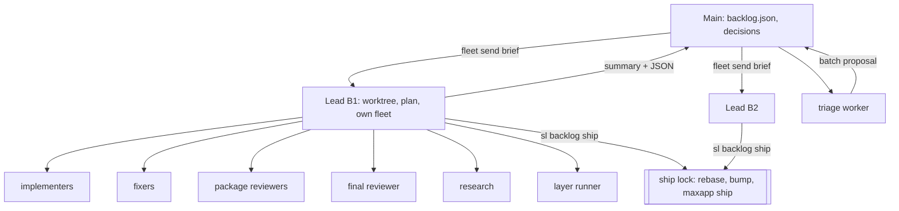

# Superlite: batch leads and fleet for every role

**Goal:** a main orchestrator that holds only the backlog and Max's decisions works a whole backlog (7 batches) with its context under 60k; each batch runs in a lead worker that plans, builds, reviews and ships it; while fleet is on, every superlite role (implementer, fixer, package reviewer, final reviewer, research, layer runner) runs as a Herdr worker, never as an in-process `Agent` call.
**Architecture:** three levels. Main (backlog, decisions, one screen of state) -> leads (one superlite coordinator per batch, own worktree, own fleet) -> workers (one role each). Every level talks over the existing `fleet send` / `fleet wait` path; reports come back as status lines plus a JSON block, never as prose the parent must read.
**Spec:** this file. Built as three phase issues (umbrella #183), each with its own plan.
**Detail:** tests
**Orchestrator:** AI (Max, 2026-11-05)

## Understanding

Max said (2026-11-05):
- Fleet covers everything that is in-process today: fixers, reviewers, the final reviewer, research, layer runs, shipping.
- The main orchestrator keeps a lean context for a very long time: only the overall plan (backlog, batch order, decisions); a fresh agent per batch; it reads back a short summary, never the batch's details.
- Shape: batch leads plus fleet for every role.
- A lead ships its own batch under a ship lock; Max's one up-front yes covers all batches.
- 2 leads at once, on batches that share no file, once #178 ships; 1 until then.
- Decisions: all batches' major decisions are asked once up front; a lead that hits a new major one escalates (`NEEDS_DECISION`), the others keep running.
- Output: this doc plus one issue per phase; #183 becomes the umbrella.
- Target: main context under 60k after a 7-batch backlog; each lead finishes its batch without compaction.
- Build: AI orchestrator.

Assumed (rulings below, vetoable):
- A batch fits one lead's context without compaction; the first fleet session ran three whole batches in one coordinator before its first compaction, and leads read less than that coordinator did.
- `maxapp ship` stays the ship step; superlite wraps it, it does not replace it.

Evidence (first autonomous fleet session, 2026-11-05, see #183): the coordinator's context went to writing six 15-31k plans, about 45 in-process agent reports, fix loops (one opus fixer: 20 min, 214k tokens on the coordinator's account), one 55k issue dump, reading worker panes, and bookkeeping (layers, version bumps, PR bodies, ship). Implementer work in fleet was the small part.

## Design

### Levels and roles

| Role | Agent | Started by | Prime | Returns |
|---|---|---|---|---|
| lead | main session's model, coordinator rules | main | lead brief | summary file, PR, status |
| triage | research worker (haiku or sonnet) | main | brief | batch proposal JSON |
| implementer | `superlite:implementer[-haiku]` (today) | lead | `prime.md` | status + JSON |
| fixer | `superlite:fixer-{sonnet,sonnet-high,opus}` by `fixing.md` tier | lead | brief | status + JSON |
| package reviewer | `superlite:package-reviewer` | lead | brief | status + findings JSON |
| final reviewer | `superlite:final-reviewer`, fresh, one turn | lead | packet path | verdict + findings JSON |
| research | read-only worker | lead or main | brief | summary file |
| layer runner | plain shell pane, no model | lead | command | exit code + one line |

Without fleet nothing changes: roles stay in-process `Agent` calls. With fleet on, a coordinator or lead that calls `Agent` for a superlite role is a rule break (`fleet.md`), and backlog mode refuses to start without a reachable Herdr (`BLOCKED`, #185).

### Units

1. **Worker roles (`fleet.py`).** `fleet spawn --role R [--tier T]`; `--role` defaults to `implementer`, so today's calls keep working. The role picks the agent (`config/routing.json` for implementers, `fixing.md` tiers for fixers), the prime (implementer: `prime.md`; other roles: none, the brief carries everything) and the env. New env `SUPERLITE_FLEET_ROLE`.
2. **Briefs (`fleet_io.py`).** `fleet send Wn --brief FILE` sends "Read FILE, do it, end with the status line and the JSON block". Task messages for implementers stay as they are.
3. **Reports as data (`fleet_io.py`).** Every worker ends its last message with a status line and one fenced `json` block: `{"status", "files", "tests", "findings": [{"file", "line", "problem", "fix", "tier"}], "summary"}`. `fleet wait` parses it from the transcript (no Write tool needed, so the read-only final reviewer works), stores `reports/<id>.json` next to the text, and prints only `Wn <task> <STATUS> findings=<n> <json path>`. A missing or broken block is `status: UNKNOWN`, the text kept, as today.
4. **Findings routing (`sl findings route`).** Reads review and final-review JSON, groups findings by file and tier as `fixing.md` says, writes one fixer brief per group and prints one dispatch line per brief (`fixer tier=sonnet-high brief=<path> files=a,b`). The coordinator spawns and sends; it never reads the findings themselves unless a brief is refused.
5. **Layer runner.** `fleet run --layer headless|tui|evals` opens a plain shell pane on the account with the most headroom (the e2e layers start Claude sessions and spend that account's quota), runs `scripts/test_layers.py run <layer>`, and reports the exit code and the layer's last line through `fleet wait`.
6. **Lead role (hooks).** A lead is a fleet worker with `SUPERLITE_FLEET_ROLE=lead`. The hooks that skip workers today treat a lead as a coordinator: `block-coordinator-edits` guards it, `final-review-check` runs (`SUPERLITE_FINAL_REVIEW` unset), `rewrite-test-runs` allows the coordinator's runs. `capture-worker-stop` still writes its stop record, so main's `fleet wait` sees it finish. `AskUserQuestion` stays disallowed for every worker, leads included.
7. **Lead brief.** Written by `sl backlog start`: batch id, issues (numbers and titles; the lead reads the bodies itself), the file set, Max's decisions for the batch, rulings, worktree topic, `ship: allowed` with the approval record, the escalation and summary paths, and "run as AI orchestrator: brainstorming, plan, subagent-driven-development with fleet on, final review, layers, `sl backlog ship`".
8. **Backlog (`sl backlog`).** State in `<main checkout>/.superlite/backlog.json`, written only by `sl backlog` (lock as `fleet_state.locked`):
   - `plan`: starts a triage worker that reads open issues and the code and writes a proposal (batches, issue numbers, files each batch touches, dependencies, major decisions each batch needs). The script checks that no two batches share a file, merges a clash into one batch or orders it, and records the proposal. Main reads only the batch table and the decision list.
   - `decide`: records Max's answers per batch, and the ship approval (`approved_ship: {by, time}`).
   - `status`: one screen: `batch | issues | state | lead | PR | next`, plus open questions. The first command main runs after any compaction.
   - `start [B]`: picks the next batch whose files clash with no running batch and whose dependencies shipped, up to the parallel cap (1 until #178 ships, then 2), writes its brief and spawns the lead.
   - `wait`: blocks until any lead changes state, run as a background command so main spends no turns while leads work; prints one line per change.
   - `answer B --file ANSWER`: sends Max's answer to a lead in `NEEDS_DECISION`.
9. **Escalation.** A lead that hits a new major decision writes `<run>/.superlite/question.json` in the `AskUserQuestion` shape (questions, options, recommendation first), ends its turn with `NEEDS_DECISION`, and parks; its workers finish their current tasks and idle. Main asks Max with that JSON and sends the answer with `sl backlog answer`. The other lead keeps running.
10. **Ship lock (`sl backlog ship B`).** In the lead: take the repo's ship lock (`~/.superlite/locks/ship-<repo>.lock`, machine-wide, with owner and time), fetch and rebase onto the default branch, rerun only the layers whose required paths changed since their stamp, bump the version with `scripts/bump-version.sh` (never in a plan task), run `maxapp ship` in the foreground (rerun on exit 4, at most 5 runs, as Max's rules say), record PR and merge in `backlog.json`, release the lock, write the summary. A red check is fixed by the lead's own fixers while it holds the lock.
11. **Summary.** `<run>/.superlite/summary.md`, at most 10 lines: issues closed, PR, version, rulings that change later batches, follow-up issues filed. Main reads this file and nothing else from a batch.
12. **Capacity.** `fleet spawn` opens a new Herdr tab past 4 panes, or when a pane would be under 20 rows (fixes the 5th-worker `no READY`); each lead gets its own workspace (`sl:<batch>`). Account choice counts the live fleet workers of every superlite session on the machine (Herdr agent list, names `sl-*`), not only this run's. Spawn retries the prime once on `agent_prompt_stalled`. Spawn refuses an account over its 5-hour or weekly cap; a lead stopped by a cap mid-batch is parked and resumed later by a fresh lead on another account with `superlite:resume` (state is on disk).
13. **Commands and docs.** `/superlite:backlog` starts backlog mode (no new skill: a `backlog.md` reference next to `fleet.md`); `docs/fleet.md` gains roles, leads and the smoke steps; `using-superlite` stays under 1,500 characters.

### Data flow of one batch

`sl backlog start` -> lead spawned with brief -> lead: worktree, brainstorming (AI, no questions; new major one -> `NEEDS_DECISION`), plan, `lint --stable`, dispatch -> implementers -> `commit_task` -> package reviewers (workers) -> `sl findings route` -> fixers (workers) -> packet -> final reviewer (worker) -> fixers -> layer runners -> `sl backlog ship` -> summary -> lead ends its turn `DONE` -> main's `sl backlog wait` prints `B4 shipped PR #190 1.5.7` -> main starts the next batch.

### Error handling

- Lead `BLOCKED` or pane gone: batch `parked` with the reason; main starts the next disjoint batch and lists parked batches in its closing report.
- Lead over its context: it compacts like any session; its run state is on disk. A batch that compacted is noted in the summary (it misses the target).
- Rebase conflict in ship: the lead's fixers resolve it in its worktree; the lock stays held; a conflict a fixer cannot resolve parks the batch and releases the lock.
- Stale ship lock (owner pane gone, older than 2 hours): `sl backlog ship` takes it over and logs an incident.
- Broken report JSON: `UNKNOWN` status, text kept, the parent reads the text once (today's behaviour).

## Rulings

Ruling: fleet on means every superlite role runs as a worker; the in-process path stays for fleet off (because Max asked for everything in-process to move; cost if wrong: small reviews pay a worker start, about 10-20 s each).
Ruling: delegated planning (#183 point 2) is dropped as its own feature; a lead plans in its own fresh context (because the lead already is the delegate; cost if wrong: a lead's context carries its plan, as today's coordinator per batch).
Ruling: issue triage runs in a triage worker; main never reads issue bodies (because the 55k issue dump was one of main's largest costs; cost if wrong: one more worker start per backlog).
Ruling: on a public repo only issues opened by the owner or a collaborator enter the backlog without asking; others are listed in the up-front decision batch (because an issue body becomes instructions for an agent that pushes to the default branch; cost if wrong: an outside issue waits for one yes).
Ruling: `backlog.json` lives in the main checkout's `.superlite/` (because main runs there and leads work in worktrees; cost if wrong: a second machine does not see the backlog, as with every run state today).
Ruling: main waits with `sl backlog wait` as a background command (because a foreground `fleet wait` costs a turn every 9 minutes, about 20k tokens over a 10-hour backlog; cost if wrong: none, a crash of the wait command ends it and notifies main).
Ruling: the version bump happens inside the ship lock, after the rebase (because two leads would otherwise bump to the same version; cost if wrong: none).
Ruling: the final review stays one fresh worker per round, never reused (because its value is the fresh context; cost if wrong: none).
Ruling: layer runs go to a shell pane on the account with headroom, not to a model worker (because a layer run is a script; cost if wrong: none).
Ruling: #178 and #181 stay in batch 6 of the session that filed them; phase 1 depends on them instead of filing them again (cost if wrong: phase 1 waits for batch 6).
Ruling: plan detail `tests` for each phase plan (because the core is plumbing over existing paths, not an algorithm; cost if wrong: a phase plan is redone at `full`).

## Coverage

| Category | State | Basis |
|---|---|---|
| Scope and success criteria | settled | Max 2026-11-05: leads + fleet for every role; target main <60k after 7 batches, no compaction in a lead. Out: cross-machine backlogs, non-Claude-Code harnesses for fleet, account swap mid-run. |
| Domain and data model | ruled | Units 3 and 8: report JSON block; `backlog.json` batches `{id, issues, files, depends, state planned/running/needs_decision/parked/shipped, lead, worktree, branch, pr, version, summary}`, decisions, `approved_ship`. |
| Persistence and migration | ruled | Ruling: `backlog.json` in the main checkout's `.superlite/`; new file, nothing to migrate; `fleet.json` gains `role` per worker, absent = implementer. |
| Interfaces and contracts | ruled | Units 1-5, 8, 10: `fleet spawn --role`, `fleet send --brief`, `fleet run --layer`, `fleet wait` line format, `sl findings route`, `sl backlog plan/decide/status/start/wait/answer/ship`. Today's `fleet spawn --tier`, `fleet send Wn Tn` and `fleet wait` lines keep working. |
| UI states | ruled | Unit 12: own Herdr workspace per lead, tab per 4 panes; `sl backlog status` one screen; `NEEDS_DECISION` shown to Max through `AskUserQuestion` from main. |
| Concurrency and state ownership | settled | Max: 2 leads after #178, file-disjoint; ship lock serialises rebase, bump, ship. Only `sl backlog` writes `backlog.json`; a lead writes only its run folder. |
| Error handling and recovery | ruled | Section Error handling: parked batches, stale lock takeover, resume by a fresh lead, `UNKNOWN` reports. |
| Security and privacy | ruled | Ruling on outside issues; ship approval recorded once with owner and time; `AskUserQuestion` disallowed in every worker; leads keep the coordinator guard (unit 6). |
| Performance and limits | ruled | Unit 12 caps and tabs; machine-wide account spread; Ruling: background `sl backlog wait`; 2 leads with up to 4 workers each on 3 accounts. |
| Observability | ruled | `sl backlog status`; per-batch build report as today; main's peak context recorded per backlog (#112 breakdown), the measure for the 60k target. |
| Testing strategy | ruled | Unit tests with the fake `herdr` for roles, briefs, report JSON, routing, backlog state, ship lock; hook tests for `SUPERLITE_FLEET_ROLE=lead` (headless layer); `docs/fleet.md` smoke steps for a lead, an escalation and two leads shipping in turn. Acceptance: the next real backlog run. |
| Compatibility | ruled | Fleet stays Claude Code + Herdr; fleet off unchanged; old `fleet.json` without `role` reads as implementers. |
| Rollout | ruled | Three phases, each its own PR and version bump: 1 prerequisites, 2 every role in fleet, 3 leads and backlog. Rollback: `fleet off` returns to in-process; backlog mode is opt-in through its command. |
| Research unknowns | spike | S1 nested fleet from a lead pane (env leakage of `SUPERLITE_FLEET_WORKER`, names, which `metrics.jsonl` gets stop records); S2 `--agent` for the one-turn final reviewer and a read-only research worker in a pane; S3 permission dialogs a lead meets in `sl backlog ship` (push, `gh`, `maxapp ship`) and the allow rules that remove them. |

## Phases (one issue each, umbrella #183)

1. **Prerequisites (#186).** Depends on #178 and #181 (batch 6). Tab past 4 panes or under 20 rows; machine-wide account spread; prime retry on `agent_prompt_stalled`; spawn refuses capped accounts; #185's hard stop when fleet was asked for and is missing. Spikes S1-S3 run here, so phases 2 and 3 plan on facts.
2. **Every role in fleet (#187).** Units 1-5: roles, briefs, report JSON, `sl findings route`, layer runner; `fleet.md`, `fixing.md` and the SDD skill switch fixers, reviewers, the final reviewer and research to workers while fleet is on.
3. **Leads and backlog (#188).** Units 6-11 and 13: lead role in the hooks, lead brief, `sl backlog`, escalation, ship lock, summary, `/superlite:backlog`, docs. Done when a real 7-batch backlog meets the target.
