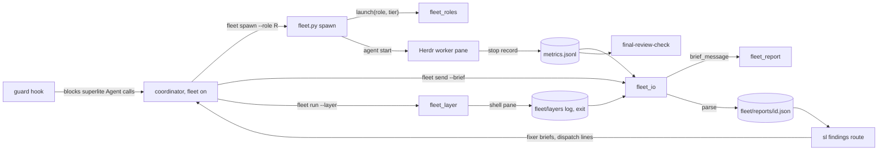
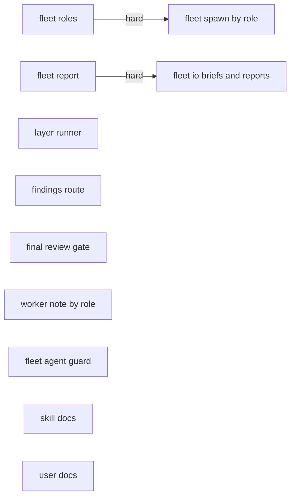
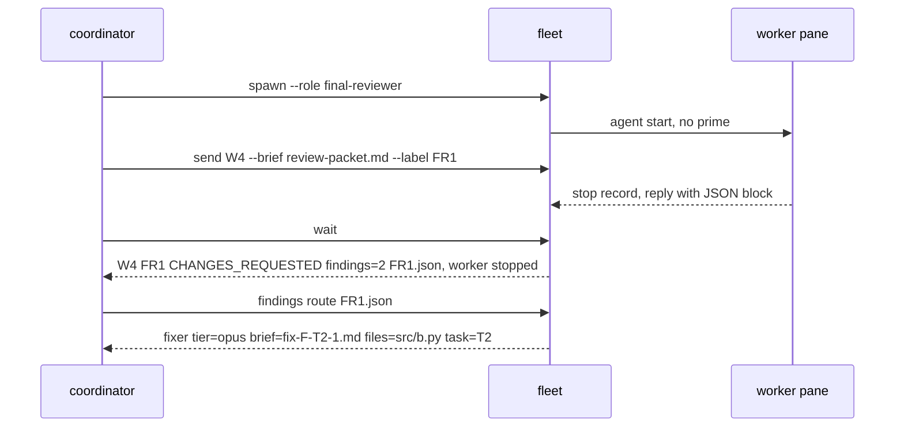

# Superlite: every role in fleet (phase 2)

**Goal:** while fleet is on, every superlite role runs as a Herdr worker: implementers (today), fixers, package reviewers, the final reviewer, research and test-layer runs; workers end with a status line plus one JSON block, `fleet wait` turns it into one line and a JSON file, `sl findings route` turns findings into fixer briefs, and a guard blocks in-process `Agent` calls for superlite roles. Fleet off changes nothing. Also fixes feedback 46177e14ea88 (`fleet off` from inside the fleet's own workspace kills its pane before `fleet.json` says off).
**Architecture:** three new modules (`fleet_roles` role table, `fleet_report` report parser and brief message, `fleet_layer` shell-pane layer runner) and one new tool (`findings`), wired into `fleet.py` (spawn by role, account and pane helpers, safe `off`) and `fleet_io.py` (`send --brief`, report JSON, layer results, one-turn stop); three hooks (final-review gate counts fleet reviewers, role-aware worker note, Agent guard); a read-only `agents/researcher.md`; skill and user docs.
**Tech stack:** Python 3.10+ stdlib, bash, pytest, Markdown.
**Spec:** `docs/plans/2026-11-05-fleet-leads.md` (Understanding, Design, Levels and roles, Units 1-5, Data flow of one batch, Error handling, Rulings, Coverage, Phases (one issue each, umbrella #183): phase 2); spike S2 `~/.superlite/handoffs/2026-11-05-spike-S2-one-turn-workers.md` (all; its facts override the design); spike S1 item 7. Issues: #187; feedback 46177e14ea88.
**Detail:** tests
**Wave0:** none
**Max chars:** 86000

Global constraints:
- Builds on batch 6 (`docs/plans/2026-11-05-run-tooling-2.md`, merged first): its `fleet spawn --for-dispatch` (T9), `herdr_client.create_tab`/`pane_layout`/`agents`, `fleet_state.place`/`register_agent`/`live_by_account`, `accounts.aliases` (T10), the root line and hard stop (T11), tabs, machine-wide spread, prime resend and hashed names `sl-<run folder, cut>-<4 hex>-wN` (T12). Keep their tests green.
- Python 3.10+ stdlib; follow the style of `skills/subagent-driven-development/scripts/` including per-line `# O(...)` comments. Bash hooks: builtins only, bash 3.2 safe, `printf` (no heredoc).
- Verify with `<abs sl> run_tests --fast <your test files> --task Tn --background`, then the printed `wait:` line; also run the existing test files the task names.
- No version bump in a task. The headless, tui and evals layers are the coordinator's step.
- Wave0 none: a module another task creates or changes is imported inside the function that calls it (`import fleet_report` in the body, `importlib.import_module("fleet_io")`); a test replaces it with `monkeypatch.setitem(sys.modules, "fleet_layer", fake)` or `monkeypatch.setattr(mod, name, fake, raising=False)`, returning the producer's `e.g.` values. Hard edges (T1 to T3, T2 to T5) use the real module.
- Roles: `implementer` (default), `fixer`, `package-reviewer`, `final-reviewer`, `research` (agent `superlite:researcher`); the layer runner records role `layer`. Fixer tiers: `1`/`sonnet` -> `superlite:fixer-sonnet`, `2`/`sonnet-high` -> `superlite:fixer-sonnet-high`, `3`/`opus` -> `superlite:fixer-opus`. Worker env adds `SUPERLITE_FLEET_ROLE=<role>` and `CLAUDE_CODE_ENABLE_PROMPT_SUGGESTION=0`.
- CLI: `sl fleet spawn --role R [--tier T]`, `sl fleet send Wn --brief FILE [--label L]`, `sl fleet run --layer headless|tui|evals`, `sl findings route --plan P REPORT.json ...`. Today's `fleet spawn --tier`, `fleet send Wn Tn`, `send --text`, `keys`, `wait`, `status`, `stop`, `off` keep working.
- Report block: the last fenced `json` block of a worker's reply, `{"status": str, "files": [str], "tests": str, "findings": [{"file": str, "line": int, "problem": str, "fix": str, "tier": 1|2|3}], "summary": str}`. Statuses `APPROVED`, `CHANGES_REQUESTED`, `DONE`, `DONE_WITH_CONCERNS`, `NEEDS_CONTEXT`, `BLOCKED`; nothing parsable: `UNKNOWN`.
- `fleet wait` lines: `Wn <label> <STATUS> findings=<n> <sd>/fleet/reports/<id>.json` (`<id>` = the label's first comma part; ` (screen)` appended for the screen fallback); layers `Wn layer-<L> GREEN|RED exit=<n> <log path>` plus `  <last line>`; `BLOCKED-UI` and `TIMEOUT` lines unchanged. The `.md` text stays next to the JSON.
- `findings route` lines: `fixer tier=<sonnet|sonnet-high|opus> brief=<abs path> files=<a,b> task=<Tn>`; briefs `<sd>/briefs/fix-F-<Tn>-<n>.md`; finding ids `F-<Tn>-<n>` (fixing.md).
- `fleet.json` worker records gain `role` (absent = implementer), `one_turn` (bool), `last_task`; layer workers also `layer`.

Ruling: research runs a new read-only `agents/researcher.md` (`superlite:researcher`, haiku, effort low, `tools: Read, Grep, Glob, Bash`), not built-in Explore (because Explore keeps Workflow, ScheduleWakeup and ToolSearch (S2), and the guard can block a `superlite:` type without blocking Explore elsewhere; cost if wrong: one more agent file).
Ruling: the guard is a branch of `hooks/block-coordinator-edits` (already the Agent PreToolUse hook), blocking `superlite:` roles while `fleet.json` says on (orchestrator ruling, #185 deterministic guard; cost if wrong: `sl fleet off` is the way back to in-process agents).
Ruling: every role, implementers included, gets `--effort` from its agent frontmatter; `--model` only for implementers (their tier) and research given a `--tier` (S2: frontmatter effort is ignored in a main-thread session; cost if wrong: implementers drop from xhigh to their declared effort).
Ruling: the report contract (status words, JSON schema) lives in the message `send --brief` sends (`fleet_report.brief_message`), not in agent files; implementer task messages stay as they are (cost if wrong: an in-process final reviewer still answers without JSON, which `parse` reads from its `file:line - ... - tier N` lines).
Ruling: one wait-line format for every role; an implementer's line gains `findings=0` and the JSON path (cost if wrong: one updated pin in `test_fleet_io.py`).
Ruling: `findings route` groups by owning task (disjoint file sets, so fixers run at once), tier = the group's highest; a file outside every Owns goes to the plan's last task with `--claim` (cost if wrong: one slower fixer per large task).
Ruling: `fleet wait` stops a one-turn worker (`one_turn` true: fixer, reviewers, research, layer) once its status is final (`DONE`, `DONE_WITH_CONCERNS`, `BLOCKED`, `APPROVED`, `CHANGES_REQUESTED`); `NEEDS_CONTEXT`, `UNKNOWN` and `BLOCKED-UI` keep it (cost if wrong: a reviewer the coordinator wanted to ask again needs a fresh worker, about 4 s, S2).
Ruling: with fleet on, fixes always go to a fresh fixer worker; owner reuse (fixing.md) is fleet off only (cost if wrong: none, a worker starts in about 4 s).
Ruling: `send --text` marks the worker busy (label kept, `sent` now), so a bare `fleet wait` waits for the answer (S1, S2; cost if wrong: none).
Ruling: the layer runner is a plain shell pane (`herdr pane run`) running `python -u scripts/test_layers.py run <L>` with output to a log and the exit code to a file; `wait` polls that file; the pane env holds `CLAUDE_CONFIG_DIR` and pass-through only, no `SUPERLITE_*` (cost if wrong: one more herdr call shape to check in the smoke test).
Ruling: `fleet off` and the stop of the last worker write `fleet.json` before closing the workspace (feedback 46177e14ea88; cost if wrong: none).
Ruling: the SDD fleet line becomes the exact line in T10 and the `THEN LOG` sentence drops `with the Agent calls,`, which keeps SKILL.md under its 11,700 cap (batch 6 leaves 3 characters).
Ruling: `T1 -->|hard| T3` and `T2 -->|hard| T5`: Wave0 none, and today's `test_fleet.py` and `test_fleet_io.py` run the new modules (cost if wrong: T3 and T5 start about 2 minutes later).
Ruling: unchanged on purpose: `hooks/capture-worker-stop`, `hooks/capture-agent-stop` (S2 change 8 is optional once prompt suggestions are off), `scripts/test_layers.py`, `skills/brainstorming/SKILL.md`; S2 side findings `_blocked` stale frame and `compact-nudge` noise stay out (follow-ups).

## Coverage

| Category | State | Basis |
|---|---|---|
| Scope and success criteria | settled | #187: roles, briefs, report JSON, findings route, layer runner, docs; orchestrator adds the Agent guard. Done when a fleet run's review, fix round and final review are Herdr panes and the coordinator's transcript has no superlite `Agent` call. Out: leads and backlog (#188). |
| Domain and data model | ruled | Report block (Global constraints); worker records gain `role`, `one_turn`, `last_task`, `layer`. |
| Persistence and migration | ruled | Old `fleet.json` without `role` reads as implementer; `fleet/reports/<id>.json` next to the `.md`; layer logs in `fleet/layers/`; nothing to migrate. |
| Interfaces and contracts | ruled | CLI and line formats in Global constraints; Produces lines of T1-T6. |
| UI states | ruled | One Herdr pane per worker; `fleet status` adds `role=` for non-implementers; one-turn workers close after their final report. |
| Concurrency and state ownership | ruled | Fixer groups have disjoint files; `fleet.json` written under its lock by `fleet.py`, `fleet_io.py`, `fleet_layer.py`; final reviewer fresh per round. |
| Error handling and recovery | ruled | Broken block: Verdict lines, status regexes, then `UNKNOWN` with the text kept; missing brief exits 2; `off` writes state first. |
| Security and privacy | ruled | Researcher limited by its tool allow-list; `AskUserQuestion` disallowed for every worker; guard on superlite `Agent` calls; layer panes get no `SUPERLITE_*` env. |
| Performance and limits | ruled | One-turn worker about 4 s plus its turn (S2); prompt suggestions off save a model call per turn; one-turn workers free their pane. |
| Observability | ruled | Launch and stop records `fleet:<agent>`; guard blocks are `rule-block` incidents; one JSON report per worker turn. |
| Testing strategy | ruled | Unit tests with the fake herdr and fake modules per task; hook tests replaying payloads; headless, tui and evals layers by the coordinator; smoke rows in `docs/fleet.md`. |
| Compatibility | ruled | Fleet off unchanged; Claude Code 2.1.318 and Herdr 0.9.5 as measured by S2; auto-mode accounts (non-auto ones show BLOCKED-UI). |
| Rollout | ruled | One PR after batch 6; rollback is `sl fleet off`. |
| Research unknowns | settled | Spike S2 (all) and S1 item 7, 2026-11-05. |

## Main diagram



## File structure

- `skills/subagent-driven-development/scripts/fleet_roles.py`: role table: agent, model, effort, argv, prime, pool, one_turn, env (T1).
- `agents/researcher.md`: read-only research agent (T1).
- `skills/subagent-driven-development/scripts/fleet_report.py`: report block parser and brief message (T2).
- `skills/subagent-driven-development/scripts/fleet.py`: spawn by role, `choose_account`, `open_pane`, safe `off`/`stop`, `run` delegation, Wave 0 through `--for-dispatch` (T3).
- `skills/subagent-driven-development/scripts/fleet_layer.py`, `.../scripts/herdr_client.py` (`run_in_pane`): layer runner (T4).
- `skills/subagent-driven-development/scripts/fleet_io.py`: `send --brief`, `send --text` busy, report JSON and lines, layer results, one-turn stop (T5).
- `skills/subagent-driven-development/scripts/findings.py`: `sl findings route` (T6).
- `hooks/final-review-check` (T7), `hooks/session-start` (T8), `hooks/block-coordinator-edits` (T9).
- `skills/subagent-driven-development/fleet.md`, `.../SKILL.md` (T10); `.../fixing.md`, `docs/fleet.md` (T11).
- Tests: one new file per task under `tests/scripts/`; T3 also updates `test_fleet_for_dispatch.py`, T5 `test_fleet_io.py`.

## Task graph

```mermaid
%% schedule
gantt
  title Predicted schedule (mm:ss)
  dateFormat X
  axisFormat %M:%S
  section lane 1
  T6 findings route :t6, 0, 183s
  section lane 2
  T4 layer runner :t4, 0, 180s
  section lane 3
  T2 fleet report :t2, 0, 160s
  T5 fleet io briefs and reports :t5, 160, 199s
  section lane 4
  T10 skill docs :t10, 0, 147s
  section lane 5
  T1 fleet roles :t1, 0, 144s
  T3 fleet spawn by role :t3, 144, 209s
  section lane 6
  T11 user docs :t11, 0, 137s
  section lane 7
  T9 fleet agent guard :t9, 0, 136s
  section lane 8
  T8 worker note by role :t8, 0, 118s
  section lane 9
  T7 final review gate :t7, 0, 117s
```





critical path: T2 → T5 (6.0 min) · peak width 9 · predicted build 6.0 min · predicted total ≈ 9.5 min

## Fleet roles and reports

**Probe entry:** call=fleet_report.parse

Package review focus: app type CLI, concurrency and parser. Categories: protocol (herdr argv, wait lines, dispatch lines, the brief message), state (worker records, `busy`/`sent`, the order of `fleet.json` writes and workspace close), encoding (JSON blocks inside prose, quotes and newlines in briefs), deep (nested or huge JSON). Specific risks: a JSON block parsed from the screen; a stale stop record taken for a brief's answer; a one-turn worker stopped while it waits for an answer; a layer pane that inherits `SUPERLITE_*` and turns its e2e sessions into fleet workers.



### T1 fleet roles · Complexity 3 · Est. context 32k
**Owns:** skills/subagent-driven-development/scripts/fleet_roles.py, agents/researcher.md, tests/scripts/test_fleet_roles.py
**Components:** 2
**LOC owned:** 110
**Tests:** fast
**Kind:** mechanical
**Model:** haiku
**Est. time:** 2 min (2 components, about 110 LOC, fast tests)
**Produces:** fleet_roles.launch(role: str, tier: str | None, cfg: dict, agents_dir: Path = AGENTS) -> dict
e.g. launch("implementer", "sonnet", cfg) -> {"role": "implementer", "agent": "superlite:implementer", "model": "sonnet", "effort": "medium", "argv": ["--agent", "superlite:implementer", "--model", "sonnet", "--effort", "medium", "--disallowedTools", "AskUserQuestion"], "prime": True, "pool": True, "one_turn": False}
e.g. launch("fixer", "3", cfg) -> {"role": "fixer", "agent": "superlite:fixer-opus", "model": "opus", "effort": "high", "argv": ["--agent", "superlite:fixer-opus", "--effort", "high", "--disallowedTools", "AskUserQuestion"], "prime": False, "pool": False, "one_turn": True}
e.g. launch("final-reviewer", None, cfg) -> {"role": "final-reviewer", "agent": "superlite:final-reviewer", "model": "opus", "effort": "high", "argv": ["--agent", "superlite:final-reviewer", "--effort", "high", "--disallowedTools", "AskUserQuestion"], "prime": False, "pool": False, "one_turn": True}; launch("lead", None, cfg) -> ValueError("unknown role lead; use implementer, fixer, package-reviewer, final-reviewer, research")
**Produces:** fleet_roles.env(role: str) -> dict
e.g. env("fixer") -> {"SUPERLITE_FLEET_ROLE": "fixer", "CLAUDE_CODE_ENABLE_PROMPT_SUGGESTION": "0"}
**Review Focus:** `test_bad_role_or_tier_is_value_error`: role `lead`, fixer tier `haiku` or `4`, and any `--tier` on a reviewer raise ValueError; `test_missing_agent_file_drops_effort`: no agent file gives no `--effort` and model None.
**Test code (verbatim):**
```python
# tests/scripts/test_fleet_roles.py
import sys
import pytest
from test_plan_tools import ROOT, SCRIPTS
sys.path.insert(0, str(SCRIPTS))
import fleet_roles as fr  # noqa: E402
import routing  # noqa: E402

CFG = routing.load_cfg()
TAIL = ["--disallowedTools", "AskUserQuestion"]

def test_implementer_keeps_model_and_prime_and_gets_effort():
    assert fr.launch("implementer", "sonnet", CFG) == {
        "role": "implementer", "agent": "superlite:implementer", "model": "sonnet", "effort": "medium",
        "argv": ["--agent", "superlite:implementer", "--model", "sonnet", "--effort", "medium"] + TAIL,
        "prime": True, "pool": True, "one_turn": False}
    h = fr.launch("implementer", "haiku", CFG)
    assert h["argv"][:6] == ["--agent", "superlite:implementer-haiku", "--model", "haiku", "--effort", "high"]
    assert fr.launch("implementer", None, CFG)["model"] == "sonnet"

@pytest.mark.parametrize("tier,agent,model,effort", [
    (None, "superlite:fixer-sonnet", "sonnet", "medium"), ("1", "superlite:fixer-sonnet", "sonnet", "medium"),
    ("2", "superlite:fixer-sonnet-high", "sonnet", "high"), ("sonnet-high", "superlite:fixer-sonnet-high", "sonnet", "high"),
    ("3", "superlite:fixer-opus", "opus", "high"), ("opus", "superlite:fixer-opus", "opus", "high")])
def test_fixer_tiers_follow_fixing_md(tier, agent, model, effort):
    r = fr.launch("fixer", tier, CFG)
    assert (r["agent"], r["model"], r["effort"]) == (agent, model, effort)
    assert r["argv"] == ["--agent", agent, "--effort", effort] + TAIL and not r["prime"] and not r["pool"] and r["one_turn"]

def test_reviewers_take_frontmatter_model_without_model_flag():
    f = fr.launch("final-reviewer", None, CFG)
    assert (f["agent"], f["model"], f["effort"]) == ("superlite:final-reviewer", "opus", "high") and "--model" not in f["argv"]
    p = fr.launch("package-reviewer", None, CFG)
    assert p["argv"] == ["--agent", "superlite:package-reviewer", "--effort", "medium"] + TAIL and p["model"] == "sonnet"

def test_research_runs_the_read_only_researcher():
    r = fr.launch("research", None, CFG)
    assert r["argv"] == ["--agent", "superlite:researcher", "--effort", "low"] + TAIL and r["model"] == "haiku" and r["one_turn"]
    s = fr.launch("research", "sonnet", CFG)
    assert s["argv"][:4] == ["--agent", "superlite:researcher", "--model", "sonnet"] and s["model"] == "sonnet"

@pytest.mark.parametrize("role,tier", [("lead", None), ("fixer", "haiku"), ("fixer", "4"), ("final-reviewer", "opus"), ("package-reviewer", "sonnet")])
def test_bad_role_or_tier_is_value_error(role, tier):
    with pytest.raises(ValueError):
        fr.launch(role, tier, CFG)

def test_unknown_role_message_lists_the_roles():
    with pytest.raises(ValueError, match="unknown role lead; use implementer, fixer, package-reviewer, final-reviewer, research"):
        fr.launch("lead", None, CFG)

def test_env_names_role_and_turns_off_prompt_suggestions():
    assert fr.env("fixer") == {"SUPERLITE_FLEET_ROLE": "fixer", "CLAUDE_CODE_ENABLE_PROMPT_SUGGESTION": "0"}
    assert fr.env("implementer")["SUPERLITE_FLEET_ROLE"] == "implementer"

def test_missing_agent_file_drops_effort(tmp_path):
    r = fr.launch("final-reviewer", None, CFG, agents_dir=tmp_path)
    assert r["argv"] == ["--agent", "superlite:final-reviewer"] + TAIL and r["effort"] is None and r["model"] is None

def test_researcher_agent_is_read_only():
    text = (ROOT / "agents" / "researcher.md").read_text(encoding="utf-8")
    fm = text.split("---")[1]
    assert "name: researcher" in fm and "model: haiku" in fm and "effort: low" in fm and "tools: Read, Grep, Glob, Bash" in fm
    assert "absolute" in text and "never write" in text and "$SL" not in text
```
**Steps:** 1 failing tests, 2 run: FAIL, 3 implement, 4 run: PASS
**Notes:** `AGENTS = Path(__file__).resolve().parents[3] / "agents"`. Frontmatter: the `key: value` lines between the first two `---` lines of `agents_dir / "<name after superlite:>.md"`; a missing file is `{}`. Implementer: agent `routing.tier_agent(cfg, tier or "sonnet")`, model = the tier. Fixer: tier None means `sonnet`; anything outside the six accepted values raises `ValueError("fixer tier must be 1, 2, 3, sonnet, sonnet-high or opus")`. Package and final reviewer: a tier raises `ValueError("<role> takes no --tier")`. Research: model = tier when given (then `--model tier` in argv), else frontmatter. argv order: `--agent`, optional `--model`, optional `--effort`, then `--disallowedTools AskUserQuestion`. `agents/researcher.md`, exactly:
```
---
name: researcher
description: Read-only research worker for fleet mode. Answers one brief from the code, the docs and git history, and returns a short summary. Never edits.
model: haiku
effort: low
tools: Read, Grep, Glob, Bash
---

You answer one research brief and change nothing. Read the brief file your first message names, then the code, docs and git history it points to. Bash is for read-only commands only (`git log`, `git show`, `git diff`, `ls`, `rg`): never write, move or delete a file, never commit, never install anything. When the brief gives the absolute `sl` path, type it literally; never use a shell variable for it.

Answer what the brief asks in at most 300 words, with `file:line` references. Say what you could not find; never guess. End as your first message says: the status line, then the JSON block.
```
Keep `tests/scripts/test_agent_mcp_tools.py`, `test_docs_contract.py`, `test_sl_form.py` green (they read every agent file).

### T2 fleet report · Complexity 4 · Est. context 36k
**Owns:** skills/subagent-driven-development/scripts/fleet_report.py, tests/scripts/test_fleet_report.py
**Components:** 1
**LOC owned:** 150
**Tests:** fast
**Model:** sonnet
**Est. time:** 2 min (1 component, about 150 LOC, fast tests)
**Produces:** fleet_report.parse(text: str, label: str = "", allow_json: bool = True) -> dict
e.g. parse('Status: DONE\n```json\n{"status": "DONE", "files": ["src/a.py"], "tests": "3 passed", "findings": [], "summary": "ok"}\n```') -> {"status": "DONE", "files": ["src/a.py"], "tests": "3 passed", "findings": [], "summary": "ok", "valid": True}
e.g. parse("Verdict: CHANGES_REQUESTED\nsrc/a.py:12 - off by one - use <= - tier 1\nChecked:\nT1 diff: read") -> {"status": "CHANGES_REQUESTED", "files": [], "tests": "", "findings": [{"file": "src/a.py", "line": 12, "problem": "off by one", "fix": "use <=", "tier": 1}], "summary": "", "valid": False}
e.g. parse("no status here") -> {"status": "UNKNOWN", "files": [], "tests": "", "findings": [], "summary": "", "valid": False}
**Produces:** fleet_report.brief_message(role: str, path: str) -> str
e.g. brief_message("fixer", "/r/.superlite/briefs/fix-F-T1-1.md") -> "Read /r/.superlite/briefs/fix-F-T1-1.md and do what it says. End your reply with the line `Status: <DONE|DONE_WITH_CONCERNS|NEEDS_CONTEXT|BLOCKED>`, then one fenced json block: ..." (one line, WORK below)
e.g. brief_message("final-reviewer", "/r/.superlite/review-packet.md") -> "Review the packet /r/.superlite/review-packet.md as your instructions say. After the `Checked:` lines (outside the 300-word cap), end with one fenced json block: ..." (one line, REVIEW below)
**Review Focus:** `test_bad_finding_breaks_the_block`: a finding with `"tier": "critical"` (S2's Explore) makes the block invalid and the status falls back to the `Status:` line; `test_parse_never_raises`: 5000 nested `[` inside a json fence gives a status, no RecursionError.
**Test code (verbatim):**
```python
# tests/scripts/test_fleet_report.py
import json, sys
import pytest
from test_plan_tools import SCRIPTS
sys.path.insert(0, str(SCRIPTS))
import fleet_report as fr  # noqa: E402

def block(obj):
    return "```json\n" + json.dumps(obj) + "\n```"

GOOD = {"status": "DONE", "files": ["src/a.py"], "tests": "3 passed", "findings": [], "summary": "ok"}
FINDING = {"file": "src/a.py", "line": 12, "problem": "off by one", "fix": "use <=", "tier": 1}
EMPTY = {"files": [], "tests": "", "findings": [], "summary": "", "valid": False}

def test_json_block_wins():
    assert fr.parse("Status: DONE\n" + block(GOOD)) == {**GOOD, "valid": True}

def test_last_block_counts_and_status_comes_from_json():
    text = block({**GOOD, "status": "BLOCKED"}) + "\nStatus: DONE\n" + block({**GOOD, "status": "DONE_WITH_CONCERNS", "findings": [FINDING]})
    r = fr.parse(text)
    assert r["status"] == "DONE_WITH_CONCERNS" and r["findings"] == [FINDING] and r["valid"]

def test_final_reviewer_block_after_checked_lines():
    text = "Verdict: CHANGES_REQUESTED\nsrc/a.py:12 - off by one - use <= - tier 1\nChecked:\nT1 diff: read\n" + block(
        {"status": "CHANGES_REQUESTED", "files": [], "tests": "", "findings": [FINDING], "summary": "1 finding"})
    assert fr.parse(text) == {"status": "CHANGES_REQUESTED", "files": [], "tests": "", "findings": [FINDING], "summary": "1 finding", "valid": True}

@pytest.mark.parametrize("bad", [
    {**FINDING, "tier": "critical"}, {**FINDING, "tier": 4}, {**FINDING, "tier": True}, {**FINDING, "line": "12"},
    {k: v for k, v in FINDING.items() if k != "fix"}])
def test_bad_finding_breaks_the_block(bad):
    assert fr.parse("Status: DONE\n" + block({**GOOD, "findings": [bad]})) == {"status": "DONE", **EMPTY}

def test_unknown_json_status_and_broken_json_fall_back():
    assert fr.parse("Status: BLOCKED - no db\n" + block({**GOOD, "status": "FINISHED"}))["status"] == "BLOCKED"
    assert fr.parse("Status: NEEDS_CONTEXT\n```json\n{not json\n```") == {"status": "NEEDS_CONTEXT", **EMPTY}

def test_verdict_lines_become_findings_without_a_block():
    text = "Verdict: CHANGES_REQUESTED\nsrc/a.py:12 - off by one - use <= - tier 1\n- src/b.py:3 - crash on empty - guard it - tier 3\nChecked:\nT1 diff: read"
    assert fr.parse(text) == {"status": "CHANGES_REQUESTED", "files": [], "tests": "", "summary": "", "valid": False,
                              "findings": [FINDING, {"file": "src/b.py", "line": 3, "problem": "crash on empty", "fix": "guard it", "tier": 3}]}
    assert fr.parse("Verdict: APPROVED") == {"status": "APPROVED", **EMPTY}

def test_status_regexes_then_unknown():
    assert fr.parse("T3: DONE, all green", "T3")["status"] == "DONE"
    assert fr.parse("Here you go.\nT4 gallery: BLOCKED by the API", "T4")["status"] == "BLOCKED"
    assert fr.parse("no status here") == {"status": "UNKNOWN", **EMPTY}
    assert fr.parse("") == {"status": "UNKNOWN", **EMPTY}

def test_screen_text_never_parses_json():
    assert fr.parse("Status: DONE\n" + block({**GOOD, "status": "BLOCKED"}), allow_json=False) == {"status": "DONE", **EMPTY}

@pytest.mark.parametrize("text", ["```json\n" + "[" * 5000 + "\n```", "```json\n[1, 2]\n```", "```json\n\"x\"\n```",
                                  "\x00" * 1000, '```json\n{"status": "DONE", "findings": {}}\n```'])
def test_parse_never_raises(text):
    assert fr.parse(text)["status"] in fr.STATUSES + ("UNKNOWN",)

def test_brief_messages():
    m = fr.brief_message("fixer", "/r/.superlite/briefs/fix-F-T1-1.md")
    assert m.startswith("Read /r/.superlite/briefs/fix-F-T1-1.md and do what it says. End your reply with the line `Status: <DONE|DONE_WITH_CONCERNS|NEEDS_CONTEXT|BLOCKED>`")
    assert '"tier": <1|2|3>' in m and "only the findings still open" in m and "\n" not in m
    f = fr.brief_message("final-reviewer", "/r/.superlite/review-packet.md")
    assert f.startswith("Review the packet /r/.superlite/review-packet.md as your instructions say.")
    assert "<APPROVED|CHANGES_REQUESTED>" in f and "Checked:" in f and "300-word cap" in f and "Status:" not in f and "\n" not in f
```
**Steps:** 1 failing tests, 2 run: FAIL, 3 implement, 4 run: PASS
**Notes:** `STATUSES = ("APPROVED", "CHANGES_REQUESTED", "DONE_WITH_CONCERNS", "DONE", "NEEDS_CONTEXT", "BLOCKED")` (a tuple). Order: (1) when `allow_json`, the last match of ```` ```json[^\n]*\n(.*?)\n?``` ```` (DOTALL); `json.loads` errors and `RecursionError` mean broken; valid only as a dict whose `status` (upper-cased) is in `STATUSES`, whose `files` (list of str), `tests` (str), `summary` (str) and `findings` (list) are the right type when present (absent: defaults), and every finding has `file` (non-empty str), `line` (int >= 0, not bool), `problem` and `fix` (str), `tier` (int 1-3, not bool); one bad finding breaks the block. (2) `^\s*\**Verdict:\**\s*(APPROVED|CHANGES_REQUESTED)\b` (multiline): that status, findings from lines `^\s*(?:[-*]\s+)?(\S+?):(\d+)\s+-\s+(.+?)\s+-\s+(.+)\s+-\s+tier\s+([123])\s*$`. (3) `metrics.STATUS`, then `metrics.LEAD` on the first line, then `metrics.TASK_STATUS` with the label's first id. (4) `UNKNOWN`. Only (1) sets `valid` True; fallbacks keep `files` [], `tests` "", `summary` "". Messages, one line each: WORK = ``End your reply with the line `Status: <DONE|DONE_WITH_CONCERNS|NEEDS_CONTEXT|BLOCKED>`, then one fenced json block: {"status": "<that word>", "files": ["<path changed>"], "tests": "<test command and result line>", "findings": [{"file": "<path>", "line": <int>, "problem": "<text>", "fix": "<text>", "tier": <1|2|3>}], "summary": "<one line>"}. `findings` lists only the findings still open; `tier` is the integer 1, 2 or 3 (fixing.md).``; every role but `final-reviewer`: `Read <path> and do what it says. ` + WORK. REVIEW = ``Review the packet <path> as your instructions say. After the `Checked:` lines (outside the 300-word cap), end with one fenced json block: {"status": "<APPROVED|CHANGES_REQUESTED>", "files": [], "tests": "", "findings": [{"file": "<path>", "line": <int>, "problem": "<text>", "fix": "<text>", "tier": <1|2|3>}], "summary": "<one line>"}, one finding entry per finding line; `tier` is the integer 1, 2 or 3.``

### T3 fleet spawn by role · Complexity 5 · Est. context 62k
**Owns:** skills/subagent-driven-development/scripts/fleet.py, tests/scripts/test_fleet_roles_spawn.py, tests/scripts/test_fleet_for_dispatch.py
**Components:** 3
**LOC owned:** 220
**Tests:** fast
**Model:** sonnet
**Est. time:** 3 min (3 components, about 220 LOC, fast tests)
**Consumes:** fleet_roles.launch(role: str, tier: str | None, cfg: dict, agents_dir: Path = AGENTS) -> dict (T1) · fleet_roles.env(role: str) -> dict (T1) · fleet_io.send_brief(sd: Path, wid: str, brief: str, label: str = "") -> str (T5) · fleet_layer.main(argv: list[str]) -> int (T4)
**Produces:** fleet.choose_account(sd: Path, model: str | None, env: dict) -> tuple[str, str, str]
e.g. choose_account(sd, "sonnet", {"HOME": "/u"}) -> ("claude3", "/u/.claude-account3", "claude3") with test_fleet's `world` accounts (claude1 weekly 64 %, claude3 weekly 3 %)
e.g. choose_account(sd, "sonnet", env) with every account capped -> prints "BLOCKED: no account with headroom" and the reasons, raises SystemExit(3)
**Produces:** fleet.open_pane(sd: Path, wid: str, cwd: str, env: dict, record: dict) -> str
e.g. open_pane(sd, "W1", "/proj", {"CLAUDE_CONFIG_DIR": "/u/.claude-account3"}, {"role": "layer", "state": "busy", "task": "layer-headless"}) on a run without a workspace -> "w6:p1"; `fleet.json` then holds workspace_id "w6" and workers["W1"] == {"role": "layer", "state": "busy", "task": "layer-headless", "pane_id": "w6:p1"}
**Produces:** fleet.spawn(sd: Path, plan: str, tier: str | None, project: Path, cfg: dict | None = None, env: dict | None = None, role: str = "implementer") -> dict
e.g. spawn(sd, plan, None, proj, role="final-reviewer") -> {"id": "W1", "account": "claude3", "pane_id": "w6:p1", "agent": "superlite:final-reviewer", "model": "opus", "role": "final-reviewer"}
**Review Focus:** `test_off_from_inside_the_workspace_writes_state_first`: `close_workspace` kills the caller (KeyboardInterrupt) and `fleet.json` is already gone, `fleet: off` already printed (feedback 46177e14ea88); `test_final_reviewer_skips_prime_and_pool`: no prime prompt, no pool entry, state `ready` right after `agent start`.
**Test code (verbatim):**
```python
# tests/scripts/test_fleet_roles_spawn.py
import json, sys, types
import pytest
from test_accounts import acc
from test_fleet import REAL, fleet, world  # noqa: F401  (world is a fixture)

pytestmark = pytest.mark.skipif(REAL, reason="argv and calls are read from the in-process fake")

def _start(world, i=0):
    return [c for c in world.fh.calls if c[0] == "start_agent"][i]

def _env(world):
    return next(c for c in world.fh.calls if c[0] == "create_workspace")[2]

def _workers(world):
    return json.loads((world.sd / "fleet.json").read_text())["workers"]

def _killed(*a):
    raise KeyboardInterrupt  # the caller's own pane closes with the workspace

def test_final_reviewer_skips_prime_and_pool(world, capsys):
    fleet.main(["on"])
    r = fleet.spawn(world.sd, world.plan, None, world.proj, role="final-reviewer")
    assert r == {"id": "W1", "account": "claude3", "pane_id": "w6:p1", "agent": "superlite:final-reviewer", "model": "opus", "role": "final-reviewer"}
    argv = _start(world)[2]
    assert argv[:4] == ["--agent", "superlite:final-reviewer", "--effort", "high"] and "--model" not in argv
    assert not any(c[0] == "prompt" for c in world.fh.calls)
    w = _workers(world)["W1"]
    assert (w["state"], w["role"], w["one_turn"]) == ("ready", "final-reviewer", True)
    pool = world.sd / "pool.json"
    assert not pool.exists() or json.loads(pool.read_text())["agents"] == []
    assert "W1 account=claude3 pane=w6:p1 agent=superlite:final-reviewer role=final-reviewer" in capsys.readouterr().out

def test_fixer_env_names_role_and_turns_off_suggestions(world):
    fleet.main(["on"]); fleet.spawn(world.sd, world.plan, "2", world.proj, role="fixer")
    env = _env(world)
    assert env["SUPERLITE_FLEET_ROLE"] == "fixer" and env["CLAUDE_CODE_ENABLE_PROMPT_SUGGESTION"] == "0"
    assert env["SUPERLITE_FLEET_AGENT"] == "superlite:fixer-sonnet-high" and env["SUPERLITE_FINAL_REVIEW"] == "off"
    assert _start(world)[2][:4] == ["--agent", "superlite:fixer-sonnet-high", "--effort", "high"]

def test_implementer_keeps_prime_pool_and_line(world, capsys):
    fleet.main(["on"]); r = fleet.spawn(world.sd, world.plan, "sonnet", world.proj)
    assert r["role"] == "implementer" and any(c[0] == "prompt" and "prime.md" in c[2] for c in world.fh.calls)
    assert _start(world)[2][:6] == ["--agent", "superlite:implementer", "--model", "sonnet", "--effort", "medium"]
    assert json.loads((world.sd / "pool.json").read_text())["agents"][0]["id"] == "W1"
    out = capsys.readouterr().out
    assert "W1 account=claude3 pane=w6:p1 agent=superlite:implementer\n" in out and "role=" not in out
    assert _env(world)["SUPERLITE_FLEET_ROLE"] == "implementer"

def test_state_dir_outside_the_project_is_added(world, tmp_path):
    fleet.main(["on"]); other = tmp_path / "elsewhere"; other.mkdir()
    fleet.spawn(world.sd, world.plan, None, other, role="research")
    argv = _start(world)[2]
    assert argv[argv.index("--add-dir") + 1] == str(world.sd.resolve())
    fleet.spawn(world.sd, world.plan, None, world.proj, role="research")
    assert "--add-dir" not in _start(world, 1)[2]

def test_unknown_role_is_exit_2(world, capsys):
    fleet.main(["on"])
    assert fleet.main(["spawn", "--role", "lead"]) == 2
    assert "unknown role lead" in capsys.readouterr().err and not world.fh.calls

def test_choose_account_and_open_pane_examples(world):
    fleet.main(["on"])
    assert fleet.choose_account(world.sd, "sonnet", {"HOME": "/u"}) == ("claude3", "/u/.claude-account3", "claude3")
    pane = fleet.open_pane(world.sd, "W1", str(world.proj), {"CLAUDE_CONFIG_DIR": "/u/.claude-account3"},
                           {"role": "layer", "state": "busy", "task": "layer-headless"})
    data = json.loads((world.sd / "fleet.json").read_text())
    assert pane == "w6:p1" and data["workspace_id"] == "w6"
    assert data["workers"]["W1"] == {"role": "layer", "state": "busy", "task": "layer-headless", "pane_id": "w6:p1"}

def test_choose_account_without_headroom_blocks(world, monkeypatch, capsys):
    fleet.main(["on", "--accounts", "claude1"])
    monkeypatch.setattr(fleet.ac, "read_usage", lambda env=None: {"accounts": [acc("claude1", 1, session=99)]})
    with pytest.raises(SystemExit) as e:
        fleet.choose_account(world.sd, "sonnet", {"HOME": "/u"})
    assert e.value.code == 3 and "BLOCKED: no account with headroom" in capsys.readouterr().out

def test_off_from_inside_the_workspace_writes_state_first(world, capsys):
    fleet.main(["on"]); fleet.spawn(world.sd, world.plan, "sonnet", world.proj)
    world.fh.close_workspace = _killed
    with pytest.raises(KeyboardInterrupt):
        fleet.main(["off"])
    assert not (world.sd / "fleet.json").exists() and "fleet: off" in capsys.readouterr().out

def test_stop_of_the_last_worker_clears_the_workspace_first(world):
    fleet.main(["on"]); fleet.spawn(world.sd, world.plan, "sonnet", world.proj)
    world.fh.close_workspace = _killed
    with pytest.raises(KeyboardInterrupt):
        fleet.stop(world.sd, ["W1"])
    data = json.loads((world.sd / "fleet.json").read_text())
    assert data["workspace_id"] is None and data["workers"]["W1"]["state"] == "stopped"

def test_run_is_delegated_to_fleet_layer(world, monkeypatch):
    seen = []
    monkeypatch.setitem(sys.modules, "fleet_layer", types.SimpleNamespace(main=lambda argv: seen.append(argv) or 0))
    assert fleet.main(["run", "--layer", "headless", "--plan", str(world.plan)]) == 0
    assert seen == [["--layer", "headless", "--plan", str(world.plan)]]

def test_status_names_non_implementer_roles(world, capsys):
    fleet.main(["on"]); fleet.spawn(world.sd, world.plan, "sonnet", world.proj)
    fleet.spawn(world.sd, world.plan, None, world.proj, role="package-reviewer")
    capsys.readouterr(); fleet.main(["status"])
    lines = capsys.readouterr().out.splitlines()
    assert lines[1].startswith("W1 ready") and "role=" not in lines[1]
    assert lines[2].startswith("W2 ready") and lines[2].endswith(" role=package-reviewer")
```
Contract in `tests/scripts/test_fleet_for_dispatch.py`, built on that file's own dispatch fake: `test_wave0_line_spawns_haiku_and_sends_brief` replaces `test_wave0_line_left_to_coordinator`: a `T0 wave0` line spawns one haiku implementer and calls `fleet_io.send_brief(sd, "W1", str(sd / "briefs" / "wave0.md"), "T0")` (monkeypatched with `raising=False`, returning "T0" as T5's example); without `briefs/wave0.md` it prints `BLOCKED: T0 not sent (no .superlite/briefs/wave0.md; run wave0 --plan PLAN)` and the call exits 3, the other lines still sent.
**Steps:** 1 failing tests, 2 run: FAIL, 3 implement, 4 run: PASS
**Notes:** Extract, unchanged in behaviour: `choose_account` = spawn's account block after batch 6 (usage, listing, machine-wide `running`, `aliases`, `pick_account`, the path/`current` fallback, BLOCKED plus `reasons`, `account_dir`), returning `(account, config dir, alias.get(account, account))`; `open_pane` = the placement block (lock, workspace / layout / `place` / tab / split, dead-pane retry) that saves `data["workers"][wid] = {**record, "pane_id": pane}` and returns the pane; a `HerdrError` propagates. `spawn`: `launch = fleet_roles.launch(role, tier, cfg)` first (a ValueError reaches `main`, which prints `error: <message>` to stderr and returns 2; no argparse `choices`); `choose_account(sd, launch["model"], base)`; env `{**worker_env(...), **fleet_roles.env(role)}` (keep `worker_env` itself unchanged); record adds `role`, `one_turn`, `tier` = tier or model; `register_agent` after `open_pane`; argv = `launch["argv"]` plus `--add-dir <sd resolved>` when the resolved sd is not inside the resolved project; when `launch["prime"]` is false skip prime, resend and `_is_ready` (ready once `start_agent` and the trust path return); pool entry only when `launch["pool"]` (tier = model); the line adds ` role=<role>` for non-implementers; return adds `role`. CLI: `spawn --role` (default implementer), `--tier` default None. `stop(sd, ids=None, all_=False, keep_workspace=False)`: when no live worker is left, `fs.set_workspace(sd, None, None)` before `hc.close_workspace`; `keep_workspace` skips the close. `off`: read `workspace_id`, `stop(all_=True, keep_workspace=True)`, `fs.set_off`, print and flush `fleet: off`, then `close_workspace` (HerdrError ignored). `main`: `argv[0] == "run"` -> `importlib.import_module("fleet_layer").main(argv[1:])`. `status`: append ` role=<role>` when the record's role is set and not `implementer`. Keep `test_fleet.py`, `test_fleet_capacity.py`, `test_dispatch_fleet.py`, `test_fleet_hooks.py` green.

### T4 layer runner · Complexity 4 · Est. context 41k
**Owns:** skills/subagent-driven-development/scripts/fleet_layer.py, skills/subagent-driven-development/scripts/herdr_client.py, tests/scripts/test_fleet_layer.py
**Components:** 2
**LOC owned:** 170
**Tests:** fast
**Model:** sonnet
**Est. time:** 2.5 min (2 components, about 170 LOC, fast tests)
**Consumes:** fleet.choose_account(sd: Path, model: str | None, env: dict) -> tuple[str, str, str] (T3) · fleet.open_pane(sd: Path, wid: str, cwd: str, env: dict, record: dict) -> str (T3)
**Produces:** fleet_layer.result(sd: Path, wid: str, w: dict) -> dict | None
e.g. result(sd, "W5", {"role": "layer", "layer": "headless"}) without `<sd>/fleet/layers/W5-headless.exit` -> None
e.g. with that exit file "0\n" and the log ending "headless: green" -> {"status": "GREEN", "exit": 0, "last": "headless: green", "log": "<sd>/fleet/layers/W5-headless.log"}
e.g. with exit "1\n" and the log ending "FAILED tests/e2e/test_headless.py::test_x - assert 1 == 2" -> {"status": "RED", "exit": 1, "last": "FAILED tests/e2e/test_headless.py::test_x - assert 1 == 2", "log": "<sd>/fleet/layers/W5-headless.log"}
**Produces:** fleet_layer.main(argv: list[str]) -> int
e.g. main(["--layer", "headless", "--plan", "/r/plan.md"]) -> 0, printing "W5 layer-headless started account=claude3 pane=w6:p2"; main(["--layer", "unit"]) -> 2
**Produces:** fleet_layer.run(sd: Path, layer: str, root: Path, env: dict | None = None) -> dict
**Produces:** herdr_client.run_in_pane(pane_id: str, command: str) -> str
**Review Focus:** `test_run_opens_a_shell_pane_with_the_account_and_no_superlite_env`: the pane env is exactly `CLAUDE_CONFIG_DIR` plus pass-through, so the layer's e2e Claude sessions are not fleet workers; `test_result_reads_exit_file_and_last_line`: an empty (half-written) exit file reads as still running.
**Test code (verbatim):**
```python
# tests/scripts/test_fleet_layer.py
import json, sys, types
from pathlib import Path
import pytest
from test_herdr_client import fake  # noqa: F401  (fixture)
from test_plan_tools import SCRIPTS
sys.path.insert(0, str(SCRIPTS))
import fleet_layer as fl  # noqa: E402
import herdr_client as hc  # noqa: E402

class Pane:
    def __init__(self): self.calls = []
    def run_in_pane(self, pane_id, command): self.calls.append((pane_id, command)); return ""

@pytest.fixture
def run_world(tmp_path, monkeypatch):
    root = tmp_path / "repo"; sd = root / ".superlite"; sd.mkdir(parents=True)
    (root / "scripts").mkdir(); (root / "scripts" / "test_layers.py").write_text("# layers\n")
    (sd / "fleet.json").write_text(json.dumps({"on": True, "workers": {}, "next": 5}))
    seen = {}
    def choose(sd_, model, env):
        seen["choose"] = (Path(sd_), model); return ("claude3", "/u/.claude-account3", "claude3")
    def open_pane(sd_, wid, cwd, env, record):
        seen["open"] = (wid, cwd, env, record)
        data = json.loads((sd / "fleet.json").read_text()); data["workers"][wid] = {**record, "pane_id": "w6:p2"}
        (sd / "fleet.json").write_text(json.dumps(data)); return "w6:p2"
    monkeypatch.setattr(fl.fleet, "choose_account", choose, raising=False)
    monkeypatch.setattr(fl.fleet, "open_pane", open_pane, raising=False)
    pane = Pane(); monkeypatch.setattr(fl, "hc", pane)
    return types.SimpleNamespace(root=root, sd=sd, seen=seen, pane=pane)

def test_run_opens_a_shell_pane_with_the_account_and_no_superlite_env(run_world):
    base = {"HOME": "/u", "SUPERLITE_STATE_DIR": "/x", "SUPERLITE_FLEET_WORKER": "W9", "CLAUDE_CODE_PLUGIN_CACHE_DIR": "/u/.claude/plugins"}
    r = fl.run(run_world.sd, "headless", run_world.root, env=base)
    wid, cwd, env, record = run_world.seen["open"]
    assert wid == "W5" and cwd == str(run_world.root) and run_world.seen["choose"] == (run_world.sd, None)
    assert env == {"CLAUDE_CONFIG_DIR": "/u/.claude-account3", "CLAUDE_CODE_PLUGIN_CACHE_DIR": "/u/.claude/plugins"}
    assert {k: record[k] for k in ("role", "layer", "account", "state", "task", "one_turn")} == {
        "role": "layer", "layer": "headless", "account": "claude3", "state": "busy", "task": "layer-headless", "one_turn": True}
    assert isinstance(record["sent"], int) and record["sent"] > 10 ** 12
    (pane, command), = run_world.pane.calls
    log = run_world.sd / "fleet" / "layers" / "W5-headless.log"; ex = run_world.sd / "fleet" / "layers" / "W5-headless.exit"
    assert pane == "w6:p2" and "-u scripts/test_layers.py run headless" in command and "echo $?" in command
    assert str(log) in command and str(ex) in command and command.startswith("cd ")
    assert r == {"id": "W5", "account": "claude3", "pane_id": "w6:p2", "layer": "headless", "log": str(log), "exit": str(ex)}

def test_main_lines_and_refusals(run_world, monkeypatch, capsys):
    monkeypatch.setattr(fl.state, "resolve", lambda plan=None: str(run_world.sd))
    monkeypatch.setattr(fl.state, "git_root", lambda p: str(run_world.root))
    assert fl.main(["--layer", "tui"]) == 0
    assert capsys.readouterr().out.strip() == "W5 layer-tui started account=claude3 pane=w6:p2"
    assert fl.main(["--layer", "unit"]) == 2 and "unknown layer unit (headless, tui, evals)" in capsys.readouterr().err
    (run_world.root / "scripts" / "test_layers.py").unlink()
    assert fl.main(["--layer", "headless"]) == 2 and "no scripts/test_layers.py" in capsys.readouterr().err

def test_blocked_account_choice_opens_nothing(run_world, monkeypatch):
    def blocked(sd_, model, env):
        print("BLOCKED: no account with headroom"); raise SystemExit(3)
    monkeypatch.setattr(fl.fleet, "choose_account", blocked, raising=False)
    with pytest.raises(SystemExit) as e:
        fl.run(run_world.sd, "headless", run_world.root, env={"HOME": "/u"})
    assert e.value.code == 3 and not run_world.pane.calls and "open" not in run_world.seen

def test_result_reads_exit_file_and_last_line(tmp_path):
    sd = tmp_path / ".superlite"; d = sd / "fleet" / "layers"; d.mkdir(parents=True)
    w = {"role": "layer", "layer": "headless"}
    assert fl.result(sd, "W5", w) is None
    (d / "W5-headless.log").write_text("headless: green\n\n"); (d / "W5-headless.exit").write_text("")
    assert fl.result(sd, "W5", w) is None
    (d / "W5-headless.exit").write_text("0\n")
    assert fl.result(sd, "W5", w) == {"status": "GREEN", "exit": 0, "last": "headless: green", "log": str(d / "W5-headless.log")}
    (d / "W5-headless.log").write_text("headless: red\n" + "x\n" * 30 + "FAILED tests/e2e/test_headless.py::test_x - assert 1 == 2\n")
    (d / "W5-headless.exit").write_text("1\n")
    assert fl.result(sd, "W5", w) == {"status": "RED", "exit": 1, "last": "FAILED tests/e2e/test_headless.py::test_x - assert 1 == 2",
                                      "log": str(d / "W5-headless.log")}
    (d / "W5-headless.log").unlink()
    assert fl.result(sd, "W5", w)["last"] == "(no log)"

def test_run_in_pane_argv(fake):
    assert hc.run_in_pane("w6:p2", "cd /r && echo hi") == '{"result": {"type": "ok"}}\n'
    assert fake()[0] == ["pane", "run", "w6:p2", "cd /r && echo hi"]
```
**Steps:** 1 failing tests, 2 run: FAIL, 3 implement, 4 run: PASS
**Notes:** Module imports `fleet`, `fleet_state as fs`, `herdr_client as hc`, `accounts as ac`, `state` at the top and calls `fleet.choose_account`/`fleet.open_pane` through the module. `run` uses `Path(sd)` as given (never resolved; `main` passes a resolved sd): checks layer in `("headless", "tui", "evals")` (ValueError `unknown layer <L> (headless, tui, evals)`) and `<root>/scripts/test_layers.py` (FileNotFoundError `no scripts/test_layers.py in <root>`), `choose_account(sd, None, base)` (its SystemExit passes through), `fs.next_id`, pane env = `{"CLAUDE_CONFIG_DIR": dir}` unless `ac.is_default_dir(dir, base)`, plus `fleet.PASS_THROUGH` keys present in base; record `{"role": "layer", "layer", "account", "agent": None, "tier": None, "one_turn": True, "state": "busy", "task": "layer-<L>", "sent": <epoch ms>}`; removes a stale exit file; command `cd <q root> && <q sys.executable> -u scripts/test_layers.py run <L> > <q log> 2>&1; echo $? > <q exit>` (`shlex.quote`); a `HerdrError` from `open_pane` or `run_in_pane` prints `BLOCKED: <wid> layer <L> <error>` and raises SystemExit(3). `result`: None when the exit file is missing or not an int; `last` = the last non-empty log line (at most 200 chars), `(no log)` without one. `main(argv)`: `--layer` (required), `--plan`; sd = `Path(state.resolve(plan)).resolve()`, root = `Path(state.git_root(sd) or sd.parent)`; ValueError and FileNotFoundError print `error: <message>` to stderr and return 2; prints `<wid> layer-<L> started account=<a> pane=<p>`. `run_in_pane` uses `read_text(["pane", "run", pane_id, command])` (raw stdout; the reply shape is not pinned). Keep `test_herdr_client.py` green.

### T5 fleet io briefs and reports · Complexity 5 · Est. context 53k
**Owns:** skills/subagent-driven-development/scripts/fleet_io.py, tests/scripts/test_fleet_io_roles.py, tests/scripts/test_fleet_io.py
**Components:** 2
**LOC owned:** 230
**Tests:** fast
**Model:** sonnet
**Est. time:** 2.5 min (2 components, about 230 LOC, fast tests)
**Consumes:** fleet_report.parse(text: str, label: str = "", allow_json: bool = True) -> dict (T2) · fleet_report.brief_message(role: str, path: str) -> str (T2) · fleet_layer.result(sd: Path, wid: str, w: dict) -> dict | None (T4)
**Produces:** fleet_io.send_brief(sd: Path, wid: str, brief: str, label: str = "") -> str
e.g. send_brief(sd, "W3", "/r/.superlite/briefs/fix-F-T1-1.md") -> "fix-F-T1-1" (prints "W3 fix-F-T1-1 sent"; W3 state busy, task "fix-F-T1-1", sent = now)
e.g. send_brief(sd, "W1", "/r/.superlite/briefs/wave0.md", "T0") -> "T0"; a missing brief file raises FileNotFoundError
**Review Focus:** `test_screen_fallback_takes_status_but_no_json`: a screen holding `Status: DONE` and a JSON block saying BLOCKED gives DONE with `(screen)`; `test_text_answer_marks_busy_so_a_bare_wait_waits`: after a NEEDS_CONTEXT report, `send --text` makes a bare `wait` pick the worker up and read only the newer stop record.
**Test code (verbatim):**
```python
# tests/scripts/test_fleet_io_roles.py
import json, sys, types
import pytest
from test_fleet_io import assistant, io, rec, user, world  # noqa: F401  (world is a fixture)

FINDING = {"file": "src/c.py", "line": 12, "problem": "off by one", "fix": "use <=", "tier": 1}

def setw(world, wid, **kw):
    p = world.sd / "fleet.json"; data = json.loads(p.read_text()); data["workers"][wid].update(kw); p.write_text(json.dumps(data))

def worker(world, wid):
    return json.loads((world.sd / "fleet.json").read_text())["workers"][wid]

def stop_record(world, wid, transcript):
    with open(world.sd / "metrics.jsonl", "a") as f:
        f.write(json.dumps({"ev": "stop", "t": world.clock.t[0] + 10, "agent_id": wid, "type": "x", "transcript": str(transcript), "last": ""}) + "\n")

def brief(world, name, text="x\n"):
    p = world.sd / "briefs" / name; p.parent.mkdir(exist_ok=True); p.write_text(text); return p

@pytest.fixture
def stopped(monkeypatch):
    seen = []
    monkeypatch.setattr(io, "_stop_worker", lambda sd, wid: seen.append(wid), raising=False)
    return seen

def test_send_brief_marks_busy_and_prompts_the_role_message(world, capsys):
    setw(world, "W2", role="fixer", one_turn=True)
    b = brief(world, "fix-F-T3-1.md")
    assert io.send_brief(world.sd, "W2", str(b)) == "fix-F-T3-1"
    name, text, until = [c for c in world.fh.calls if c[0] == "prompt"][-1][1:]
    assert name == "sl-proj-w2" and until == ["working"] and text.startswith(f"Read {b.resolve()} and do what it says.")
    w = worker(world, "W2")
    assert (w["state"], w["task"], w["sent"]) == ("busy", "fix-F-T3-1", world.clock.t[0])
    assert "W2 fix-F-T3-1 sent" in capsys.readouterr().out

def test_send_brief_cli_label_and_missing_file(world, capsys):
    b = brief(world, "wave0.md", "skeleton\n")
    assert io.main(["send", "W1", "--brief", str(b), "--label", "T0"]) == 0
    assert worker(world, "W1")["task"] == "T0" and "W1 T0 sent" in capsys.readouterr().out
    pool = json.loads((world.sd / "pool.json").read_text())["agents"][0]
    assert pool["busy"] is True and pool["current"] == "T0"
    assert io.main(["send", "W2", "--brief", str(world.sd / "briefs" / "nope.md")]) == 2
    assert "brief not found" in capsys.readouterr().err and worker(world, "W2")["state"] == "ready"

def test_final_reviewer_report_becomes_json_and_worker_stops(world, tmp_path, capsys, stopped):
    setw(world, "W2", role="final-reviewer", one_turn=True, agent="superlite:final-reviewer")
    io.send_brief(world.sd, "W2", str(brief(world, "review-packet.md")), "FR1")
    tr = tmp_path / "w2.jsonl"
    body = {"status": "CHANGES_REQUESTED", "files": [], "tests": "", "findings": [FINDING], "summary": "1 finding"}
    rec(tr, user("review"), assistant("Verdict: CHANGES_REQUESTED\nsrc/c.py:12 - off by one - use <= - tier 1\nChecked:\nT3 diff: read\n```json\n" + json.dumps(body) + "\n```"))
    stop_record(world, "W2", tr); world.fh.states = [{"sl-proj-w2": "done"}]
    out = io.wait(world.sd, ["W2"], 5000)
    jp = world.sd / "fleet" / "reports" / "FR1.json"
    assert out[0]["status"] == "CHANGES_REQUESTED" and out[0]["findings"] == 1 and out[0]["report"] == str(jp)
    assert f"W2 FR1 CHANGES_REQUESTED findings=1 {jp}" in capsys.readouterr().out
    data = json.loads(jp.read_text())
    assert data["findings"] == [FINDING] and data["valid"] is True and (data["id"], data["label"], data["role"]) == ("W2", "FR1", "final-reviewer")
    assert data["report"] == str(world.sd / "fleet" / "reports" / "FR1.md") and stopped == ["W2"]

def test_implementer_line_gains_findings_and_json_but_keeps_running(world, tmp_path, capsys, stopped):
    io.send(world.sd, world.plan, "W1", ["T3"], "/sl/sl", "/sl")
    tr = tmp_path / "w1.jsonl"; rec(tr, user("task"), assistant("Status: DONE\nFiles: src/c.py"))
    stop_record(world, "W1", tr); world.fh.states = [{"sl-proj-w1": "done"}]
    io.wait(world.sd, ["W1"], 5000)
    jp = world.sd / "fleet" / "reports" / "T3.json"
    assert f"W1 T3 DONE findings=0 {jp}" in capsys.readouterr().out
    assert json.loads(jp.read_text())["valid"] is False and (world.sd / "fleet" / "reports" / "T3.md").read_text() == "Status: DONE\nFiles: src/c.py"
    assert stopped == [] and worker(world, "W1")["state"] == "ready"

def test_unknown_report_keeps_the_worker(world, tmp_path, capsys, stopped):
    setw(world, "W2", role="fixer", one_turn=True)
    io.send_brief(world.sd, "W2", str(brief(world, "b.md")))
    tr = tmp_path / "w2.jsonl"; rec(tr, user("fix"), assistant("I looked at it."))
    stop_record(world, "W2", tr); world.fh.states = [{"sl-proj-w2": "done"}]
    io.wait(world.sd, ["W2"], 5000)
    assert "W2 b UNKNOWN findings=0" in capsys.readouterr().out and stopped == []

def test_screen_fallback_takes_status_but_no_json(world, capsys, stopped):
    setw(world, "W2", role="research", one_turn=True)
    io.send_brief(world.sd, "W2", str(brief(world, "r1.md")))
    world.fh.screen = 'Status: DONE\n```json\n{"status": "BLOCKED", "files": [], "tests": "", "findings": [], "summary": ""}\n```\n'
    world.fh.states = [{"sl-proj-w2": "idle"}]
    io.wait(world.sd, ["W2"], 60000)
    out = capsys.readouterr().out
    assert "W2 r1 DONE findings=0" in out and out.rstrip().endswith("(screen)") and stopped == ["W2"]

def test_text_answer_marks_busy_so_a_bare_wait_waits(world, tmp_path, capsys):
    io.send(world.sd, world.plan, "W1", ["T3"], "/sl/sl", "/sl")
    tr = tmp_path / "w1.jsonl"; rec(tr, user("task"), assistant("Status: NEEDS_CONTEXT - which API?"))
    stop_record(world, "W1", tr); world.fh.states = [{"sl-proj-w1": "done"}]
    io.wait(world.sd, ["W1"], 5000)
    world.clock.t[0] += 1000
    assert io.main(["send", "W1", "--text", "use v2"]) == 0
    w = worker(world, "W1")
    assert (w["state"], w["task"], w["sent"]) == ("busy", "T3", world.clock.t[0])
    rec(tr, user("task"), assistant("Status: NEEDS_CONTEXT - which API?"), user("use v2"), assistant("Status: DONE"))
    stop_record(world, "W1", tr); world.fh.states = [{"sl-proj-w1": "done"}]
    capsys.readouterr(); io.wait(world.sd, None, 5000)
    assert "W1 T3 DONE findings=0" in capsys.readouterr().out

def test_layer_worker_reports_exit_and_last_line(world, monkeypatch, capsys, stopped):
    p = world.sd / "fleet.json"; data = json.loads(p.read_text())
    data["workers"]["W3"] = {"role": "layer", "layer": "headless", "pane_id": "w6:p3", "account": "claude1", "state": "busy",
                             "task": "layer-headless", "sent": world.clock.t[0], "one_turn": True}
    p.write_text(json.dumps(data))
    results = [None, {"status": "RED", "exit": 1, "last": "FAILED tests/e2e/test_headless.py::test_x - assert 1 == 2",
                      "log": "/r/.superlite/fleet/layers/W3-headless.log"}]
    monkeypatch.setitem(sys.modules, "fleet_layer", types.SimpleNamespace(result=lambda sd, wid, w: results.pop(0)))
    out = io.wait(world.sd, None, 60000)
    text = capsys.readouterr().out
    assert "W3 layer-headless RED exit=1 /r/.superlite/fleet/layers/W3-headless.log\n  FAILED tests/e2e/test_headless.py::test_x - assert 1 == 2" in text
    assert out[0]["status"] == "RED" and stopped == ["W3"] and worker(world, "W3")["state"] == "ready"
    assert json.loads((world.sd / "fleet" / "reports" / "layer-headless.json").read_text())["exit"] == 1
```
In `tests/scripts/test_fleet_io.py`, `test_wait_reads_report_from_transcript` pins the new line (the only edit there):
```python
    assert out == [{"id": "W1", "task": "T3", "status": "DONE", "report": str(world.sd / "fleet" / "reports" / "T3.json"), "source": "transcript", "findings": 0}]
    assert (world.sd / "fleet" / "reports" / "T3.md").read_text() == "Status: DONE\nFiles changed: src/c.py"
    assert f"W1 T3 DONE findings=0 {world.sd / 'fleet' / 'reports' / 'T3.json'}" in capsys.readouterr().out
```
**Steps:** 1 failing tests, 2 run: FAIL, 3 implement, 4 run: PASS
**Notes:** `send_brief`: role = the record's `role` or `implementer`; message = `fleet_report.brief_message(role, str(Path(brief).resolve()))`; label = `label` or the brief's stem; prompt until `working` (15 s), then state busy, task label, `sent`, and the pool's `busy` (as `send`; a worker the pool lacks is fine). CLI `send WID --brief FILE [--label L]`; a missing file prints `error: brief not found: <path>` and returns 2 before any prompt. `send --text`: after the prompt set state busy, task = `task` or `last_task` or the wid, `sent` = now; the pool stays untouched (`test_send_text_and_keys_cli`). `_finish(sd, wid, w, text, source)`: id = the label's first comma part; write `<id>.md` (text) and `<id>.json` = `{**fleet_report.parse(text, id, allow_json=source == "transcript"), "id", "label", "role", "source", "report": <md path>}`; print `Wn <label> <STATUS> findings=<n> <json path>` (+ ` (screen)`); one lock-held write sets state ready, task None, `last_task` label; return `{"id", "task", "status", "report": <json path>, "source", "findings": n}`; then `_stop_worker(sd, wid)` when `w.get("one_turn")` and the status is final (Rulings). `_stop_worker` = `importlib.import_module("fleet").stop(sd, [wid])`, errors ignored. `wait`: a pending worker with role `layer` skips the herdr state and asks `fleet_layer.result`; a result writes `reports/<label>.json` (`{**result, "id", "label", "role": "layer"}`), prints `Wn <label> <STATUS> exit=<n> <log>` and `  <last>`, sets ready, stops the worker, returns `{"id", "task", "status", "report": <json path>, "source": "layer", "findings": 0}`. Remove `_status` (replaced by `parse`). Keep `test_fleet_io.py` (one pin above), `test_dispatch_fleet.py`, `test_fleet_hooks.py` green.

### T6 findings route · Complexity 4 · Est. context 35k
**Owns:** skills/subagent-driven-development/scripts/findings.py, tests/scripts/test_findings_route.py
**Components:** 2
**LOC owned:** 180
**Tests:** fast
**Model:** sonnet
**Est. time:** 2.5 min (2 components, about 180 LOC, fast tests)
**Produces:** findings.route(sd: Path, plan: Path, reports: list[str], sl_path: str) -> list[str]
e.g. route(sd, plan, ["<sd>/fleet/reports/FR1.json"], "/sl/sl") with findings src/a.py:12 tier 1 (T1 owns it) and src/b.py:3 tier 3 (T2 owns it) -> ["fixer tier=sonnet brief=<sd>/briefs/fix-F-T1-1.md files=src/a.py task=T1", "fixer tier=opus brief=<sd>/briefs/fix-F-T2-1.md files=src/b.py task=T2"]
**Produces:** findings.main(argv: list[str] | None = None) -> int
**Review Focus:** `test_unowned_and_absolute_paths`: an absolute finding path under a symlinked tmp root becomes `src/d.py`, and `./scripts/x.py` (no owner) joins the last task's group with a `--claim` line; `test_ids_continue_after_earlier_rounds`: an existing `fixes/F-T3-2.md` makes the next id `F-T3-3`.
**Test code (verbatim):**
```python
# tests/scripts/test_findings_route.py
import json, sys
import pytest
from test_plan_tools import SCRIPTS, make_plan
sys.path.insert(0, str(SCRIPTS))
import findings  # noqa: E402

def f(file, line, tier, problem="p", fix="x"):
    return {"file": file, "line": line, "problem": problem, "fix": fix, "tier": tier}

@pytest.fixture
def run(tmp_path):
    root = tmp_path / "repo"; sd = root / ".superlite"; (sd / "fleet" / "reports").mkdir(parents=True)
    plan = make_plan(root, [{"id": "T1", "owns": "src/a.py, tests/test_a.py"}, {"id": "T2", "owns": "src/b.py, src/c.py"}, {"id": "T3", "owns": "src/d.py"}])
    def report(label, items):
        p = sd / "fleet" / "reports" / f"{label}.json"
        p.write_text(json.dumps({"id": "W4", "label": label, "status": "CHANGES_REQUESTED", "findings": items, "valid": True}))
        return str(p)
    return root, sd, plan, report

def test_groups_by_owning_task_with_the_highest_tier(run):
    root, sd, plan, report = run
    r1 = report("FR1", [f("src/a.py", 12, 1, "off by one", "use <="), f("src/b.py", 3, 1), f("src/c.py", 9, 3)])
    r2 = report("R-T1", [f("src/a.py", 12, 1, "off by one", "use <="), f("tests/test_a.py", 4, 2)])
    lines = findings.route(sd, plan, [r1, r2], "/sl/sl")
    b = sd.resolve() / "briefs"
    assert lines == [f"fixer tier=sonnet-high brief={b / 'fix-F-T1-1.md'} files=src/a.py,tests/test_a.py task=T1",
                     f"fixer tier=opus brief={b / 'fix-F-T2-1.md'} files=src/b.py,src/c.py task=T2"]
    t1 = (b / "fix-F-T1-1.md").read_text()
    assert "- F-T1-1 src/a.py:12 - off by one - use <= (tier 1, from FR1)" in t1 and "- F-T1-2 tests/test_a.py:4 - p - x (tier 2, from R-T1)" in t1
    assert "F-T1-3" not in t1 and f"PLAN={plan.resolve()}" in t1 and "/sl/sl commit_task T1 --plan" in t1 and ".superlite/fixes/<id>.md" in t1

def test_ids_continue_after_earlier_rounds(run):
    root, sd, plan, report = run
    (sd / "fixes").mkdir(); (sd / "fixes" / "F-T3-2.md").write_text("# F-T3-2 · tier 1 · round 1 · NOT_FIXED\n")
    assert findings.route(sd, plan, [report("FR2", [f("src/d.py", 5, 1)])], "/sl/sl") == [
        f"fixer tier=sonnet brief={sd.resolve() / 'briefs' / 'fix-F-T3-3.md'} files=src/d.py task=T3"]

def test_unowned_and_absolute_paths(run):
    root, sd, plan, report = run
    lines = findings.route(sd, plan, [report("FR1", [f(str(root / "src" / "d.py"), 1, 1), f("./scripts/x.py", 2, 1)])], "/sl/sl")
    assert lines == [f"fixer tier=sonnet brief={sd.resolve() / 'briefs' / 'fix-F-T3-1.md'} files=scripts/x.py,src/d.py task=T3"]
    assert "/sl/sl commit_task T3 --claim scripts/x.py --ruling" in (sd / "briefs" / "fix-F-T3-1.md").read_text()

def test_no_findings_and_bad_report(run, capsys):
    root, sd, plan, report = run
    assert findings.route(sd, plan, [report("FR3", [])], "/sl/sl") == []
    assert findings.main(["route", "--plan", str(plan), report("FR3", [])]) == 0 and capsys.readouterr().out.strip() == "findings: none"
    assert findings.main(["route", "--plan", str(plan), str(sd / "missing.json")]) == 2 and "cannot read report" in capsys.readouterr().err
```
**Steps:** 1 failing tests, 2 run: FAIL, 3 implement, 4 run: PASS
**Notes:** sd is resolved; root = `sd.resolve().parent`. Owners from `plan_tools.Plan.load(str(plan)).tasks` Owns (first owner wins); a file in no Owns belongs to the plan's last task. Paths: strip `./`; an absolute path is resolved and made relative to root. Findings dedupe on (file, line, problem), first report wins (its `label`, else the file stem). Groups in plan task order; inside a group findings sorted by (file, line), files sorted; tier = the highest (1 sonnet, 2 sonnet-high, 3 opus). Ids `F-<Tn>-<n>`: n continues after the highest n for that task among names in `<sd>/fixes/` and `<sd>/briefs/`. Brief `<sd>/briefs/fix-<first id>.md`: heading `# Fix <ids> · tier <N> · task <Tn>`; `sl (type it literally in every command): <sl_path>`; `PLAN=<plan resolved>`; `Task: <Tn> · Owns: <owns>`; one line per finding `- <id> <file>:<line> - <problem> - <fix> (tier <t>, from <label>)`; "Per finding: read `.superlite/fixes/<id>.md` first if it exists, and rewrite it when you finish (fixing.md format). Fix only these findings, one regression test each."; verify `<sl_path> run_tests --fast <the test files you touched> --background`, then the printed `run_tests --wait <path>` line; commit `<sl_path> commit_task <Tn> --plan <plan>`; per file outside the task's Owns first `<sl_path> commit_task <Tn> --claim <file> --ruling "final-review fix outside every Owns" --plan <plan>`. CLI `route --plan P REPORT...`: sd = `state.resolve(P)`, sl = this folder's `sl`; prints the lines or `findings: none`; an unreadable report prints `error: cannot read report <path>` to stderr and returns 2.

## Hooks

**Probe entry:** none (bash hooks; tests replay hook payloads in tmp folders).

Package review focus: app type CLI hooks. Categories: state (`fleet.json` on or off, a worker's env), protocol (hook exit codes and JSON, `rule-block` incident lines), encoding (a role or agent string with quotes in printf JSON).

### T7 final review gate · Complexity 2 · Est. context 31k
**Owns:** hooks/final-review-check, tests/scripts/test_final_review_fleet.py
**Components:** 1
**LOC owned:** 30
**Tests:** fast
**Kind:** mechanical
**Model:** haiku
**Est. time:** 1.5 min (1 component, about 30 LOC, fast tests)
**Review Focus:** `test_fleet_record_as_capture_worker_stop_writes_it_counts`: the compact `"type":"fleet:superlite:final-reviewer"` line that `capture-worker-stop` prints satisfies the gate; `test_other_fleet_roles_do_not_count`: `fleet:superlite:final-reviewer-x` does not.
**Test code (verbatim):**
```python
# tests/scripts/test_final_review_fleet.py
import json, time
import pytest
from test_final_review_check import big, metrics, repo, run  # noqa: F401  (repo is a fixture)

def now_ms(offset_s=0):
    return int((time.time() + offset_s) * 1000)

def test_fleet_final_reviewer_stop_counts(repo):
    big(repo)
    metrics(repo, {"ev": "stop", "t": now_ms(5), "agent_id": "W4", "type": "fleet:superlite:final-reviewer"})
    assert run(repo).stdout == ""

def test_fleet_record_as_capture_worker_stop_writes_it_counts(repo):
    big(repo)
    d = repo / ".superlite"; d.mkdir(exist_ok=True)
    (d / "metrics.jsonl").write_text('{"ev":"stop","t":%d,"agent_id":"W4","type":"fleet:superlite:final-reviewer","transcript":"/t.jsonl","last":"Verdict: APPROVED"}\n' % now_ms(5))
    assert run(repo).stdout == ""

def test_old_fleet_final_reviewer_stop_still_blocks(repo):
    big(repo)
    metrics(repo, {"ev": "stop", "t": now_ms(-3600), "agent_id": "W4", "type": "fleet:superlite:final-reviewer"})
    assert json.loads(run(repo).stdout)["decision"] == "block"

@pytest.mark.parametrize("kind", ["fleet:superlite:implementer", "fleet:superlite:package-reviewer", "fleet:superlite:final-reviewer-x"])
def test_other_fleet_roles_do_not_count(repo, kind):
    big(repo)
    metrics(repo, {"ev": "stop", "t": now_ms(5), "agent_id": "W1", "type": kind})
    assert json.loads(run(repo).stdout)["decision"] == "block"
```
**Steps:** 1 failing tests, 2 run: FAIL, 3 implement, 4 run: PASS
**Notes:** In the metrics loop also accept `*'"type":"fleet:superlite:final-reviewer"'*` and `*'"type": "fleet:superlite:final-reviewer"'*`; add "or a fleet final reviewer's (`fleet:superlite:final-reviewer`)" to the header comment. Nothing else changes. Keep `tests/scripts/test_final_review_check.py` green.

### T8 worker note by role · Complexity 2 · Est. context 31k
**Owns:** hooks/session-start, tests/scripts/test_session_start_roles.py
**Components:** 1
**LOC owned:** 35
**Tests:** fast
**Kind:** mechanical
**Model:** haiku
**Est. time:** 1.5 min (1 component, about 35 LOC, fast tests)
**Review Focus:** `test_unknown_role_falls_back_to_the_implementer_note`: `SUPERLITE_FLEET_ROLE='x" injected'` gives the implementer note, never the raw value inside the JSON.
**Test code (verbatim):**
```python
# tests/scripts/test_session_start_roles.py
import json
import pytest
from test_fleet_hooks import run_hook, sd, worker_env  # noqa: F401  (sd is a fixture)

BUILD = "The coordinator sends your task as a message; build it, then finish with your report."

def note(sd, **extra):
    stdin = json.dumps({"session_id": "s1", "source": "startup", "cwd": str(sd.parent)})
    r = run_hook("session-start", stdin, {**worker_env(sd), **extra}, sd.parent)
    assert r.returncode == 0, r.stderr
    return json.loads(r.stdout)["hookSpecificOutput"]["additionalContext"]

def test_implementer_note_is_unchanged(sd):
    assert BUILD in note(sd) and BUILD in note(sd, SUPERLITE_FLEET_ROLE="implementer")

@pytest.mark.parametrize("role,agent", [("fixer", "superlite:fixer-opus"), ("package-reviewer", "superlite:package-reviewer"),
                                        ("final-reviewer", "superlite:final-reviewer"), ("research", "superlite:researcher")])
def test_brief_roles_get_the_brief_note(sd, role, agent):
    assert note(sd, SUPERLITE_FLEET_ROLE=role, SUPERLITE_FLEET_AGENT=agent) == (
        f"You are superlite fleet worker W1 ({role}, {agent}). The coordinator sends one brief file: "
        "do what it says, then end with the status line and the JSON block it asks for. Do not start a superlite run.")

def test_unknown_role_falls_back_to_the_implementer_note(sd):
    t = note(sd, SUPERLITE_FLEET_ROLE='x" injected')
    assert BUILD in t and "injected" not in t
```
**Steps:** 1 failing tests, 2 run: FAIL, 3 implement, 4 run: PASS
**Notes:** Only the fleet-worker branch changes: `case "${SUPERLITE_FLEET_ROLE:-implementer}" in fixer|package-reviewer|final-reviewer|research)` sets the brief note (text as in the test, agent from `SUPERLITE_FLEET_AGENT`); every other value keeps today's implementer note. `printf` only. Keep `test_session_start.py`, `test_fleet_hooks.py`, `test_fleet_hard_stop.py` (batch 6) green.

### T9 fleet agent guard · Complexity 3 · Est. context 36k
**Owns:** hooks/block-coordinator-edits, tests/scripts/test_guard_fleet_agents.py
**Components:** 1
**LOC owned:** 75
**Tests:** fast
**Model:** sonnet
**Est. time:** 1.5 min (1 component, about 75 LOC, fast tests)
**Review Focus:** `test_fleet_off_or_absent_changes_nothing`: `"on": false` next to a worker record holding `"one_turn": true` does not read as on; `test_other_agents_workers_and_subagents_pass`: Explore, a fleet worker's own call and a subagent call (`agent_id`) pass.
**Test code (verbatim):**
```python
# tests/scripts/test_guard_fleet_agents.py
import json
import pytest
from test_fleet_hooks import run_hook, sd  # noqa: F401  (sd is a fixture)

def agent_call(sd, agent, **extra):
    return json.dumps({"session_id": "s1", "tool_name": "Agent", "cwd": str(sd.parent),
                       "tool_input": {"subagent_type": agent, "description": "d", "prompt": "p"}, **extra})

def fleet(sd, on=True):
    (sd / "fleet.json").write_text(json.dumps({"on": on, "label": "sl:proj", "next": 2,
                                               "workers": {"W1": {"one_turn": True, "state": "ready"}}}, indent=2))

def guard(sd, agent, env=None, **extra):
    return run_hook("block-coordinator-edits", agent_call(sd, agent, **extra), {"SUPERLITE_STATE_DIR": str(sd), **(env or {})}, sd.parent)

@pytest.mark.parametrize("agent,hint", [
    ("superlite:implementer", "sl fleet spawn --role implementer "),
    ("superlite:implementer-haiku", "sl fleet spawn --role implementer --tier haiku"),
    ("superlite:fixer-sonnet", "sl fleet spawn --role fixer --tier sonnet "),
    ("superlite:fixer-sonnet-high", "sl fleet spawn --role fixer --tier sonnet-high"),
    ("superlite:fixer-opus", "sl fleet spawn --role fixer --tier opus"),
    ("superlite:package-reviewer", "sl fleet spawn --role package-reviewer"),
    ("superlite:final-reviewer", "sl fleet spawn --role final-reviewer"),
    ("superlite:researcher", "sl fleet spawn --role research")])
def test_fleet_on_blocks_each_superlite_role(sd, agent, hint):
    fleet(sd)
    r = guard(sd, agent)
    assert r.returncode == 2 and hint in r.stderr and "fleet send Wn --brief" in r.stderr and "sl fleet off" in r.stderr
    inc = json.loads((sd / "incidents.jsonl").read_text().splitlines()[-1])
    assert (inc["kind"], inc["agent"], inc["tool"]) == ("rule-block", "coordinator", "Agent") and agent in inc["target"]

def test_fleet_off_or_absent_changes_nothing(sd):
    assert guard(sd, "superlite:fixer-opus").returncode == 0
    fleet(sd, on=False)
    assert guard(sd, "superlite:final-reviewer").returncode == 0

def test_other_agents_workers_and_subagents_pass(sd):
    fleet(sd)
    assert guard(sd, "Explore").returncode == 0 and guard(sd, "general-purpose").returncode == 0
    assert guard(sd, "superlite:implementer", env={"SUPERLITE_FLEET_WORKER": "W1"}).returncode == 0
    assert guard(sd, "superlite:implementer", agent_id="a123").returncode == 0
```
**Steps:** 1 failing tests, 2 run: FAIL, 3 implement, 4 run: PASS
**Notes:** In the `Agent`/`Task` branch, before the human-mode check: `jstr subagent_type`; when `$sd/fleet.json` (read with `read -r -d ''`) matches `"on"[[:space:]]*:[[:space:]]*true`, map `superlite:implementer` -> `implementer`, `superlite:implementer-haiku` -> `implementer --tier haiku`, `superlite:fixer-sonnet|fixer-sonnet-high|fixer-opus` -> `fixer --tier <suffix>`, `superlite:package-reviewer`, `superlite:final-reviewer` -> same name, `superlite:researcher` -> `research`; on a match append `{"kind":"rule-block","agent":"coordinator","tool":"Agent","target":"<type> (fleet on)"}` to `$sd/incidents.jsonl`, print to stderr `Blocked: fleet is on, so <type> runs as a fleet worker, not an in-process Agent call. Use: sl fleet spawn --role <mapped> --plan PLAN, then sl fleet send Wn --brief <abs brief> --plan PLAN (fleet.md). sl fleet off goes back to in-process agents.` and exit 2. Any other type falls through to today's code. Update the header comment (a fourth rule). Keep `test_block_coordinator_edits.py`, `test_guard_*.py`, `test_hooks_bash32.py`, `test_fleet_hooks.py` green.

## Docs

**Probe entry:** none (Markdown; string tests).

Package review focus: app type docs. Every command, flag, line format and role name matches Global constraints; fleet off stays in-process; SKILL.md stays under its 11,700-character cap.

### T10 skill docs · Complexity 3 · Est. context 34k
**Owns:** skills/subagent-driven-development/fleet.md, skills/subagent-driven-development/SKILL.md, tests/scripts/test_fleet_roles_skill.py
**Components:** 2
**LOC owned:** 70
**Tests:** fast
**Model:** sonnet
**Est. time:** 2 min (2 components, about 70 LOC, fast tests)
**Review Focus:** `test_sdd_fleet_line_sends_every_role_to_fleet`: the exact line, batch 6's `report BLOCKED` and `never in-process` kept, file at most 11,700 characters.
**Test code (verbatim):**
```python
# tests/scripts/test_fleet_roles_skill.py
from test_plan_tools import ROOT

SDD = ROOT / "skills" / "subagent-driven-development"
LINE = 'Fleet mode (user asks): `"$SL" fleet on` before the first dispatch, then `fleet.md`: every role a worker, never in-process; missing or BLOCKED: report BLOCKED.'

def read(name):
    return (SDD / name).read_text(encoding="utf-8")

def test_sdd_fleet_line_sends_every_role_to_fleet():
    sdd = read("SKILL.md")
    assert LINE in sdd.splitlines() and "with the Agent calls" not in sdd and len(sdd) <= 11700

def test_fleet_md_names_each_role_and_its_command():
    t = read("fleet.md")
    for s in ("fleet spawn --for-dispatch", "briefs/wave0.md", "--role package-reviewer", "--role final-reviewer",
              "review-packet.md", "findings route", "--role fixer --tier", "--role research", "fleet send Wn --brief",
              ".superlite/briefs/", "fleet run --layer", "scripts/test_layers.py", "findings=", "UNKNOWN",
              "never call `Agent` for a superlite role", "stopped by `fleet wait`", "fleet send Wn --text"):
        assert s in t, s

def test_fleet_md_keeps_earlier_contract_words():
    t = read("fleet.md")
    for s in ("before the first dispatch", "sl-<run folder>-<hash>-w", "implementer", "in-process", "report BLOCKED",
              "never fall back to in-process", "one taskgraph plan in one checkout", "in addition", "fleet stop --all"):
        assert s in t, s
    assert "Reviewers, fixers and the final reviewer stay in-process" not in t
```
**Steps:** 1 failing tests, 2 run: FAIL, 3 implement, 4 run: PASS
**Notes:** SKILL.md, exactly two edits: the `Fleet mode` line becomes `LINE`; `Each dispatch round, with the Agent calls, run the` becomes `Each dispatch round, run the` (net -1 character after batch 6). `fleet.md` rewrite, in order: (1) fleet on: every superlite role runs as a worker in a Herdr pane; never call `Agent` for a superlite role while fleet is on; with fleet off every role stays an in-process Agent call; keep the `fleet on` sentence (before the first dispatch) and batch 6's sentences (one taskgraph plan in one checkout; hard stop, `report BLOCKED`, never fall back to in-process, feedback in addition) and worker names `sl-<run folder>-<hash>-wn`. (2) Implementers: one `"$SL" fleet spawn --for-dispatch --plan $PLAN` per dispatch round, Wave 0 included (it sends `.superlite/briefs/wave0.md` as T0). (3) Other roles take a brief file under `.superlite/briefs/` (never pasted): `"$SL" fleet spawn --role R [--tier T] --plan $PLAN`, then `"$SL" fleet send Wn --brief <abs file> [--label L] --plan $PLAN`: package reviewer (`--role package-reviewer`, the brief holds what SKILL.md's review brief holds), final reviewer (`--role final-reviewer`, a fresh worker per round, `fleet send Wn --brief <abs>/.superlite/review-packet.md --label FR<round>`), fixers (`"$SL" findings route --plan $PLAN <json paths>` prints `fixer tier=T brief=P files=F task=Tn`; per line `fleet spawn --role fixer --tier T`, then `fleet send Wn --brief P`; escalation: the same brief, `--tier` one up), research (`--role research`, read-only `superlite:researcher`), test layers in a repo with `scripts/test_layers.py` (`"$SL" fleet run --layer headless|tui|evals --plan $PLAN`). (4) `fleet wait --timeout 540000` in the foreground; act on lines, not report text: `Wn <label> <STATUS> findings=<n> <json>` (tasks: `commit_task`; findings above 0 or `CHANGES_REQUESTED`: `findings route` with the JSON paths); one-turn workers are stopped by `fleet wait`; `UNKNOWN`: read `.superlite/fleet/reports/<id>.md` once; `NEEDS_CONTEXT`: `fleet send Wn --text "..."`, then wait again; `BLOCKED-UI`; `Wn layer-L GREEN|RED exit=n <log>`; `TIMEOUT`. (5) `fleet status`, `fleet stop Wn|--all`; at freeze `fleet stop --all` before `trees clean`. Keep `test_docs_contract.py`, `test_fleet_capacity.py`, `test_fleet_hard_stop.py`, `test_orchestrator.py`, `test_agent_mcp_tools.py`, `test_isolation_wording.py` green.

### T11 user docs · Complexity 2 · Est. context 32k
**Owns:** skills/subagent-driven-development/fixing.md, docs/fleet.md, tests/scripts/test_fleet_roles_docs.py
**Components:** 2
**LOC owned:** 70
**Tests:** fast
**Kind:** mechanical
**Model:** haiku
**Est. time:** 2 min (2 components, about 70 LOC, fast tests)
**Review Focus:** `test_docs_fleet_md_covers_roles`: the two "stay in-process" sentences are gone and the auto-mode reliance is stated.
**Test code (verbatim):**
```python
# tests/scripts/test_fleet_roles_docs.py
from test_plan_tools import ROOT

def read(rel):
    return (ROOT / rel).read_text(encoding="utf-8")

def test_fixing_md_routes_fleet_fixes():
    t = read("skills/subagent-driven-development/fixing.md")
    for s in ('"$SL" findings route', "fleet spawn --role fixer --tier", "fleet send Wn --brief", "(fleet off only)", "fresh fixer worker"):
        assert s in t, s
    assert 'bash "$SL"' not in t

def test_docs_fleet_md_covers_roles():
    t = read("docs/fleet.md")
    for s in ("--role", "fixer", "package-reviewer", "final-reviewer", "research", "--effort", ".superlite/briefs/",
              "auto mode", "CLAUDE_CODE_ENABLE_PROMPT_SUGGESTION=0", "findings=", "findings route", "fleet run --layer",
              "APPROVED", "CHANGES_REQUESTED", "fleet off", "agents/researcher.md"):
        assert s in t, s
    assert "Reviewers, fixers and the final reviewer stay in-process" not in t
    assert "only implementer tasks of a taskgraph plan run in panes" not in t

def test_docs_fleet_md_keeps_earlier_contract_words():
    t = read("docs/fleet.md")
    for s in ("before the first dispatch", "sl-<run folder>-<hash>-w", "implementer", "in-process", "report BLOCKED",
              "never fall back to in-process", "4 panes", "20 rows", "fleet/agents"):
        assert s in t, s
```
**Steps:** 1 failing tests, 2 run: FAIL, 3 implement, 4 run: PASS
**Notes:** `fixing.md`: after the tier table add the paragraph "**Fleet on:** final-review and package-review findings go through `"$SL" findings route --plan PLAN <report json>...`, which writes one brief per owning task and prints `fixer tier=T brief=P files=F task=Tn`; each line is a fresh fixer worker: `"$SL" fleet spawn --role fixer --tier T --plan PLAN`, then `"$SL" fleet send Wn --brief P --plan PLAN`. Escalation sends the same brief to `--tier` one up."; the `Owner reuse` bullet starts "**Owner reuse** (fleet off only):". `docs/fleet.md`: the intro says fleet runs every superlite role (implementers, fixers, package reviewers, the final reviewer, research, test layers) with fleet off unchanged and in-process; delete the two sentences saying reviewers, fixers and the final reviewer stay in-process; a Roles table (role, agent, model and effort, prime): implementer `superlite:implementer[-haiku]` tier model, prime; fixer `superlite:fixer-{sonnet,sonnet-high,opus}` (`--tier 1|2|3`); package-reviewer; final-reviewer (opus, high, fresh per round); research `superlite:researcher` (`agents/researcher.md`, haiku, low, read-only); every worker gets `--effort` from its agent file (frontmatter effort is ignored in a main-thread session), `CLAUDE_CODE_ENABLE_PROMPT_SUGGESTION=0` and `SUPERLITE_FLEET_ROLE`; briefs live in `.superlite/briefs/` (inside the worker's cwd; spawn adds `--add-dir` when the state dir is outside); fleet relies on accounts in auto mode (a non-auto account stops research Bash and reads outside the cwd at a dialog: `BLOCKED-UI`); Commands gain `fleet spawn --role`, `fleet send Wn --brief FILE [--label L]`, `fleet run --layer headless|tui|evals`, `sl findings route`; the wait line `Wn <label> <STATUS> findings=<n> <json>` with statuses incl. `APPROVED`, `CHANGES_REQUESTED`, `UNKNOWN`; `fleet off` writes its state first, so it is safe from inside the fleet's own workspace; smoke rows: final reviewer worker (`wait` prints `APPROVED|CHANGES_REQUESTED findings=n`), fix round (`findings route` then fixer workers), layer run (`fleet run --layer headless`, then `wait` prints `GREEN|RED exit=n`), guard (an in-process `Agent` call for a superlite role is blocked while fleet is on). Keep batch 6's capacity paragraph and hard-stop sentences. Keep `test_docs_contract.py`, `test_fleet_capacity.py`, `test_fixer_commit_wording.py`, `test_run_tests_wait.py`, `test_sl_form.py`, `test_block_coordinator_edits.py` green.

## Review Focus

- fleet_report: deep, encoding (nested and huge JSON, JSON inside prose, never from the screen).
- fleet_io: protocol, state (wait lines, `busy`/`sent` for briefs and text, one-turn stop only on final statuses, layer results).
- fleet_layer: protocol, state (herdr `pane run`, no `SUPERLITE_*` in the pane env, half-written exit file).
- findings: file, encoding (absolute and symlinked paths, unowned files, ids across rounds).
- block-coordinator-edits: state, protocol (`fleet.json` on only, `"one_turn": true` is not on, workers and subagents pass, exit 2 plus incident).
- Spawn in `fleet.py` (prose, no package key: `fleet` would also match `docs/fleet.md`): state (the `fleet.json` write before the workspace close; no prime and no pool entry for non-implementers), protocol (argv per role, `--add-dir`, the `role=` suffix only for non-implementers).

## Self-review

- Units 1 T1, T3; 2 T2, T5; 3 T2, T5; 4 T6; 5 T4, T5, T3 (`run`); skill and doc switch T10, T11. S2 changes 1 T1, T3; 2 T3; 3 T1 (researcher); 4 T5, T3 (`--add-dir`); 5 T2, T5; 6 T2; 7 T7; 8 ruled out; 9 T8; 10 T11. S1 item 7 T7. Feedback 46177e14ea88 T3. Guard (orchestrator ruling) T9.
- Edges: `T1 -->|hard| T3`, `T2 -->|hard| T5` (rulings); T4 consumes T3's `choose_account`/`open_pane`, T5 consumes T4's `result`, T3 consumes T5's `send_brief` and T4's `main`, all through fakes with the producers' `e.g.` values. No two tasks share a file.
- Mechanical on haiku: T1, T7, T8, T11 (no package key above matches their Owns segments).
- SKILL.md: batch 6 leaves 11,697 characters; T10 nets -1.
