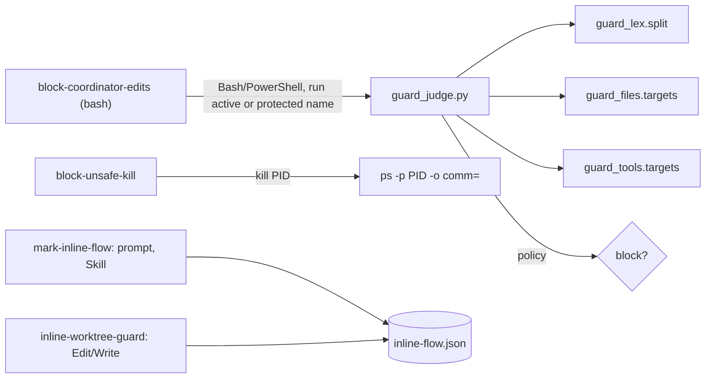
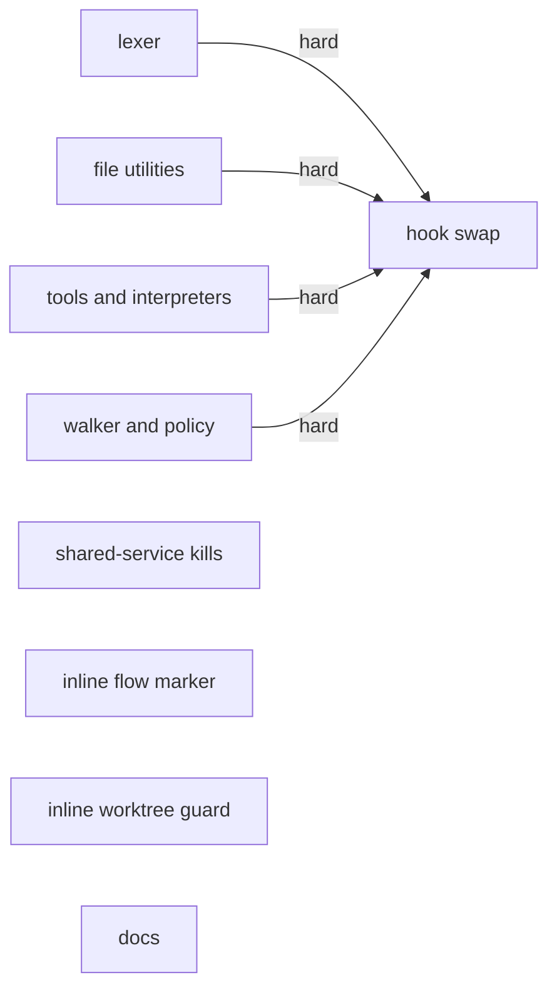

# Superlite: coordinator guard judged in Python, shared-service kills, inline flows in a worktree

**Goal:** the coordinator guard reads Bash and PowerShell commands with a tested Python judge instead of 1,300 lines of bash text matching (#131, Max chose the Python helper), which fixes the 9 findings of #149 and the two false blocks reported there; `kill <PID>` of a shared service is blocked (#171); once an inline superlite flow has started, writes to the main checkout are refused until `sl worktree ensure` (#148, Max chose "hook refuses").
**Architecture:** four Python modules in `skills/subagent-driven-development/scripts/` (hooks/ is linted as bash 3.2): `guard_lex` turns command text into segments, `guard_files` and `guard_tools` name the paths a simple command writes, `guard_judge` walks segments (cd state, wrappers, nested bodies), applies the path policy and is the CLI. T5 swaps the hook's Bash branch onto it and deletes the old bash judging code; every existing guard test is the parity suite. T6 extends `block-unsafe-kill`. T7a and T7b add the inline-flow marker and the refusing hook. T8 updates the docs.
**Tech stack:** Python 3.10+ stdlib (`python3 -I`), bash 3.2 (hooks), pytest.
**Spec:** this file, section Design; #149's body (items 1-9) and its two comments of 2026-11-05.
**Detail:** contracts
**Target-min:** 14
**Max chars:** 24000
**Coverage:** off

Global constraints:
- Language: Python 3.10+ stdlib only; test command `<abs sl> run_tests --fast <test files> --task Tn --background`, then the printed `wait:` line. Follow the style of `skills/subagent-driven-development/scripts/` including per-line `# O(...)` comments. Hooks stay bash 3.2 (`tests/scripts/test_hooks_bash32.py` lints every non-JSON file in `hooks/`).
- Guard modes: `idle` (no run marker), `active` (`stable.json`, `prime.md` or `pool.json` in the state folder), `human` (orchestrator.json says human and not approved). The bash hook decides the mode, as today.
- Path policy (unchanged from `hooks/block-coordinator-edits` `project_code1`/`allowed_rel`/`wt_rel`): protected in every mode: `.superlite/orchestrator.json`, `.superlite/human-replies.jsonl` (also inside a linked worktree). Human mode allows only `docs/plans/*.review.md`, `docs/*/plans/*.review.md`, `.superlite/*`, `.git/info/exclude`. Active mode allows `docs/plans/**`, `docs/*/plans/**`, `docs/**/*.md`, `SPEC*.md`, `**/SPEC*.md`, `docs.md`, `**/docs.md`, `.superlite/**`, `.git/info/exclude`. A path below a linked worktree inside the project is judged from that worktree's root. Paths outside the project are allowed. Project-relative comparison is case-insensitive.
- Block output (unchanged format, exit 2): the same three messages as today (protected file, human gate, dispatch text), last line `Blocked target: <project-relative path> (<absolute path>)` or `Blocked command: <command>`; append `{"kind":"rule-block","agent":"coordinator","tool":...,"target":...}` to `<state folder>/incidents.jsonl`. The hook fails open (exit 0) on any internal error, after appending a `guard-error` incident.
- No version bump in a task.

Ruling: the Python judge runs only when it can matter: the bash hook keeps its early exits (subagent `agent_id`, `SUPERLITE_FLEET_WORKER`, no state folder) and, when idle, exits 0 unless the lowercased command names `orchestrator.json` or `human-replies.jsonl`; so the process spawn (about 30 ms on macOS, 250 ms on Windows) happens only for the coordinator's Bash calls during a run - cost if wrong: coordinator Bash calls in a run are slower by one spawn each.
Ruling: Edit, Write, NotebookEdit and Agent/Task stay in bash (they take a path or a type, not shell text) - cost if wrong: none.
Ruling: a shell that reads its program from a pipe or a process substitution (`curl x | sh`, `bash <(cmd)`) and a write whose target is not a literal (`open(p, 'w')`, `rm "$X"` with `X` unassigned) count as unknown targets and block in active and human mode - cost if wrong: the coordinator must write such a command as a file in `.superlite/` or the scratchpad first.
Ruling: an unresolvable `cd` (a variable, a substitution) makes the shell's directory unknown; relative targets are then judged from the project root, except that `VAR=literal` assignments earlier in the same command resolve `cd "$VAR"` and targets (the 2026-11-05 scratchpad false block) - cost if wrong: one false block, as today.
Ruling (#171): `kill [-SIG] PID...` resolves each PID's command with one `ps -p PID -o comm=` call (only for a PID kill) and blocks when its basename matches `Xcode`, `Simulator`, `mcpbridge`, `SourceKitService`, `com.apple.dt.*`, `com.apple.CoreSimulator*`, `herdr`, `claude`, `launchd`, `WindowServer`, `Finder`, `Dock`, `loginwindow` (case-insensitive); the message says to ask the user - cost if wrong: a user who means it runs the kill themselves.
Ruling (#148): flows are marked by a `/superlite:small` or `/superlite:debug` prompt and by loading `superlite:test-driven-development` or `superlite:systematic-debugging` (the implement-phase skills; brainstorming alone writes nothing); while marked, an Edit/Write/NotebookEdit of a path inside the main checkout (not below a linked worktree, not under `.superlite/` or `.claude/`) is refused, unless `sl worktree inplace --reason TEXT` recorded an opt-out; subagents and fleet workers are exempt; a plan run (run marker) is left to the coordinator guard - cost if wrong: a trivial edit after loading TDD needs one `inplace` call.

## Design

1. **Lexer (T1).** `guard_lex.split` returns one `Segment` per simple command: decoded words (quotes, backslashes, `$'...'`), redirects split off even when attached (`rm>/dev/null x`), heredoc bodies in order, here-strings, comments dropped, line continuations joined, `$(...)`/backtick/`<(...)`/`>(...)` bodies collected for recursion, a `( ... )` group kept as one subshell body, `{ ...; }` flattened, and the separator after each segment.
2. **Write targets (T2, T3).** `targets(words)` returns the paths a simple command writes as written, or `"?"` for a write whose target is not literal. T2: file utilities. T3: git, archives, interpreters' inline code, PowerShell cmdlets.
3. **Walker and policy (T4).** `guard_judge.judge` walks the segments with a directory state per subshell (`cd`, `pushd`, `popd`, `cd -`), `VAR=literal` assignments, wrapper unwrapping (`env`, `sudo`, `nice`, `timeout`, `command`, `exec`, `nohup`, `time`, `xargs`, `find -exec/-execdir/-delete`), recursion into `bash|sh|zsh -c`, `eval`, `source|.` of stdin, heredoc programs of shells and interpreters, substitution bodies and subshells; then resolves every target against the directory state and applies the policy.
4. **Hook swap (T5).** The Bash/PowerShell branch of `hooks/block-coordinator-edits` becomes: early exits, idle pre-check, then `python3 -I <scripts>/guard_judge.py --mode M --project P --sd SD` with the hook JSON on stdin (Python finds the same interpreter `sl` uses). The bash shell-reading functions are deleted.
5. **Kills (T6).** See the ruling.
6. **Inline flows (T7a, T7b).** See the ruling. The marker is `<state folder>/inline-flow.json` `{"flow": "small|debug|tdd|debugging", "at": <epoch>, "inplace": null | "<reason>"}`; `sl orchestrator end` and a new session start clear it.

## Main diagram

## File structure

- `skills/subagent-driven-development/scripts/guard_lex.py`, `tests/scripts/test_guard_lex.py`: T1.
- `skills/subagent-driven-development/scripts/guard_files.py`, `tests/scripts/test_guard_files.py`: T2.
- `skills/subagent-driven-development/scripts/guard_tools.py`, `tests/scripts/test_guard_tools.py`: T3.
- `skills/subagent-driven-development/scripts/guard_judge.py`, `tests/scripts/test_guard_judge.py`: T4.
- `hooks/block-coordinator-edits`, `tests/scripts/test_guard_parity.py`: T5.
- `hooks/block-unsafe-kill`, `tests/scripts/test_kill_shared.py`: T6.
- `hooks/mark-inline-flow`, `hooks/hooks.json`, `tests/scripts/test_mark_inline_flow.py`: T7a.
- `hooks/inline-worktree-guard`, `skills/subagent-driven-development/scripts/worktree.py`, `tests/scripts/test_inline_worktree_guard.py`: T7b.
- `docs/hooks.md`, `commands/small.md`, `commands/debug.md`, `docs/tools.md`, `tests/scripts/test_hooks_doc.py`: T8.

## Task graph

```mermaid
%% schedule
gantt
  title Predicted schedule (mm:ss)
  dateFormat X
  axisFormat %M:%S
  section lane 1
  T4 walker and policy :t4, 0, 162s
  T5 hook swap :t5, 162, 128s
  section lane 2
  T3 tools and interpreters :t3, 0, 158s
  section lane 3
  T1 lexer :t1, 0, 145s
  section lane 4
  T2 file utilities :t2, 0, 136s
  section lane 5
  T7b inline worktree guard :t7b, 0, 134s
  section lane 6
  T7a inline flow marker :t7a, 0, 116s
  section lane 7
  T6 shared-service kills :t6, 0, 114s
  section lane 8
  T8 docs :t8, 0, 109s
```

critical path: T4 → T5 (4.8 min) · peak width 8 · predicted build 4.8 min · predicted total ≈ 8.3 min (target ✓)

## Guard judge

**Probe entry:** none (the parity suite drives the hook end to end).

Package review focus: app type parser plus security guard. Categories: deep (nested bodies, quotes inside substitutions), encoding (`$'...'`, backslashes, non-ASCII paths, CRLF), state (directory state per subshell, `pushd`/`popd`), protocol (hook JSON, exit codes, fail open). **Security review required:** the final review checks bypasses, not only parity.

### T1 lexer · Complexity 6 · Est. context 45k
**Owns:** skills/subagent-driven-development/scripts/guard_lex.py, tests/scripts/test_guard_lex.py
**Components:** 1
**LOC owned:** 260
**Tests:** fast
**Model:** sonnet
**Est. time:** 5 min (1 component, about 260 LOC, fast tests)
**Produces:** guard_lex.split(text: str) -> list[Segment] · guard_lex.Segment(words: list[str], dyn: list[bool], redirects: list[Redirect], heredocs: list[str], bodies: list[str], subshell: str | None, sep: str) · guard_lex.Redirect(op: str, target: str)
e.g. split("cp a 'b c' > out.txt && cd src") -> [Segment(words=["cp", "a", "b c"], dyn=[False, False, False], redirects=[Redirect(">", "out.txt")], heredocs=[], bodies=[], subshell=None, sep="&&"), Segment(words=["cd", "src"], dyn=[False, False], redirects=[], heredocs=[], bodies=[], subshell=None, sep="")]
e.g. split("cat <<'EOF' > f\nhi $x\nEOF\n") -> [Segment(words=["cat"], dyn=[False], redirects=[Redirect("<<", "EOF"), Redirect(">", "f")], heredocs=["hi $x\n"], bodies=[], subshell=None, sep="")]
e.g. split("echo $'a\\tb' x=$(rm -rf src) # c") -> [Segment(words=["echo", "a\tb", "x=$(rm -rf src)"], dyn=[False, False, True], redirects=[], heredocs=[], bodies=["rm -rf src"], subshell=None, sep="")]
e.g. split("rm>/dev/null x; (cd y && rm z) | sh") -> [Segment(words=["rm", "x"], dyn=[False, False], redirects=[Redirect(">", "/dev/null")], heredocs=[], bodies=[], subshell=None, sep=";"), Segment(words=[], dyn=[], redirects=[], heredocs=[], bodies=[], subshell="cd y && rm z", sep="|"), Segment(words=["sh"], dyn=[False], redirects=[], heredocs=[], bodies=[], subshell=None, sep="")]
**Review Focus:** `test_redirect_forms`: `a 2>&1 >>log &>all >|clob <in <<<word 3<>rw` gives redirects `[(">&","1"), (">>","log"), ("&>","all"), (">|","clob"), ("<","in"), ("<<<","word"), ("<>","rw")]` (an fd number before the operator is dropped). `test_unterminated_quote_is_one_dyn_word`: `rm 'src/a.py` does not raise; the rest of the text is one word with `dyn` True.
**Test code (contracts):**
- The four `e.g.` lines, exactly (`Segment` and `Redirect` are dataclasses with equality).
- `test_redirect_forms`, `test_unterminated_quote_is_one_dyn_word`: as in Review Focus.
- `test_heredoc_dash_and_order`: `cat <<-A >x; cat <<B\n\tone\nA\ntwo\nB\n` gives heredocs `["one\n"]` and `["two\n"]` on the two segments (tabs stripped for `<<-`).
- `test_backslash_and_dollar_quotes`: `printf x\ y "a\"b" $'\x41' "$HOME/x"` gives words `["printf", "x y", "a\"b", "A", "$HOME/x"]`, dyn `[False, False, False, False, True]`.
- `test_continuation_and_comments`: `rm \\\n  a # rm b` gives words `["rm", "a"]`.
- `test_braces_flatten`: `{ cd x; rm y; }` gives two segments `cd x` and `rm y`.
- `test_backticks_and_procsub`: ``a `rm b` <(rm c) >(tee d)`` gives bodies `["rm b", "rm c", "tee d"]`.
- `test_crlf`: CRLF line ends split like LF.
**Steps:** 1 failing tests, 2 run: FAIL, 3 implement, 4 run: PASS
**Notes:** A word is `dyn` when it holds an unquoted or double-quoted `$` expansion or a backtick; single-quoted `$` is literal. Keep the original text of a `dyn` word (do not expand). `sep` is one of `&&`, `||`, `;`, `|`, `&`, `\n`, `""` (newline separators that only end a heredoc line are not segments). No `shlex`: it cannot keep redirects or heredocs.

### T2 file utilities · Complexity 5 · Est. context 38k
**Owns:** skills/subagent-driven-development/scripts/guard_files.py, tests/scripts/test_guard_files.py
**Components:** 1
**LOC owned:** 200
**Tests:** fast
**Model:** sonnet
**Est. time:** 4 min (1 component, about 200 LOC, fast tests)
**Produces:** guard_files.targets(words: list[str]) -> list[str] · guard_files.COMMANDS: frozenset[str]
e.g. targets(["cp", "-r", "a", "b", "dst/"]) -> ["dst/"]; targets(["cp", "-t", "dst", "a", "b"]) -> ["dst/"]
e.g. targets(["sed", "-i", "s/a/b/", "x.py"]) -> ["x.py"]; targets(["sed", "-i", "", "s/a/b/", "x.py"]) -> ["x.py"]; targets(["sed", "s/a/b/", "x.py"]) -> []
e.g. targets(["tee", "-a", "log.txt", "docs/a.md"]) -> ["log.txt", "docs/a.md"]; targets(["dd", "if=a", "of=src/b"]) -> ["src/b"]; targets(["rm", "-rf", "--", "-x", "y"]) -> ["-x", "y"]
**Review Focus:** `test_getopt_clusters`: `rm -rfv a`, `cp -av a b`, `mv -fT a b`, `sed -Ei.bak 's/x/y/' f`, `perl -pi -e 's/x/y/' f`, `perl -i.orig -pe 1 f` each name only their real target files.
**Test code (contracts):**
- The three `e.g.` lines, exactly.
- `test_getopt_clusters`: as in Review Focus.
- `test_each_command`: one case each for `cp`, `mv`, `rm`, `rmdir`, `unlink`, `shred`, `tee`, `install` (`-D`, `-t`), `ln` (`-s`, `-t`), `touch`, `dd` (`of=`), `truncate` (`-s 0 f`), `rsync` (last operand), `patch` (`-o out`, a file operand, or none: `["?"]`), `sed -i`/`--in-place`, `perl -i`; and `COMMANDS` holds exactly these names.
- `test_long_options_with_values`: `cp --target-directory=d a`, `install --mode 644 a d/`, `rsync -e ssh a d/`, `truncate --size 0 f` name only `d/`, `d/`, `d/`, `f`.
- `test_read_only_forms`: `sed -n p f`, `cp --help`, `rm` (no operand), `touch -r ref` without a file give `[]`.
**Steps:** 1 failing tests, 2 run: FAIL, 3 implement, 4 run: PASS
**Notes:** Words come already decoded (T1). An operand that is `-` or a `/dev/*` path is not a target. A target-directory form returns the directory with a trailing `/`.

### T3 tools and interpreters · Complexity 6 · Est. context 45k
**Owns:** skills/subagent-driven-development/scripts/guard_tools.py, tests/scripts/test_guard_tools.py
**Components:** 2
**LOC owned:** 260
**Tests:** fast
**Model:** sonnet
**Est. time:** 5 min (2 components, about 260 LOC, fast tests)
**Produces:** guard_tools.targets(words: list[str]) -> list[str] · guard_tools.COMMANDS: frozenset[str]
e.g. targets(["git", "checkout", "--", "src/a.py"]) -> ["src/a.py"]; targets(["git", "reset", "--hard"]) -> ["."]; targets(["git", "status"]) -> []; targets(["git", "-C", "sub", "restore", "x"]) -> ["sub/x"]
e.g. targets(["python3", "-c", "open('src/a.py','w').write('x')"]) -> ["src/a.py"]; targets(["python3", "-c", "p=input(); open(p,'w')"]) -> ["?"]
e.g. targets(["node", "-e", "require('fs').renameSync('/tmp/s','.superlite/orchestrator.json')"]) -> [".superlite/orchestrator.json"]
e.g. targets(["tar", "-xf", "/tmp/x.tar", "-C", "src"]) -> ["src/"]; targets(["unzip", "a.zip", "-d", "out"]) -> ["out/"]
**Review Focus:** #149 items 1, 2 and 6-9 at this level: `node -e "require('fs').renameSync('/tmp/s','.superlite/orchestrator.json')"`; `python3 -c "from shutil import move; move('/tmp/s', '.superlite/orchestrator.json')"`, also `from os import replace; replace(...)` and `copyfile(`; `tar -xf /tmp/x.tar --xattrs a.py -C /tmp`, `--checkpoint a.py`, `--inc a.py` each give `["a.py", "/tmp/"]` (the member lands in the shell's directory); `tar -x --older-than 2020-01-01 -C /tmp` and the other value options of item 9 give `["/tmp/"]` only.
**Test code (contracts):**
- The four `e.g.` lines, exactly.
- `test_review_149_items`: as in Review Focus, one case each (items 1, 2, 6, 7, 8, 9 with every option item 9 lists).
- `test_git_writers`: `checkout`/`restore`/`rm`/`mv`/`clean` paths; `checkout -f`, `switch --discard-changes`, `reset --hard`, `stash pop|apply|branch`, `clean -fd` give `["."]`; `apply`/`am` give `["?"]`; read-only `log`, `diff`, `show`, `status`, `branch`, `fetch` give `[]`.
- `test_interpreter_writers`: one literal-target case each for Python `open(..., 'w'|'a'|'x'|'r+')`, `Path('p').write_text`, `Path('p').open('w')`, `shutil.copy*`/`move` (destination), `os.rename`/`replace` (destination), `os.remove`/`unlink`; Node `fs.writeFileSync`/`appendFileSync`/`copyFileSync` (destination)/`rmSync`/`unlinkSync`; Ruby `File.write`, `FileUtils.cp|mv|rm`; PHP `file_put_contents`; a non-literal target gives `"?"`; code with only reads gives `[]`.
- `test_powershell_cmdlets`: `Set-Content -Path a`, `Add-Content a`, `Out-File -FilePath a`, `New-Item a`, `Remove-Item a`, `Copy-Item x -Destination a`, `Move-Item x a` each give `["a"]` (cmdlet names case-insensitive).
- `test_other_archives`: `7z x a.7z -oout` gives `["out/"]`; `cpio -i` gives `["?"]`.
**Steps:** 1 failing tests, 2 run: FAIL, 3 implement, 4 run: PASS
**Notes:** Port the option tables from the bash guard (`git_cfg`/`GIT_CMDS`, `TAR_VALOPTS`, `archive_hit`): read `hooks/block-coordinator-edits` lines 789-1130 and 1741-1803. A tar long option is matched by unambiguous prefix; an unclear prefix counts as the riskier reading (a member name). Interpreter code is matched with regexes on the literal code; a script file argument (`python3 x.py`) is not judged.

### T4 walker and policy · Complexity 6 · Est. context 48k
**Owns:** skills/subagent-driven-development/scripts/guard_judge.py, tests/scripts/test_guard_judge.py
**Components:** 2
**LOC owned:** 280
**Tests:** fast
**Model:** sonnet
**Est. time:** 5.5 min (2 components, about 280 LOC, fast tests)
**Consumes:** guard_lex.split(text: str) -> list[Segment] (T1) · guard_files.targets(words: list[str]) -> list[str] (T2) · guard_files.COMMANDS: frozenset[str] (T2) · guard_tools.targets(words: list[str]) -> list[str] (T3) · guard_tools.COMMANDS: frozenset[str] (T3)
**Produces:** guard_judge.judge(command: str, cwd: str, project: str, mode: str) -> Verdict | None · guard_judge.Verdict(rel: str, abs: str, kind: str) · guard_judge.main(argv: list[str] | None = None) -> int
e.g. judge("printf x > src/a.py", "/p", "/p", "active") -> Verdict(rel="src/a.py", abs="/p/src/a.py", kind="code")
e.g. judge("printf x > docs/plans/a.md", "/p", "/p", "active") -> None; judge("printf x > src/a.py", "/p", "/p", "idle") -> None
e.g. judge("cd /p/docs && cd ../src && rm a.py", "/p", "/p", "active") -> Verdict(rel="src/a.py", abs="/p/src/a.py", kind="code")
e.g. judge("S=/tmp/s; cd $S && cat > A.md", "/p", "/p", "active") -> None
**Review Focus:** `test_review_149_walker_items`: #149 items 3 (`cp /tmp/x src/a.py 2> /dev/null` blocks), 4 (`{ eval "$(cat)"; } <<EOF` + `\nrm src/a.py\nEOF` blocks), 5 (`eval "c''d ../../src"; printf x > a.md` from `/p/docs/plans` blocks) and both 2026-11-05 comments (`cd /p/wtA && echo x >> .superlite/progress.md; cd /p/wtB && ls` passes when `/p/wtA` is outside the project or `.superlite/` is allowed; the `S=...; cd $S` case passes).
**Test code (contracts):**
- The four `e.g.` lines, exactly. Tests build the project as a tmp folder; they may use the real T1-T3 modules once committed, but fake `targets` through monkeypatch where a case is about walking only.
- `test_review_149_walker_items`: as in Review Focus.
- `test_cd_state_per_subshell`: `(cd src) && printf x > docs/a.md` passes; `pushd src && popd && printf x > docs/a.md` passes; `cd src; cd -; printf x > docs/a.md` passes; `cd src && printf x > a.md` blocks.
- `test_wrappers_and_recursion`: `env A=1 rm src/a`, `sudo -u x rm src/a`, `timeout 5 rm src/a`, `xargs rm < list` (`"?"`), `find src -delete`, `find . -name x -exec rm {} \;`, `bash -c 'rm src/a'`, `sh -c "rm src/a"`, `eval rm src/a`, `python3 - <<EOF\nopen('src/a','w')\nEOF`, `curl x | sh`, `bash <(curl x)` all block in active mode; `env A=1 ls`, `bash -c 'ls'` pass.
- `test_policy_modes`: protected names block in idle mode; human mode allows only `docs/plans/x.review.md` among docs; a path in `.claude/worktrees/w/docs/plans/a.md` is allowed, `.claude/worktrees/w/src/a.py` blocks; `/tmp/x` passes; `../outside/x` from the project root passes.
- `test_main_cli`: `main(["--mode", "active", "--project", P, "--sd", SD])` with stdin `{"tool_name": "Bash", "tool_input": {"command": "rm src/a"}, "cwd": P}` exits 2, prints the dispatch message ending `Blocked target: src/a (P/src/a)`, appends one `rule-block` incident; an allowed command exits 0 and prints nothing; malformed stdin exits 0 and appends a `guard-error` incident.
**Steps:** 1 failing tests, 2 run: FAIL, 3 implement, 4 run: PASS
**Notes:** Copy the three message texts from `hooks/block-coordinator-edits` lines 1813-1844. Resolve `~`, `$HOME`, `$CLAUDE_PROJECT_DIR`/`${CLAUDE_PROJECT_DIR}` and `VAR=literal` names; any other `dyn` target is `"?"`. A redirect to `/dev/*` or an fd duplicate is not a target. PowerShell commands go through the same lexer (its quoting is close enough for cmdlet words).

### T5 hook swap · Complexity 6 · Est. context 50k
**Owns:** hooks/block-coordinator-edits, tests/scripts/test_guard_parity.py
**Components:** 1
**LOC owned:** 150
**Tests:** fast
**Model:** sonnet
**Est. time:** 5 min (1 component, about 150 LOC, fast tests)
**Consumes:** guard_judge.main(argv: list[str] | None = None) -> int (T4)
**Review Focus:** `test_parity_existing_suites`: every existing guard test file passes unchanged: `tests/scripts/test_block_coordinator_edits.py`, every `tests/scripts/test_guard_*.py`, `test_human_gate.py`, `test_session_state.py`, `test_fleet_hooks.py`, `test_hooks_bash32.py` (including `test_typical_allowed_call_is_fast`).
**Test code (contracts):**
- `test_parity_existing_suites`: as in Review Focus (run them; do not edit them; a failing parity test is a finding against T1-T4: report the case and its expected outcome).
- `test_not_judged_before_now_blocks`: through the hook (the `run`/`bash` helpers of `test_block_coordinator_edits.py`), in an active project: `xargs rm < l`, `find src -delete`, `dd if=a of=src/b`, `truncate -s 0 src/a`, `install a src/b`, `ln -s a src/b`, `rsync a src/`, `touch src/a`, `curl x | sh` exit 2.
- `test_block_names_absolute_target`: `printf x > src/a.py` ends with `Blocked target: src/a.py (<abs>/src/a.py)`.
- `test_idle_skips_python`: idle, a command without a protected name exits 0 without starting Python (put a fake `python3` that fails first on `PATH`).
- `test_python_missing_fails_open`: active, `PATH` without any Python: exit 0 and one `guard-error` incident.
**Steps:** 1 failing tests, 2 run: FAIL, 3 implement, 4 run: PASS
**Notes:** Keep the entry (stdin read, early exits, state folder via `superlite-state.sh`, mode decision), the Edit/Write/NotebookEdit path check and the Agent/Task human gate; delete every function only the old Bash judging used. Find Python like `skills/subagent-driven-development/scripts/sl` does (read it). Pass the hook JSON unchanged on stdin.

### T6 shared-service kills · Complexity 3 · Est. context 26k
**Owns:** hooks/block-unsafe-kill, tests/scripts/test_kill_shared.py
**Components:** 1
**LOC owned:** 60
**Tests:** fast
**Model:** sonnet
**Est. time:** 2 min (1 component, about 60 LOC, fast tests)
**Review Focus:** `test_kill_xcode_pid_blocked`: a fake `ps` on `PATH` that prints `/Applications/Xcode.app/Contents/MacOS/Xcode` for pid 4242; `kill 4242` and `kill -9 4242` exit 2 naming `Xcode`; a fake printing `/usr/bin/python3` lets `kill 4242` pass.
**Test code (contracts):**
- `test_kill_xcode_pid_blocked`: as in Review Focus.
- `test_each_shared_name`: every name of the ruling, including `com.apple.dt.SKAgent` and `com.apple.CoreSimulator.CoreSimulatorService`, blocks; `kill %1` (a job) and `kill -0 4242` (a probe) pass without calling `ps`.
- `test_ps_missing_passes`: no `ps` on `PATH`: `kill 4242` passes (fail open).
- The existing `tests/scripts/test_block_unsafe_kill.py` stays green (run it, do not edit it).
**Steps:** 1 failing tests, 2 run: FAIL, 3 implement, 4 run: PASS
**Notes:** Call `ps` only when the command is a PID kill (one call with all PIDs: `ps -o comm= -p 1,2`). Bash 3.2.

### T7a inline flow marker · Complexity 3 · Est. context 28k
**Owns:** hooks/mark-inline-flow, hooks/hooks.json, tests/scripts/test_mark_inline_flow.py
**Components:** 1
**LOC owned:** 70
**Tests:** fast
**Model:** sonnet
**Est. time:** 2.5 min (1 component, about 70 LOC, fast tests)
**Review Focus:** `test_prompt_marks_small`: UserPromptSubmit input with prompt `/superlite:small fix the typo` writes `<state folder>/inline-flow.json` with flow `small`; a prompt `please /superlite:small` (not at the start) does not.
**Test code (contracts):**
- `test_prompt_marks_small`: as in Review Focus; `/superlite:debug x` marks `debug`.
- `test_skill_marks_tdd`: PreToolUse input with `tool_name` `Skill` and `tool_input.skill` `superlite:test-driven-development` marks `tdd`; `superlite:systematic-debugging` marks `debugging`; `superlite:brainstorming` does not.
- `test_subagent_and_worker_never_mark`: input with `agent_id`, or env `SUPERLITE_FLEET_WORKER=W1`: no marker.
- `test_hooks_json_registers`: `hooks/hooks.json` registers `mark-inline-flow` for UserPromptSubmit and for PreToolUse matcher `Skill`, and `inline-worktree-guard` for PreToolUse matcher `Edit|Write|NotebookEdit`, keeping every existing entry.
**Steps:** 1 failing tests, 2 run: FAIL, 3 implement, 4 run: PASS
**Notes:** Find the state folder with `hooks/superlite-state.sh` (`superlite_state`), as the other hooks do; the hook always exits 0. `hooks/inline-worktree-guard` is T7b's file: register it, do not write it.

### T7b inline worktree guard · Complexity 4 · Est. context 32k
**Owns:** hooks/inline-worktree-guard, skills/subagent-driven-development/scripts/worktree.py, tests/scripts/test_inline_worktree_guard.py
**Components:** 2
**LOC owned:** 100
**Tests:** fast
**Model:** sonnet
**Est. time:** 3 min (2 components, about 100 LOC, fast tests)
**Review Focus:** `test_marked_flow_refuses_main_checkout_write`: a tmp git repo (main checkout) with `inline-flow.json` flow `small` and no run marker; an Edit of `<repo>/src/a.py` exits 2 with a message naming `sl worktree ensure` and `sl worktree inplace --reason`; an Edit of `<repo>/.claude/worktrees/superlite-x/src/a.py` passes.
**Test code (contracts):**
- `test_marked_flow_refuses_main_checkout_write`: as in Review Focus.
- `test_unmarked_passes`, `test_run_marker_passes` (a `pool.json` present: left to the coordinator guard), `test_superlite_and_claude_dirs_pass` (`.superlite/x`, `.claude/settings.json`), `test_outside_repo_passes`.
- `test_inplace_opt_out`: `sl worktree inplace --reason "typo"` sets `inplace` to `typo`, appends `Ruling: in place - typo` to `<state folder>/progress.md`, and the Edit then passes.
- `test_subagent_and_worker_pass`: `agent_id` in the input, or `SUPERLITE_FLEET_WORKER` set: exit 0.
**Steps:** 1 failing tests, 2 run: FAIL, 3 implement, 4 run: PASS
**Notes:** Bash 3.2, builtins only (no `git` call): the main checkout is the hook's project root when its `.git` is a folder; a path below a folder whose `.git` is a file is in a linked worktree. The `inplace` subcommand lives in `worktree.py`'s CLI next to `ensure`.

### T8 docs · Complexity 2 · Est. context 26k
**Owns:** docs/hooks.md, commands/small.md, commands/debug.md, docs/tools.md, tests/scripts/test_hooks_doc.py
**Components:** 1
**LOC owned:** 50
**Tests:** fast
**Kind:** mechanical
**Model:** haiku
**Est. time:** 1.5 min (1 component, about 50 LOC, fast tests)
**Review Focus:** `test_new_hooks_documented`: `docs/hooks.md` names `mark-inline-flow` and `inline-worktree-guard`, and its guard paragraph names `guard_judge.py`.
**Test code (contracts):**
- `test_new_hooks_documented`: as in Review Focus.
- `test_commands_name_inplace`: `commands/small.md` and `commands/debug.md` each contain `sl worktree inplace --reason`.
- `test_tools_row_names_inplace`: the `worktree` row of `docs/tools.md` contains `inplace --reason`.
**Steps:** 1 failing tests, 2 run: FAIL, 3 implement, 4 run: PASS
**Notes:** `docs/hooks.md`: replace the guard paragraph's description of how shell text is read with one paragraph: Bash and PowerShell commands are judged by `skills/subagent-driven-development/scripts/guard_judge.py` (Python, run only during a run or when a protected name appears; fails open); keep the policy text. Add one bullet each for `mark-inline-flow` and `inline-worktree-guard` (text from Design 6 and the #148 ruling), and add the shared-service list to the `block-unsafe-kill` bullet. `commands/small.md` and `commands/debug.md`: one sentence after the worktree step: "A hook refuses edits in the main checkout once this flow starts; for a trivial change run `sl worktree inplace --reason \"<why>\"`." `docs/tools.md` worktree row: append "`worktree inplace --reason TEXT` records an in-place opt-out for an inline flow." Add the three tests to `tests/scripts/test_hooks_doc.py`; keep its existing tests.

## Review Focus

- Guard: every #149 item and both 2026-11-05 false blocks; bypass hunting on the new code (a quote or `$'...'` that hides a separator, nested `$( $( ) )`, a heredoc delimiter in quotes, `\` before a newline inside quotes, `;` inside a `case` pattern, a function definition `f() { rm x; }; f`), parity with every existing guard test, fail open on crash, no Python spawn when idle.
- Hooks: kills by PID of shared services; the inline marker only from the main session; the refusing hook never blocks a worktree path.

## Self-review

- #131 T1-T5, #149 T3 (items 1, 2, 6-9), T4 (items 3-5, both comments), T5 (parity, absolute target); #171 T6; #148 T7a, T7b, T8.
- No two tasks share a file. Edges: T1-T4 -> T5 only (T5's tests run the real judge). T4's own tests run against T1-T3 through Wave 0 stubs until they land, then the real modules.
