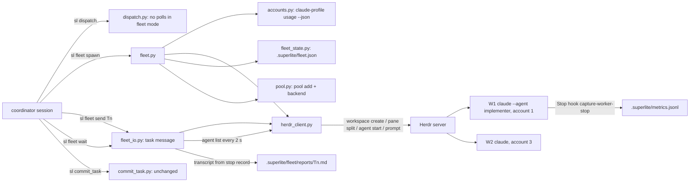
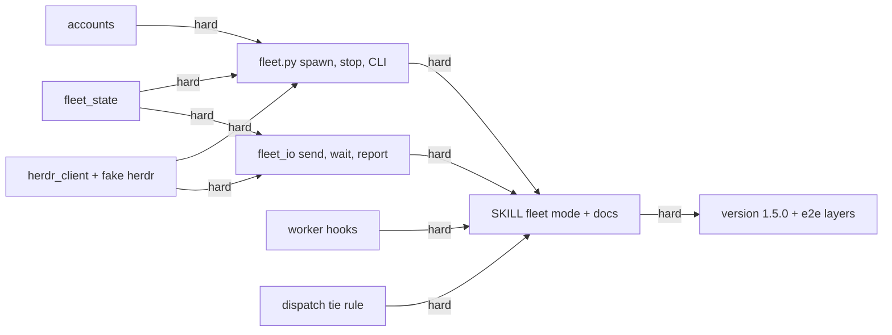

# Superlite 1.5.0: Herdr fleet backend

**Goal:** a superlite run can execute its implementer tasks in real Claude Code sessions that live in Herdr panes, one worker per pane, each started under the subscription account with the most headroom, while the coordinator keeps the same scheduling loop (dispatch, task message, DONE report, commit_task, reviews). Workers are visible and steerable in Herdr, survive the coordinator's turn boundaries, and spread the run across the three accounts.
**Architecture:** four new `sl` tools in `skills/subagent-driven-development/scripts/`: `fleet_state.py` (the run's `.superlite/fleet.json`), `accounts.py` (account choice from `claude-profile usage --json`), `herdr_client.py` (one subprocess wrapper over the `herdr` CLI, JSON in and out), `fleet_io.py` (task message, wait loop, report extraction) and the CLI `fleet.py` (`on`, `off`, `status`, `spawn`, `send`, `keys`, `wait`, `stop`). Worker sessions run `claude --agent superlite:implementer` with `SUPERLITE_FLEET_WORKER=<id>`, `SUPERLITE_STATE_DIR=<run>/.superlite`, `SUPERLITE_FINAL_REVIEW=off` and `CLAUDE_CONFIG_DIR=<account>`; three hooks learn the worker env (coordinator guard exempts, a Stop hook writes the stop record, session-start injects a worker note instead of the start menu). `dispatch` never polls in fleet mode. The SDD skill gets a "Fleet mode" subsection; `docs/fleet.md` is the operator guide.
**Tech stack:** Python 3.10+ stdlib, bash hooks (bash 3.2 compatible, builtins only), pytest, Herdr 0.9.x CLI (`herdr`), Claude Code 2.1.318 or later, `claude-profile` (Max's account tool, optional).
**Spec:** this file, sections 1 to 7 under Design.
**Detail:** tests
**Target-min:** 11
**Max chars:** 80000
**Wave0:** none

Global constraints:
- Stdlib only. Every new script carries the repo's trailing `# O(...)` complexity comment on every line; tests and hooks do not need it.
- Run `sl` as an executable (`<abs>/sl ...`); new tools are plain `.py` files next to `dispatch.py`, so `sl fleet`, `sl fleet_state`, `sl accounts`, `sl herdr_client`, `sl fleet_io` resolve through the launcher unchanged.
- The `herdr` binary is `$SUPERLITE_HERDR_BIN` when set, else `herdr` on PATH. Every call is `subprocess.run([...], capture_output=True, text=True, timeout=<ms>/1000 + 5)`. Herdr answers JSON `{"id": ..., "result": {...}}` or `{"id": ..., "error": {"code": "...", "message": "..."}}` on stdout, except `herdr agent read` and `herdr pane read`, which print plain text.
- Herdr commands used, exactly (verified on Herdr 0.9.5): `workspace create --label L --cwd P --env K=V... --no-focus` (result `.workspace.workspace_id`, `.root_pane.pane_id`); `pane split PANE --direction right|down --cwd P --env K=V... --no-focus` (result `.pane.pane_id`); `agent start NAME --kind claude --pane PANE --timeout MS -- ARGS...` (result `.agent.agent_status`, or error code `agent_not_ready` when the session is blocked during startup); `agent get NAME` (`.agent.agent_status` in `idle|working|blocked|done|unknown`); `agent list` (`.agents[]` with `name`, `agent_status`, `pane_id`); `agent read NAME --source visible --lines N` (text); `agent prompt NAME TEXT --wait --until S [--until S] --timeout MS` (result `.agent.agent_status`, or error codes `agent_blocked`, `agent_prompt_stalled`, `timeout`); `agent send-keys NAME KEY...` (result `{"type":"ok"}`); `pane close PANE`; `workspace close WS`.
- Worker environment, set on the pane that hosts it (so the shell and the `claude` process inherit it): `CLAUDE_CONFIG_DIR=<account config dir>`, `SUPERLITE_FLEET_WORKER=<worker id>`, `SUPERLITE_FLEET_AGENT=<agent type, e.g. superlite:implementer>`, `SUPERLITE_STATE_DIR=<abs .superlite of the run>`, `SUPERLITE_FINAL_REVIEW=off`. `CLAUDE_CODE_PLUGIN_CACHE_DIR` is passed through when the coordinator has it. Nothing else from the coordinator's environment is forwarded explicitly (the pane shell has the user's login environment).
- Worker ids are `W1`, `W2`, ... per run, allocated by `fleet_state.next_id`. The Herdr agent name, the pool id and the metrics `agent_id` are the same string.
- Worker command line: `claude --agent <tier agent> --model <tier model> --disallowedTools AskUserQuestion`. The tier agent is `routing.tier_agent(cfg, tier)` (`superlite:implementer` for sonnet, `superlite:implementer-haiku` for haiku); the tier model is the tier name (`sonnet`, `haiku`).
- Fleet state lives in `<run>/.superlite/fleet.json`; reports in `<run>/.superlite/fleet/reports/<Tn>.md`; screen captures in `<run>/.superlite/fleet/screens/<Wn>.txt`. All under `.superlite/`, never committed.
- Existing tests stay green unchanged. Existing scripts change only where a section names the change (`dispatch.py`, three hooks, `hooks.json`, `SKILL.md`).
- Versions change only through `scripts/bump-version.sh 1.5.0` in T9; `--audit` must report nothing missed.

Ruling: workers edit the coordinator's checkout directly, as in-process implementers do today (the taskgraph already partitions files; `trees.py` test trees stay as they are) - a worktree per worker would need a merge step commit_task does not have - cost if wrong: a later task adds per-worker worktrees.
Ruling: v1 workers keep the implementer persona's rules, including "never spawn agents"; a fleet worker can technically spawn subagents (verified in the spike) and a later version may allow it for large tasks - plan tasks are 2-5 minute units where a nested agent is overhead - cost if wrong: one line in the task message.
Ruling: account choice is static per worker (chosen at spawn, never swapped); automatic re-dispatch on a usage limit is out of scope - Max chose this in brainstorming; it also stays clear of the usage-policy grey area - cost if wrong: a worker on an exhausted account reports BLOCKED and the coordinator spawns another.
Ruling: no relevance polls in fleet mode; a tie goes to the idle eligible worker with the lowest `context_k` - a poll costs a Herdr round trip per worker and a parse of free text - cost if wrong: a slightly worse agent match, never a stall.
Ruling: the worker's startup trust dialog is accepted automatically when the screen shows "Yes, I trust this folder" for the run's checkout - the coordinator's own project is trusted by definition; any other startup block (login, onboarding) fails the spawn with the screen text - cost if wrong: one wrong keypress in a pane the coordinator created itself.
Ruling: the worker's DONE report is read from its transcript (the Stop hook records the path), with the visible screen as the fallback - the transcript holds the full text, the screen is cut and wrapped - cost if wrong: a report truncated to the screen.
Ruling: the fleet workspace is one Herdr workspace per run labelled `sl:<plan stem>`, with panes split right then down alternately from the root pane - one place to look at, closed by `fleet stop --all` - cost if wrong: narrow panes after six or more workers (Herdr reflows; readability only).
Ruling: `sl fleet wait` polls `herdr agent list` every 2 seconds instead of one `herdr agent wait` per worker - one subprocess per poll, works for N workers from one process, no threads, testable with a fake binary - cost if wrong: up to 2 seconds of latency per state change.
Ruling: `--permission-mode` is not passed to workers; the user's settings decide (Max runs auto mode) - a permission prompt surfaces as Herdr `blocked` and the coordinator handles it like any BLOCKED-UI - cost if wrong: one `fleet keys` call per prompt.
Ruling: detail tests - process control and state, no algorithmic core - cost if wrong: one NEEDS_CONTEXT.



## Design

### 1. Fleet mode and state

`sl fleet on [--accounts claude1,claude3]` writes `.superlite/fleet.json`; `sl fleet off` removes it; `sl fleet status` prints one line per worker. The file:

```json
{"on": true, "label": "sl:2026-11-05-herdr-fleet", "workspace_id": null, "root_pane": null,
 "accounts": ["claude1", "claude2", "claude3"], "next": 1,
 "workers": {"W1": {"pane_id": "w6:p1", "account": "claude1", "agent": "superlite:implementer", "tier": "sonnet",
                    "state": "ready", "task": null, "started": 1762338000000}}}
```

`state` is one of `starting`, `ready`, `busy`, `blocked`, `stopped`. `accounts` is the allowed list: the `--accounts` flag, else `$SUPERLITE_FLEET_ACCOUNTS`, else every account `claude-profile list --json` returns, else the single pseudo account `current` (the coordinator's own `CLAUDE_CONFIG_DIR`, forwarded unchanged). `fleet_state.is_on(sd)` is what `dispatch` and the SDD skill consult. Writes are atomic (temp file plus rename, as `pool.py`).

### 2. Account choice

`accounts.read_usage()` runs `claude-profile usage --json` (binary `$SUPERLITE_CLAUDE_PROFILE_BIN`, else `claude-profile`); a missing binary, non-zero exit or unparsable output returns `{}`. `accounts.pick_account(usage, allowed)` ranks the accounts in `allowed` that appear in `usage["accounts"]` with `error` null, drops those with any limit of kind `five_hour*` at 90 percent or more or any `weekly_all` at 100, and returns the name with the lowest `weekly_all` percent (tie: lowest `n`). With no candidate it returns `None`; with `usage == {}` it returns the first of `allowed`. `accounts.account_dir(listing, name)` maps a name to its config dir from `claude-profile list --json` (`accounts[].config_dir`); `current` maps to `os.environ.get("CLAUDE_CONFIG_DIR", "")` (empty means "do not set the variable").

### 3. Worker lifecycle (`sl fleet spawn --tier T --plan P`)

1. Pick the account (section 2); none usable: print `BLOCKED: no account with headroom (<reasons>)`, exit 3.
2. First spawn of the run: `herdr workspace create --label <label> --cwd <project root> --env ... --no-focus`, remember `workspace_id` and `root_pane`, and the root pane becomes W1's pane. Later spawns: `herdr pane split <root_pane> --direction right|down ...` (alternating, starting with `right`).
3. `herdr agent start <Wn> --kind claude --pane <pane> --timeout 90000 -- --agent <agent> --model <model> --disallowedTools AskUserQuestion`. Error `agent_not_ready`: read the visible screen; if it contains `Yes, I trust this folder`, `herdr agent send-keys <Wn> Down Enter` and `herdr agent wait <Wn> --until idle --timeout 60000`; any other block: save the screen to `.superlite/fleet/screens/<Wn>.txt`, `herdr pane close`, log an incident (`kind: workaround`, context `fleet spawn blocked: <first 120 chars>`), print `BLOCKED: <Wn> account <name> startup: <first line>`, exit 3.
4. Prime: `herdr agent prompt <Wn> "Read <abs .superlite>/prime.md, then reply READY" --wait --until done --until blocked --timeout 180000` (`prime-haiku.md` for the haiku tier). Then `herdr agent read <Wn> --source visible --lines 40` must contain `READY`; otherwise state `blocked`, screen saved, exit 3 with `BLOCKED: <Wn> no READY`.
5. Record: metrics launch line `{"ev":"launch","t":<ms>,"agent_id":"<Wn>","type":"fleet:<agent>","model":"<model>","desc":"fleet worker <account> pane <pane>"}`; `pool.add(data, Wn, tier)` plus `backend: "herdr"` and `account: <name>` on that agent; `fleet.json` worker state `ready`.
6. Print `<Wn> account=<name> pane=<pane> agent=<agent>` on stdout. Exit 0.

`sl fleet stop [<Wn>... | --all]`: for each worker `herdr agent prompt <Wn> "/exit" --timeout 5000` (errors ignored), `herdr pane close <pane>`, state `stopped`, `pool.remove`; `--all` also `herdr workspace close <workspace_id>` and clears `workspace_id`. Exit 0.

### 4. Send, wait, report

`sl fleet send <Wn> Tn[,Tm] --plan P` builds the task message with `fleet_io.task_message` (heading `# Task Tn`, `SUPERLITE=<abs plugin root>`, `PLAN=<abs plan>`, "your task text: `<abs sl> task Tn --plan <PLAN>`", Owns and the other tasks' owned files as "do not touch", the Review Focus line, the literal `sl` path, the verify command `<abs sl> run_tests --fast <owned test paths> --task Tn --background`, and the report instruction "reply in at most 200 words: Status: DONE / DONE_WITH_CONCERNS / NEEDS_CONTEXT / BLOCKED, files, test result, open questions"; haiku tier: the full task block inline), sends it with `herdr agent prompt <Wn> <text> --wait --until working --timeout 15000`, marks `pool.busy` and `fleet.json` state `busy` with `task`, prints `<Wn> Tn sent`. A `--text "..."` form sends free text (an answer to NEEDS_CONTEXT) without touching the pool. `sl fleet keys <Wn> <KEY>...` forwards to `herdr agent send-keys`.

`sl fleet wait [--timeout MS] [<Wn>...]` (default: every busy worker, 540000 ms): every 2 s `herdr agent list`; for each watched worker whose `agent_status` turned `done` or `idle`: find the newest `{"ev":"stop","agent_id":"<Wn>"}` record in `metrics.jsonl` newer than the send time; read its transcript with `fleet_io.last_assistant_text`, write `.superlite/fleet/reports/<Tn>.md`, parse the status with `metrics.STATUS` then `metrics.LEAD` (fallback `UNKNOWN`), set state `ready`, print `<Wn> Tn <STATUS> <report path>`. No stop record within 10 s of the state change: use `herdr agent read --source recent --lines 80` as the report text and add ` (screen)` to the line. `blocked`: save the visible screen, state `blocked`, print `<Wn> Tn BLOCKED-UI <screen path>` and the screen's last 5 non-empty lines indented. Return once every watched worker has printed or the timeout passed; then print `TIMEOUT <Wn>,<Wm>` for the rest. Exit 0 always. The pool is released by `commit_task`, as today.

### 5. Worker-side hooks

When `SUPERLITE_FLEET_WORKER` is set in the hook's environment:
- `hooks/block-coordinator-edits` exits 0 before any rule (the session is an implementer, not a coordinator); unset, behaviour unchanged.
- new `hooks/capture-worker-stop` (`Stop` matcher in `hooks.json`, after `final-review-check`): appends `{"ev":"stop","t":<ms>,"agent_id":"$SUPERLITE_FLEET_WORKER","type":"fleet:$SUPERLITE_FLEET_AGENT","transcript":<transcript_path>,"last":<last_assistant_message, 160 chars>}` to `$SL_SD/metrics.jsonl` (state via `superlite-state.sh`, which already honours `SUPERLITE_STATE_DIR`); silent exit 0 when the variable is unset or `stop_hook_active` is true. Bash builtins only, same helpers as `capture-agent-stop`.
- `hooks/session-start` prints, instead of the using-superlite skill, the additional context `You are superlite fleet worker <id> (agent <agent>). Wait for the coordinator's messages: first the prime file, then tasks. Follow your agent persona; never run /superlite commands.`
- `final-review-check` needs no change: workers get `SUPERLITE_FINAL_REVIEW=off`.

### 6. Scheduler integration

`dispatch.py`: when `fleet_state.is_on(sd)` (import at module top, `sd` is the pool's folder), a `poll` decision becomes `agent=<id>` for the tied idle eligible agent with the lowest `context_k` (ties: first in pool order); line format unchanged otherwise. `commit_task`, `pool.sync` (stop records matched by `agent_id`), `metrics` and `finish` need no change. The SDD skill gets a "Fleet mode" subsection: `fresh tier=T agent=TYPE` means `"$SL" fleet spawn --tier T --plan $PLAN` then `"$SL" fleet send <Wn> Tn --plan $PLAN`; `agent=Wn` means `fleet send`; after a dispatch round `"$SL" fleet wait` (foreground, up to 9 minutes) replaces waiting for SendMessage replies; `BLOCKED-UI` lines: read the screen file, answer with `fleet keys` or `fleet send --text`, or treat as BLOCKED; NEEDS_CONTEXT: `fleet send --text`; freeze adds `"$SL" fleet stop --all` before `trees clean`.

### 7. Documentation and version

`docs/fleet.md`: what fleet mode is, prerequisites (Herdr server, accounts logged in, `claude-profile`), the five commands, the smoke test from the 2026-11-05 spike (spawn under an account, prompt and wait, blocked on a dialog, three workers, subagents read as working), troubleshooting (trust dialog, login expired, no READY, `agent_prompt_stalled`). `docs/tools.md` lists the new tools; `docs/config.md` lists `SUPERLITE_HERDR_BIN`, `SUPERLITE_CLAUDE_PROFILE_BIN`, `SUPERLITE_FLEET_ACCOUNTS`, `SUPERLITE_FLEET_WORKER`, `SUPERLITE_FLEET_AGENT`. README: one bullet under "Pick how to use it". Version 1.5.0.

## File structure

- `skills/subagent-driven-development/scripts/fleet_state.py`: `.superlite/fleet.json` read, write, worker records, ids.
- `skills/subagent-driven-development/scripts/accounts.py`: account ranking from `claude-profile` JSON, name to config dir.
- `skills/subagent-driven-development/scripts/herdr_client.py`: the only place that runs `herdr`.
- `skills/subagent-driven-development/scripts/fleet_io.py`: task message text, wait loop, transcript report extraction.
- `skills/subagent-driven-development/scripts/fleet.py`: CLI, spawn and stop.
- `skills/subagent-driven-development/scripts/dispatch.py`: fleet-mode tie rule (edit).
- `hooks/capture-worker-stop` (new), `hooks/hooks.json`, `hooks/block-coordinator-edits`, `hooks/session-start` (edits).
- `skills/subagent-driven-development/SKILL.md`: "Fleet mode" subsection.
- `docs/fleet.md` (new), `docs/tools.md`, `docs/config.md`, `README.md`.
- `tests/scripts/test_fleet_state.py`, `test_accounts.py`, `test_herdr_client.py`, `test_fleet_io.py`, `test_fleet.py`, `test_dispatch_fleet.py`, `test_fleet_hooks.py`; fixture `tests/scripts/fixtures/fleet/herdr` (fake binary, python) and `tests/scripts/fixtures/fleet/claude-profile`.

## Task graph

```mermaid
%% schedule
gantt
  title Predicted schedule (mm:ss)
  dateFormat X
  axisFormat %M:%S
  section lane 1
  T6 worker hooks :t6, 0, 198s
  T8 SKILL fleet mode and docs :t8, 396, 179s
  T9 version 1.5.0 and e2e layers :t9, 575, 129s
  section lane 2
  T3 herdr_client and fake herdr :t3, 0, 194s
  T4 fleet.py  spawn  stop  CLI :t4, 194, 202s
  section lane 3
  T2 accounts :t2, 0, 152s
  T5 fleet_io  task message  wait  report :t5, 194, 198s
  section lane 4
  T1 fleet_state :t1, 0, 150s
  section lane 5
  T7 dispatch  no polls in fleet mode :t7, 0, 139s
```





critical path: T3 → T4 → T8 → T9 (11.7 min) · peak width 5 · predicted build 11.7 min · predicted total ≈ 15.2 min (target ✗ 11.0)

## Fleet scripts

**Probe entry:** none (the tools drive an external Herdr server; the Review Focus cases are named pytest tests against the fake binary)

App type: CLI plus concurrency. Categories: protocol (Herdr JSON and error codes, worker states), state (fleet.json, pool.json, metrics), file (reports, screens, atomic writes). Specific risks: a `herdr` error payload treated as success; a stop record of an earlier task read as the new report; a worker left running after `stop`; the trust-dialog keypress sent to a login screen.

### T1 fleet_state · Complexity 3 · Est. context 30k
**Owns:** skills/subagent-driven-development/scripts/fleet_state.py, tests/scripts/test_fleet_state.py
**Components:** 1
**LOC owned:** 120
**Tests:** fast
**Model:** sonnet
**Est. time:** 2.5 min (1 component, about 120 LOC, fast tests)
**Covers:** 1
**Produces:** fleet_state.path(sd: Path) -> Path · fleet_state.load(sd: Path) -> dict · fleet_state.save(sd: Path, data: dict) -> None · fleet_state.is_on(sd: Path) -> bool · fleet_state.set_on(sd: Path, label: str, accounts: list[str]) -> dict · fleet_state.set_off(sd: Path) -> None · fleet_state.next_id(sd: Path) -> str · fleet_state.add_worker(sd: Path, wid: str, pane_id: str, account: str, agent: str, tier: str) -> dict · fleet_state.set_state(sd: Path, wid: str, state: str, task: str | None = None) -> dict · fleet_state.set_workspace(sd: Path, workspace_id: str, root_pane: str) -> dict · fleet_state.workers(sd: Path, state: str | None = None) -> dict
e.g. is_on(sd) -> False when fleet.json is absent; after set_on(sd, "sl:x", ["claude1"]) -> True and load(sd)["accounts"] -> ["claude1"]
e.g. next_id(sd) -> "W1", then "W2" (the counter `next` advances on every call and is saved)
e.g. add_worker(sd, "W1", "w6:p1", "claude1", "superlite:implementer", "sonnet")["state"] -> "starting"; set_state(sd, "W1", "busy", "T3")["task"] -> "T3"; workers(sd, "busy") -> {"W1": {...}}
**Review Focus:** state: `test_save_is_atomic_and_rereadable` (save then load returns the same dict; no `fleet.json.tmp` left); `test_set_state_unknown_worker_raises_keyerror`; `test_set_off_removes_file_and_is_on_false`; file: `test_load_missing_file_returns_default` (`{"on": False, "workers": {}, "next": 1, "accounts": [], "workspace_id": None, "root_pane": None, "label": ""}`).
**Test code:**
```python
# tests/scripts/test_fleet_state.py
import json, sys
from pathlib import Path
from test_plan_tools import SCRIPTS
sys.path.insert(0, str(SCRIPTS))
import fleet_state as fs  # noqa: E402

def sd(tmp_path):
    d = tmp_path / ".superlite"; d.mkdir(); return d

def test_load_missing_file_returns_default(tmp_path):
    assert fs.load(sd(tmp_path)) == {"on": False, "workers": {}, "next": 1, "accounts": [], "workspace_id": None, "root_pane": None, "label": ""}
    assert fs.is_on(sd(tmp_path) if False else tmp_path / ".superlite") is False

def test_set_on_then_is_on_and_ids(tmp_path):
    d = sd(tmp_path); fs.set_on(d, "sl:x", ["claude1"])
    assert fs.is_on(d) is True and fs.load(d)["accounts"] == ["claude1"]
    assert fs.next_id(d) == "W1" and fs.next_id(d) == "W2" and fs.load(d)["next"] == 3

def test_worker_lifecycle(tmp_path):
    d = sd(tmp_path); fs.set_on(d, "sl:x", ["claude1"])
    w = fs.add_worker(d, "W1", "w6:p1", "claude1", "superlite:implementer", "sonnet")
    assert w["state"] == "starting" and w["pane_id"] == "w6:p1"
    assert fs.set_state(d, "W1", "busy", "T3")["task"] == "T3"
    assert list(fs.workers(d, "busy")) == ["W1"] and fs.workers(d, "ready") == {}
    fs.set_workspace(d, "w6", "w6:p1"); assert fs.load(d)["workspace_id"] == "w6"

def test_save_is_atomic_and_rereadable(tmp_path):
    d = sd(tmp_path); data = fs.load(d); data["on"] = True; fs.save(d, data)
    assert json.loads(fs.path(d).read_text())["on"] is True and not list(d.glob("*.tmp"))

def test_set_state_unknown_worker_raises_keyerror(tmp_path):
    import pytest
    d = sd(tmp_path); fs.set_on(d, "sl:x", [])
    with pytest.raises(KeyError): fs.set_state(d, "W9", "busy")

def test_set_off_removes_file_and_is_on_false(tmp_path):
    d = sd(tmp_path); fs.set_on(d, "sl:x", []); fs.set_off(d)
    assert not fs.path(d).exists() and fs.is_on(d) is False
```
**Steps:** 1 failing tests, 2 run: FAIL, 3 implement, 4 run: PASS.
**Notes:** `path(sd)` is `sd / "fleet.json"`. `save` writes `fleet.json.tmp` then `os.replace`, as `pool.py` does. `set_state` on an unknown worker raises `KeyError`. `workers(sd)` without a state returns every worker.

### T2 accounts · Complexity 3 · Est. context 30k
**Owns:** skills/subagent-driven-development/scripts/accounts.py, tests/scripts/test_accounts.py, tests/scripts/fixtures/fleet/claude-profile
**Components:** 1
**LOC owned:** 130
**Tests:** fast
**Model:** sonnet
**Est. time:** 2.5 min (1 component, about 130 LOC, fast tests)
**Covers:** 2
**Produces:** accounts.pick_account(usage: dict, allowed: list[str]) -> str | None · accounts.account_dir(listing: dict, name: str) -> str | None · accounts.read_usage(env: dict | None = None) -> dict · accounts.read_listing(env: dict | None = None) -> dict · accounts.reasons(usage: dict, allowed: list[str]) -> list[str]
e.g. pick_account({"accounts": [{"name": "claude1", "n": 1, "error": None, "limits": [{"kind": "weekly_all", "percent": 65}]}, {"name": "claude3", "n": 3, "error": None, "limits": [{"kind": "weekly_all", "percent": 3}, {"kind": "five_hour", "percent": 22}]}]}, ["claude1", "claude3"]) -> "claude3"
e.g. pick_account({"accounts": [{"name": "claude1", "n": 1, "error": None, "limits": [{"kind": "five_hour", "percent": 95}, {"kind": "weekly_all", "percent": 10}]}]}, ["claude1"]) -> None
e.g. pick_account({}, ["claude2", "claude1"]) -> "claude2"
e.g. account_dir({"accounts": [{"name": "claude1", "config_dir": "/Users/max/.claude-account1"}]}, "claude1") -> "/Users/max/.claude-account1"; account_dir({...}, "current") -> os.environ.get("CLAUDE_CONFIG_DIR", "")
**Review Focus:** protocol: `test_missing_binary_returns_empty` (`SUPERLITE_CLAUDE_PROFILE_BIN=/nonexistent` gives `{}` from `read_usage` and `read_listing`); `test_bad_json_returns_empty` (fake prints `not json`); numeric: `test_weekly_100_is_skipped` (weekly_all 100 skipped even with five_hour 0); `test_tie_lowest_n_wins` (two accounts at weekly 40: `n` 1 wins over `n` 3); state: `test_error_account_skipped` (`error: "login expired"` never picked; `reasons` names it).
**Test code:**
```python
# tests/scripts/test_accounts.py
import json, os, sys
from pathlib import Path
from test_plan_tools import SCRIPTS
sys.path.insert(0, str(SCRIPTS))
import accounts as ac  # noqa: E402
FAKE = Path(__file__).parent / "fixtures" / "fleet" / "claude-profile"

def acc(name, n, **limits):
    return {"name": name, "n": n, "email": "", "plan": "Ultra", "error": None,
            "limits": [{"kind": k, "percent": v, "resets_at": "2026-11-10T20:59:59+00:00"} for k, v in limits.items()]}

def test_picks_lowest_weekly():
    u = {"accounts": [acc("claude1", 1, weekly_all=65), acc("claude3", 3, weekly_all=3, five_hour=22)]}
    assert ac.pick_account(u, ["claude1", "claude3"]) == "claude3"

def test_five_hour_90_is_skipped():
    u = {"accounts": [acc("claude1", 1, five_hour=95, weekly_all=10)]}
    assert ac.pick_account(u, ["claude1"]) is None and "claude1" in " ".join(ac.reasons(u, ["claude1"]))

def test_weekly_100_is_skipped():
    u = {"accounts": [acc("claude1", 1, five_hour=0, weekly_all=100), acc("claude2", 2, weekly_all=99)]}
    assert ac.pick_account(u, ["claude1", "claude2"]) == "claude2"

def test_tie_lowest_n_wins():
    u = {"accounts": [acc("claude3", 3, weekly_all=40), acc("claude1", 1, weekly_all=40)]}
    assert ac.pick_account(u, ["claude3", "claude1"]) == "claude1"

def test_error_account_skipped():
    a = acc("claude1", 1, weekly_all=1); a["error"] = "login expired"
    u = {"accounts": [a, acc("claude2", 2, weekly_all=50)]}
    assert ac.pick_account(u, ["claude1", "claude2"]) == "claude2"

def test_empty_usage_takes_first_allowed():
    assert ac.pick_account({}, ["claude2", "claude1"]) == "claude2"

def test_allowed_filters_usage():
    u = {"accounts": [acc("claude1", 1, weekly_all=1), acc("claude2", 2, weekly_all=50)]}
    assert ac.pick_account(u, ["claude2"]) == "claude2"

def test_account_dir_and_current(monkeypatch):
    listing = {"accounts": [{"name": "claude1", "config_dir": "/x/.claude-account1"}]}
    assert ac.account_dir(listing, "claude1") == "/x/.claude-account1"
    monkeypatch.setenv("CLAUDE_CONFIG_DIR", "/y"); assert ac.account_dir(listing, "current") == "/y"
    monkeypatch.delenv("CLAUDE_CONFIG_DIR"); assert ac.account_dir(listing, "current") == ""
    assert ac.account_dir(listing, "nope") is None

def test_missing_binary_returns_empty():
    env = {**os.environ, "SUPERLITE_CLAUDE_PROFILE_BIN": "/nonexistent/claude-profile"}
    assert ac.read_usage(env) == {} and ac.read_listing(env) == {}

def test_fake_binary_parsed_and_bad_json_empty(tmp_path):
    env = {**os.environ, "SUPERLITE_CLAUDE_PROFILE_BIN": str(FAKE), "FAKE_PROFILE_USAGE": json.dumps({"accounts": [acc("claude1", 1, weekly_all=5)]})}
    assert ac.read_usage(env)["accounts"][0]["name"] == "claude1"
    env["FAKE_PROFILE_USAGE"] = "not json"; assert ac.read_usage(env) == {}
```
**Steps:** 1 failing tests, 2 run: FAIL, 3 implement, 4 run: PASS.
**Notes:** The fake `tests/scripts/fixtures/fleet/claude-profile` is an executable Python script (`#!/usr/bin/env python3`): `usage --json` prints `$FAKE_PROFILE_USAGE` (default `{}`), `list --json` prints `$FAKE_PROFILE_LIST` (default `{"accounts": []}`); anything else exits 2. `read_usage` and `read_listing` run the binary with `timeout=40`, `check=False`, and return `{}` on `FileNotFoundError`, non-zero exit, timeout or `json.JSONDecodeError`. A `five_hour*` kind match is `kind.startswith("five_hour")`. `reasons` returns one line per skipped or missing account ("claude1: five_hour 95%", "claude2: error login expired", "claude3: not in usage").

### T3 herdr_client and fake herdr · Complexity 4 · Est. context 34k
**Owns:** skills/subagent-driven-development/scripts/herdr_client.py, tests/scripts/test_herdr_client.py, tests/scripts/fixtures/fleet/herdr
**Components:** 2
**LOC owned:** 220
**Tests:** fast
**Model:** sonnet
**Est. time:** 4 min (2 components, about 220 LOC, fast tests)
**Covers:** 3, 4
**Produces:** herdr_client.HerdrError(Exception) with attributes code: str, message: str · herdr_client.call(args: list[str], timeout_ms: int = 30000, env: dict | None = None) -> dict · herdr_client.read_text(args: list[str], timeout_ms: int = 30000, env: dict | None = None) -> str · herdr_client.create_workspace(label: str, cwd: str, env_vars: dict) -> tuple[str, str] · herdr_client.split_pane(pane_id: str, direction: str, cwd: str, env_vars: dict) -> str · herdr_client.start_agent(name: str, pane_id: str, argv: list[str], timeout_ms: int = 90000) -> str · herdr_client.agent_state(name: str) -> str · herdr_client.agent_states() -> dict · herdr_client.read_screen(name: str, lines: int = 40, source: str = "visible") -> str · herdr_client.prompt(name: str, text: str, until: list[str], timeout_ms: int) -> str · herdr_client.send_keys(name: str, keys: list[str]) -> None · herdr_client.wait_state(name: str, until: list[str], timeout_ms: int) -> str · herdr_client.close_pane(pane_id: str) -> None · herdr_client.close_workspace(workspace_id: str) -> None
e.g. create_workspace("sl:x", "/proj", {"CLAUDE_CONFIG_DIR": "/u/.claude-account1"}) -> ("w6", "w6:p1") after running `herdr workspace create --label sl:x --cwd /proj --env CLAUDE_CONFIG_DIR=/u/.claude-account1 --no-focus`
e.g. start_agent("W1", "w6:p1", ["--agent", "superlite:implementer", "--model", "sonnet"]) -> "idle"; when herdr answers `{"error":{"code":"agent_not_ready","message":"..."}}` it raises HerdrError with code "agent_not_ready"
e.g. prompt("W1", "hi", ["done", "blocked"], 1000) -> "done"; on `{"error":{"code":"agent_prompt_stalled",...}}` -> HerdrError(code="agent_prompt_stalled")
e.g. agent_states() -> {"W1": "done", "W2": "working"} from `herdr agent list`
**Review Focus:** protocol: `test_error_payload_raises_with_code` (a 0-exit JSON `{"error": {...}}` raises `HerdrError`, not returns); `test_nonzero_exit_raises_with_stderr` (code `exit`, message holds stderr); `test_prompt_passes_each_until_flag` (argv has `--until done --until blocked --timeout 1000` and the text as one argument); `test_env_vars_become_repeated_env_flags` (two vars give two `--env K=V` flags, `--no-focus` present); `test_read_text_returns_plain_stdout` (no JSON parse of `agent read`); state: `test_agent_states_maps_name_to_status`.
**Test code:**
```python
# tests/scripts/test_herdr_client.py
import json, os, sys
from pathlib import Path
import pytest
from test_plan_tools import SCRIPTS
sys.path.insert(0, str(SCRIPTS))
import herdr_client as hc  # noqa: E402
FAKE = Path(__file__).parent / "fixtures" / "fleet" / "herdr"

@pytest.fixture
def fake(tmp_path, monkeypatch):
    log = tmp_path / "herdr.log"
    monkeypatch.setenv("SUPERLITE_HERDR_BIN", str(FAKE)); monkeypatch.setenv("FAKE_HERDR_LOG", str(log))
    monkeypatch.delenv("FAKE_HERDR_REPLY", raising=False)
    def calls():
        return [json.loads(l) for l in log.read_text().splitlines()] if log.exists() else []
    return calls

def test_create_workspace_flags_and_ids(fake, monkeypatch):
    ws, pane = hc.create_workspace("sl:x", "/proj", {"CLAUDE_CONFIG_DIR": "/u/.c1", "SUPERLITE_FLEET_WORKER": "W1"})
    assert (ws, pane) == ("w6", "w6:p1")
    argv = fake()[0]
    assert argv[:5] == ["workspace", "create", "--label", "sl:x", "--cwd"] and argv.count("--env") == 2 and "--no-focus" in argv
    assert "CLAUDE_CONFIG_DIR=/u/.c1" in argv

def test_split_pane_returns_new_id(fake):
    assert hc.split_pane("w6:p1", "right", "/proj", {}) == "w6:p2"
    assert fake()[0][:4] == ["pane", "split", "w6:p1", "--direction"]

def test_start_agent_ok_and_not_ready(fake, monkeypatch):
    assert hc.start_agent("W1", "w6:p1", ["--agent", "superlite:implementer"]) == "idle"
    argv = fake()[0]; assert "--" in argv and argv[argv.index("--") + 1:] == ["--agent", "superlite:implementer"]
    monkeypatch.setenv("FAKE_HERDR_REPLY", json.dumps({"error": {"code": "agent_not_ready", "message": "blocked during startup"}}))
    with pytest.raises(hc.HerdrError) as e: hc.start_agent("W1", "w6:p1", [])
    assert e.value.code == "agent_not_ready"

def test_prompt_passes_each_until_flag(fake):
    assert hc.prompt("W1", "hi there", ["done", "blocked"], 1000) == "done"
    argv = fake()[0]
    assert argv[:4] == ["agent", "prompt", "W1", "hi there"] and argv.count("--until") == 2 and argv[-2:] == ["--timeout", "1000"]

def test_error_payload_raises_with_code(fake, monkeypatch):
    monkeypatch.setenv("FAKE_HERDR_REPLY", json.dumps({"error": {"code": "agent_prompt_stalled", "message": "no activity"}}))
    with pytest.raises(hc.HerdrError) as e: hc.prompt("W1", "x", ["done"], 10)
    assert (e.value.code, e.value.message) == ("agent_prompt_stalled", "no activity")

def test_nonzero_exit_raises_with_stderr(fake, monkeypatch):
    monkeypatch.setenv("FAKE_HERDR_REPLY", "EXIT 7 boom")
    with pytest.raises(hc.HerdrError) as e: hc.call(["agent", "list"])
    assert e.value.code == "exit" and "boom" in e.value.message

def test_agent_states_maps_name_to_status(fake):
    assert hc.agent_states() == {"W1": "done", "W2": "working"} and hc.agent_state("W2") == "working"

def test_read_text_returns_plain_stdout(fake):
    assert "Yes, I trust this folder" in hc.read_screen("W1")
    assert fake()[0][:3] == ["agent", "read", "W1"]

def test_send_keys_wait_close(fake):
    hc.send_keys("W1", ["Down", "Enter"]); assert hc.wait_state("W1", ["idle"], 500) == "idle"
    hc.close_pane("w6:p2"); hc.close_workspace("w6")
    assert [c[:2] for c in fake()] == [["agent", "send-keys"], ["agent", "wait"], ["pane", "close"], ["workspace", "close"]]

def test_missing_binary_is_herdr_error(monkeypatch):
    monkeypatch.setenv("SUPERLITE_HERDR_BIN", "/nonexistent/herdr")
    with pytest.raises(hc.HerdrError) as e: hc.call(["agent", "list"])
    assert e.value.code == "missing"
```
**Steps:** 1 failing tests, 2 run: FAIL, 3 write the fake, 4 implement, 5 run: PASS.
**Notes:** The fake `tests/scripts/fixtures/fleet/herdr` is an executable Python script: it appends `json.dumps(sys.argv[1:])` as one line to `$FAKE_HERDR_LOG`; if `$FAKE_HERDR_REPLY` is set it prints it (a value `EXIT <n> <stderr>` exits n with the rest on stderr) and stops; else canned answers by subcommand: `workspace create` -> `{"id":"x","result":{"type":"workspace_created","workspace":{"workspace_id":"w6"},"root_pane":{"pane_id":"w6:p1"}}}`; `pane split` -> `{"result":{"pane":{"pane_id":"w6:p2"}}}`; `agent start` -> `{"result":{"agent":{"agent_status":"idle"}}}`; `agent get NAME` -> `{"result":{"agent":{"agent_status":"idle","name":NAME}}}`; `agent list` -> `{"result":{"agents":[{"name":"W1","agent_status":"done","pane_id":"w6:p1"},{"name":"W2","agent_status":"working","pane_id":"w6:p2"}]}}`; `agent read` -> three plain lines ending in `Yes, I trust this folder`; `agent prompt` -> `{"result":{"agent":{"agent_status":"<first --until value>"}}}`; `agent wait` -> same; `agent send-keys`, `pane close`, `workspace close` -> `{"result":{"type":"ok"}}`. `call` raises `HerdrError("missing", ...)` on `FileNotFoundError`, `HerdrError("exit", stderr)` on non-zero exit, `HerdrError("timeout", ...)` on `subprocess.TimeoutExpired`, `HerdrError("parse", stdout[:200])` on invalid JSON, and `HerdrError(code, message)` when the JSON has `error`; it returns `payload["result"]`. `env_vars` are emitted as `--env K=V` in insertion order; empty values are skipped.

### T4 fleet.py: spawn, stop, CLI · Complexity 5 · Est. context 44k
**Owns:** skills/subagent-driven-development/scripts/fleet.py, tests/scripts/test_fleet.py
**Components:** 2
**LOC owned:** 260
**Tests:** fast
**Model:** sonnet
**Est. time:** 4.5 min (2 components, about 260 LOC, fast tests)
**Covers:** 1, 2, 3
**Consumes:** fleet_state.is_on(sd: Path) -> bool (T1) · fleet_state.next_id(sd: Path) -> str (T1) · fleet_state.add_worker(sd: Path, wid: str, pane_id: str, account: str, agent: str, tier: str) -> dict (T1) · accounts.pick_account(usage: dict, allowed: list[str]) -> str | None (T2) · accounts.account_dir(listing: dict, name: str) -> str | None (T2) · herdr_client.create_workspace(label: str, cwd: str, env_vars: dict) -> tuple[str, str] (T3) · herdr_client.start_agent(name: str, pane_id: str, argv: list[str], timeout_ms: int = 90000) -> str (T3) · herdr_client.prompt(name: str, text: str, until: list[str], timeout_ms: int) -> str (T3)
**Produces:** fleet.spawn(sd: Path, plan: Path, tier: str, project: Path, cfg: dict | None = None, env: dict | None = None) -> dict · fleet.stop(sd: Path, ids: list[str] | None = None, all_: bool = False) -> list[str] · fleet.worker_env(sd: Path, wid: str, agent: str, config_dir: str, base_env: dict) -> dict · fleet.main(argv: list[str] | None = None) -> int
e.g. spawn(sd, plan, "sonnet", proj) -> {"id": "W1", "account": "claude3", "pane_id": "w6:p1", "agent": "superlite:implementer", "model": "sonnet"} and stdout line `W1 account=claude3 pane=w6:p1 agent=superlite:implementer`
e.g. worker_env(sd, "W1", "superlite:implementer", "/u/.claude-account3", {"CLAUDE_CODE_PLUGIN_CACHE_DIR": "/u/.claude/plugins", "HOME": "/u"}) -> {"CLAUDE_CONFIG_DIR": "/u/.claude-account3", "SUPERLITE_FLEET_WORKER": "W1", "SUPERLITE_FLEET_AGENT": "superlite:implementer", "SUPERLITE_STATE_DIR": "<abs sd>", "SUPERLITE_FINAL_REVIEW": "off", "CLAUDE_CODE_PLUGIN_CACHE_DIR": "/u/.claude/plugins"}
e.g. stop(sd, all_=True) -> ["W1", "W2"] and fleet.json has every worker `stopped`, `workspace_id` None, pool.json without W1 and W2
**Review Focus:** protocol: `test_spawn_accepts_trust_dialog` (start_agent raises `agent_not_ready`, screen holds `Yes, I trust this folder`: send_keys `["Down", "Enter"]`, wait_state idle, then the prime prompt follows); `test_spawn_login_screen_is_blocked` (screen holds `Select login method`: no keys sent, pane closed, exit 3, stdout starts `BLOCKED: W1 account`); `test_spawn_without_ready_is_blocked` (prime answered `done` but screen lacks READY: exit 3, state `blocked`); state: `test_second_spawn_splits_right_then_down` (first spawn creates the workspace, second splits `right` from the root pane, third `down`); `test_spawn_records_launch_pool_and_state` (metrics launch line type `fleet:superlite:implementer`, pool agent `backend == "herdr"`, `account`, fleet.json state `ready`); `test_haiku_tier_uses_haiku_agent_and_prime` (argv has `--agent superlite:implementer-haiku --model haiku`, prime text names `prime-haiku.md`); file: `test_no_account_is_blocked_exit_3` (pick_account None: `BLOCKED: no account with headroom` plus the reasons, no herdr call).
**Test code:**
```python
# tests/scripts/test_fleet.py
import json, os, sys, types
from pathlib import Path
import pytest
from test_plan_tools import SCRIPTS, make_plan
sys.path.insert(0, str(SCRIPTS))
import fleet  # noqa: E402
REAL = os.environ.get("SUPERLITE_REAL") == "1"

class FakeHerdr:
    """Swappable fake of herdr_client: records calls, scripted failures. The seam check (SUPERLITE_REAL=1) runs the real module against the fake binary of T3."""
    def __init__(self):
        self.calls, self.start_error, self.screen, self.prompt_state = [], None, "READY\n", "done"
        self.HerdrError = type("HerdrError", (Exception,), {"__init__": lambda s, code, message="": (setattr(s, "code", code), setattr(s, "message", message), None)[-1]})
    def create_workspace(self, label, cwd, env_vars): self.calls.append(("create_workspace", label, env_vars)); return ("w6", "w6:p1")
    def split_pane(self, pane_id, direction, cwd, env_vars): self.calls.append(("split_pane", pane_id, direction)); return f"w6:p{len(self.calls) + 1}"
    def start_agent(self, name, pane_id, argv, timeout_ms=90000):
        self.calls.append(("start_agent", name, argv))
        if self.start_error: e, self.start_error = self.start_error, None; raise self.HerdrError(e, "blocked during startup")
        return "idle"
    def read_screen(self, name, lines=40, source="visible"): self.calls.append(("read_screen", name)); return self.screen
    def prompt(self, name, text, until, timeout_ms): self.calls.append(("prompt", name, text)); return self.prompt_state
    def send_keys(self, name, keys): self.calls.append(("send_keys", name, keys))
    def wait_state(self, name, until, timeout_ms): self.calls.append(("wait_state", name, until)); return "idle"
    def close_pane(self, pane_id): self.calls.append(("close_pane", pane_id))
    def close_workspace(self, ws): self.calls.append(("close_workspace", ws))

@pytest.fixture
def world(tmp_path, monkeypatch):
    proj = tmp_path / "proj"; (proj / ".superlite").mkdir(parents=True); sd = proj / ".superlite"
    (sd / "prime.md").write_text("rules\nReply READY\n"); (sd / "prime-haiku.md").write_text("mini\nReply READY\n")
    plan = make_plan(proj, [("T1", "a", ["src/a.py"])]) if callable(make_plan) else proj / "plan.md"
    fh = FakeHerdr()
    if not REAL:
        monkeypatch.setattr(fleet, "hc", fh)
    else:
        fake_bin = Path(__file__).parent / "fixtures" / "fleet" / "herdr"
        monkeypatch.setenv("SUPERLITE_HERDR_BIN", str(fake_bin)); monkeypatch.setenv("FAKE_HERDR_LOG", str(tmp_path / "h.log"))
    usage = {"accounts": [{"name": "claude1", "n": 1, "error": None, "limits": [{"kind": "weekly_all", "percent": 64}]},
                          {"name": "claude3", "n": 3, "error": None, "limits": [{"kind": "weekly_all", "percent": 3}]}]}
    listing = {"accounts": [{"name": "claude1", "config_dir": "/u/.claude-account1"}, {"name": "claude3", "config_dir": "/u/.claude-account3"}]}
    monkeypatch.setattr(fleet.ac, "read_usage", lambda env=None: usage); monkeypatch.setattr(fleet.ac, "read_listing", lambda env=None: listing)
    monkeypatch.chdir(proj)
    return types.SimpleNamespace(proj=proj, sd=sd, plan=plan, fh=fh, usage=usage)

def test_spawn_records_launch_pool_and_state(world, capsys):
    fleet.main(["on", "--accounts", "claude1,claude3"])
    r = fleet.spawn(world.sd, world.plan, "sonnet", world.proj)
    assert r["id"] == "W1" and r["account"] == "claude3" and r["pane_id"] == "w6:p1"
    assert "W1 account=claude3 pane=w6:p1 agent=superlite:implementer" in capsys.readouterr().out
    launch = [json.loads(l) for l in (world.sd / "metrics.jsonl").read_text().splitlines()][0]
    assert launch["ev"] == "launch" and launch["agent_id"] == "W1" and launch["type"] == "fleet:superlite:implementer"
    pool = json.loads((world.sd / "pool.json").read_text())["agents"][0]
    assert (pool["id"], pool["backend"], pool["account"], pool["tier"]) == ("W1", "herdr", "claude3", "sonnet")
    assert json.loads((world.sd / "fleet.json").read_text())["workers"]["W1"]["state"] == "ready"

def test_worker_env_contents(world):
    env = fleet.worker_env(world.sd, "W1", "superlite:implementer", "/u/.claude-account3", {"CLAUDE_CODE_PLUGIN_CACHE_DIR": "/u/.claude/plugins", "HOME": "/u"})
    assert env == {"CLAUDE_CONFIG_DIR": "/u/.claude-account3", "SUPERLITE_FLEET_WORKER": "W1", "SUPERLITE_FLEET_AGENT": "superlite:implementer",
                   "SUPERLITE_STATE_DIR": str(world.sd.resolve()), "SUPERLITE_FINAL_REVIEW": "off", "CLAUDE_CODE_PLUGIN_CACHE_DIR": "/u/.claude/plugins"}

@pytest.mark.skipif(REAL, reason="scripted failure needs the in-process fake")
def test_spawn_accepts_trust_dialog(world):
    fleet.main(["on"]); world.fh.start_error = "agent_not_ready"; world.fh.screen = "Quick safety check\n > No, exit\n   Yes, I trust this folder\n"
    world.fh.screen_after = "READY"
    r = fleet.spawn(world.sd, world.plan, "sonnet", world.proj)
    names = [c[0] for c in world.fh.calls]
    assert names[:5] == ["create_workspace", "start_agent", "read_screen", "send_keys", "wait_state"] and r["id"] == "W1"
    assert ("send_keys", "W1", ["Down", "Enter"]) in world.fh.calls

@pytest.mark.skipif(REAL, reason="scripted failure needs the in-process fake")
def test_spawn_login_screen_is_blocked(world, capsys):
    fleet.main(["on"]); world.fh.start_error = "agent_not_ready"; world.fh.screen = "Select login method\n"
    with pytest.raises(SystemExit) as e: fleet.spawn(world.sd, world.plan, "sonnet", world.proj)
    assert e.value.code == 3 and capsys.readouterr().out.startswith("BLOCKED: W1 account claude3")
    assert ("close_pane", "w6:p1") in world.fh.calls and not any(c[0] == "send_keys" for c in world.fh.calls)
    assert (world.sd / "fleet" / "screens" / "W1.txt").read_text().startswith("Select login")

@pytest.mark.skipif(REAL, reason="scripted screen needs the in-process fake")
def test_spawn_without_ready_is_blocked(world, capsys):
    fleet.main(["on"]); world.fh.screen = "something else\n"
    with pytest.raises(SystemExit) as e: fleet.spawn(world.sd, world.plan, "sonnet", world.proj)
    assert e.value.code == 3 and "no READY" in capsys.readouterr().out
    assert json.loads((world.sd / "fleet.json").read_text())["workers"]["W1"]["state"] == "blocked"

@pytest.mark.skipif(REAL, reason="call order is read from the in-process fake")
def test_second_spawn_splits_right_then_down(world):
    fleet.main(["on"])
    for _ in range(3): fleet.spawn(world.sd, world.plan, "sonnet", world.proj)
    splits = [c for c in world.fh.calls if c[0] == "split_pane"]
    assert [s[1:] for s in splits] == [("w6:p1", "right"), ("w6:p1", "down")]
    assert json.loads((world.sd / "fleet.json").read_text())["workspace_id"] == "w6"

@pytest.mark.skipif(REAL, reason="argv is read from the in-process fake")
def test_haiku_tier_uses_haiku_agent_and_prime(world):
    fleet.main(["on"]); fleet.spawn(world.sd, world.plan, "haiku", world.proj)
    start = next(c for c in world.fh.calls if c[0] == "start_agent"); prompt = next(c for c in world.fh.calls if c[0] == "prompt")
    assert "--agent" in start[2] and start[2][start[2].index("--agent") + 1] == "superlite:implementer-haiku" and "haiku" in start[2]
    assert "--disallowedTools" in start[2] and "prime-haiku.md" in prompt[2]

def test_no_account_is_blocked_exit_3(world, monkeypatch, capsys):
    fleet.main(["on", "--accounts", "claude1"])
    monkeypatch.setattr(fleet.ac, "read_usage", lambda env=None: {"accounts": [{"name": "claude1", "n": 1, "error": None, "limits": [{"kind": "five_hour", "percent": 99}]}]})
    with pytest.raises(SystemExit) as e: fleet.spawn(world.sd, world.plan, "sonnet", world.proj)
    assert e.value.code == 3 and "BLOCKED: no account with headroom" in capsys.readouterr().out and not world.fh.calls

@pytest.mark.skipif(REAL, reason="call list is read from the in-process fake")
def test_stop_all_closes_everything(world, capsys):
    fleet.main(["on"]); fleet.spawn(world.sd, world.plan, "sonnet", world.proj); fleet.spawn(world.sd, world.plan, "sonnet", world.proj)
    assert fleet.stop(world.sd, all_=True) == ["W1", "W2"]
    kinds = [c[0] for c in world.fh.calls]; assert kinds.count("close_pane") == 2 and kinds[-1] == "close_workspace"
    data = json.loads((world.sd / "fleet.json").read_text())
    assert all(w["state"] == "stopped" for w in data["workers"].values()) and data["workspace_id"] is None
    assert json.loads((world.sd / "pool.json").read_text())["agents"] == []

def test_on_off_status(world, capsys):
    assert fleet.main(["status"]) == 0 and "fleet: off" in capsys.readouterr().out
    fleet.main(["on", "--accounts", "claude1,claude3"]); assert json.loads((world.sd / "fleet.json").read_text())["accounts"] == ["claude1", "claude3"]
    fleet.main(["status"]); assert "fleet: on" in capsys.readouterr().out
    fleet.main(["off"]); assert not (world.sd / "fleet.json").exists()
```
**Steps:** 1 failing tests, 2 run: FAIL, 3 implement, 4 run: PASS.
**Notes:** T1, T2 and T3 are committed before this task starts (hard edges), so read their real modules; besides the Consumes lines it uses `fleet_state.set_on`, `set_off`, `load`, `set_state`, `set_workspace`, `workers`; `accounts.read_usage`, `read_listing`, `reasons`; `herdr_client.split_pane`, `read_screen`, `send_keys`, `wait_state`, `close_pane`, `close_workspace`, `HerdrError`, exactly as those tasks define them. `fleet.py` imports the three modules as `fs`, `ac`, `hc` at module top (`import fleet_state as fs`, `import accounts as ac`, `import herdr_client as hc`, plus `pool`, `routing`, `state`), so tests swap them with `monkeypatch.setattr`. `main` subcommands: `on [--accounts A,B] [--plan P]`, `off`, `status`, `spawn --tier T --plan P`, `stop [IDS...] [--all]`; `send`, `keys` and `wait` delegate to `fleet_io.main` (T5) by name so this task does not import it (`import importlib; importlib.import_module("fleet_io").main(argv)`). `sd` is `state.plan_dir(plan)` when `--plan` is given, else `state.resolve()`. Project root is the plan's git root (`state.git_root`). After the trust keypress the screen is read again for the READY check (the fake's `screen_after` attribute is read with `getattr(hc, "screen_after", None)` only in the test; the implementation reads `read_screen` twice). The trust dialog is only accepted when the screen holds `Yes, I trust this folder`. The incident for a blocked startup is written with `incident.py`'s `add` function if importable, else skipped. Argv for `start_agent`: `["--agent", agent, "--model", model, "--disallowedTools", "AskUserQuestion"]`.

### T5 fleet_io: task message, wait, report · Complexity 5 · Est. context 42k
**Owns:** skills/subagent-driven-development/scripts/fleet_io.py, tests/scripts/test_fleet_io.py
**Components:** 2
**LOC owned:** 240
**Tests:** fast
**Model:** sonnet
**Est. time:** 4.5 min (2 components, about 240 LOC, fast tests)
**Covers:** 4
**Consumes:** herdr_client.prompt(name: str, text: str, until: list[str], timeout_ms: int) -> str (T3) · herdr_client.agent_states() -> dict (T3)
**Produces:** fleet_io.task_message(plan: Path, tasks: list[str], sl_path: str, superlite_root: str, tier: str = "sonnet") -> str · fleet_io.last_assistant_text(transcript: Path) -> str · fleet_io.latest_stop(sd: Path, wid: str, after_ms: int) -> dict | None · fleet_io.send(sd: Path, plan: Path, wid: str, tasks: list[str], sl_path: str, superlite_root: str) -> str · fleet_io.wait(sd: Path, ids: list[str] | None, timeout_ms: int, poll_s: float = 2.0, clock=None) -> list[dict] · fleet_io.main(argv: list[str] | None = None) -> int
e.g. task_message(plan, ["T3"], "/sl/sl", "/sl") -> text starting `# Task T3` containing `SUPERLITE=/sl`, `PLAN=<abs plan>`, `/sl/sl task T3 --plan <abs plan>`, `Owns:`, `Do not touch:`, `/sl/sl run_tests --fast tests/test_c.py --task T3 --background`, and `Status: DONE / DONE_WITH_CONCERNS / NEEDS_CONTEXT / BLOCKED`
e.g. last_assistant_text(p) -> "Status: DONE\nFiles: a.py" for a transcript whose last `{"type":"assistant","message":{"content":[{"type":"text","text":"Status: DONE\nFiles: a.py"}]}}` line follows a user line
e.g. wait(sd, ["W1"], 5000) -> [{"id": "W1", "task": "T3", "status": "DONE", "report": "<sd>/fleet/reports/T3.md", "source": "transcript"}] and the stdout line `W1 T3 DONE <sd>/fleet/reports/T3.md`
**Review Focus:** protocol: `test_wait_blocked_prints_screen_and_marks_blocked` (`BLOCKED-UI` line, screen file written, state `blocked`); `test_wait_timeout_lists_rest` (`TIMEOUT W2`); `test_send_marks_busy_and_prompts_until_working` (prompt called with `until == ["working"]`, pool busy, fleet state `busy` with task); state: `test_wait_ignores_stop_older_than_send` (an old stop record for W1 is not the report; falls back to the screen and appends ` (screen)`); `test_status_parsed_from_lead_line` (report `T3: DONE_WITH_CONCERNS ...` without `Status:` gives `DONE_WITH_CONCERNS`); file: `test_report_written_per_task` (`fleet/reports/T3.md` holds the text).
**Test code:**
```python
# tests/scripts/test_fleet_io.py
import json, os, sys, types
from pathlib import Path
import pytest
from test_plan_tools import SCRIPTS, make_plan
sys.path.insert(0, str(SCRIPTS))
import fleet_io as io  # noqa: E402
REAL = os.environ.get("SUPERLITE_REAL") == "1"

class FakeHerdr:
    def __init__(self): self.calls, self.states, self.screen = [], [{"W1": "working", "W2": "working"}], "prompt text\n> Allow once?\n"
    def prompt(self, name, text, until, timeout_ms): self.calls.append(("prompt", name, text, until)); return "working"
    def agent_states(self): self.calls.append(("agent_states",)); return self.states.pop(0) if len(self.states) > 1 else self.states[0]
    def read_screen(self, name, lines=40, source="visible"): self.calls.append(("read_screen", name)); return self.screen
    def send_keys(self, name, keys): self.calls.append(("send_keys", name, keys))

def transcript(path, text):
    path.write_text(json.dumps({"type": "user", "message": {"content": "task"}}) + "\n" + json.dumps({"type": "assistant", "message": {"content": [{"type": "text", "text": text}]}}) + "\n")

@pytest.fixture
def world(tmp_path, monkeypatch):
    proj = tmp_path / "proj"; sd = proj / ".superlite"; (sd / "fleet").mkdir(parents=True)
    plan = make_plan(proj, [("T3", "c", ["src/c.py", "tests/test_c.py"]), ("T4", "d", ["src/d.py"])])
    (sd / "fleet.json").write_text(json.dumps({"on": True, "label": "sl:x", "workspace_id": "w6", "root_pane": "w6:p1", "accounts": ["claude1"], "next": 3,
        "workers": {"W1": {"pane_id": "w6:p1", "account": "claude1", "agent": "superlite:implementer", "tier": "sonnet", "state": "ready", "task": None, "started": 1000},
                    "W2": {"pane_id": "w6:p2", "account": "claude1", "agent": "superlite:implementer", "tier": "sonnet", "state": "ready", "task": None, "started": 1000}}}))
    (sd / "pool.json").write_text(json.dumps({"agents": [{"id": "W1", "tier": "sonnet", "tasks": [], "files": [], "context_k": 20, "idle_min": 0, "busy": False, "backend": "herdr"},
                                                        {"id": "W2", "tier": "sonnet", "tasks": [], "files": [], "context_k": 20, "idle_min": 0, "busy": False, "backend": "herdr"}]}))
    fh = FakeHerdr(); monkeypatch.setattr(io, "hc", fh); monkeypatch.chdir(proj)
    clock = types.SimpleNamespace(t=[2_000_000])
    monkeypatch.setattr(io, "now_ms", lambda: clock.t[0]); monkeypatch.setattr(io, "sleep", lambda s: clock.t.__setitem__(0, clock.t[0] + int(s * 1000)))
    return types.SimpleNamespace(proj=proj, sd=sd, plan=plan, fh=fh, clock=clock)

def test_task_message_shape(world):
    m = io.task_message(world.plan, ["T3"], "/sl/sl", "/sl")
    assert m.startswith("# Task T3") and "SUPERLITE=/sl" in m and f"PLAN={world.plan.resolve()}" in m
    assert f"/sl/sl task T3 --plan {world.plan.resolve()}" in m and "Owns:" in m and "Do not touch:" in m and "src/d.py" in m
    assert "/sl/sl run_tests --fast tests/test_c.py --task T3 --background" in m and "Status: DONE / DONE_WITH_CONCERNS / NEEDS_CONTEXT / BLOCKED" in m

def test_haiku_message_inlines_block(world):
    assert "### T3" in io.task_message(world.plan, ["T3"], "/sl/sl", "/sl", tier="haiku")

def test_last_assistant_text(tmp_path):
    p = tmp_path / "t.jsonl"; transcript(p, "Status: DONE\nFiles: a.py"); assert io.last_assistant_text(p) == "Status: DONE\nFiles: a.py"
    p.write_text("not json\n"); assert io.last_assistant_text(p) == ""

def test_send_marks_busy_and_prompts_until_working(world, capsys):
    io.send(world.sd, world.plan, "W1", ["T3"], "/sl/sl", "/sl")
    c = world.fh.calls[0]; assert c[:2] == ("prompt", "W1") and c[3] == ["working"] and "# Task T3" in c[2]
    assert json.loads((world.sd / "pool.json").read_text())["agents"][0]["busy"] is True
    w = json.loads((world.sd / "fleet.json").read_text())["workers"]["W1"]; assert (w["state"], w["task"]) == ("busy", "T3")
    assert "W1 T3 sent" in capsys.readouterr().out

def test_wait_reads_report_from_transcript(world, tmp_path, capsys):
    io.send(world.sd, world.plan, "W1", ["T3"], "/sl/sl", "/sl"); sent = world.clock.t[0]
    tr = tmp_path / "w1.jsonl"; transcript(tr, "Status: DONE\nFiles changed: src/c.py")
    (world.sd / "metrics.jsonl").write_text(json.dumps({"ev": "stop", "t": sent + 10, "agent_id": "W1", "type": "fleet:superlite:implementer", "transcript": str(tr), "last": "Status: DONE"}) + "\n")
    world.fh.states = [{"W1": "working", "W2": "idle"}, {"W1": "done", "W2": "idle"}]
    out = io.wait(world.sd, ["W1"], 10000)
    assert out == [{"id": "W1", "task": "T3", "status": "DONE", "report": str(world.sd / "fleet" / "reports" / "T3.md"), "source": "transcript"}]
    assert (world.sd / "fleet" / "reports" / "T3.md").read_text() == "Status: DONE\nFiles changed: src/c.py"
    assert f"W1 T3 DONE {world.sd / 'fleet' / 'reports' / 'T3.md'}" in capsys.readouterr().out
    assert json.loads((world.sd / "fleet.json").read_text())["workers"]["W1"]["state"] == "ready"

def test_wait_ignores_stop_older_than_send(world, tmp_path, capsys):
    io.send(world.sd, world.plan, "W1", ["T3"], "/sl/sl", "/sl"); sent = world.clock.t[0]
    tr = tmp_path / "old.jsonl"; transcript(tr, "Status: DONE old task")
    (world.sd / "metrics.jsonl").write_text(json.dumps({"ev": "stop", "t": sent - 5000, "agent_id": "W1", "type": "x", "transcript": str(tr), "last": ""}) + "\n")
    world.fh.screen = "⏺ T3: DONE_WITH_CONCERNS, one flaky test\n"; world.fh.states = [{"W1": "working"}, {"W1": "done"}]
    out = io.wait(world.sd, ["W1"], 60000)
    assert out[0]["source"] == "screen" and out[0]["status"] == "DONE_WITH_CONCERNS" and "(screen)" in capsys.readouterr().out
    assert "old task" not in (world.sd / "fleet" / "reports" / "T3.md").read_text()

def test_wait_blocked_prints_screen_and_marks_blocked(world, capsys):
    io.send(world.sd, world.plan, "W2", ["T4"], "/sl/sl", "/sl")
    world.fh.states = [{"W2": "working"}, {"W2": "blocked"}]
    out = io.wait(world.sd, ["W2"], 10000)
    assert out[0]["status"] == "BLOCKED-UI" and (world.sd / "fleet" / "screens" / "W2.txt").read_text() == world.fh.screen
    o = capsys.readouterr().out; assert f"W2 T4 BLOCKED-UI {world.sd / 'fleet' / 'screens' / 'W2.txt'}" in o and "Allow once?" in o
    assert json.loads((world.sd / "fleet.json").read_text())["workers"]["W2"]["state"] == "blocked"

def test_wait_timeout_lists_rest(world, capsys):
    io.send(world.sd, world.plan, "W2", ["T4"], "/sl/sl", "/sl"); world.fh.states = [{"W2": "working"}]
    assert io.wait(world.sd, None, 5000) == [] and "TIMEOUT W2" in capsys.readouterr().out

def test_status_parsed_from_lead_line(world, tmp_path):
    io.send(world.sd, world.plan, "W1", ["T3"], "/sl/sl", "/sl"); sent = world.clock.t[0]
    tr = tmp_path / "w1.jsonl"; transcript(tr, "T3: DONE_WITH_CONCERNS. Files: src/c.py")
    (world.sd / "metrics.jsonl").write_text(json.dumps({"ev": "stop", "t": sent + 1, "agent_id": "W1", "type": "x", "transcript": str(tr), "last": ""}) + "\n")
    world.fh.states = [{"W1": "done"}]
    assert io.wait(world.sd, ["W1"], 5000)[0]["status"] == "DONE_WITH_CONCERNS"

def test_send_text_and_keys_cli(world):
    assert io.main(["send", "W1", "--text", "use the fake", "--plan", str(world.plan)]) == 0
    assert world.fh.calls[-1][:3] == ("prompt", "W1", "use the fake") and json.loads((world.sd / "pool.json").read_text())["agents"][0]["busy"] is False
    assert io.main(["keys", "W1", "Down", "Enter"]) == 0 and world.fh.calls[-1] == ("send_keys", "W1", ["Down", "Enter"])
```
**Steps:** 1 failing tests, 2 run: FAIL, 3 implement, 4 run: PASS.
**Notes:** T1 and T3 are committed before this task starts (hard edges): besides the Consumes lines it uses `fleet_state.load`, `set_state`, `workers` and `herdr_client.read_screen`, `send_keys`, `HerdrError` as those tasks define them. `fleet_io.py` imports `herdr_client as hc`, `fleet_state as fs`, `pool`, `metrics` (for `STATUS` and `LEAD`), `state`; module-level `now_ms()` and `sleep(s)` wrap `time` so tests can replace them. `task_message` reads the plan with the same block parser `task.py` uses (import `task` and call its render for the task text when the tier is haiku; otherwise point at `<sl> task Tn --plan`); "Do not touch" lists the `Owns` of every other task in the plan. `send` records `sent_ms` on the worker record (`fleet.json` key `sent`) and `pool.busy(data, wid, "T3", now_ms())`. `wait` watches the given ids (default: workers in state `busy`), polls `hc.agent_states()` every `poll_s` seconds until every watched worker reported or `timeout_ms` elapsed; `done` or `idle` ends a watch; `latest_stop` returns the newest stop record with `agent_id == wid` and `t >= after_ms` (the worker's `sent`); when none appears within 10 s of the state change, the report is `hc.read_screen(wid, 80, "recent")` with `source: "screen"`. `blocked` ends the watch with status `BLOCKED-UI`. The status is `metrics.STATUS` first, then `metrics.LEAD` on the report's first line, then `metrics.own_status`-style search for `<task>: <STATUS>`, else `UNKNOWN`. Exit code of `main` is always 0 for `wait`.

## Hooks and scheduler

**Probe entry:** none (bash hooks and a scheduler edit; named pytest tests)

App type: CLI (hooks) plus state (dispatch). Categories: protocol (hook JSON in and out), state (metrics records, poll replacement), file (metrics append). Specific risks: a worker's edits denied by the coordinator guard; a stop record written to the wrong `.superlite`; the start menu injected into a worker; dispatch polling a Herdr worker that cannot answer a poll.

### T6 worker hooks · Complexity 4 · Est. context 36k
**Owns:** hooks/capture-worker-stop, hooks/hooks.json, hooks/block-coordinator-edits, hooks/session-start, tests/scripts/test_fleet_hooks.py
**Components:** 3
**LOC owned:** 110
**Tests:** fast
**Model:** sonnet
**Est. time:** 3 min (3 components, about 110 LOC, fast tests)
**Covers:** 5
**Produces:** none consumed by another task.
**Review Focus:** protocol: `test_worker_stop_writes_record` (stdin `{"session_id":"s1","transcript_path":"/t/w1.jsonl","last_assistant_message":"Status: DONE\nFiles: a"}`, env `SUPERLITE_FLEET_WORKER=W1 SUPERLITE_FLEET_AGENT=superlite:implementer SUPERLITE_STATE_DIR=<sd>` appends `{"ev":"stop",...,"agent_id":"W1","type":"fleet:superlite:implementer","transcript":"/t/w1.jsonl","last":"Status: DONE Files: a"}`); `test_worker_stop_silent_without_env` (no `SUPERLITE_FLEET_WORKER`: no file, exit 0); `test_worker_stop_silent_when_stop_hook_active`; state: `test_guard_exempts_worker` (a `Write` call JSON without `agent_id`, run marker `stable.json` present, `SUPERLITE_FLEET_WORKER=W1`: exit 0, empty stdout; without the variable the existing behaviour, which blocks, is unchanged, asserted by non-zero exit or a deny JSON); `test_session_start_worker_note` (output JSON `additionalContext` contains `superlite fleet worker W1` and not `/superlite:start`); file: `test_hooks_json_registers_worker_stop` (`Stop` entries include `capture-worker-stop` after `final-review-check`).
**Test code:**
```python
# tests/scripts/test_fleet_hooks.py
import json, os, subprocess, sys
from pathlib import Path
import pytest
from test_plan_tools import ROOT
HOOKS = ROOT / "hooks"

def run_hook(name, stdin, env, cwd):
    e = {k: v for k, v in os.environ.items() if not k.startswith("SUPERLITE_")}; e.update(env); e["CLAUDE_PLUGIN_ROOT"] = str(ROOT)
    return subprocess.run(["bash", str(HOOKS / name)], input=stdin, capture_output=True, text=True, env=e, cwd=cwd)

@pytest.fixture
def sd(tmp_path):
    d = tmp_path / "proj" / ".superlite"; d.mkdir(parents=True); (d / "stable.json").write_text("{}"); return d

def worker_env(sd):
    return {"SUPERLITE_FLEET_WORKER": "W1", "SUPERLITE_FLEET_AGENT": "superlite:implementer", "SUPERLITE_STATE_DIR": str(sd)}

def test_worker_stop_writes_record(sd):
    stdin = json.dumps({"session_id": "s1", "transcript_path": "/t/w1.jsonl", "last_assistant_message": "Status: DONE\nFiles: a"})
    r = run_hook("capture-worker-stop", stdin, worker_env(sd), sd.parent); assert r.returncode == 0
    rec = json.loads((sd / "metrics.jsonl").read_text().splitlines()[-1])
    assert rec["ev"] == "stop" and rec["agent_id"] == "W1" and rec["type"] == "fleet:superlite:implementer"
    assert rec["transcript"] == "/t/w1.jsonl" and rec["last"] == "Status: DONE Files: a" and isinstance(rec["t"], int) and rec["t"] > 10**12

def test_worker_stop_silent_without_env(sd):
    r = run_hook("capture-worker-stop", json.dumps({"session_id": "s1", "transcript_path": "/t"}), {"SUPERLITE_STATE_DIR": str(sd)}, sd.parent)
    assert r.returncode == 0 and r.stdout == "" and not (sd / "metrics.jsonl").exists()

def test_worker_stop_silent_when_stop_hook_active(sd):
    stdin = json.dumps({"session_id": "s1", "transcript_path": "/t", "stop_hook_active": True, "last_assistant_message": "x"})
    r = run_hook("capture-worker-stop", stdin, worker_env(sd), sd.parent)
    assert r.returncode == 0 and not (sd / "metrics.jsonl").exists()

def test_guard_exempts_worker(sd):
    call = json.dumps({"session_id": "s1", "tool_name": "Write", "tool_input": {"file_path": str(sd.parent / "src" / "a.py"), "content": "x"}, "cwd": str(sd.parent)})
    r = run_hook("block-coordinator-edits", call, worker_env(sd), sd.parent)
    assert r.returncode == 0 and r.stdout.strip() == ""
    plain = run_hook("block-coordinator-edits", call, {"SUPERLITE_STATE_DIR": str(sd)}, sd.parent)
    assert plain.returncode != 0 or '"deny"' in plain.stdout or "Blocked" in plain.stderr

def test_session_start_worker_note(sd):
    stdin = json.dumps({"session_id": "s1", "source": "startup", "cwd": str(sd.parent)})
    r = run_hook("session-start", stdin, worker_env(sd), sd.parent); assert r.returncode == 0
    assert "superlite fleet worker W1" in r.stdout and "superlite:implementer" in r.stdout and "/superlite:start" not in r.stdout and json.loads(r.stdout)
    normal = run_hook("session-start", stdin, {}, sd.parent); assert "fleet worker" not in normal.stdout and "superlite" in normal.stdout

def test_hooks_json_registers_worker_stop():
    cfg = json.loads((HOOKS / "hooks.json").read_text())
    cmds = [h["command"] for entry in cfg["hooks"]["Stop"] for h in entry["hooks"]]
    assert any("final-review-check" in c for c in cmds) and any("capture-worker-stop" in c for c in cmds)
    assert [i for i, c in enumerate(cmds) if "final-review-check" in c][0] < [i for i, c in enumerate(cmds) if "capture-worker-stop" in c][0]
```
**Steps:** 1 failing tests, 2 run: FAIL, 3 implement, 4 run: PASS.
**Notes:** `capture-worker-stop` copies the `jstr`, `esc` and epoch-ms code of `capture-agent-stop` (bash builtins only, `#!/usr/bin/env bash`, exits 0 always), reads `SL_SD` through `superlite-state.sh`, and writes nothing when `SUPERLITE_FLEET_WORKER` is empty or `stop_hook_active` is true; `type` is `fleet:${SUPERLITE_FLEET_AGENT:-unknown}`. The guard exemption is one line right after the `agent_id` early exit: `[ -n "${SUPERLITE_FLEET_WORKER:-}" ] && exit 0`. `session-start` keeps its session-id bookkeeping, then, when `SUPERLITE_FLEET_WORKER` is set, prints the hookSpecificOutput JSON with the worker note as `additionalContext` and exits before reading the skill file. Keep LF endings and `printf`, never a heredoc, in `session-start`. The `hooks.json` entry is added inside the existing `Stop` list, as a second hook object in a new entry after `final-review-check`.

### T7 dispatch: no polls in fleet mode · Complexity 3 · Est. context 32k
**Owns:** skills/subagent-driven-development/scripts/dispatch.py, tests/scripts/test_dispatch_fleet.py
**Components:** 1
**LOC owned:** 60
**Tests:** fast
**Model:** sonnet
**Est. time:** 2 min (1 component, about 60 LOC, fast tests)
**Covers:** 6
**Consumes:** fleet_state.is_on(sd: Path) -> bool (T1)
**Produces:** dispatch.resolve_poll(decision: str, pool: dict) -> str
e.g. resolve_poll("poll A,B", {"agents": [{"id": "A", "context_k": 40}, {"id": "B", "context_k": 25}]}) -> "agent=B"
e.g. resolve_poll("poll A,B", {"agents": [{"id": "A", "context_k": 30}, {"id": "B", "context_k": 30}]}) -> "agent=A"
e.g. resolve_poll("agent=A", pool) -> "agent=A" (unchanged); resolve_poll("fresh", pool) -> "fresh"
**Review Focus:** state: `test_fleet_mode_replaces_poll_with_lowest_context` (two idle eligible same-tier agents with equal scores and `context_k` 40 and 25: the line is `Tn agent=B tier=sonnet`, no `poll` anywhere); `test_no_fleet_mode_keeps_poll` (same pool without `fleet.json`: `poll A,B`); `test_fleet_mode_no_agent_twice` (two ready tasks, two tied agents: each task gets a different agent).
**Test code:**
```python
# tests/scripts/test_dispatch_fleet.py
import json, sys
from pathlib import Path
from test_plan_tools import SCRIPTS, run, make_plan
from test_stable_split import DISPATCH
sys.path.insert(0, str(SCRIPTS))
import dispatch as dp  # noqa: E402

def test_resolve_poll_examples():
    pool = {"agents": [{"id": "A", "context_k": 40}, {"id": "B", "context_k": 25}]}
    assert dp.resolve_poll("poll A,B", pool) == "agent=B"
    assert dp.resolve_poll("poll A,B", {"agents": [{"id": "A", "context_k": 30}, {"id": "B", "context_k": 30}]}) == "agent=A"
    assert dp.resolve_poll("agent=A", pool) == "agent=A" and dp.resolve_poll("fresh", pool) == "fresh"

def tied_world(tmp_path, fleet_on):
    plan = make_plan(tmp_path, [("T1", "a", ["src/a.py"]), ("T2", "b", ["src/b.py"])])
    sd = tmp_path / ".superlite"; sd.mkdir(exist_ok=True)
    (sd / "pool.json").write_text(json.dumps({"agents": [
        {"id": "A", "tier": "sonnet", "tasks": ["T9"], "files": ["src/z.py"], "context_k": 40, "idle_min": 1, "busy": False},
        {"id": "B", "tier": "sonnet", "tasks": ["T8"], "files": ["src/y.py"], "context_k": 25, "idle_min": 1, "busy": False}]}))
    if fleet_on:
        (sd / "fleet.json").write_text(json.dumps({"on": True, "workers": {}, "next": 1, "accounts": [], "workspace_id": None, "root_pane": None, "label": "sl:x"}))
    return plan, sd

def test_no_fleet_mode_keeps_poll(tmp_path):
    plan, sd = tied_world(tmp_path, False)
    out = run(DISPATCH, "--plan", str(plan), "--pool", str(sd / "pool.json"), "--ledger", str(sd / "ledger.md"), "--batch", "1", cwd=tmp_path).stdout
    assert "poll" in out

def test_fleet_mode_replaces_poll_with_lowest_context(tmp_path):
    plan, sd = tied_world(tmp_path, True)
    out = run(DISPATCH, "--plan", str(plan), "--pool", str(sd / "pool.json"), "--ledger", str(sd / "ledger.md"), "--batch", "1", cwd=tmp_path).stdout
    assert "poll" not in out and "agent=B" in out

def test_fleet_mode_no_agent_twice(tmp_path):
    plan, sd = tied_world(tmp_path, True)
    out = run(DISPATCH, "--plan", str(plan), "--pool", str(sd / "pool.json"), "--ledger", str(sd / "ledger.md"), "--batch", "1", cwd=tmp_path).stdout
    agents = [tok.split("=")[1] for line in out.splitlines() for tok in line.split() if tok.startswith("agent=")]
    assert len(agents) == len(set(agents)) and "poll" not in out
```
**Steps:** 1 failing tests, 2 run: FAIL, 3 implement, 4 run: PASS.
**Notes:** `resolve_poll` is a pure function in `dispatch.py`; `plan_dispatch` calls it for every `poll` decision when `fleet_state.is_on(Path(pool_path).parent)` (import `fleet_state` at module top, next to the other script imports; a missing module means off). The chosen agent joins `taken` so no later line reuses it; when every polled agent is taken the decision falls back to `fresh`. The existing poll path stays byte-identical when fleet mode is off (`test_no_fleet_mode_keeps_poll` relies on the ledger being absent and both agents eligible; if `make_plan` tasks need `Owns` overlap for a tie, give both agents `files` that do not overlap the tasks, as above).

## Documentation and release

**Probe entry:** none (documentation and a version bump)

### T8 SKILL fleet mode and docs · Complexity 3 · Est. context 38k
**Owns:** skills/subagent-driven-development/SKILL.md, docs/fleet.md, docs/tools.md, docs/config.md, README.md
**Components:** 2
**LOC owned:** 140
**Tests:** build
**Model:** sonnet
**Est. time:** 3 min (2 components, about 140 LOC, build check)
**Covers:** 6, 7
**Produces:** none consumed by another task.
**Review Focus:** protocol: the SKILL.md "Fleet mode" subsection maps every dispatch line form (`agent=Wn`, `fresh tier=T agent=TYPE`, `poll` never appears) to a `fleet` command, names `fleet wait` as the replacement for waiting on SendMessage replies, lists the `BLOCKED-UI` and `NEEDS_CONTEXT` handling, and adds `"$SL" fleet stop --all` to the freeze line; file: `docs/fleet.md` contains the five spike steps as a smoke test and the four troubleshooting cases named in Design section 7.
**Test code:** build check: `python3 -c "import re,sys; t=open('skills/subagent-driven-development/SKILL.md').read(); sys.exit(0 if 'Fleet mode' in t and 'fleet stop --all' in t and 'fleet wait' in t else 1)"` and `test -f docs/fleet.md && grep -q SUPERLITE_FLEET_ACCOUNTS docs/config.md && grep -q 'fleet' docs/tools.md && grep -q -i 'herdr' README.md`.
**Steps:** 1 write docs/fleet.md from Design sections 1 to 7 and the 2026-11-05 spike table, 2 add the SKILL.md subsection (under "The scheduling loop", before "Reviews"), 3 add the tools and config rows and the README bullet, 4 run the build check.
**Notes:** Keep `skills/using-superlite/SKILL.md` untouched (1,500 character cap). The SKILL.md subsection is at most 25 lines. The README bullet goes in the "Pick how to use it" table: "**Many real sessions across accounts** | `sl fleet on`, then build as usual | Implementers run as Claude Code sessions in Herdr panes, one account per worker (docs/fleet.md)". `docs/fleet.md` structure: What it is; Prerequisites (Herdr server running, `herdr` on PATH, accounts logged in once per `CLAUDE_CONFIG_DIR`, `claude-profile` optional); Commands (`on`, `spawn`, `send`, `wait`, `keys`, `stop`, `status`, `off`) with one example each; How a run looks (sequence: dispatch -> spawn -> send -> wait -> commit_task); Smoke test (the five spike steps with expected outcomes); Troubleshooting (trust dialog accepted automatically; `Select login method` means run `claude` once in that account's dir; `no READY` means the prime prompt did not land, check `herdr agent read`; `agent_prompt_stalled` means the worker was mid-turn, wait and resend); Limits (workers share the checkout, no mid-run account swap, reviewers stay in-process).

### T9 version 1.5.0 and e2e layers · Complexity 2 · Est. context 24k
**Owns:** .version-bump.json, package.json, .claude-plugin/plugin.json, .claude-plugin/marketplace.json
**Components:** 1
**LOC owned:** 10
**Tests:** build
**Model:** sonnet
**Est. time:** 2 min (1 component, about 10 LOC, build check)
**Covers:** 7
**Produces:** none consumed by another task.
**Review Focus:** protocol: `scripts/bump-version.sh --audit` reports nothing missed after `scripts/bump-version.sh 1.5.0`; file: every file `.version-bump.json` lists carries `1.5.0`.
**Test code:** build check: `scripts/bump-version.sh 1.5.0 && scripts/bump-version.sh --audit` exits 0 and `grep -rn '"version"' .claude-plugin/plugin.json` shows `1.5.0`. Then the required e2e layers for the touched paths (`hooks/**` and `hooks/hooks.json` changed in T6): `SUPERLITE_E2E=1 python3 -m pytest tests/e2e -k headless -q` and `SUPERLITE_E2E=1 python3 -m pytest tests/e2e -k tui -q`, run once each, both green; `python3 scripts/test_layers.py check` reports no stale layer. A red e2e layer is reported as BLOCKED with the failing test names, never stamped.
**Steps:** 1 bump, 2 audit, 3 run the headless layer, 4 run the tui layer, 5 run `scripts/test_layers.py check`.
**Notes:** The owned file list is whatever `.version-bump.json` names; the task edits only through `scripts/bump-version.sh`. If `tmux` is not on PATH the tui layer skips; report that, do not stamp it as green.

## Review Focus (probe plan)

| Package | App type | Categories | Specific risks |
|---|---|---|---|
| Fleet scripts | CLI, concurrency | protocol, state, file | error payload as success; stale stop record read as the report; worker left running after `stop`; trust keypress on a login screen; `--env` flags dropped |
| Hooks and scheduler | CLI (hooks), state | protocol, state, file | worker edits denied by the guard; stop record in the wrong `.superlite`; start menu injected into a worker; a poll sent to a Herdr worker |
| Docs and release | docs | file | SKILL.md says `poll` in fleet mode; version missed in one manifest |

## Self-review

- Coverage: sections 1 (T1, T4), 2 (T2, T4), 3 (T3, T4), 4 (T3, T5), 5 (T6), 6 (T7, T8), 7 (T8, T9).
- Placeholders: none. Every test has a name and an asserted value.
- Type consistency: T4 and T5 Consumes lines are copied from T1, T2, T3 Produces. `herdr_client.HerdrError` is consumed by name only (exception type).
- Graph: T1, T2, T3, T6, T7 have no incoming edges; T4 and T5 run after T1 to T3 are committed (hard edges; their tests still use in-process fakes, the seam check runs the real modules); T8 depends on T4 to T7 (docs describe their output, `hard`); T9 after T8. No two concurrent tasks share a file: `dispatch.py` only in T7, hooks only in T6, `SKILL.md` only in T8.
- Measurable fields: present on every task.
- Review Focus: every package has an app type, categories and a `Probe entry` line (`none`, with the reason), and each task carries its cases.
- Limits: `Max chars: 60000` set for the verbatim test code; schedule and lint run after writing.
