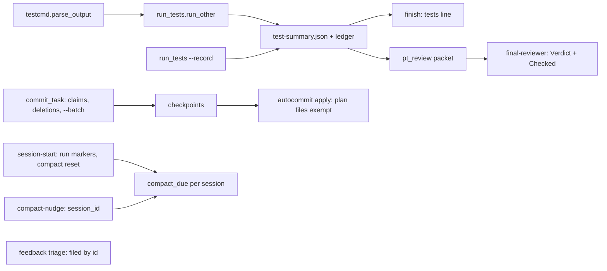
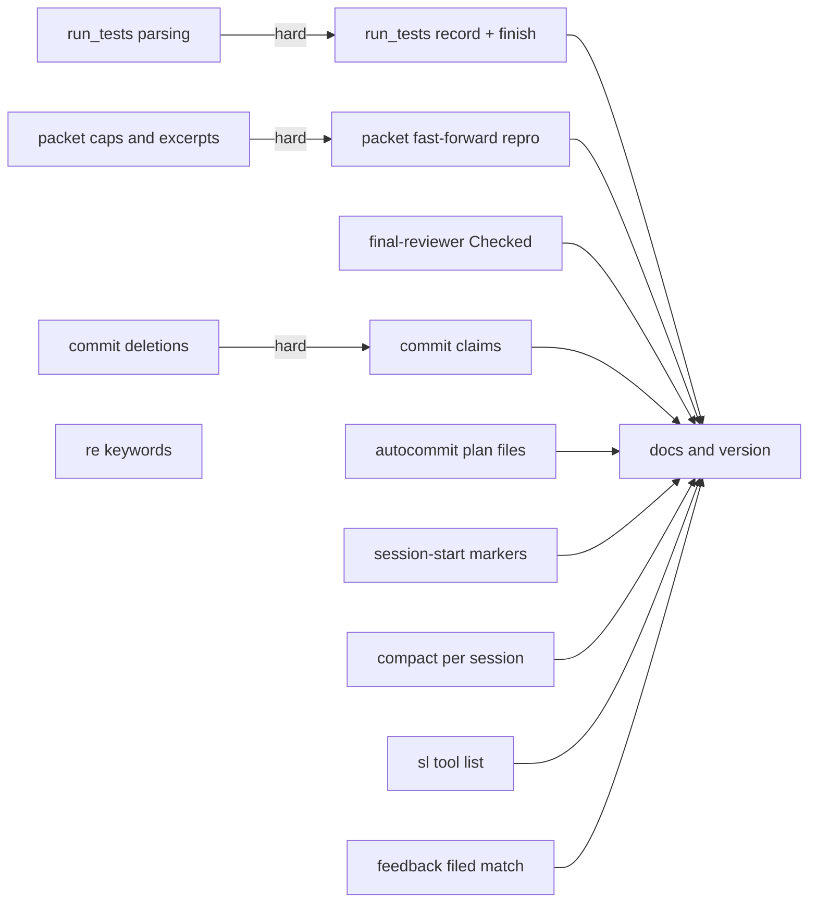

# Superlite: known-cause bug batch

**Goal:** fix 16 open issues with a stated cause, in five module clusters: test runs (#129 #142 #143 #110), review packet (#158 #159 #160), commits (#127 #155 #157), hooks and launcher (#71 #72 #117), misc (#156 #162 #163). Each fix ships with a regression test.
**Architecture:** edits to existing `sl` tools in `skills/subagent-driven-development/scripts/` (`testcmd.py`, `run_tests.py`, `finish.py`, `pt_review.py`, `commit_task.py`, `dispatch.py`, `autocommit.py`, `compact_due.py`, `feedback.py`, `plan_tools.py`, the `sl` launcher), two hooks (`session-start`, `compact-nudge`), one agent prompt (`agents/final-reviewer.md`), and docs. No new tool; two new flags (`run_tests --record`, `commit_task --claim`).
**Tech stack:** Python 3.10+ stdlib, bash 3.2 compatible hooks (builtins only), pytest.
**Spec:** this file, sections 1 to 5 under Design; the issue texts on GitHub are the source for each Expected line.
**Detail:** contracts
**Target-min:** 11
**Max chars:** 40000
**Wave0:** none

Global constraints:
- Files under `skills/subagent-driven-development/scripts/` (including `sl`) and `hooks/` carry the repo's trailing `# O(...)` complexity comment on every line; tests and Markdown do not. Follow each file's existing style.
- Hooks and `sl`: bash 3.2, builtins on the normal path; `tests/scripts/test_hooks_bash32.py` must stay green. `hooks/session-start` uses `printf`, never a heredoc. LF endings.
- Stdlib only. Results on stdout, everything else on stderr. Existing tests stay green; a task changes an existing test only where its Owns names the file.
- Run `sl` as an executable (`<abs>/sl ...`). Verify with `<abs>/sl run_tests --fast <test files> --task Tn --background`, then the printed `wait:` line. Never raw `pytest`, never the e2e or eval layers (coordinator's step).
- `skills/using-superlite/SKILL.md` stays under 1,500 characters (`tests/scripts/test_sl_form.py` is the strictest check).
- Version: only T14 runs `scripts/bump-version.sh 1.5.1`; `--audit` must report nothing missed.

Ruling: detail contracts - bug fixes in existing modules with uniform test fixtures; tests are named with exact inputs and outcomes - cost if wrong: one NEEDS_CONTEXT per task.
Ruling: #158 is reproduce-first (T4): the cause is not confirmed from reading; T4 writes the three untested shapes as tests, fixes only what fails, and reports `not reproduced` when all pass - shipping a guessed fix to the packet range code has broken it four times (#100 #104 #109 #113) - cost if wrong: the issue stays open with guard tests added.
Ruling: #129 fixes the confirmed defect only (a green run with a `1) name` line listed `-::name: failed`; a `-` file printed `(file not found)`), plus a stderr warning when `test-cmd.json` exists but is rejected; the "config not honoured" premise is not reachable from code - cost if wrong: the reporter's case needs a repro on a new issue.
Ruling: #110 `run_tests --record` reports only: `finish` labels it `tests (full, recorded)` and a recorded summary never closes `run_tests` test-failure incidents - a recorded result is the agent's word, not parsed output - cost if wrong: one `sl incident resolve` call.
Ruling: #127 smallest version: this call's `--also` files count as owned before any check, a new `commit_task Tn --claim F... --ruling TEXT` records a claim without committing, and a file owned only by a ruling or claim of another task is left uncommitted with `left uncommitted (claimed by Tn): F` - the ledger already is the one ownership map; fixers are not in the pool - cost if wrong: fixers must remember to claim.
Ruling: #155 exempts the plan's own files (`<plan stem>.*`) from `apply`'s unrelated-changes check; it does not commit them - committing would change the squash-equality logic - cost if wrong: the user still `git add`s them, as the issue accepts.
Ruling: #160 uncaps hooks in every packet (one code path); the packet's token budget stays the limit and `render_excerpts` already prints the cut count - cost if wrong: a huge hook crowds other files above their 40-line floor.
Ruling: #117 stamps per session (`last-compact.<session_id>`), a session's first sight starts its window, and `session-start` with source `compact` resets it; no run gating - cost if wrong: a nudge in an idle project after 30 minutes of one session.
Ruling: #72 bare `sl` and an unknown tool print the tool list; `status` gets a fixed hint (`sl orchestrator status; sl metrics`), no new tool - cost if wrong: none.
Ruling: one docs task (T14) owns every shared doc (`docs/tools.md`, `docs/hooks.md`, `AGENTS.md`, the SDD `SKILL.md` and `fixing.md`) and the version bump, after the code tasks - several tasks would edit the same lines - cost if wrong: about 3 minutes on the critical path.
Ruling: version 1.5.1; if main has a 1.5.1 by finish (the #154 fleet fix runs in another session), rebump to the next patch on rebase - cost if wrong: one bump-script run.
Ruling: no probe adapter - every package is a CLI over git state or a hook; Review Focus cases run as named pytest cases - cost if wrong: no generated probes.

## Design

### 1. Test runs (#142 #129 #143 #110)
- #142: `testcmd.parse_output` reads `passed=N`, `failed=N`, `skipped=N` (also `Passed: N`, `:` or `=`, case-insensitive), and the `N passed|failed|skipped` forms no longer match a number that follows `=` or `:`. `passed=7 failed=0`, rc 0 -> 7 passed, 0 failed. An unknown format keeps the exit-code fallback.
- #129: `parse_output` collects failing `names` only when rc != 0. `run_other`'s exit-code failure names the command. `testcmd.resolve` prints `test-cmd.json ignored: <reason>` on stderr when the file exists but `read_config` rejects it (bad JSON, not an object, no `test`). `pt_review` renders an incident whose file is `-` without an excerpt line (no `(file not found)`).
- #143: `parse_output` also returns `error` (first line matching `^(?:\S.*?:\d+(?::\d+)?: )?error: .+`, else "") and `marker` (last `** TEST|BUILD SUCCEEDED|FAILED **` line, else ""), over the whole output. On rc != 0 with an `error`, `run_other` puts `build error: <error>` (160 chars) first in failures; `test-output.log` starts with the marker and the error line when the tail lacks them. `test-summary.json` keys stay unchanged.
- #110: `run_tests --record --passed N [--failed N] [--skipped N] [--seconds S] --command CMD` writes a `full` summary with `started` and `recorded: CMD[:200]` plus the ledger line `- tests full passed=N failed=N skipped=N seconds=S recorded`, and removes the background pointer so the newest summary is this one. Missing `--passed` or `--command`: exit 2. `finish` prints `tests (full, recorded): N passed, ...`. `pt_review._full_ran` ignores a recorded summary.

### 2. Review packet (#160 #158 #159)
- #160: `_file_cap` gives hooks no per-file cap; the token budget still applies; the constant `EXCERPT_HOOK_LINES` goes.
- #158: reproduce first (Ruling), shapes: glob or directory `Owns` with a post-merge checkpoint; a merged file whose only checkpoint predates the merge; an explicit sha as `--base`. Fix in `moved_files` / `RunRanges.of` / `run_ranges` only.
- #159: `final-reviewer.md` adds a `Checked:` block after the verdict (one line per packet section or task read, one per Review Focus item, at most 8 words each, outside the 300-word cap; `Left out:` and truncation notes listed as unverified); the fast path stays a bare verdict; `Verdict:` stays the first line. SDD `SKILL.md` final-review step: an APPROVED without `Checked:` on a non-fast-path packet is no review; start a fresh reviewer.

### 3. Commits (#157 #155 #127)
- #157: `commit_one` adds owned files that an earlier checkpoint of this plan holds and that are gone from disk, so the new checkpoint drops them; a deletion-only commit succeeds.
- #128: out of this plan (open PR #135).
- #155: `autocommit.dirty_outside(files, plan)` skips the plan's own `<stem>.*` files.
- #127: see Ruling. Out-of-scope and shared-test rules consult the same map.

### 4. Hooks and launcher (#71 #117 #72)
- #71: `session-start` reports `run in progress` only when `./.superlite` holds a run marker (`stable.json`, `prime.md` or `pool.json`), the test the other hooks use.
- #117: `compact_due.is_due(sl_dir, now, window_s=1800, sid=None)` and `mark(sl_dir, sid=None)`; with a sid the stamp is `last-compact.<sid>`, created on first sight (not due). CLI `compact_due.py <sl_dir> [sid]`. `compact-nudge` passes the hook's `session_id`. `session-start` with source `compact` and a sid touches `last-compact.<sid>` in an existing state folder (never creates one).
- #72: bare `sl` prints the usage line and the sorted tool names (scripts and probes, no `_*`), exit 2; an unknown tool adds `did you mean 'X'?` (difflib, error path only) and the list; `status` adds `try: sl orchestrator status; sl metrics`.

### 5. Misc (#156 #163 #162)
- #156: `plan_tools.py:351` passes `maxsplit=1, flags=re.M`; a static test fails on any positional count or flags in `re.split/sub/subn`.
- #163: `triage` fetches `number,title,body,comments`; an entry whose 12-hex id appears in an open issue's body or comments is `filed: #N`, grouped apart, with a `sl feedback mark <ids>` line; the `using-superlite` feedback line names `--kind bug|slow|unclear|repeat|idea`.
- #162: AGENTS.md testing table runs `python3 scripts/test_layers.py run <layer>` for headless, tui and evals, and says e2e and evals are the coordinator's step.

## Coverage

| Category | State | Basis |
|---|---|---|
| Scope and success criteria | settled | 16 issues named in Goal; each issue's Expected line; out: #154 #112 (claimed elsewhere), #128 (open PR #135), design issues |
| Domain and data model | n/a | no new entities |
| Persistence and migration | ruled | new files only under `.superlite/` (`last-compact.<sid>`); old `last-compact` still read without a sid |
| Interfaces and contracts | ruled | additive flags only; `test-summary.json` keys unchanged except `recorded`; `hint:` line of commit_task unchanged (`test_commit_pix_v2.py:109`) |
| UI states | n/a | CLI and hook text |
| Concurrency and state ownership | settled | ledger Rulings are the ownership map (#127 Ruling) |
| Error handling and recovery | settled | each task's error cases (bad test-cmd.json, missing flags, no python on the `sl` error path) |
| Security and privacy | n/a | no new input surface beyond local files |
| Performance and limits | ruled | hooks stay builtin on the normal path; packet budget unchanged (#160 Ruling) |
| Observability | settled | stderr warnings named in sections 1 and 3 |
| Testing strategy | settled | unit tests per task; e2e headless, tui and evals once by the coordinator |
| Compatibility | settled | bash 3.2, Python 3.10 to 3.15 |
| Rollout | ruled | one PR, version 1.5.1 (Ruling) |
| Research unknowns | spike | #158 cause: reproduce-first inside T4 |

## File structure

- `scripts/testcmd.py`, `scripts/run_tests.py`: output parsing, record mode (T1, T2).
- `scripts/finish.py`: recorded label (T2).
- `scripts/pt_review.py`: hook cap, `-` excerpts, recorded guard (T3); fast-forward ranges (T4).
- `agents/final-reviewer.md`: Checked block (T5).
- `scripts/commit_task.py`: deletions (T6); claims (T7).
- `scripts/autocommit.py`: plan-file exemption (T8).
- `hooks/session-start`: run markers, compact reset (T9).
- `hooks/compact-nudge`, `scripts/compact_due.py`: per-session window (T10).
- `scripts/sl`: tool list (T11).
- `scripts/plan_tools.py`: re keywords (T12).
- `scripts/feedback.py`, `skills/using-superlite/SKILL.md`: filed match (T13).
- `AGENTS.md`, `docs/tools.md`, `docs/hooks.md`, SDD `SKILL.md`, `fixing.md`, version files: T14.

## Task graph

```mermaid
%% schedule
gantt
  title Predicted schedule (mm:ss)
  dateFormat X
  axisFormat %M:%S
  section lane 1
  T1 run_tests output parsing :t1, 0, 123s
  T2 run_tests --record and finish label :t2, 123, 119s
  T14 docs  AGENTS.md and version 1.5.1 :t14, 242, 114s
  section lane 2
  T6 commit_task  deleted owned files and  :t6, 0, 119s
  T7 commit_task  claims before commit :t7, 119, 107s
  section lane 3
  T13 feedback triage  filed by id :t13, 0, 117s
  section lane 4
  T10 compact nudge per session :t10, 0, 114s
  section lane 5
  T3 packet  hook cap  dash excerpts  reco :t3, 0, 101s
  T4 packet after a mid-run fast-forward ( :t4, 101, 104s
  section lane 6
  T9 session-start  run markers and compac :t9, 0, 98s
  section lane 7
  T11 sl lists its tools :t11, 0, 98s
  section lane 8
  T5 final-reviewer Checked block :t5, 0, 97s
  section lane 9
  T8 autocommit  plan files are not unrela :t8, 0, 94s
  section lane 10
  T12 re keyword arguments :t12, 0, 94s
```

critical path: T1 → T2 → T14 (5.9 min) · peak width 10 · predicted build 5.9 min · predicted total ≈ 9.4 min (target ✓)

## Test runs

**Probe entry:** none (CLI over a project's test command; Review Focus cases are named pytest cases)

### T1 run_tests output parsing · Complexity 4 · Est. context 40k
**Owns:** skills/subagent-driven-development/scripts/testcmd.py, skills/subagent-driven-development/scripts/run_tests.py, tests/scripts/test_testcmd_xcode.py, tests/scripts/test_testcmd.py, tests/scripts/test_run_tests_sidecars.py
**Components:** 2
**LOC owned:** 120
**Tests:** fast
**Model:** sonnet
**Est. time:** 3.5 min (2 components, about 120 LOC, fast tests)
**Covers:** 1
**Consumes:** nothing executed from another task.
**Produces:** testcmd.parse_output(text: str, rc: int) -> dict
e.g. parse_output("passed=7 failed=0", 0) -> {"passed": 7, "failed": 0, "skipped": 0, "names": [], "error": "", "marker": "", ...}
e.g. parse_output("1) frontend\n** TEST SUCCEEDED **", 0) -> {"passed": 1, "failed": 0, "names": [], "marker": "** TEST SUCCEEDED **", ...}
e.g. parse_output("Foo.swift:3:5: error: cannot find 'Date' in scope\n** TEST FAILED **", 65) -> {"failed": 1, "error": "Foo.swift:3:5: error: cannot find 'Date' in scope", "marker": "** TEST FAILED **", ...}
**Review Focus:** encoding: `test_key_value_counts` (`passed=7 failed=0` rc 0 -> 7, 0; `passed=5 failed=2` rc 1 -> 5, 2); protocol: `test_green_run_lists_no_names` (green stub printing `1) frontend` -> summary failures empty, no test-failure incident); file: `test_rejected_config_warns` (`.superlite/test-cmd.json` holding `{` -> stderr contains `test-cmd.json ignored`, detection still runs).
**Test code:**
- `test_testcmd_xcode.py::test_key_value_counts`: the two cases above, plus `PASSED: 3` rc 0 -> 3 passed (dotnet form still counted once).
- `test_testcmd_xcode.py::test_unknown_format_falls_back_to_exit_code`: `"done"` rc 0 -> passed 1, failed 0; rc 1 -> failed 1.
- `test_testcmd_xcode.py::test_error_and_marker_extracted`: the third `e.g.` above; with no error line, `error == ""`.
- `test_testcmd.py::test_green_run_lists_no_names`: config `{"language": "bash", "test": "<python> runner.py"}`, runner prints `1) frontend` and `** TEST SUCCEEDED **`, exits 0 -> `rt(tmp_path, "--full")` summary `failures == []`.
- `test_testcmd.py::test_rejected_config_warns`: as Review Focus.
- `test_run_tests_sidecars.py::test_compile_error_leads_failures_and_log`: model `test_log_has_no_ansi_escapes`; stub prints 60 filler lines, then `Foo.swift:3:5: error: cannot find 'Date' in scope`, 50 more lines and `** TEST FAILED **`, exits 65, config `junit: ""` -> summary `failures[0]` contains `build error: Foo.swift:3:5: error:`; `test-output.log` contains the error line and `** TEST FAILED **`.
**Steps:** 1 failing tests, 2 run: FAIL, 3 implement, 4 run: PASS.
**Notes:** keep the `"{n}: failed"` failure text (`test_testcmd.py:127`) and the summary key set (`test_testcmd.py:99`, `:113`). The `error`/`marker` keys exist only in `parse_output`'s dict, not in the summary. `_parse_xcode` results also get `error` and `marker`.

### T2 run_tests --record and finish label · Complexity 3 · Est. context 36k
**Owns:** skills/subagent-driven-development/scripts/run_tests.py, skills/subagent-driven-development/scripts/finish.py, tests/scripts/test_run_tests_record.py
**Components:** 2
**LOC owned:** 90
**Tests:** fast
**Model:** sonnet
**Est. time:** 3 min (2 components, about 90 LOC, fast tests)
**Covers:** 1
**Consumes:** nothing executed from another task (T1 edits the same file first: hard edge).
**Produces:** test-summary.json key `recorded` (string, the command, at most 200 chars), read by T3's `_full_ran` guard
e.g. `sl run_tests --record --passed 1333 --command "Scripts/test.sh"` -> summary {"mode": "full", "passed": 1333, "failed": 0, "skipped": 0, "recorded": "Scripts/test.sh", "started": ...}; ledger `- tests full passed=1333 failed=0 skipped=0 seconds=0 recorded`
**Review Focus:** protocol: `test_record_without_command_exits_2`; state: `test_record_shadows_older_background_summary` (an older background pointer exists -> after `--record` the newest summary read by `pt_review.newest_summary_path` is the recorded one).
**Test code:** model `tests/scripts/test_run_tests_summary.py` (`rt`, `summary`) and the finish call in `test_run_scripts.py::test_finish_collects_rulings`.
- `test_record_writes_full_summary`: the `e.g.` above -> summary keys and ledger line as shown, exit 0.
- `test_record_without_command_exits_2`: `--record --passed 3` -> exit 2, stderr names `--command`; same for a missing `--passed`.
- `test_finish_labels_recorded`: after the record call, `finish --plan` output contains `tests (full, recorded): 1333 passed`.
- `test_record_shadows_older_background_summary`: as Review Focus.
**Steps:** 1 failing tests, 2 run: FAIL, 3 implement, 4 run: PASS.
**Notes:** handle `--record` in `main()` after root resolution, before `run(a)`. `finish.TESTS` gets an optional trailing `(\s+recorded)?` group; old ledger lines parse as before.

## Review packet

**Probe entry:** none (packet builder over git state; named pytest cases)

### T3 packet: hook cap, dash excerpts, recorded guard · Complexity 3 · Est. context 40k
**Owns:** skills/subagent-driven-development/scripts/pt_review.py, tests/scripts/test_packet_batch.py, tests/scripts/test_packet_small_fixes.py
**Components:** 1
**LOC owned:** 70
**Tests:** fast
**Model:** sonnet
**Est. time:** 2.5 min (1 component, about 70 LOC, fast tests)
**Covers:** 1, 2
**Consumes:** test-summary.json key `recorded` (T2, by name; the test writes the summary file itself).
**Produces:** none consumed by another task.
**Review Focus:** deep: `test_hook_uncapped_at_default_budget` (a 500-line changed hook -> section 8 shows `+new 499`, no `(truncated:` note); numeric: `test_hook_cut_by_size_cap` (same hook with a small `--max-tokens` -> note says `size cap` and `of 500`); `test_floor_before_fill` stays green.
**Test code:**
- `test_packet_batch.py`: replace `test_hook_cap_400` with the two Review Focus tests (fixtures `proj`, `commit_base`, `change`, `packet`, `sec8`).
- `test_packet_small_fixes.py::test_dash_incident_has_no_file_not_found`: an open `test-failure` incident with file `-` -> packet has its context line and no `(file not found)`.
- `test_packet_small_fixes.py::test_recorded_summary_does_not_close_incidents`: a full summary with `recorded` and an open `run_tests` test-failure incident -> the incident stays listed as open.
**Steps:** 1 failing tests, 2 run: FAIL, 3 implement, 4 run: PASS.
**Notes:** `_file_cap` (about line 1889), `excerpt` / `render_item` (about 1395 and 2140), `_full_ran` (about 2075). Do not touch `moved_files`, `RunRanges` or `run_ranges` (T4).

### T4 packet after a mid-run fast-forward (reproduce first) · Complexity 5 · Est. context 44k
**Owns:** skills/subagent-driven-development/scripts/pt_review.py, tests/scripts/test_packet_fast_forward.py
**Components:** 1
**LOC owned:** 90
**Tests:** fast
**Model:** sonnet
**Est. time:** 3 min (1 component, about 90 LOC, fast tests)
**Covers:** 2
**Consumes:** nothing executed from another task (T3 edits the same file first: hard edge).
**Produces:** none consumed by another task.
**Review Focus:** state: the three shapes below, each with `--base <new HEAD sha>` (explicit sha, not the word `HEAD`) and checkpoints on the old HEAD; expected for each: section "Changed files" and the diff stat list only the run's own files, no merged file appears as deleted (`-` lines only) or as a revert.
**Test code:** extend `test_packet_fast_forward.py` (fixtures `ff_repo`, `ff_shared`; model `test_diff_stat_and_excerpts_show_only_task_files`):
- `test_ff_glob_owns_post_merge_checkpoint`: a task owning `src/` (directory Owns) checkpoints after a fast-forward that added `src/merged.py` -> `src/merged.py` not in the packet's changed files.
- `test_ff_merged_file_checkpointed_before_merge`: the run checkpoints `src/b.py`, then a fast-forward changes `src/b.py` lines the run did not touch -> the packet's hunks for `src/b.py` hold only the run's lines.
- `test_ff_explicit_sha_base`: the existing main case with `--base $(git rev-parse HEAD)` -> same output as `--base HEAD`.
**Steps:** 1 write the three tests, 2 run: record which fail, 3 fix only the failing shapes in `moved_files` / `RunRanges.of` / `run_ranges`, 4 run: PASS.
**Notes:** if all three pass on step 2, change no product code, keep the tests as guards and report `DONE_WITH_CONCERNS: not reproduced` with the shapes tried. Do not touch the functions T3 changed.

### T5 final-reviewer Checked block · Complexity 2 · Est. context 26k
**Owns:** agents/final-reviewer.md, tests/scripts/test_packet_inline.py
**Components:** 1
**LOC owned:** 40
**Tests:** fast
**Model:** sonnet
**Est. time:** 2 min (1 component, about 40 LOC, fast tests)
**Covers:** 2
**Consumes:** nothing executed from another task.
**Produces:** final-reviewer output contract: line 1 `Verdict: APPROVED|CHANGES_REQUESTED`; then `Checked:` and one line per packet section or task read (`T3 diff: read`) and per Review Focus item (`RF2: checked, holds`), each at most 8 words, outside the 300-word cap; truncated or `Left out:` parts listed as `unverified`; fast path: the bare verdict line.
**Review Focus:** protocol: `test_final_reviewer_lists_what_it_checked` (the agent file holds the `Checked:` rule, the 8-word limit, `unverified`, and keeps `Verdict:` as the first output line); `test_final_reviewer_fast_path_keys_on_the_header` stays green.
**Test code:** in `test_packet_inline.py`, model `test_final_reviewer_fast_path_keys_on_the_header` (read the agent file, find the rule line, assert substrings): `test_final_reviewer_lists_what_it_checked` as above.
**Steps:** 1 failing test, 2 run: FAIL, 3 edit the agent file, 4 run: PASS.
**Notes:** `bench/harness.py:387` matches `^\W*verdict\b` at a line start: the verdict stays first.

## Commits

**Probe entry:** none (CLI over git state; named pytest cases)

### T6 commit_task: deleted owned files · Complexity 3 · Est. context 30k
**Owns:** skills/subagent-driven-development/scripts/commit_task.py, tests/scripts/test_checkpoint_chain.py
**Components:** 1
**LOC owned:** 60
**Tests:** fast
**Model:** sonnet
**Est. time:** 2 min (1 component, about 60 LOC, fast tests)
**Covers:** 3
**Consumes:** nothing executed from another task.
**Produces:** none consumed by another task.
**Review Focus:** state: `test_deleted_owned_file_leaves_checkpoint` (T1 owns `src/a.py`, `tests/test_a.py`; checkpoint both, delete `tests/test_a.py`, `commit_task T1` -> new checkpoint tree lacks it, exit 0 even when the deletion is the only change); state: `test_other_tasks_deleted_file_kept` (a T2-owned file deleted -> T1's checkpoint keeps it).
**Test code:** `test_checkpoint_chain.py` (`commit`, `files_in`, `make_repo` from `test_autocommit`) for both tests.
**Steps:** 1 failing tests, 2 run: FAIL, 3 implement, 4 run: PASS.
**Notes:** candidates are files of this plan's checkpoint entries (`autocommit.load_state()`, same `plan_key`) that are owned, not live and gone from disk, passed through `changed_vs_parent`; added to `mine` after the `cand/shared` block. Only in checkpoint mode (`autocommit.is_on()` false). #128 (`--batch`) is out: open PR #135 implements it.

### T7 commit_task: claims before commit · Complexity 5 · Est. context 46k
**Owns:** skills/subagent-driven-development/scripts/commit_task.py, tests/scripts/test_commit_scope_batch.py, tests/scripts/test_commit_shared_test.py
**Components:** 1
**LOC owned:** 110
**Tests:** fast
**Model:** sonnet
**Est. time:** 3.5 min (1 component, about 110 LOC, fast tests)
**Covers:** 3
**Consumes:** nothing executed from another task (T6 edits the same file first: hard edge).
**Produces:** CLI `commit_task Tn --claim F [F...] --ruling TEXT --plan P` -> appends `Ruling: Tn also commits F - TEXT` per file to the ledger, prints `Tn claimed F`, exit 0, commits nothing
**Review Focus:** state: `test_also_counts_for_every_task_in_the_call` (`commit_task T1 T2 --also F` where T1 is blocked -> T2 does not report F out-of-scope); state: `test_claimed_file_left_uncommitted` (`--claim F` by T7, then `commit_task T6` -> exit 0, stderr `left uncommitted (claimed by T7): F`, checkpoint lacks F); state: `test_claimed_test_not_swept_as_shared` (a modified tracked test claimed by T3 -> `commit_task T4` does not take it); protocol: `test_claim_without_ruling_exits_2`.
**Test code:** `test_commit_scope_batch.py` (`setup`, `commit`, `entries`, `recorded`, `CP`) for the first two and the protocol case; `test_commit_shared_test.py` for the third.
**Steps:** 1 failing tests, 2 run: FAIL, 3 implement, 4 run: PASS.
**Notes:** register this call's `--also` files into the first task's owns in `main` before the loop (reuse the `_rel` and trailing-slash logic of `commit_one`). Keep the existing `hint:` line byte-identical and single (`test_commit_pix_v2.py:109`). Do not touch T6's deleted-file helper.

### T8 autocommit: plan files are not unrelated · Complexity 2 · Est. context 28k
**Owns:** skills/subagent-driven-development/scripts/autocommit.py, tests/scripts/test_autocommit.py
**Components:** 1
**LOC owned:** 40
**Tests:** fast
**Kind:** mechanical
**Model:** haiku
**Est. time:** 1.5 min (1 component, about 40 LOC, fast tests)
**Covers:** 3
**Consumes:** nothing executed from another task.
**Produces:** autocommit.dirty_outside(files: list, plan: str | None = None) -> list
e.g. dirty_outside([...]) with dirty `plan.review.md`, `plan.report.md`, `plan.report.json` and stored plan `<repo>/plan.md` -> []
e.g. same with dirty `notes.txt` -> ["notes.txt"]
**Review Focus:** file: `test_apply_allows_plan_folder_files`, `test_apply_allows_nested_plan_files`, `test_apply_refuses_unrelated_changes` stays green.
**Test code:** in `test_autocommit.py` next to `test_apply_refuses_unrelated_changes` (`make_repo`, `two_tasks`, `write`, `run("autocommit", "apply", cwd=repo)`):
- `test_apply_allows_plan_folder_files`: write `plan.review.md`, `plan.report.md`, `plan.report.json` -> apply exit 0.
- `test_apply_allows_nested_plan_files`: plan at `docs/plans/p.md` (as `repo_with_plan` in `test_commit_plan_folder.py`), dirty `docs/plans/p.review.md` -> exit 0; dirty `docs/plans/other.md` -> refused.
**Steps:** 1 failing tests, 2 run: FAIL, 3 implement, 4 run: PASS.
**Notes:** stem = the stored plan path relative to `git rev-parse --show-toplevel`, minus its suffix; skip a path that starts with `stem + "."`. `apply` passes `st.get("plan")`. No import of `commit_task` (circular).

## Hooks and launcher

**Probe entry:** none (bash hooks and a launcher; named pytest cases)

### T9 session-start: run markers and compact reset · Complexity 3 · Est. context 32k
**Owns:** hooks/session-start, tests/scripts/test_session_start.py
**Components:** 1
**LOC owned:** 50
**Tests:** fast
**Model:** sonnet
**Est. time:** 2 min (1 component, about 50 LOC, fast tests)
**Covers:** 4
**Consumes:** stamp file name `last-compact.<session_id>` in the state folder (T10, by name).
**Produces:** none consumed by another task.
**Review Focus:** state: `test_marker_means_run_in_progress` (`.superlite/stable.json` present -> `Project state: run in progress`); `test_orchestrator_file_alone_is_existing_code` (`.superlite/orchestrator.json` and `docs/plans/` only, plus a source file -> `Project state: existing code`); `test_empty_folder` (-> `empty folder`); file: `test_compact_source_touches_session_stamp` (input `{"session_id": "s1", "source": "compact"}`, state folder exists -> `last-compact.s1` exists; no state folder -> none created).
**Test code:** in `test_session_start.py`: run `[BASH, HOOK]` with `cwd=tmp_path`, `SUPERLITE_HOME`, `CLAUDE_PROJECT_DIR` set to tmp dirs and no `SUPERLITE_STATE_DIR` or `CLAUDE_ENV_FILE`; the four tests above. For the compact case use the stdin pattern of `test_session_state.py:508-523`.
**Steps:** 1 failing tests, 2 run: FAIL, 3 implement, 4 run: PASS.
**Notes:** marker test `[ -f "$sd/stable.json" ] || [ -f "$sd/prime.md" ] || [ -f "$sd/pool.json" ]` with `sd=.superlite`. The compact stamp uses the folder `superlite_state` resolves (`superlite-state.sh`), after the /clear handover; `: > file`, never `mkdir`.

### T10 compact nudge per session · Complexity 3 · Est. context 32k
**Owns:** hooks/compact-nudge, skills/subagent-driven-development/scripts/compact_due.py, tests/scripts/test_compact_due.py
**Components:** 2
**LOC owned:** 60
**Tests:** fast
**Model:** sonnet
**Est. time:** 2.5 min (2 components, about 60 LOC, fast tests)
**Covers:** 4
**Consumes:** nothing executed from another task.
**Produces:** compact_due.is_due(sl_dir, now: float, window_s: int = 1800, sid: str | None = None) -> bool · compact_due.mark(sl_dir, sid: str | None = None) -> None
e.g. is_due(sd, now, sid="s1") with no `last-compact.s1` -> False and the file now exists
e.g. is_due(sd, now, sid="s1") with `last-compact.s1` 1801 s old -> True; with no sid and an old `last-compact` -> True (legacy)
**Review Focus:** state: `test_new_session_not_nudged_by_old_folder_stamp` (old folder `last-compact`, input `{"session_id": "s1"}` -> no nudge, `last-compact.s1` created); `test_session_nudged_once_after_window` (backdate `last-compact.s1` past 1800 s -> nudge once, then silent); `test_sessions_independent` (s1's fresh stamp does not silence s2 with an old stamp); legacy tests with input `{}` stay green.
**Test code:** extend `test_compact_due.py` (`_sl`, `_env`, `_run`) with the cases above.
**Steps:** 1 failing tests, 2 run: FAIL, 3 implement, 4 run: PASS.
**Notes:** `compact-nudge` reads `session_id` from its stdin with the regex `session-start` uses, passes it as the CLI's second argument. Optional: `mark` prunes `last-compact.*` older than 14 days.

### T11 sl lists its tools · Complexity 2 · Est. context 28k
**Owns:** skills/subagent-driven-development/scripts/sl, tests/scripts/test_sl_tools.py
**Components:** 1
**LOC owned:** 50
**Tests:** fast
**Model:** sonnet
**Est. time:** 2 min (1 component, about 50 LOC, fast tests)
**Covers:** 4
**Consumes:** nothing executed from another task.
**Produces:** none consumed by another task.
**Review Focus:** protocol: `test_bare_sl_lists_tools` (rc 2, stderr has `usage: sl` and the names `orchestrator`, `metrics`, `dispatch`, `probe_run`, no `_pyrun`); `test_typo_suggests_nearest` (`sl metrcs` -> rc 2, `did you mean 'metrics'?`); `test_unknown_without_match` (`sl zzzz` -> rc 2, no `did you mean`); `test_status_hint` (`sl status` -> `try: sl orchestrator status; sl metrics`).
**Test code:** new `test_sl_tools.py`, model `test_spawn_free.py::_sl` (bash plus `SCRIPTS/"sl"`, env with `SUPERLITE_CACHE_DIR`) and the `BASH` selection of `test_compact_due.py`; the four tests above.
**Steps:** 1 failing tests, 2 run: FAIL, 3 implement, 4 run: PASS.
**Notes:** the normal tool path stays unchanged (`test_spawn_free.py`). Python runs only on the error path and is skipped silently when missing. Guard empty arrays with `${a[@]+"${a[@]}"}`.

## Misc

**Probe entry:** none (CLI text and docs; named pytest cases)

### T12 re keyword arguments · Complexity 1 · Est. context 22k
**Owns:** skills/subagent-driven-development/scripts/plan_tools.py, tests/scripts/test_re_keywords.py
**Components:** 1
**LOC owned:** 40
**Tests:** fast
**Kind:** mechanical
**Model:** haiku
**Est. time:** 1.5 min (1 component, about 40 LOC, fast tests)
**Covers:** 5
**Consumes:** nothing executed from another task.
**Produces:** none consumed by another task.
**Review Focus:** encoding: `test_wave0_header_without_warning` (`warnings.simplefilter("error")`; `plan_tools.Plan("**Wave0:** none\n## T1\n")` wave0-off check returns True, no warning); `test_no_positional_re_count_or_flags` (an `ast` walk over every `git ls-files '*.py'` file: no `re.split` call with more than 2 positional args, no `re.sub`/`re.subn` with more than 3).
**Test code:** new `test_re_keywords.py` with the two tests above.
**Steps:** 1 failing tests, 2 run: FAIL, 3 change `plan_tools.py:351` to `re.split(r"^#{2,}\s", self.text, maxsplit=1, flags=re.M)`, 4 run: PASS.
**Notes:** the method name at line 351 is whatever the existing code calls it; read it there.

### T13 feedback triage: filed by id · Complexity 3 · Est. context 36k
**Owns:** skills/subagent-driven-development/scripts/feedback.py, tests/scripts/test_feedback.py, skills/using-superlite/SKILL.md
**Components:** 2
**LOC owned:** 80
**Tests:** fast
**Model:** sonnet
**Est. time:** 3 min (2 components, about 80 LOC, fast tests)
**Covers:** 5
**Consumes:** nothing executed from another task.
**Produces:** feedback.filed(entries: list, issues: list) -> dict
e.g. filed([{"id": "aaaaaaaaaaaa"}, {"id": "bbbbbbbbbbbb"}], [{"number": 154, "title": "x", "body": "cites aaaaaaaaaaaa"}]) -> {"aaaaaaaaaaaa": 154}
e.g. an id that appears only in `comments[].body` -> matched; an id in no issue -> absent
**Review Focus:** protocol: `test_triage_shows_filed_by_id` (issues fixture cites two entry ids -> output has `filed: #154`, a `sl feedback mark <id1> <id2>` line, no `none (new)` for them; header count unchanged); `test_triage_filed_via_comment`; `test_triage_requests_body` (fake `gh` logs its args -> `--json` includes `body`); file: `using-superlite` names `--kind bug|slow|unclear|repeat|idea` and stays under 1,500 characters.
**Test code:** in `test_feedback.py`, model `test_triage_matches_open_issue` (`triage(tmp_path, *args, issues=[...])`) and the fake `gh` of `test_triage_gh_failure_is_unmatched_not_new`; the three tests above plus `test_using_superlite_names_kinds`.
**Steps:** 1 failing tests, 2 run: FAIL, 3 implement, 4 run: PASS.
**Notes:** open issues only. Group only unfiled entries. `skills/using-superlite/SKILL.md` is at 1,493 characters: trim words elsewhere in it so the result stays under 1,500 (`test_sl_form.py`, `test_docs_contract.py`, `test_isolation_wording.py`, `test_start_unattended.py` all check it).

### T14 docs, AGENTS.md and version 1.5.1 · Complexity 3 · Est. context 44k
**Owns:** AGENTS.md, docs/tools.md, docs/hooks.md, skills/subagent-driven-development/SKILL.md, skills/subagent-driven-development/fixing.md, tests/scripts/test_test_layers.py, package.json, .hermes-plugin/plugin.yaml, .claude-plugin/plugin.json, .cursor-plugin/plugin.json, .codex-plugin/plugin.json, .devin-plugin/plugin.json, .kimi-plugin/plugin.json, .muse-plugin/plugin.json, .claude-plugin/marketplace.json, .muse-plugin/marketplace.json, gemini-extension.json
**Components:** 2
**LOC owned:** 60
**Tests:** fast
**Model:** sonnet
**Est. time:** 3 min (2 components, about 60 LOC, fast tests)
**Covers:** 1, 2, 3, 4, 5
**Consumes:** the committed code of T2, T4, T5, T7, T8, T9, T10, T11, T13 (reads their diffs).
**Produces:** none consumed by another task.
**Review Focus:** file: `test_agents_md_runs_layers_through_test_layers` (AGENTS.md has no `-m pytest`, has `test_layers.py run headless` and `test_layers.py run tui`, and says e2e and evals are the coordinator's step); `test_docs_contract.py` and `--audit` stay green.
**Test code:** in `test_test_layers.py` next to `test_default_e2e_commands_use_sl_run_tests`: the Review Focus test.
**Steps:** 1 failing test, 2 run: FAIL, 3 edit docs, run `scripts/bump-version.sh 1.5.1` and `scripts/bump-version.sh --audit`, 4 run: PASS (`test_test_layers.py`, `test_docs_contract.py`).
**Notes:** docs/tools.md rows: `run_tests` (`--record`, rejected-config warning), `commit_task` (`--claim`, claimed-file line), `autocommit` (plan files exempt), packet row (hooks uncapped; drop "hooks 400"), `feedback` (filed by id), and line 3 (bare `sl` lists tools). docs/hooks.md: the per-session compact stamp. SDD `SKILL.md`: final-review step 3 gets the `Checked:` rule (an APPROVED without it on a non-fast-path packet is no review: start a fresh reviewer); step 4 names `--claim`. `fixing.md`: a fixer touching a file outside its task's Owns runs `commit_task Tn --claim F --ruling "..."` first. Keep every changed doc within its existing length checks.

## Review Focus

- **test runs (testcmd, run_tests, finish):** CLI; protocol, encoding, state. Risks: a green run listed as failing; counts read from the wrong token; a recorded result closing incidents; the summary key set changing.
- **review packet (pt_review, final-reviewer):** file I/O; deep, numeric, state. Risks: a hook diff cut without a note; merged files shown as reverts after a fast-forward; the verdict no longer on the first line.
- **commits (commit_task, autocommit):** CLI over git; state, protocol. Risks: a deletion restored by `apply`; another task's file swept into a checkpoint; a claim lost between calls; the `hint:` line changing.
- **hooks and launcher:** CLI; protocol, state. Risks: bash 4 syntax; a hook creating `.superlite` in a foreign project; the normal `sl` path spawning Python.
- **misc and docs:** file; encoding. Risks: `using-superlite` over 1,500 characters; a missed version file.

## Self-review

- Coverage: each of the 16 issues maps to a task (T1 #142 #129 #143; T2 #110; T3 #160, #129 excerpt, #110 guard; T4 #158; T5 #159; T6 #157; T7 #127; T8 #155; T9 #71, #117 reset; T10 #117; T11 #72; T12 #156; T13 #163; T14 #162 and docs).
- Shared files are ordered by hard edges: `run_tests.py` T1 -> T2, `pt_review.py` T3 -> T4, `commit_task.py` T6 -> T7; every shared doc is T14's alone.
- Placeholders: none. Measurable fields: every task.
