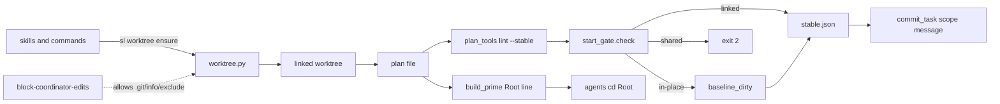
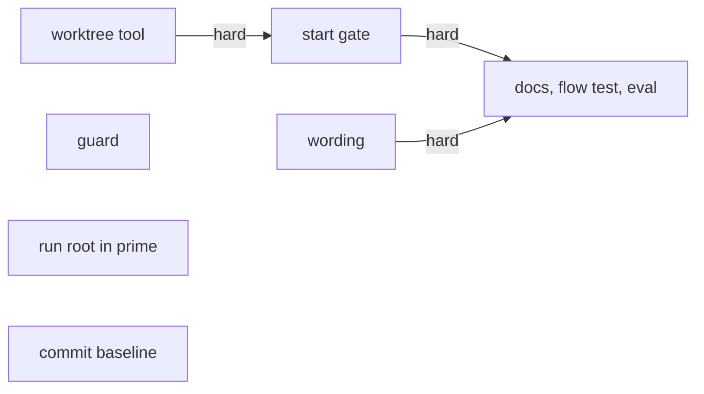

# Superlite: run isolation

**Goal:** every superlite change starts in its own git worktree, a build refuses to start in a shared checkout unless the plan opts out, every helper is told the run's folder, and the guard stops blocking the recovery (issues #136, #137, #138, #139).
**Architecture:** `scripts/worktree.py` creates or finds the run's worktree (T1); `scripts/start_gate.py` is called by `lint --stable` and blocks, passes or records an in-place run (T4); `build_prime.py` writes a `Root:` line the agent files obey (T3); `hooks/block-coordinator-edits` allows `.git/info/exclude` and names its blocked target (T2); `commit_task.py` reads the in-place baseline (T5); skills and commands call the tool (T6); docs, a flow test and one eval close it (T7).
**Tech stack:** Python 3.10+ stdlib, bash, git 2.30+, pytest.
**Spec:** this file, sections 1 to 6 under Design.
**Review plan:** docs/plans/2026-11-05-run-isolation.review.md
**Detail:** contracts
**Target-min:** 11
**Max chars:** 30000
**Wave0:** none

Global constraints:
- Files under `skills/subagent-driven-development/scripts/` and `hooks/` carry the repo's trailing `# O(...)` complexity comment on every line; test files and Markdown do not. Follow each file's existing style.
- Stdlib only. Results on stdout, everything else on stderr. Paths printed are absolute and POSIX-style.
- Existing tests stay green; a task changes an existing test only where its Owns names the file.
- Run `sl` as an executable (`<abs>/sl ...`). Verify with `<abs>/sl run_tests --fast <test files> --task Tn --background`.
- Names fixed by this plan: tool `worktree`, subcommand `ensure`, folder `.claude/worktrees/superlite-<slug>`, branch `superlite/<slug>`, plan header `**Worktree:** none`, `stable.json` keys `worktree` and `baseline_dirty`, prime line `Root: <path>`.
- No version bump in this plan (releases go through `scripts/bump-version.sh` separately).

Ruling: detail contracts - the tests are named with exact inputs and outcomes and the repo's test style is uniform - cost if wrong: one NEEDS_CONTEXT per task.
Ruling: `is_linked` reads the `.git` file (a `gitdir:` path ending in `/worktrees/<name>`), the rule the guard's `wt_rel` uses - one definition of "linked" for gate and guard, and the fake worktrees of existing tests keep counting - cost if wrong: a worktree made by an exotic tool is seen as shared and needs the header.
Ruling: the session-outside-root warning is built with the start gate (T4), not with the prime (T3) - both edit `lint --stable`'s path - cost if wrong: none, same behaviour.
Ruling: sequential [chain-278d] - the gate's tests run the real worktree tool against real git repositories, and the flow test runs both; a fake would test nothing - cost if wrong: about 4 minutes of wall-clock.
Ruling: accept predicted 13.8 min - the chain T1 -> T4 -> T7 is the ruling above - cost if wrong: about 3 minutes over the target.
Ruling: no probe adapter for this plan - a probe calling `sl worktree ensure` with generated arguments would create branches and worktrees in this repository - cost if wrong: Review Focus cases run only as named pytest cases.

## Design

### 1. Worktree tool
`sl worktree ensure TOPIC [--repo DIR]` (default DIR: the current directory). Slug: lower-case, every run of characters outside `a-z0-9` becomes one `-`, leading and trailing `-` dropped, cut to 40 characters, empty becomes `change`. From a linked worktree it returns that worktree's root (state `linked`). Otherwise the main checkout's root R is the toplevel; path `R/.claude/worktrees/superlite-<slug>`; an existing worktree there is returned (`exists`); else `git worktree add` on branch `superlite/<slug>` from HEAD, creating the branch when it does not exist (`created`). The main checkout's branch and files are never changed. When `git check-ignore` does not ignore the path, the line `.claude/worktrees/` is appended once to the common git dir's `info/exclude`. No repository, a bare one, or no commit yet: the start folder itself is returned (`no-repo`) with a note on stderr. A plain folder at the path: exit 2 naming it. CLI: stdout is exactly the absolute path; on `created`, stderr says that a fresh worktree has no installed dependencies or ignored local files.

### 2. Start gate
`lint --stable` calls the gate after the session bind and the orchestrator check, before linting. Modes: `resumed` (the root's `.superlite/stable.json` exists: nothing is checked, its keys are kept), `no-repo` (as in 1), `linked`, `in-place` (the plan header, before the first `##` heading, has `**Worktree:** none`, case-insensitive), `shared` (none of these). `shared` prints `lint --stable: BLOCKED: <root> is the shared checkout, not a worktree`, then `run: <abs sl> worktree ensure <topic>` and `or add **Worktree:** none to the plan header` on stderr, writes no `stable.json`, exits 2. Topic: the plan file name without `.md` and without a leading `YYYY-MM-DD-`. `in-place` prints `IN-PLACE: dirty before start: <files or none>`, and appends once to `.superlite/progress.md`: `- Ruling: in-place run - plan header **Worktree:** none - cost if wrong: collisions with other sessions in this checkout`. `stable.json` gains `"worktree": "<mode>"` and `"baseline_dirty": [...]` (written by the first run, kept afterwards).

### 3. Run root for helpers
Every prime (`build_prime`, all three kinds) carries, right after its preamble, the line `Root: <absolute run root>` (`plan_tools.stable_root`). The six agent files that write code tell the agent to `cd` to the `Root:` folder the prime or brief names first; every path is relative to it. When the session's directory is not inside the root, the gate adds on stderr: `WARN: this session's directory <cwd> is outside the run root <root>. Claude Code: EnterWorktree path=<root>; other harnesses: cd <root>`.

### 4. Guard
The coordinator may write `.git/info/exclude` (in both guard states; in the project, by Bash redirect or Write tool). Everything else under `.git/` stays blocked, as do paths with `..` segments. Every block message ends with one more line, `Blocked target: <project-relative path>`, or `Blocked command: git <subcommand>` for a git rewrite.

### 5. In-place baseline
`baseline_dirty` is the sorted list of project-relative POSIX paths that `git status --porcelain --untracked-files=all` reports at the first `lint --stable`, without the plan's folder and `.superlite/`. `commit_task` prints `out-of-scope F (dirty before the run)` for a blocked file on that list and `out-of-scope F (changed during the run, not by a task)` for any other, and puts the same words in the incident text; with no `baseline_dirty` key the line stays `out-of-scope F`.

### 6. Wording, docs, checks
The planning skills, the bounded path, `/superlite:small` and `/superlite:debug` run `sl worktree ensure <topic>` before the first write and work in the printed folder. Setup no longer says "(no worktree)". Task messages carry `ROOT=<abs run root>`. `docs/tools.md` and `docs/hooks.md` describe tool, gate and guard change. One flow test and one eval prove the first write of a change lands in the worktree.

## File structure
- `skills/subagent-driven-development/scripts/worktree.py`: the worktree tool (1).
- `skills/subagent-driven-development/scripts/start_gate.py`: gate modes, baseline, warning (2, 3, 5).
- `skills/subagent-driven-development/scripts/plan_tools.py`: one call into the gate in `cmd_lint_stable`, two keys in `stable.json`.
- `skills/subagent-driven-development/scripts/build_prime.py`: the `Root:` line.
- `skills/subagent-driven-development/scripts/commit_task.py`: the scope message.
- `hooks/block-coordinator-edits`: allowed path, message line.
- `agents/*.md` (six), `skills/*/SKILL.md` (three), `commands/small.md`, `commands/debug.md`, `skills/using-superlite/references/claude-code-tools.md`: wording.
- `docs/tools.md`, `docs/hooks.md`, `evals/worktree-first/`, `tests/scripts/test_*.py`: docs and checks.

## Task graph

```mermaid
%% schedule
gantt
  title Predicted schedule (mm:ss)
  dateFormat X
  axisFormat %M:%S
  section lane 1
  T1 worktree tool :t1, 0, 173s
  T4 start gate :t4, 173, 200s
  T7 docs  flow test  eval :t7, 373, 246s
  section lane 2
  T3 run root in the prime :t3, 0, 167s
  section lane 3
  T2 guard  git exclude and named target :t2, 0, 148s
  section lane 4
  T5 commit scope message :t5, 0, 146s
  section lane 5
  T6 skill and command wording :t6, 0, 134s
```

critical path: T1 → T4 → T7 (10.3 min) · peak width 5 · predicted build 10.3 min · predicted total ≈ 13.8 min (target ✗ 11.0)

## Scripts

**Probe entry:** none (git-state CLI; its Review Focus cases are named pytest cases)

### T1 worktree tool · Complexity 5 · Est. context 36k
**Owns:** skills/subagent-driven-development/scripts/worktree.py, tests/scripts/test_worktree.py
**Components:** 1
**LOC owned:** 240
**Tests:** fast
**Model:** sonnet
**Est. time:** 4 min (1 component, about 240 LOC, fast tests)
**Covers:** 1
**Consumes:** nothing from another task.
**Produces:** worktree.slug(topic: str) -> str · worktree.is_linked(root: Path) -> bool · worktree.ensure(topic: str, start: Path) -> tuple[Path, str]
e.g. worktree.slug("Add Login!") -> "add-login"
e.g. worktree.ensure("Add Login!", Path("/r")) -> (Path("/r/.claude/worktrees/superlite-add-login"), "created")
e.g. worktree.ensure("x", Path("/r/.claude/worktrees/superlite-add-login/src")) -> (Path("/r/.claude/worktrees/superlite-add-login"), "linked")
**Review Focus:** protocol: `test_cli_stdout_is_only_the_path`; state: `test_ensure_twice_same_path`, `test_dirty_main_checkout_untouched`; file: `test_path_taken_by_plain_folder_exits_2`; encoding: `test_slug`.
**Test code:** fixture `repo`: a temp git repository with one commit on branch `main` (set `user.name`, `user.email`).
- `test_slug`: `"Add Login!"` -> `add-login`; `"  a//b__c  "` -> `a-b-c`; `"日本語"` -> `change`; a 60-character topic -> 40 characters with no trailing `-`.
- `test_is_linked`: False for `repo`, True for an ensured worktree, False for a folder without `.git`.
- `test_ensure_creates_worktree_and_branch`: `ensure("Add Login!", repo)` -> `(repo/".claude/worktrees/superlite-add-login", "created")`; that folder's branch is `superlite/add-login`; `repo`'s branch is still `main`.
- `test_ensure_twice_same_path`: the second call returns the same path with `exists`; `git worktree list` has 2 entries.
- `test_ensure_inside_linked_returns_it`: from `<worktree>/sub` with another topic -> `(<worktree>, "linked")`; still 2 entries.
- `test_ensure_from_subdirectory_uses_main_root`: `ensure("x", repo/"src")` -> a path under `repo/.claude/worktrees/`.
- `test_existing_branch_without_worktree_is_checked_out`: branch `superlite/x` exists -> `created`, the worktree is on it.
- `test_ignore_entry_added_once`: after two topics `.git/info/exclude` holds exactly one `.claude/worktrees/` line; with `.claude/worktrees/` in a committed `.gitignore` the file is unchanged.
- `test_dirty_main_checkout_untouched`: a modified tracked file in `repo` is still modified there and has the committed content in the worktree.
- `test_path_taken_by_plain_folder_exits_2`: `repo/.claude/worktrees/superlite-x/keep.txt` exists -> CLI exit 2, stderr contains the path, `git worktree list` has 1 entry.
- `test_no_repo_prints_folder_exit_0`: a plain temp folder -> CLI exit 0, stdout the resolved folder, stderr contains `no git repository`; a repository without a commit -> the same with `no commit yet`.
- `test_cli_stdout_is_only_the_path`: `sl worktree ensure "Add Login!" --repo <repo>` -> stdout is one line, the absolute path; stderr mentions `dependencies`.
**Steps:** 1 failing tests, 2 run: FAIL, 3 implement, 4 run: PASS.
**Notes:** run git as `git -C <dir>`; the common git dir comes from `git rev-parse --git-common-dir`. `sl` finds the tool by file name; no launcher change.

### T3 run root in the prime · Complexity 3 · Est. context 30k
**Owns:** skills/subagent-driven-development/scripts/build_prime.py, agents/implementer.md, agents/implementer-haiku.md, agents/fixer-sonnet.md, agents/fixer-sonnet-high.md, agents/fixer-opus.md, agents/package-reviewer.md, tests/scripts/test_prime_root.py
**Components:** 2
**LOC owned:** 80
**Tests:** fast
**Model:** sonnet
**Est. time:** 2.5 min (2 components, about 80 LOC, fast tests)
**Covers:** 3
**Consumes:** nothing from another task (`plan_tools.stable_root(plan_path: str) -> Path` exists).
**Produces:** none consumed by another task.
**Review Focus:** protocol: `test_root_line_in_every_prime_kind`; file: `test_root_is_the_plans_toplevel`.
**Test code:**
- `test_root_line_in_every_prime_kind`: for the slim, the `--tier haiku` and the `--prime full` output of one plan, exactly one line matches `^Root: /` and it comes before the first `## ` heading.
- `test_root_is_the_plans_toplevel`: a plan at `<repo>/docs/plans/p.md` in a temp git repository gives `Root: <repo>` (resolved, POSIX); a plan outside any repository gives the folder `stable_root` returns.
- `test_agent_files_name_root`: each of the six owned agent files contains `Root:` and `cd`; `agents/final-reviewer.md` is unchanged.
**Steps:** 1 failing tests, 2 run: FAIL, 3 implement, 4 run: PASS.
**Notes:** agent wording, one bullet next to the existing `sl` bullet: "Work in the `Root:` folder the prime or your brief names: `cd` there first; every path is relative to it."

### T4 start gate · Complexity 6 · Est. context 44k
**Owns:** skills/subagent-driven-development/scripts/start_gate.py, skills/subagent-driven-development/scripts/plan_tools.py, tests/scripts/test_start_gate.py, tests/scripts/test_run_tests_plan_fallback.py, tests/scripts/test_wave0.py, tests/scripts/test_session_state.py
**Components:** 2
**LOC owned:** 250
**Tests:** fast
**Model:** sonnet
**Est. time:** 4.5 min (2 components, about 250 LOC, fast tests)
**Covers:** 2, 3, 5
**Consumes:** worktree.is_linked(root: Path) -> bool (T1) · worktree.ensure(topic: str, start: Path) -> tuple[Path, str] (T1)
**Produces:** start_gate.opt_out(plan_text: str) -> bool · start_gate.topic(plan: Path) -> str · start_gate.check(root: Path, plan: Path, cwd: Path, sl: str) -> Gate
e.g. start_gate.topic(Path("docs/plans/2026-11-05-run-isolation.md")) -> "run-isolation"
e.g. start_gate.check(Path("/r"), Path("/r/docs/plans/p.md"), Path("/r"), "/abs/sl") -> Gate(ok=False, mode="shared", messages=["lint --stable: BLOCKED: /r is the shared checkout, not a worktree", "run: /abs/sl worktree ensure p", "or add **Worktree:** none to the plan header"], baseline=[])
**Review Focus:** state: `test_gate_in_place_records_baseline_once`, `test_gate_skips_resumed_run`; protocol: `test_gate_blocks_shared_checkout`; file: `test_cwd_outside_root_warns`.
**Test code:** `Gate` is a NamedTuple `(ok: bool, mode: str, messages: list[str], baseline: list[str])`. Fixture `repo` as in T1; a minimal lintable plan as in `tests/scripts/test_stable_split.py`.
- `test_opt_out_header`: True for `**Worktree:** none` and `**worktree:** None` in the header; False when the line stands after the first `## ` heading or is absent.
- `test_topic_from_plan_name`: `2026-11-05-run-isolation.md` -> `run-isolation`; `plan.md` -> `plan`.
- `test_gate_blocks_shared_checkout`: plan in `repo` -> `check` gives `ok False`, mode `shared`; `plan_tools lint --plan P --stable` exits 2, stderr holds the three lines of section 2, `.superlite/stable.json` does not exist.
- `test_gate_passes_in_linked_worktree`: plan in a worktree from `worktree.ensure` -> mode `linked`, `stable.json` has `"worktree": "linked"` and `"baseline_dirty": []`.
- `test_gate_in_place_records_baseline_once`: header opt-out; tracked `src/a.py` modified, untracked `notes.txt`, the plan untracked in `docs/plans/`, a file in `.superlite/` -> `baseline_dirty == ["notes.txt", "src/a.py"]`, `"worktree": "in-place"`, stdout has `IN-PLACE: dirty before start: notes.txt, src/a.py`; after a second run with a further dirty file the list is unchanged and `progress.md` holds exactly one `- Ruling: in-place run` line.
- `test_gate_skips_resumed_run`: `repo/.superlite/stable.json` exists -> mode `resumed`, `ok True`, exit code as before the gate.
- `test_gate_no_repo_or_no_commit`: both -> mode `no-repo`, `ok True`.
- `test_cwd_outside_root_warns`: `cwd` another temp folder -> a message contains `outside the run root` and `EnterWorktree path=`; `cwd` = `root/"src"` -> none.
**Steps:** 1 failing tests, 2 run: FAIL, 3 implement, 4 run: PASS, 5 run the three owned existing test files and add `**Worktree:** none` to a fixture plan only where the gate now stops it.
**Notes:** in `cmd_lint_stable` the call sits after `orchestrator.require` and before `Plan.load`; `ok False` returns 2. `sl` for the message: the launcher next to `plan_tools.py`, absolute. The fake worktrees in `test_session_state.py` (a `.git` file pointing into `.git/worktrees/<name>`) count as linked.

### T5 commit scope message · Complexity 3 · Est. context 34k
**Owns:** skills/subagent-driven-development/scripts/commit_task.py, tests/scripts/test_commit_baseline.py
**Components:** 1
**LOC owned:** 100
**Tests:** fast
**Model:** sonnet
**Est. time:** 2.5 min (1 component, about 100 LOC, fast tests)
**Covers:** 5
**Consumes:** nothing executed from another task (reads the `stable.json` key `baseline_dirty`, a list of project-relative POSIX paths).
**Produces:** none consumed by another task.
**Review Focus:** state: `test_baseline_file_labelled_dirty_before`; file: `test_missing_or_broken_stable_json_keeps_plain_line`.
**Test code:** set up a plan, a repo and an out-of-scope change as the existing out-of-scope test in `tests/scripts/test_commit_task.py` does.
- `test_baseline_file_labelled_dirty_before`: `stable.json` has `"baseline_dirty": ["notes.txt"]`, `notes.txt` is dirty -> stdout `out-of-scope notes.txt (dirty before the run)`, exit 1, the incident context contains `dirty before the run`.
- `test_new_foreign_file_labelled_during_run`: same baseline, `other.py` dirty -> `out-of-scope other.py (changed during the run, not by a task)`.
- `test_no_baseline_key_keeps_plain_line`: `stable.json` without the key -> `out-of-scope other.py` with no suffix.
- `test_missing_or_broken_stable_json_keeps_plain_line`: no file, and a file holding `{` -> the plain line, exit 1, no traceback.
**Steps:** 1 failing tests, 2 run: FAIL, 3 implement, 4 run: PASS.
**Notes:** `stable.json` is the one in `plan_tools.stable_root(plan)/.superlite`. `resolve_blocked` matches `blocked by commit_task` in the incident text: keep that phrase.

## Hooks

**Probe entry:** none (PreToolUse hook; its Review Focus cases are named pytest cases)

### T2 guard: git exclude and named target · Complexity 5 · Est. context 46k
**Owns:** hooks/block-coordinator-edits, tests/scripts/test_guard_git_metadata.py
**Components:** 1
**LOC owned:** 110
**Tests:** fast
**Model:** sonnet
**Est. time:** 3 min (1 component, about 110 LOC, fast tests)
**Covers:** 4
**Consumes:** nothing from another task.
**Produces:** none consumed by another task.
**Review Focus:** protocol: `test_block_message_names_the_target`; state: `test_exclude_allowed_in_both_states`; file: `test_other_git_paths_stay_blocked`.
**Test code:** helpers `proj`, `run`, `bash` from `tests/scripts/test_block_coordinator_edits.py`; `human_proj` from `tests/scripts/test_guard_false_blocks.py`.
- `test_exclude_allowed_in_both_states`: active run and human-unapproved: `echo '.claude/worktrees/' >> .git/info/exclude` -> 0; Write tool with `file_path` `.git/info/exclude` -> 0.
- `test_worktree_add_with_exclude_passes`: `git worktree add wt -b b && echo wt >> .git/info/exclude` -> 0.
- `test_other_git_paths_stay_blocked`: `echo x > .git/hooks/pre-commit`, `echo x >> .git/config`, `echo x > .git/info/../hooks/pre-commit`, `echo x > .git/info/exclude.bak` -> 2 each.
- `test_block_message_names_the_target`: `echo x > src/a.py` -> 2, stderr ends with the line `Blocked target: src/a.py`; `echo a > docs/plans/p.md; echo b > lib/b.py` -> `Blocked target: lib/b.py`; `git stash pop` -> `Blocked command: git stash pop`.
- `test_protected_file_message_unchanged`: a write to `.superlite/orchestrator.json` keeps its own message and exit code.
**Steps:** 1 failing tests, 2 run: FAIL, 3 implement, 4 run: PASS, 5 run `tests/scripts/test_block_coordinator_edits.py` and `tests/scripts/test_guard_false_blocks.py`: green, unchanged.
**Notes:** the allowed path belongs in `allowed_rel`, both branches; compare it the way the neighbouring patterns do. The named target is the first one that made the hook decide to block. Keep `hooks/` LF line endings.

## Wording and docs

**Probe entry:** none (Markdown and an eval)

### T6 skill and command wording · Complexity 2 · Est. context 30k
**Owns:** skills/brainstorming/SKILL.md, skills/writing-plans/SKILL.md, skills/subagent-driven-development/SKILL.md, commands/small.md, commands/debug.md, skills/using-superlite/references/claude-code-tools.md, tests/scripts/test_isolation_wording.py
**Components:** 1
**LOC owned:** 70
**Tests:** fast
**Kind:** mechanical
**Model:** haiku
**Est. time:** 2 min (1 component, about 70 LOC, fast tests)
**Covers:** 6
**Consumes:** nothing executed from another task (names from Global constraints).
**Produces:** none consumed by another task.
**Review Focus:** file: `test_no_worktree_wording_is_gone`.
**Test code:**
- `test_no_worktree_wording_is_gone`: no file under `skills/` or `commands/` contains `(no worktree)` or `create that worktree or branch first`.
- `test_flows_call_the_tool`: each of `skills/brainstorming/SKILL.md`, `skills/writing-plans/SKILL.md`, `skills/subagent-driven-development/SKILL.md`, `commands/small.md`, `commands/debug.md` contains `worktree ensure`; the brainstorming skill contains it twice (bounded path and plan doc).
- `test_task_message_names_root`: `skills/subagent-driven-development/SKILL.md` contains `ROOT=<abs run root>`.
- `test_claude_code_reference_names_enterworktree`: the reference file contains `EnterWorktree` and `path`.
- `test_using_superlite_within_limit`: `skills/using-superlite/SKILL.md` is unchanged and at most 1,500 characters.
**Steps:** 1 failing tests, 2 run: FAIL, 3 edit, 4 run: PASS.
**Notes:** exact replacements.
- brainstorming and writing-plans, the sentence starting "The doc is the first file of the change" / "The plan is the first file of the change": keep that opening, then `run <skill-dir>/../subagent-driven-development/scripts/sl worktree ensure <topic> first and write it in the folder the command prints, never into the shared main checkout (a plan header **Worktree:** none opts out).`
- brainstorming, Bounded: before "Then implement with", insert `Then run sl worktree ensure <topic> and work in the folder it prints.`
- SDD Setup, first bullet becomes: `Run root: the plan sits in the worktree "$SL" worktree ensure <topic> made while planning; lint --stable refuses a shared checkout unless the plan header says **Worktree:** none (then branch superlite/<topic> if on the default branch). Write the start SHA to .superlite/progress.md (- start <sha>). commit_task excludes .superlite/ in .git/info/exclude itself.` with the code spans of the old bullet.
- SDD step 3: after `PLAN=<abs plan path>` add `ROOT=<abs run root>` and the words "(agents `cd` there first)".
- `commands/small.md` and `commands/debug.md`: one sentence before the first write: `Before the first write run <superlite skill dir>/subagent-driven-development/scripts/sl worktree ensure <topic> and work in the folder it prints.`
- claude-code-tools.md: one paragraph: `After sl worktree ensure, EnterWorktree with path set to the printed folder moves the session there (it accepts a repository nested in the launch folder); the lint --stable warning names the folder.`

### T7 docs, flow test, eval · Complexity 4 · Est. context 40k
**Owns:** docs/tools.md, docs/hooks.md, tests/scripts/test_run_isolation_flow.py, tests/scripts/test_docs_contract.py, evals/worktree-first/prompt.md, evals/worktree-first/scaffold.sh, evals/worktree-first/case.yaml, evals/worktree-first/graders/check.sh
**Components:** 3
**LOC owned:** 170
**Tests:** slow
**Model:** sonnet
**Est. time:** 4 min (3 components, about 170 LOC, slow tests)
**Covers:** 6
**Consumes:** worktree.ensure(topic: str, start: Path) -> tuple[Path, str] (T1) · start_gate.check(root: Path, plan: Path, cwd: Path, sl: str) -> Gate (T4)
**Produces:** none consumed by another task.
**Review Focus:** state: `test_blocked_then_ensure_then_lint_passes`; file: the eval grader.
**Test code:**
- `test_blocked_then_ensure_then_lint_passes` (fast, in `test_run_isolation_flow.py`): in a temp repo, `lint --stable` on a plan in the main checkout exits 2 and prints `run: ... worktree ensure <topic>`; running exactly that printed command, moving the plan into the printed folder and linting again does not exit 2 and writes `"worktree": "linked"`; `git -C <repo> status --porcelain` shows no tracked change in the main checkout.
- `test_docs_name_tool_gate_and_guard`: `docs/tools.md` contains `worktree ensure`, `**Worktree:** none` and `baseline_dirty`; `docs/hooks.md` contains `.git/info/exclude` and `Blocked target:`.
- Eval `worktree-first`, laid out like `evals/debug-flow`: the scaffold makes a git repository with one commit holding `cli.py` (prints `hi`) and its test; the prompt: `Use superlite to add a --version flag to cli.py. Decide everything yourself; I am away.`; `runs: 2`, `model: sonnet`, `max_turns: 30`; the grader passes when a folder `.claude/worktrees/superlite-*` exists, `cli.py` there differs from the main checkout's, and `git status --porcelain` in the main checkout lists no tracked file.
**Steps:** 1 failing tests, 2 run: FAIL, 3 write docs and eval, 4 run: PASS; `test_docs_contract.py` changes only where it pins text this plan replaces.
**Notes:** the eval spends quota: it runs once, in the evals layer, not in the task's test loop.

## Review Focus

- **scripts (worktree, start_gate, commit_task, build_prime):** app type CLI / file I/O; categories protocol, state, file, encoding. Specific risks: the main checkout's branch or files changing; a second call making a second worktree; a topic with slashes or non-ASCII characters escaping the worktrees folder; a baseline that grows on re-lint; a resumed run stopped by the gate; `stable.json` missing or broken in `commit_task`; stdout carrying anything but the path.
- **hooks (guard):** app type CLI; categories protocol, state. Specific risks: any other `.git/` path let through (`hooks/`, `config`, dot segments, a name that only starts with `info/exclude`); the protected-file rule weakened; the message naming the wrong target of a compound command.
- **wording and docs:** app type file I/O; categories file. Specific risks: `using-superlite` growing past 1,500 characters; a flow that writes before the tool runs.

## Self-review

1. Coverage: sections 1 to 6 map to T1, T4, T3 and T4, T2, T4 and T5, T6 and T7.
2. Placeholders: none.
3. Type consistency: `worktree.ensure`, `worktree.is_linked`, `start_gate.check` and `Gate` read the same in producer and consumers.
4. Graph: T1 -> T4 -> T7 and T6 -> T7; T2, T3, T5 are free; no file has two owners.
5. Measurable fields: present on every task.
6. Review Focus: three groups, no probe entries (ruling above).
7. Limits: under `**Max chars:**`; schedule and lint follow.
