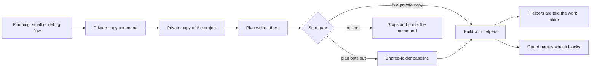
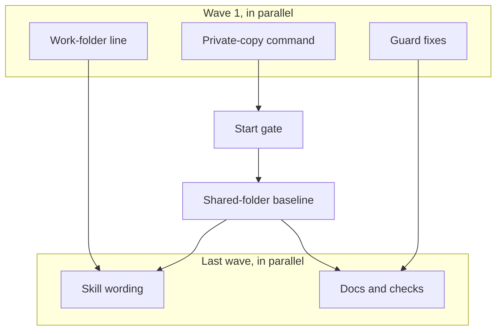

# Run isolation: review plan

Covers issues #136, #137, #138 and #139.

## Summary
Today a superlite build starts in the project folder that every session shares, and switches that folder to a new branch. When a second session works there, both collide, and superlite notices only when it tries to save the first task. This change makes every superlite change start in its own private copy of the project (a git worktree), checks that before any helper starts, tells every helper which folder to work in, and removes two obstacles that made the recovery slow.

## What you will get
- One command that creates the private copy, or reports the one you are already in. Same place and same name every time; the shared folder stays on its branch.
- Planning, small changes and debugging all call that command before the first file is written.
- A build refuses to start outside a private copy, unless the plan says so in its header. That choice is listed in the closing summary.
- Every helper is told the exact folder to work in. You get a warning when the session sits somewhere else.
- The coordinator may add a git ignore entry during a run. When the guard blocks a command, it names what tripped it.
- A build that deliberately runs in the shared folder lists the files that were already changed at the start, and later says whether a blocking file changed before or during the run.

## What will be built
| Part | What it does | Size | Built by |
|---|---|---|---|
| Private-copy command | Creates or finds the run's private copy and prints where it is. | M | a careful helper |
| Start gate | Stops a build that is not in a private copy, unless the plan opts out. | S | a careful helper |
| Work-folder line | Tells each helper the run's folder and warns when the session is elsewhere. | S | a fast helper |
| Guard fixes | Lets the ignore entry through and names the blocked target in the message. | S | a careful helper |
| Shared-folder baseline | Records the files already changed at the start and uses them when a save is refused. | M | a careful helper |
| Skill wording | Makes the planning, small and debug flows call the command first and removes "no worktree". | S | a fast helper |
| Docs and checks | Updates the tool and hook pages and adds one end-to-end check. | S | a fast helper |

## How it fits together

## How it gets built

## Decisions you can change
- Where the private copy lives: inside the project, in the hidden folder Claude Code already uses for worktrees (default) | a sibling folder next to the project
- What the copy starts from: the current local state of the shared folder (default) | the latest state on GitHub
- Opting out: one line in the plan header, listed at the end of the run (default) | no opt-out at all
- Small and debug flows: also use a private copy, as you chose today (default) | planned builds only
- Automatic feedback logging (#140) and dependency setup in fresh copies (#141): separate builds afterwards (default) | include them now
- Commits: leave my work uncommitted, superlite takes hidden checkpoints (default) | commit each task on my branch

## Risks
- A fresh private copy has no installed dependencies, so a first test run can fail for that reason. Until #141 the command prints a reminder.
- Small and debug flows have no start gate. Only the skill wording protects them; the end-to-end check covers planned builds.
- A project that is already isolated without being a git worktree (a cloud sandbox) would be stopped. The opt-out line covers it, and the stop message says so.
- Another branch in this repository is changing the guard. The guard change stays in two small spots, and the merge order is checked before finishing.
- A build that is already running in a shared folder must keep working. The gate applies when a build starts, not when it resumes.

## Out of scope
- Automatic feedback logging (#140) and dependency setup (#141).
- The two test-runner count problems (#142, #143).
- Moving a running build into a private copy.
- Checking for other sessions.

## How we will know it works
- Starting a build in the shared folder stops with a message that names the command. After running the command, the build starts.
- Running the command twice gives the same folder, and the shared folder is still on its branch.
- A plan with the opt-out line builds in place, and the closing summary lists that choice.
- A helper started from a session in another folder changes files only in the private copy.
- The ignore entry passes during a run. A blocked command's message names the file.
- In a shared-folder build, a file changed before the start is reported as changed before the start.
- The repository's own test layers are green: unit, headless and evals.

## Rough time and cost
Seven parts, five of them small: about 30 to 50 minutes and $8 to $15 (rough, until the machine plan is linted).
