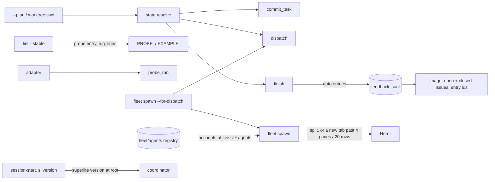
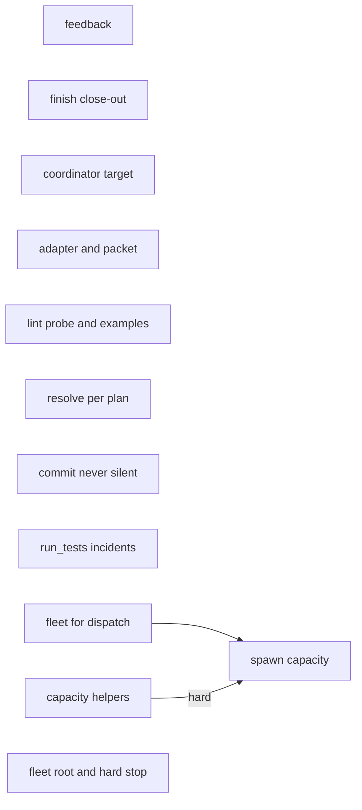
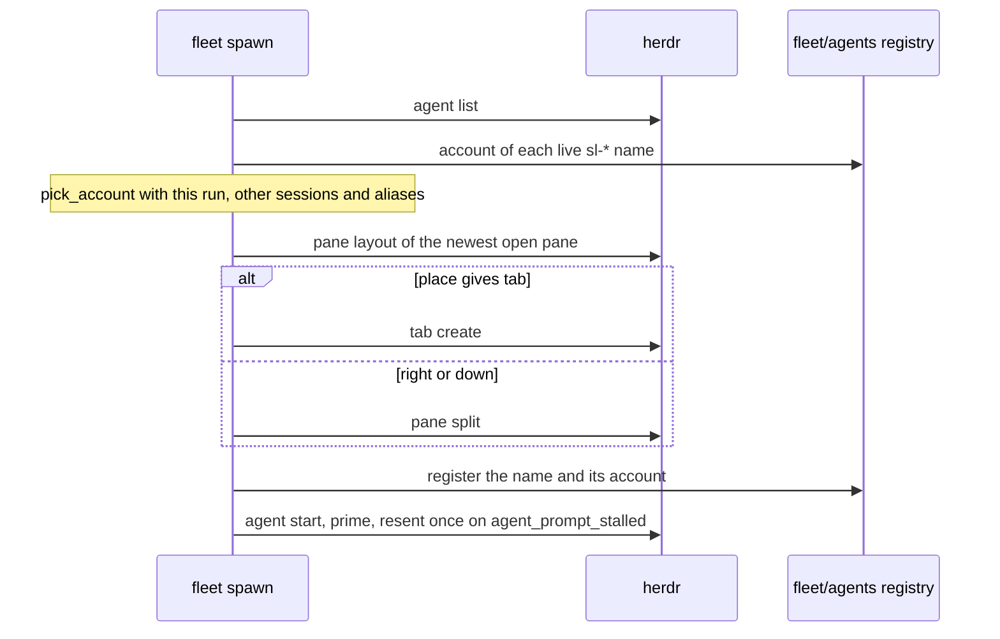

# Superlite: run tooling from the first fleet session

**Goal:** fix what the first autonomous fleet session found: run state stays per plan when one coordinator runs several plans (#178); `commit_task` never skips a checkpoint silently (#179); lint checks the probe entry and `e.g.` lines properly and the adapter never goes stale (#177); the final packet lets the reviewer read truncated files, and red-run incidents resolve themselves (#180); one fleet call spawns and sends per dispatch line (#181); superlite-side stops become feedback without anyone asking, and `finish` asks for friction (#140); triage finds issues that already name an entry, open or closed (#182); the coordinator has a measured cost target per task (#112). Phase 1 of the fleet-leads design (#186, without spikes S1-S3): `fleet spawn` opens a new Herdr tab past 4 panes or under 20 rows, spreads accounts over the live workers of every superlite session on the machine, resends a stalled prime once, and refuses `current` and config-dir accounts at their cap; agent names stay unique per run root (spike S1). Fleet asked for but missing or stale stops hard and visibly (#185).
**Architecture:** twelve tasks. T1-T8, T10 and T11 are independent, one per module, so no two share a file; T12 (spawn capacity) follows T9 (shares `fleet.py`, `fleet.md`) and T10 (its tests run T10's helpers).
**Tech stack:** Python 3.10+ stdlib, bash, pytest, Markdown.
**Spec:** this file, section Design; the issue bodies of #112, #140, #177-#182, #185, #186; `docs/plans/2026-11-05-fleet-leads.md` units 12-13 (phase 1).
**Detail:** contracts
**Target-min:** 10
**Wave0:** none
**Coverage:** off (bug batch; phase 1 narrows the design's table, section Coverage)
**Max chars:** 56000

Global constraints:
- Python 3.10+ stdlib; follow the style of `skills/subagent-driven-development/scripts/` including per-line `# O(...)` comments.
- Verify with `<abs sl> run_tests --fast <your test files> --task Tn --background`, then the printed `wait:` line; also run the existing test files the task names, unchanged unless the task says to update them.
- Feedback entries keep today's scrubbing (`feedback.scrub`: home paths, e-mail addresses, tokens). Nothing leaves the machine.
- No version bump in a task.

Ruling: #112 target = coordinator run cost of $1.00 per task, from the five run-scoped reports (per task $2.06, $1.96, $1.21, $0.46, $0.09; median $1.21, rounded down to make it a goal) - cost if wrong: the hint fires early or late; the number lives in one constant.
Ruling: #140 auto feedback is written by `finish` from the run's incidents (guard blocks, commit scope blocks, lint refusals, test runs with no parsable result), one entry per distinct signature, kind `auto`; triage lists an auto group only when it holds at least 2 entries - cost if wrong: a one-off block waits for a second sighting.
Ruling: #178 is fixed by resolving every default from `--plan` (or the cwd's worktree) before the session binding, not by refusing a second plan - cost if wrong: none; refusing would block a valid workflow.
Ruling: batch 6 absorbs phase 1 of `docs/plans/2026-11-05-fleet-leads.md` (#186 without spikes S1-S3, plus #185) and spike S1's name fix (orchestrator, 2026-11-05) - cost if wrong: one larger PR.
Ruling: #186 cap refusal: named accounts are refused at their cap since #168; T10 and T12 close the hole for `current` and config-dir entries, matched to their claude-profile account by config dir - cost if wrong: an entry whose dir no listing names still spawns unchecked, as today.
Ruling: machine-wide spread reads a registry `$SUPERLITE_HOME/fleet/agents/<name>` (the account of each worker name, written at spawn) for the live `sl-*` names of `herdr agent list`; Herdr has no account field and a lead's cwd is not its parent's run (spike S1) - cost if wrong: workers started by an older superlite are not counted.
Ruling: tabs: at most 4 of the run's panes per tab; a down split goes from the tallest pane and opens a tab instead when `rows // 2 < 20` - cost if wrong: two constants in `fleet_state`.
Ruling: the prime is resent once on `agent_prompt_stalled`; a duplicate prime only makes the worker answer READY twice - cost if wrong: none.
Ruling: agent names always carry 4 hex of sha1(run root), `sl-<folder, cut>-<hash>-wN`, so folders with equal or long shared names never collide (spike S1) - cost if wrong: names change once; `fleet.json` stores names, so old workers stay addressable.
Ruling: #185: session-start and `sl` (bare, `version`, unknown tool) print `superlite <version> at <root>`; the hard stop is a 54-character pointer in SDD's fleet line (its file cap is 11,700) and full text in `fleet.md`; `using-superlite` stays at its 1,500 cap; `sl doctor` and the `installed_plugins.json` check stay out - cost if wrong: a session that never loads SDD sees only the root line.
Ruling: `T10 -->|hard| T12` (no Wave 0 stubs; every spawn test runs T10's helpers) and `T9 --> T12` (shared `fleet.py`, `fleet.md`; T12 keeps T9's tests green) - cost if wrong: T12 starts about 2 minutes later.
Ruling: T10-T12 carry verbatim test code (the design's `tests` ruling for phase plans); T1-T9 stay at `contracts` - cost if wrong: none.
Ruling: T11 touches `hooks/session-start`, so this batch also runs the tui layer - cost: one tui run of quota.

## Coverage

Phase 1 (#185, #186, spike S1's name fix) narrows the design's table (`docs/plans/2026-11-05-fleet-leads.md`, section Coverage); the batch-6 bug fixes keep `**Coverage:** off`.

| Category | State | Basis |
|---|---|---|
| Scope and success criteria | ruled | #186 without spikes S1-S3, #185, S1's name fix; done when 8 workers of one run start in two tabs with no `no READY`, and two sessions spread over the accounts. Out: roles, leads, `sl doctor`. |
| Interfaces and contracts | ruled | T10 Produces; `fleet spawn` lines unchanged except `no READY (pane R rows, C cols)`; new `sl version`; agent names gain a hash. |
| Concurrency and state ownership | ruled | Ruling: registry `$SUPERLITE_HOME/fleet/agents/<name>`, one file per name, written only by spawn; other runs' `fleet.json` is never read or written. |
| Error handling and recovery | ruled | A failing `agent list` counts this run only; one prime resend; a dead layout anchor is today's dead-pane retry; fleet asked for and missing: BLOCKED, never in-process. |
| Performance and limits | ruled | Ruling: 4 panes per tab, 20 rows. |
| Research unknowns | n/a | Spikes S1-S3 run outside this plan; S1's phase-1 findings are in T10 and T12. |

## Design

1. **#178 (T6, T7, T2).** `state.resolve` order: explicit plan; `$SUPERLITE_STATE_DIR`; the `.superlite` of the linked worktree that contains the cwd when it holds a run marker; the session binding; `./.superlite`. `dispatch`, `commit_task` and `finish` compute `--pool`, `--ledger` and `--log` defaults after parsing, from `--plan` when given.
2. **#179 (T7).** A task that is not checkpointed always prints `Tn FAILED: <reason>` and makes the call exit non-zero. A dirty file outside every Owns that the task did not touch no longer blocks the task: it is listed as `left uncommitted (outside every Owns): F` and the task's own files are checkpointed.
3. **#177 (T4, T5).** Lint checks that a `call=` probe entry names a `Produces` function with exactly one required parameter (`PROBE:` issue otherwise). `adapter` deletes a stale `adapter.py` when the plan has no entry; `probe_run` refuses an adapter whose entries differ from the plan's and reports arity errors as `setup-error`, not `crash`. An `e.g.` line counts for a Produces when it contains the call and `->` anywhere; consumers on hard edges skip `EXAMPLE:`.
4. **#180 (T4, T8).** The packet names each truncated file with its path; `agents/final-reviewer.md` lets the reviewer read a truncated file in full. `run_tests --task Tn` resolves the task's open `test-failure` incidents for tests that now pass.
5. **#181 (T9).** `fleet spawn --for-dispatch` runs `dispatch`, spawns one worker per `fresh` line, sends each line's tasks (reusing the worker for `agent=Wn` lines), prints one line per worker, and reports a BLOCKED spawn without stopping the rest.
6. **#140 (T2, T1, T5, T8).** `finish` appends the auto feedback (ruling) and prints the run's superlite-side stops plus the friction prompt. `lint --stable` refusals and `run_tests` runs with no parsable result log an incident (`kind` `rule-block` and `no-result`).
7. **#182 (T1).** Triage fetches open and closed issues (closed within 30 days); a group whose entry id appears in an issue's body or comments is shown as that issue and its entries are marked.
8. **#112 (T3).** `budget` and `report` compare the coordinator's run cost per task with the target; the hint fires above it.
9. **#186 (T10, T12).** Spawn reads the layout of the tab holding the run's newest open pane: one pane splits right, more split down from the tallest; a fifth pane, or a down split leaving under 20 rows, opens a new tab in the run's workspace. `no READY` names the pane's rows and columns. Account choice adds the live `sl-*` agents of other sessions per account (registry, ruling); a failing agent list counts this run only. The prime is resent once on `agent_prompt_stalled`. `current` and config-dir entries take the caps of their claude-profile account.
10. **Spike S1 names (T12).** `fleet_state.agent_name` is `sl-<run folder, cut>-<4 hex of sha1(run root)>-wN`, at most 32 characters.
11. **#185 (T11, T12).** session-start and `sl` print `superlite <version> at <root>`; SDD's fleet line and `fleet.md`: fleet asked for but `sl fleet` unknown or `fleet spawn` exits 3 means report BLOCKED with the exact error before any dispatch, never in-process agents; feedback comes in addition. `fleet.md` says fleet covers one taskgraph plan in one checkout.

## Main diagram



## File structure

- `skills/subagent-driven-development/scripts/feedback.py`, `tests/scripts/test_feedback_auto.py`: T1.
- `.../scripts/finish.py`, `tests/scripts/test_finish_closeout.py`: T2.
- `.../scripts/budget.py`, `.../scripts/report.py`, `tests/scripts/test_coordinator_target.py`: T3.
- `.../scripts/pt_review.py`, `skills/subagent-driven-development/probes/probe_run.py`, `agents/final-reviewer.md`, `tests/scripts/test_adapter_and_packet.py`: T4.
- `.../scripts/plan_tools.py`, `.../scripts/shape.py`, `tests/scripts/test_lint_probe_examples.py`: T5.
- `.../scripts/state.py`, `.../scripts/dispatch.py`, `tests/scripts/test_resolve_per_plan.py`: T6.
- `.../scripts/commit_task.py`, `tests/scripts/test_commit_never_silent.py`: T7.
- `.../scripts/run_tests.py`, `tests/scripts/test_run_tests_resolve.py`: T8.
- `.../scripts/fleet.py`, `skills/subagent-driven-development/fleet.md`, `tests/scripts/test_fleet_for_dispatch.py`: T9.
- `.../scripts/herdr_client.py`, `.../scripts/accounts.py`, `.../scripts/fleet_state.py` (helpers), `tests/scripts/fixtures/fleet/herdr`, `tests/scripts/test_fleet_capacity_helpers.py`: T10.
- `hooks/session-start`, `.../scripts/sl`, `skills/subagent-driven-development/SKILL.md`, `tests/scripts/test_fleet_hard_stop.py`: T11.
- `.../scripts/fleet.py`, `.../scripts/fleet_state.py` (`agent_name`), `.../fleet.md`, `docs/fleet.md`, `tests/scripts/test_fleet.py`, `test_fleet_state.py`, `test_docs_contract.py`, `test_fleet_capacity.py`: T12, after T9 and T10.

## Task graph

```mermaid
%% schedule
gantt
  title Predicted schedule (mm:ss)
  dateFormat X
  axisFormat %M:%S
  section lane 1
  T10 capacity helpers :t10, 0, 174s
  T12 spawn capacity :t12, 174, 186s
  section lane 2
  T11 fleet root and hard stop :t11, 0, 151s
  section lane 3
  T4 adapter and packet :t4, 0, 145s
  section lane 4
  T5 lint probe and examples :t5, 0, 142s
  section lane 5
  T6 resolve per plan :t6, 0, 139s
  section lane 6
  T3 coordinator target :t3, 0, 136s
  section lane 7
  T1 feedback :t1, 0, 133s
  section lane 8
  T2 finish close-out :t2, 0, 133s
  section lane 9
  T9 fleet for dispatch :t9, 0, 130s
  section lane 10
  T7 commit never silent :t7, 0, 127s
  T8 run_tests incidents :t8, 127, 124s
```





critical path: T10 → T12 (6.0 min) · peak width 10 · predicted build 6.0 min · predicted total ≈ 9.5 min (target ✓)

## Run scripts

**Probe entry:** none (CLI tools over files and git; unit tests drive them in tmp repos).

Package review focus: app type CLI and file I/O. Categories: state (two plans, one session; a worker's env), file (worktree versus main checkout), protocol (CLI output lines other tools parse: `Tn <sha>`, `Tn FAILED`, dispatch lines).

### T1 feedback · Complexity 4 · Est. context 32k
**Owns:** skills/subagent-driven-development/scripts/feedback.py, tests/scripts/test_feedback_auto.py
**Components:** 1
**LOC owned:** 90
**Tests:** fast
**Model:** sonnet
**Est. time:** 2.5 min (1 component, about 90 LOC, fast tests)
**Produces:** feedback.add_auto(tool: str, reason: str, target: str, version: str) -> bool
e.g. add_auto("block-coordinator-edits", "rule-block", "src/a.py", "1.5.6") -> True (appends one scrubbed entry of kind auto); the same signature again in the same run -> True (a second entry; triage groups them)
**Review Focus:** `test_triage_marks_closed_issue`: a fake `gh` (PATH) returning one closed issue (closed 3 days ago) whose comment holds `Feedback entry: abc123def456`; triage shows the group as that issue and marks the entry.
**Test code (contracts):**
- `test_add_auto_scrubs`: a target `/Users/x/p/src/a.py` and a reason holding an e-mail address are stored as `~/p/src/a.py` and `<email>`; `kind` is `auto`.
- `test_auto_groups_need_two`: one auto entry is not listed by triage; two with the same tool and reason are listed as one group ×2; non-auto groups of one are listed as before.
- `test_triage_marks_closed_issue`: as in Review Focus; an issue closed 40 days ago is not fetched.
- Keep `tests/scripts/test_feedback.py` and `test_feedback_file.py` green (run them).
**Steps:** 1 failing tests, 2 run: FAIL, 3 implement, 4 run: PASS
**Notes:** Add `auto` to `KINDS`. Fetch closed issues with `gh issue list --state closed --search "closed:>=<date>" --json number,title,body,comments`. The signature of an auto entry is `tool + reason` (target excluded).

### T2 finish close-out · Complexity 4 · Est. context 34k
**Owns:** skills/subagent-driven-development/scripts/finish.py, tests/scripts/test_finish_closeout.py
**Components:** 1
**LOC owned:** 90
**Tests:** fast
**Model:** sonnet
**Est. time:** 2.5 min (1 component, about 90 LOC, fast tests)
**Consumes:** feedback.add_auto(tool: str, reason: str, target: str, version: str) -> bool (T1)
**Review Focus:** `test_finish_reports_stops_and_logs_auto`: a run folder whose `incidents.jsonl` holds two `rule-block` entries (same tool) and one `no-result`; `finish --plan P` prints `superlite stops this run: 2 rule-block (block-coordinator-edits), 1 no-result (run_tests)` and calls `add_auto` three times (monkeypatched), then the friction line.
**Test code (contracts):**
- `test_finish_reports_stops_and_logs_auto`: as in Review Focus (a fake `add_auto` returns True, as in T1's `e.g.`).
- `test_no_stops_no_line`: no such incidents: no `superlite stops` line; the friction line stays.
- `test_finish_defaults_follow_plan`: with the session bound to another run folder, `finish --plan P` reads P's folder for ledger and log (#178).
**Steps:** 1 failing tests, 2 run: FAIL, 3 implement, 4 run: PASS
**Notes:** Incident kinds to count: `rule-block`, `rule-rewrite`, `guard-error`, `no-result`, and the commit scope incidents `commit_task` logs today (read `commit_task.py` for their kind). Import `feedback` lazily; a failure to write feedback never fails `finish`.

### T3 coordinator target · Complexity 3 · Est. context 30k
**Owns:** skills/subagent-driven-development/scripts/budget.py, skills/subagent-driven-development/scripts/report.py, tests/scripts/test_coordinator_target.py
**Components:** 2
**LOC owned:** 60
**Tests:** fast
**Model:** sonnet
**Est. time:** 2 min (2 components, about 60 LOC, fast tests)
**Review Focus:** `test_report_shows_per_task_cost`: a report with coordinator run cost $6.00 and 4 tasks renders `coordinator per task $1.50 (target $1.00)` in the cost split.
**Test code (contracts):**
- `test_report_shows_per_task_cost`: as in Review Focus; with 0 tasks the line is omitted.
- `test_budget_hint_above_target`: `budget.compute` adds the coordinator hint when run cost per committed task is above `COORDINATOR_TARGET_USD` (1.00) and the run has at least 3 committed tasks; not at $0.90 per task.
- Keep `tests/scripts/test_report.py` and `test_coordinator_run_scope.py` green.
**Steps:** 1 failing tests, 2 run: FAIL, 3 implement, 4 run: PASS
**Notes:** One constant `COORDINATOR_TARGET_USD = 1.00` in `budget.py`, imported by `report.py`.

### T4 adapter and packet · Complexity 4 · Est. context 38k
**Owns:** skills/subagent-driven-development/scripts/pt_review.py, skills/subagent-driven-development/probes/probe_run.py, agents/final-reviewer.md, tests/scripts/test_adapter_and_packet.py
**Components:** 2
**LOC owned:** 90
**Tests:** fast
**Model:** sonnet
**Est. time:** 3 min (2 components, about 90 LOC, fast tests)
**Review Focus:** `test_adapter_removed_when_entry_none`: a run with `.superlite/probes/adapter.py` and a plan whose probe entry is `none`: `adapter` deletes the file and prints `adapter: no Probe entry lines; removed stale adapter.py`.
**Test code (contracts):**
- `test_adapter_removed_when_entry_none`: as in Review Focus.
- `test_probe_run_refuses_mismatched_adapter`: an adapter built for `call=a.f` while the plan says `call=a.g`: `probe_run` prints `probe_run: adapter is stale (plan entry changed); rebuild with plan_tools adapter` and runs nothing.
- `test_arity_error_is_setup_error`: a `call=` target taking 3 required args: every probe result has status `setup-error`, none `crash`; no regression test file is written.
- `test_packet_names_truncated_paths`: a packet whose excerpt of `src/a.py` is cut prints `(truncated: n of m lines; read src/a.py in full)`.
- `test_final_reviewer_may_read_truncated`: `agents/final-reviewer.md` says the reviewer may read a file the packet marks truncated, and still nothing else.
- Keep `tests/scripts/test_pt_review.py`, `test_probe_run.py`, `test_packet_batch.py`, `test_packet_stale.py` green.
**Steps:** 1 failing tests, 2 run: FAIL, 3 implement, 4 run: PASS
**Notes:** Record the plan's entries in the adapter (a constant `ENTRIES`) so `probe_run` can compare.

### T5 lint probe and examples · Complexity 4 · Est. context 36k
**Owns:** skills/subagent-driven-development/scripts/plan_tools.py, skills/subagent-driven-development/scripts/shape.py, tests/scripts/test_lint_probe_examples.py
**Components:** 2
**LOC owned:** 80
**Tests:** fast
**Model:** sonnet
**Est. time:** 2.5 min (2 components, about 80 LOC, fast tests)
**Review Focus:** `test_lint_rejects_multi_arg_call_entry`: a plan with `**Probe entry:** call=mod.f` where `mod.f(a: str, b: int) -> bool` is a Produces line: lint prints `PROBE: call=mod.f takes 2 required parameters; probes pass one text argument` and the task holding the section is a FIX task.
**Test code (contracts):**
- `test_lint_rejects_multi_arg_call_entry`: as in Review Focus; `mod.f(text: str) -> bool` passes; a `call=` target no Produces names prints `PROBE: call=mod.h is not a Produces of this plan`.
- `test_example_anywhere_in_line`: `e.g. after record_green(s, "u", "h", {}): changed_files(s, "u", {}) -> []` counts as an example for `changed_files`.
- `test_hard_edge_skips_example`: a consumer on `T1 -->|hard| T2` with a producer without `e.g.` gets no `EXAMPLE:`.
- `test_lint_stable_refusal_logs_incident`: a refused `lint --stable` (shared checkout or human gate) appends a `rule-block` incident with `tool` `lint --stable`.
- Keep `tests/scripts/test_shape.py` and `test_lint_pix_v2.py` green.
**Steps:** 1 failing tests, 2 run: FAIL, 3 implement, 4 run: PASS
**Notes:** `shape.CALL` drops its `^` anchor (search, not match); keep the name-or-member comparison of `has_example`.

### T6 resolve per plan · Complexity 4 · Est. context 36k
**Owns:** skills/subagent-driven-development/scripts/state.py, skills/subagent-driven-development/scripts/dispatch.py, tests/scripts/test_resolve_per_plan.py
**Components:** 2
**LOC owned:** 70
**Tests:** fast
**Model:** sonnet
**Est. time:** 2.5 min (2 components, about 70 LOC, fast tests)
**Review Focus:** `test_two_plans_one_session`: a session bound to run A's folder; from run B's worktree cwd, `state.resolve()` returns B's `.superlite` when B holds a run marker; `dispatch --plan B` uses B's pool and ledger.
**Test code (contracts):**
- `test_two_plans_one_session`: as in Review Focus.
- `test_order_unchanged_elsewhere`: with no linked worktree in the cwd, the binding still wins over `./.superlite`; `$SUPERLITE_STATE_DIR` still wins over both.
- `test_dispatch_defaults_after_parse`: `dispatch --plan B` without `--pool` reads `<B run folder>/pool.json` even when the binding points at A.
- Keep `tests/scripts/test_session_state.py` and `test_run_state_binding.py` green.
**Steps:** 1 failing tests, 2 run: FAIL, 3 implement, 4 run: PASS
**Notes:** A run marker is `stable.json`, `prime.md` or `pool.json`. Find the containing linked worktree by walking up from the cwd to a folder whose `.git` is a file.

### T7 commit never silent · Complexity 4 · Est. context 34k
**Owns:** skills/subagent-driven-development/scripts/commit_task.py, tests/scripts/test_commit_never_silent.py
**Components:** 1
**LOC owned:** 70
**Tests:** fast
**Model:** sonnet
**Est. time:** 2.5 min (1 component, about 70 LOC, fast tests)
**Review Focus:** `test_unowned_dirty_file_does_not_block`: a run with task T5 owning `a.py` (changed) and an unrelated dirty `notes/x.txt` outside every Owns: `commit_task T5` checkpoints `a.py`, prints `T5 <sha>` and `left uncommitted (outside every Owns): notes/x.txt`, exit 0.
**Test code (contracts):**
- `test_unowned_dirty_file_does_not_block`: as in Review Focus.
- `test_single_task_failure_prints_failed`: a single task whose own file has a syntax error prints `T5 FAILED: <reason>` and exits 1; "nothing to commit" prints `T5 FAILED: nothing to commit` on stdout.
- `test_defaults_follow_plan`: with the session bound to another run, `commit_task T5 --plan B` writes B's ledger and log (#178).
- Keep `tests/scripts/test_commit_baseline.py`, `test_commit_running_scope.py`, `test_commit_scope_batch.py` green; update an existing assertion only where it pins the old blocking of an unrelated file, and say which.
**Steps:** 1 failing tests, 2 run: FAIL, 3 implement, 4 run: PASS
**Notes:** A file another task owns or a dirty-before-the-run file keeps today's handling.

### T8 run_tests incidents · Complexity 3 · Est. context 30k
**Owns:** skills/subagent-driven-development/scripts/run_tests.py, tests/scripts/test_run_tests_resolve.py
**Components:** 1
**LOC owned:** 60
**Tests:** fast
**Model:** sonnet
**Est. time:** 2 min (1 component, about 60 LOC, fast tests)
**Review Focus:** `test_green_run_resolves_red_incidents`: a red run of `tests/test_a.py` with `--task T3` logs open `test-failure` incidents carrying `task` `T3`; a later green run of the same file with `--task T3` appends a resolution for each (`resolution` `fixed`, ruling `passed on a later run`), so `incident hotspots` no longer lists them.
**Test code (contracts):**
- `test_green_run_resolves_red_incidents`: as in Review Focus.
- `test_other_task_not_resolved`: a green run for `--task T4` leaves T3's incidents open.
- `test_no_result_logs_incident`: a pytest run that produces no results logs one incident `kind` `no-result`, `agent` `run_tests`.
- Keep `tests/scripts/test_run_tests_record.py` and `test_finish_open_incidents.py` green.
**Steps:** 1 failing tests, 2 run: FAIL, 3 implement, 4 run: PASS
**Notes:** Use the resolution format `sl incident resolve` writes (read `incident.py`).

### T9 fleet for dispatch · Complexity 4 · Est. context 34k
**Owns:** skills/subagent-driven-development/scripts/fleet.py, skills/subagent-driven-development/fleet.md, tests/scripts/test_fleet_for_dispatch.py
**Components:** 1
**LOC owned:** 80
**Tests:** fast
**Model:** sonnet
**Est. time:** 2.5 min (1 component, about 80 LOC, fast tests)
**Review Focus:** `test_for_dispatch_spawns_per_line`: dispatch lines `T2,T4 fresh tier=sonnet agent=superlite:implementer`, `T3 fresh tier=sonnet agent=superlite:implementer`, `T5 agent=W1 tier=sonnet` (fake herdr and fake dispatch): `fleet spawn --for-dispatch --plan P` spawns two workers, sends `T2,T4` and `T3` to them and `T5` to W1, and prints one `Wn T.. sent` line per worker.
**Test code (contracts):**
- `test_for_dispatch_spawns_per_line`: as in Review Focus.
- `test_blocked_spawn_continues`: the first spawn exits BLOCKED: its line prints `BLOCKED: T2,T4 not sent (<reason>)` and the next line is still spawned and sent; the call exits 3 when any line was blocked.
- `test_wave0_line_left_to_coordinator`: a `T0 wave0` line is printed as `T0: run the Wave 0 Agent line yourself` and not spawned.
- `fleet.md`: names `fleet spawn --for-dispatch` as the one call per dispatch round.
- Keep `tests/scripts/test_fleet.py` and `test_dispatch_fleet.py` green.
**Steps:** 1 failing tests, 2 run: FAIL, 3 implement, 4 run: PASS
**Notes:** Reuse `dispatch.run`/`render` and `fleet_io.send` (import, do not copy); catch `SystemExit(3)` from `spawn`. Fake herdr: import `FakeHerdr` and the `world` fixture from `test_fleet` (T12 extends them for tabs, layouts and the agent list); define no second fake herdr.

## Fleet capacity and hard stop (phase 1)

**Probe entry:** none (Herdr and claude-profile are faked; unit tests drive spawn, the hook and `sl` in tmp folders).

Package review focus: app type concurrency and CLI. Categories: state (other sessions' workers, a dead layout anchor, a stale registry name), numeric (the 20-row bound), protocol (herdr argv and result shapes; `BLOCKED` and `superlite <version> at <root>` lines), encoding (a plugin root with a space in session-start's JSON).

### T10 capacity helpers · Complexity 5 · Est. context 50k
**Owns:** skills/subagent-driven-development/scripts/herdr_client.py, skills/subagent-driven-development/scripts/accounts.py, skills/subagent-driven-development/scripts/fleet_state.py, tests/scripts/fixtures/fleet/herdr, tests/scripts/test_fleet_capacity_helpers.py
**Components:** 3
**LOC owned:** 150
**Tests:** fast
**Model:** sonnet
**Est. time:** 2.5 min (3 components, about 150 LOC, fast tests)
**Produces:** herdr_client.create_tab(workspace_id: str, cwd: str, env_vars: dict) -> tuple[str, str]
e.g. create_tab("w6", "/proj", {"SUPERLITE_FLEET_WORKER": "W5"}) -> ("w6:t2", "w6:p5")
**Produces:** herdr_client.pane_layout(pane_id: str) -> list[dict]
e.g. pane_layout("w6:p1") -> [{"pane_id": "w6:p1", "rows": 64, "cols": 73}, {"pane_id": "w6:p2", "rows": 64, "cols": 73}]
**Produces:** herdr_client.agents() -> list[dict]
e.g. agents() -> [{"name": "sl-proj-w1", "agent_status": "done", "pane_id": "w6:p1", "cwd": "/u/proj"}] (agents without a name are dropped)
**Produces:** fleet_state.place(panes: list[dict], max_panes: int = 4, min_rows: int = 20) -> tuple[str, str | None]
e.g. place([{"pane_id": "w6:p1", "rows": 64, "cols": 147}]) -> ("right", "w6:p1")
e.g. place([{"pane_id": "w6:p1", "rows": 32, "cols": 73}, {"pane_id": "w6:p2", "rows": 64, "cols": 73}, {"pane_id": "w6:p3", "rows": 32, "cols": 73}]) -> ("down", "w6:p2")
e.g. place([{"pane_id": "w6:p1", "rows": 39, "cols": 73}, {"pane_id": "w6:p2", "rows": 39, "cols": 73}]) -> ("tab", None); four panes -> ("tab", None)
**Produces:** fleet_state.register_agent(name: str, account: str) -> None
**Produces:** fleet_state.live_by_account(agents: list[dict], own: set[str]) -> dict[str, int]
e.g. live_by_account([{"name": "sl-main-1a2b-w2", "agent_status": "working", "cwd": "/u/x", "pane_id": "w9:p1"}], set()) -> {"claude3": 1} once register_agent("sl-main-1a2b-w2", "claude3") ran; a name unregistered, in `own`, not `sl-*` or registered as `current` -> not counted
**Produces:** accounts.aliases(listing: dict, entries: list[str], env: dict | None = None) -> dict[str, str]
e.g. aliases({"accounts": [{"name": "claude1", "dir": "/u/.claude-account1"}]}, ["current", "/u/.claude-account1/", "/u/.claude-x", "claude3"], {"CLAUDE_CONFIG_DIR": "/u/.claude-account1"}) -> {"current": "claude1", ".claude-account1": "claude1"}
**Produces:** accounts.pick_account(usage: dict, allowed: list[str], running: dict | None = None, tier: str | None = None, alias: dict | None = None) -> str | None
e.g. pick_account({"accounts": [acc("claude1", 1, session=95)]}, ["current"], {}, "sonnet", {"current": "claude1"}) -> None; with claude1 at weekly_all 10 -> "current"
**Produces:** accounts.reasons(usage: dict, allowed: list[str], tier: str | None = None, alias: dict | None = None) -> list[str]
e.g. reasons({"accounts": [acc("claude1", 1, session=95)]}, ["current"], "sonnet", {"current": "claude1"}) -> ["current: 5-hour 95%"]
**Review Focus:** `test_place_down_split_under_20_rows_opens_tab`: two panes of 39 rows give ("tab", None), 40 and 39 rows give ("down", "w6:p1"); `test_live_by_account_counts_other_sessions`: two workers of other sessions registered on claude3 count claude3 twice; own, unregistered, `current` and non-`sl-` names count nothing.
**Test code (verbatim):**
```python
# tests/scripts/test_fleet_capacity_helpers.py
import sys
from test_accounts import acc
from test_herdr_client import fake  # noqa: F401  (fixture)
from test_plan_tools import SCRIPTS
sys.path.insert(0, str(SCRIPTS))
import accounts as ac  # noqa: E402
import fleet_state as fs  # noqa: E402
import herdr_client as hc  # noqa: E402

LISTING = {"accounts": [{"name": "claude1", "dir": "/u/.claude-account1"}, {"name": "claude3", "dir": "/u/.claude-account3"}]}

def pane(i, rows, cols=73):
    return {"pane_id": f"w6:p{i}", "rows": rows, "cols": cols}

def row(name, i=1):
    return {"name": name, "agent_status": "working", "cwd": "/u/x", "pane_id": f"w9:p{i}"}

def test_place_examples():
    assert fs.place([pane(1, 64, 147)]) == ("right", "w6:p1")
    assert fs.place([pane(1, 64), pane(2, 64)]) == ("down", "w6:p1")
    assert fs.place([pane(1, 32), pane(2, 64), pane(3, 32)]) == ("down", "w6:p2")
    assert fs.place([pane(i, 32) for i in (1, 2, 3, 4)]) == ("tab", None)
    assert fs.place([]) == ("tab", None)

def test_place_down_split_under_20_rows_opens_tab():
    assert fs.place([pane(1, 39), pane(2, 39)]) == ("tab", None)
    assert fs.place([pane(1, 40), pane(2, 39)]) == ("down", "w6:p1")

def test_live_by_account_counts_other_sessions():
    for name, account in (("sl-main-1a2b-w2", "claude3"), ("sl-dashmax-3c4d-w31", "claude3"),
                          ("sl-other-5e6f-w1", "current"), ("sl-proj-7a8b-w1", "claude1")):
        fs.register_agent(name, account)
    names = ("sl-main-1a2b-w2", "sl-dashmax-3c4d-w31", "sl-other-5e6f-w1", "sl-proj-7a8b-w1", "sl-gone-0000-w1", "reviewer")
    assert fs.live_by_account([row(n, i) for i, n in enumerate(names)], {"sl-proj-7a8b-w1"}) == {"claude3": 2}

def test_register_agent_overwrites_under_superlite_home(tmp_path, monkeypatch):
    monkeypatch.setenv("SUPERLITE_HOME", str(tmp_path / "h"))
    fs.register_agent("sl-a-0000-w1", "claude1"); fs.register_agent("sl-a-0000-w1", "claude2")
    assert (tmp_path / "h" / "fleet" / "agents" / "sl-a-0000-w1").read_text().strip() == "claude2"
    assert fs.live_by_account([row("sl-a-0000-w1")], set()) == {"claude2": 1}

def test_aliases_match_config_dirs():
    entries = ["current", "/u/.claude-account1/", "/u/.claude-x", "claude3"]
    assert ac.aliases(LISTING, entries, {"CLAUDE_CONFIG_DIR": "/u/.claude-account1"}) == {"current": "claude1", ".claude-account1": "claude1"}
    assert ac.aliases({}, ["current"], {"CLAUDE_CONFIG_DIR": "/u/.claude-account1"}) == {}

def test_capped_alias_is_refused_with_reason():
    usage = {"accounts": [acc("claude1", 1, session=95, weekly_all=10)]}
    assert ac.pick_account(usage, ["current"], {}, "sonnet", {"current": "claude1"}) is None
    assert ac.reasons(usage, ["current"], "sonnet", {"current": "claude1"}) == ["current: 5-hour 95%"]
    weekly = {"accounts": [acc("claude1", 1, weekly_all=100)]}
    assert ac.reasons(weekly, [".claude-account1"], "sonnet", {".claude-account1": "claude1"}) == [".claude-account1: weekly_all 100%"]

def test_alias_with_headroom_is_picked():
    usage = {"accounts": [acc("claude1", 1, weekly_all=10)]}
    assert ac.pick_account(usage, ["current"], {}, "sonnet", {"current": "claude1"}) == "current"
    assert ac.pick_account(usage, ["current"]) is None   # no alias: no usage data, as before

def test_create_tab_flags_and_ids(fake):
    assert hc.create_tab("w6", "/proj", {"SUPERLITE_FLEET_WORKER": "W5"}) == ("w6:t2", "w6:p5")
    argv = fake()[0]
    assert argv[:4] == ["tab", "create", "--workspace", "w6"] and "SUPERLITE_FLEET_WORKER=W5" in argv and "--no-focus" in argv

def test_pane_layout_reads_rects(fake):
    assert hc.pane_layout("w6:p1") == [{"pane_id": "w6:p1", "rows": 64, "cols": 73}, {"pane_id": "w6:p2", "rows": 64, "cols": 73}]
    assert fake()[0] == ["pane", "layout", "--pane", "w6:p1"]

def test_agents_lists_named_agents_with_cwd(fake):
    assert [(a["name"], a["cwd"]) for a in hc.agents()] == [("sl-proj-w1", "/u/proj"), ("sl-proj-w2", "/u/proj")]
```
**Steps:** 1 failing tests, 2 run: FAIL, 3 implement, 4 run: PASS
**Notes:** `place`: a single pane splits right; otherwise the tallest pane (the first on a tie) splits down when `rows // 2 >= min_rows`; no pane, `max_panes` or more, or a too-short tallest pane give ("tab", None); constants `MAX_PANES = 4`, `MIN_ROWS = 20`. Registry: one file per agent name under `history.home() / "fleet" / "agents"` holding the account, written atomically, overwritten on reuse, never deleted (only names Herdr lists as live count). `aliases` compares `account_dir(listing, entry, env)` with each listing entry's `dir`, both through `expanduser` and `normpath`; only path entries and `current` get aliases, keyed by `entry_name`. Fake herdr binary: `tab create` replies `{"result": {"type": "tab_created", "tab": {"tab_id": "w6:t2", "workspace_id": "w6"}, "root_pane": {"pane_id": "w6:p5"}}}`; `pane layout` replies herdr 0.9.5's shape `{"result": {"type": "pane_layout", "layout": {"area": {"height": 64, "width": 147, "x": 0, "y": 0}, "panes": [{"pane_id": "w6:p1", "focused": false, "rect": {"height": 64, "width": 73, "x": 0, "y": 0}}, {"pane_id": "w6:p2", "focused": false, "rect": {"height": 64, "width": 73, "x": 74, "y": 0}}], "splits": [], "tab_id": "w6:t1", "workspace_id": "w6", "zoomed": false}}}`; the two named `agent list` rows gain `"cwd": "/u/proj"`. `fleet.py` does not call these yet (T12). Keep `test_herdr_client.py`, `test_accounts.py`, `test_fleet_state.py`, `test_fleet.py` green.

### T11 fleet root and hard stop · Complexity 3 · Est. context 42k
**Owns:** hooks/session-start, skills/subagent-driven-development/scripts/sl, skills/subagent-driven-development/SKILL.md, tests/scripts/test_fleet_hard_stop.py
**Components:** 3
**LOC owned:** 70
**Tests:** fast
**Model:** sonnet
**Est. time:** 2.5 min (3 components, about 70 LOC, fast tests)
**Review Focus:** `test_root_with_space_stays_valid_json`: a plugin copy under `plug in/` prints `superlite <version> at <its absolute path, space kept>` inside valid JSON.
**Test code (verbatim):**
```python
# tests/scripts/test_fleet_hard_stop.py
import json, os, shutil, subprocess
from pathlib import Path

ROOT = Path(__file__).resolve().parents[2]
SL = ROOT / "skills" / "subagent-driven-development" / "scripts" / "sl"
VERSION = json.loads((ROOT / "package.json").read_text(encoding="utf-8"))["version"]
LINE = f"superlite {VERSION} at {ROOT}"

def run(argv, cwd, **extra):
    env = {k: v for k, v in os.environ.items() if not k.startswith("SUPERLITE_") and k != "CLAUDE_ENV_FILE"}
    env.update(CLAUDE_PLUGIN_ROOT=str(ROOT), SUPERLITE_HOME=str(cwd / "home"), SUPERLITE_CACHE_DIR=str(cwd / "cache"), **extra)
    return subprocess.run(["bash", *map(str, argv)], input="", capture_output=True, text=True, encoding="utf-8", cwd=cwd, env=env)

def context(r):
    assert r.returncode == 0, r.stderr
    return json.loads(r.stdout)["hookSpecificOutput"]["additionalContext"]

def test_session_start_names_root_version_and_sl(tmp_path):
    ctx = context(run([ROOT / "hooks" / "session-start"], tmp_path))
    assert LINE in ctx and f"{ROOT}/skills/subagent-driven-development/scripts/sl <tool>" in ctx

def test_worker_note_stays_short(tmp_path):
    r = run([ROOT / "hooks" / "session-start"], tmp_path, SUPERLITE_FLEET_WORKER="W1")
    assert "superlite fleet worker W1" in r.stdout and LINE not in r.stdout

def test_root_with_space_stays_valid_json(tmp_path):
    root = tmp_path / "plug in"
    for rel in ("hooks/session-start", "hooks/superlite-state.sh", "skills/using-superlite/SKILL.md", "package.json"):
        (root / rel).parent.mkdir(parents=True, exist_ok=True); shutil.copy(ROOT / rel, root / rel)
    assert f"superlite {VERSION} at {root.resolve()}" in context(run([root / "hooks" / "session-start"], tmp_path))

def test_sl_version_prints_root_and_tools(tmp_path):
    r = run([SL, "version"], tmp_path)
    assert r.returncode == 0 and r.stdout.splitlines()[0] == LINE and "fleet" in r.stdout.split()

def test_unknown_and_bare_sl_name_the_copy(tmp_path):
    r = run([SL, "fleeet"], tmp_path)
    assert r.returncode == 2 and "sl: unknown tool 'fleeet'" in r.stderr and LINE in r.stderr
    r = run([SL], tmp_path)
    assert r.returncode == 2 and LINE in r.stderr

def test_sdd_fleet_line_is_a_hard_stop():
    sdd = (ROOT / "skills" / "subagent-driven-development" / "SKILL.md").read_text(encoding="utf-8")
    line = next(l for l in sdd.splitlines() if l.startswith("Fleet mode"))
    assert '"$SL" fleet on' in line and "report BLOCKED" in line and "never in-process" in line and len(sdd) <= 11700
```
**Steps:** 1 failing tests, 2 run: FAIL, 3 implement, 4 run: PASS
**Notes:** session-start: after the `Project state:` line append `superlite <version> at <root>: run its tools as <root>/skills/subagent-driven-development/scripts/sl <tool>; never search for another copy.`, `<root>` the physical plugin root (`pwd -P`), `<version>` read from `<root>/package.json` with a bash regex (`unknown` without the file); bash builtins and `printf` only; the fleet-worker branch is unchanged. `sl`: `sl version` prints `superlite <version> at <root>` (root = `pwd -P` three levels above the scripts folder) then `tools: ...` on stdout, exit 0; bare `sl` and an unknown tool print that line on stderr too. SDD `SKILL.md`: append exactly ` Missing or BLOCKED: report BLOCKED; never in-process.` to the `Fleet mode` line and change nothing else (the file then holds 11,697 of the 11,700 characters `test_orchestrator.py` allows). Keep `test_session_start.py`, `test_sl_tools.py`, `test_fleet_hooks.py`, `test_docs_contract.py`, `test_orchestrator.py`, `test_fleet_hint_wording.py` green.

### T12 spawn capacity · Complexity 5 · Est. context 62k

**Owns:** skills/subagent-driven-development/scripts/fleet.py, skills/subagent-driven-development/scripts/fleet_state.py, skills/subagent-driven-development/fleet.md, docs/fleet.md, tests/scripts/test_fleet.py, tests/scripts/test_fleet_state.py, tests/scripts/test_docs_contract.py, tests/scripts/test_fleet_capacity.py
**Components:** 3
**LOC owned:** 190
**Tests:** fast
**Model:** sonnet
**Est. time:** 3 min (3 components, about 190 LOC, fast tests)
**Consumes:** herdr_client.create_tab(workspace_id: str, cwd: str, env_vars: dict) -> tuple[str, str] (T10) · herdr_client.pane_layout(pane_id: str) -> list[dict] (T10) · herdr_client.agents() -> list[dict] (T10) · fleet_state.place(panes: list[dict], max_panes: int = 4, min_rows: int = 20) -> tuple[str, str | None] (T10) · fleet_state.register_agent(name: str, account: str) -> None (T10) · fleet_state.live_by_account(agents: list[dict], own: set[str]) -> dict[str, int] (T10) · accounts.aliases(listing: dict, entries: list[str], env: dict | None = None) -> dict[str, str] (T10) · accounts.pick_account(usage: dict, allowed: list[str], running: dict | None = None, tier: str | None = None, alias: dict | None = None) -> str | None (T10) · accounts.reasons(usage: dict, allowed: list[str], tier: str | None = None, alias: dict | None = None) -> list[str] (T10)
**Review Focus:** `test_fifth_worker_opens_a_tab`: five spawns give 1 workspace, 3 splits, 1 tab, five ready workers; `test_spawn_avoids_accounts_busy_in_other_sessions`: weekly use claude1 70 %, claude2 32 %, claude3 13 % and two live workers of other sessions (a lead and another run's worker) on claude3 give claude2, then claude1.
**Test code (verbatim):** in `tests/scripts/test_fleet.py`, `FakeHerdr` gains these members (the others stay):
```python
        self.layout, self.agent_rows, self.tab_panes = None, [], []  # in __init__: scripted pane_layout and agents replies; panes of the newest tab
    def create_workspace(self, label, cwd, env_vars):
        if self.create_error: raise self.HerdrError(self.create_error, "missing")
        self.calls.append(("create_workspace", label, env_vars)); self.tab_panes = ["w6:p1"]; return ("w6", "w6:p1")
    def split_pane(self, pane_id, direction, cwd, env_vars):
        self.calls.append(("split_pane", pane_id, direction))
        if self.split_error: e, self.split_error = self.split_error, None; raise self.HerdrError(e, "pane gone")
        pane = f"w6:p{len(self.calls) + 1}"; self.tab_panes.append(pane); return pane
    def create_tab(self, workspace_id, cwd, env_vars):
        self.calls.append(("create_tab", workspace_id)); pane = f"w6:p{len(self.calls) + 1}"; self.tab_panes = [pane]
        return (f"w6:t{len(self.calls)}", pane)
    def pane_layout(self, pane_id):
        self.calls.append(("pane_layout", pane_id))
        return self.layout if self.layout is not None else [{"pane_id": p, "rows": 64, "cols": 73} for p in self.tab_panes]
    def agents(self): return list(self.agent_rows)  # a read, not logged: the call-order tests stay as they are
    def close_pane(self, pane_id):
        self.calls.append(("close_pane", pane_id))
        if pane_id in self.tab_panes: self.tab_panes.remove(pane_id)
```
In `tests/scripts/test_fleet_state.py`, `test_agent_name_is_run_folder_plus_lowercase_worker_id` becomes:
```python
def test_agent_name_is_run_folder_hash_and_worker_id():
    sd = Path("/u/github/maxOS/.superlite")
    assert fs.agent_name(sd, "W1") == "sl-maxos-ff82-w1" and fs.agent_name(sd, "W12") == "sl-maxos-ff82-w12"

def test_long_shared_prefixes_and_equal_folder_names_stay_apart():
    """Spike S1: worktrees superlite-fleet-leads-phase-2 and -phase-3 both gave sl-superlite-fleet-leads-phas-w1."""
    wt = Path("/u/github/superlite/.claude/worktrees")
    assert fs.agent_name(wt / "superlite-fleet-leads-phase-2" / ".superlite", "W1") == "sl-superlite-fleet-leads-48ae-w1"
    assert fs.agent_name(wt / "superlite-fleet-leads-phase-3" / ".superlite", "W1") == "sl-superlite-fleet-leads-293e-w1"
    assert fs.agent_name(Path("/u/a/superlite/.superlite"), "W1") == "sl-superlite-c4bd-w1" != fs.agent_name(Path("/u/b/superlite/.superlite"), "W1")
```
New file:
```python
# tests/scripts/test_fleet_capacity.py
import hashlib, json
import pytest
from test_accounts import acc
from test_fleet import REAL, _three_accounts, fleet, world  # noqa: F401  (world is a fixture)
from test_plan_tools import ROOT

def _rows(*names):
    return [{"name": n, "agent_status": "working", "cwd": "/u/x", "pane_id": f"w9:p{i}"} for i, n in enumerate(names, 1)]

def _name(world, wid):
    return json.loads((world.sd / "fleet.json").read_text())["workers"][wid]["name"]

def _kinds(world):
    return [c[0] for c in world.fh.calls]

@pytest.mark.skipif(REAL, reason="call order is read from the in-process fake")
def test_fifth_worker_opens_a_tab(world):
    fleet.main(["on"])
    for _ in range(5): fleet.spawn(world.sd, world.plan, "sonnet", world.proj)
    k = _kinds(world)
    assert (k.count("create_workspace"), k.count("split_pane"), k.count("create_tab")) == (1, 3, 1)
    assert [w["state"] for w in json.loads((world.sd / "fleet.json").read_text())["workers"].values()] == ["ready"] * 5

@pytest.mark.skipif(REAL, reason="call order is read from the in-process fake")
def test_eight_workers_fill_two_tabs(world):
    fleet.main(["on"])
    for _ in range(8): fleet.spawn(world.sd, world.plan, "sonnet", world.proj)
    k = _kinds(world)
    assert (k.count("create_workspace"), k.count("split_pane"), k.count("create_tab")) == (1, 6, 1)

@pytest.mark.skipif(REAL, reason="scripted layout needs the in-process fake")
def test_short_panes_open_a_tab(world):
    fleet.main(["on"]); fleet.spawn(world.sd, world.plan, "sonnet", world.proj); w2 = fleet.spawn(world.sd, world.plan, "sonnet", world.proj)
    world.fh.layout = [{"pane_id": "w6:p1", "rows": 30, "cols": 73}, {"pane_id": w2["pane_id"], "rows": 30, "cols": 73}]
    w3 = fleet.spawn(world.sd, world.plan, "sonnet", world.proj)
    assert _kinds(world).count("create_tab") == 1 and w3["pane_id"] not in ("w6:p1", w2["pane_id"])

@pytest.mark.skipif(REAL, reason="scripted screen needs the in-process fake")
def test_no_ready_names_the_pane_size(world, capsys):
    fleet.main(["on"]); world.fh.screen = "something else\n"; world.fh.layout = [{"pane_id": "w6:p1", "rows": 14, "cols": 47}]
    with pytest.raises(SystemExit) as e: fleet.spawn(world.sd, world.plan, "sonnet", world.proj)
    assert e.value.code == 3 and "BLOCKED: W1 no READY (pane 14 rows, 47 cols)" in capsys.readouterr().out

@pytest.mark.skipif(REAL, reason="scripted failure needs the in-process fake")
def test_stalled_prime_is_resent_once(world):
    fleet.main(["on"]); orig, seen = world.fh.prompt, []
    def flaky(n, t, u, ms):
        seen.append(t)
        if len(seen) == 1: raise world.fh.HerdrError("agent_prompt_stalled", "no working state within 5000 ms")
        return orig(n, t, u, ms)
    world.fh.prompt = flaky
    assert fleet.spawn(world.sd, world.plan, "sonnet", world.proj)["id"] == "W1" and len(seen) == 2 and seen[0] == seen[1]

@pytest.mark.skipif(REAL, reason="scripted failure needs the in-process fake")
def test_second_stall_blocks_and_other_errors_are_not_resent(world, capsys):
    fleet.main(["on"]); seen = []
    def stalled(n, t, u, ms): seen.append(t); raise world.fh.HerdrError("agent_prompt_stalled", "stalled")
    world.fh.prompt = stalled
    with pytest.raises(SystemExit) as e: fleet.spawn(world.sd, world.plan, "sonnet", world.proj)
    assert e.value.code == 3 and len(seen) == 2 and "agent_prompt_stalled" in capsys.readouterr().out
    def gone(n, t, u, ms): seen.append(t); raise world.fh.HerdrError("agent_not_found", "gone")
    world.fh.prompt = gone; seen.clear()
    with pytest.raises(SystemExit): fleet.spawn(world.sd, world.plan, "sonnet", world.proj)
    assert len(seen) == 1

@pytest.mark.skipif(REAL, reason="scripted agent list needs the in-process fake")
def test_spawn_avoids_accounts_busy_in_other_sessions(world, monkeypatch):
    """Spike S1: a lead's W1 landed on claude3, the lead's own account and the one with the lowest weekly use."""
    usage = {"accounts": [acc("claude1", 1, weekly_all=70), acc("claude2", 2, weekly_all=32), acc("claude3", 3, weekly_all=13)]}
    listing = {"accounts": [{"name": f"claude{i}", "dir": f"/u/.claude-account{i}"} for i in (1, 2, 3)]}
    monkeypatch.setattr(fleet.ac, "read_usage", lambda env=None: usage); monkeypatch.setattr(fleet.ac, "read_listing", lambda env=None: listing)
    for name in ("sl-main-1a2b-w2", "sl-dashmax-3c4d-w31"):  # the lead itself and a worker of another session, both on claude3
        fleet.fs.register_agent(name, "claude3")
    world.fh.agent_rows = _rows("sl-main-1a2b-w2", "sl-dashmax-3c4d-w31", "sl-old-9e9e-w1")
    fleet.main(["on"])
    assert [fleet.spawn(world.sd, world.plan, "sonnet", world.proj)["account"] for _ in range(2)] == ["claude2", "claude1"]

@pytest.mark.skipif(REAL, reason="scripted agent list needs the in-process fake")
def test_agent_list_error_counts_this_run_only(world, monkeypatch):
    _three_accounts(world, monkeypatch); fleet.fs.register_agent("sl-other-5e6f-w1", "claude1")
    def boom(): raise world.fh.HerdrError("timeout", "herdr agent list timed out")
    world.fh.agents = boom
    fleet.main(["on"])
    assert fleet.spawn(world.sd, world.plan, "sonnet", world.proj)["account"] == "claude1"

def test_spawn_registers_its_worker_machine_wide(world):
    fleet.main(["on"]); r = fleet.spawn(world.sd, world.plan, "sonnet", world.proj)
    assert fleet.fs.live_by_account(_rows(_name(world, r["id"])), set()) == {"claude3": 1}

def test_capped_current_account_is_refused(world, monkeypatch, capsys):
    monkeypatch.setattr(fleet.ac, "read_usage", lambda env=None: {"accounts": [acc("claude1", 1, session=95, weekly_all=10)]})
    fleet.main(["on", "--accounts", "current"])
    with pytest.raises(SystemExit) as e:
        fleet.spawn(world.sd, world.plan, "sonnet", world.proj, env={"HOME": "/u", "CLAUDE_CONFIG_DIR": "/u/.claude-account1"})
    out = capsys.readouterr().out
    assert e.value.code == 3 and "BLOCKED: no account with headroom" in out and "current: 5-hour 95%" in out

def test_current_with_headroom_registers_its_claude_profile_name(world):
    fleet.main(["on", "--accounts", "current"])
    r = fleet.spawn(world.sd, world.plan, "sonnet", world.proj, env={"HOME": "/u", "CLAUDE_CONFIG_DIR": "/u/.claude-account1"})
    assert r["account"] == "current" and fleet.fs.live_by_account(_rows(_name(world, r["id"])), set()) == {"claude1": 1}

def test_agent_name_carries_a_hash_of_the_run_root(world):
    fleet.main(["on"]); r = fleet.spawn(world.sd, world.plan, "sonnet", world.proj)
    assert _name(world, r["id"]) == f"sl-proj-{hashlib.sha1(str(world.proj.resolve()).encode()).hexdigest()[:4]}-w1"

def test_fleet_docs_name_capacity_and_hard_stop():
    skill = (ROOT / "skills" / "subagent-driven-development" / "fleet.md").read_text(encoding="utf-8")
    docs = (ROOT / "docs" / "fleet.md").read_text(encoding="utf-8")
    for text in (skill, docs):
        assert "report BLOCKED" in text and "never fall back to in-process" in text and "sl-<run folder>-<hash>-w" in text
    assert "one taskgraph plan in one checkout" in skill and "in addition" in skill
    assert "4 panes" in docs and "20 rows" in docs and "fleet/agents" in docs and "different names" not in docs
```
**Steps:** 1 failing tests, 2 run: FAIL, 3 implement, 4 run: PASS
**Notes:** `spawn`, in order: (1) `own` = this run's worker names (`fs.name_of`); `machine = fs.live_by_account(hc.agents(), own)`, `{}` on `HerdrError`; `alias = ac.aliases(listing, entries, base)`; for each allowed `n`, `running[n]` = this run's live workers on `n` plus `machine.get(alias.get(n, n), 0)`; pass `alias` to `pick_account` and `reasons`; the fallback to a path or `current` entry skips aliased entries (their usage is known). (2) Placement inside today's lock and two-attempt loop: no workspace or no open pane: `create_workspace` as today; else `panes` = `hc.pane_layout(<newest open pane>)` kept to the run's open panes, then `fs.place(panes)`: `tab` -> `hc.create_tab(workspace_id, cwd, wenv)`, else `hc.split_pane(src, how, cwd, wenv)`. A `HerdrError` from `pane_layout` or `split_pane` is today's dead-pane case for that pane (stop its worker, retry once). (3) Right after the worker record is saved: `fs.register_agent(name, alias.get(account, account))`. (4) `hc.prompt` raising `agent_prompt_stalled` resends the same prime once. (5) `no READY` becomes `no READY (pane R rows, C cols)` from `hc.pane_layout(pane)`, read before the pane closes (plain `no READY` when that fails). `fleet_state.agent_name`: `h` = first 4 hex of `sha1(str(Path(sd).resolve().parent))`; `sl-<run folder, sanitised as today>` cut so that `-<h>-<wid lowercased>` fits 32 characters; update its docstring. `test_fleet.py`: the four computed `"sl-proj-w1"` pins (the `send_keys` call, the `by_name` set, the `fleet.json` name, the `exit_agent` call) become `fleet.fs.agent_name(world.sd, "W1")`; the `pick_account` lambda in `test_spawn_passes_its_tier_to_the_account_choice` takes and passes `alias=None`. `test_docs_contract.py`: `"sl-<run folder>-w"` becomes `"sl-<run folder>-<hash>-w"`. `fleet.md`: workers show as `sl-<run folder>-<hash>-wn`; after the first paragraph add two sentences, (a) "Fleet covers the implementer tasks of one taskgraph plan in one checkout: several tickets go into one plan and one run, not one worktree each." and (b) "Fleet asked for but `sl fleet` unknown (compare `sl version` with the session-start line) or `fleet spawn` exits 3: report BLOCKED with the exact error before any dispatch; never fall back to in-process agents. `sl feedback add` comes in addition, never instead." `docs/fleet.md`: the same name and hard-stop sentences; drop "two runs at the same time need run folders with different names"; a Capacity paragraph (4 panes per tab, 20 rows, account spread over every session through `~/.superlite/fleet/agents/`, one prime resend, caps for `current` and config-dir entries); smoke row `8 workers | spawn eight | two tabs of 4, all ready`; the `agent_prompt_stalled` troubleshooting line says spawn resends the prime once. Keep `test_fleet_for_dispatch.py` (T9), `test_fleet_io.py`, `test_dispatch_fleet.py`, `test_fleet_hooks.py` and `SUPERLITE_REAL=1 pytest tests/scripts/test_fleet.py` green.

## Review Focus

- State: two plans in one session, a fleet worker's env, a cwd inside a nested worktree.
- Output lines other tools parse stay stable (`Tn <sha>`, dispatch lines, `Wn ... sent`).
- Feedback stays scrubbed and local.
- Fleet capacity (T10, T12), concurrency and CLI: workers of other sessions on the same account, a stale registry name, a dead layout anchor (state); the 20-row bound and the fifth pane (numeric); herdr argv and 0.9.5 result shapes, `BLOCKED` lines (protocol).
- Hard stop (T11): a plugin root with a space stays valid JSON (encoding); `superlite <version> at <root>` is the first line of `sl version` (protocol).

## Self-review

- #178 T6, T7, T2; #179 T7; #177 T4, T5; #180 T4, T8; #181 T9; #140 T1, T2, T5, T8; #182 T1; #112 T3; #186 T10, T12; #185 T11, T12; spike S1 names T12, S1 cross-session spread T10, T12.
- Edges: `T9 --> T12` (shared `fleet.py`, `fleet.md`) and `T10 -->|hard| T12` (rulings); no other pair shares a file (T2 consumes T1's `add_auto` through a fake with T1's example).
