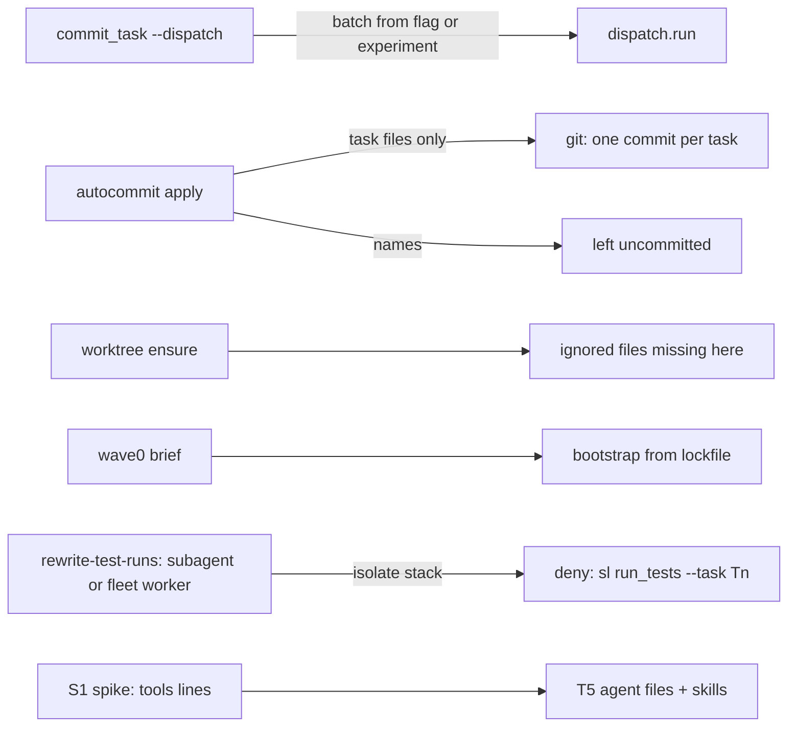
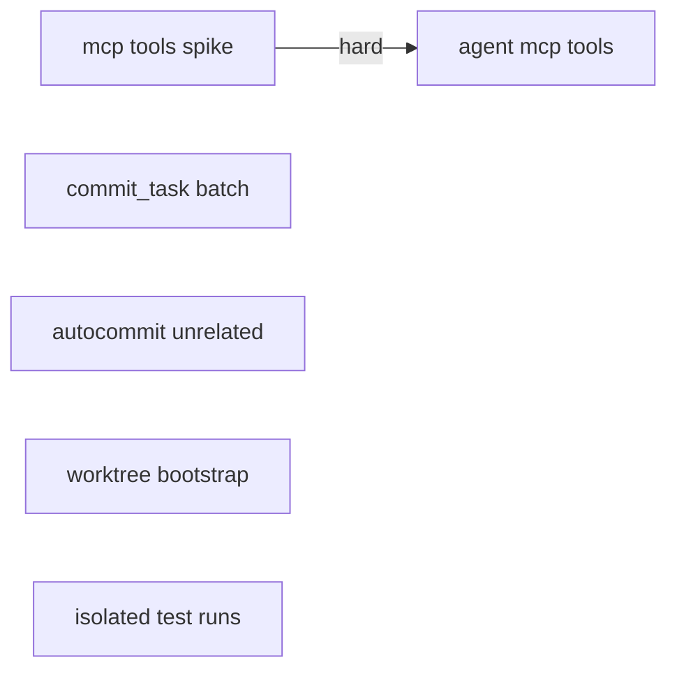

# Superlite: run tooling (batch flag, autocommit, worktree bootstrap, isolated test runs, MCP tools for agents)

**Goal:** `commit_task --dispatch` keeps the run's batch setting (#128); `autocommit apply` commits the run and leaves unrelated changes in the tree (#173); a fresh worktree names the ignored files it lacks and Wave 0 bootstraps dependencies from the lockfile (#141); a subagent's or fleet worker's raw test run on a compiled stack is sent to its per-task tree (#97); implementers, fixers and reviewers get the project's MCP tools (#98, Max chose this option).
**Architecture:** five independent tasks plus one spike. S1 finds out how a plugin agent's `tools:` line can admit MCP tools; T5 (draft until S1 reports) applies it to the agent files and the skill texts.
**Tech stack:** Python 3.10+ stdlib, bash (hooks, builtins only), pytest, Markdown.
**Spec:** this file, section Design.
**Detail:** contracts
**Target-min:** 9
**Wave0:** none
**Coverage:** off

Global constraints:
- Python 3.10+ stdlib; follow the style of `skills/subagent-driven-development/scripts/` including per-line `# O(...)` comments. Hooks stay bash with builtins only (no new process spawn on the common path); follow `hooks/rewrite-test-runs`'s style.
- Verify with `<abs sl> run_tests --fast <your test files> --task Tn --background`, then the printed `wait:` line.
- No version bump in a task.

Ruling: #173 - `apply` no longer refuses unrelated changes: it commits only the checkpointed task files and leaves every other change in the working tree, naming them (`apply: left uncommitted: a, b`); it still refuses when an unrelated change touches a checkpointed file, and no message suggests `git stash` (the stash stack is shared by all worktrees and sessions) - cost if wrong: a stray file stays uncommitted and is named.
Ruling: #97 - deny with the exact command, do not rewrite: a subagent's or fleet worker's run of the configured test command on an isolate stack (`test-cmd.json` `language` in swift, go, rust, csharp) is denied with `use <sl> run_tests --fast <test files> --task <Tn> --background` naming its current task from `pool.json`; agents are matched by the input's `agent_id`, fleet workers by `SUPERLITE_FLEET_WORKER` - cost if wrong: one extra agent turn per blocked run.
Ruling: #141 - list ignored top-level entries of the main checkout that the worktree lacks (names only, at most 10, skipping `.git`, `.superlite`, `.claude`, `__pycache__`), and map lockfiles to commands: `uv.lock` -> `uv sync`, `package-lock.json` -> `npm ci`, `pnpm-lock.yaml` -> `pnpm install --frozen-lockfile`, `bun.lock` or `bun.lockb` -> `bun install --frozen-lockfile`, `yarn.lock` -> `yarn install --frozen-lockfile`; nothing is installed globally or copied - cost if wrong: a missing command for another lockfile.
Ruling: #98 - S1 first: the docs say plugin agents can use MCP tools and `tools:` takes `mcp__<server>__*`, but are silent on `mcp__*` and on names that do not resolve; T5 is drafted after S1 - cost if wrong: T5 waits about 5 minutes.

## Design

1. **#128.** `commit_task` gains `--batch N`; without it, the `--dispatch` branch reads the run's experiment claim (`experiment.for_plan(plan, sl_dir)`) as `dispatch.py` does, and passes `batch` to `dispatch.run`.
2. **#173.** See the ruling. `dirty_outside` still finds the unrelated paths; `apply` proceeds when none of them is a checkpointed file and prints them after the commits. `commands/commit.md` describes the new behaviour.
3. **#141.** `worktree.ensure` (state `created`) prints `worktree: ignored in the main checkout, missing here: .env, .venv/` instead of today's generic line (no line when nothing is missing). `wave0.build_brief` adds a bootstrap step when the plan's root is a linked worktree and a lockfile exists: `Bootstrap: run \`uv sync\` in the worktree before anything else (lockfile uv.lock).`
4. **#97.** See the ruling. The subagent branch of `hooks/rewrite-test-runs` gains the isolate check before its existing full-suite check. `load_project_runner` falls back to the main checkout's `.superlite/test-cmd.json` in a linked worktree, as `testcmd.py` does.
5. **#98.** S1 runs `claude -p` with a temporary plugin whose agent declares different `tools:` lines, and records which ones start and which tools the agent sees. T5 then changes the six agent files (not `final-reviewer`), `skills/writing-plans/SKILL.md` and `skills/subagent-driven-development/SKILL.md`: MCP-only checks (e.g. Xcode `RenderPreview`) may be task steps when the project configures that server.

## Main diagram

## File structure

- `skills/subagent-driven-development/scripts/commit_task.py`, `tests/scripts/test_commit_task_batch.py`: T1.
- `skills/subagent-driven-development/scripts/autocommit.py`, `commands/commit.md`, `tests/scripts/test_autocommit_unrelated.py`: T2.
- `skills/subagent-driven-development/scripts/worktree.py`, `skills/subagent-driven-development/scripts/wave0.py`, `tests/scripts/test_worktree_bootstrap.py`: T3.
- `hooks/rewrite-test-runs`, `tests/scripts/test_rewrite_isolate.py`: T4.
- `docs/plans/2026-11-05-mcp-agent-tools-spike.md`: S1's findings.
- `agents/implementer.md`, `agents/implementer-haiku.md`, `agents/fixer-sonnet.md`, `agents/fixer-sonnet-high.md`, `agents/fixer-opus.md`, `agents/package-reviewer.md`, `skills/writing-plans/SKILL.md`, `skills/subagent-driven-development/SKILL.md`, `tests/scripts/test_agent_mcp_tools.py`: T5.

## Task graph

```mermaid
%% schedule
gantt
  title Predicted schedule (mm:ss)
  dateFormat X
  axisFormat %M:%S
  section lane 1
  T3 worktree bootstrap :t3, 0, 126s
  section lane 2
  T2 autocommit unrelated :t2, 0, 109s
  section lane 3
  T4 isolated test runs :t4, 0, 107s
  section lane 4
  T1 commit_task batch :t1, 0, 103s
  section lane 5
  S1 mcp tools spike :s1, 0, 102s
```

critical path: T3 (2.1 min) · peak width 5 · predicted build 2.1 min · predicted total ≈ 5.6 min (target ✓)

## Run scripts

**Probe entry:** none (CLI wrappers over git; the unit tests drive them in tmp repos).

Package review focus: app type CLI and file I/O. Categories: state (HEAD moved, a checkpointed file dirty again, an experiment claim for another plan), file (linked worktree versus main checkout, ignored directories), protocol (hook input JSON, `pool.json` `current` holding a batch `T2,T4`).

### S1 mcp tools spike · Complexity 3 · Est. context 25k
**Owns:** docs/plans/2026-11-05-mcp-agent-tools-spike.md
**Components:** 1
**LOC owned:** 40
**Tests:** build
**Kind:** design
**Model:** sonnet
**Est. time:** 3 min (1 component, about 40 LOC, build)
**Review Focus:** the findings name, for each `tools:` line tried, whether the agent started, which MCP tool names it listed, and the exact command used.
**Test code (contracts):**
- No tests: the output is the findings file.
**Steps:** 1 make a temporary plugin under the session scratch or `/tmp` (never in the repo): `.claude-plugin/plugin.json` `{"name": "mcpprobe"}` and `agents/probe-a.md` ... `agents/probe-d.md` (frontmatter `name`, `description`, `model: haiku`, and the `tools:` line under test; body: "List the names of every tool you can call, one per line, then stop."). Lines to test: (a) `Read, Bash, mcp__*`; (b) `Read, Bash, mcp__xcode__*`; (c) `Read, Bash, mcp__nosuchserver__*`; (d) no `tools:` line, `disallowedTools: Agent, Write`. 2 for each, run `claude -p --plugin-dir <tmp> --model haiku --max-turns 3 --output-format json "Use the Agent tool with subagent_type mcpprobe:probe-x. Reply with its answer verbatim."` from `/Users/max/github/superlite` (the user configuration there has the `xcode` MCP server; check `claude mcp list` first and name what you saw). 3 write the findings file: a table (line, started yes/no, MCP tools seen, error text) and one recommendation line for the agents' `tools:` line that gives the project's MCP tools without the `Agent` tool.
**Notes:** Cost: four haiku runs, a few cents. If `claude -p` cannot run here, report BLOCKED with the error. Remove the temporary plugin afterwards.

### T1 commit_task batch · Complexity 2 · Est. context 25k
**Owns:** skills/subagent-driven-development/scripts/commit_task.py, tests/scripts/test_commit_task_batch.py
**Components:** 1
**LOC owned:** 50
**Tests:** fast
**Kind:** design
**Model:** sonnet
**Est. time:** 1.5 min (1 component, about 50 LOC, fast tests)
**Review Focus:** `test_dispatch_uses_experiment_batch`: a run with an experiment claim for this plan with batch 1 prints no batch line (`Tn,Tm`) from `commit_task --dispatch`.
**Test code (contracts):**
- `test_batch_flag_reaches_dispatch`: `commit_task T1 --dispatch --batch 1` calls `dispatch.run` with `batch=1` (monkeypatch `dispatch.run`, record kwargs).
- `test_dispatch_uses_experiment_batch`: as in Review Focus (or the same monkeypatch, with `experiment.for_plan` returning `{"batch": 1}`).
- `test_claim_for_other_plan_is_ignored`: a claim whose plan differs gives `batch=None`.
**Steps:** 1 failing tests, 2 run: FAIL, 3 implement, 4 run: PASS
**Notes:** Mirror `dispatch.py:298-301`; read the existing `--dispatch` tests in `tests/scripts/test_dispatch_evict.py` and `test_spawn_free.py` for the fixtures.

### T2 autocommit unrelated · Complexity 4 · Est. context 32k
**Owns:** skills/subagent-driven-development/scripts/autocommit.py, commands/commit.md, tests/scripts/test_autocommit_unrelated.py
**Components:** 1
**LOC owned:** 80
**Tests:** fast
**Kind:** design
**Model:** sonnet
**Est. time:** 2.5 min (1 component, about 80 LOC, fast tests)
**Review Focus:** `test_apply_keeps_version_bump_uncommitted`: a tmp repo run with two checkpointed tasks and a tracked `package.json` changed after the run (a version bump): `apply` makes the two task commits, `git status --porcelain` afterwards lists only ` M package.json`, and the output names `package.json` as left uncommitted.
**Test code (contracts):**
- `test_apply_keeps_version_bump_uncommitted`: as in Review Focus; the task commits hold no `package.json` change.
- `test_apply_keeps_untracked_stray`: an untracked `notes.txt` outside the run stays untracked and is named.
- `test_apply_refuses_dirty_checkpointed_file`: a checkpointed task file edited again after its checkpoint: `apply` refuses as today, naming the file; the message does not contain `stash`.
- `test_no_message_suggests_stash`: no string in `autocommit.py` contains `stash` (read the source).
**Steps:** 1 failing tests, 2 run: FAIL, 3 implement, 4 run: PASS
**Notes:** Check how `apply` resets the index and runs `clean()` after `update-ref`: the unrelated changes must survive both (read `clean()` before changing anything; it must never delete an unrelated untracked file). `commands/commit.md:8`: replace the refusal sentence with the new behaviour, one sentence.

### T3 worktree bootstrap · Complexity 4 · Est. context 32k
**Owns:** skills/subagent-driven-development/scripts/worktree.py, skills/subagent-driven-development/scripts/wave0.py, tests/scripts/test_worktree_bootstrap.py
**Components:** 2
**LOC owned:** 90
**Tests:** fast
**Kind:** design
**Model:** sonnet
**Est. time:** 3 min (2 components, about 90 LOC, fast tests)
**Produces:** worktree.missing_ignored(main: Path, wt: Path) -> list[str] · wave0.bootstrap_command(root: Path) -> str | None
e.g. missing_ignored(main, wt) with `.env` and `.venv/` ignored and present in main only -> [".env", ".venv/"]
e.g. bootstrap_command(wt) with `uv.lock` in a linked worktree -> "uv sync"; in a main checkout -> None
**Review Focus:** `test_ensure_names_missing_ignored`: a tmp repo with `.gitignore` holding `.env` and `.venv/`, both present in the main checkout; `ensure` on a new topic prints `worktree: ignored in the main checkout, missing here: .env, .venv/` and copies nothing.
**Test code (contracts):**
- `test_ensure_names_missing_ignored`: as in Review Focus.
- `test_missing_ignored_skips_internal`: `.superlite/`, `.claude/`, `__pycache__/` in main are never listed; at most 10 names, then ` (+N more)`.
- `test_no_line_when_nothing_missing`: no ignored entries: no `ignored in the main checkout` line and no generic line.
- `test_bootstrap_command_per_lockfile`: one case per lockfile in the ruling; two lockfiles: the first in the ruling's order wins.
- `test_wave0_brief_has_bootstrap_step`: a plan whose root is a linked worktree with `package-lock.json`: the brief contains ``Bootstrap: run `npm ci` in the worktree before anything else (lockfile package-lock.json).``; a main checkout: no `Bootstrap:` line.
**Steps:** 1 failing tests, 2 run: FAIL, 3 implement, 4 run: PASS
**Notes:** List ignored entries with `git ls-files --others --ignored --exclude-standard --directory` in the main checkout (one process call, at worktree creation only).

### T4 isolated test runs · Complexity 5 · Est. context 40k
**Owns:** hooks/rewrite-test-runs, tests/scripts/test_rewrite_isolate.py
**Components:** 1
**LOC owned:** 70
**Tests:** fast
**Kind:** design
**Model:** sonnet
**Est. time:** 3 min (1 component, about 70 LOC, fast tests)
**Review Focus:** `test_subagent_raw_swift_run_denied`: `test-cmd.json` `{"language": "swift", "test": "xcodebuild test -scheme X {only_testing}", "test_file": "Scripts/test.sh -only-testing:{file}"}`, `pool.json` with agent `a1` current `T3`; hook input with `agent_id` `a1` and command `Scripts/test.sh -only-testing:AppTests/FooTests` exits 2 and the message names `run_tests --fast` and `--task T3`.
**Test code (contracts):**
- `test_subagent_raw_swift_run_denied`: as in Review Focus.
- `test_fleet_worker_matched_by_env`: no `agent_id`, env `SUPERLITE_FLEET_WORKER=W2`, pool agent `W2` current `T5,T6`: denied, the message names `--task T5`.
- `test_python_stack_not_isolated`: `language` python: the same raw run passes (exit 0).
- `test_sl_run_tests_passes`: `sl run_tests --fast x --task T3` passes.
- `test_main_checkout_config_fallback`: in a linked worktree without `.superlite/test-cmd.json`, the main checkout's file is used.
- The existing tests in `tests/scripts/test_rewrite_test_runs.py` stay green (run them, do not edit them).
**Steps:** 1 failing tests, 2 run: FAIL, 3 implement, 4 run: PASS
**Notes:** Match the configured command by its first word plus the next word when the first is a runner script (e.g. `Scripts/test.sh`, `xcodebuild test`), after stripping `{...}` placeholders. A fleet worker is a top-level session (no `agent_id`): today it takes the coordinator branch; route it to the subagent branch when `SUPERLITE_FLEET_WORKER` is set. Log a `rule-block` incident like `deny_subagent_full` does.

### T5 agent mcp tools · Complexity 3 · Est. context 30k
**Owns:** agents/implementer.md, agents/implementer-haiku.md, agents/fixer-sonnet.md, agents/fixer-sonnet-high.md, agents/fixer-opus.md, agents/package-reviewer.md, skills/writing-plans/SKILL.md, skills/subagent-driven-development/SKILL.md, tests/scripts/test_agent_mcp_tools.py
**Components:** 1
**LOC owned:** 40
**Tests:** fast
**Kind:** design
**Model:** sonnet
**Est. time:** 2 min (1 component, about 40 LOC, fast tests)
**Review Focus:** `test_agents_admit_mcp_tools`: each of the six agent files has the `tools:` line S1 recommends; `final-reviewer.md` is unchanged.
**Test code (contracts):**
- `test_agents_admit_mcp_tools`: as in Review Focus.
- `test_agents_never_get_agent_tool`: no agent file admits the `Agent` tool.
- `test_plans_may_name_mcp_checks`: `skills/writing-plans/SKILL.md` says an MCP-only check (e.g. Xcode `RenderPreview`) may be a task step when the project configures that MCP server, and otherwise is the coordinator's step.
**Steps:** 1 failing tests, 2 run: FAIL, 3 implement, 4 run: PASS
**Notes:**
- S1 (`docs/plans/2026-11-05-mcp-agent-tools-spike.md`) found: `tools: ..., mcp__*` admits no MCP tool; `mcp__<server>__*` works per server and an unknown server is ignored; no `tools:` line plus `disallowedTools` reaches every connected server's tools.
- Ruling (coordinator): in the six agent files replace the `tools:` line with exactly `disallowedTools: Agent, Task, Workflow, AskUserQuestion, SendMessage, EnterWorktree, ExitWorktree, EnterPlanMode, ExitPlanMode, CronCreate, CronDelete, ScheduleWakeup, RemoteTrigger, PushNotification, TaskCreate, TaskUpdate, TaskStop` (one line, this order). The agents thereby inherit the session's MCP tools (deferred, names only) and the harmless harness tools; they never get agent spawning, worktree or plan-mode switches, scheduling or the user's task list. `final-reviewer.md` keeps `tools: Read, Grep, Glob`.
- `test_agents_admit_mcp_tools` asserts: no `tools:` line and that exact `disallowedTools:` line in each of the six files.
- `skills/writing-plans/SKILL.md`: one sentence, e.g. "An MCP-only check (Xcode `RenderPreview`) can be a task step when the project configures that MCP server, since agents inherit the session's MCP tools; otherwise it is the coordinator's step after the package review." `skills/subagent-driven-development/SKILL.md`: one sentence in Setup or Reviews saying agents inherit the session's MCP tools, and a project MCP server that needs approval must be approved before dispatch (background agents surface prompts in the main session).
- Keep each `SKILL.md` edit to one added sentence; touch nothing else.

## Review Focus

- Run scripts: `apply` with HEAD moved plus unrelated changes; `clean()` never deletes an unrelated file; worktree listing in a repo with no ignored files.
- Hook: a quoted command, a batch `current`, a pool agent without `current`, no `pool.json`, malformed `test-cmd.json` (must pass, not crash).
- Agents: no `Agent` tool, final reviewer unchanged.

## Self-review

- #128 T1, #173 T2, #141 T3, #97 T4, #98 S1 then T5. No two tasks share a file; the only edge is S1 -> T5 (T5 needs S1's answer).
