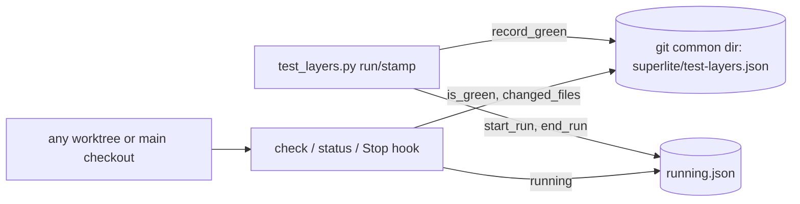
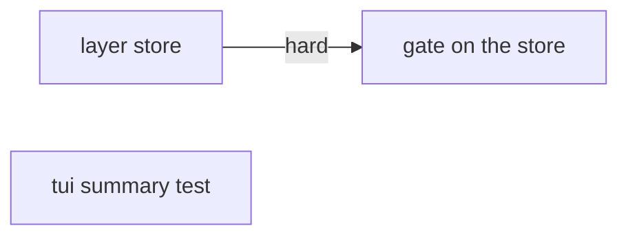

# Superlite: test-layer gate without re-demands, tui summary test on 2.1.318

**Goal:** a layer stamped green in any checkout of the repository counts in every checkout with the same layer content; a version bump alone changes no layer; the tui keyword scan reacts only to keyword lines; a layer whose run is in progress is not demanded again; `check` and a new `status` name the changed files (#91). The tui summary-timer test passes on Claude Code 2.1.318 by asserting what that version logs (#145).
**Architecture:** T1 adds `scripts/layer_store.py`, a store of green layer hashes shared by all checkouts (under the git common dir), with a run lock and the last green file manifest. T2 rewires `scripts/test_layers.py` onto it and changes the hashing. T3 diagnoses and fixes the tui test.
**Tech stack:** Python 3.10+ stdlib, pytest, git, tmux (tui only).
**Spec:** this file, section Design.
**Detail:** contracts
**Target-min:** 8
**Wave0:** none
**Coverage:** off

Global constraints:
- Python 3.10+ stdlib only. Follow the existing style of `scripts/test_layers.py`, including the per-line `# O(...)` complexity comments.
- The store file is `<git common dir>/superlite/test-layers.json`, where the common dir is `git rev-parse --git-common-dir` resolved against the checkout root (it is relative in a main checkout). Outside a git repository: `<root>/.superlite/test-layers.json`.
- Store format: `{"version": 1, "layers": {"<layer>": {"green": ["<sha256>", ...], "files": {"<path>": "<sha256>"}}}}`; the run lock is `running.json` next to it: `{"<layer>": {"pid": N, "digest": "<sha256>"}}`. Every write goes to a temp file in the same folder, then `os.replace`.
- `--state PATH` on every subcommand overrides the store path (tests use it).
- Verify with `<abs sl> run_tests --fast <test files> --task Tn --background`, then the printed `wait:` line. tui tests need `SUPERLITE_E2E=1` in front.
- No version bump in a task (the coordinator runs `scripts/bump-version.sh` at finish).

Ruling: one store per repository under the git common dir, keyed by layer hash - covers fresh worktrees, merged main checkouts and rebases with identical content (every case in #91) - cost if wrong: a stale stamp from another checkout could pass a layer, but only for byte-identical layer content.
Ruling: the hash format changes (per-file digests, normalized manifests), so every existing stamp goes stale once after this ships - one rerun or ruling per layer - cost if wrong: one round of stamps.
Ruling: keep the last 200 green hashes per layer; concurrent writers use atomic replace and the last writer wins - cost if wrong: a lost green hash means one rerun.
Ruling: the run lock covers `test_layers.py run` only (a bare `sl run_tests --background` stamps nothing today and stays so) - cost if wrong: the gate still demands a layer while an unrelated background run goes.
Ruling: detail contracts - both scripts are small and the tests are named with exact inputs - cost if wrong: one NEEDS_CONTEXT per task.

## Design

1. **Shared store (#91 cases 1, fresh worktree, merged main, rebase).** Stamps move from the per-checkout `.superlite/test-layers.json` to one file under the git common dir. A layer is green when its current hash is in that layer's `green` list, whichever checkout stamped it.
2. **Version bumps (#91 case 3).** Hashing a manifest (`.claude-plugin/*.json`, any `.<name>-plugin/*.json`, `package.json`, `gemini-extension.json`) replaces every `"version": "<value>"` with `"version": ""` first, so a bump alone leaves every layer hash unchanged; any other manifest change still moves the layer.
3. **Keyword scan (#91 case 2).** A file that enters the tui layer only through the keyword scan contributes its path and the lines that contain a keyword, not its whole content. `tests/scripts/` joins `SKIP_SCAN` (test-only files the tui tests never load).
4. **Run in progress (#91, 1.4.9 comment).** `run` writes a lock with its pid and the layer hash before it starts and removes it after; `check` and the Stop hook skip a layer whose lock pid is alive and whose lock digest equals the current hash.
5. **Output (#91, 1.4.6 comment).** `check` prints one line per stale layer naming up to 5 changed paths against the last green manifest; a new `status` prints every layer's state.
6. **tui (#145).** On 2.1.318 the summary timer fires for a background agent but the debug log has neither `Forking for summary` nor `Asking for summary from`. Find what 2.1.318 logs when it summarizes, and assert on that version-independent evidence.

## Main diagram

## File structure

- `scripts/layer_store.py`: the shared store, the run lock, the changed-file diff (T1).
- `tests/scripts/test_layer_store.py`: T1's tests (T1).
- `scripts/test_layers.py`: hashing, CLI and Stop hook on the store (T2).
- `tests/scripts/test_test_layers.py`: T2's tests, existing ones updated (T2).
- `docs/testing.md`: the gate section (T2).
- `tests/e2e/tui_driver.py`, `tests/e2e/test_tui.py`: the summary counters and assertion (T3).

## Task graph

```mermaid
%% schedule
gantt
  title Predicted schedule (mm:ss)
  dateFormat X
  axisFormat %M:%S
  section lane 1
  T3 tui summary test :t3, 0, 129s
  section lane 2
  T1 layer store :t1, 0, 125s
  T2 gate on the store :t2, 125, 145s
```

critical path: T1 → T2 (4.5 min) · peak width 2 · predicted build 4.5 min · predicted total ≈ 8.0 min (target ✓)

## Gate scripts

**Probe entry:** none (no one-argument entry point; the unit tests cover the store and the CLI)

Package review focus: app type CLI and file I/O. Categories: file (git common dir from a linked worktree, relative paths), state (stale lock pid, two writers), encoding (manifest JSON with unusual spacing).

### T1 layer store · Complexity 4 · Est. context 32k
**Owns:** scripts/layer_store.py, tests/scripts/test_layer_store.py
**Components:** 1
**LOC owned:** 170
**Tests:** fast
**Kind:** design
**Model:** sonnet
**Est. time:** 3 min (1 component, about 170 LOC, fast tests)
**Produces:** layer_store.store_path(root: Path) -> Path · layer_store.is_green(store: Path, layer: str, digest: str) -> bool · layer_store.record_green(store: Path, layer: str, digest: str, files: dict[str, str]) -> None · layer_store.changed_files(store: Path, layer: str, files: dict[str, str]) -> list[str] · layer_store.has_manifest(store: Path, layer: str) -> bool · layer_store.start_run(store: Path, layer: str, digest: str, pid: int) -> None · layer_store.running(store: Path, layer: str, digest: str) -> bool · layer_store.end_run(store: Path, layer: str) -> None
e.g. store_path(Path("/r/.claude/worktrees/x")) -> Path("/r/.git/superlite/test-layers.json") (a linked worktree of /r); store_path(Path("/r")) -> the same path
e.g. record_green(s, "unit", "h1", {"a.py": "1"}); is_green(s, "unit", "h1") -> True; is_green(s, "unit", "h2") -> False; is_green(s, "tui", "h1") -> False
e.g. after record_green(s, "unit", "h1", {"a.py": "1", "b.py": "2", "d.py": "5"}): changed_files(s, "unit", {"a.py": "1", "b.py": "3", "c.py": "4"}) -> ["b.py", "c.py", "d.py"]; changed_files(s, "tui", {"x": "1"}) -> ["x"]
**Review Focus:** `test_store_path_shared_by_worktree`: a real `git init` repo plus `git worktree add`; both roots give `<main>/.git/superlite/test-layers.json` as an absolute path. `test_running_dead_pid`: the pid of a finished `subprocess.run(["true"])` child gives `running(...) -> False`.
**Test code (contracts):**
- `test_store_path_shared_by_worktree`: as in Review Focus.
- `test_store_path_outside_git`: a plain tmp folder gives `<tmp>/.superlite/test-layers.json`.
- `test_record_then_green`: the second `e.g.` line, exactly.
- `test_green_list_capped`: 205 `record_green` calls with digests `h0`..`h204`: `h0`..`h4` not green, `h5` and `h204` green.
- `test_record_is_idempotent`: recording `h1` twice keeps one `h1` entry in `green`.
- `test_changed_files`: the third `e.g.` line, exactly; `has_manifest(s, "unit") -> True`, `has_manifest(s, "tui") -> False`.
- `test_running_live_pid`: `start_run(s, "unit", "h1", os.getpid())`: `running(s, "unit", "h1") -> True`, `running(s, "unit", "h2") -> False`; after `end_run(s, "unit")`: `running(s, "unit", "h1") -> False`.
- `test_running_dead_pid`: as in Review Focus.
- `test_corrupt_store`: the store file holds `not json`: `is_green(s, "unit", "h1") -> False`, then `record_green` leaves valid JSON with `version` 1.
- `test_no_temp_files_left`: after `record_green` and `start_run`, the store folder holds only `test-layers.json` and `running.json`.
**Steps:** 1 failing tests, 2 run: FAIL, 3 implement, 4 run: PASS
**Notes:** `running` treats a pid as alive via `os.kill(pid, 0)` (PermissionError counts as alive, ProcessLookupError as dead; on Windows without `os.kill` semantics, any OSError counts as dead). `record_green` replaces the layer's `files` manifest with the given one and appends the digest after removing an equal one, keeping the newest 200.

### T2 gate on the store · Complexity 5 · Est. context 45k
**Owns:** scripts/test_layers.py, tests/scripts/test_test_layers.py, docs/testing.md
**Components:** 2
**LOC owned:** 200
**Tests:** fast
**Kind:** design
**Model:** sonnet
**Est. time:** 4.5 min (2 components, about 200 LOC, fast tests)
**Consumes:** layer_store.store_path(root: Path) -> Path (T1) · layer_store.is_green(store: Path, layer: str, digest: str) -> bool (T1) · layer_store.record_green(store: Path, layer: str, digest: str, files: dict[str, str]) -> None (T1) · layer_store.has_manifest(store: Path, layer: str) -> bool (T1) · layer_store.start_run(store: Path, layer: str, digest: str, pid: int) -> None (T1) · layer_store.running(store: Path, layer: str, digest: str) -> bool (T1) · layer_store.end_run(store: Path, layer: str) -> None (T1)
**Produces:** test_layers.layer_digests(layer: str, root: Path) -> dict[str, str] · test_layers.layer_hash(layer: str, root: Path) -> str
e.g. layer_digests("headless", root) for a repo holding only `.claude-plugin/plugin.json` = `{"name": "x", "version": "1.0.0"}` -> {".claude-plugin/plugin.json": "<sha256 of the text with \"version\": \"\">"}; the same after the version becomes 1.0.1
**Review Focus:** `test_green_in_worktree_counts_in_main`: stamp every layer in a linked worktree whose files equal the main checkout's; `check` in the main checkout prints nothing and exits 0. `test_hook_skips_running_layer`: a lock with the test's own pid and the current unit digest; `check --hook` prints no block naming unit.
**Test code (contracts):**
- `test_version_only_change_keeps_hashes`: a repo with `.claude-plugin/plugin.json`, `.claude-plugin/marketplace.json`, `package.json` and `gemini-extension.json` at version 1.0.0; rewrite all four to 1.0.1 (also with `"version" :  "1.0.1"` spacing in one): `layer_hash` of every layer is unchanged.
- `test_manifest_other_change_moves_headless`: change only `"name"` in `.claude-plugin/plugin.json`: the headless hash moves.
- `test_keyword_lines_only`: `notes/x.py` holds `a = 1` and `os.environ["CLAUDE_CODE_FORK_SUBAGENT"]`; editing `a = 1` keeps the tui hash, editing the keyword line moves it.
- `test_keyword_scan_skips_tests_scripts`: `tests/scripts/conftest.py` naming `CLAUDE_CODE_FORK_SUBAGENT` is not in `layer_digests("tui", root)`.
- `test_green_in_worktree_counts_in_main`: as in Review Focus.
- `test_check_names_changed_files`: stamp unit, then edit `hooks/a` and add `hooks/b`: `check` prints the line `unit stale: hooks/a, hooks/b` and exits 2; with no stamp at all the line is `unit stale: no green stamp`; more than 5 changed paths end with ` (+N more)`.
- `test_status_lists_every_layer`: each layer prints one line starting `<layer> green `, `<layer> stale `, `<layer> running ` or `<layer> none` (no files).
- `test_hook_skips_running_layer`: as in Review Focus.
- `test_run_releases_lock`: `run unit --command-override unit=true` exits 0, stamps unit green, and leaves `running(...)` False; with `unit=false` it stamps nothing and also releases the lock.
- `test_stamp_ruling_records_green`: `stamp tui --ruling "why"` makes tui green in the store and appends `Ruling: skip tui - why` to `.superlite/progress.md`.
- Update the existing tests to the store (`--state` points at a tmp store file); keep their intent.
**Steps:** 1 failing tests, 2 run: FAIL, 3 implement, 4 run: PASS
**Notes:**
- `layer_hash` = SHA-256 over `path + "\0" + digest + "\0"` for the sorted `layer_digests` items. A file digest is SHA-256 of its bytes, except: a manifest (path matches `.claude-plugin/*.json`, `.*-plugin/*.json`, `package.json` or `gemini-extension.json` at the root) is decoded as UTF-8 and every `"version"\s*:\s*"[^"]*"` replaced by `"version": ""` first; a keyword-scan file (tui only, not matched by the tui globs) hashes only its lines that contain a keyword, joined by `\n`.
- `SKIP_SCAN` gains `tests/scripts/`.
- The changed paths come from T1's `layer_store.changed_files(store, layer, files)`, which returns the sorted paths that differ from, are missing in, or were removed since the layer's last green manifest (read its docstring and tests in `scripts/layer_store.py`).
- The default store is `layer_store.store_path(root)`; the old per-checkout `.superlite/test-layers.json` is no longer read.
- `stale_layers` = layers with files, not green, and not `running`.
- `run`: `start_run(store, layer, digest, os.getpid())` before the command, `end_run` in a `finally`; on green `record_green(store, layer, layer_hash(...), layer_digests(...))` with the hash taken after the run.
- Add a `status` subcommand (with `--root`, `--state`). `check` without `--hook` prints the stale lines of `test_check_names_changed_files`. The Stop hook keeps its reason text and appends ` (status: python3 scripts/test_layers.py status)`.
- `docs/testing.md`: rewrite the paragraph on where stamps live (line 16) and the command list (lines 18-22) to describe the shared store, the version normalization, keyword-line hashing, the run lock and `status`. Touch nothing else in that file.

### T3 tui summary test · Complexity 4 · Est. context 30k
**Owns:** tests/e2e/tui_driver.py, tests/e2e/test_tui.py
**Components:** 1
**LOC owned:** 30
**Tests:** slow
**Kind:** design
**Model:** sonnet
**Est. time:** 4 min (1 component, about 30 LOC, slow tests)
**Review Focus:** `test_summary_timer_runs_for_a_background_agent` passes on Claude Code 2.1.318 (`claude --version`), and `test_fork_switch_silences_summary_timer` still passes.
**Test code (contracts):**
- `test_summary_timer_runs_for_a_background_agent`: keeps `timer_fired >= 1`; its second assertion checks the evidence 2.1.318 writes when it summarizes a background agent (found in step 1), or, if 2.1.318 writes none, the test is `xfail(strict=False)` with a reason naming Claude Code 2.1.318 and #145, and the timer assertion stays.
- `test_fork_switch_silences_summary_timer`: unchanged and green.
**Steps:** 1 run `SUPERLITE_E2E=1 <abs sl> run_tests --fast tests/e2e/test_tui.py --task T3 --background`, then `wait:`; keep the failing test's `debug.log` (copy it out of pytest's tmp folder, e.g. by a temporary `shutil.copy` in the test, removed again before you report) and read the lines after each `[AgentSummary] Timer fired`; 2 change `SUMMARY_KEYS` and the assertion to the evidence found; 3 run the tui file again: PASS.
**Notes:** Report the debug-log lines you based the assertion on (at most 10, quoted). Each tui run costs Haiku quota and about 3 min: run the file at most 4 times. Do not touch `hooks/`.

## Review Focus

- Gate scripts (CLI, file I/O): the store path from a linked worktree, a stale lock pid, two writers, manifest JSON spacing, keyword lines in a file with no trailing newline.
- tui test: the assertion holds on 2.1.318 and does not pass vacuously (it must still fail when the summary never runs).

## Self-review

- Every #91 case maps to a design point: per-checkout stamps (1), keyword scan (3), version bumps (2), run in progress (4), output (5). #145 is design point 6.
- T1 and T2 share no file; T3 shares none with either. The only edge is T1 -> T2 (T2's tests import the real store).
