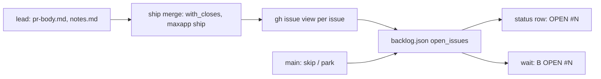
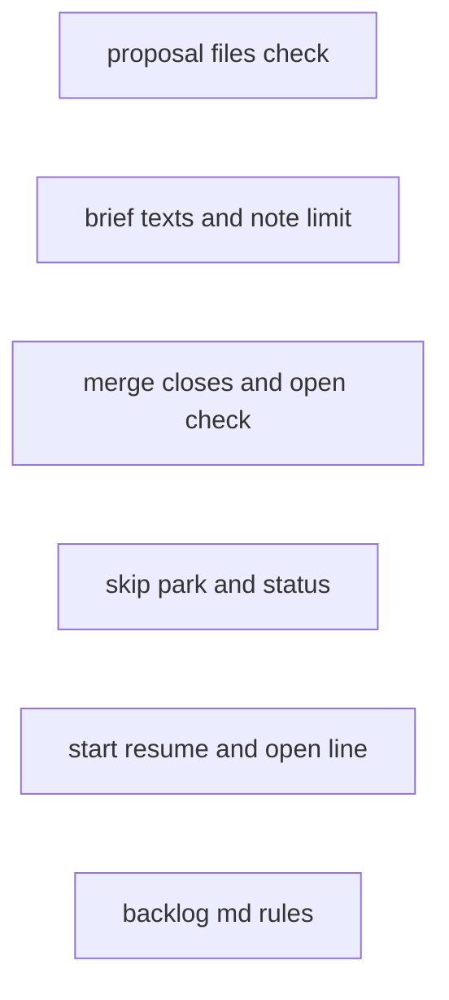

# Superlite: backlog core fixes (backlog batch B8)

**Goal:** batch PRs close every batch issue or say which stayed open (#220); main can skip an issue and park a planned batch (#221); a proposal batch without files is rejected (#222); lead notes reach the summary whole (#223); the lead brief and `backlog.md` say ship steps are bare commands (#246).
**Architecture:** six independent tasks, one per module plus its own test file. No task runs another task's code; the one shared datum is the batch key `open_issues` (Global constraints).
**Tech stack:** Python 3.10+ stdlib, pytest.
**Spec:** this file, section Design; the issue bodies of #220, #221, #222, #223, #246.
**Detail:** tests
**Target-min:** 8
**Wave0:** none
**Coverage:** off (bug batch)
**Max chars:** 32000

Global constraints:
- Python 3.10+ stdlib; follow the style of `skills/subagent-driven-development/scripts/`, including a `# O(...)` comment on every new code line in files that already carry them.
- Shared datum: a shipped batch's record in `backlog.json` may hold `open_issues: list[int]`, the batch issues still open after the merge (T3 writes it; T4 `status_lines` and T5 `_shipped` read it). Absent or empty means none.
- Only the files a task owns change. Other tests in its test file stay green.
- Verify with `<abs sl> run_tests --fast <test files> --task Tn --background`, then the printed `wait:` line.
- No version bump in a task.

Ruling: Max decided #222: reject a proposal batch with a missing or empty `files` list; `_clash`, `_pick` and `separate` stay as they are - cost if wrong: a batch stored before this fix with `files: []` still runs in parallel.
Ruling: the test file of each owned module is in scope (`tests/scripts/test_backlog_*.py`); the plan doc goes to `docs/plans/` like B1 to B4 - cost if wrong: a few extra files in the PR.
Ruling: `merge` writes the PR body it sends to `<main>/.superlite/backlog/<B>.pr-body.md` (outside the worktree, which `maxapp ship -C` may remove); the source is `--body-file`, else `<worktree>/.superlite/pr-body.md`, else empty - cost if wrong: none.
Ruling: after the merge each issue is checked with `gh issue view N -R <repo> --json state -q .state`; open ones are checked once more after 10 s; a failed check counts as open - cost if wrong: a false `OPEN` line main can ignore.
Ruling: `sl backlog ship` accepts and ignores `--plan`, so the brief's "pass --plan .superlite to every sl call" holds for ship steps too (#246) - cost if wrong: none.
Ruling: `skip` refuses an issue in a started batch (running, needs_decision, shipped, or parked with a worktree); `park` takes only a planned batch; `start B` resumes only a parked batch that has a worktree - cost if wrong: main uses `release --park`/`answer` paths for started batches, as today.
Ruling: `fleet_lead.py` keeps its allow rules; #246 is a docs fix plus `--plan` on ship - cost if wrong: none.

## Design

- #222 `backlog_checks.check_proposal`: a batch whose `files` is missing or `[]` adds `"{bid}: files must list at least one repo-relative file"`; a non-list keeps only `"{bid}: files must be a list"`.
- #223 `backlog_brief`: `clean(s, limit=LIMIT)`; `NOTE_LIMIT = 400`; `summary` cleans note lines with `NOTE_LIMIT`. Lead brief: notes are self-contained lines of at most 400 characters.
- #220 `backlog_ship._merge`: compose the body with `with_closes(text, issues)`, pass the composed file to `maxapp ship --body-file`, check the issues after the merge, record `open_issues`, print `OPEN #N` per open issue. `backlog_state.status_lines`: a shipped row's next column adds ` OPEN #N ...`. `backlog_run._shipped`: adds `"{bid} OPEN #N ..."`. Lead brief and `backlog.md`: one `Closes #N` line per issue.
- #221 `backlog_state.skip_issue(data, n)` and `park(data, bid, reason)`; `backlog.py` subcommands `skip <issue>` and `park B --reason R` (main only, locked update). `backlog_run.cmd_start`: `resume` only for a parked batch with a worktree. Triage brief: umbrella and tracking issues stay out of every batch.
- #246 lead brief and `backlog.md`: each ship step is one bare command; `backlog_ship` accepts `--plan`.



## File structure

- `skills/subagent-driven-development/scripts/backlog_checks.py`: proposal checks (T1).
- `skills/subagent-driven-development/scripts/backlog_brief.py`: briefs and summary (T2).
- `skills/subagent-driven-development/scripts/backlog_ship.py`: ship steps (T3).
- `skills/subagent-driven-development/scripts/backlog_state.py`, `backlog.py`: state functions and main's CLI (T4).
- `skills/subagent-driven-development/scripts/backlog_run.py`: start and wait (T5).
- `skills/subagent-driven-development/backlog.md`: lead and main rules (T6).

```mermaid
%% schedule
gantt
  title Predicted schedule (mm:ss)
  dateFormat X
  axisFormat %M:%S
  section lane 1
  T4 skip park and status :t4, 0, 139s
  section lane 2
  T3 merge closes and open check :t3, 0, 116s
  section lane 3
  T5 start resume and open line :t5, 0, 100s
  section lane 4
  T2 brief texts and note limit :t2, 0, 99s
  section lane 5
  T1 proposal files check :t1, 0, 97s
  section lane 6
  T6 backlog md rules :t6, 0, 97s
```





critical path: T4 (2.3 min) · peak width 6 · predicted build 2.3 min · predicted total ≈ 5.8 min (target ✓)

## Package: backlog

App type: CLI. Categories: protocol (subcommands, exit codes, one-line refusals), state (locked `backlog.json` updates, refusals write nothing), encoding (control characters in notes and reasons).
**Probe entry:** none (state-writing CLIs bound to the main checkout's `backlog.json`, tested through pytest; cases are named tests).

### T1 proposal files check · Complexity 2 · Est. context 37k
**Owns:** skills/subagent-driven-development/scripts/backlog_checks.py, tests/scripts/test_backlog_checks.py
**Components:** 1
**LOC owned:** 25
**Tests:** fast
**Kind:** mechanical
**Model:** haiku
**Est. time:** 1.5 min (1 component, about 25 LOC, fast tests)
**Produces:** backlog_checks.check_proposal(obj: dict, known: set[int]) -> tuple[list[dict], list[str]]
e.g. check_proposal({"batches": [{"id": "B1", "topic": "t", "issues": [1], "files": []}]}, {1}) -> ([], ["B1: files must list at least one repo-relative file"])
e.g. check_proposal({"batches": [{"id": "B1", "topic": "t", "issues": [1], "files": "a.py"}]}, {1}) -> ([], ["B1: files must be a list"])
**Review Focus:** `test_a_batch_without_files_is_rejected`, `test_a_files_value_that_is_not_a_list_gets_one_error`.
**Test code (verbatim):** append to `tests/scripts/test_backlog_checks.py`:
```python
@pytest.mark.parametrize("drop", [False, True])
def test_a_batch_without_files_is_rejected(drop):
    b = bt("B1", [1], [])
    if drop:
        del b["files"]
    assert bc.check_proposal({"batches": [b]}, {1}) == ([], ["B1: files must list at least one repo-relative file"])

def test_a_files_value_that_is_not_a_list_gets_one_error():
    assert bc.check_proposal({"batches": [{**bt("B1", [1], []), "files": "a.py"}]}, {1}) == ([], ["B1: files must be a list"])
```
**Steps:** 1 add the tests, 2 run: FAIL, 3 in `check_proposal` add the error after the files loop when `files` is a list and empty (missing key reads as `[]`), 4 run: PASS.

### T2 brief texts and note limit · Complexity 2 · Est. context 31k
**Owns:** skills/subagent-driven-development/scripts/backlog_brief.py, tests/scripts/test_backlog_brief.py
**Components:** 1
**LOC owned:** 50
**Tests:** fast
**Kind:** mechanical
**Model:** haiku
**Est. time:** 1.5 min (1 component, about 50 LOC, fast tests)
**Produces:** backlog_brief.summary(batch: dict, notes: str) -> str
e.g. summary({"id": "B2", "issues": [188], "pr": 201, "version": "1.5.8"}, "y" * 500) -> "B2 shipped: #188\nPR: #201\nVersion: 1.5.8\n" + "y" * 400 + "\n"
**Produces:** backlog_brief.clean(s: str, limit: int = 120) -> str
**Review Focus:** `test_summary_keeps_note_lines_whole_up_to_400_characters` (encoding: control characters still stripped).
**Notes:** exact texts.
- `NOTE_LIMIT = 400  # O(1) characters kept of one lead note line`; `def clean(s, limit=LIMIT)` returns `CTRL.sub("", t)[:limit]`; `summary` uses `clean(x, NOTE_LIMIT)`. Titles keep `LIMIT`.
- In `lead_brief`, the approved Ship line becomes exactly:
```python
        out.append(f"Ship: allowed (approved by {ap.get('by')} at {ap.get('time')}). Ship only with `{sl} backlog ship {bid} lock`, "
                   "then bump, then merge (backlog.md). Run each ship step as one bare command that starts with "
                   f"`{sl} backlog ship` or `maxapp ship`: no `cd` (you start in your worktree), no pipe, no `echo`, no `&&` chain; "
                   "the allow rules match nothing else. First write .superlite/notes.md (at most 4 lines, each one self-contained line "
                   "of at most 400 characters: rulings that change later batches, follow-up issues) and .superlite/pr-body.md with one "
                   "`Closes #N` line per issue (\"Fixes #1, #2\" closes only #1); merge adds a missing one and prints `OPEN #N` for an "
                   "issue still open after the merge.")  # O(1)
```
- In `triage_brief`'s Rules line, `list every repo-relative file a batch touches;` becomes `list every repo-relative file a batch touches (at least one file per batch);`, and the line ends with the added sentence ` Leave umbrella and tracking issues (whose acceptance is the run itself or other issues) out of every batch.`
**Test code (verbatim):** append to `tests/scripts/test_backlog_brief.py`:
```python
def test_summary_keeps_note_lines_whole_up_to_400_characters():
    note = "Follow-up: the pane label is set only while a fleet wait runs; " + "x" * 300
    lines = bb.summary(B, note + "\n" + "y" * 500 + "\nCtrl \x1b[2Jgone\n").splitlines()
    assert lines[3] == note and lines[4] == "y" * 400 and lines[5] == "Ctrl [2Jgone"
    assert bb.clean("z" * 500) == "z" * 120

def test_lead_brief_spells_bare_ship_commands_closing_keywords_and_note_lines():
    t = bb.lead_brief(B, CTX)
    for s in ("one bare command that starts with `/p/sl backlog ship` or `maxapp ship`", "no `cd`", "no pipe", "no `echo`", "no `&&` chain",
              "each one self-contained line of at most 400 characters", ".superlite/pr-body.md with one `Closes #N` line per issue",
              '"Fixes #1, #2" closes only #1', "prints `OPEN #N`"):
        assert s in t, s

def test_triage_brief_leaves_umbrellas_out_and_needs_files():
    t = bb.triage_brief([{"number": 1, "title": "t"}], {"repo": "r", "max_batches": 2})
    assert "Leave umbrella and tracking issues" in t and "out of every batch" in t and "(at least one file per batch)" in t
```
**Steps:** 1 add the tests, 2 run: FAIL, 3 implement the texts above, 4 run: PASS.

### T3 merge closes and open check · Complexity 5 · Est. context 42k
**Owns:** skills/subagent-driven-development/scripts/backlog_ship.py, tests/scripts/test_backlog_ship.py
**Components:** 1
**LOC owned:** 130
**Tests:** fast
**Model:** sonnet
**Est. time:** 3 min (1 component, about 130 LOC, fast tests)
**Produces:** backlog_ship.with_closes(text: str, issues: list[int]) -> str
e.g. with_closes("Fixes #1, #2\n", [1, 2]) -> "Fixes #1, #2\n\nCloses #2\n"
e.g. with_closes("", [5, 6]) -> "Closes #5\nCloses #6\n"
e.g. with_closes("closes: #5, Resolved #6", [5, 6]) -> "closes: #5, Resolved #6"
**Review Focus:** `test_with_closes_adds_one_keyword_line_per_missing_issue` (`#2` never matches `#20`; GitHub's keywords close/closes/closed/fix/fixes/fixed/resolve/resolves/resolved, any case, optional colon, then whitespace and `#N`); `test_merge_uses_the_pr_body_file_and_reports_issues_left_open` (state: `open_issues` recorded); `test_merge_refuses_an_unreadable_body_file` (protocol: exit 2, maxapp never runs).
**Notes:**
- `with_closes`: unchanged when no issue is missing; else `text.rstrip()` + (`"\n\n"` when the text has content) + one `Closes #N` line per missing issue, in the given order, + `"\n"`. Keyword per issue: `(?i)\b(?:close[sd]?|fix(?:e[sd])?|resolve[sd]?):?\s+#N\b`.
- `_merge`, before `maxapp ship`: source = `a.body_file` (unreadable: `refused: cannot read <path>`, exit 2), else `<wt>/.superlite/pr-body.md` when it is a file, else `""`. Write `with_closes(source, issues)` to `<sd>/backlog/<B>.pr-body.md` and always pass `--body-file <that path>`.
- After a merged PR number: per issue run `_run(["gh", "issue", "view", str(n), "-R", repo, "--json", "state", "-q", ".state"], root)`; open when rc != 0 or the stripped output is `OPEN`. If any are open, `_sleep(10)` and check only those once more. Record `open_issues` with `pr` and `merged`; print the shipped line, then one `OPEN #N` line per open issue.
- `main`: `p.add_argument("--plan")`, unused.
**Test code (verbatim):** in `tests/scripts/test_backlog_ship.py` replace `test_merge_records_the_pr_writes_the_summary_and_releases` with the first test below and append the others:
```python
def test_merge_records_the_pr_writes_the_summary_and_releases(sh, capsys):
    locked(sh, capsys); bs.update(bs.path(sh.root), lambda d: bs.batch(d, "B1").update({"version": "1.5.8"}))
    (sh.wt / ".superlite").mkdir(); (sh.wt / ".superlite" / "notes.md").write_text("Ruling: x\n")
    body = sh.wt / "b.md"; body.write_text("Batch B1.\n")
    sh.replies = {"maxapp ship": (0, "pr https://github.com/o/r/pull/201\nmerged #201 as abc\nnext: maxapp ship -C /wt (from outside the worktree)\n")}
    s, pb = sh.sd / "backlog" / "B1.md", sh.sd / "backlog" / "B1.pr-body.md"
    assert ship(capsys, "B1", "merge", "--title", "B1: leads", "--body-file", str(body)) == (0, f"B1 shipped PR #201 1.5.8 summary={s}\n")
    assert ["maxapp", "ship", "-C", str(sh.wt), "--timeout", "8", "--title", "B1: leads", "--body-file", str(pb)] in sh.calls
    assert pb.read_text() == "Batch B1.\n\nCloses #5\n" and ["gh", "issue", "view", "5", "-R", "o/r", "--json", "state", "-q", ".state"] in sh.calls
    assert s.read_text().startswith("B1 shipped: #5") and (b1(sh)["pr"], b1(sh)["merged"], b1(sh)["state"], b1(sh)["open_issues"]) == (201, True, "running", [])
    assert ship_lock.holder(sh.lock) is None

def test_with_closes_adds_one_keyword_line_per_missing_issue():
    assert bsh.with_closes("Fixes #1, #2\n", [1, 2]) == "Fixes #1, #2\n\nCloses #2\n"
    assert bsh.with_closes("", [5, 6]) == "Closes #5\nCloses #6\n"
    assert bsh.with_closes("closes: #5, Resolved #6", [5, 6]) == "closes: #5, Resolved #6"
    assert bsh.with_closes("Closes #20 and fixes#2", [2]) == "Closes #20 and fixes#2\n\nCloses #2\n"

def test_merge_uses_the_pr_body_file_and_reports_issues_left_open(sh, capsys):
    locked(sh, capsys); bs.update(bs.path(sh.root), lambda d: bs.batch(d, "B1").update({"issues": [5, 6]}))
    (sh.wt / ".superlite").mkdir(); (sh.wt / ".superlite" / "pr-body.md").write_text("Fixes #5, #6\n")
    sh.replies = {"maxapp ship": (0, "merged #201 as abc\n"), "gh issue view 6": (0, "OPEN\n")}
    assert ship(capsys, "B1", "merge") == (0, f"B1 shipped PR #201 - summary={sh.sd / 'backlog' / 'B1.md'}\nOPEN #6\n")
    assert (sh.sd / "backlog" / "B1.pr-body.md").read_text() == "Fixes #5, #6\n\nCloses #6\n"
    assert [c[3] for c in sh.calls if c[:3] == ["gh", "issue", "view"]] == ["5", "6", "6"]
    assert (b1(sh)["open_issues"], b1(sh)["merged"]) == ([6], True)

def test_merge_counts_a_failed_issue_check_as_open(sh, capsys):
    locked(sh, capsys); sh.replies = {"maxapp ship": (0, "merged #201\n"), "gh issue view": (1, "HTTP 502")}
    assert ship(capsys, "B1", "merge")[1].endswith("\nOPEN #5\n") and b1(sh)["open_issues"] == [5]

def test_merge_refuses_an_unreadable_body_file(sh, capsys):
    locked(sh, capsys); f = sh.wt / "nope.md"
    assert ship(capsys, "B1", "merge", "--body-file", str(f)) == (2, f"refused: cannot read {f}\n")
    assert not any(c[:2] == ["maxapp", "ship"] for c in sh.calls)

def test_ship_accepts_and_ignores_plan(sh, capsys):
    assert ship(capsys, "B1", "release", "--plan", ".superlite") == (0, "B1 lock not held\n")
```
**Steps:** 1 tests, 2 run: FAIL, 3 implement, 4 run: PASS (whole `test_backlog_ship.py`).

### T4 skip park and status · Complexity 5 · Est. context 52k
**Owns:** skills/subagent-driven-development/scripts/backlog_state.py, skills/subagent-driven-development/scripts/backlog.py, tests/scripts/test_backlog_state.py, tests/scripts/test_backlog_cli.py
**Components:** 2
**LOC owned:** 170
**Tests:** fast
**Model:** sonnet
**Est. time:** 4 min (2 components, about 170 LOC, fast tests)
**Produces:** backlog_state.skip_issue(data: dict, n: int) -> str
e.g. skip_issue(data with B1 issues [1, 7], 1) -> "skipped #1 (B1 keeps #7)"
e.g. skip_issue(data with B1 issues [7] and B2 depends ["B1"], 7) -> "skipped #7 (B1 dropped)", B2 depends []
e.g. skip_issue(data with no batch holding #9, 9) -> "skipped #9 (in no batch)"
**Produces:** backlog_state.park(data: dict, bid: str, reason: str) -> str
e.g. park(data with planned B1, "B1", "hold") -> "B1 parked: hold"
**Review Focus:** `test_skip_and_park_refuse_started_batches` (state: refusals change nothing); `test_skip_and_park_from_main` (protocol: exit 2 one-line refusals, main session only); `test_a_skipped_issue_stays_out_of_the_next_plan` (state).
**Notes:**
- `skip_issue`: the batch holding `n` must be planned, or parked without a worktree; else `ValueError(f"#{n} is in {bid}, which is {state}")`. Remove `n` from its issues; a batch left empty leaves `data["batches"]` and its id leaves every `depends`. Drop `n` from `data["outside"]`; add it to `data["skipped"]` once. Messages as in the examples; several kept issues read `keeps #7 #8`.
- `park`: `batch(data, bid)` (KeyError for unknown); state must be planned, else `ValueError(f"{bid} is {state}; only a planned batch can be parked")`; reason must be a str of 1 to 200 characters without control characters (`ord < 32` or 127), else `ValueError("reason: 1 to 200 characters, no control characters")`. Sets `state="parked"`, `reason`, `parked_by="main"`.
- `status_lines`: a shipped row's next column is the version (or `-`) plus `" OPEN #1 #9"` when `open_issues` is non-empty.
- `backlog.py`: subcommands `skip <issue:int>` and `park <batch> --reason R` (required), next to `decide`. Under `SUPERLITE_FLEET_WORKER` print `refused: sl backlog skip runs only in the main session` (or `park`) and return 2. Run the function in `bs.update` (an exception aborts the write); ValueError or KeyError print `refused: <e.args[0]>`, return 2; success prints the message, returns 0. Module docstring names the two subcommands.
**Test code (verbatim):** append to `tests/scripts/test_backlog_state.py`:
```python
def test_skip_issue_drops_it_and_an_emptied_batch():
    d = data(b("B1", ["a.py"], issues=[1, 7]), b("B2", ["b.py"], depends=["B1"]), b("B3", ["c.py"], depends=["B2"]))
    assert bs.skip_issue(d, 1) == "skipped #1 (B1 keeps #7)" and d["batches"][0]["issues"] == [7]
    assert bs.skip_issue(d, 7) == "skipped #7 (B1 dropped)" and [x["id"] for x in d["batches"]] == ["B2", "B3"]
    assert d["batches"][0]["depends"] == [] and d["batches"][1]["depends"] == ["B2"]
    d["outside"] = [{"number": 9, "title": "x", "author": "eve"}]
    assert bs.skip_issue(d, 9) == "skipped #9 (in no batch)" and d["outside"] == []
    bs.skip_issue(d, 9)
    assert d["skipped"] == [1, 7, 9]

def test_skip_and_park_refuse_started_batches():
    d = data(b("B1", ["a.py"], "running"), b("B2", ["b.py"], "parked", worktree="/w/b2", reason="tui red"), b("B3", ["c.py"]))
    for n, msg in ((1, "#1 is in B1, which is running"), (2, "#2 is in B2, which is parked")):
        with pytest.raises(ValueError, match=msg):
            bs.skip_issue(d, n)
    with pytest.raises(ValueError, match="B1 is running; only a planned batch can be parked"):
        bs.park(d, "B1", "hold")
    for bad in ("", "x" * 201, "a\x1bb"):
        with pytest.raises(ValueError, match="reason: 1 to 200 characters, no control characters"):
            bs.park(d, "B3", bad)
    with pytest.raises(KeyError):
        bs.park(d, "B9", "hold")
    assert d["skipped"] == [] and d["batches"][2]["state"] == "planned"

def test_park_holds_a_planned_batch_from_plain_start():
    d = data(b("B1", ["a.py"]), b("B2", ["b.py"]))
    assert bs.park(d, "B1", "umbrella: run acceptance") == "B1 parked: umbrella: run acceptance"
    x = d["batches"][0]
    assert (x["state"], x["reason"], x["parked_by"]) == ("parked", "umbrella: run acceptance", "main")
    assert bs.startable(d, 2) == ["B2"] and "B1 | #1 | parked | - | - | umbrella: run acceptance" in bs.status_lines(d)
    assert bs.skip_issue(d, 1) == "skipped #1 (B1 dropped)"

def test_status_names_issues_a_shipped_batch_left_open():
    d = data(b("B1", ["a.py"], "shipped", pr=201, version="1.5.8", lead="W1", open_issues=[1, 9]))
    assert bs.status_lines(d)[-1] == "B1 | #1 | shipped | W1 | #201 | 1.5.8 OPEN #1 #9"
```
Append to `tests/scripts/test_backlog_cli.py`:
```python
def test_skip_and_park_from_main(bk, capsys, monkeypatch):
    cli(capsys, "plan")
    assert cli(capsys, "skip", "1") == (0, "skipped #1 (B1 keeps #2)\n") and load(bk)["skipped"] == [1]
    assert cli(capsys, "park", "B1", "--reason", "hold for #208") == (0, "B1 parked: hold for #208\n")
    assert load(bk)["batches"][0]["state"] == "parked"
    assert cli(capsys, "park", "B9", "--reason", "x") == (2, "refused: unknown batch B9\n")
    assert cli(capsys, "park", "B1", "--reason", "x") == (2, "refused: B1 is parked; only a planned batch can be parked\n")
    monkeypatch.setenv("SUPERLITE_FLEET_WORKER", "W3")
    assert cli(capsys, "skip", "2") == (2, "refused: sl backlog skip runs only in the main session\n")
    assert cli(capsys, "park", "B1", "--reason", "x") == (2, "refused: sl backlog park runs only in the main session\n")

def test_a_skipped_issue_stays_out_of_the_next_plan(bk, capsys):
    cli(capsys, "plan"); cli(capsys, "skip", "1"); bk.issues.clear(); bk.batches = [{**BATCH, "issues": [2]}]
    assert cli(capsys, "plan", "--reset")[0] == 0
    brief = (bk.sd / "briefs" / "triage.md").read_text()
    assert "#1 One" not in brief and "#2 Two" in brief and load(bk)["batches"][0]["issues"] == [2]
```
**Steps:** 1 tests, 2 run: FAIL, 3 implement state functions, then CLI, 4 run: PASS (both test files).

### T5 start resume and open line · Complexity 3 · Est. context 44k
**Owns:** skills/subagent-driven-development/scripts/backlog_run.py, tests/scripts/test_backlog_run.py
**Components:** 1
**LOC owned:** 30
**Tests:** fast
**Model:** sonnet
**Est. time:** 1.5 min (1 component, about 30 LOC, fast tests)
**Produces:** backlog_run.main(argv: list) -> int
**Review Focus:** `test_a_batch_main_parked_starts_only_by_name_and_fresh` (state: no resume brief without a worktree); `test_wait_names_issues_the_merge_left_open` (protocol: one extra line).
**Notes:**
- `cmd_start` ctx: `"resume": batch["state"] == "parked" and bool(batch.get("worktree"))`.
- `_shipped`: right after the shipped line, when `b.get("open_issues")` is non-empty, add `f"{bid} OPEN " + " ".join(f"#{n}" for n in b["open_issues"])`.
**Test code (verbatim):** in `tests/scripts/test_backlog_run.py`, in `test_start_resumes_a_parked_batch_and_survives_a_blocked_spawn` replace its first line with
```python
    put(bk, b("B1", ["a.py"], "parked", reason="tui red", worktree=str(bk.root / "wts" / "superlite-b1-t")), b("B2", ["b.py"]))
```
and append:
```python
def test_a_batch_main_parked_starts_only_by_name_and_fresh(bk, capsys):
    put(bk, b("B1", ["a.py"], "parked", reason="hold", parked_by="main"))
    assert run(capsys, "start") == (0, "no startable batch\n")
    assert run(capsys, "start", "B1")[0] == 0 and get(bk, "B1")["state"] == "running"
    brief = (bk.root / "wts" / "superlite-b1-t" / ".superlite" / "briefs" / "lead.md").read_text()
    assert ("resume=False" in brief) if brief.startswith("brief ") else ("Resume" not in brief)

def test_wait_names_issues_the_merge_left_open(bk, capsys):
    running(bk, merged=True, pr=201, version="1.5.8", open_issues=[1, 9]); bk.stops["W1"] = {"t": 2000, "last": "Status: DONE"}
    assert run(capsys, "wait", "--timeout", "0")[1] == f"B1 shipped PR #201 1.5.8 summary={bk.sd / 'backlog' / 'B1.md'}\nB1 OPEN #1 #9\n"
```
**Steps:** 1 tests, 2 run: FAIL, 3 implement, 4 run: PASS (whole file).

### T6 backlog md rules · Complexity 1 · Est. context 27k
**Owns:** skills/subagent-driven-development/backlog.md, tests/scripts/test_backlog_docs.py
**Components:** 1
**LOC owned:** 25
**Tests:** fast
**Kind:** mechanical
**Model:** haiku
**Est. time:** 1.5 min (1 component, about 25 LOC, fast tests)
**Produces:** skills/subagent-driven-development/backlog.md
**Review Focus:** `test_reference_spells_skip_park_closing_and_bare_ship_steps`.
**Notes:** exact edits in `backlog.md` (each block line below is the full new text of that line):
- Main step 5: append this sentence at the end of the step 5 line:
```text
A `B OPEN #N` line names an issue the merge left open; `status` shows it too.
```
- Main: add this new line right after step 5:
```text
6. Hold work: `"$SL" backlog skip <issue>` drops an issue from its batch (a batch left empty is dropped) and keeps it out of every later plan; skip umbrella and tracking issues. `"$SL" backlog park B --reason R` holds a planned batch: plain `start` skips it, `status` shows the reason, and only `start B` starts it.
```
- Lead: replace the line that starts `- Keep your notes in` with:
```text
- Keep your notes in `.superlite/notes.md`, each follow-up one self-contained line, and the PR text in `.superlite/pr-body.md` with one `Closes #N` line per issue (`Fixes #1, #2` closes only #1). `merge` adds a missing line and prints `OPEN #N` for an issue still open after the merge.
```
- Lead: replace the line that starts `- Ship in four steps` with:
```text
- Ship in four steps, each one bare command `"$SL" backlog ship B ...` (`--plan .superlite` is accepted): no `cd` (you start in your worktree), no pipe, no `echo`, no `&&` chain, since the allow rules match only a command that starts with `"$SL" backlog ship` or `maxapp ship`:
```
**Test code (verbatim):** append to `tests/scripts/test_backlog_docs.py`:
```python
def test_reference_spells_skip_park_closing_and_bare_ship_steps():
    for s in ('"$SL" backlog skip <issue>', '"$SL" backlog park B --reason R', "only `start B` starts it", "umbrella and tracking issues",
              "one `Closes #N` line per issue", "`OPEN #N`", "B OPEN #N", "self-contained line", "one bare command", "no `cd`", "no pipe",
              "no `&&` chain", "`--plan .superlite` is accepted"):
        assert s in REF, s
```
**Steps:** 1 add the test, 2 run: FAIL, 3 edit `backlog.md`, 4 run: PASS (whole file).

## Review Focus

Package backlog (CLI): protocol, state, encoding. Specific risks: a closing keyword for `#2` matched inside `#20`; a refused `skip`/`park` that still writes `backlog.json`; a main-parked batch started with a resume brief; a note line cut mid-word.

## Self-review

Coverage: #220 T2 T3 T4 T5 T6; #221 T2 T4 T5 T6; #222 T1 T2; #223 T2 T6; #246 T2 T3 T6. No edges: every task tests its own module; `open_issues` is a named key with examples in the tests. No two tasks share a file.
