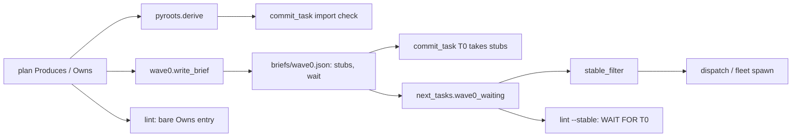
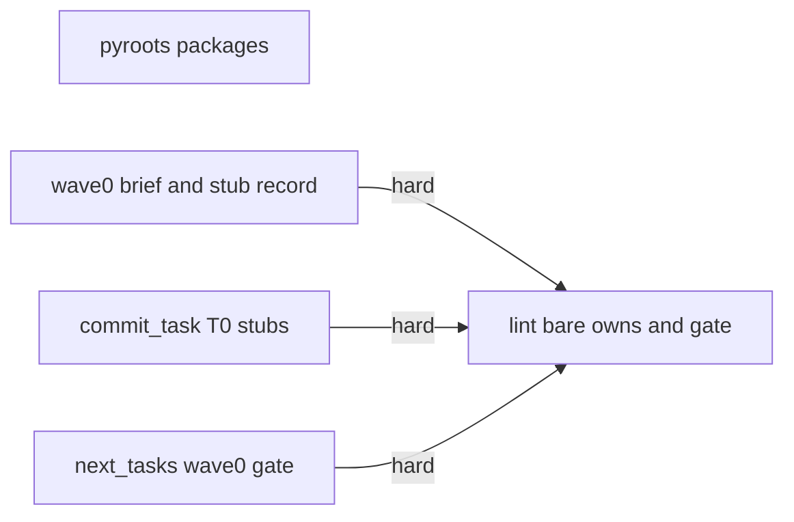

# Superlite: commit_task and Wave 0 batch (B2)

**Goal:** fix #194 (import roots inside a `src/` package), #195 (Owns shorthand), #197 (Wave 0 brief runs the full suite and rewrites `test-cmd.json`), #198 (T0 never checkpoints its stub files). Each fix ships with regression tests.
**Architecture:** edits to existing `sl` tools in `skills/subagent-driven-development/scripts/`: `pyroots.py`, `wave0.py`, `commit_task.py`, `next_tasks.py`, `plan_tools.py`. No new tool, no new flag; one new lint issue, one new `lint --stable` line, two new keys in `.superlite/briefs/wave0.json`.
**Tech stack:** Python 3.10+ stdlib, pytest (through `sl run_tests`).
**Spec:** this file, section Design; the issue bodies on GitHub are the source for each Expected line.
**Detail:** contracts
**Target-min:** 11
**Wave0:** none

Global constraints:
- Files under `skills/subagent-driven-development/scripts/` carry the repo's trailing `# O(...)` complexity comment on every code line; tests do not. Follow each file's existing style.
- Stdlib only. Results on stdout, notes on stderr. Existing tests stay green; a task changes an existing test only where its Owns names the file.
- Run `sl` as an executable (`<abs>/sl ...`). Verify with `<abs>/sl run_tests --fast <test files> --task Tn --background`, then the printed `wait:` line. Never raw `pytest`, never the e2e or eval layers (coordinator's step).
- No docs, SKILL.md or version edits (the ship step bumps the version).

Ruling: detail contracts - fixes in existing modules with known causes; tests are named with exact inputs and outcomes - cost if wrong: one NEEDS_CONTEXT per task.
Ruling: the batch also edits `pyroots.py`, `wave0.py` and `next_tasks.py` (brief lists only `commit_task.py` and `plan_tools.py`) - #194 and #197 name those files, and `backlog.json` assigns them to no other batch - cost if wrong: a rebase at ship.
Ruling: #195 takes the lint option: an Owns entry without a folder that follows an entry with one, is not a glob and is not an existing file or folder at the plan's root is a task-scoped lint issue; the tools do not guess folders - the plan format asks for exact paths, and real plans list root files such as `package.json` after paths - cost if wrong: a plan creating a new root file after a path lists it first.
Ruling: #197 uses `sl testcmd` (resolves only, runs nothing) as the "does run_tests detect the stack" check; T0 writes `test-cmd.json` only when it prints `null` - cost if wrong: none, the check is read-only.
Ruling: #198 stub files are recorded once, at brief time, in `wave0.json` (`stubs`, `wait`); `commit_task` and the dispatch gate read that record, never recompute from a later plan edit; a `wave0.json` without the keys keeps the old behaviour - cost if wrong: a plan edited after the brief keeps the first brief's stub list.
Ruling: #198 `commit_task <wave0 id>` takes a stub file even while its owner is busy in the pool (T0 owns it until it commits), but never once the owner has a `commit` line - cost if wrong: a stray owner started early has its partial file in T0's checkpoint, then its own.
Ruling: #198 the gate rides on `stable.json` (`next_tasks.stable_filter`), the dispatch path every round uses; without `stable.json` nothing is gated - cost if wrong: a dispatch without a prior `lint --stable` still sends stub owners with T0.
Ruling: no probe adapter - every package is a CLI or library over local files and git state; Review Focus cases run as named pytest cases - cost if wrong: no generated probes.

## Design

### 1. #194 import roots
`pyroots.derive` walks top-down and prunes. A directory D (not the root, not `src/`) is never a root when D holds `__init__.py` (a package is importable from its parent) and its subtree is not walked; a directory that becomes a root has its subtree pruned too, so nothing under a returned root is returned. `src/pkg/__init__.py` + `src/pkg/connectors/__init__.py` + `connectors.base.Foo()` returns `[]`; the import check then imports `src/pkg/connectors/base.py` as `pkg.connectors.base`. The repo root's own `__init__.py` never blocks a root.

### 2. #195 Owns shorthand
`lint_plan` walks each task's `owns` in order. An entry with no `/`, no `*`, after an earlier entry with a `/`, that does not exist at `stable_root(plan.path)` (file or folder, parenthetical notes stripped), is an `Issue("Tn: Owns entry `y.swift` has no folder (after `Sources/A/x.swift`); write the full path (`Sources/A/y.swift`) or list root-level files before paths", [Tn])`. Task-scoped: the task goes to FIX.

### 3. #197 Wave 0 brief
Done criteria 2 and 3 of `build_brief` change to the text in T2. T0 checks its stubs with an import or compile check of the files it wrote (seconds), runs `"$SL" testcmd`, writes `test-cmd.json` only when that prints `null`, and never runs `run_tests --full`.

### 4. #198 T0 owns its stub files
- `wave0.stub_files(plan)`: the non-test Owns (the `files:` lists of the stub spec) of every task with a Produces item another task consumes, plan order, deduped. `wave0.wait_tasks(plan, stubs, wid)`: ids of tasks other than `wid` whose Owns match a stub file (`next_tasks.owns_match`). `write_brief` adds `"stubs"` and `"wait"` to `wave0.json`.
- `commit_task`: `wave0_stubs(plan)` reads `wave0.sl_dir(plan)/briefs/wave0.json` and returns `(id, stubs)` or None. In `commit_one`, for the task whose id is that `id`, a changed file matching a stub entry is taken (`mine`) unless a task that owns it has a `commit` line in the ledger. This runs before the `Wave 0 globs never take another task's file` rule, which stays for every other file.
- `next_tasks.wave0_waiting(sl_dir)`: the `wait` list of `sl_dir/briefs/wave0.json` while `sl_dir/progress.md` has neither `commit <id> <sha>` nor `Ruling: skip <id>`; else empty. `stable_filter` subtracts it, so `dispatch` and `fleet spawn --for-dispatch` hold stub owners until T0 commits.
- `lint --stable`: after the brief is written, `pending` drops `wave0_waiting`; when that set is not empty it prints `WAIT FOR T0: T1 T3 (they hold T0's stub files; dispatch offers them once commit_task T0 succeeds or the ledger has - Ruling: skip T0)` (the recorded id in place of `T0`) right before `DISPATCH NOW:`. `SEND BEFORE ANY PLAN EDIT`, `THEN LOG` and the lint-log `pending` use the reduced list.

## Coverage

| Category | State | Basis |
|---|---|---|
| Scope and success criteria | settled | four issues in Goal; each issue's Expected line; out: docs, SKILL.md, the other batches' files |
| Domain and data model | n/a | no new entities |
| Persistence and migration | ruled | two optional keys in `wave0.json`; old files without them keep old behaviour (Ruling) |
| Interfaces and contracts | ruled | `commit_task` stdout unchanged; new lint issue and one `WAIT FOR` line; `stable.json` keys unchanged |
| UI states | n/a | CLI text |
| Concurrency and state ownership | ruled | T0 owns stub files until its commit line; gate in `stable_filter` (Rulings) |
| Error handling and recovery | settled | unreadable `wave0.json` or ledger: no gate, no stub rule |
| Security and privacy | n/a | local files only |
| Performance and limits | settled | pyroots prunes package subtrees (fewer dirs walked) |
| Observability | settled | `WAIT FOR` line; lint issue names the fix |
| Testing strategy | settled | unit tests per task; unit layer `sl run_tests --full` by the coordinator |
| Compatibility | settled | Python 3.10+; plans with root files after paths stay clean |
| Rollout | ruled | one PR; version bump at ship |
| Research unknowns | n/a | causes stated in the issues and confirmed in code |

## File structure

- `scripts/pyroots.py`: root derivation (T1).
- `scripts/wave0.py`: brief text, stub record (T2).
- `scripts/commit_task.py`: T0 stub rule (T3).
- `scripts/next_tasks.py`: dispatch gate (T4).
- `scripts/plan_tools.py`: bare Owns lint, `lint --stable` gate (T5).

## Task graph

```mermaid
%% schedule
gantt
  title Predicted schedule (mm:ss)
  dateFormat X
  axisFormat %M:%S
  section lane 1
  T3 commit_task  T0 commits its stub file :t3, 0, 120s
  T5 plan_tools  bare Owns lint and the T0 :t5, 120, 135s
  section lane 2
  T2 wave0  brief checks and stub record :t2, 0, 119s
  section lane 3
  T4 next_tasks  hold stub owners until T0 :t4, 0, 116s
  section lane 4
  T1 pyroots  no root inside a package :t1, 0, 110s
```

critical path: T3 → T5 (4.3 min) · peak width 4 · predicted build 4.3 min · predicted total ≈ 7.8 min (target ✓)

## Package: scripts (CLI over plan, ledger and git state)

**Probe entry:** none (Ruling: no probe adapter).

### T1 pyroots: no root inside a package · Complexity 2 · Est. context 24k
**Owns:** skills/subagent-driven-development/scripts/pyroots.py, tests/scripts/test_pyroots_packages.py
**Components:** 1
**LOC owned:** 70
**Tests:** fast
**Kind:** mechanical
**Model:** haiku
**Est. time:** 1.5 min (1 component, about 70 LOC, fast tests)
**Covers:** 1
**Consumes:** nothing executed from another task.
**Produces:** pyroots.derive(root: Path, names: list[str]) -> set[str]
**Review Focus:** file: `test_src_package_not_a_root` (files `src/pkg/__init__.py`, `src/pkg/connectors/__init__.py`, `src/pkg/connectors/base.py`; plan line `**Produces:** connectors.base.Foo() -> int` -> `import_roots == []`); file: `test_folder_inside_package_not_a_root` (`app/__init__.py`, `app/data/review/shell.py`, `review.shell.run_json(` -> `[]`); file: `test_folder_under_found_root_not_a_root` (`x/review/shell.py`, `x/y/review/shell.py`, `review.shell.run_json(` -> `["x"]`); file: `test_root_init_does_not_block` (`__init__.py` at the repo root, `x/y/mod.py`, `mod.f(a) -> int` -> `["x/y"]`).
**Test code:** new file; `mk` and `plan` helpers as in `tests/scripts/test_pyroots.py` (copy them, do not import); the four tests above.
**Steps:** 1 failing tests, 2 run: FAIL, 3 implement, 4 run: PASS (also `tests/scripts/test_pyroots.py` stays green).
**Notes:** in `derive`'s `os.walk` loop, after the root/`src` `continue`: if `Path(dirpath) / "__init__.py"` is a file, `dirs[:] = []` and `continue`; when a dir is added to `found`, also `dirs[:] = []`. Update the module docstring line on roots. Nothing else changes.

### T2 wave0: brief checks and stub record · Complexity 3 · Est. context 32k
**Owns:** skills/subagent-driven-development/scripts/wave0.py, tests/scripts/test_wave0_stub_record.py
**Components:** 1
**LOC owned:** 100
**Tests:** fast
**Model:** sonnet
**Est. time:** 2.5 min (1 component, about 100 LOC, fast tests)
**Covers:** 3, 4
**Consumes:** nothing executed from another task.
**Produces:** wave0.stub_files(plan: Plan) -> list[str] · wave0.wait_tasks(plan: Plan, stubs: list[str], wid: str) -> list[str]
**Review Focus:** state: `test_wave0_json_records_stubs_and_wait` (the `PY` plan of `tests/scripts/test_wave0.py`: T1 owns `src/pkg/slug.py, tests/test_slug.py` and produces `pkg.slug.slugify(text: str) -> str`, T2 consumes it -> `wave0.json` has `"stubs": ["src/pkg/slug.py"]`, `"wait": ["T1"]`); state: `test_no_consumed_produces_records_empty` (no Consumes anywhere -> `"stubs": []`, `"wait": []`); file: `test_brief_checks_stubs_without_suite` (brief has `"$SL" testcmd`, `prints null`, `never create, change or narrow`, and no `run_tests --full`); file: `test_brief_keeps_pythonpath_rule` (brief still has `"pythonpath"` and ``neither the repository root nor `src/` ``).
**Test code:** new file; build plans with `plan`, `PY` and `HEAD` imported from `test_wave0`; run `wave0.py --plan` with `run` from `test_plan_tools`; read `.superlite/briefs/wave0.json`.
**Steps:** 1 failing tests, 2 run: FAIL, 3 implement, 4 run: PASS (also `tests/scripts/test_wave0.py` stays green).
**Notes:** factor the per-task item filter of `stub_spec` into one helper so `stub_spec` and `stub_files` agree; `stub_files` keeps `TEST_PATH` out, plan order, deduped. `wait_tasks` imports `next_tasks` (`owns_match`). Replace Done criteria 2 and 3 in `build_brief` with exactly:
`2. Check the stubs, not the suite: run the fastest import or compile check the language has on the files you wrote (Python: \`python -m py_compile\` plus an import of each module; TypeScript: \`tsc --noEmit\`; Go: \`go build ./...\`; Rust: \`cargo check\`). It takes seconds; never run the test suite or \`run_tests\`.`
`3. Run \`"$SL" testcmd\` (it resolves the test command and runs nothing). It prints a command: run_tests already detects the stack, so never create, change or narrow \`.superlite/test-cmd.json\`. It prints null: write \`.superlite/test-cmd.json\`: ` followed by the current key list, `test`/`test_file`/`junit`/`setup` explanation and the `pythonpath` sentence unchanged, then `Run \`"$SL" testcmd\` again: it must print your command.`

### T3 commit_task: T0 commits its stub files · Complexity 4 · Est. context 40k
**Owns:** skills/subagent-driven-development/scripts/commit_task.py, tests/scripts/test_commit_t0_stubs.py
**Components:** 1
**LOC owned:** 110
**Tests:** fast
**Model:** sonnet
**Est. time:** 3 min (1 component, about 110 LOC, fast tests)
**Covers:** 4
**Consumes:** nothing executed from another task.
**Produces:** commit_task.wave0_stubs(plan: str) -> tuple[str, list[str]] | None
**Review Focus:** state: `test_t0_commits_stub_of_uncommitted_owner` (TS plan of `test_wave0.py`; hand-written `wave0.json` `{"id": "T0", "synthetic": true, "title": "Wave 0 skeleton", "owns": ["package.json"], "stubs": ["src/slug.ts"], "wait": ["T1"]}`; files `package.json`, `src/slug.ts`, `src/feed.ts` -> `commit_task T0` exit 0, commit holds exactly `package.json`, `src/slug.ts`); state: `test_t0_commits_stub_while_owner_busy` (same, pool has T1 `busy: true` -> same two files); state: `test_t0_leaves_stub_of_committed_owner` (ledger `- commit T1 abcdef1234 slug` -> commit holds only `package.json`); state: `test_wave0_json_without_stubs_keeps_old_rule` (no `stubs` key -> only `package.json`); state: `test_other_task_ignores_stub_record` (`commit_task T2` with `src/slug.ts` and `src/feed.ts` changed -> commit holds only `src/feed.ts`).
**Test code:** new file; git repo setup and `git show --name-only` as in `test_wave0.py::test_commit_task_t0_takes_its_files_not_other_tasks` (conftest sets `SUPERLITE_AUTOCOMMIT=1`); the five tests above.
**Steps:** 1 failing tests, 2 run: FAIL, 3 implement, 4 run: PASS (also `tests/scripts/test_commit_*.py` stay green).
**Notes:** `wave0_stubs` reads `wave0.sl_dir(plan) / "briefs" / "wave0.json"` (lazy `import wave0`, as `main` already does); None on a missing or unreadable file, a missing or empty `stubs` list, or no `id`. `main` stores it once (`a.w0`). In `commit_one`, before the `tid == "T0"` glob rule: `tid == w0 id`, `nt.owns_match(f, stubs)`, and no other task owning `f` is in `committed_tasks(a.ledger)` -> `mine.append(f); continue`. stdout stays the bare SHA. `test_wave0.py` is T5's: its old commit test turns red until T5.

### T4 next_tasks: hold stub owners until T0 commits · Complexity 3 · Est. context 28k
**Owns:** skills/subagent-driven-development/scripts/next_tasks.py, tests/scripts/test_wave0_gate.py
**Components:** 1
**LOC owned:** 80
**Tests:** fast
**Model:** sonnet
**Est. time:** 2 min (1 component, about 80 LOC, fast tests)
**Covers:** 4
**Consumes:** nothing executed from another task.
**Produces:** next_tasks.wave0_waiting(sl_dir: Path) -> set[str]
e.g. wave0_waiting(sd) -> {"T1", "T3"} (wave0.json `{"id": "T0", "wait": ["T1", "T3"]}`, empty ledger)
e.g. wave0_waiting(sd) -> set() (same, ledger has `- commit T0 abcdef1234 skeleton`)
e.g. wave0_waiting(sd) -> set() (same, ledger has `- Ruling: skip T0 - not needed`)
**Review Focus:** state: `test_waiting_until_t0_commit` (first e.g.); state: `test_commit_line_releases` (second); state: `test_skip_ruling_releases` (third); file: `test_missing_or_bad_wave0_json_waits_nothing` (no file, `{not json`, `"wait": "T1"` -> `set()`); state: `test_stable_filter_subtracts_waiting` (`stable.json` `{"stable": ["T1", "T2", "T3"]}`, wait `["T1", "T3"]` -> `stable_filter(plan) == {"T2"}`; after the commit line -> all three); state: `test_other_id_released_by_its_own_commit` (`"id": "T1"`, wait `["T2"]`, ledger `- commit T0 abcdef1234 x` -> `{"T2"}`; `- commit T1 abcdef1234 x` -> `set()`).
**Test code:** new file; `tmp_path / ".superlite"` holds `briefs/wave0.json`, `progress.md`, `stable.json`; the plan file is `tmp_path / "plan.md"` (`state.plan_dir` maps it to `tmp_path / ".superlite"`).
**Steps:** 1 failing tests, 2 run: FAIL, 3 implement, 4 run: PASS (also `tests/scripts/test_dispatch_*.py` stay green).
**Notes:** commit line regex as `commit_task.COMMIT_LINE` for the given id; skip ruling as `dispatch.skip_t0` (`- Ruling: skip <id>` or `Ruling: skip <id>` at line start). `id` defaults to `T0`; non-string `wait` items are dropped. `stable_filter` returns `stable - wave0_waiting(f.parent)`; None stays None.

### T5 plan_tools: bare Owns lint and the T0 gate · Complexity 4 · Est. context 44k
**Owns:** skills/subagent-driven-development/scripts/plan_tools.py, tests/scripts/test_lint_owns_bare.py, tests/scripts/test_wave0.py
**Components:** 2
**LOC owned:** 130
**Tests:** fast
**Model:** sonnet
**Est. time:** 3.5 min (2 components, about 130 LOC, fast tests)
**Covers:** 2, 4
**Consumes:** next_tasks.wave0_waiting(sl_dir: Path) -> set[str] (T4)
**Produces:** none consumed by another task.
**Review Focus:** file: `test_bare_name_after_path_flagged` (T1 Owns `Sources/A/x.swift, y.swift, z.swift (same folder)` -> lint output has ``T1: Owns entry `y.swift` has no folder`` and ``Sources/A/y.swift``, `lint --stable` lists T1 under FIX); file: `test_existing_root_file_not_flagged` (`package.json` exists next to the plan; Owns `src/a.py, package.json` -> no issue); file: `test_root_files_first_not_flagged` (Owns `Makefile, src/a.py`, no Makefile on disk -> no issue); file: `test_glob_and_dir_not_flagged` (Owns `src/a.py, *.csproj, docs/` -> no issue); state: in `test_wave0.py`, `test_lint_stable_holds_stub_owner_until_t0` (the `PY` plan: lines `SEND BEFORE ANY PLAN EDIT: T0 T2`, `WAIT FOR T0: T1 (...)`, last line `DISPATCH NOW: T2`; then ledger `- commit T0 abcdef1234 skeleton` -> `DISPATCH NOW` includes T1 and no `WAIT FOR` line); state: `test_dispatch_holds_stub_owner_until_t0` (after `lint --stable`, `dispatch.py` output has the T0 line and no line naming T1; after the commit line, T1 is offered).
**Test code:** `test_lint_owns_bare.py` new (plans via `make_plan` from `test_plan_tools`, `owns=`); in `test_wave0.py` update the three tests whose old expectations #198 changes and add the two state tests: `test_lint_stable_prints_t0_agent_line_and_send_before_edit` (`SEND BEFORE ANY PLAN EDIT: T0 T2`, last line `DISPATCH NOW: T2`), `test_lint_prints_log_line_and_unblocked_line_counts_as_dispatched` (`dispatched T0 T2 at`), `test_commit_task_t0_takes_its_files_not_other_tasks` (now commits `package.json` and `src/slug.ts`, and leaves a new `src/feed.ts`).
**Steps:** 1 failing tests, 2 run: FAIL, 3 implement, 4 run: PASS (also `test_stable_split.py`, `test_lint_dispatch_now.py`, `test_plan_tools.py` stay green; an existing test outside Owns that turns red: report DONE_WITH_CONCERNS with its name, do not edit it).
**Notes:** bare-entry check goes next to the `no **Owns:** line` check in `lint_plan`; strip a trailing ` (...)` note before the existence check; root = `stable_root(str(plan.path))` when `plan.path` is set. Gate: in `cmd_lint_stable` after the wave0 brief block, `waiting = nt.wave0_waiting(sl_dir)` (lazy `import next_tasks as nt`), `pending = [t for t in pending if t not in waiting]` before `SEND BEFORE`, `THEN LOG` and the lint-log entry; the `WAIT FOR` line uses the `id` from `wave0.json` and the waiting ids that are stable and unsent, sorted by `nkey`, and prints right before `DISPATCH NOW:`.

## Review Focus

Package `scripts`: app type CLI over local files and git state; categories state, file. Specific risks: a stub file taken from an owner that already committed (T3); the gate never lifting after T0's commit (T4); a root-level file such as `package.json` after paths flagged in real plans (T5); a root skipped for a project whose root has `__init__.py` (T1). Each task block carries its cases.

## Self-review

- Coverage: #194 T1, #195 T5, #197 T2, #198 T2 + T3 + T4 + T5.
- Graph: T5 runs `write_brief` (T2), `commit_task` (T3, the updated `test_wave0.py` commit test) and `wave0_waiting` (T4); all hard. T1 to T4 share no file.
- Contracts: `wave0.json` keys `stubs` (list of Owns paths) and `wait` (list of task ids) written by T2, read by T3 and T4.
