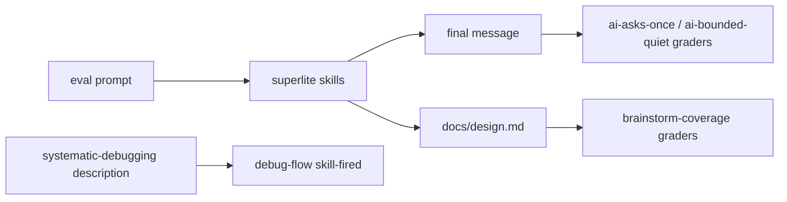
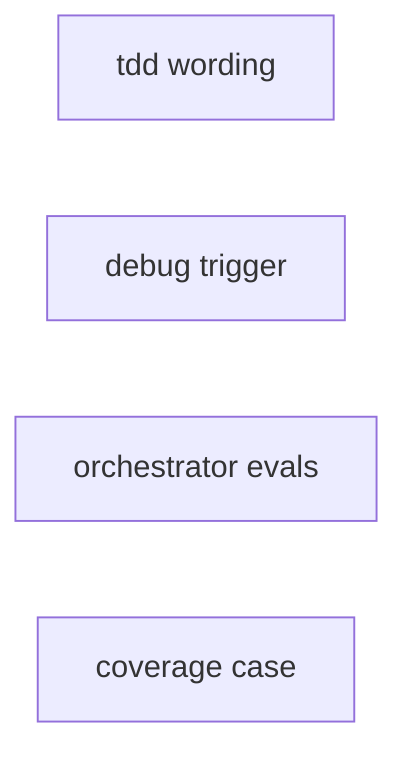

# Superlite B6: TDD evidence wording, debug trigger, orchestrator and coverage evals

**Goal:** the TDD and verification skills cover regression guards, green for the right reason and UI checks in the real container (#73); a failing-test prompt loads `systematic-debugging` before any fix (#74); evals check that the AI orchestrator raises one batch of major decisions before any code and stays quiet on a bounded request (#15); `brainstorm-coverage` shows a plugin delta (#152).
**Architecture:** four independent tasks: T1 wording in two skills; T2 the debugging skill's trigger description; T3 two new eval cases plus suite wiring; T4 the rebuilt coverage case.
**Tech stack:** Markdown, bash (scaffolds), pytest, `claude plugin eval` cases.
**Spec:** this file, section Design.
**Detail:** contracts
**Target-min:** 6
**Wave0:** none
**Coverage:** off (skill wording, eval fixtures and their unit tests; no runtime surface)

Global constraints:
- Verify with `<abs sl> run_tests --fast <your test files> --task Tn --background`, then the printed `wait:` line. Never run `scripts/evals.sh`, `claude plugin eval` or an e2e layer: evals are the coordinator's step.
- Markdown edits: only the sentences named in the task; LF endings; no version bump.
- Eval files copied from `<ROOT>/.superlite/spike/` are calibrated: copy them byte for byte (`cp -R`), keep scaffolds executable.

Ruling: #15 graders judge the final message, not an AskUserQuestion call (because a probe eval showed `claude plugin eval` withholds AskUserQuestion: the model reported it missing and `tool_used` counted 0 calls; cost if wrong: the case checks the content of the batch, not the tool).
Ruling: #74 changes only the debugging skill's description (because a spike with that description fired 3 of 3 debug-flow runs against 1 of 2 without it, and `using-superlite` is at 1,497 of 1,500 characters; cost if wrong: a UserPromptSubmit hint hook is the next step).
Ruling: #152 grades a design doc written unattended (`docs/design.md`) instead of the final message (because the coverage pass records ruled rows in the doc; an attended run showed only open rows, so rollback and observability were invisible in both arms; cost if wrong: the case no longer covers the attended question path, which `ai-asks-once` covers).
Ruling: #152 hidden gaps are untrusted input, size limits and rollback, with migration as the sanity gap (because measured over 2 runs per arm: baseline raised concurrency and observability 2 of 2 in a written design, untrusted input and limits 0 of 2; plugin 2 of 2 on all; cost if wrong: a flaky gap, caught by the two acceptance runs).
Ruling: #152 item 4 (`/superlite:feature` skipping brainstorming in eval runs) is not built here; follow-up issue (because acceptance does not need it and the new cases start from a plain prompt or `/superlite:brainstorming`; cost if wrong: none).
Ruling: #73 gets wording only, no red-run tooling in `run_tests`/`commit_task` (because the issue asks for skill text and batch B2 owns those scripts; cost if wrong: a skipped red step stays visible only in reports).
Ruling: the judge stays haiku (because every plugin-arm verdict in calibration runs r2-r4 passed with it; cost if wrong: a judge miss turns the suite red, seen in the acceptance runs).

## Design

1. **#73 (T1).** TDD Red step: an exception for regression guards, proven by breaking the code on purpose once. Green step: confirm the intended reason (print measured values once for layout or numeric assertions). Good tests and Done checklist: UI work names one check in the real container and real data state. Verification skill: the same UI evidence rule.
2. **#74 (T2).** The `systematic-debugging` description reads `Use first on any bug report, failing test or unexpected behavior, even when the fix looks obvious, before reading code to fix it`. `debug-flow` runs 3 times (T3).
3. **#15 (T3).** `ai-asks-once`: a notes CLI and the prompt `Add sync so I can read and add my notes from my phone as well. AI orchestrator. I am at my desk and will answer your questions before you plan.` Graders: the final message raises at least two of four open decisions, asks at most four top-level items, and no `.py` file is edited or written. `ai-bounded-quiet` (should not fire): the same CLI and `Add a --version flag ...`; the final message asks nothing and `cli.py` gains `--version`. Calibrated: plugin 1.00 vs baseline 0.75 (ai-asks-once, 2 runs), both 1.00 (bounded).
4. **#152 (T4).** The notes spec adds `notes import DIR`, run by cron, which deletes the imported mail files; the prompt asks for an unattended design in `docs/design.md` and a stop before the plan. Graders read that file. Calibrated: plugin 1.00 vs baseline 0.67 in 2 of 2 runs.

## Main diagram

## File structure

- `skills/test-driven-development/SKILL.md`, `skills/verification-before-completion/SKILL.md`, `tests/scripts/test_tdd_wording.py`: T1.
- `skills/systematic-debugging/SKILL.md`, `tests/scripts/test_debug_trigger.py`: T2.
- `evals/ai-asks-once/**`, `evals/ai-bounded-quiet/**`, `evals/debug-flow/case.yaml`, `docs/testing.md`, `tests/scripts/test_evals_suite.py`: T3.
- `evals/brainstorm-coverage/**`, `tests/scripts/test_evals_coverage_case.py`: T4.

## Task graph

```mermaid
%% schedule
gantt
  title Predicted schedule (mm:ss)
  dateFormat X
  axisFormat %M:%S
  section lane 1
  T3 orchestrator evals :t3, 0, 138s
  section lane 2
  T4 coverage case :t4, 0, 117s
  section lane 3
  T1 tdd wording :t1, 0, 111s
  section lane 4
  T2 debug trigger :t2, 0, 109s
```

critical path: T3 (2.3 min) · peak width 4 · predicted build 2.3 min · predicted total ≈ 5.8 min (target ✓)

## Skills and evals

**Probe entry:** none (wording and eval fixtures; unit tests cover them, the evals layer runs them).

Package review focus: app type docs and fixtures. Categories: file (scaffold scripts run in an empty folder), encoding (YAML frontmatter values with colons and braces).

### T1 tdd wording · Complexity 2 · Est. context 24k
**Owns:** skills/test-driven-development/SKILL.md, skills/verification-before-completion/SKILL.md, tests/scripts/test_tdd_wording.py
**Components:** 1
**LOC owned:** 45
**Tests:** fast
**Kind:** mechanical
**Model:** haiku
**Est. time:** 1.5 min (1 component, about 45 LOC, fast tests)
**Review Focus:** `test_red_flag_allows_guards`: the red flag line reads exactly `- The test passed on its first run, and it is not a regression guard you saw fail on purpose.`
**Test code (contracts):**
- `test_red_step_names_guard_exception`: the Red step line (starts `1. **Red.**`) contains `regression guard` and `breaking the code on purpose`.
- `test_green_step_names_right_reason`: the Green step line contains `for the intended reason` and `print the measured values once`.
- `test_red_flag_allows_guards`: as in Review Focus; the old line `- The test passed on its first run.` is gone.
- `test_ui_check_in_real_container`: the TDD skill contains `real container` and `real data state` under `## Good tests` and under `## Done checklist`; the verification skill contains both phrases under `## Acceptable evidence`.
- `test_done_checklist_names_guards`: the Done checklist contains `Regression guards were seen failing once`.
**Steps:** 1 failing tests, 2 run: FAIL, 3 implement, 4 run: PASS
**Notes:** Exact edits.
- TDD Red step: after `A test that passes immediately proves nothing: fix the test.` append ` Exception: a regression guard for behavior that already works passes at once by design; prove it once by breaking the code on purpose (or running it against the parent commit), see it fail, then restore the code.`
- TDD Green step: after `Confirm green and no new failures there.` append ` Confirm it passes for the intended reason: for a layout, size or numeric assertion, print the measured values once.`
- TDD Red flags: replace `- The test passed on its first run.` with the Review Focus line.
- TDD `## Good tests`: add the bullet `- UI work: besides the component in isolation, one check of it in its real container with the real data state (loaded, not the loading placeholder), named as the evidence.`
- TDD `## Done checklist`: add `- Regression guards were seen failing once against deliberately broken code.` and `- UI work: one check ran in the real container with the real data state.`
- Verification `## Acceptable evidence`: add `- For UI work: one check of the screen in its real container and real data state (not the component alone, not the loading state), named as the evidence.`

### T2 debug trigger · Complexity 1 · Est. context 20k
**Owns:** skills/systematic-debugging/SKILL.md, tests/scripts/test_debug_trigger.py
**Components:** 1
**LOC owned:** 15
**Tests:** fast
**Kind:** mechanical
**Model:** haiku
**Est. time:** 1 min (1 component, about 15 LOC, fast tests)
**Review Focus:** `test_description_fires_first`: the frontmatter line is exactly `description: Use first on any bug report, failing test or unexpected behavior, even when the fix looks obvious, before reading code to fix it`.
**Test code (contracts):**
- `test_description_fires_first`: as in Review Focus.
- `test_obvious_fixes_stay_quick`: the body still contains `## Obvious failures: fix directly` and `/superlite:debug`.
**Steps:** 1 failing tests, 2 run: FAIL, 3 implement, 4 run: PASS
**Notes:** Replace only the `description:` line. Do not touch `skills/using-superlite/SKILL.md`.

### T3 orchestrator evals · Complexity 3 · Est. context 32k
**Owns:** evals/ai-asks-once/case.yaml, evals/ai-asks-once/prompt.md, evals/ai-asks-once/scaffold.sh, evals/ai-asks-once/graders/raises-decisions.md, evals/ai-asks-once/graders/one-batch.md, evals/ai-asks-once/graders/no-code-edit.md, evals/ai-asks-once/graders/no-code-write.md, evals/ai-bounded-quiet/case.yaml, evals/ai-bounded-quiet/prompt.md, evals/ai-bounded-quiet/scaffold.sh, evals/ai-bounded-quiet/graders/no-questions.md, evals/ai-bounded-quiet/graders/changed.md, evals/debug-flow/case.yaml, docs/testing.md, tests/scripts/test_evals_suite.py
**Components:** 2
**LOC owned:** 140
**Tests:** fast
**Model:** sonnet
**Est. time:** 3 min (2 components, about 140 LOC, fast tests)
**Review Focus:** `test_ai_cases_grade_outcomes`: `no-code-edit` and `no-code-write` are `tool_used` graders with `min: 0`, `max: 0`, `arm: both` and an `input_match` that matches `"file_path": "/x/src/notes/cli.py"` but not `"file_path": "/x/docs/plan.md"`.
**Test code (contracts):** in `tests/scripts/test_evals_suite.py`:
- `CASES` gains `ai-asks-once` and `ai-bounded-quiet`; `test_frontmatter_keys_are_known` expects `runs` `3` for `debug-flow` and `2` for every other case.
- `test_scaffold_scripts_are_executable_bash`: the scaffold set gains both new cases; after running, `src/notes/cli.py` exists and `pyproject.toml` holds `version = "1.2.3"` in each.
- `test_ai_cases_grade_outcomes`: as in Review Focus, plus `raises-decisions` and `one-batch` are `llm` graders with `criteria`; `ai-bounded-quiet/graders/no-questions.md` is `llm`; `changed.md` is `regex` with target `{source: file, path: src/notes/cli.py}` and pattern `--version`.
- `test_ai_prompts_name_the_orchestrator`: both prompts contain `AI orchestrator` and `I am at my desk`; neither starts with `/`.
- `test_testing_doc_counts_cases`: `docs/testing.md`'s evals row says `six cases`.
- Delete `test_coverage_scaffold_spec_is_thin` and `test_coverage_case_grades_the_final_message` (T4 replaces them in its own file).
**Steps:** 1 failing tests, 2 run: FAIL, 3 implement, 4 run: PASS
**Notes:**
- `cp -R <ROOT>/.superlite/spike/ai-asks-once <ROOT>/.superlite/spike/ai-bounded-quiet <ROOT>/evals/`; change nothing in them.
- `evals/debug-flow/case.yaml`: `runs: 2` becomes `runs: 3` (#74 accepts 3 of 3).
- `docs/testing.md` evals row: `about $1-3` becomes `about $2-4`, `three cases of real agent work` becomes `six cases of real agent work`.
- `frontmatter()` reads `input_match: '...'` with its quotes stripped; compile it with `re` for the Review Focus check.

### T4 coverage case · Complexity 2 · Est. context 26k
**Owns:** evals/brainstorm-coverage/case.yaml, evals/brainstorm-coverage/prompt.md, evals/brainstorm-coverage/scaffold.sh, evals/brainstorm-coverage/graders/design-written.md, evals/brainstorm-coverage/graders/no-code-yet.md, evals/brainstorm-coverage/graders/raises-limits.md, evals/brainstorm-coverage/graders/raises-migration.md, evals/brainstorm-coverage/graders/raises-rollback.md, evals/brainstorm-coverage/graders/raises-untrusted-input.md, evals/brainstorm-coverage/graders/reads-coverage.md, evals/brainstorm-coverage/graders/raises-errors.md, tests/scripts/test_evals_coverage_case.py
**Components:** 1
**LOC owned:** 70
**Tests:** fast
**Model:** sonnet
**Est. time:** 2 min (1 component, about 70 LOC, fast tests)
**Review Focus:** `test_spec_hides_the_graded_gaps`: after `scaffold.sh` runs in a temp folder, `docs/spec.md` (lower-cased) contains `cron` and `notes import` and none of `migrat`, `rollback`, `roll back`, `untrusted`, `secur`, `limit`, `size`, `error`, `fail`, `lock`.
**Test code (contracts):** in `tests/scripts/test_evals_coverage_case.py` (reuse `frontmatter()` by importing it from `test_evals_suite`, or a local copy of the 15-line parser):
- `test_spec_hides_the_graded_gaps`: as in Review Focus; `notes.json` holds 2 notes; `src/notes/store.py` contains `json.load`.
- `test_graders_read_the_design_doc`: `raises-limits`, `raises-migration`, `raises-rollback`, `raises-untrusted-input` are `llm` graders whose `focus` is `{source: file, path: docs/design.md}`; `design-written` is `file_exists` with path `docs/design.md`; `raises-errors.md` and `skill-fired.md` do not exist.
- `test_reads_coverage_stays_with_only`: `reads-coverage` is `tool_used`, tool `Read`, `arm: with-only`.
- `test_prompt_is_unattended`: the prompt starts with `/superlite:brainstorming ` and contains `decide yourself`, `docs/design.md` and `no plan and no code`; `case.yaml` allows `Write` and not `AskUserQuestion`.
**Steps:** 1 failing tests, 2 run: FAIL, 3 implement, 4 run: PASS
**Notes:** `cp -R <ROOT>/.superlite/spike/brainstorm-coverage/. <ROOT>/evals/brainstorm-coverage/`, then `git rm` `evals/brainstorm-coverage/graders/raises-errors.md`. Do not edit `tests/scripts/test_evals_suite.py` (T3 owns it; until T3 commits, its two old coverage tests fail: expected).

## Review Focus

- Scaffolds: each runs with `set -euo pipefail` in an empty folder and creates the files its graders read.
- Grader frontmatter: values with braces, colons and regexes parse in the runner (calibration runs r2-r4 loaded them).
- Wording: only the named sentences change; no rule is weakened.

## Self-review

- #73 T1, #74 T2 (+ `debug-flow` runs in T3), #15 T3, #152 T4. No shared files; no edges.
- The coordinator runs unit, headless and evals; evals twice in a row for #152's acceptance.
