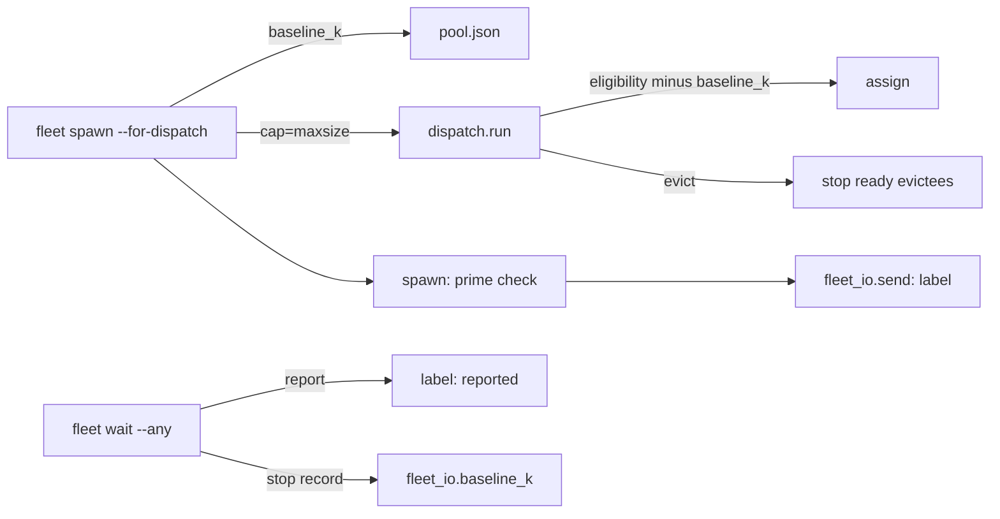
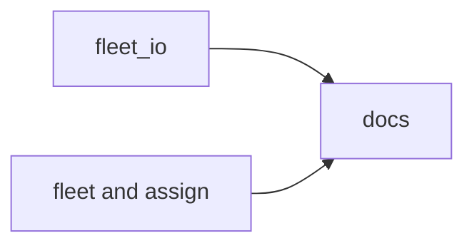

# Superlite: fleet spawn and dispatch round fixes (backlog batch B1)

**Goal:** a fleet dispatch round that never fails silently or wastes workers: `fleet spawn` refuses at once when the prime file is missing (#203); `--for-dispatch` sends every ready task (#204) and stops the idle workers it evicts (#205); eviction counts what a worker added since READY, not its fixed baseline (#206); a finished worker is visible in Herdr and can push its report to a coordinator that runs `fleet wait --any` in the background (#193).
**Architecture:** three tasks. T1 (`fleet_io.py`) and T2 (`fleet.py`, `assign.py`) run in parallel; T2 builds against T1's `baseline_k` examples. T3 (docs) follows both.
**Tech stack:** Python 3.10+ stdlib, pytest, Markdown.
**Spec:** this file, section Design; the issue bodies of #193, #203, #204, #205, #206.
**Detail:** contracts
**Target-min:** 10
**Wave0:** none
**Coverage:** off (bug batch)

Global constraints:
- Python 3.10+ stdlib; follow the style of `skills/subagent-driven-development/scripts/`, including a `# O(...)` comment on every code line.
- New behaviour gets tests in the task's new test file; existing test files stay unchanged and green (run the ones the task names).
- Verify with `<abs sl> run_tests --fast <test files> --task Tn --background`, then the printed `wait:` line.
- `fleet_state.locked(sd)` is not reentrant: never call a function that takes it while holding it.
- No version bump in a task.

Ruling: B1 may also change `assign.py` and the fleet docs (Max, answer-1.json) - cost if wrong: a merge conflict with a later batch.
Ruling: #204 `--for-dispatch` passes `cap=sys.maxsize` (every ready task, as lint's DISPATCH NOW); account headroom stays the fleet's limit and prints BLOCKED lines as today - cost if wrong: a big round fills the accounts.
Ruling: #205 only an evicted worker whose fleet state is `ready` is stopped; a `busy` one keeps its unread report - cost if wrong: none.
Ruling: #203 no automatic `build_prime`: the refusal names the command - cost if wrong: one extra command.
Ruling: #206 baseline = context of the READY reply, read lazily from the worker transcript (its first turn) and cached in fleet.json; eviction subtracts it instead of the prime size - cost if wrong: a worker runs up to about 15k past the old limit.
Ruling: #193 push = `fleet wait --any` run as a background command (the harness notifies on exit); pane label via `herdr pane rename`, best effort - cost if wrong: the label updates only while a wait runs.

## Design

- **#203:** `spawn` checks the tier's prime file (`prime.md`, `prime-haiku.md` for haiku) right after `fleet_roles.launch` and before the worker id, the account choice and any Herdr call; missing: `BLOCKED: no <abs path>; run build_prime --plan PLAN first` (haiku: `build_prime --tier haiku --plan PLAN`), exit 3. A `no READY` failure names the prime file when it is gone by then.
- **#204/#205:** `for_dispatch` calls `dispatch.run(..., cap=sys.maxsize)`; after the `evict=` lines it stops each evicted fleet worker in state `ready` (same as `fleet stop Wn`) and prints `stopped Wn`, before the spawn loop, so the freed pane slots serve this round.
- **#206:** `fleet_io.baseline_k(sd, wid)` reads the worker's first stop record, takes the READY reply's usage from its transcript (`fleet_io.ready_k`) and caches it in fleet.json. `for_dispatch` writes it into each pool agent as `baseline_k` before dispatch; `assign.eligibility` subtracts `baseline_k` when present, else the prime size as today. `fleet status` prints `context_k=` and `baseline_k=` per pool worker.
- **#193:** `fleet_io.pane_label` renames a worker's pane: `Wn <label>` on send, `Wn <label> reported, waiting for coordinator` when `wait` collects the report, `Wn <label> BLOCKED-UI` on a blocked screen. `fleet wait --any` returns after the first poll round that finished a worker and prints `BUSY Wn Wm` for the rest.

## File structure

- `skills/subagent-driven-development/scripts/fleet_io.py`: pane label, `wait --any`, `ready_k`, `baseline_k` (T1).
- `skills/subagent-driven-development/scripts/fleet.py`: prime check, dispatch round, status columns (T2).
- `skills/subagent-driven-development/scripts/assign.py`: eligibility subtracts the baseline (T2).
- `skills/subagent-driven-development/fleet.md`, `docs/fleet.md`: coordinator docs (T3).

```mermaid
%% schedule
gantt
  title Predicted schedule (mm:ss)
  dateFormat X
  axisFormat %M:%S
  section lane 1
  T2 fleet round  prime check  eviction :t2, 0, 141s
  T3 fleet docs :t3, 141, 111s
  section lane 2
  T1 fleet_io notify and baseline :t1, 0, 138s
```

critical path: T2 → T3 (4.2 min) · peak width 2 · predicted build 4.2 min · predicted total ≈ 7.7 min (target ✓)

## Package: fleet scripts

App type: CLI. Categories: protocol (commands, output lines), state (fleet.json, pool.json), file.
**Probe entry:** run=python3 skills/subagent-driven-development/scripts/fleet.py

### T1 fleet_io notify and baseline · Complexity 4 · Est. context 40k
**Owns:** skills/subagent-driven-development/scripts/fleet_io.py, tests/scripts/test_fleet_io_notify.py
**Components:** 2
**LOC owned:** 150
**Tests:** fast
**Model:** sonnet
**Est. time:** 3.5 min (2 components, about 150 LOC, fast tests)
**Produces:** fleet_io.ready_k(transcript: str) -> float | None
e.g. ready_k(path of [user "Read /x/.superlite/prime.md, then reply READY", assistant "READY" with usage {"input_tokens": 3, "cache_read_input_tokens": 12000, "cache_creation_input_tokens": 2400}, user "# Task T1", assistant "Status: DONE" with usage {"input_tokens": 5, "cache_read_input_tokens": 40000}]) -> 14.4
e.g. ready_k(path of [user "Read prime", assistant "READY" with usage {"input_tokens": 1000, "cache_read_input_tokens": 9000}]) -> 10.0
e.g. ready_k("/missing.jsonl") -> None
**Produces:** fleet_io.baseline_k(sd: Path, wid: str) -> float | None
e.g. baseline_k(sd, "W1") with a W1 stop record in metrics.jsonl whose transcript is ready_k's first example -> 14.4, and fleet.json W1 now holds "baseline_k": 14.4
e.g. baseline_k(sd, "W9") with no W9 stop record -> None
**Produces:** fleet_io.pane_label(sd: Path, wid: str, text: str) -> bool
**Produces:** fleet_io.wait(sd, ids, timeout_ms, poll_s=2.0, clock=None, any_=False) -> list
**Review Focus:** `test_label_failure_never_breaks_send` (state: a failed rename must not lose a send or a report); `test_wait_any_returns_first` (protocol: the `BUSY` line names exactly the pending workers).
**Test code (contracts):** in `tests/scripts/test_fleet_io_notify.py`, reusing `world`, `FakeHerdr`, `rec`, `user`, `assistant` from `test_fleet_io`; give the fake a `call(args)` that records `("call", args)` and returns `{}`.
- `test_send_labels_pane`: `send(sd, plan, "W1", ["T3"], ...)` records `("call", ["pane", "rename", "w6:p1", "W1 T3"])`.
- `test_finish_labels_reported`: W1 busy on T3, a stop record after `sent` with a transcript ending `Status: DONE`; `wait(sd, ["W1"], 5000)` records `("call", ["pane", "rename", "w6:p1", "W1 T3 reported, waiting for coordinator"])`.
- `test_blocked_ui_labels`: W2 busy on T4, herdr state `blocked`; `wait` records the rename of `w6:p2` to `W2 T4 BLOCKED-UI`.
- `test_label_failure_never_breaks_send`: `call` raising the module's HerdrError, and a fake with no `call` attribute: `send` still prints `W1 T3 sent` and returns `"T3"`; `label` returns False.
- `test_wait_any_returns_first`: W1 and W2 busy; first poll W1 `done` with a stop record, W2 `working`; `wait(sd, None, 60000, any_=True)` returns one result (W1), prints `BUSY W2` last, leaves W2 `busy` in fleet.json, and polls once.
- `test_wait_any_cli_flag`: `main(["wait", "--any", "--timeout", "5000"])` calls `wait` with `any_=True` (monkeypatched `io.wait`).
- `test_ready_k_first_turn`: the three `ready_k` examples; a tool_use/tool_result pair inside the READY turn does not end it.
- `test_baseline_k_caches`: the two `baseline_k` examples; after the first call the transcript is deleted and a second call still returns 14.4 (cache); None is never cached.
- Keep `tests/scripts/test_fleet_io.py` and `tests/scripts/test_fleet_io_roles.py` green.
**Steps:** 1 failing tests, 2 run: FAIL, 3 implement, 4 run: PASS
**Notes:** `ready_k` cuts the records before the second `_starts_turn` record and reuses `pool.context_k` on those lines (written to a temp file), so the token formula stays in `pool.py`. `baseline_k` uses the earliest stop record of `wid` (READY turn), and writes the cache under `fs.locked`. `label` reads the pane id from fleet.json, calls `hc.call(["pane", "rename", pane, text])`, and returns False on any exception (a fake without `call` included). Label calls: `send`/`send_brief` `Wn <label>`, `send_text` `Wn <task>`, `_finish` before `_stop_worker`, `_blocked`. `--any`: after the poll round's loop, when `results` is not empty, print `BUSY <pending ids>` (only when some are pending) and return; `TIMEOUT` stays as is.

### T2 fleet round, prime check, eviction · Complexity 5 · Est. context 46k
**Owns:** skills/subagent-driven-development/scripts/fleet.py, skills/subagent-driven-development/scripts/assign.py, tests/scripts/test_fleet_dispatch_round.py
**Components:** 2
**LOC owned:** 170
**Tests:** fast
**Model:** sonnet
**Est. time:** 4 min (2 components, about 170 LOC, fast tests)
**Consumes:** fleet_io.baseline_k(sd: Path, wid: str) -> float | None (T1)
**Produces:** assign.eligibility(agent: dict, est_context: float, limits: dict | None = None, prime_k: float = 0.0) -> str | None
e.g. eligibility({"context_k": 70, "baseline_k": 30, "tasks": [], "idle_min": 0}, 20, {"max_context_k": 80}, 5.0) -> None
e.g. eligibility({"context_k": 70, "tasks": [], "idle_min": 0}, 20, {"max_context_k": 80}, 5.0) -> "context over 80k"
**Review Focus:** `test_for_dispatch_stops_evicted_ready_worker` (state: a busy evictee is never stopped); `test_spawn_without_prime_refuses_before_pane` (protocol: exact BLOCKED line, exit 3, no Herdr call).
**Test code (contracts):** in `tests/scripts/test_fleet_dispatch_round.py`, reusing `world`, `FakeHerdr` from `test_fleet` and `dwld`, `_go`, `FRESH` from `test_fleet_for_dispatch`; fake `fleet_io.baseline_k` with `monkeypatch.setattr(fleet_io, "baseline_k", ..., raising=False)`.
- `test_spawn_without_prime_refuses_before_pane`: `prime.md` deleted; `fleet.spawn(sd, plan, "sonnet", proj)` exits 3, prints exactly `BLOCKED: no <sd resolved>/prime.md; run build_prime --plan PLAN first`, `fh.calls == []`, fleet.json `next` unchanged.
- `test_haiku_spawn_names_prime_haiku`: `prime-haiku.md` deleted; tier haiku prints `BLOCKED: no <sd resolved>/prime-haiku.md; run build_prime --tier haiku --plan PLAN first`.
- `test_for_dispatch_without_prime_blocks_each_line`: no `prime.md`, lines `[("T2", FRESH), ("T3", FRESH)]`: exit 3, stdout `BLOCKED: T2 not sent (no <path>; run build_prime --plan PLAN first)` then the same for T3, no `start_agent` call.
- `test_no_ready_names_missing_prime`: the fake's `prompt` deletes `prime.md` and the screen has no READY: the BLOCKED line holds `no READY` and `no <sd resolved>/prime.md`.
- `test_for_dispatch_passes_no_cap`: the faked `dispatch.run` sees `cap=sys.maxsize`.
- `test_for_dispatch_stops_evicted_ready_worker`: W1 ready, W2 busy, evict `{"W1": "context over 80k", "W2": "context over 80k"}`, lines `[("T3", FRESH)]`: stdout `["stopped W1", "W3 T3 sent"]`, W1 `stopped`, W2 still `busy`, `exit_agent` only for W1, stderr keeps `evict=W1 context over 80k`.
- `test_for_dispatch_writes_baselines_into_pool`: `baseline_k` faked as `{"W1": 14.4}.get`: after the round pool.json W1 has `baseline_k` 14.4, W2 has no `baseline_k` key.
- `test_status_shows_context_and_baseline`: pool W1 `context_k` 52.3, `baseline_k` faked 14.4: W1's status line ends ` context_k=52.3 baseline_k=14.4`; unknown values print `-`; a fixer worker's line has no `context_k=`.
- `test_eligibility_uses_baseline`: the two `eligibility` examples; `"baseline_k": None` falls back to `prime_k`.
- Keep `tests/scripts/test_fleet.py`, `test_fleet_for_dispatch.py`, `test_fleet_capacity.py`, `test_dispatch_fleet.py`, `test_dispatch_prime_budget.py`, `test_prime_root.py` green.
**Steps:** 1 failing tests, 2 run: FAIL, 3 implement, 4 run: PASS
**Notes:** Prime check goes right after `launch = fleet_roles.launch(...)`, before `choose_account` and `fs.next_id`. In `for_dispatch`: compute `fio.baseline_k` for pool agents that are fleet workers without `baseline_k` first, then write pool.json under `fs.locked` (never call `baseline_k` while holding it); then `dp.run(..., cap=sys.maxsize)`, `dp.render([], evict)`, then `for wid in stop(sd, [k for k in evict if <fleet state of k> == "ready"]): print(f"stopped {wid}")`, then the spawn loop. `stop` already drops the pool entry. Status line suffix only for workers listed in pool.json.

## Package: fleet docs

App type: docs. No probe entry (no runnable code).

### T3 fleet docs · Complexity 2 · Est. context 30k
**Owns:** skills/subagent-driven-development/fleet.md, docs/fleet.md, tests/scripts/test_fleet_b1_docs.py
**Components:** 1
**LOC owned:** 45
**Tests:** fast
**Model:** sonnet
**Est. time:** 2 min (1 component, about 45 LOC, fast tests)
**Review Focus:** `test_fleet_md_wait_any_background`: the skill doc tells the coordinator to run `fleet wait --any` as a background command and names the `BUSY` line.
**Test code (contracts):** in `tests/scripts/test_fleet_b1_docs.py`:
- `test_fleet_md_wait_any_background`: `skills/subagent-driven-development/fleet.md` contains `fleet wait --any`, `background` and `BUSY Wn`.
- `test_fleet_md_names_stopped_line`: it contains `stopped Wn` and `build_prime`.
- `test_docs_fleet_lists_new_output`: `docs/fleet.md` contains `--any`, `BUSY`, `stopped W`, `baseline_k=`, `reported, waiting for coordinator` and `run build_prime --plan PLAN first`.
- Keep `tests/scripts/test_docs_contract.py`, `test_fleet_capacity.py`, `test_fleet_for_dispatch.py`, `test_fleet_roles_docs.py`, `test_fleet_roles_skill.py` green.
**Steps:** 1 failing tests, 2 run: FAIL, 3 implement, 4 run: PASS
**Notes:** skill `fleet.md`: in "Waiting and acting" replace the foreground rule with: run `"$SL" fleet wait --any --timeout 540000 --plan $PLAN` as a background command (the harness wakes you when a worker finishes), act on its lines, run it again while workers are busy; `BUSY Wn Wm` lists the workers still running; a lead that must not end its turn may run it in the foreground. In "Implementers": `--for-dispatch` sends every ready task, stops each evicted idle worker (`stopped Wn` on stdout) and refuses with `BLOCKED: no ...prime.md; run build_prime --plan PLAN first` when the prime is missing. `docs/fleet.md` Commands: the same lines, the pane labels, the `fleet status` columns `context_k=` and `baseline_k=`, and that eviction subtracts `baseline_k` (the READY reply's context). Keep the house style: terse, one fact per sentence, no new headings.

## Self-review

Coverage: #203 T2, #204 T2, #205 T2, #206 T1+T2 (+T3 docs), #193 T1+T3. No placeholders. T2 consumes exactly T1's `baseline_k` line. Edges: docs only (they describe T1 and T2). No shared file between T1 and T2.
