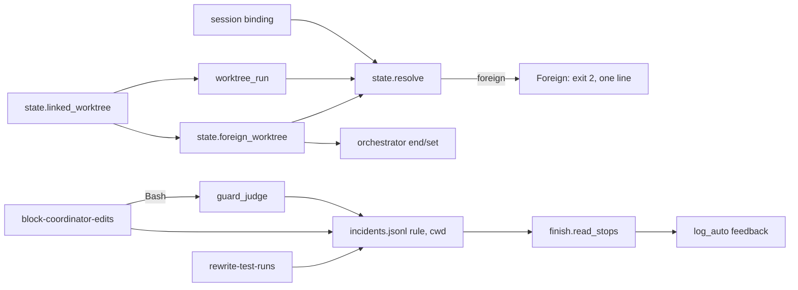
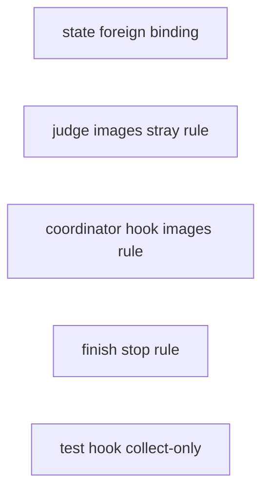

# Superlite: guards batch (B12)

**Goal:** fix #224 (writers follow a session binding into another worktree), #225 (a submodule `.git` file counts as a linked worktree), #232 (the coordinator guard has no route for doc images or a stray untracked file), #233 (rule-block incidents carry no rule or cwd), #234 (the worker test-run block denies `pytest --collect-only` and names no whole-suite route). Each fix ships with regression tests.
**Architecture:** edits to `skills/subagent-driven-development/scripts/state.py`, `orchestrator.py`, `guard_judge.py`, `finish.py` and the hooks `hooks/block-coordinator-edits`, `hooks/rewrite-test-runs`; one new test file per task.
**Tech stack:** Python 3.10+ stdlib, bash 3.2+ builtins in hooks, pytest (through `sl run_tests`).
**Spec:** this file, section Design; the issue bodies on GitHub are the source for each Expected line.
**Detail:** contracts
**Target-min:** 11
**Wave0:** none
**Max chars:** 26000

Global constraints:
- Files under `skills/subagent-driven-development/scripts/` carry the repo's trailing `# O(...)` complexity comment on every code line; tests do not. Follow each file's existing style. Hooks stay bash builtins only until they start Python (no new external process on a path that passes today).
- Stdlib only. Existing tests stay green; a task changes an existing test only where its Owns names the file.
- Run `sl` as an executable (`<abs>/sl ...`). Verify with `<abs>/sl run_tests --fast <test files> --task Tn --background`, then the printed `wait:` line. Never raw `pytest`, never the e2e or eval layers (coordinator's step).
- Tests that need a session or state folder set their own env: the host's `SUPERLITE_STATE_DIR`, `SUPERLITE_SESSION_ID`, `CLAUDE_CODE_SESSION_ID` are dropped by `tests/scripts/conftest.py`; a subprocess env is built from `os.environ` plus the test's own values.
- No version edits (the ship step bumps the version). No edits to `docs/` (another lead may own them).
- The block message line (exact, both guards): `- New code belongs to an implementer task. You may write only docs/plans/**, docs/*/plans/**, SPEC*.md, docs/**/*.md, docs/** images (png, jpg, jpeg, gif, svg, webp), any docs.md and .superlite/**, and rm a file git does not track and no task Owns.`

Ruling: detail contracts - fixes in existing modules with known causes; tests are named with exact inputs and outcomes - cost if wrong: one NEEDS_CONTEXT per task.
Ruling: #224 `state.resolve()` refuses (exit 2 via `state.Foreign`, a `SystemExit` subclass, one stderr line) only for the session-binding step; `SUPERLITE_STATE_DIR`, an explicit plan or folder, the worktree's own run and the private folder pass; `resolve(strict=False)` keeps the old result for callers that judge it themselves - cost if wrong: a reader (`sl pool list`) in a foreign worktree also refuses; the line names `SUPERLITE_STATE_DIR` and `--plan`.
Ruling: #224 `for_plan(plan)` with a not-started plan run and a foreign binding returns the plan's own folder: `--plan` names this worktree's run - cost if wrong: none, the binding was never this worktree's.
Ruling: #224 hooks keep their own bash resolution (`hooks/superlite-state.sh` is outside this batch's files): follow-up - cost if wrong: hook-written rows still follow a foreign binding.
Ruling: #225 one test `state.linked_worktree(top)`: `.git` is a file whose `gitdir:` path ends in `/worktrees/<name>`; `worktree_run`, `foreign_worktree` use it; `orchestrator.foreign_worktree` becomes an alias of `state.foreign_worktree` - cost if wrong: none.
Ruling: #232 images are lowercase `png jpg jpeg gif svg webp` under `docs/**`, active mode only (human mode keeps review plans only), like `docs/**/*.md` - cost if wrong: an upper-case `.PNG` still blocks.
Ruling: #232 `rm`/`unlink` of a literal existing regular file passes in active mode when `git ls-files --error-unmatch` does not know it (untracked or ignored) and no task Owns it (the plan named by `stable.json`); any doubt (no stable.json, unreadable plan, git error, glob, folder, symlink, hard link) blocks - cost if wrong: a stray file still needs a fixer.
Ruling: #233 every rule-block row the two guards and the test hook write gains `rule` and `cwd`; command targets keep up to 400 characters; `finish.read_stops` folds them into the target text, so `log_auto` entries carry them and the `(kind, tool, target)` tuple stays - cost if wrong: none.
Ruling: #234 a segment with `--collect-only` or `--co` passes for workers and is not rewritten for the coordinator; the optional `test_all` key is out of scope (`testcmd.py` is outside this batch's files) - cost if wrong: a narrowed `test` command still narrows `--full`.
Ruling: no probe adapter - hooks and CLIs over local files and git state; Review Focus cases run as named pytest cases - cost if wrong: no generated probes.

## Design

### 1. #225 one linked-worktree test
`state.linked_worktree(top)` reads `top/.git`: a file whose first line is `gitdir: <path>` with `<path>` (backslashes as `/`, trailing `/` dropped) ending in `/worktrees/<name>`. `state.worktree_top(path=".")` is `git_root(path)` when that is a linked worktree, else None. `worktree_run()` uses it.

### 2. #224 writers never follow a binding into another worktree
`state.foreign_worktree(sd)` moves from `orchestrator.py` unchanged in behaviour. `resolve()` (no plan, no env, no worktree run) checks `bound()`: when `foreign_worktree(b)` names a top, it prints `Foreign.line` to stderr and raises `Foreign` (exit 2). Every default (`pool_path`, `ledger_path`, `incident_log`) and every tool without `--plan` gets the refusal without edits. `orchestrator end/set` without `--plan` read `resolve(strict=False)` and keep their own message.

### 3. #232 doc images and stray files
See T2 and T3.

### 4. #233 rule and cwd
See T2, T3, T4, T5.

### 5. #234 collect-only
See T5.

## Coverage

| Category | State | Basis |
|---|---|---|
| Scope and success criteria | settled | five issues in Goal; each issue's Expected line |
| Domain and data model | ruled | incident rows gain `rule`, `cwd` (Ruling) |
| Persistence and migration | settled | old rows without the keys read as before |
| Interfaces and contracts | ruled | `state.Foreign`, `resolve(strict=)`, `linked_worktree`, `worktree_top`, `foreign_worktree` |
| UI states | n/a | CLI and hook text |
| Concurrency and state ownership | settled | appends only; no shared file between tasks |
| Error handling and recovery | ruled | refusal exit 2; stray rule blocks on any doubt |
| Security and privacy | ruled | guard widened only for literal untracked unowned files and doc images |
| Performance and limits | settled | git spawn only for an `rm` the guard would block |
| Observability | settled | rule and cwd in rows and feedback entries |
| Testing strategy | settled | unit tests per task; layers unit, headless by the coordinator |
| Compatibility | settled | Python 3.10+, bash 3.2 |
| Rollout | ruled | one PR; version bump at ship |
| Research unknowns | n/a | causes stated in the issues and confirmed in code |

## File structure

- `scripts/state.py`, `scripts/orchestrator.py` (T1). `scripts/guard_judge.py` (T2). `hooks/block-coordinator-edits` (T3). `scripts/finish.py` (T4). `hooks/rewrite-test-runs` (T5).

## Task graph

```mermaid
%% schedule
gantt
  title Predicted schedule (mm:ss)
  dateFormat X
  axisFormat %M:%S
  section lane 1
  T2 guard_judge  doc images  stray files  :t2, 0, 120s
  section lane 2
  T1 state  refuse a binding in another wo :t1, 0, 118s
  section lane 3
  T3 block-coordinator-edits  doc images a :t3, 0, 92s
  section lane 4
  T5 rewrite-test-runs  collect-only and t :t5, 0, 90s
  section lane 5
  T4 finish  stop text carries rule and cw :t4, 0, 87s
```

critical path: T2 (2.0 min) · peak width 5 · predicted build 2.0 min · predicted total ≈ 5.5 min (target ✓)

## Package: guards and state (hooks and CLIs over local files and git state)

**Probe entry:** none (Ruling: no probe adapter).

### T1 state: refuse a binding in another worktree · Complexity 4 · Est. context 40k
**Owns:** skills/subagent-driven-development/scripts/state.py, skills/subagent-driven-development/scripts/orchestrator.py, tests/scripts/test_state_foreign_worktree.py
**Components:** 2
**LOC owned:** 150
**Tests:** fast
**Model:** sonnet
**Est. time:** 3 min (2 components, about 150 LOC, fast tests)
**Covers:** 1, 2
**Consumes:** nothing executed from another task.
**Produces:** state.linked_worktree(top: Path) -> bool · state.worktree_top(path=".") -> Path | None · state.foreign_worktree(sd) -> Path | None · state.Foreign(sd: Path, top: Path) (SystemExit, code 2, attribute line: str) · state.resolve(plan_or_dir=None, strict: bool = True) -> Path
**Review Focus:** file: `test_linked_worktree_reads_the_gitdir` (parametrized `.git` file text -> result: `gitdir: /r/.git/worktrees/wa` True; `gitdir: /r/.git/worktrees/wa/` True; `gitdir: C:\r\.git\worktrees\wa` True; `gitdir: /r/.git/modules/sub` False; `gitdir: /r/sub.git` False; `garbage` False; `.git` a folder False; no `.git` False); state: `test_worktree_run_skips_a_submodule` (main `.git` folder; `main/sub/.git` file `gitdir: ../.git/modules/sub`; `main/sub/.superlite/stable.json`; cwd `main/sub`: `worktree_run() is None`; session A bound to `main/.superlite`: `resolve() == main/.superlite`); state: `test_resolve_refuses_a_binding_in_another_worktree` (`repo` fixture of `test_session_state`, A bound to `wb/.superlite` with `stable.json`, cwd `wa`: `pytest.raises(state.Foreign)`, `.code == 2`, stderr one line holding `cwd is in worktree <wa>` and `<wb>/.superlite`); state: `test_resolve_keeps_a_binding_inside_the_worktree` (A bound to `wa/.superlite`, cwd `wa/docs` -> `wa/.superlite`); state: `test_state_dir_names_the_foreign_run` (`SUPERLITE_STATE_DIR=<wb>/.superlite`, cwd `wa` -> that folder, no raise); state: `test_non_strict_and_main_checkout_follow_the_binding` (cwd `wa`: `resolve(strict=False) == wb/.superlite`; cwd `main`: `resolve() == wb/.superlite`); state: `test_private_folder_passes` (A bound to `state.private_dir(A)`, cwd `wa` -> that folder); state: `test_for_plan_uses_the_plan_folder_when_the_binding_is_foreign` (A bound to `wb`, cwd `wa`: `for_plan(wa/docs/superpowers/plans/p.md) == wa/.superlite`); protocol: `test_writer_cli_refuses_with_exit_2` (subprocess `scripts/incident.py add --file a.py --line 1 --context x`, cwd `wa`, env `CLAUDE_CODE_SESSION_ID=A`: returncode 2, stderr one line naming both folders, `wb/.superlite/incidents.jsonl` absent; same with `SUPERLITE_STATE_DIR=<wb>/.superlite`: returncode 0, the file exists); protocol: `test_where_reports_a_foreign_binding` (`state.py where` in `wa`: returncode 0, stdout holds `session binding` and `foreign`); state: `test_orchestrator_uses_the_state_check` (`orchestrator.foreign_worktree is state.foreign_worktree`; `orchestrator.py bind` in `wa` with A bound to `wb`: returncode 0, binds `wa/.superlite`).
**Test code:** new file; reuse `repo`, `A`, `state` from `test_session_state` (as `test_orchestrator_worktree_guard.py` does); in-process tests use `monkeypatch.chdir`, `monkeypatch.setenv("CLAUDE_CODE_SESSION_ID", A)`, `monkeypatch.setenv("PWD", str(cwd))`.
**Steps:** 1 failing tests, 2 run: FAIL, 3 implement, 4 run: PASS (also `tests/scripts/test_orchestrator_worktree_guard.py`, `test_session_state.py`, `test_run_state_binding.py`, `test_state_hook_order.py` stay green).
**Notes:** `Foreign.line` = `superlite: cwd is in worktree {top}, but the session binding names {sd}; not used. Pass --plan {top}/.superlite for this worktree's run, --plan {sd}, or set SUPERLITE_STATE_DIR`. `resolve` prints it with `print(..., file=sys.stderr)` right before `raise`. `for_plan`: `r = resolve(strict=False)`; return `plan_dir(plan)` when the run has not started, `SUPERLITE_STATE_DIR` is unset and `foreign_worktree(r)` is not None. `where` uses `strict=False` and appends `; foreign: cwd is in worktree <top>, writers refuse it` to the how text. `orchestrator.main` computes `sd` per command: `bind` without `--plan` the launch folder (never resolves); `end`/`set` without `--plan` `state.resolve(None, strict=False)`, then the unchanged #199 check and message; `approve --review` without `--plan` `plan_dir(review)`; else `sl_dir(a.plan)`. Update both module docstrings (Library list, the #199 line names #224).

### T2 guard_judge: doc images, stray files, rule and cwd · Complexity 5 · Est. context 50k
**Owns:** skills/subagent-driven-development/scripts/guard_judge.py, tests/scripts/test_judge_housekeeping.py
**Components:** 2
**LOC owned:** 160
**Tests:** fast
**Model:** sonnet
**Est. time:** 3.5 min (2 components, about 160 LOC, fast tests)
**Covers:** 3, 4
**Consumes:** nothing executed from another task.
**Produces:** guard_judge.judge(command, cwd, project, mode, sds=()) -> Verdict | None (unchanged signature) · guard_judge._incident(sd, kind, tool, target, rule=None, cwd=None) -> None
**Review Focus:** file: `test_doc_images_pass` (git repo with a run marker, mode active: `cp /tmp/a.png docs/x/a.png`, `rm docs/x/a.png`, `mv docs/a.svg docs/b/a.webp`, `cp a.jpg docs/` -> None); file: `test_images_outside_docs_and_human_mode_block` (`cp /tmp/a.png src/a.png` active -> kind code; `cp /tmp/a.png docs/x/a.png` mode human -> kind human; `cp /tmp/a.png docs/../src/a.png` -> code); state: `test_rm_untracked_unowned_file_passes` (repo with tracked `src/a.py`, untracked `src/a.py-E`, `.superlite/stable.json` `{"plan": <abs plan>, "stable": []}`, plan task `### T1 a` with `**Owns:** src/a.py, src/new.py`: `rm src/a.py-E` and `rm -f src/a.py-E` -> None; `unlink src/a.py-E` -> None); state: `test_rm_ignored_file_passes` (`.gitignore` `build/`, file `build/out.bin` -> `rm build/out.bin` None); state: `test_rm_blocks_on_any_doubt` (each -> kind code: `rm src/a.py` tracked; `rm src/new.py` untracked but owned; `rm src/a.py-E src/a.py`; `rm src/*.py-E`; `rm -r src/tmpdir` untracked folder; `rm src/link-E` a symlink to `src/a.py`; `rm src/a.py-E` with stable.json removed; with stable.json `{"plan": "/nope.md"}`; `rm src/a.py-E` mode human -> kind human); protocol: `test_block_row_has_rule_and_cwd` (`main` with argv `--mode active --project P --sd P/.superlite`, stdin `{"tool_name": "Bash", "tool_input": {"command": "rm src/a.py"}, "cwd": "P/src"}` -> returns 2; the incidents row has `rule == "code"`, `cwd == "P/src"`, `target == "src/a.py"`; stderr holds the exact block message line of Global constraints); protocol: `test_command_target_keeps_400_chars` (command `"echo " + "a" * 450 + " && rm $(cat list)"` -> row `target` length 400, starts `echo aaa`); protocol: `test_guard_error_row_unchanged` (`_incident(sd, "guard-error", "Bash", "x" * 300)` -> row has no `rule` or `cwd`, target length 120).
**Test code:** new file (not named `test_guard_*`: the parity suite reruns those); repos via `git init -q`, `git -c user.email=t@t -c user.name=t commit`; `judge(cmd, cwd=str(P), project=str(P), mode="active", sds=(str(P / ".superlite"),))`; mark the run with `P/.superlite/pool.json`.
**Steps:** 1 failing tests, 2 run: FAIL, 3 implement, 4 run: PASS (also `tests/scripts/test_guard_judge.py`, `test_judge_state_dirs.py`, `test_guard_false_blocks.py`, `test_guard_targets.py` stay green).
**Notes:** `ACTIVE_OK` gains `docs/*.png docs/*.jpg docs/*.jpeg docs/*.gif docs/*.svg docs/*.webp`. `_Ctx` keeps `self.sd` (first of `sds`). In `_targets`, for `base in ("rm", "unlink")`, a code verdict for a target with no glob or brace flag is skipped when `_stray(v, ctx)`: mode active, `v.rel` not `?`/`.`, `v.abs` a regular file (`os.lstat`, not a link, `st_nlink == 1`), `git -C <dir> ls-files --error-unmatch -- <name>` exits 1 (env without `GIT_DIR`, `GIT_WORK_TREE`, `GIT_INDEX_FILE`; timeout 1 s; any other outcome blocks), and no task of the plan in `<sd>/stable.json` `plan` owns it (`plan_tools.Plan.load`, `plan_tools.stable_root`, `next_tasks.owns_match` on the path relative to that root; lazy imports; any exception blocks). `MESSAGES["code"]` line 4 becomes the Global constraints line. `main` passes `rule=v.kind`, `cwd=cwd` and `_flat(target, 400)` for rule-block rows; other kinds stay 120 with no new keys.

### T3 block-coordinator-edits: doc images and rule rows · Complexity 3 · Est. context 34k
**Owns:** hooks/block-coordinator-edits, tests/scripts/test_coordinator_doc_images.py
**Components:** 1
**LOC owned:** 80
**Tests:** fast
**Model:** sonnet
**Est. time:** 2 min (1 component, about 80 LOC, fast tests)
**Covers:** 3, 4
**Consumes:** nothing executed from another task.
**Produces:** hook rows `{"kind":"rule-block","agent":"coordinator","tool":T,"target":X,"rule":R,"cwd":C}` with R in `fleet`, `protected`, `cache`, `human`, `code`
**Review Focus:** file: `test_write_doc_image_passes` (active run, parametrized `docs/ui/mock.png`, `.jpg`, `.jpeg`, `.gif`, `.svg`, `.webp`, absolute and relative `file_path` -> returncode 0); file: `test_image_outside_docs_blocks` (`src/mock.png`, `docs/../src/a.png` -> 2); state: `test_human_mode_doc_image_blocks` (orchestrator.json `{"mode": "human", "approved": false}`, `docs/ui/mock.png` -> 2); protocol: `test_block_message_line` (Write `src/a.py` -> stderr holds the exact Global constraints line); protocol: `test_rows_carry_rule_and_cwd` (payload `cwd` `/w/x`: Write `src/a.py` -> last row `rule` `code`, `cwd` `/w/x`; Write `.superlite/orchestrator.json` -> `protected`; human mode Write `src/a.py` -> `human`; `fleet.json` `{"on": true}` and Agent `superlite:implementer` -> `fleet`; a payload without `cwd` -> `cwd` `""`).
**Test code:** new file; `proj`, `run` from `test_block_coordinator_edits`.
**Steps:** 1 failing tests, 2 run: FAIL, 3 implement, 4 run: PASS (also `tests/scripts/test_block_coordinator_edits.py`, `test_guard_fleet_agents.py`, `test_hooks_bash32.py`, `test_inline_worktree_guard.py` stay green).
**Notes:** `allowed_rel` (active branch) adds `docs/*.png|docs/*.jpg|docs/*.jpeg|docs/*.gif|docs/*.svg|docs/*.webp`. Read the input `cwd` once (`jstr cwd`) into a variable before any other `jstr`; strip `"`, `\` and control characters; at most 300 characters. Both `printf` rows gain `"rule"` and `"cwd"`. The code message line 4 becomes the Global constraints line; the header comment (rule 3) names the images and the stray rm.

### T4 finish: stop text carries rule and cwd · Complexity 2 · Est. context 26k
**Owns:** skills/subagent-driven-development/scripts/finish.py, tests/scripts/test_finish_stop_rule.py
**Components:** 1
**LOC owned:** 50
**Tests:** fast
**Model:** sonnet
**Est. time:** 1.5 min (1 component, about 50 LOC, fast tests)
**Covers:** 4
**Consumes:** nothing executed from another task.
**Produces:** finish.read_stops(path) -> list[tuple[str, str, str]] (unchanged shape)
e.g. read_stops(log) -> [("rule-block", "Bash", "rm src/a.py (rule code, cwd /p/src)")] (row with `rule` "code", `cwd` "/p/src")
e.g. read_stops(log) -> [("rule-block", "Agent", "superlite:implementer (fleet on) (rule fleet)")] (row with `rule` only)
**Review Focus:** state: the two e.g. lines as `test_read_stops_appends_rule_and_cwd`, `test_read_stops_rule_only`; state: `test_read_stops_without_rule_keeps_target` (row without both keys -> target unchanged; `"rule": ""` -> unchanged); file: `test_log_auto_entry_names_the_rule` (`finish.log_auto(read_stops(log))` with the first row -> `feedback.jsonl` under `SUPERLITE_HOME` holds one entry whose `text` contains `rule-block: rm src/a.py (rule code, cwd /p/src)`); state: `test_cwd_whitespace_is_flattened` (`cwd` `"/a\nb"` -> `cwd /a b`).
**Test code:** new file; incident rows written as JSON lines in `tmp_path`.
**Steps:** 1 failing tests, 2 run: FAIL, 3 implement, 4 run: PASS (also `tests/scripts/test_finish_closeout.py`, `test_finish_grouping.py` stay green).
**Notes:** suffix only the parts present: ` (rule R, cwd C)`, ` (rule R)`, ` (cwd C)`; values through `" ".join(str(v).split())`. Docstrings of `read_stops` and `log_auto` say so.

### T5 rewrite-test-runs: collect-only and the full route · Complexity 3 · Est. context 32k
**Owns:** hooks/rewrite-test-runs, tests/scripts/test_rewrite_collect_only.py
**Components:** 1
**LOC owned:** 70
**Tests:** fast
**Model:** sonnet
**Est. time:** 2 min (1 component, about 70 LOC, fast tests)
**Covers:** 4, 5
**Consumes:** nothing executed from another task.
**Produces:** hook rows `{"kind":"rule-block",...,"rule":R,"cwd":C}` with R in `hidden-test-wait`, `subagent-full-suite`, `isolated-test-run`
**Review Focus:** protocol: `test_worker_collect_only_passes` (with `agent_id`, parametrized `uv run pytest --collect-only`, `pytest --co -q`, `python -m pytest --collect-only tests/`, `uv run pytest --collect-only -q && echo ok` -> returncode 0, stdout empty, no incident row); protocol: `test_fleet_worker_collect_only_passes` (env `SUPERLITE_FLEET_WORKER=W1`, `SUPERLITE_FLEET_ROLE=implementer`, no `agent_id`: `pytest --collect-only` -> 0); protocol: `test_cov_is_not_co` (with `agent_id`: `pytest --cov` -> 2, `pytest --co-x` -> 2); protocol: `test_worker_block_names_the_full_route` (with `agent_id`: `pytest` -> 2, stderr holds `sl run_tests --full` and `sl run_tests --fast <files>`); protocol: `test_coordinator_collect_only_not_rewritten` (no `agent_id`: `uv run pytest --collect-only` -> 0, stdout empty); state: `test_deny_rows_carry_rule_and_cwd` (payload `cwd` `/w/x`: worker `pytest` -> row `rule` `subagent-full-suite`, `cwd` `/w/x`; coordinator `until pytest; do sleep 1; done` -> `hidden-test-wait`; a 500-character `pytest` command from a worker -> target at most 400 characters after its prefix).
**Test code:** new file; `proj`, `run` from `test_rewrite_test_runs`; drop `SUPERLITE_FLEET_ROLE`, `SUPERLITE_FLEET_WORKER` from the env unless the test sets them.
**Steps:** 1 failing tests, 2 run: FAIL, 3 implement, 4 run: PASS (also `tests/scripts/test_rewrite_test_runs.py`, `test_rewrite_isolate.py`, `test_rewrite_quoted_paths.py` stay green).
**Notes:** collect-only test on the segment: `(^|[[:space:]])--(collect-only|co)([[:space:]]|$)`; the worker loop skips `deny_subagent_full` for it; the coordinator rewrite loop keeps such a segment as written (no rewrite, so `changed` stays 0 for it). New message line 2: `Use \`sl run_tests --fast <files>\` for focused tests; the whole suite runs only as \`sl run_tests --full\`.` The three deny rows gain `"rule"` and `"cwd"` (cwd read once like T3) and cut the command at 400 characters. Header comment names the collect-only pass.

## Review Focus

Package guards and state: app type CLI and hook; categories state (resolution order, run markers), file (git index, Owns, links), protocol (hook input JSON, exit codes, stderr lines). Specific risks: the stray rule deleting a tracked or owned file; a refusal escaping into a hook as exit 2; a foreign check that refuses a worktree's own run. Each task lists its named cases.

## Self-review

Coverage: #224, #225 T1; #232 T2, T3; #233 T2, T3, T4, T5; #234 T5. No placeholders. No task shares a file; no execution edges (each task's tests run only its own files). Fields filled.
