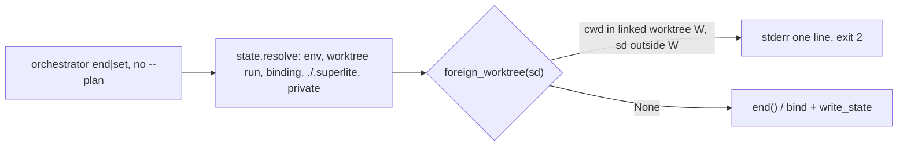

# Superlite: orchestrator end and set act only on the cwd's worktree run (backlog batch B4)

**Goal:** `sl orchestrator end` (and `set`) run without `--plan` in one linked worktree never archive or rewrite another worktree's run (#199). When the cwd is in a linked worktree and the folder `state.resolve` finds (the session binding, `$SUPERLITE_STATE_DIR`) lies outside it, the command refuses with one line naming both folders.
**Architecture:** one task. A guard `foreign_worktree(sd)` in `orchestrator.py`, checked by `end` and `set` before they touch any file or binding.
**Tech stack:** Python 3.10+ stdlib, pytest.
**Spec:** this file, section Design; the issue body of #199.
**Detail:** tests
**Target-min:** 6
**Wave0:** none
**Coverage:** off (bug batch)

Global constraints:
- Python 3.10+ stdlib; follow the style of `skills/subagent-driven-development/scripts/`, including a `# O(...)` comment on every code line.
- Only `skills/subagent-driven-development/scripts/orchestrator.py` and the new test file change; `state.py` and every other file belong to other batches.
- Existing test files stay unchanged and green (run the ones the task names).
- Verify with `<abs sl> run_tests --fast <test files> --task T1 --background`, then the printed `wait:` line.
- No version bump in the task.

Ruling: refuse instead of switching to the cwd's folder (because `end` moves files and a cwd reset to the launch worktree makes the cwd an unreliable signal; one extra call with `--plan` is cheap) - cost if wrong: one extra command per affected end.
Ruling: the guard covers `end` and `set` without `--plan`; `approve` always targets the review plan's folder and `bind` the launch directory - cost if wrong: `approve` without `--review` reads the bound folder, which it never writes.
Ruling: a folder inside the cwd's worktree (a monorepo `<app>/.superlite`) and the session's private folder pass; a main checkout and a folder outside git are not guarded - cost if wrong: none (the main checkout ending a worktree's run is the documented flow).
Ruling: the other state-writing tools (`lint --stable`, `dispatch`, ...) resolve through `state.py`, outside this batch's files: a follow-up issue - cost if wrong: they still follow a binding across worktrees.

## Design

- `foreign_worktree(sd) -> Path | None`: the cwd's git toplevel (`state.git_root(".")`) when its `.git` is a file (a linked worktree) and `sd` lies outside it; else None. Inside means equal or a descendant, by the logical paths (`state._abs`) or by the resolved ones (`Path.resolve()`), so a symlinked cwd into the bound worktree passes. `sd` equal to `state.private_dir(<session id>)` passes.
- `main`: for `end` and `set` with no `--plan`, after `sd` is known and before the `--plan` existence check, `live_owner`, `end()` or `state.bind`: when `foreign_worktree(sd)` names a worktree `w`, print to stderr, one line, and return 2:
  `orchestrator: cwd is in worktree {w}, but the run folder found is {sd} ({how}); not {verb}; pass --plan {w / '.superlite'} for this worktree's run, or --plan {sd}`
  with `sd` as `state._abs(sd)`, `how` = `SUPERLITE_STATE_DIR` when that variable is set, else `session binding`, and `verb` = `ended` for `end`, `set` for `set`.
- Module docstring: one sentence on the guard (#199).



## File structure

- `skills/subagent-driven-development/scripts/orchestrator.py`: the guard and its use in `main` (T1).
- `tests/scripts/test_orchestrator_worktree_guard.py`: the #199 tests (T1).


critical path: T1 (2.0 min) · peak width 1 · predicted build 2.0 min · predicted total ≈ 5.5 min (target ✓)

## Package: orchestrator

App type: CLI. Categories: protocol (exit code, one stderr line), state (binding and run files untouched on refusal), file (symlinked paths).
**Probe entry:** run=python3 skills/subagent-driven-development/scripts/orchestrator.py

### T1 orchestrator worktree guard · Complexity 3 · Est. context 56k
**Owns:** skills/subagent-driven-development/scripts/orchestrator.py, tests/scripts/test_orchestrator_worktree_guard.py
**Components:** 1
**LOC owned:** 120
**Tests:** fast
**Model:** sonnet
**Est. time:** 3 min (1 component, about 120 LOC, fast tests)
**Produces:** orchestrator.foreign_worktree(sd: Path) -> Path | None
e.g. foreign_worktree(Path("/r/.claude/worktrees/wb/.superlite")) with cwd /r/.claude/worktrees/wa (a linked worktree) -> Path("/r/.claude/worktrees/wa")
e.g. foreign_worktree(Path("/r/.claude/worktrees/wa/app/.superlite")) with cwd /r/.claude/worktrees/wa -> None
e.g. foreign_worktree(Path("/r/.claude/worktrees/wb/.superlite")) with cwd /r (the main checkout, `.git` a folder) -> None
**Review Focus:** `test_end_from_another_worktree_refuses_and_names_both` (state: no file moved, binding kept; protocol: exit 2, exactly one stderr line); `test_symlinked_cwd_into_the_bound_worktree_passes` (file: resolved-path comparison).
**Test code (verbatim):** `tests/scripts/test_orchestrator_worktree_guard.py`:
```python
"""#199: without --plan, `sl orchestrator end` and `set` never act on another worktree's run. When the cwd is in a linked
worktree and the folder found (the session binding, $SUPERLITE_STATE_DIR) lies outside it, they refuse with one line
naming both folders; a folder inside the worktree and the session's private folder still pass."""
from __future__ import annotations

import json
import os
import subprocess
import sys

import pytest

from test_session_state import A, B, ORCH, repo, sl, state  # noqa: F401  (repo is a fixture)


def trees(repo):
    return tuple(p.resolve() for p in repo)


def bound_run(main, w, markers=("stable.json", "pool.json")):
    """Session A bound to worktree w's planned run (set ai --plan), with run markers and a ledger; returns its folder."""
    assert sl(main, A, "set", "ai", "--plan", w / "docs" / "superpowers" / "plans" / "p.md").returncode == 0
    sd = w / ".superlite"
    for f in markers:
        (sd / f).write_text("{}\n")
    (sd / "progress.md").write_text("ledger\n")
    return sd


def test_end_from_another_worktree_refuses_and_names_both(repo):
    main, wa, wb = trees(repo)
    sb = bound_run(main, wb)
    (wa / ".superlite").mkdir()
    (wa / ".superlite" / "inline-flow.json").write_text('{"flow": "small"}\n')
    r = sl(wa, A, "end")
    assert r.returncode == 2, r.stdout
    assert len(r.stderr.strip().splitlines()) == 1, r.stderr
    assert f"cwd is in worktree {wa}," in r.stderr and f"found is {sb} (session binding)" in r.stderr
    assert "not ended" in r.stderr and f"--plan {wa / '.superlite'} " in r.stderr and r.stderr.strip().endswith(f"--plan {sb}")
    assert sorted(p.name for p in sb.iterdir()) == ["orchestrator.json", "pool.json", "progress.md", "session", "stable.json"]
    assert state.bound(A) == sb and (wa / ".superlite" / "inline-flow.json").exists()


def test_end_with_this_worktrees_folder_leaves_the_bound_run(repo):
    main, wa, wb = trees(repo)
    sb = bound_run(main, wb)
    sa = wa / ".superlite"
    sa.mkdir()
    (sa / "inline-flow.json").write_text('{"flow": "small"}\n')
    (sa / "progress.md").write_text("inline ledger\n")
    r = sl(wa, A, "end", "--plan", sa)
    assert r.returncode == 0 and "run ended; 1 files moved" in r.stdout, r.stderr
    assert not (sa / "inline-flow.json").exists() and not (sa / "progress.md").exists()
    assert (sb / "stable.json").exists() and (sb / "progress.md").exists() and state.bound(A) == sb


@pytest.mark.parametrize("sub", ["", "docs"])
def test_end_inside_the_bound_worktree_still_ends(repo, sub):
    main, _, wb = trees(repo)
    sb = bound_run(main, wb)
    r = sl(wb / sub, A, "end")
    assert r.returncode == 0 and "run ended" in r.stdout, r.stderr
    assert not (sb / "stable.json").exists() and state.bound(A) is None


def test_set_from_another_worktree_refuses_and_keeps_the_gate(repo):
    main, wa, wb = trees(repo)
    assert sl(main, A, "set", "human", "--plan", wb / "docs" / "superpowers" / "plans" / "p.md").returncode == 0
    sb = wb / ".superlite"
    r = sl(wa, A, "set", "ai")
    assert r.returncode == 2 and "not set" in r.stderr and f"found is {sb} (session binding)" in r.stderr, r.stderr
    assert json.loads((sb / "orchestrator.json").read_text())["mode"] == "human"
    assert state.bound(A) == sb and not (wa / ".superlite").exists()


def test_state_dir_from_another_worktree_refuses(repo, monkeypatch):
    _, wa, wb = trees(repo)
    sb = wb / ".superlite"
    sb.mkdir()
    (sb / "stable.json").write_text("{}\n")
    monkeypatch.setenv("SUPERLITE_STATE_DIR", str(sb))
    r = sl(wa, None, "end")
    assert r.returncode == 2 and f"found is {sb} (SUPERLITE_STATE_DIR)" in r.stderr, r.stderr
    assert (sb / "stable.json").exists()


def test_a_folder_inside_the_worktree_passes(repo):
    main, wa, _ = trees(repo)
    plans = wa / "app" / "docs" / "plans"
    plans.mkdir(parents=True)
    assert sl(main, A, "set", "ai", "--plan", plans / "p.md").returncode == 0
    sd = wa / "app" / ".superlite"
    (sd / "stable.json").write_text("{}\n")
    r = sl(wa, A, "end")
    assert r.returncode == 0 and "run ended" in r.stdout, r.stderr
    assert not (sd / "stable.json").exists()


def test_the_sessions_private_folder_passes(repo):
    _, wa, _ = trees(repo)
    assert sl(wa, B, "set", "human").returncode == 0  # B, launched in wa, owns wa/.superlite
    r = sl(wa, A, "set", "ai")
    assert r.returncode == 0, r.stderr
    assert state.bound(A) == state.private_dir(A)
    assert json.loads((wa / ".superlite" / "orchestrator.json").read_text())["mode"] == "human"


@pytest.mark.skipif(os.name == "nt", reason="symlinks need privileges on Windows")
def test_symlinked_cwd_into_the_bound_worktree_passes(repo, tmp_path):
    main, _, wb = trees(repo)
    sb = bound_run(main, wb, markers=())
    link = tmp_path / "link"
    link.symlink_to(wb, target_is_directory=True)
    env = dict(os.environ, PYTHONIOENCODING="utf-8", CLAUDE_CODE_SESSION_ID=A, PWD=str(link))
    r = subprocess.run([sys.executable, str(ORCH), "end"], capture_output=True, text=True, cwd=link, env=env, timeout=60)
    assert r.returncode == 0 and "run ended" in r.stdout, r.stderr
    assert not (sb / "progress.md").exists()
```
- Keep `tests/scripts/test_session_state.py`, `test_orchestrator.py`, `test_orchestrator_end_summaries.py`, `test_inline_flow_clear.py`, `test_run_state_binding.py`, `test_judge_state_dirs.py` green.
**Steps:** 1 failing tests, 2 run: FAIL, 3 implement, 4 run: PASS
**Notes:** `foreign_worktree`: `top = state.git_root(".")`; None when `top` is None or `(top / ".git")` is not a file; `s = state._abs(sd)`; None when the session id (`state.session_id()`) is set and `s == state._abs(state.private_dir(sid))`; None when, for `(s, top)` or `(s.resolve(), top.resolve())`, `c == p or p in c.parents`; else `top`. Add `import os` for the `how` check. In `main` the guard goes right after the `bind`-without-plan line and before `if a.cmd == "end":`, so `set` refuses before `state.bind` and `end` before `live_owner` and `end()`. The symlink test hands the subprocess `PWD=<link>`, so `state._abs(".")` is the logical link path while the binding holds the physical one.

## Review Focus

Package orchestrator (CLI): protocol (exit 2 and exactly one stderr line naming both folders), state (on refusal no file moves, no binding changes, no `.superlite` is created), file (a symlinked cwd into the bound worktree passes; a monorepo `<app>/.superlite` inside the worktree passes). Cases are in T1.

## Self-review

Coverage: #199 T1 (`end` refusal, `--plan` path, inside-worktree pass, `set` refusal, `$SUPERLITE_STATE_DIR`). No placeholders. One task, no edges. Only the two owned files change.
