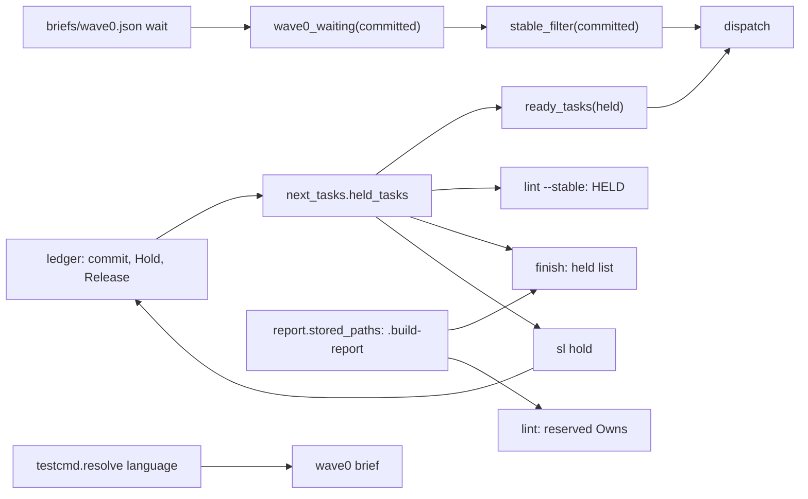
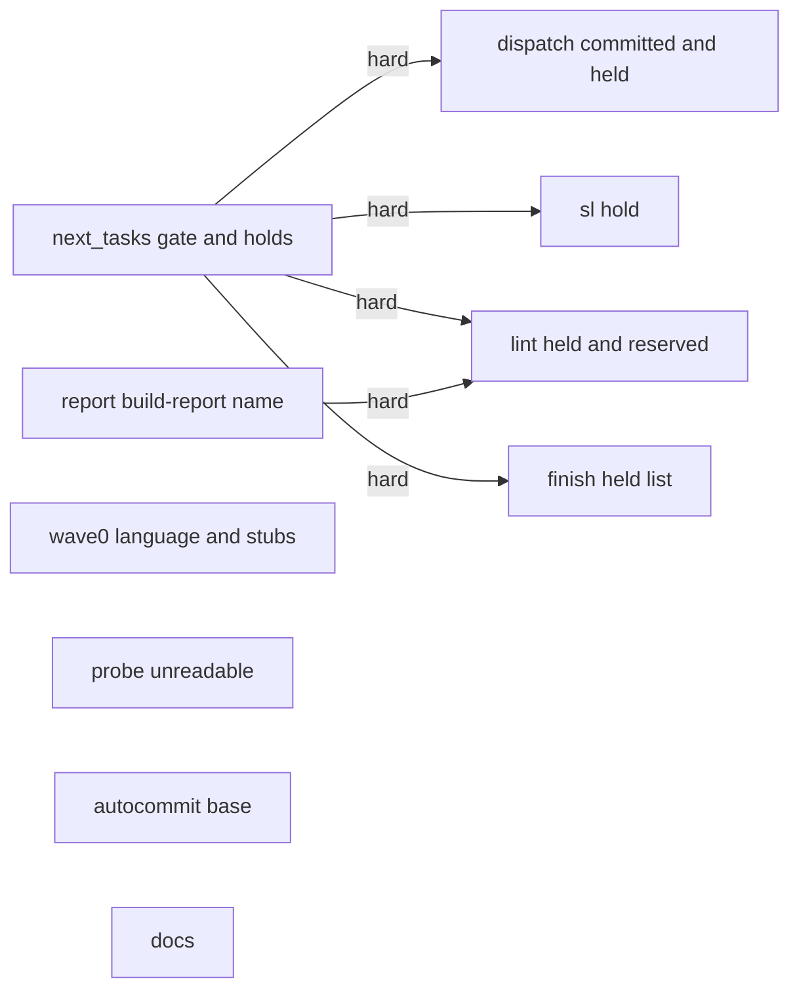

# Superlite: plan state batch (B10)

**Goal:** fix #227 (docs miss the Wave 0 gate and the T0 testcmd check), #228 (`dispatch --committed T0` keeps the Wave 0 gate), #236 (`sl finish` overwrites a plan task's `<plan>.report.md`), #242 (Wave 0 brief names the wrong language and stubs), #244 (no way to hold a task that waits for a human step), #245 (probe `arg_unreadable` fails in its own setup; `checkpoints.json` `head` reads like a tip). Each fix ships with regression tests.
**Architecture:** edits to existing `sl` tools in `skills/subagent-driven-development/scripts/` (`next_tasks`, `dispatch`, `plan_tools`, `report`, `finish`, `wave0`, `autocommit`), the file probe pack, one new tool `hold.py`, and the docs `docs/tools.md` and the SDD `SKILL.md`.
**Tech stack:** Python 3.10+ stdlib, pytest (through `sl run_tests`).
**Spec:** this file, section Design; the issue bodies on GitHub are the source for each Expected line.
**Detail:** contracts
**Target-min:** 11
**Wave0:** none
**Max chars:** 26000

Global constraints:
- Files under `skills/subagent-driven-development/scripts/` and `probes/` carry the repo's trailing `# O(...)` complexity comment on every code line; tests do not. Follow each file's existing style.
- Stdlib only. Results on stdout, notes on stderr. Existing tests stay green; a task changes an existing test only where its Owns names the file.
- Run `sl` as an executable (`<abs>/sl ...`). Verify with `<abs>/sl run_tests --fast <test files> --task Tn --background`, then the printed `wait:` line. Never raw `pytest`, never the e2e or eval layers (coordinator's step).
- No version edits (the ship step bumps the version). Only T10 edits docs.
- Ledger = the run folder's `progress.md`. Task id regex: `[A-Z]{1,3}\d+[A-Za-z]?`.

Ruling: detail contracts - fixes in existing modules with known causes; tests are named with exact inputs and outcomes - cost if wrong: one NEEDS_CONTEXT per task.
Ruling: #244 `sl hold` is a new tool `scripts/hold.py` (the `sl` launcher finds it by name) - the brief names no CLI home, and a new file belongs to no other batch - cost if wrong: one file to move.
Ruling: #244 ledger lines `- Hold Tn: <reason>` and `- Release Tn`; the last line per id wins; a committed task is never held (hold refuses it, finish and dispatch skip it) - cost if wrong: a stale hold line after a manual commit.
Ruling: #244 "shows it in status": `sl hold` with no ids lists the held tasks with reasons; `lint --stable` prints one `HELD:` line per held task and `dispatch` one `held=Tn <reason>` stderr line; `commands/status.md` is outside this batch's files - cost if wrong: `/superlite:status` does not name holds yet (follow-up).
Ruling: #228 `--committed` counts as commit lines for the Wave 0 gate in `dispatch` and `next_tasks`; `build_prime` and `lint --stable` keep reading the ledger - cost if wrong: none, they take no `--committed`.
Ruling: #236 (Max: write .build-report.md) the build report goes to `<plan stem>.build-report.md`/`.json`; `report --list`/`--show` still read the old `<stem>.report.*`; the run folder copy `.superlite/report.md` stays; lint flags an Owns entry equal to the plan's `.build-report.*` path - cost if wrong: none for old reports. `commands/report.md` and `skills/finishing-a-development-branch/SKILL.md` still say `<plan>.report.md`: outside this batch's files (follow-up).
Ruling: #242 the language is `testcmd.resolve(root)["language"]` when it resolves (named alone), else the plan's constraint lines with `LANGS` (Swift, Kotlin, PHP added; `.net` only as `.NET`, not inside a host name) - cost if wrong: a repo whose test-cmd.json names the wrong language.
Ruling: #242 stub file existence is checked in the plan root's working tree when the brief is written (first `lint --stable`, before any dispatch: the base commit); an item without a full signature is listed as `{no_stub: ...}`; a task with no signature item left, or whose non-test files all exist, gets no stub entry and its files are not in `wave0.json` `stubs` (its owner does not wait) - cost if wrong: an existing half-written file gets no stub.
Ruling: #245 each `_unreadable` call makes its own file with `tempfile.mkstemp`; `checkpoints.json` writes `base` next to `head` (same value), readers take `base`, else `head` - cost if wrong: none.
Ruling: no probe adapter - every package is a CLI or library over local files and git state; Review Focus cases run as named pytest cases - cost if wrong: no generated probes.

## Design

### 1. #228 committed lifts the gate
`next_tasks.wave0_waiting(sl_dir, committed=None)` returns `set()` when the brief's `id` (default T0) is in `committed`, besides the ledger commit line and the skip ruling. `stable_filter(plan, committed=None)` passes it through. `dispatch.plan_dispatch` calls `nt.stable_filter(plan, committed)`; `next_tasks.main` passes `csv(a.committed)`.

### 2. #244 hold
`next_tasks.held_tasks(ledger)` reads `- Hold Tn: <reason>` / `- Release Tn` lines (bullet optional: `-`, `*`, `+`), last line per id wins, `{id: reason}` in first-hold order; a missing ledger gives `{}`. `ready_tasks(..., held=None)` drops held ids; dependents stay blocked because a held task never commits. `dispatch.run` reads holds from its ledger, drops committed ids, skips the Wave 0 line when T0 is held, prints `held=Tn <reason>` on stderr per held task, and passes `held` to `plan_dispatch`. `lint --stable` drops held tasks from `pending` (so `SEND BEFORE`, `THEN LOG`, the lint-log and `DISPATCH NOW` exclude them) and prints `HELD: Tn (<reason>; \`sl hold --release Tn\` puts it back)` per held stable unsent task, after any `WAIT FOR` line and before `DISPATCH NOW:`. `finish` lists every held, uncommitted task. `sl hold` writes the lines.

### 3. #236 build report name
`report.stored_paths(plan)` returns `<stem>.build-report.md`/`.json`; `write_report` never writes `<stem>.report.*`. `list_reports` and `show_report` read both names (new first). `lint_plan` adds a task issue for an Owns entry equal to either reserved path (relative to the plan's root).

### 4. #242 Wave 0 language and stubs
See T7.

### 5. #245
See T8 and T9.

### 6. #227 docs
See T10 (exact text).

## Coverage

| Category | State | Basis |
|---|---|---|
| Scope and success criteria | settled | six issues in Goal; each issue's Expected line |
| Domain and data model | ruled | two ledger line forms (Ruling) |
| Persistence and migration | ruled | new report names, old ones still read; `base` next to `head` (Rulings) |
| Interfaces and contracts | ruled | new `sl hold`; new `HELD:`, `held=` lines; new lint issue; dispatch stdout unchanged |
| UI states | n/a | CLI text |
| Concurrency and state ownership | settled | ledger appends only; holds read per call |
| Error handling and recovery | settled | missing ledger or brief: no hold, no gate; hold refuses bad, unknown, committed ids |
| Security and privacy | n/a | local files only |
| Performance and limits | settled | one ledger read per call |
| Observability | settled | `HELD:`, `held=`, `hold` list, finish list |
| Testing strategy | settled | unit tests per task; layers unit, headless, evals by the coordinator |
| Compatibility | settled | Python 3.10+; old reports and checkpoint states still read |
| Rollout | ruled | one PR; version bump at ship |
| Research unknowns | n/a | causes stated in the issues and confirmed in code |

## File structure

- `scripts/next_tasks.py`: gate and hold reading (T1). `scripts/dispatch.py` (T2). `scripts/hold.py` new CLI (T3). `scripts/plan_tools.py`: lint (T4). `scripts/report.py` (T5). `scripts/finish.py` (T6). `scripts/wave0.py` (T7). `probes/pack/file.py` (T8). `scripts/autocommit.py` (T9). `docs/tools.md`, SDD `SKILL.md` (T10).

## Task graph

```mermaid
%% schedule
gantt
  title Predicted schedule (mm:ss)
  dateFormat X
  axisFormat %M:%S
  section lane 1
  T7 wave0  language and stubs :t7, 0, 135s
  section lane 2
  T1 next_tasks  committed gate and holds :t1, 0, 116s
  T4 plan_tools  HELD line and reserved re :t4, 116, 130s
  section lane 3
  T5 report  build-report name :t5, 0, 110s
  T3 sl hold  hold and release tasks :t3, 116, 119s
  section lane 4
  T9 autocommit  base key :t9, 0, 102s
  T2 dispatch  committed and held tasks :t2, 116, 111s
  section lane 5
  T10 docs  Wave 0 gate  holds  build repo :t10, 0, 101s
  T6 finish  list held tasks :t6, 116, 102s
  section lane 6
  T8 probe  unreadable file per call :t8, 0, 100s
```

critical path: T1 → T4 (4.1 min) · peak width 6 · predicted build 4.1 min · predicted total ≈ 7.6 min (target ✓)

## Package: scripts (CLI over plan, ledger and git state)

**Probe entry:** none (Ruling: no probe adapter).

### T1 next_tasks: committed gate and holds · Complexity 3 · Est. context 30k
**Owns:** skills/subagent-driven-development/scripts/next_tasks.py, tests/scripts/test_wave0_gate_committed.py, tests/scripts/test_held_tasks.py
**Components:** 1
**LOC owned:** 120
**Tests:** fast
**Model:** sonnet
**Est. time:** 2.5 min (1 component, about 120 LOC, fast tests)
**Covers:** 1, 2
**Consumes:** nothing executed from another task.
**Produces:** next_tasks.wave0_waiting(sl_dir: Path, committed: Iterable[str] | None = None) -> set[str] · next_tasks.stable_filter(plan: str, committed: Iterable[str] | None = None) -> set[str] | None · next_tasks.held_tasks(ledger: str | Path) -> dict[str, str] · next_tasks.ready_tasks(graph: dict, times: dict, committed: list, running: list, cap: int, status: dict | None = None, stable: set | None = None, held: dict | None = None) -> list[str]
e.g. held_tasks(L) -> {"T5": "ssh sign-in on the build host"} (ledger `- Hold T5: ssh sign-in on the build host`)
e.g. held_tasks(L) -> {} (same, then `- Release T5`)
e.g. held_tasks(L) -> {"T5": "second"} (`- Hold T5: first`, then `- Hold T5: second`)
**Review Focus:** state: `test_committed_t0_releases_wait` (wave0.json `{"id": "T0", "wait": ["T1", "T3"]}`, empty ledger: `wave0_waiting(sd, {"T0"}) == set()`, `wave0_waiting(sd, {"T2"}) == {"T1", "T3"}`, `wave0_waiting(sd) == {"T1", "T3"}`); state: `test_committed_other_id` (`{"id": "T1", "wait": ["T2"]}`: `(sd, ["T0"])` -> `{"T2"}`, `(sd, ["T1"])` -> `set()`); state: `test_stable_filter_committed` (stable.json `{"stable": ["T1", "T2", "T3"]}` + first wave0.json: `stable_filter(plan, {"T0"}) == {"T1", "T2", "T3"}`, `stable_filter(plan) == {"T2"}`); state: `test_cli_committed_t0_offers_stub_owner` (the `PY` plan of `test_wave0`, stable.json `{"stable": ["T1", "T2"]}`, wave0.json wait `["T1"]`: `next_tasks.py --plan p --committed T0` prints `T1`; without `--committed` prints nothing); state: the three e.g. lines as `test_hold_line_holds`, `test_release_line_releases`, `test_last_hold_wins`; file: `test_missing_ledger_holds_nothing` (no file -> `{}`); file: `test_hold_line_forms` (`* Hold T5a: x`, `Hold UI3: y`, `+ Hold T6:   z  ` -> `{"T5a": "x", "UI3": "y", "T6": "z"}`; `- Hold t7: no` and `- Holding T8: no` hold nothing; `- Release T50` does not release T5); state: `test_ready_tasks_skips_held` (graph `{"T1": [], "T2": ["T1"], "T3": []}`, equal times, nothing committed: `held={"T1": "x"}` -> `["T3"]`; `held=None` -> `["T1", "T3"]`).
**Test code:** two new files; `tmp_path / ".superlite"` holds `briefs/wave0.json`, `progress.md`, `stable.json`; the plan is `tmp_path / "plan.md"` (`state.plan_dir` maps it to `tmp_path / ".superlite"`); CLI via `run` from `test_plan_tools`, plans via `plan`/`PY` from `test_wave0`.
**Steps:** 1 failing tests, 2 run: FAIL, 3 implement, 4 run: PASS (also `tests/scripts/test_wave0_gate.py`, `test_wave0.py`, `test_batching.py` stay green).
**Notes:** regexes `^\s*[-*+]?\s*Hold\s+(ID)\s*:\s*(.*?)\s*$` and `^\s*[-*+]?\s*Release\s+(ID)(?![A-Za-z0-9])`, ID the task id regex followed by a word boundary. `main` passes `held_tasks(state.plan_dir(a.plan) / "progress.md")` and `stable_filter(a.plan, csv(a.committed))`. Keep every existing call form working (new parameters are optional, keyword-safe).

### T2 dispatch: committed and held tasks · Complexity 3 · Est. context 34k
**Owns:** skills/subagent-driven-development/scripts/dispatch.py, tests/scripts/test_dispatch_committed_hold.py
**Components:** 1
**LOC owned:** 90
**Tests:** fast
**Model:** sonnet
**Est. time:** 2 min (1 component, about 90 LOC, fast tests)
**Covers:** 1, 2
**Consumes:** next_tasks.stable_filter(plan: str, committed: Iterable[str] | None = None) -> set[str] | None (T1) · next_tasks.held_tasks(ledger: str | Path) -> dict[str, str] (T1) · next_tasks.ready_tasks(graph: dict, times: dict, committed: list, running: list, cap: int, status: dict | None = None, stable: set | None = None, held: dict | None = None) -> list[str] (T1)
**Produces:** dispatch.plan_dispatch(plan, pool, committed, running, cap, tiers=None, cfg=None, lane_virtual=0, sl_dir=None, batch=None, held=None) -> tuple[list, dict]
**Review Focus:** state: `test_dispatch_committed_t0_offers_stub_owner` (the `PY` plan of `test_wave0`, after `plan_tools.py lint --stable`; `dispatch.py --plan p --pool tmp/pool.json --ledger <sd>/progress.md --committed T0` -> a line starting `T1 `, no line starting `T0 `); state: `test_dispatch_skips_held_task` (same plan after lint, ledger `- commit T0 abcdef1234 skeleton` + `- Hold T1: ssh sign-in`: no line starting `T1 `, stderr has `held=T1 ssh sign-in`; then `- Release T1` appended -> a `T1 ` line); state: `test_dispatch_held_t0_has_no_wave0_line` (synthesized T0 pending, ledger `- Hold T0: waits for the human` -> no line starting `T0 `); state: `test_committed_held_task_not_reported` (ledger `- Hold T1: x` and `- commit T1 abcdef1234 t1` -> no `held=T1` on stderr).
**Test code:** new file; plans via `plan`/`PY` from `test_wave0`, `run` from `test_plan_tools`, `DISPATCH` from `test_stable_split`, as in `test_wave0.py::test_dispatch_holds_stub_owner_until_t0`.
**Steps:** 1 failing tests, 2 run: FAIL, 3 implement, 4 run: PASS (also `tests/scripts/test_dispatch_*.py`, `test_wave0.py`, `test_stable_split.py` stay green).
**Notes:** `plan_dispatch` gains `held=None` and calls `nt.ready_tasks(..., nt.stable_filter(plan, committed), held=held)`. In `run`: `held = {t: r for t, r in nt.held_tasks(ledger).items() if t not in done}`; `w0` also needs `"T0" not in held`; one `print(f"held={t} {r}", file=sys.stderr)` per held id; return shape unchanged (commit_task uses it). Update the module docstring (one line on holds and `--committed`).

### T3 sl hold: hold and release tasks · Complexity 3 · Est. context 30k
**Owns:** skills/subagent-driven-development/scripts/hold.py, tests/scripts/test_hold_cli.py
**Components:** 1
**LOC owned:** 140
**Tests:** fast
**Model:** sonnet
**Est. time:** 2.5 min (1 component, about 140 LOC, fast tests)
**Covers:** 2
**Consumes:** next_tasks.held_tasks(ledger: str | Path) -> dict[str, str] (T1)
**Produces:** hold.main(argv: list[str] | None = None) -> int
**Review Focus:** protocol: `test_hold_appends_line` (`hold.py T5 --reason "ssh sign-in" --ledger L` -> exit 0, stdout `held T5: ssh sign-in`, ledger ends `- Hold T5: ssh sign-in\n`); protocol: `test_list_shows_reason` (then `hold.py --ledger L` -> stdout `held T5: ssh sign-in`; empty or missing ledger -> `held: none`); protocol: `test_release` (`hold.py --release T5 --ledger L` -> stdout `released T5`, ledger has `- Release T5`, list -> `held: none`); protocol: `test_release_not_held_refused` (exit 2, `T5 is not held` on stderr, ledger unchanged); protocol: `test_reason_required` (`hold.py T5 --ledger L` and `--reason "  "` -> exit 2, ledger not created); protocol: `test_bad_id_refused` (`t5`, `T` -> exit 2); state: `test_plan_unknown_task_refused` (`PY` plan of `test_wave0`, `hold.py T9 --reason x --plan p --ledger L` -> exit 2, stderr names `T9` and `T1 T2`, nothing written); state: `test_committed_task_refused` (ledger `- commit T1 abcdef1234 x` -> `hold.py T1 --reason x --ledger L` exit 2, `already committed`); encoding: `test_multiline_reason_one_line` (`--reason "a\nb"` -> ledger line `- Hold T5: a b`); protocol: `test_two_ids_one_call` (`hold.py T5 T6 --reason x` -> two lines, two `held` stdout lines).
**Test code:** new file; `run` from `test_plan_tools` on `SCRIPTS / "hold.py"`, every call with `--ledger tmp_path / "progress.md"`.
**Steps:** 1 failing tests, 2 run: FAIL, 3 implement, 4 run: PASS.
**Notes:** usage docstring: `hold.py Tn [Tm ...] --reason TEXT | --release Tn [Tm ...] | (no ids: list)  [--plan P] [--ledger L]`. Ledger default: `(state.for_plan(a.plan) if a.plan else state.resolve()) / "progress.md"` (as `finish.main`). Validate every id first (regex, plan membership via `plan_tools.Plan.load(plan).by_id` when `--plan`, `commit_task.committed_tasks(ledger)`), then append all lines in one write (create the parent folder). The list prints held ids that are not committed, in `held_tasks` order. Errors: `hold: <reason>` on stderr, exit 2. Stdlib only; module header like the other tools.

### T4 plan_tools: HELD line and reserved report path · Complexity 4 · Est. context 44k
**Owns:** skills/subagent-driven-development/scripts/plan_tools.py, tests/scripts/test_lint_held_reserved.py
**Components:** 2
**LOC owned:** 110
**Tests:** fast
**Model:** sonnet
**Est. time:** 3 min (2 components, about 110 LOC, fast tests)
**Covers:** 2, 3
**Consumes:** next_tasks.held_tasks(ledger: str | Path) -> dict[str, str] (T1) · report.stored_paths(plan_path: str) -> tuple[Path, Path] (T5)
**Produces:** none consumed by another task.
**Review Focus:** file: `test_reserved_build_report_flagged` (plan `tmp_path / "plan.md"`, T1 Owns `plan.build-report.md, tests/test_a.py` -> `lint` prints an issue with ``T1: Owns `plan.build-report.md` is the build report`` and `lint --stable` lists T1 under FIX); file: `test_reserved_json_flagged` (`plan.build-report.json` -> same issue); file: `test_plan_task_report_name_not_flagged` (Owns `plan.report.md` -> no such issue); file: `test_reserved_with_note_and_ticks_flagged` (Owns `` `plan.build-report.md` (closing report) `` -> flagged); state: `test_lint_stable_held_line` (`PY` plan of `test_wave0`, ledger `- commit T0 abcdef1234 skeleton` + `- Hold T1: ssh sign-in` before the first `lint --stable` -> a line ``HELD: T1 (ssh sign-in; `sl hold --release T1` puts it back)``, last line `DISPATCH NOW: none`, no `THEN LOG` line naming T1; then `- Release T1` appended -> no `HELD:` line, last line `DISPATCH NOW: T1`).
**Test code:** new file; plans via `make_plan` from `test_plan_tools` (`owns=`) and `plan`/`PY` from `test_wave0`; `run` from `test_plan_tools`.
**Steps:** 1 failing tests, 2 run: FAIL, 3 implement, 4 run: PASS (also `test_wave0.py`, `test_stable_split.py`, `test_lint_dispatch_now.py`, `test_plan_tools.py`, `test_lint_owns_bare.py` stay green).
**Notes:** reserved check in `lint_plan` next to the bare-Owns check: lazy `import report`; reserved = both `stored_paths(plan.path)` made relative to `stable_root(plan.path)` (posix; skip when `plan.path` is unset or not under the root); compare each Owns entry with a trailing ` (...)` note, backticks and a leading `./` stripped; issue text ``Tn: Owns `<entry>` is the build report `sl finish` writes; give the task's own report another name (e.g. `<stem>.report.md`)``, task-scoped. Held: in `cmd_lint_stable`, right after `waiting` is read, `held = nt.held_tasks(sl_dir / "progress.md")`; `pending` drops held ids too; `HELD:` lines for stable, unsent held ids sorted by `nkey`, printed after the `WAIT FOR` line, before `DISPATCH NOW:`.

### T5 report: build-report name · Complexity 2 · Est. context 30k
**Owns:** skills/subagent-driven-development/scripts/report.py, tests/scripts/test_report.py, tests/scripts/test_build_report_name.py
**Components:** 1
**LOC owned:** 80
**Tests:** fast
**Model:** sonnet
**Est. time:** 2 min (1 component, about 80 LOC, fast tests)
**Covers:** 3
**Consumes:** nothing executed from another task.
**Produces:** report.stored_paths(plan_path: str) -> tuple[Path, Path]
e.g. stored_paths("docs/plans/x.md") -> (Path("docs/plans/x.build-report.md"), Path("docs/plans/x.build-report.json"))
**Review Focus:** file: `test_write_report_leaves_plan_task_report` (plan `p.md` next to `p.report.md` holding `task review results\n`; `write_report` -> `p.report.md` bytes unchanged, `p.build-report.md` and `.json` written, `.superlite/report.md` written); file: `test_list_reads_legacy_and_new` (dir with `old.report.json` and `new.build-report.json`, each `{"headline": {}}` -> `list_reports` lines start `new  ` and `old  `, neither name keeps a `.build-report`/`.report` suffix); file: `test_show_reads_legacy` (only `old.report.md` + `old.report.json` -> `show_report("old", dir)` does not start `report: no stored report`; with `--full` returns the md text); file: `test_show_prefers_new` (both pairs for `x` -> `--full` returns the `.build-report.md` text).
**Test code:** new file plus updates in `test_report.py`: every expected `<stem>.report.md`/`.report.json` next to the plan becomes `<stem>.build-report.md`/`.json` (lines asserting `Full report:`, the per-plan pair, `show` naming `plan.build-report.md`); `.superlite/report.md` expectations stay.
**Steps:** 1 failing tests, 2 run: FAIL, 3 implement, 4 run: PASS (also `test_metrics_history.py`, `test_finish_*.py` stay green).
**Notes:** add `legacy_paths(plan_path)` for the old pair; `list_reports` dedupes by name (new wins); module docstring line on stored paths names `<plan>.build-report.md`/`.json` and says why (`<plan>.report.md` may belong to a plan task).

### T6 finish: list held tasks · Complexity 2 · Est. context 26k
**Owns:** skills/subagent-driven-development/scripts/finish.py, tests/scripts/test_finish_held.py
**Components:** 1
**LOC owned:** 60
**Tests:** fast
**Kind:** mechanical
**Model:** haiku
**Est. time:** 1.5 min (1 component, about 60 LOC, fast tests)
**Covers:** 2
**Consumes:** next_tasks.held_tasks(ledger: str | Path) -> dict[str, str] (T1)
**Produces:** none consumed by another task.
**Review Focus:** state: `test_finish_lists_held` (ledger `- Hold T5: ssh sign-in` and `- Hold T7: App Store sign-in`; `finish.py --ledger L --log tmp/incidents.jsonl` -> stdout lines `held: 2 (still waiting for a human step)`, `- T5: ssh sign-in`, `- T7: App Store sign-in`, `- release one: sl hold --release Tn`); state: `test_finish_skips_released_and_committed` (`- Hold T5: x`, `- Release T5`, `- Hold T6: y`, `- commit T6 abcdef1234 t6` -> no line starting `held:`).
**Test code:** new file; `run` from `test_plan_tools` on `SCRIPTS / "finish.py"`.
**Steps:** 1 failing tests, 2 run: FAIL, 3 implement, 4 run: PASS (also `tests/scripts/test_finish_*.py` stay green).
**Notes:** in `summary`, right after the rulings block: lazy `import next_tasks`, `held_tasks(ledger)` minus the ids in `commits`; nothing printed when empty; else the four line kinds above, then `""`. Docstring: one sentence on held tasks.

### T7 wave0: language and stubs · Complexity 4 · Est. context 40k
**Owns:** skills/subagent-driven-development/scripts/wave0.py, tests/scripts/test_wave0_language.py
**Components:** 2
**LOC owned:** 140
**Tests:** fast
**Model:** sonnet
**Est. time:** 3 min (2 components, about 140 LOC, fast tests)
**Covers:** 4
**Consumes:** nothing executed from another task.
**Produces:** wave0.language_facts(lines: list[str], plan: Plan, root: Path | None = None) -> str · wave0.stub_spec(plan: Plan, root: Path | None = None) -> str · wave0.stub_files(plan: Plan, root: Path | None = None) -> list[str]
**Review Focus:** file: `test_resolved_language_named_alone` (`Package.swift` in `tmp_path`; stack `**Tech stack:** Swift 6; a TypeScript dashboard in web/app.ts and a .NET bridge` -> the `## Language and layout` section has `The project's language: Swift` and neither `TypeScript` nor `C#`); file: `test_test_cmd_json_language_wins` (`.superlite/test-cmd.json` `{"language": "kotlin", "test": "gradle test"}` -> `The project's language: Kotlin`); file: `test_fallback_names_swift` (no markers, stack `**Tech stack:** Swift 6, SwiftUI` -> `The plan names: Swift`); file: `test_host_name_is_not_csharp` (stack `**Tech stack:** Python; docs at example.net` -> section names Python, no `C#`); file: `test_existing_file_gets_no_stub` (`PY` plan, `tmp_path / "src/pkg/slug.py"` exists -> `wave0.json` `"stubs": []`, `"wait": []`, YAML has no `id: T1`); file: `test_raw_item_marked_no_stub` (T1 produces ``pkg.slug.slugify(text: str) -> str · `pkg.slug.SLUG_MAX` ``, T2 consumes both -> YAML has `name: "pkg.slug.slugify"` and ``{no_stub: "`pkg.slug.SLUG_MAX`"}``); file: `test_only_raw_items_no_entry` (T1 produces only `` `pkg.slug.SLUG_MAX` ``, T2 consumes it -> `"stubs": []`, `"wait": []`).
**Test code:** new file; plans via `plan`, `PY`, `HEAD`, `TASK` from `test_wave0`; `run` from `test_plan_tools` on `wave0.py --plan`; brief and `wave0.json` read as in `test_wave0.py`.
**Steps:** 1 failing tests, 2 run: FAIL, 3 implement, 4 run: PASS (also `test_wave0.py`, `test_wave0_stub_record.py`, `test_commit_t0_stubs.py` stay green: their files do not exist, so their stubs and the `The plan names:` texts stay).
**Notes:** `language_facts`: with `root`, `testcmd.resolve(root)` in a `try` (lazy import); a language other than empty or `unknown` -> `"The project's language: " + PRETTY.get(lang.lower(), lang) + " (its resolved test command, `sl testcmd`). Use the tooling the plan's constraints name; where they are silent, use the project's own declared tooling ..."` (same marker list as now); else the current `LANGS` text. `PRETTY` maps python, typescript, javascript, go, rust, swift, csharp, kotlin, php, java, ruby to display names. `LANGS` adds `("Swift", r"\bswift\b|\.swift\b|xcodebuild|xcodeproj")`, `("Kotlin", r"\bkotlin\b|\.kts?\b")`, `("PHP", r"\bphp\b|composer\.json|\.php\b")`; C# becomes `r"c#|(?<!\w)\.net\b|\bdotnet\b|csproj|\.cs\b"`. One helper picks per task: signature items (`pt.parse_signature`), raw items, files = non-test Owns minus plain paths (no `*`, no trailing `/`) that are files under `root`; a task needs at least one signature item and one file. `stub_spec` and `stub_files` use it (`root=None`: nothing exists); `build_brief` and `write_brief` pass `pt.stable_root(plan_path)`. Brief text: "Write one stub per `produces` item below that has a `name` (a `no_stub` item has no full signature: write nothing for it) ...".

### T8 probe: unreadable file per call · Complexity 1 · Est. context 20k
**Owns:** skills/subagent-driven-development/probes/pack/file.py, tests/scripts/test_probe_unreadable.py
**Components:** 1
**LOC owned:** 40
**Tests:** fast
**Kind:** mechanical
**Model:** haiku
**Est. time:** 1.5 min (1 component, about 40 LOC, fast tests)
**Covers:** 5
**Consumes:** nothing executed from another task.
**Produces:** none consumed by another task.
**Review Focus:** file: `test_both_unreadable_probes_set_up` (skip on win32 or uid 0; `ctx = SimpleNamespace(tmp=tmp_path)`; call the `make` of the `call_unreadable` probe dict in `file.PROBES`, then the `make` of `arg_unreadable`, both with `(None, ctx)`: no exception; the first returns a path string, the second `([path], "")`; the two paths differ; both files have mode `0o000`); file: `test_unreadable_twice_same_probe` (two calls of `_unreadable(None, ctx)` -> two different existing files).
**Test code:** new file; `sys.path.insert(0, <repo>/skills/subagent-driven-development/probes)` then `from pack import file`; chmod the files back to `0o600` at the end.
**Steps:** 1 failing tests, 2 run: FAIL, 3 implement, 4 run: PASS (also `tests/scripts/test_probe_run.py` stays green).
**Notes:** `_unreadable`: keep the Skip guard; `fd, name = tempfile.mkstemp(dir=ctx.tmp, prefix="unreadable-", suffix=".txt")`, `os.write(fd, b"secret")`, `os.close(fd)`, `os.chmod(name, 0)`, return `name`. `import tempfile` with an `# O(1)` comment.

### T9 autocommit: base key · Complexity 2 · Est. context 26k
**Owns:** skills/subagent-driven-development/scripts/autocommit.py, tests/scripts/test_autocommit_base.py
**Components:** 1
**LOC owned:** 60
**Tests:** fast
**Kind:** mechanical
**Model:** haiku
**Est. time:** 1.5 min (1 component, about 60 LOC, fast tests)
**Covers:** 5
**Consumes:** nothing executed from another task.
**Produces:** autocommit.base_of(st: dict) -> str
e.g. base_of({"base": "abc", "head": "abc"}) -> "abc"
e.g. base_of({"head": "def"}) -> "def"
**Review Focus:** state: `test_checkpoint_state_names_base` (repo from `test_autocommit.make_repo`, two checkpointed tasks as in `two_tasks` -> `.superlite/checkpoints.json` has `base` equal to the repo's start SHA and `head` equal to `base`); state: `test_legacy_state_without_base` (drop `base` from that file -> `autocommit status` exit 0 and prints `(base <start sha[:10]>)`; `autocommit apply` exit 0); state: the two e.g. lines as `test_base_of`.
**Test code:** new file; helpers imported from `test_autocommit` (`make_repo`, `two_tasks`, `run`, `git`).
**Steps:** 1 failing tests, 2 run: FAIL, 3 implement, 4 run: PASS (also `tests/scripts/test_autocommit*.py` stay green).
**Notes:** in `checkpoint`, `h = head_sha()` once; the new state dict gets `"base": h, "head": h`. Every read of `st["head"]` (parent of the first entry, the moved check, `moved_overlap`, the status line) becomes `base_of(st)`.

### T10 docs: Wave 0 gate, holds, build report · Complexity 2 · Est. context 30k
**Owns:** docs/tools.md, skills/subagent-driven-development/SKILL.md, tests/scripts/test_docs_b10.py
**Components:** 1
**LOC owned:** 50
**Tests:** fast
**Kind:** mechanical
**Model:** haiku
**Est. time:** 1.5 min (1 component, about 50 LOC, fast tests)
**Covers:** 6
**Consumes:** nothing executed from another task.
**Produces:** none consumed by another task.
**Review Focus:** file: `test_skill_names_gate_hold_report` (SKILL.md has `` `WAIT FOR T0:` ``, `hold Tn --reason R`, `` `<plan>.build-report.md` `` and is at most 11700 characters); file: `test_tools_rows` (tools.md has a `` | `hold` | `` row, `WAIT FOR T0`, `HELD:`, `` `stubs` ``, `` `wait` ``, `` `base` ``, `build-report`, `never runs the suite`).
**Test code:** new file reading both files as `test_docs_contract.py` does.
**Steps:** 1 failing tests, 2 run: FAIL, 3 edit, 4 run: PASS (also `test_docs_contract.py`, `test_orchestrator.py`, `test_fleet_hard_stop.py`, `test_fleet_roles_skill.py`, `test_isolation_wording.py`, `test_sl_form.py`, `test_agent_mcp_tools.py`, `test_backlog_user_docs.py`, `test_hooks_doc.py`, `test_run_isolation_flow.py` stay green).
**Notes:** exact replacements in `skills/subagent-driven-development/SKILL.md` (each old text occurs once):
1. `Send it first with the stable set; then `commit_task T0`.` -> `Send it first; stub owners wait (`WAIT FOR T0:`) for `commit_task T0`.`
2. `: slim for sonnet (rules and interfaces, no plan, no `--spec`). `--prime full --spec SPEC --sections "1,3"` restores the old one. Never paste it.` -> `: slim for sonnet (rules and interfaces, no plan). Never paste it.`
3. ``full: `<plan>.report.md`.`` -> ``full: `<plan>.build-report.md`.``
4. `A task that must touch another task's file:` -> `Human-step wait: `"$SL" hold Tn --reason R`, `--release Tn`. A task that must touch another task's file:`
In `docs/tools.md` (table rows; keep each row one line):
- `plan_tools` row: append before the closing ` |`: `` `lint --stable` holds the owners of Wave 0 stub files (`briefs/wave0.json` `wait`) out of `DISPATCH NOW` with one `WAIT FOR T0: ...` line until `- commit T0` or `- Ruling: skip T0`, and each held task (`hold`) with a `HELD: Tn (<reason>; ...)` line. Lint issues include an Owns entry with no folder after one with a folder, and an Owns entry equal to the plan's build report (`<stem>.build-report.md`/`.json`). ``
- `wave0` row: replace its text with `` Builds the Wave 0 skeleton brief for `implementer-haiku` from the plan alone and records `briefs/wave0.json` (`id`, `owns`, `stubs`: the files it stubs, `wait`: the tasks that own them). The language is the resolved test command's (`testcmd`), else what the plan's constraints name; stubs only for consumed Produces lines with a full signature whose files do not exist yet (others are listed as `no_stub`). T0 checks its stubs with an import or compile check and `sl testcmd` (it writes `.superlite/test-cmd.json` only when that prints null) and never runs the suite ``
- `testcmd` row: append ` T0 runs it as the check that `run_tests` detects the stack.`
- `dispatch` row: append `; `--committed` counts as commit lines for the Wave 0 gate; a held task (`hold`) is never offered and prints `held=Tn <reason>` on stderr`
- `next_tasks` row: replace `Computes which tasks are ready` with `` Computes which tasks are ready; skips held tasks (ledger `- Hold Tn: <reason>` with no later `- Release Tn`) and, through `stable_filter`, the Wave 0 stub owners until T0 is committed (`--committed` or the ledger) ``
- new row right after `next_tasks`: `` | `hold` | `hold Tn [Tm ...] --reason TEXT` keeps tasks that wait for a human step (an ssh session, a sign-in) out of `dispatch` and `DISPATCH NOW` (appends `- Hold Tn: TEXT` to the ledger; tasks that depend on one stay blocked); `hold --release Tn` puts it back (`- Release Tn`); `hold` alone lists the held tasks with their reasons; `finish` lists every task still held. Refuses a bad id, an unknown one (with `--plan`) or a committed one | ``
- `autocommit` row: append before the closing ` |`: `; `.superlite/checkpoints.json` names the run's base commit `base` (older states: `head`, same value)`
- `finish` row: append before the closing ` |`: `; it lists every task still held (`hold`) and saves the build report as `<plan>.build-report.md`/`.json` (never `<plan>.report.md`, which a plan task may own)`

## Review Focus

Package `scripts`: app type CLI over local files and git state; categories protocol, state, file, encoding. Specific risks: a held task still offered in a batch (T2); a hold line form not parsed or a longer id released by a shorter one (T1); a report name collision with a plan task's file (T4, T5); a stub written over an existing file (T7); a stale fixed probe path (T8). Each task block carries its cases.

## Self-review

- Coverage: #227 T10, #228 T1 + T2, #236 T4 + T5, #242 T7, #244 T1 + T2 + T3 + T4 + T6, #245 T8 + T9.
- Graph: T2, T3, T4, T6 run `held_tasks` or `stable_filter` (T1); T4's reserved check runs `stored_paths` (T5); all hard. No two parallel tasks share a file.
- Contracts: ledger lines `- Hold Tn: <reason>` / `- Release Tn` written by T3, read by T1's `held_tasks`.
