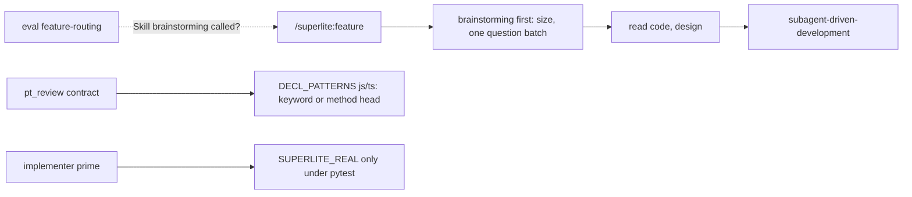
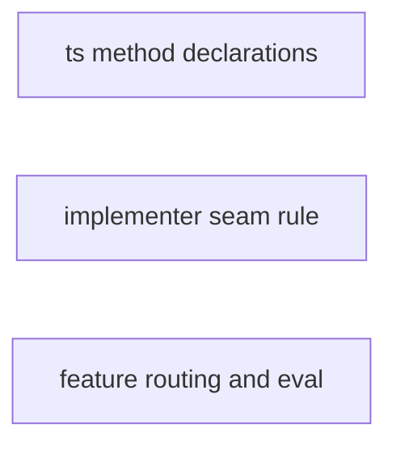
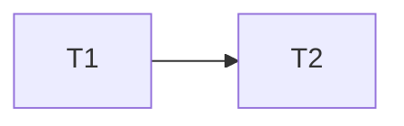

# Superlite: review, prime and eval fixes (backlog batch B13)

**Goal:** `/superlite:feature` loads `brainstorming` first, also in eval runs, and an eval case guards it (#230); `pt_review contract` finds TypeScript and JavaScript class methods (#238); the implementer prime asks for the `SUPERLITE_REAL` switch only on pytest projects (#243).
**Architecture:** three independent tasks, one per issue, each with its own test file. No task runs another task's code.
**Tech stack:** Python 3.10+ stdlib, pytest; Markdown agent, command and eval files.
**Spec:** this file, section Design; the issue bodies of #230, #238, #243.
**Detail:** tests
**Target-min:** 6
**Wave0:** none
**Coverage:** off (bug batch)
**Max chars:** 24000

Global constraints:
- Python 3.10+ stdlib; follow the style of `skills/subagent-driven-development/scripts/`, including a `# O(...)` comment on every new code line in `pt_review.py`.
- Only the files a task owns change. Other tests stay green.
- Verify with `<abs sl> run_tests --fast <test files> --task Tn --background`, then the printed `wait:` line.
- No version bump in a task. Evals and e2e runs are the coordinator's step, never a task's.

Ruling: #230 cause, from a spike of 6 plugin-only `claude plugin eval` runs on the notes CLI (`/superlite:feature Add a notes delete <id> command ...`): with a plain prompt `brainstorming` loaded 0 of 3; the command's first step asks the orchestrator choice, `claude plugin eval` withholds AskUserQuestion and runs one turn, so the model asks in plain text and the run ends before the command's third step loads `brainstorming`. With "AI orchestrator, decide yourself: I am away" it loaded 2 of 3; the miss read the code and went straight to Edit. Fix: the command loads `brainstorming` first, even for a change that looks trivial, and the orchestrator choice rides in brainstorming's one question batch - cost if wrong: the new eval case turns red and shows it.
Ruling: `skills/using-superlite/SKILL.md` stays unchanged (1,499 of 1,500 characters; the cause is the command's step order, not the injected skill) - cost if wrong: a follow-up issue.
Ruling: the test files of the owned files are in scope: new `tests/scripts/test_pt_review_ts_methods.py`, `tests/scripts/test_implementer_seam_rule.py`, `tests/scripts/test_feature_routing.py`, and the eval layout test `tests/scripts/test_evals_suite.py` (it pins the case list) - cost if wrong: a few extra files in the PR.
Ruling: #238 matches a method head on its own line; it does not check that the method sits inside the named class, and a class field holding an arrow function (`fetchAll = async () => {`) stays unmatched - cost if wrong: a `not declared` note for that form, as today.
Ruling: #243 per Max's decision: only the prime changes (conditional rule); `rerun_consumer_tests` stays Python-only - cost if wrong: non-pytest consumers keep no part-3 rerun, as today.
Ruling: the new eval case `feature-routing` has one grader, `skill-fired` (`arm: with-only`); `claude plugin eval` scores with-only graders in both arms when every grader of a case is with-only, so the case gates the suite (plugin must pass, baseline scores 0) - cost if wrong: the case is only an indicator, like brainstorm-first's.

## Design

- #230 `commands/feature.md`: the first step loads `superlite:brainstorming` before any read or question, even when the change looks trivial (brainstorming sizes it); the orchestrator choice goes into brainstorming's one question batch unless the user said; then read the code, then build with `subagent-driven-development`. New eval case `evals/feature-routing/` (notes CLI scaffold, plain `/superlite:feature` prompt, one with-only `skill-fired` grader).
- #238 `pt_review.DECL_PATTERNS` for `.ts .tsx .js .mjs .jsx`: the keyword pattern plus a method-head alternative: line start, optional modifiers (`public private protected static async readonly get set abstract override declare`), optional `*`, the name, optional `?`/`!`, optional generics, `(`, then on the same line either `)` followed by `{` or `:`, or the end of the line (parameters wrapped). A call statement (`fetchAll();`, `this.fetchAll()`, `await fetchAll()`) never matches.
- #243 `agents/implementer.md`, `agents/implementer-haiku.md` line 20: pytest projects get the swappable fake with `SUPERLITE_REAL=1`; other runners are told to add no such switch and keep the fake in a test-support file or test against the real implementation.



## File structure

- `skills/subagent-driven-development/scripts/pt_review.py`: declaration patterns (T1).
- `agents/implementer.md`, `agents/implementer-haiku.md`: implementer rules (T2).
- `commands/feature.md`, `evals/feature-routing/`: feature command and its eval case (T3).

```mermaid
%% schedule
gantt
  title Predicted schedule (mm:ss)
  dateFormat X
  axisFormat %M:%S
  section lane 1
  T3 feature routing and eval :t3, 0, 104s
  section lane 2
  T1 ts method declarations :t1, 0, 93s
  section lane 3
  T2 implementer seam rule :t2, 0, 81s
```





critical path: T3 (1.7 min) · peak width 3 · predicted build 1.7 min · predicted total ≈ 5.2 min (target ✓)

## Package: review-prime-evals

App type: library (regex declaration finder) plus prompt text. Categories: deep (nested parentheses and generics in a method head), encoding (strings and comments ignored, as today), protocol (command step order, eval grader shape).
**Probe entry:** none (`pt_review` is tested through pytest; the Markdown files have no runnable entry; cases are named tests).

### T1 ts method declarations · Complexity 4 · Est. context 40k
**Owns:** skills/subagent-driven-development/scripts/pt_review.py, tests/scripts/test_pt_review_ts_methods.py
**Components:** 1
**LOC owned:** 90
**Tests:** fast
**Model:** sonnet
**Est. time:** 2 min (1 component, about 90 LOC, fast tests)
**Produces:** pt_review.find_declaration(root: Path, files: list[str], name: str) -> tuple[str, int] | None
e.g. find_declaration(root, ["src/store.ts"], "fetchAll") -> ("src/store.ts", 6)
e.g. find_declaration(root, ["app.js"], "load") -> None
**Review Focus:** `test_ts_class_methods_are_declared` (modifiers, generics with nested `<>`, a callback parameter type with parentheses); `test_calls_are_not_declarations` (deep: a call statement never declares); `test_multiline_heads_and_signatures_are_declared`; `test_contract_reports_a_missing_ts_method`.
**Notes:** in `pt_review.py` add two module constants above `DECL_PATTERNS` and use them for the five JS/TS extensions:
```python
_JS_DECL = r"(class|function|interface|type|enum|const|let|var)\s+{name}\b"  # O(1)
_JS_METHOD = (r"^\s*(?:(?:public|private|protected|static|async|readonly|get|set|abstract|override|declare)\s+)*"  # O(1)
              r"\*?\s*{name}\s*[?!]?\s*(?:<[^(]*>\s*)?\((?:[^()]|\([^()]*\))*(?:\)\s*[{:]|$)")  # a method head: `)` then `{` or `: T`, or params wrapped | O(1)
```
and `**{e: _JS_DECL + "|" + _JS_METHOD for e in (".ts", ".tsx", ".js", ".mjs", ".jsx")},  # O(1)`. `find_declaration` is unchanged (`re.search` per line, so `^` is the line start).
**Test code (verbatim):** new file `tests/scripts/test_pt_review_ts_methods.py`:
````python
"""#238: pt_review contract finds TypeScript and JavaScript class method declarations."""
from __future__ import annotations

import importlib.util
import sys
from pathlib import Path

import pytest

SCRIPT = Path(__file__).resolve().parents[2] / "skills" / "subagent-driven-development" / "scripts" / "pt_review.py"
_spec = importlib.util.spec_from_file_location("pt_review", SCRIPT)
pt_review = importlib.util.module_from_spec(_spec)
sys.modules["pt_review"] = pt_review
_spec.loader.exec_module(pt_review)

STORE_TS = (
    "export class Store {\n"
    "  private items: Item[] = [];\n"
    "  static create<T extends Map<string, number>>(seed: T): Store {\n"
    "    return new Store();\n"
    "  }\n"
    "  async fetchAll(opts: Opts): Promise<Item[]> {\n"
    "    await this.load();\n"
    "    return this.items;\n"
    "  }\n"
    "  get size(): number {\n"
    "    return this.items.length;\n"
    "  }\n"
    "  private helper(): void {\n"
    "    flush();\n"
    "  }\n"
    "  public save(cb: (e: Error) => void): void {\n"
    "    this.helper();\n"
    "  }\n"
    "}\n")

PLAN = """# web plan



### T1 store · Complexity 3
**Owns:** src/store.ts, tests/store.test.ts
**Produces:** Store.fetchAll(opts: Opts) -> Promise<Item[]>

### T2 view · Complexity 3
**Owns:** src/view.ts, tests/view.test.ts
**Consumes:** Store.fetchAll(opts: Opts) -> Promise<Item[]> (T1)
**Produces:** View.render(items: Item[]) -> string

## Review Focus
- web: state
"""


def project(tmp_path: Path, plan: str = PLAN) -> Path:
    (tmp_path / "src").mkdir()
    (tmp_path / "src" / "store.ts").write_text(STORE_TS, encoding="utf-8")
    (tmp_path / "src" / "view.ts").write_text(
        "export class View {\n  render(items: Item[]): string {\n    return '';\n  }\n}\n", encoding="utf-8")
    (tmp_path / "plan.md").write_text(plan, encoding="utf-8")
    return tmp_path


@pytest.mark.parametrize("name, line", [("Store", 1), ("create", 3), ("fetchAll", 6), ("size", 10), ("helper", 13), ("save", 16)])
def test_ts_class_methods_are_declared(tmp_path, name, line):
    project(tmp_path)
    assert pt_review.find_declaration(tmp_path, ["src/store.ts"], name) == ("src/store.ts", line)


def test_calls_are_not_declarations(tmp_path):
    (tmp_path / "app.js").write_text(
        "export function main() {\n"
        "  load();\n"
        "  this.flush();\n"
        "  await fetchAll();\n"
        "  const r = render(x);\n"
        "  stream(x).then(() => {\n"
        "  loadMore(x)\n"
        "  items: [],\n"
        "}\n", encoding="utf-8")
    find = pt_review.find_declaration
    for name in ("load", "flush", "fetchAll", "render", "stream", "loadMore", "items"):
        assert find(tmp_path, ["app.js"], name) is None, name
    assert find(tmp_path, ["app.js"], "main") == ("app.js", 1)


def test_multiline_heads_and_signatures_are_declared(tmp_path):
    (tmp_path / "shape.ts").write_text(
        "export abstract class Shape {\n"
        "  abstract area(): number;\n"
        "  protected override render(\n"
        "    ctx: Ctx,\n"
        "  ) {\n"
        "  }\n"
        "  async *walk(): AsyncGenerator<number> {\n"
        "  }\n"
        "}\n"
        "export interface Repo {\n"
        "  find?(id: string): Item;\n"
        "}\n", encoding="utf-8")
    find = pt_review.find_declaration
    assert find(tmp_path, ["shape.ts"], "area") == ("shape.ts", 2)
    assert find(tmp_path, ["shape.ts"], "render") == ("shape.ts", 3)
    assert find(tmp_path, ["shape.ts"], "walk") == ("shape.ts", 7)
    assert find(tmp_path, ["shape.ts"], "find") == ("shape.ts", 11)


def test_contract_verifies_a_ts_class_method(tmp_path, capsys):
    proj = project(tmp_path)
    assert pt_review.main(["contract", "--plan", str(proj / "plan.md"), "--root", str(proj), "--seam", "T1,T2"]) == 0
    out = capsys.readouterr().out
    assert "checked by declaration" in out and "not declared" not in out


def test_contract_reports_a_missing_ts_method(tmp_path, capsys):
    proj = project(tmp_path, PLAN.replace("Store.fetchAll(", "Store.fetchMissing("))
    assert pt_review.main(["contract", "--plan", str(proj / "plan.md"), "--root", str(proj), "--seam", "T1,T2"]) == 1
    out = capsys.readouterr().out
    assert "T1 Produces: `fetchMissing` not declared in src/store.ts" in out
````
**Steps:** 1 add the test file, 2 run: FAIL, 3 add the constants and the pattern, 4 run: PASS; also keep `tests/scripts/test_pt_review_declarations.py`, `test_pt_review_noise.py`, `test_pt_review_noise_batch.py` green.

### T2 implementer seam rule · Complexity 1 · Est. context 26k
**Owns:** agents/implementer.md, agents/implementer-haiku.md, tests/scripts/test_implementer_seam_rule.py
**Components:** 1
**LOC owned:** 25
**Tests:** fast
**Kind:** mechanical
**Model:** haiku
**Est. time:** 1.5 min (1 component, about 25 LOC, fast tests)
**Produces:** agents/implementer.md rule line (the RULE text below)
**Review Focus:** `test_real_switch_rule_is_pytest_only` (both agent files carry the same line; the old unconditional sentence is gone).
**Notes:** in both agent files replace the whole line that starts with `- For each producer your task consumes, test against a **swappable fake**` with exactly the RULE string from the test below (one line). Change nothing else.
**Test code (verbatim):** new file `tests/scripts/test_implementer_seam_rule.py`:
```python
"""#243: the implementer prime asks for the SUPERLITE_REAL switch only on pytest projects."""
from pathlib import Path

import pytest

ROOT = Path(__file__).resolve().parents[2]
RULE = ("- For each producer your task consumes, test against a fake. pytest projects only: make it **swappable**, "
        "one fixture returns the fake by default and the real implementation when `SUPERLITE_REAL=1`; "
        "the seam check reruns those Python tests against real code. Other test runners never see `SUPERLITE_REAL`: "
        "add no such switch; keep the fake in a test-support file, or test against the real implementation.")


@pytest.mark.parametrize("name", ["implementer.md", "implementer-haiku.md"])
def test_real_switch_rule_is_pytest_only(name):
    text = (ROOT / "agents" / name).read_text(encoding="utf-8")
    assert RULE in text.splitlines()
    assert text.count("SUPERLITE_REAL") == 2
    assert "swappable fake" not in text and "reruns the same tests" not in text
```
**Steps:** 1 add the test file, 2 run: FAIL, 3 replace the line in both files, 4 run: PASS; also keep `tests/scripts/test_docs_contract.py` green.

### T3 feature routing and eval · Complexity 2 · Est. context 30k
**Owns:** commands/feature.md, evals/feature-routing/case.yaml, evals/feature-routing/prompt.md, evals/feature-routing/scaffold.sh, evals/feature-routing/graders/skill-fired.md, tests/scripts/test_feature_routing.py, tests/scripts/test_evals_suite.py
**Components:** 2
**LOC owned:** 110
**Tests:** fast
**Kind:** mechanical
**Model:** haiku
**Est. time:** 2 min (2 components, about 110 LOC, fast tests)
**Produces:** commands/feature.md step order (brainstorming first)
**Review Focus:** `test_brainstorming_loads_first` (protocol: the first step loads brainstorming, no separate orchestrator question); `test_eval_case_scores_only_the_brainstorming_load`; `test_scaffold_scripts_are_executable_bash` covers the new scaffold.
**Notes:** exact contents.
- `commands/feature.md`: keep the frontmatter, the `Superlite feature mode. Request: $ARGUMENTS` line and `If the request is empty, ask for it in one line. Then:`; the bullet list becomes exactly these four lines (the old orchestrator bullet and the old `Load ...` bullet are removed; the `Read before designing` and `Scope rules` bullets keep their text):
```
- First, before you read code or ask anything, load `superlite:brainstorming`, even when the change looks trivial: it sizes the request. Its one question batch carries the orchestrator choice (human or AI) unless the user already said; run `sl orchestrator set human|ai`.
- Read before designing: find the files and tests the change touches, and follow the project's own conventions and toolchain. Offer Graphify only if `sl graphify_gate` allows, and never install it without the user's yes.
- Then build with `superlite:subagent-driven-development`.
- Scope rules for this mode: change only what the request needs. Name the existing interfaces the new code must keep (FROZEN in the plan) and add seam checks between new and existing code. Existing tests must still pass.
```
- `evals/feature-routing/scaffold.sh`: a byte copy of `evals/ai-bounded-quiet/scaffold.sh`, mode 755 (`cp -p`).
- `evals/feature-routing/prompt.md`, one line: ``/superlite:feature Add a `notes delete <id>` command to the notes CLI that removes the note with that id.``
- `evals/feature-routing/case.yaml`:
```yaml
schema_version: "1.1"
name: feature-routing
description: A plain /superlite:feature request loads brainstorming before anything else.
runs: 2
context:
  scaffold_script: scaffold.sh
execution:
  model: sonnet
  max_turns: 12
  timeout_seconds: 600
  allowed_tools: [Read, Glob, Grep, Skill, Edit, Write]
```
- `evals/feature-routing/graders/skill-fired.md`:
```
---
type: tool_used
tool: Skill
input_match: '"skill":\s*"(superlite:)?brainstorming"'
arm: with-only
---

The feature command loaded brainstorming. It is the case's only grader, so the runner scores it in both arms.
```
- `tests/scripts/test_evals_suite.py`: add `"feature-routing"` to `CASES`, to the scaffold set in `test_scaffold_scripts_are_executable_bash`, and to the `for name in ("ai-asks-once", "ai-bounded-quiet")` tuple there.
**Test code (verbatim):** new file `tests/scripts/test_feature_routing.py`:
```python
"""#230: /superlite:feature loads brainstorming before reading code or asking anything; an eval case guards it."""
from pathlib import Path

ROOT = Path(__file__).resolve().parents[2]
FEATURE = (ROOT / "commands" / "feature.md").read_text(encoding="utf-8")
CASE = ROOT / "evals" / "feature-routing"


def test_brainstorming_loads_first():
    steps = [ln for ln in FEATURE.splitlines() if ln.startswith("- ")]
    assert len(steps) == 4
    assert steps[0].startswith("- First, before you read code or ask anything, load `superlite:brainstorming`")
    assert "even when the change looks trivial" in steps[0] and "orchestrator choice" in steps[0]
    assert FEATURE.index("superlite:brainstorming") < FEATURE.index("Read before designing")
    assert "Ask the orchestrator choice" not in FEATURE


def test_eval_case_scores_only_the_brainstorming_load():
    assert sorted(p.name for p in (CASE / "graders").glob("*.md")) == ["skill-fired.md"]
    g = (CASE / "graders" / "skill-fired.md").read_text(encoding="utf-8")
    for s in ("type: tool_used", "tool: Skill", "brainstorming", "arm: with-only"):
        assert s in g, s
    prompt = (CASE / "prompt.md").read_text(encoding="utf-8")
    assert prompt.startswith("/superlite:feature ") and "orchestrator" not in prompt.lower()
```
**Steps:** 1 add the test file and the `test_evals_suite.py` edits, 2 run both: FAIL, 3 write the command and case files, 4 run: PASS.

## Review Focus

- review-prime-evals (library + prompt text): deep (nested parentheses and generics in a method head, a callback type in the parameters), encoding (comments and strings stay ignored), protocol (feature command step order; eval grader scored in both arms). Cases are in T1, T2, T3.

## Self-review

Coverage: #230 T3, #238 T1, #243 T2. No placeholders. No edges: no task runs another's code. Each task owns its files only. Fields filled. Evals and headless run by the coordinator after the build.
