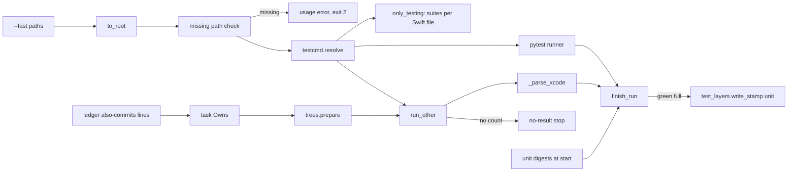
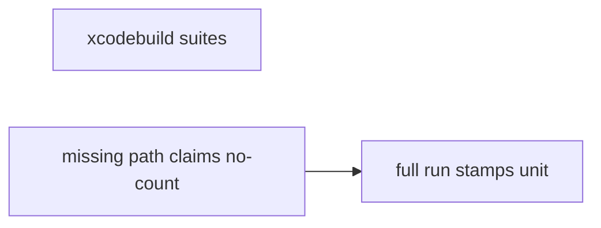

# Superlite: run_tests batch (B11)

**Goal:** fix #229 (a green `sl run_tests --full` does not stamp the unit layer), #235 (a missing `--fast` path is logged as a `no-result` stop), #239 (the `--task` tree omits files added by `--claim` or `--also`), #240 (`--fast` on xcodebuild counts only part of the selected tests). Each fix ships with regression tests.
**Architecture:** edits to `skills/subagent-driven-development/scripts/testcmd.py`, `run_tests.py` and `scripts/test_layers.py`; one new test file per task, plus real xcodebuild output fixtures.
**Tech stack:** Python 3.10+ stdlib, pytest (through `sl run_tests`); Xcode 27.2 on this machine for the #240 fixtures.
**Spec:** this file, section Design; the issue bodies on GitHub are the source for each Expected line.
**Detail:** contracts
**Target-min:** 11
**Wave0:** none
**Max chars:** 22000

Global constraints:
- Files under `skills/subagent-driven-development/scripts/` and `scripts/` carry the repo's trailing `# O(...)` complexity comment on every code line; tests and fixtures do not. Follow each file's existing style; update the module docstring where behaviour changes.
- Stdlib only. Existing tests stay green; a task changes no existing test file (another lead may own them): new tests go in the new file its Owns names.
- Run `sl` as an executable (`<abs>/sl ...`). Verify with `<abs>/sl run_tests --fast <test files> --task Tn --background`, then the printed `wait:` line. Never raw `pytest`, never the e2e or eval layers (coordinator's step).
- No version edits (the ship step bumps the version). No edits to `docs/` (another lead may own them).
- Tests never write the real repo's layer store or `.superlite/`: each builds its project under `tmp_path` (a git repo where a test needs one).

Ruling: detail contracts - fixes in existing modules with known causes, tests named with exact inputs and outcomes; #240 confirms its parse shapes on a real xcodebuild run - cost if wrong: one NEEDS_CONTEXT per task.
Ruling: T2 and T3 both edit `run_tests.py`, so T3 runs after T2 (`sequential`): a file edge, not an execution edge - cost if wrong: about 2 min on the critical path.
Ruling: #229 `run_tests` stamps the unit layer itself after a green `--full` run with no `--task`, run from the git toplevel, when `<root>/scripts/test_layers.py` loads and lists `unit`; the digests are taken before the runner starts, so a file edited during the run is not counted as tested; a stamp error is one stderr warning and never changes the exit code - cost if wrong: projects without `scripts/test_layers.py` see no change.
Ruling: #235 the check covers the pytest runner only (other stacks take packages and globs); a path's `::node` suffix is stripped; the `--background` parent runs the same check before it spawns, so a worker sees the usage error at once - cost if wrong: none.
Ruling: #239 `run_tests --task` adds the ledger's `Ruling: Tn also commits F` entries (`commit_task.add_also_owns` on `--ledger`) to the task's Owns before `trees.prepare`; `trees.py` stays unchanged - cost if wrong: a claim recorded in another run folder's ledger is not seen.
Ruling: #240 a run that counted no tests (exit 0, no junit, no parsed count) is a `no-result` stop with a reason naming the command, like pytest's (#140), instead of a silent `0 0` red; it sits in T2 because it lives in `run_tests.run_other` - cost if wrong: none.
Ruling: #240 `only_testing` selects the suites a Swift file declares (top-level types that are XCTest classes, `@Suite` types or types or extensions holding `@Test`/`func test`), plus top-level `@Test` functions; a file with none falls back to its stem with a stderr warning - cost if wrong: a suite declared by a macro or nested only inside another type is missed and the warning names the file.
Ruling: no probe adapter - CLI over local files and subprocesses; Review Focus cases run as named pytest cases - cost if wrong: no generated probes.

## Design

### 1. #229 one green full run counts for the unit layer
`test_layers.write_stamp(root, state, layer, digests=None)` records the given digests (else computes them, as today). `run_tests.run()` takes `unit_snapshot(a, label)` before the runner starts and stores it on `a.unit_snap`; `finish_run` calls `stamp_unit(a.unit_snap)` when the run is green.

### 2. #235 missing `--fast` path
`run()` checks every pytest `--fast` path after `expand_fast_paths`; a missing one prints `run_tests: test path not found: <paths> (cwd <cwd>, root <root>)`, writes that as the summary `error`, prints `0 0 0 0.0`, exits 2 and logs no incident. `main` keeps the original cwd on `a.cwd`.

### 3. #239 claimed files reach the task tree
See T2.

### 4. #240 xcodebuild selection and counts
See T1 (filter, parse) and T2 (no-count stop).

## Coverage

| Category | State | Basis |
|---|---|---|
| Scope and success criteria | settled | four issues in Goal; each issue's Expected line |
| Domain and data model | settled | layer store, ledger lines, summary JSON unchanged in shape |
| Persistence and migration | settled | no new files beyond the existing stamp store |
| Interfaces and contracts | ruled | `write_stamp(digests=)`, `only_testing(paths, root=".")`, `run_tests.unit_snapshot`, `stamp_unit` |
| UI states | n/a | CLI text |
| Concurrency and state ownership | ruled | T2 before T3 on `run_tests.py`; stamp store keeps its lock |
| Error handling and recovery | ruled | usage error exit 2; stamp errors warn only |
| Security and privacy | n/a | local files only; fixtures redact the home path |
| Performance and limits | settled | one digest pass per full run, only with `scripts/test_layers.py` |
| Observability | settled | stderr lines for stamp, warning, usage error |
| Testing strategy | settled | unit tests per task; real xcodebuild output as fixtures; unit layer by the coordinator |
| Compatibility | settled | Python 3.10+; Xcode output of Xcode 16+ shapes kept |
| Rollout | ruled | one PR; version bump at ship |
| Research unknowns | ruled | #240 output shapes confirmed on a real run inside T1 |

## File structure

- `skills/subagent-driven-development/scripts/testcmd.py`, `tests/scripts/fixtures/xcode/` (T1).
- `skills/subagent-driven-development/scripts/run_tests.py` (T2, then T3). `scripts/test_layers.py` (T3).

## Task graph

```mermaid
%% schedule
gantt
  title Predicted schedule (mm:ss)
  dateFormat X
  axisFormat %M:%S
  section lane 1
  T1 testcmd  xcodebuild filter from decla :t1, 0, 119s
  section lane 2
  T2 run_tests  missing path  claimed file :t2, 0, 116s
  T3 run_tests  a green full run stamps th :t3, 116, 115s
```

critical path: T2 → T3 (3.8 min) · peak width 2 · predicted build 3.8 min · predicted total ≈ 7.3 min (target ✓)

## Package: run_tests (CLI over local files and subprocesses)

**Probe entry:** none (Ruling: no probe adapter).

### T1 testcmd: xcodebuild filter from declared suites · Complexity 5 · Est. context 48k
**Owns:** skills/subagent-driven-development/scripts/testcmd.py, tests/scripts/test_testcmd_xcode_suites.py, tests/scripts/fixtures/xcode/
**Components:** 2
**LOC owned:** 170
**Tests:** fast
**Model:** sonnet
**Est. time:** 3.5 min (2 components, about 170 LOC, fast tests)
**Covers:** 4
**Consumes:** nothing executed from another task.
**Produces:** testcmd.only_testing(paths, root=".") -> str · testcmd.swift_suites(text: str) -> list[str]
e.g. swift_suites("final class AlphaTests: XCTestCase {\n  func testA() {}\n}\nclass BetaTests: XCTestCase {\n  func testB() {}\n}\n") -> ["AlphaTests", "BetaTests"]
e.g. swift_suites("@Suite struct Parser {\n  @Test func a() {}\n}\nstruct Fixture { let x = 1 }\n@Test func free() {}\n") -> ["Parser", "free()"]
**Review Focus:** encoding: `test_only_testing_two_xctest_suites_in_one_file` (`Tests/KitTests/Mixed.swift` holding the first e.g. text -> `-only-testing:KitTests/AlphaTests -only-testing:KitTests/BetaTests`); encoding: `test_swift_suites_examples` (both e.g. lines exactly); encoding: `test_implicit_suite_and_extension` (`struct Implicit {\n  @Test func b() {}\n}\nextension AlphaTests {\n  func testMore() {}\n}\n` -> `["Implicit", "AlphaTests"]`); encoding: `test_attributes_and_modifiers` (`@MainActor\nfinal class UITests: XCTestCase {\n  func testX() {}\n}\n@Suite("Named")\npublic struct S {\n  @Test func t() {}\n}\n` -> `["UITests", "S"]`); file: `test_no_suite_falls_back_with_warning` (`Tests/KitTests/Helpers.swift` with `struct Fixture {}` -> `-only-testing:KitTests/Helpers`, stderr holds `Tests/KitTests/Helpers.swift` and `declares no test suite`); file: `test_missing_file_falls_back` (path not on disk -> `-only-testing:KitTests/<stem>`, warning); state: `test_duplicates_across_files_once` (two files declaring `AlphaTests` -> one `-only-testing:KitTests/AlphaTests`); protocol: `test_resolve_expands_suites` (`.superlite/test-cmd.json` `{"language":"swift","test":"xcodebuild test -scheme X","test_file":"xcodebuild test -scheme X {only_testing}"}` in `tmp_path`, the Mixed file under it -> `resolve(tmp_path, [rel])["command"] == "xcodebuild test -scheme X -only-testing:KitTests/AlphaTests -only-testing:KitTests/BetaTests"`); numeric: `test_parse_real_xctest_two_suites` (fixture `xctest_two_suites.txt` -> passed, failed equal the real run's totals); numeric: `test_parse_real_swift_testing` (fixture `swift_testing.txt` -> the real totals); numeric: `test_parse_real_mixed_selection` (fixture `mixed_only_testing.txt`: both frameworks, several `-only-testing` suites in one run -> the real totals, every selected test counted once).
**Test code:** new file; `from test_plan_tools import SCRIPTS`, `sys.path.insert(0, str(SCRIPTS))`, `import testcmd` (as `test_testcmd_xcode.py` does); fixtures read from `tests/scripts/fixtures/xcode/` via `Path(__file__).parent`.
**Steps:** 1 failing tests, 2 run: FAIL, 3 implement, 4 run: PASS (also `tests/scripts/test_testcmd_xcode.py`, `test_testcmd.py`, `test_session_cost_testcmd.py` stay green).
**Notes:** Fixtures from a real run: build a throwaway Swift package under your scratch folder (outside the repo; library target `Kit`, test target `KitTests`) with one file holding two XCTest classes (3 + 2 tests, one failing), one Swift Testing file with a `@Suite` (2 tests) and an implicit suite (1 test), and run `xcodebuild test -scheme <pkg> -destination 'platform=macOS'` with and without `-only-testing:KitTests/<Suite>` args (also check whether `-only-testing:KitTests/free()` selects a free `@Test` function and whether an unknown name errors or selects nothing; state both in the report). Save the outputs (home path replaced by `/Users/u`) as the three fixtures and assert the totals xcodebuild printed. Fix `_parse_xcode` only where a fixture shows a wrong count. `swift_suites`: top-level declarations (column 0, after attribute lines and modifiers) of `class|struct|enum|actor|extension`; the block runs to the next line starting with `}`; a type is a suite when its inheritance names `XCTestCase`, an `@Suite` attribute precedes it, or its block holds `@Test` or `func test`; top-level `@Test func name(` gives `name()`; order of first appearance, no duplicates. `only_testing` reads each path relative to `root` (UTF-8, errors replaced); `resolve` passes its `root`. Warning line: `testcmd: <path> declares no test suite; using -only-testing:<arg>`. If xcodebuild cannot run here, report BLOCKED with its error; no hand-written fixtures.

### T2 run_tests: missing path, claimed files, no-count stop · Complexity 4 · Est. context 46k
**Owns:** skills/subagent-driven-development/scripts/run_tests.py, tests/scripts/test_run_tests_paths_claims.py
**Components:** 2
**LOC owned:** 150
**Tests:** fast
**Model:** sonnet
**Est. time:** 3 min (2 components, about 150 LOC, fast tests)
**Covers:** 2, 3, 4
**Consumes:** nothing executed from another task.
**Produces:** run_tests.missing_fast_paths(paths: list[str]) -> list[str]
e.g. missing_fast_paths(["tests/test_a.py::test_x[1]", "tests/nope.py"]) -> ["tests/nope.py"] (cwd holds `tests/test_a.py`)
**Review Focus:** file: `test_missing_fast_path_is_a_usage_error` (project `proj/.superlite`, `proj/tests/test_a.py`, cwd `proj/sub` (no `.git`), `--fast tests/test_a.py` -> exit 2; stderr holds `run_tests: test path not found: sub/tests/test_a.py`, `cwd <proj>/sub`, `root <proj>`; `.superlite/incidents.jsonl` has no `no-result` row; summary `error` starts `test path not found`); file: `test_node_suffix_is_stripped` (`--fast tests/test_a.py::test_a` from `proj` -> exit 0, `1 0 0`); file: `test_background_parent_refuses_missing_path` (`--fast tests/nope.py --background` -> exit 2, no `summary:` line, no `test-summary.latest`); state: `test_missing_fast_paths_example` (the e.g. line); state: `test_claimed_file_reaches_the_tree` (`setup` from `test_run_tests_plan_fallback`, plan tasks T1 `src/a.txt`, T2 `src/b.txt`; `commit_task.py T1 --claim src/b.txt --ruling x --plan P --ledger <root>/.superlite/progress.md`; write `new` to `src/b.txt`; `run_tests.py --fast src/a.txt --task T1 --plan P` -> `.superlite/trees/T1/src/b.txt` reads `new`); state: `test_also_dir_entry_reaches_the_tree` (ledger line `- Ruling: T1 also commits src/c/ - why`, untracked `src/c/x.txt` `c` -> tree file reads `c`); state: `test_unclaimed_file_stays_at_base` (edit `src/b.txt`, no claim -> tree `src/b.txt` equals the committed text); protocol: `test_no_count_run_is_a_no_result_stop` (swift test command printing `Build succeeded` with exit 0 -> exit 1; summary `error` starts `no tests ran:` and names the command; one `no-result` row; stdout `0 0 0`); protocol: `test_counted_run_unchanged` (command printing `Executed 2 tests, with 0 failures (0 unexpected) in 0.1 (0.1) seconds` -> exit 0, `2 0 0`).
**Test code:** new file; `setup`, `git`, `summary` from `test_run_tests_plan_fallback`; subprocess runs as in `test_run_tests_root.py`; tests add a second plan task by writing the plan with `make_plan(..., [{"id": "T1", "owns": "src/a.txt"}, {"id": "T2", "owns": "src/b.txt"}])`.
**Steps:** 1 failing tests, 2 run: FAIL, 3 implement, 4 run: PASS (also `tests/scripts/test_run_tests_*.py`, `test_trees.py`, `test_commit_task*.py` stay green).
**Notes:** `main` sets `a.cwd = cwd` before `to_root`. `missing_fast_paths` strips everything from the first `::`, keeps the given spelling. In `run()`, after `testcmd.resolve` and only when `spec["python"]` and paths: missing -> stderr line, `write_summary(..., error=line)`, `publish_summary`, print `0 0 0 0.0`, return 2, no `add_incidents`. In `main`, before `start_background` with `--fast`: `expand_fast_paths` (a `FileNotFoundError` there is left to the child), resolve, the same check, exit 2 without spawning. In `run()` before `trees.prepare`: `ct.add_also_owns(info, a.ledger)`. In `run_other`, when no junit counted and `parse_output` gives zero passed, failed and skipped with no failure names: reason `no tests ran: exit {rc} from \`{command}\` with no test count; its filter may select nothing` (cut at 300); stderr, `write_summary(..., error=reason)`, `publish_summary`, `add_incidents(no-result)`, print `0 0 0 S`, return 1. Docstring: the usage error and the no-count stop.

### T3 run_tests: a green full run stamps the unit layer · Complexity 4 · Est. context 44k
**Owns:** scripts/test_layers.py, skills/subagent-driven-development/scripts/run_tests.py, tests/scripts/test_run_tests_unit_stamp.py
**Components:** 2
**LOC owned:** 140
**Tests:** fast
**Model:** sonnet
**Est. time:** 3 min (2 components, about 140 LOC, fast tests)
**Covers:** 1
**Consumes:** nothing executed from another task.
**Produces:** test_layers.write_stamp(root: Path, state: Path, layer: str, digests: dict | None = None) -> None · run_tests.unit_snapshot(a, label: str) -> tuple | None · run_tests.stamp_unit(snap: tuple | None) -> None
**Review Focus:** state: `test_green_full_run_stamps_unit` (tmp git repo: real `scripts/test_layers.py` and `scripts/layer_store.py` copied, `.superlite/`, `pytest.ini` `[pytest]\ntestpaths = tests`, passing `tests/scripts/test_ok.py`, committed; `run_tests.py --full` -> exit 0, stderr holds `unit layer stamped`; `python3 scripts/test_layers.py status` stdout line starts `unit green`); state: `test_background_full_run_stamps_unit` (`--full --background`, then the `--wait` line -> exit 0, `unit green`); state: `test_red_full_run_does_not_stamp` (a failing test -> exit 1, status `unit stale`); state: `test_fast_and_task_runs_do_not_stamp` (`--fast tests/scripts/test_ok.py` and `--full --task T1` -> `unit stale`); state: `test_file_changed_during_run_is_not_stamped` (`test_ok.py` writes `scripts/extra.py` -> exit 0, status `unit stale` naming `scripts/extra.py`); state: `test_subfolder_root_does_not_stamp` (`.superlite/` in `repo/app`, tests under it, run from `repo/app` -> exit 0, no store file at `<repo>/.git/superlite/test-layers.json`); file: `test_no_layer_script_no_stamp` (repo without `scripts/test_layers.py` -> exit 0, no store file); file: `test_stamp_error_keeps_exit_code` (`scripts/test_layers.py` whose `write_stamp` raises `RuntimeError("x")` -> exit 0, stderr holds `unit layer not stamped: x`); state: `test_write_stamp_takes_digests` (`write_stamp(root, store, "unit", {"a.py": "1"})` -> `layer_store.is_green(store, "unit", hash_digests({"a.py": "1"}))`).
**Test code:** new file; load `scripts/test_layers.py` by path under a module name of its own (not `test_layers`, which `test_test_layers.py` registers); git repos via `git init -q` and `git -c user.email=t@t -c user.name=t commit`; subprocess env drops `SUPERLITE_STATE_DIR`, `SUPERLITE_FLEET_ROLE`, `SUPERLITE_FLEET_PARENT_DIR`.
**Steps:** 1 failing tests, 2 run: FAIL, 3 implement, 4 run: PASS (also `tests/scripts/test_test_layers.py`, `test_run_tests_*.py` stay green).
**Notes:** T3 starts after T2 committed `run_tests.py`; keep T2's changes. `unit_snapshot`: None unless `label == "full"`, no `a.task`, `Path.cwd()` resolves to `git rev-parse --show-toplevel`, `scripts/test_layers.py` loads (`importlib.util.spec_from_file_location("superlite_test_layers", ...)`) and `"unit" in mod.LAYERS`; returns `(mod, root, mod.layer_store.store_path(root), mod.layer_digests("unit", root))`; a load error prints `run_tests: unit layer not stamped: <err>` and returns None. `run()` sets `a.unit_snap` before the runner (both branches). `finish_run` calls `stamp_unit(getattr(a, "unit_snap", None))` when green (`not failed and (passed or skipped)`); `stamp_unit` calls `mod.write_stamp(root, state, "unit", digests)`, prints `run_tests: unit layer stamped`; any exception prints `run_tests: unit layer not stamped: <err>`. `record_run` never stamps. Docstrings of both files say so.

## Review Focus

Package run_tests: app type CLI; categories protocol (flags, exit codes, stderr lines), file (paths against cwd and root, tree overlay), encoding (Swift source parsing), numeric (test counts), state (layer stamp store, ledger rulings). Specific risks: a stamp written for a run that did not cover the unit layer; a usage error that hides a real collection problem; a tree that copies another task's unclaimed edit; `-only-testing` args that select nothing. Each task lists its named cases.
