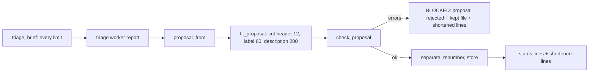
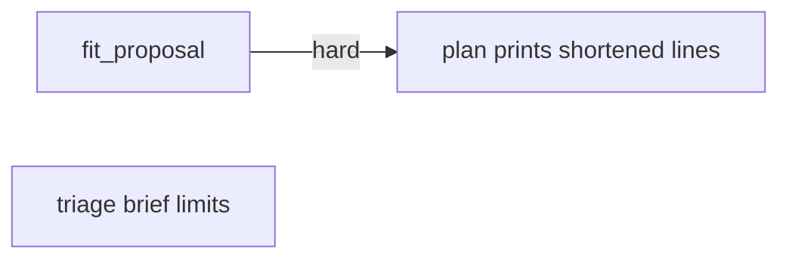

# Superlite: backlog triage proposals shorten over-long question texts (B20)

**Goal:** fix #296: `sl backlog plan` rejects a whole triage proposal over one option label over 60 characters or one header over 12, so main reruns the full triage. Max's decision: auto-truncate length-only errors. The triage brief states every AskUserQuestion limit `plan` checks.
**Architecture:** `skills/subagent-driven-development/scripts/backlog_checks.py` gains `fit_proposal` (cuts over-long header, option label and option description in place, returns one note per cut); `backlog.py` `cmd_plan` calls it before `check_proposal` and prints `shortened:` lines; `backlog_brief.py` `triage_brief` names every limit. One new test file per task.
**Tech stack:** Python 3.10+ stdlib, pytest (through `sl run_tests`).
**Spec:** this file, section Design; the issue body on GitHub is the source for the Expected lines.
**Detail:** tests
**Target-min:** 11
**Wave0:** none

Global constraints:
- Code lines under `skills/subagent-driven-development/scripts/` follow each file's existing style (`backlog_brief.py` and `backlog.py` carry trailing `# O(...)` comments on new lines; `backlog_checks.py` only on loops). Tests do not.
- Stdlib only. Existing tests stay green; a task changes no existing test file (another lead may own them): new tests go in the new file its Owns names.
- Run `sl` as an executable (`<abs>/sl ...`). Verify with `<abs>/sl run_tests --fast <test files> --task Tn --background`, then run the printed `wait:` line in the foreground. Never raw `pytest`, never the e2e or eval layers (coordinator's step).
- No version edits (the ship step bumps the version). Only the files a task owns change.
- Tests build their state under `tmp_path`; they never write the real repo's `.superlite/`.

Ruling: shorten header (12), option label (60) and option description (200) only; an over-long question (300) stays a hard error - the question text is the key of Max's answer and its end holds the ask - cost if wrong: a 301-character question still costs a triage rerun.
Ruling: a cut keeps the first characters, drops trailing whitespace, and keeps a label's ` (Recommended)` suffix whole (the text before it is cut); a cut that would leave an empty text is not made, so the length error stays - cost if wrong: none beyond the text.
Ruling: notes name the question (control characters to spaces, whitespace collapsed, at most 60 characters, `?` when it is not text), not a batch id, since `plan` renumbers ids and `separate` merges batches after the check - cost if wrong: two questions with the same text share a note name.
Ruling: `plan` prints at most 5 `shortened: <note>` lines, then `shortened: N more`, after its status lines or after the rejection block; the kept `backlog-proposal.json` holds the shortened texts - cost if wrong: main sees fewer cut names, `decide --print` still shows every text.
Ruling: no `plan --from FILE` (Max chose auto-truncate) - cost if wrong: an edited kept proposal still needs a rerun.
Ruling: a lead's `question.json` (`decide --print --batch`, `backlog_run`) is not fitted: outside Max's decision, and `backlog_run.py` is outside B20's files - cost if wrong: a lead question over a limit is still refused (follow-up).
Ruling: T1 --> T3 is a hard edge: the existing `tests/scripts/test_backlog_cli.py` suite T3 keeps green runs `cmd_plan` with the real `backlog_checks`, so T3's verify runs T1's code - cost if wrong: about 2 minutes of serial time.
Ruling: detail tests - small edits in existing modules; T1 and T3 tests verbatim - cost if wrong: one NEEDS_CONTEXT per task.
Ruling: no probe adapter - script internals over in-memory JSON; Review Focus cases run as named pytest cases - cost if wrong: no generated probes.
LAYERS: unit



## Design

### 1. fit_proposal
`backlog_checks.fit_proposal(obj)` walks only `obj["batches"][*]["decisions"][*]` (through `as_batch`, so a bare question counts) `["questions"][*]`: its `header`, and per option its `label` and `description`. A value that is a `str` longer than its limit (12, 60, 200) is replaced in place by its cut when the cut is not empty; each replacement adds one note `"<question name>" header: 13 -> 12 characters` / `"<name>" option <j> label: 86 -> 60 characters` / `"<name>" option <j> description: 250 -> 200 characters` (j from 1), in walk order: header first, then per option label, then description. Any other shape (not a dict, not a list, a missing key, a non-string value) is skipped without a note; `check_proposal` still reports it. It never copies or walks other keys (deeply nested input stays cheap).

### 2. plan wiring
`cmd_plan` calls `bc.fit_proposal(prop)` right after the triage result and before `bc.check_proposal`. Rejected: the existing output, then the `shortened:` lines; the kept file is written from the shortened proposal. Accepted: the status lines, then the `shortened:` lines. No cut: no `shortened` line.

### 3. triage brief
The Rules line's parenthesis names 1 to 4 distinct questions per decision, question at most 300 characters, header at most 12, 2 to 4 options with distinct labels, option label at most 60, description at most 200, and that an over-long header, label or description is cut while any other violation rejects the proposal.

## Coverage

| Category | State | Basis |
|---|---|---|
| Scope and success criteria | settled | #296 Expected lines; Max's decision |
| Domain and data model | settled | proposal JSON shape unchanged |
| Persistence and migration | n/a | `backlog.json` keys unchanged |
| Interfaces and contracts | settled | one new function with a Produces line; `check_proposal` unchanged |
| UI states | n/a | CLI text |
| Concurrency and state ownership | settled | tasks own disjoint files |
| Error handling and recovery | ruled | non-length errors still reject; kept file holds the cut copy |
| Security and privacy | settled | notes carry no control characters |
| Performance and limits | settled | one pass over the decisions |
| Observability | ruled | `shortened:` lines |
| Testing strategy | settled | new unit test file per task; unit layer by the coordinator |
| Compatibility | settled | a proposal within limits prints and stores as today |
| Rollout | ruled | one PR; version bump at ship |
| Research unknowns | n/a | causes named in the issue |

## File structure
- `skills/subagent-driven-development/scripts/backlog_checks.py`, `tests/scripts/test_backlog_fit.py` (T1).
- `skills/subagent-driven-development/scripts/backlog_brief.py`, `tests/scripts/test_backlog_brief_limits.py` (T2).
- `skills/subagent-driven-development/scripts/backlog.py`, `tests/scripts/test_backlog_fit_cli.py` (T3).

## Task graph

```mermaid
%% schedule
gantt
  title Predicted schedule (mm:ss)
  dateFormat X
  axisFormat %M:%S
  section lane 1
  T1 backlog_checks  fit_proposal cuts ove :t1, 0, 80s
  T3 backlog.py  plan fits the proposal an :t3, 80, 70s
  section lane 2
  T2 backlog_brief  triage brief states ev :t2, 0, 63s
```




critical path: T1 → T3 (2.5 min) · peak width 2 · predicted build 2.5 min · predicted total ≈ 6.0 min (target ✓)

## Package: superlite scripts (script internals over in-memory JSON)
**Probe entry:** none (Ruling: no probe adapter).

### T1 backlog_checks: fit_proposal cuts over-long texts · Complexity 4 · Est. context 42k
**Owns:** skills/subagent-driven-development/scripts/backlog_checks.py, tests/scripts/test_backlog_fit.py
**Components:** 1
**LOC owned:** 130
**Tests:** fast
**Model:** sonnet
**Est. time:** 2.5 min (1 component, about 130 LOC, fast tests)
**Covers:** 1
**Consumes:** existing `backlog_checks.as_batch(q) -> object` · existing `backlog_checks.check_proposal(obj: dict, known: set[int]) -> tuple[list[dict], list[str]]`
**Produces:** backlog_checks.fit_proposal(obj: object) -> list[str]
e.g. `p = {"batches": [{"id": "B1", "decisions": [{"questions": [{"question": "Which store?", "header": "Dependencies!", "options": [{"label": "x" * 72 + " (Recommended)", "description": "a"}, {"label": "Drop", "description": "b"}]}]}]}]}`; `fit_proposal(p) -> ['"Which store?" header: 13 -> 12 characters', '"Which store?" option 1 label: 86 -> 60 characters']`, and `p` now holds header `"Dependencies"` and label `"x" * 46 + " (Recommended)"`
e.g. `fit_proposal({"batches": [{"id": "B1", "decisions": []}]}) -> []`
e.g. `fit_proposal(None) -> []`
**Review Focus:** deep: `test_deeply_nested_unknown_keys_are_never_walked`; encoding: `test_the_note_names_the_question_without_control_characters`; state: `test_a_bare_question_decision_is_fitted_in_place`, `test_a_cut_that_makes_two_labels_equal_still_rejects`, `test_a_cut_that_would_leave_nothing_is_not_made`; protocol: `test_malformed_shapes_are_skipped`, `test_every_other_error_is_left_for_check_proposal`.
**Test code (verbatim):**
```python
# tests/scripts/test_backlog_fit.py
import sys
import pytest
from test_plan_tools import SCRIPTS
sys.path.insert(0, str(SCRIPTS))
import backlog_checks as bc  # noqa: E402

REC = " (Recommended)"

def q(header="API", labels=("Keep (Recommended)", "Drop"), desc="d", question="Which store?"):
    return {"questions": [{"question": question, "header": header,
                           "options": [{"label": lb, "description": desc} for lb in labels]}]}

def prop(*decisions):
    return {"batches": [{"id": "B1", "topic": "t", "issues": [1], "files": ["a.py"], "depends": [], "decisions": list(decisions)}]}

def first(p):
    return p["batches"][0]["decisions"][0]["questions"][0]

def test_long_header_and_label_are_cut_and_the_proposal_passes():
    p = prop(q(header="Dependencies!", labels=("x" * 72 + REC, "Drop")))
    assert bc.fit_proposal(p) == ['"Which store?" header: 13 -> 12 characters', '"Which store?" option 1 label: 86 -> 60 characters']
    assert first(p)["header"] == "Dependencies" and first(p)["options"][0]["label"] == "x" * 46 + REC
    batches, errs = bc.check_proposal(p, {1})
    assert errs == [] and batches[0]["decisions"][0]["questions"][0]["header"] == "Dependencies"

def test_cut_drops_trailing_spaces_and_a_plain_label_keeps_its_start():
    p = prop(q(header="Ship it now please", labels=("a" * 59 + " tail", "Drop")))
    assert len(bc.fit_proposal(p)) == 2
    assert first(p)["header"] == "Ship it now" and first(p)["options"][0]["label"] == "a" * 59

def test_long_descriptions_are_cut_to_200():
    p = prop(q(desc="y" * 250))
    assert bc.fit_proposal(p) == ['"Which store?" option 1 description: 250 -> 200 characters',
                                  '"Which store?" option 2 description: 250 -> 200 characters']
    assert [len(o["description"]) for o in first(p)["options"]] == [200, 200]

def test_texts_within_limits_are_untouched():
    args = dict(header="x" * 12, labels=("y" * 60, "Drop"), desc="z" * 200)
    p = prop(q(**args))
    assert bc.fit_proposal(p) == [] and p == prop(q(**args))

def test_a_bare_question_decision_is_fitted_in_place():
    bare = q(header="Dependencies!")["questions"][0]
    p = prop(bare)
    assert bc.fit_proposal(p) == ['"Which store?" header: 13 -> 12 characters'] and bare["header"] == "Dependencies"
    assert p["batches"][0]["decisions"][0] is bare

def test_every_other_error_is_left_for_check_proposal():
    bad = {"question": "?" * 301, "header": "", "options": [{"label": "", "description": "d"}, {"label": "a\x1b", "description": "d"}]}
    p = prop({"questions": [bad]})
    assert bc.fit_proposal(p) == []
    assert {"B1 decision 1: q1 question: 1 to 300 characters", "B1 decision 1: q1 header: 1 to 12 characters",
            "B1 decision 1: q1 options label: label 1 to 60 characters",
            "B1 decision 1: q1 options label: control character"} <= set(bc.check_proposal(p, {1})[1])

def test_a_cut_that_makes_two_labels_equal_still_rejects():
    p = prop(q(labels=("z" * 70, "z" * 65)))
    assert len(bc.fit_proposal(p)) == 2
    assert "B1 decision 1: q1 options: duplicate label " + "z" * 60 in bc.check_proposal(p, {1})[1]

def test_a_cut_that_would_leave_nothing_is_not_made():
    p = prop(q(header=" " * 13))
    assert bc.fit_proposal(p) == [] and first(p)["header"] == " " * 13

def test_the_note_names_the_question_without_control_characters():
    p = prop(q(header="Dependencies!", question="Pick\x1b[2J\n one?" + "!" * 100))
    assert bc.fit_proposal(p) == ['"Pick [2J one?' + "!" * 47 + '" header: 13 -> 12 characters']

def test_a_question_that_is_not_text_is_named_by_a_question_mark():
    p = prop(q(header="Dependencies!", question=5))
    assert bc.fit_proposal(p) == ['"?" header: 13 -> 12 characters']

@pytest.mark.parametrize("obj", [None, [], {"batches": "x"},
                                 {"batches": [None, {"id": 3, "decisions": "x"},
                                              {"decisions": [None, 5, {"questions": "x"},
                                                             {"questions": [None, {"options": "x"},
                                                                            {"header": 5, "options": [None, {"label": 7, "description": None}]}]}]}]}])
def test_malformed_shapes_are_skipped(obj):
    assert bc.fit_proposal(obj) == []

def test_deeply_nested_unknown_keys_are_never_walked():
    deep = cur = {}
    for _ in range(5000):
        cur["x"] = {}
        cur = cur["x"]
    p = prop({**q(header="Dependencies!"), "extra": deep})
    p["batches"][0]["extra"] = deep
    first(p)["options"][0]["evil"] = deep
    assert bc.fit_proposal(p) == ['"Which store?" header: 13 -> 12 characters']
```
**Steps:** 1 failing tests, 2 run: FAIL, 3 implement, 4 run: PASS (also `tests/scripts/test_backlog_checks.py` stays green).
**Notes:** Module constants `FIT = (("header", 12), ("label", 60), ("description", 200))` (or equivalent) and `REC = " (Recommended)"`. Cut: when the value ends with `REC` (and the limit is over `len(REC)`), cut the text before it to `limit - len(REC)`, `rstrip()`, append `REC`; else `value[:limit].rstrip()`. Name: `" ".join(re.sub(r"[\x00-\x1f\x7f]", " ", question).split())[:60]`, `?` for a non-string. Docstring: what it cuts and that everything else stays for `check_proposal`.

### T2 backlog_brief: triage brief states every question limit · Complexity 1 · Est. context 30k
**Owns:** skills/subagent-driven-development/scripts/backlog_brief.py, tests/scripts/test_backlog_brief_limits.py
**Components:** 1
**LOC owned:** 20
**Tests:** fast
**Kind:** mechanical
**Model:** haiku
**Est. time:** 1.5 min (1 component, about 20 LOC, fast tests)
**Covers:** 3
**Consumes:** nothing executed from another task.
**Produces:** backlog_brief.triage_brief(issues, ctx) -> str (signature unchanged; Rules line text)
**Review Focus:** protocol: `test_triage_brief_states_every_question_limit_it_checks`.
**Test code (verbatim):**
```python
# tests/scripts/test_backlog_brief_limits.py
import sys
from test_plan_tools import SCRIPTS
sys.path.insert(0, str(SCRIPTS))
import backlog_brief as bb  # noqa: E402

def test_triage_brief_states_every_question_limit_it_checks():
    t = bb.triage_brief([{"number": 1, "title": "t"}], {"repo": "r", "max_batches": 2})
    for s in ("1 to 4 distinct questions per decision", "question at most 300 characters", "header at most 12 characters",
              "2 to 4 options with distinct labels", "option label at most 60 characters", "description at most 200 characters",
              "an over-long header, label or description is cut to its limit", "any other violation rejects the whole proposal"):
        assert s in t, s
```
**Steps:** 1 failing test, 2 run: FAIL, 3 edit, 4 run: PASS (also `tests/scripts/test_backlog_brief.py` stays green).
**Notes:** In `triage_brief`'s Rules string replace exactly `(2 to 4 options, header at most 12 characters)` with `(1 to 4 distinct questions per decision, question at most 300 characters, header at most 12 characters, 2 to 4 options with distinct labels, option label at most 60 characters, description at most 200 characters; an over-long header, label or description is cut to its limit, any other violation rejects the whole proposal)`. Split the Python string literal over lines as the file does (lines under 140 characters). Nothing else changes; the json schema string stays byte-identical.

### T3 backlog.py: plan fits the proposal and prints shortened lines · Complexity 3 · Est. context 44k
**Owns:** skills/subagent-driven-development/scripts/backlog.py, tests/scripts/test_backlog_fit_cli.py
**Components:** 1
**LOC owned:** 60
**Tests:** fast
**Model:** sonnet
**Est. time:** 2 min (1 component, about 60 LOC, fast tests)
**Covers:** 2
**Consumes:** backlog_checks.fit_proposal(obj: object) -> list[str] (T1)
**Produces:** backlog.cmd_plan(a) -> int (output gains `shortened:` lines)
**Review Focus:** protocol: `test_a_rejected_proposal_is_kept_shortened_and_names_the_cuts`, `test_more_than_five_cuts_print_five_and_a_count`; state: `test_nothing_to_cut_prints_no_shortened_line`.
**Test code (verbatim):**
```python
# tests/scripts/test_backlog_fit_cli.py
import json, sys
from test_backlog_cli import bk, cli, load, BATCH  # noqa: F401  bk is the CLI fixture
from test_plan_tools import SCRIPTS
sys.path.insert(0, str(SCRIPTS))
import backlog_checks as bc  # noqa: E402

REC = " (Recommended)"
LONG = {"questions": [{"question": "Which store?", "header": "Dependencies!",
                       "options": [{"label": "x" * 72 + REC, "description": "a"}, {"label": "Drop", "description": "b"}]}]}
NOTES = ['"Which store?" header: 13 -> 12 characters', '"Which store?" option 1 label: 86 -> 60 characters']

def test_plan_shortens_a_long_header_and_label_and_says_so(bk, capsys):
    bk.batches = [{**BATCH, "decisions": [LONG]}]
    rc, out = cli(capsys, "plan")
    e = load(bk)["batches"][0]["decisions"][0]["questions"][0]
    assert rc == 0 and "B1 | #1 #2 | planned" in out
    assert e["header"] == "Dependencies" and e["options"][0]["label"] == "x" * 46 + REC
    assert out.endswith("".join(f"shortened: {n}\n" for n in NOTES))

def test_a_rejected_proposal_is_kept_shortened_and_names_the_cuts(bk, capsys):
    bk.batches = [{**BATCH, "issues": [9], "decisions": [LONG]}]
    rc, out = cli(capsys, "plan")
    kept = json.loads((bk.sd / "backlog-proposal.json").read_text())
    assert rc == 3 and "BLOCKED: proposal rejected" in out and "B1: unknown issue #9" in out
    assert out.endswith("".join(f"shortened: {n}\n" for n in NOTES))
    assert kept["batches"][0]["decisions"][0]["questions"][0]["header"] == "Dependencies"

def test_more_than_five_cuts_print_five_and_a_count(bk, monkeypatch, capsys):
    notes = [f'"Q" option {n} description: 201 -> 200 characters' for n in range(1, 8)]
    monkeypatch.setattr(bc, "fit_proposal", lambda obj: list(notes))
    rc, out = cli(capsys, "plan")
    assert rc == 0 and out.count('shortened: "Q"') == 5 and out.endswith("shortened: 2 more\n")

def test_nothing_to_cut_prints_no_shortened_line(bk, capsys):
    rc, out = cli(capsys, "plan")
    assert rc == 0 and "shortened" not in out
```
**Steps:** 1 failing tests, 2 run: FAIL, 3 implement, 4 run: PASS (also `tests/scripts/test_backlog_cli.py` stays green).
**Notes:** In `cmd_plan`, right after the `if err:` block: `cuts = [f"shortened: {n}" for n in bc.fit_proposal(prop)]`, then keep the first 5 and add `shortened: {len - 5} more` when there are more. Rejected branch: after its existing print, print the cut lines (if any). Accepted: `print("\n".join(shown["lines"] + cuts))`. The kept file is written after the fit, so it holds the cut texts. Module docstring: `plan` names the shortening.

## Review Focus
Package superlite scripts: app type library (proposal checks) plus CLI; categories deep (nested untrusted JSON), encoding (control characters in note names), state (in-place cuts, bare questions, duplicates after a cut), protocol (CLI output order, exit codes). Specific risks: a cut that empties a text; a lost `(Recommended)` marker; a note naming a renumbered batch id; walking or copying unknown deep keys. Each task lists its named cases.

## Self-review
Coverage: #296 brief limits T2, auto-truncate T1 + T3. No placeholders. T1, T2 and T3 share no file; one hard edge T1 -> T3.
