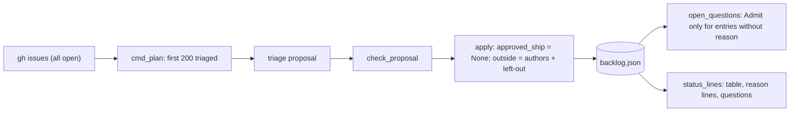
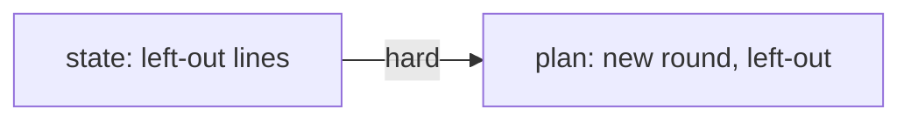

# Superlite: backlog plan starts a fresh round, status lists left-out issues (B27)

**Goal:** fix #313 (`sl backlog plan --reset` keeps the earlier round's `approved_ship`, so `decide --print` never asks the ship approval for the new batches) and #314 (issues the plan left out, for example past the batch cap, show neither in `backlog status` nor in `outside[]` of backlog.json). Each fix ships with regression tests.
**Architecture:** edits to `skills/subagent-driven-development/scripts/backlog_state.py` (left-out entries in `outside[]` never become Admit questions; `status_lines` prints them grouped by reason) and `skills/subagent-driven-development/scripts/backlog.py` (`cmd_plan` clears `approved_ship` and writes the left-out entries); one new test file per task.
**Tech stack:** Python 3.10+ stdlib, pytest (through `sl run_tests`).
**Spec:** this file, section Design; the issue bodies on GitHub are the source for each Expected line.
**Detail:** contracts
**Target-min:** 11
**Wave0:** none

Global constraints:
- Code lines under `skills/subagent-driven-development/scripts/` carry the repo's trailing `# O(...)` complexity comment where the file already uses them; tests do not. Follow each file's existing style.
- Stdlib only. Existing tests stay green; a task changes no existing test file (another lead may own them): new tests go in the new file its Owns names.
- Run `sl` as an executable (`<abs>/sl ...`). Verify with `<abs>/sl run_tests --fast <test files> --task Tn --background`, then run the printed `wait:` line in the foreground and end the turn only after it reports. Never raw `pytest`, never the e2e or eval layers (coordinator's step).
- No version edits (the ship step bumps the version). Only the files a task owns change.
- Tests build their state under `tmp_path`; they never write the real repo's `.superlite/`.
- backlog.json keeps its keys; an `outside[]` entry with a non-empty string `reason` is a left-out issue `{"number": int, "title": str, "reason": str}`; an entry without one is an outside-author issue `{"number", "title", "author"}` as today.

Ruling: detail contracts - fixes in existing modules with known causes; tests named with exact inputs and outcomes - cost if wrong: one NEEDS_CONTEXT per task.
Ruling: every successful `sl backlog plan` clears `approved_ship`, with or without `--reset` - each plan starts a new round with no lead running (plan refuses otherwise), and one approval covers one round's batches - cost if wrong: main asks the ship question once more per round.
Ruling: a left-out issue's reason is `not planned (cap)` when the proposal held MAX_BATCHES or more batches, else `not planned (triage)`; open issues past the 200-issue fetch limit get `not triaged (200 cap)` - the triage brief and proposal checks (backlog_brief.py, backlog_checks.py) that could carry a per-issue reason belong to other leads - cost if wrong: an umbrella issue left out at the cap reads `(cap)`.
Ruling: status prints one line per reason, `<reason>: #a #b`, numbers only, after the batch table and before the questions line, also when there are no batches - compact for main's lean context; titles stay in backlog.json - cost if wrong: main looks titles up in `titles`.
Ruling: edge T1 -> T2 is hard - T2's CLI tests read `status_lines` and `open_questions` output that T1 changes - cost if wrong: about 2 min of serial time.
Ruling: no probe adapter - script internals over local files; Review Focus cases run as named pytest cases - cost if wrong: no generated probes.
LAYERS: unit

## Design

### 1. #313 a plan starts a new round
`cmd_plan`'s `apply` sets `data["approved_ship"] = None` next to the other fields it replaces. A rejected or blocked plan writes nothing, so the old approval stays. `decide --print` then lists `SHIP_Q` first again, and `status` reads `ship not approved`.

### 2. #314 left-out issues in outside[] and status
`cmd_plan` keeps `ISSUE_LIMIT = 200` open issues for triage (today's `[:200]`). After `check_proposal` accepts, every trusted issue in no accepted batch becomes `{"number", "title", "reason"}` with reason `not planned (cap)` if `len(prop["batches"]) >= MAX_BATCHES`, else `not planned (triage)`; every non-skipped open issue past the limit becomes one with `f"not triaged ({ISSUE_LIMIT} cap)"`. `apply` stores `outside` = outside-author entries, then left-out entries (triage order), then past-limit entries (fetch order). `backlog_state.admit_entries(data)` returns the outside entries without a reason; `open_questions` and `answer` use it, so a left-out issue is never an Admit question. `backlog_state.left_out_lines(data)` groups left-out entries by reason (first-seen order) as `<reason>: #a #b`, the reason cleaned like titles (control characters to spaces, at most 80 characters). `status_lines` prints those lines after the table and before the questions line, and after the head line when there are no batches. `skip <issue>` already drops the issue from `outside[]` and keeps it out of later plans.

## Coverage

| Category | State | Basis |
|---|---|---|
| Scope and success criteria | settled | two issues in Goal; each issue's Expected line |
| Domain and data model | settled | `outside[]` entry gains an optional `reason`; global constraints |
| Persistence and migration | settled | old backlog.json entries have no reason and read as today |
| Interfaces and contracts | settled | two new functions with Produces lines; CLI output lines named in tests |
| UI states | n/a | CLI text |
| Concurrency and state ownership | settled | writes stay inside `bs.update`'s lock; T1, T2 own disjoint files |
| Error handling and recovery | settled | rejected plan writes nothing; skip drops a left-out entry |
| Security and privacy | n/a | local files; reason text is our own constant, still cleaned |
| Performance and limits | settled | one pass over issues and batches |
| Observability | settled | status lines |
| Testing strategy | settled | new unit test file per task; unit layer by the coordinator |
| Compatibility | settled | outside-author entries and their questions unchanged |
| Rollout | ruled | one PR; version bump at ship |
| Research unknowns | n/a | causes named in the issues |

## File structure
- `skills/subagent-driven-development/scripts/backlog_state.py`, `tests/scripts/test_backlog_state_left_out.py` (T1).
- `skills/subagent-driven-development/scripts/backlog.py`, `tests/scripts/test_backlog_plan_round.py` (T2).

## Task graph

```mermaid
%% schedule
gantt
  title Predicted schedule (mm:ss)
  dateFormat X
  axisFormat %M:%S
  section lane 1
  T1 backlog_state  left-out entries  admi :t1, 0, 77s
  T2 backlog plan  fresh ship approval  le :t2, 77, 78s
```

critical path: T1 → T2 (2.6 min) · peak width 1 · predicted build 2.6 min · predicted total ≈ 6.1 min (target ✓)

## Package: superlite backlog scripts (CLI over local state)
**Probe entry:** none (Ruling: no probe adapter).

### T1 backlog_state: left-out entries, admit filter, status lines · Complexity 3 · Est. context 32k
**Owns:** skills/subagent-driven-development/scripts/backlog_state.py, tests/scripts/test_backlog_state_left_out.py
**Components:** 1
**LOC owned:** 110
**Tests:** fast
**Model:** sonnet
**Est. time:** 2.0 min (1 component, about 110 LOC, fast tests)
**Covers:** 2
**Consumes:** nothing executed from another task.
**Produces:** backlog_state.left_out_lines(data: dict) -> list[str] · backlog_state.admit_entries(data: dict) -> list[dict] · backlog_state.status_lines(data: dict) -> list[str] (signature unchanged)
e.g. `left_out_lines({"outside": [{"number": 3, "title": "Three", "author": "eve"}, {"number": 5, "title": "Five", "reason": "not planned (cap)"}, {"number": 6, "title": "Six", "reason": "not planned (cap)"}, {"number": 7, "title": "Seven", "reason": "not triaged (200 cap)"}]})` -> `["not planned (cap): #5 #6", "not triaged (200 cap): #7"]`
e.g. `admit_entries(<that data>)` -> `[{"number": 3, "title": "Three", "author": "eve"}]`
e.g. `status_lines({**<that data>, "batches": [], "approved_ship": None})` -> `["backlog: 0 batches, 0 running, 0 shipped, ship not approved", "not planned (cap): #5 #6", "not triaged (200 cap): #7"]`
**Review Focus:** state: `test_left_out_lines_group_by_reason` (the e.g. data -> the e.g. list); state: `test_admit_entries_skip_left_out` (the e.g. data -> only #3); protocol: `test_open_questions_ask_admit_only_for_authors` (the e.g. data with `batches: []`, `approved_ship: None` -> exactly one question, its text starts `Admit outside issue #3`; no question text holds `#5`, `#6` or `#7`); protocol: `test_answer_refuses_left_out_admit` (`answer(data, {"Admit outside issue #5 (Five, by ) into the backlog?": "Admit"}, "AskUserQuestion", "t")` -> `["no open question: Admit outside issue #5 (Five, by ) into the backlog?"]`, `data["admitted"]` stays `[]`, #5 stays in `outside`); protocol: `test_status_no_batches_lists_left_out` (the third e.g.); protocol: `test_status_order_table_reasons_questions` (the e.g. data plus `batches: [{"id": "B1", "topic": "t", "issues": [1], "files": ["a.py"], "depends": [], "decisions": [], "state": "planned"}]`, `approved_ship: None`, `admitted: []`, `skipped: []` -> lines `[2]` is `B1 | #1 | planned | - | - | start` and `lines[-3:] == ["not planned (cap): #5 #6", "not triaged (200 cap): #7", "questions: 2 open (sl backlog decide --print)"]`); encoding: `test_reason_cleaned` (one entry `{"number": 9, "title": "N", "reason": "a\nb" + "x" * 100}` -> `["a b" + "x" * 77 + ": #9"]`); state: `test_entries_without_reason_unchanged` (outside `[{"number": 3, "title": "Three", "author": "eve"}, {"number": 4, "title": "Four", "author": "bob", "reason": ""}]` -> `left_out_lines == []`, `admit_entries` returns both, `open_questions` (with one planned batch, `approved_ship` set) holds two Admit questions); state: `test_skip_drops_left_out_entry` (`skip_issue(data, 5)` on the e.g. data with `batches: []`, `skipped: []` -> `"skipped #5 (in no batch)"`, `left_out_lines` -> `["not planned (cap): #6", "not triaged (200 cap): #7"]`, `skipped == [5]`).
**Test code:** new file; `from test_plan_tools import SCRIPTS`, `sys.path.insert(0, str(SCRIPTS))`, `import backlog_state as bs`; build fresh dicts per test (`copy.deepcopy`).
**Steps:** 1 failing tests, 2 run: FAIL, 3 implement, 4 run: PASS (also `tests/scripts/test_backlog_state.py`, `test_backlog_cli.py`, `test_backlog_run.py`, `test_backlog_run_lifecycle.py` stay green).
**Notes:** An entry is left out when `isinstance(o.get("reason"), str) and o["reason"]`. Clean the reason with the existing `_title`. `open_questions` iterates `admit_entries(data)`; `answer` builds its outside map from `admit_entries(data)`. In `status_lines` the `if not bs:` branch returns `[head] + left_out_lines(data)`; with batches, the left-out lines go after the table rows, before `questions:`. Update the module docstring (left-out entries, status reason lines).

### T2 backlog plan: fresh ship approval, left-out issues written · Complexity 3 · Est. context 36k
**Owns:** skills/subagent-driven-development/scripts/backlog.py, tests/scripts/test_backlog_plan_round.py
**Components:** 1
**LOC owned:** 120
**Tests:** fast
**Model:** sonnet
**Est. time:** 2.0 min (1 component, about 120 LOC, fast tests)
**Covers:** 1, 2
**Consumes:** backlog_state.left_out_lines(data: dict) -> list[str] (T1) · backlog_state.admit_entries(data: dict) -> list[dict] (T1)
**Produces:** backlog.ISSUE_LIMIT: int = 200 · backlog.cmd_plan(a) -> int (signature unchanged)
**Review Focus:** state: `test_reset_plan_clears_ship_approval` (`plan`; `approved_ship` set to `{"by": "AskUserQuestion", "time": "t"}` through `bs.update`; `plan --reset` -> exit 0, `approved_ship is None`, the stdout head line ends `ship not approved`, `decide --print` questions[0]["question"] == `bs.SHIP_Q`); state: `test_next_round_plan_clears_ship_approval` (`plan`; approval set; B1 marked shipped; `bk.batches = [{**BATCH, "issues": [2]}]`; plain `plan` -> exit 0, `approved_ship is None`); state: `test_rejected_plan_keeps_ship_approval` (`plan`; approval set; `bk.batches = [{**BATCH, "issues": [99]}]`; `plan --reset` -> exit 3, `approved_ship == {"by": "AskUserQuestion", "time": "t"}`); state: `test_left_out_issue_in_outside_with_triage_reason` (`bk.batches = [{**BATCH, "issues": [1]}]`; `plan` -> `outside == [{"number": 3, "title": "Three", "author": "eve"}, {"number": 2, "title": "Two", "reason": "not planned (triage)"}]`, stdout holds the line `not planned (triage): #2`); numeric: `test_left_out_at_cap_reason` (`monkeypatch.setattr(bl, "MAX_BATCHES", 1)`, batches `[{**BATCH, "issues": [1]}]` -> the #2 entry's reason is `not planned (cap)`); numeric: `test_issues_past_limit_listed` (`monkeypatch.setattr(bl, "ISSUE_LIMIT", 2)`, batches `[{**BATCH, "issues": [1, 2]}]` -> the triage brief has no `#3`, `outside == [{"number": 3, "title": "Three", "reason": "not triaged (2 cap)"}]`, `decide --print` holds no question with `#3`); state: `test_skipped_issue_past_limit_not_listed` (`skip 3` first, then the same plan -> `outside == []`); protocol: `test_status_lists_left_out` (batches `[{**BATCH, "issues": [1]}]`, `plan`, then `status` -> stdout holds `not planned (triage): #2`, `decide --print` holds no question with `#2`); state: `test_next_plan_replaces_left_out` (batches `[{**BATCH, "issues": [1]}]`, `plan`; then `bk.batches = [BATCH]`, `plan --reset` -> no `outside` entry has a `reason`).
**Test code:** new file; `from test_backlog_cli import bk, cli, load, BATCH  # noqa: F401` (bk is the CLI fixture, its fake gh returns issues #1 One/max/OWNER, #2 Two/co/COLLABORATOR, #3 Three/eve/NONE in that order), `from test_plan_tools import SCRIPTS`, `sys.path.insert(0, str(SCRIPTS))`, `import backlog as bl`, `import backlog_state as bs`.
**Steps:** 1 failing tests, 2 run: FAIL, 3 implement, 4 run: PASS (also `tests/scripts/test_backlog_cli.py`, `test_backlog_fit_cli.py`, `test_backlog_checks.py` stay green).
**Notes:** Read `ISSUE_LIMIT` and `MAX_BATCHES` at call time (module globals), so the monkeypatched values apply. `issues` keeps today's jq and `--paginate`; slice `[:ISSUE_LIMIT]` for triage and `[ISSUE_LIMIT:]` for the past-limit entries (skipped numbers dropped, title kept). Planned numbers come from the accepted `batches` (after `check_proposal`, before or after `separate`, same set). Set `data["approved_ship"] = None` inside `apply`. Update the module docstring (a plan clears the ship approval and lists left-out issues).

## Review Focus
- Package superlite backlog scripts: app type CLI over local state; categories protocol (commands and output lines), state (round reset, outside[] contents), numeric (cap thresholds), encoding (reason cleaning).
- Specific risks: a left-out entry turned into an Admit question; a rejected plan clearing the approval; a stale left-out list from an earlier round surviving a new plan; past-limit issues duplicated with triaged ones.

## Self-review
- Coverage: #313 -> T2; #314 -> T1 (state and output) and T2 (data written).
- Types: T2's Consumes match T1's Produces names and types.
- Graph: one hard edge; disjoint Owns.
