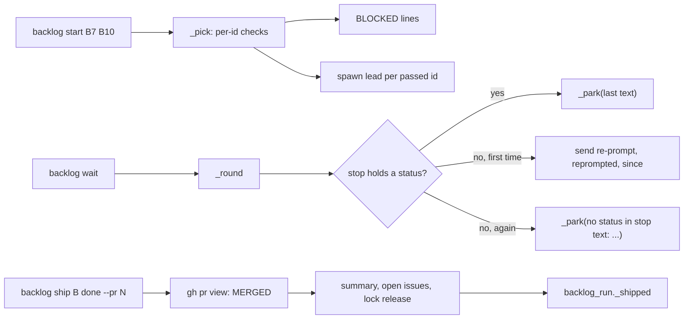
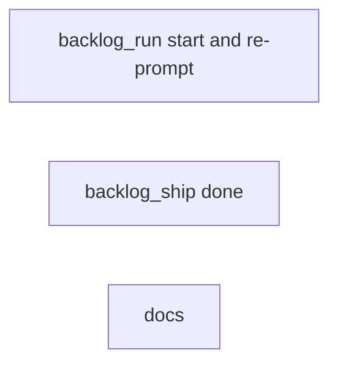

# Superlite: backlog run and ship lifecycle (B14)

**Goal:** fix #255 (commands/backlog.md and docs/tools.md do not name `backlog skip` and `park`), #265 (no command marks a batch shipped after main shipped it by hand), #266 (a lead that stops without a status is parked at once), #267 (`backlog start` takes one batch id). Each fix ships with regression tests.
**Architecture:** edits to `skills/subagent-driven-development/scripts/backlog_run.py` (multi-id start, status re-prompt) and `backlog_ship.py` (main-only `done`); doc edits to `commands/backlog.md` and `docs/tools.md`; one new test file per task.
**Tech stack:** Python 3.10+ stdlib, pytest (through `sl run_tests`).
**Spec:** this file, section Design; the issue bodies on GitHub are the source for each Expected line.
**Detail:** contracts
**Target-min:** 11
**Wave0:** none
**Max chars:** 22000

Global constraints:
- Code lines under `skills/subagent-driven-development/scripts/` carry the repo's trailing `# O(...)` complexity comment; tests do not. Follow each file's existing style; update the module docstring where behaviour changes.
- Stdlib only. Existing tests stay green; a task changes no existing test file (another lead may own them): new tests go in the new file its Owns names. New tests may import the fixtures and helpers of `tests/scripts/test_backlog_run.py` (`bk`, `put`, `get`, `run`, `running`) and `tests/scripts/test_backlog_ship.py` (`sh`, `ship`, `b1`) and `backlog_fixtures` (`batch`, `APPROVED`, `Q`).
- Run `sl` as an executable (`<abs>/sl ...`). Verify with `<abs>/sl run_tests --fast <test files> --task Tn --background`, then the printed `wait:` line. Never raw `pytest`, never the e2e or eval layers (coordinator's step).
- No version edits (the ship step bumps the version). Touch only the files your Owns names.

Ruling: detail contracts - fixes in existing modules with known causes, tests named with exact inputs and outcomes - cost if wrong: one NEEDS_CONTEXT per task.
Ruling: #265 Max chose a main-only `sl backlog ship B done --pr N`; commands/backlog.md says main ships a batch whose lead could not merge, then records it with `done` - cost if wrong: the lead-side classifier path stays unsolved (follow-up).
Ruling: `done` reuses `backlog_run._shipped` unchanged for state, lead stop and worktree cleanup, so a hand-shipped batch ends exactly like a merged one; T1 keeps `_shipped` byte-identical - cost if wrong: T2's tests see T1's work in progress (no shared lines).
Ruling: `done` accepts a batch in `running`, `needs_decision` or `parked` with a worktree recorded, and requires `gh pr view N` to say `MERGED`; it needs no ship-approval check (main merged it already) - cost if wrong: one refusal for a batch shipped before it was started.
Ruling: #266 the status is read from the full report (`fleet_io.report_text(transcript)`) when the stop record names a transcript, else from the record's 160-char `last`, because the lead ends its reply with the `Status:` line; `NEEDS_DECISION` counts as a status - cost if wrong: one needless re-prompt.
Ruling: #266 the re-prompt prints no `wait` line (main has nothing to do), sets `reprompted` and a new `since` on the batch; `start` and `answer` reset `reprompted` - cost if wrong: main learns of the re-prompt only from the later park line.
Ruling: #267 `start B ...` prints every refusal first (named order), then one `running` line per started batch; exit 2 when any named batch was refused, 0 when all started; a blocked spawn still returns its own code at once - cost if wrong: a script reading only the exit code misses a started batch.
Ruling: tests for this batch go in new files (`test_backlog_run_lifecycle.py`, `test_backlog_ship_done.py`, `test_backlog_main_docs.py`) because the brief lists only the four source files - cost if wrong: none.
Ruling: no probe adapter - CLI over local state files and fakes; Review Focus cases run as named pytest cases - cost if wrong: no generated probes.



## Design

### 1. #267 several batch ids
`start` takes `batch` as `nargs="*"`. `_pick(data, bids, cap, live) -> (ids, refusals)` runs, per named id (deduplicated, in order), today's checks in today's order (unknown, state, depends, shared files with active batches, open decisions, free slot) plus the live-lead check; a batch that passes counts as active for the later ids (files and slot). With no ids it takes `bs.startable` and drops a batch whose lead pane lives. `cmd_start` prints `BLOCKED: <reason>` per refusal, then starts the rest as today.

### 2. #266 a stop without a status
In `_round`, for a running batch with a new stop, no fresh `question.json` and no `merged`: the stop text (report text, else `last`) holding `Status: DONE|DONE_WITH_CONCERNS|NEEDS_DECISION|NEEDS_CONTEXT|BLOCKED` parks as today (reason: the cut `last`). Without a status, the first time it sets `reprompted: true` and `since: now`, then sends `REPROMPT` through `fleet_io.main(["send", lead, "--text", REPROMPT, "--plan", sd])` (the `answer` path); a failed send parks at once. With `reprompted` set it parks with `no status in stop text: <cut last or ->`.

### 3. #265 main records a hand-shipped batch
`sl backlog ship B done --pr N [--version X]`, main only. See T2.

### 4. #255 docs
commands/backlog.md names skip, park, multi-id start, the re-prompt and `done`; docs/tools.md rows name the same. See T3.

## Coverage

| Category | State | Basis |
|---|---|---|
| Scope and success criteria | settled | four issues in Goal; each issue's Expected line |
| Domain and data model | ruled | batch keys `reprompted` (bool) added; `pr`, `version`, `merged`, `open_issues` reused |
| Persistence and migration | settled | `backlog.json` keeps its shape; a missing `reprompted` reads as false |
| Interfaces and contracts | ruled | `start [B ...]`, `ship B done --pr N [--version X]`, `_pick(data, bids, cap, live)` |
| UI states | n/a | CLI text |
| Concurrency and state ownership | settled | `bs.update` keeps its lock; ship lock released by batch id |
| Error handling and recovery | ruled | refusals exit 2, gh failure exit 3, failed re-prompt send parks |
| Security and privacy | settled | `done` refuses inside a fleet worker; the re-prompt text is fixed |
| Performance and limits | settled | one transcript read per new stop |
| Observability | ruled | park reason `no status in stop text: <text>` |
| Testing strategy | settled | unit tests per task with fakes; unit layer by the coordinator |
| Compatibility | settled | `start B` and every existing output line unchanged |
| Rollout | ruled | one PR; version bump at ship |
| Research unknowns | n/a | none |

## File structure

- `skills/subagent-driven-development/scripts/backlog_run.py`, `tests/scripts/test_backlog_run_lifecycle.py` (T1).
- `skills/subagent-driven-development/scripts/backlog_ship.py`, `tests/scripts/test_backlog_ship_done.py` (T2).
- `commands/backlog.md`, `docs/tools.md`, `tests/scripts/test_backlog_main_docs.py` (T3).

## Task graph

```mermaid
%% schedule
gantt
  title Predicted schedule (mm:ss)
  dateFormat X
  axisFormat %M:%S
  section lane 1
  T1 backlog_run  several ids for start  r :t1, 0, 116s
  section lane 2
  T2 backlog_ship  main-only done for a ha :t2, 0, 96s
  section lane 3
  T3 docs  skip  park  several ids  re-pro :t3, 0, 81s
```





critical path: T1 (1.9 min) · peak width 3 · predicted build 1.9 min · predicted total ≈ 5.4 min (target ✓)

## Package: backlog (CLI over local state files)

**Probe entry:** none (Ruling: no probe adapter).

### T1 backlog_run: several ids for start, re-prompt a lead without a status · Complexity 5 · Est. context 45k
**Owns:** skills/subagent-driven-development/scripts/backlog_run.py, tests/scripts/test_backlog_run_lifecycle.py
**Components:** 2
**LOC owned:** 160
**Tests:** fast
**Model:** sonnet
**Est. time:** 3.5 min (2 components, about 160 LOC, fast tests)
**Covers:** 1, 2
**Produces:** backlog_run._pick(data: dict, bids: list, cap: int, live: dict) -> tuple[list, list]
**Review Focus:** state (slot and file accounting across ids of one call), protocol (argv, exit codes, line order)
**Notes:**
- argparse: `s.add_argument("batch", nargs="*")`; ids are deduplicated in order (`start B5 B5` starts B5 once).
- `_pick` returns `(ids to start, refusal messages)`; messages are today's texts: `unknown batch B`, `B is <state>`, `B waits for D`, `B shares files with running X`, `B has open decisions (sl backlog decide --print)`, `no free slot for B (cap N)`, `B lead W is still running (sl backlog wait)`. A passed id joins the active list for the later ids. `cmd_start` fetches `live` before `_pick`, prints each refusal as `BLOCKED: <msg>`, then the spawn loop as today; exit 2 when any refusal, else 0; no ids and nothing startable prints `no startable batch`, exit 0. A spawn `SystemExit` returns its code at once.
- Module constant `STATUS = re.compile(r"\bStatus:\s*\**\s*(DONE_WITH_CONCERNS|DONE|NEEDS_DECISION|NEEDS_CONTEXT|BLOCKED)\b", re.I)` and `REPROMPT = "superlite: your last turn ended without a status line. Go on with the batch; end your turn only with Status: DONE, DONE_WITH_CONCERNS, NEEDS_CONTEXT or BLOCKED, or write .superlite/question.json and end with Status: NEEDS_DECISION."`.
- `_stop_text(rec) -> str`: `fleet_io.report_text(rec["transcript"])` when the record has a `transcript` (errors read as `""`), else or when empty `str(rec.get("last") or "")`.
- In `_round` replace the final park: status found -> `_park` with `" ".join(str(rec.get("last") or "lead stopped").split())[:120]` (today's reason); no status and `b.get("reprompted")` -> `_park` with `f"no status in stop text: {cut}"`, `cut = " ".join(str(rec.get("last") or "").split())[:120] or "-"`; else `bs.update` sets `reprompted: True, since: _now_ms()`, then the send; a non-zero send parks with the `no status in stop text` reason. No output line for a re-prompt.
- `cmd_start`'s `mark` and `cmd_answer`'s `mark` also set `reprompted: False`. `_shipped` stays byte-identical (T2 calls it).
**Test code (named, exact):** in `tests/scripts/test_backlog_run_lifecycle.py`, with `from test_backlog_run import bk, put, get, run, running` and `from backlog_fixtures import batch as b`:
- `test_start_takes_several_ids_and_reports_each_refusal`: `put(bk, b("B1", ["a.py"]), b("B2", ["a.py"]), b("B3", ["c.py"]), b("B4", ["d.py"], depends=["B1"]))`; `run(capsys, "start", "B1", "B2", "B4", "B3", "--cap", "3")` == `(2, "BLOCKED: B2 shares files with running B1\nBLOCKED: B4 waits for B1\nB1 running lead=W1 worktree=<root>/wts/superlite-b1-t\nB3 running lead=W2 worktree=<root>/wts/superlite-b3-t\n")`; B1, B3 `running`, B2, B4 `planned`.
- `test_start_counts_batches_of_the_same_call_against_the_cap`: `put(bk, b("B1", ["a.py"]), b("B2", ["b.py"]), b("B3", ["c.py"]))`; `start B1 B2 B3` -> rc 2, first line `BLOCKED: no free slot for B3 (cap 2)`, B1 and B2 `running`, B3 `planned`. Then `put(bk, b("B5", ["e.py"]))`; `start B5 B5` -> rc 0, exactly one `B5 running` line and one more `spawn` call.
- `test_a_live_lead_refuses_only_its_own_batch`: `put(bk, b("B1", ["a.py"], "parked", reason="x", lead="W9", agent="sl-m-W9", worktree=str(bk.root / "wts" / "superlite-b1-t")), b("B2", ["b.py"]))`, `bk.states["sl-m-W9"] = "working"`; `start B1 B2` -> rc 2, line 1 `BLOCKED: B1 lead W9 is still running (sl backlog wait)`, line 2 starts `B2 running lead=`; B1 stays `parked`.
- `test_start_keeps_a_started_batch_when_a_later_spawn_blocks`: B1 `a.py`, B2 `b.py` planned; `spawn_lead` fake succeeds once, then prints `BLOCKED: no account with headroom` and raises `SystemExit(3)`; `start B1 B2` -> rc 3, B1 `running`, B2 `planned`.
- `test_wait_reprompts_a_lead_whose_stop_holds_no_status_once`: `running(bk)`, `bk.stops["W1"] = {"t": 2000, "last": "PONG"}`; `wait --timeout 0` == `(0, "TIMEOUT\n")`; batch `running`, `reprompted` True, `since` 5000; one `("text", argv)` call with `argv[:3] == ["send", "W1", "--text"]`, `"Status:" in argv[3]`, `argv[4:] == ["--plan", str(bk.sd)]`; no `stop` or `release` call. Then `bk.stops["W1"] = {"t": 6000, "last": "PONG again"}`; `wait --timeout 0` == `(0, "B1 parked: no status in stop text: PONG again\n")`; reason equal; `("release", "B1")` and `("stop", ["W1"])` in calls.
- `test_wait_reads_the_status_from_the_transcript`: stop `{"t": 2000, "last": "Outcome: BLOCKED, tui layer red", "transcript": "/x/t.jsonl"}`, `monkeypatch.setattr(sys.modules["fleet_io"], "report_text", lambda t: "Outcome: BLOCKED, tui layer red\n\nStatus: BLOCKED", raising=False)`; `wait --timeout 0` == `(0, "B1 parked: Outcome: BLOCKED, tui layer red\n")`; no `text` call.
- `test_needs_decision_without_a_question_parks_at_once`: stop last `Status: NEEDS_DECISION`, no question.json -> `(0, "B1 parked: Status: NEEDS_DECISION\n")`.
- `test_a_failed_reprompt_send_parks_with_a_readable_reason`: `monkeypatch.setattr(sys.modules["fleet_io"], "main", lambda argv: 1)`, stop last `""` -> `(0, "B1 parked: no status in stop text: -\n")`.
- `test_answer_and_start_reset_the_reprompt`: `wt = running(bk, reprompted=True)`, state `needs_decision`, `question.json` = `Q`, answers file `{"answers": {"Keep the v1 API?": "Drop"}}`; `answer B1 --file F` rc 0 and `get(bk, "B1")["reprompted"] is False`. `put(bk, b("B2", ["b.py"], reprompted=True))`; `start B2` rc 0 and `reprompted` False.
**Steps:** 1 failing tests, 2 run: FAIL, 3 implement, 4 run: PASS (`test_backlog_run_lifecycle.py` and `test_backlog_run.py`)

### T2 backlog_ship: main-only done for a hand-shipped batch · Complexity 4 · Est. context 40k
**Owns:** skills/subagent-driven-development/scripts/backlog_ship.py, tests/scripts/test_backlog_ship_done.py
**Components:** 1
**LOC owned:** 130
**Tests:** fast
**Model:** sonnet
**Est. time:** 2.5 min (1 component, about 130 LOC, fast tests)
**Covers:** 3
**Produces:** backlog_ship._done(a: argparse.Namespace, root: Path, data: dict, b: dict) -> int
**Review Focus:** protocol (main-only gate, refusal texts, exit codes), state (lock released only for this batch, record fields)
**Notes:**
- `action` choices gain `done`; new `--pr` (int). In `main`, after the batch lookup, `done` returns `_done(a, root, data, b)` before the lead, approval and state checks.
- `_done` checks, in order (each refusal exit 2, nothing written): `SUPERLITE_FLEET_WORKER` set -> `refused: sl backlog ship B done runs only in the main session`; no `--pr` or below 1 -> `refused: done needs --pr N`; state not `running`/`needs_decision`/`parked` -> `refused: B is <state>, not running or parked`; no repo or worktree -> `refused: B has no repo or worktree recorded`. Then `_run(["gh", "pr", "view", str(N), "-R", repo, "--json", "state", "-q", ".state"], root)`: non-zero -> exit 3 `BLOCKED: cannot read PR #N (<_tail>)`; text not `MERGED` -> exit 2 `refused: PR #N is <text or unknown>, not merged`.
- Then: version `a.version or b.get("version") or _current_version(wt)`; notes from `<wt>/.superlite/notes.md` (missing: `""`); summary `<root>/.superlite/backlog/B.md` = `backlog_brief.summary({**b, "pr": N, "version": v}, notes)`; `left = _open_issues(repo, issues, root)`; `_set(root, bid, pr=N, version=v, merged=True, open_issues=left)`; `ship_lock.release(lock, bid)` (OSError/ValueError ignored); `lines = backlog_run._shipped(bs.path(root), root / ".superlite", root, {**b, "pr": N, "version": v, "open_issues": left}, wt)`; print them, exit 0. Module docstring names `done`.
**Test code (named, exact):** in `tests/scripts/test_backlog_ship_done.py`, with `from test_backlog_ship import sh, ship, b1, AG`; each test unsets `SUPERLITE_FLEET_ROLE` and `SUPERLITE_FLEET_WORKER`, fakes `sys.modules["fleet"]` (`stop` logs `("stop", ids)`) and `backlog_run._run` (logs the cmd, returns `(0, "")`):
- `test_done_records_a_hand_shipped_batch`: B1 set `parked`, reason `merge denied`, version `1.5.20`; `ship_lock.acquire(sh.lock, {"batch": "B1", "lead": "W1", "agent": AG, "repo": "o/r"}, None, 9_000)`; `sh.replies = {"gh pr view": (0, "MERGED\n")}`; `ship(capsys, "B1", "done", "--pr", "262")` == `(0, f"B1 shipped PR #262 1.5.20 summary={sh.sd / 'backlog' / 'B1.md'}\n")`; record `state` shipped, `pr` 262, `merged` True, `version` 1.5.20, `open_issues` []; `ship_lock.holder(sh.lock) is None`; `("stop", ["W1"])` logged; a backlog_run cmd starting `["maxapp", "ship", "-C"]`; the summary file exists.
- `test_done_is_main_only_and_needs_a_merged_pr`: with `SUPERLITE_FLEET_WORKER=W1` -> `(2, "refused: sl backlog ship B1 done runs only in the main session\n")`; unset, no `--pr` -> `(2, "refused: done needs --pr N\n")`; `gh pr view` -> `(0, "OPEN\n")` -> `(2, "refused: PR #262 is OPEN, not merged\n")`; `gh pr view` -> `(1, "no such PR")` -> rc 3 and output starts `BLOCKED: cannot read PR #262`; B1 set `planned` -> `(2, "refused: B1 is planned, not running or parked\n")`; after each the record keeps `merged` False and no `stop` is logged.
- `test_done_takes_the_version_flag_and_names_open_issues`: B1 `running`, `sh.replies = {"gh pr view": (0, "MERGED\n"), "gh issue view": (0, "OPEN\n")}`; `done --pr 262 --version 1.6.0` -> rc 0, output lines `B1 shipped PR #262 1.6.0 summary=...` and `B1 OPEN #5`; record `version` 1.6.0, `open_issues` [5].
**Steps:** 1 failing tests, 2 run: FAIL, 3 implement, 4 run: PASS (`test_backlog_ship_done.py` and `test_backlog_ship.py`)

### T3 docs: skip, park, several ids, re-prompt, done · Complexity 2 · Est. context 25k
**Owns:** commands/backlog.md, docs/tools.md, tests/scripts/test_backlog_main_docs.py
**Components:** 1
**LOC owned:** 45
**Tests:** fast
**Kind:** mechanical
**Model:** haiku
**Est. time:** 1.5 min (1 component, about 45 LOC, fast tests)
**Covers:** 4
**Notes:**
- `commands/backlog.md`: step 4 becomes ``4. Run `"$SL" backlog start` (a worktree and a lead per startable batch, capped at 2); `"$SL" backlog start B7 B10` starts the named batches, each checked on its own: a refused batch prints its `BLOCKED:` reason and the others still start. Herdr missing or exit 3 means BLOCKED: stop and say so, never fall back to in-process agents.`` Step 5 keeps its text and appends `` A lead that stops without a status line is asked once for it; its next such stop parks the batch with `no status in stop text: <text>`.`` New step 6: ``6. A batch whose lead could not merge (its merge step was denied) is yours to ship: run `maxapp ship -C <worktree>` for it, then `"$SL" backlog ship B done --pr N`. That marks the batch shipped, records its PR and version, writes its summary, releases the ship lock and stops its lead, so batches that depend on it can start.`` New step 7: ``7. Hold work: `"$SL" backlog skip <issue>` when an issue waits on outside work, such as another open PR (it leaves its batch and every later plan); `"$SL" backlog park B --reason R` when a planned batch needs a human design decision first (plain `start` skips it, only `start B` starts it).`` The old step 6 becomes step 8, text unchanged (`8. Repeat 4 and 5 until ...`).
- `docs/tools.md`, `backlog` row: after `` `decide --print [--batch B] \| --file F` `` insert ``, `skip <issue>` (main: drops an issue that waits on outside work, such as another open PR, from its planned batch and keeps it out of every later plan; a batch left empty is dropped), `park B --reason R` (main: holds a planned batch that needs a human design decision; plain `start` skips it, only `start B` starts it)``.
- `backlog_run` row becomes: ``| `backlog_run` | `backlog start [B ...] [--cap 2] [--model opus]`, `wait [--timeout 21600] [--poll 10]`, `answer B --file F`: per batch a worktree and a lead worker. `start B7 B10` checks each named batch as `start B` does (state, depends, shared files, open decisions, free slot, a live lead): a refused one prints `BLOCKED: <reason>` and the others still start; exit 2 when any was refused. `wait` asks a lead whose stop holds no `Status:` line once for its status (the `answer` send path) and parks the batch on the next such stop with the reason `no status in stop text: <text>` |``
- `backlog_ship` row: after `` `release [--park R]` under the machine-wide ship lock`` append ``; `done --pr N [--version X]` (main only) records a batch main shipped by hand: it checks that PR N is merged, marks the batch shipped with its PR and version, writes its summary, releases the ship lock, stops its lead and cleans up its worktree``.
**Test code (verbatim):**
```python
# tests/scripts/test_backlog_main_docs.py
from test_plan_tools import ROOT

CMD = (ROOT / "commands" / "backlog.md").read_text(encoding="utf-8")
TOOLS = (ROOT / "docs" / "tools.md").read_text(encoding="utf-8")


def row(name):
    return next(x for x in TOOLS.splitlines() if x.startswith(f"| `{name}` |"))


def test_command_names_skip_and_park_with_their_reasons():
    for s in ('"$SL" backlog skip <issue>', "waits on outside work, such as another open PR",
              '"$SL" backlog park B --reason R', "needs a human design decision"):
        assert s in CMD, s


def test_command_names_several_ids_done_and_the_reprompt():
    for s in ('"$SL" backlog start B7 B10', "the others still start", '"$SL" backlog ship B done --pr N',
              "maxapp ship -C <worktree>", "no status in stop text"):
        assert s in CMD, s
    assert CMD.index("backlog start B7 B10") < CMD.index("backlog ship B done") < CMD.index("Repeat 4 and 5")


def test_tools_rows_name_the_new_forms():
    assert all(s in row("backlog") for s in ("`skip <issue>`", "`park B --reason R`", "another open PR", "human design decision"))
    assert all(s in row("backlog_run") for s in ("`backlog start [B ...]", "`start B7 B10`", "the others still start", "no status in stop text"))
    assert all(s in row("backlog_ship") for s in ("`done --pr N [--version X]`", "(main only)", "shipped by hand", "releases the ship lock"))
```
**Steps:** 1 write the test, 2 run: FAIL, 3 edit the two docs, 4 run: PASS (`test_backlog_main_docs.py`, `test_backlog_docs.py`, `test_backlog_user_docs.py`)

## Review Focus

Package backlog, app type CLI: protocol (argv forms, refusal texts, exit codes, line order), state (`backlog.json` fields, slot and file accounting, ship lock ownership), file (summary and notes paths). Specific risks: a re-prompt loop that never parks (T1 `test_wait_reprompts_a_lead_whose_stop_holds_no_status_once`), a `done` run inside a lead pane (T2 `test_done_is_main_only_and_needs_a_merged_pr`), a second batch of one call overfilling the cap (T1 `test_start_counts_batches_of_the_same_call_against_the_cap`).

## Self-review

Coverage: #267 T1, #266 T1, #265 T2 and T3, #255 T3. No placeholders. No Consumes; T2 calls the existing `backlog_run._shipped`, which T1 keeps unchanged. Tasks share no file, so the graph has no edges.
