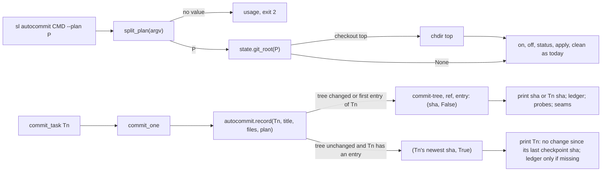
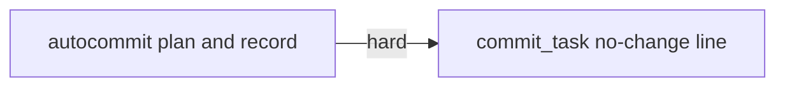

# Superlite: autocommit --plan and no-change re-checkpoint batch (B23)

**Goal:** fix #290 (`sl autocommit apply --plan .superlite` prints the usage line, though the lead brief says to pass `--plan` to every sl call) and #294 (`commit_task Tn` re-run with no change since the task's checkpoint makes an empty shadow commit and prints a bare SHA, read as the task's files dropped). Each fix ships with regression tests.
**Architecture:** edits to `skills/subagent-driven-development/scripts/autocommit.py` (`main` and a new `split_plan` for #290; `checkpoint` split into a new `record` for #294) and `skills/subagent-driven-development/scripts/commit_task.py` (`commit_one`, `main` output); one new test file per concern.
**Tech stack:** Python 3.10+ stdlib, pytest (through `sl run_tests`).
**Spec:** this file, section Design; the issue bodies on GitHub are the source for each Expected line.
**Detail:** contracts
**Target-min:** 11
**Wave0:** none

Global constraints:
- Code lines under `skills/subagent-driven-development/scripts/` follow each file's style: `commit_task.py` lines carry the trailing `# O(...)` complexity comment, `autocommit.py` mostly does not (keep its style). Tests carry none.
- Stdlib only. Existing tests stay green; a task changes no existing test file (another lead may own them): new tests go in the new files its Owns names.
- Run `sl` as an executable (`<abs>/sl ...`). Verify with `<abs>/sl run_tests --fast <test files> --task Tn --background`, then run the printed `wait:` line in the foreground. Never raw `pytest`, never the e2e or eval layers (coordinator's step).
- No version edits (the ship step bumps the version). No edits to `docs/` (another lead may own them).
- Tests build their repos under `tmp_path`; they never write the real repo's `.superlite/`. In-process tests set `SUPERLITE_AUTOCOMMIT=0` with `monkeypatch.setenv` (conftest sets it to 1) and `monkeypatch.chdir` into the test repo.

Ruling: detail contracts - small fixes in existing modules with known causes, tests named with exact inputs and outcomes - cost if wrong: one NEEDS_CONTEXT per task.
Ruling: #290 every autocommit subcommand (on, off, status, apply, clean, and the bare call) accepts `--plan P` and `--plan=P` anywhere in argv (last one wins); the run folder is `.superlite` at the toplevel of the git checkout holding P (`state.git_root(P)`), and autocommit chdirs there first, as Max decided (accept --plan and resolve the run folder) - cost if wrong: a `--plan` naming another checkout now acts on that checkout instead of the cwd.
Ruling: #290 uses `state.git_root`, not `state.for_plan`: commit_task, pt_review and trees always keep checkpoints.json in `<checkout>/.superlite` (commit_task runs from the repository root), while `for_plan` falls back to `SUPERLITE_STATE_DIR` or the session's binding when the plan's folder has no run marker - cost if wrong: none known; a monorepo app plan also resolves to the repository root, where commit_task wrote the checkpoints.
Ruling: #290 a P outside any git checkout leaves the cwd as today; `--plan` with no value is a usage error (exit 2); P need not exist and is not matched against the state's stored plan - cost if wrong: a typo in P that still lies inside a checkout acts on that checkout.
Ruling: #294 a re-checkpoint is reused only when staging the task's files on the chain head leaves its tree unchanged AND the task already has a checkpoint entry in this run's state; a task's first checkpoint still commits (an empty diff included), so `apply` keeps one entry per task - cost if wrong: a first checkpoint whose files another task's `--also` already took still prints a bare SHA with an empty diff.
Ruling: #294 a reused checkpoint prints `Tn: no change since its last checkpoint <full sha>` on stdout in place of the SHA line, for one task and for several (exit 0); the sha is the task's own newest entry, not the chain head; no commit, ref or state entry is written, as Max decided (skip the commit, reuse SHA, print message) - cost if wrong: a script reading a one-task stdout as a bare SHA gets the message (none in the repo).
Ruling: #294 on reuse commit_task writes the `- commit Tn` ledger line only when the ledger has none for Tn yet, starts no probe_run and no seam check (that sha had them), and keeps `--also` ruling lines, `resolve_blocked` and the pool release as for a commit; real-commit mode (`autocommit on`) is unchanged - cost if wrong: a probe that failed to start on the first checkpoint is not retried.
Ruling: no probe adapter - script internals over local git repos; Review Focus cases run as named pytest cases - cost if wrong: no generated probes.
Ruling: docs/tools.md and the SDD SKILL.md line on commit_task output are not edited (outside this batch's files); recorded as a follow-up in notes.md - cost if wrong: the docs lag one release.

## Design

### 1. #290 autocommit accepts --plan
`autocommit.split_plan(argv) -> (rest, plan)` removes every `--plan P` pair and `--plan=P` item from argv and returns the other items in order plus the last P (None when absent, `""` when the final `--plan` has no value or `--plan=` is empty). `main` calls it first: `""` prints the usage line on stderr and returns 2; a P whose `state.git_root(P)` is a folder makes `main` `os.chdir` to it (state imported lazily inside `main`); then `cmd = rest[0] if rest else "status"` and every branch reads `rest` where it read `argv` (`apply` still takes only `--no-squash`). The usage line becomes `usage: autocommit.py on|off|status|apply [--no-squash]|clean [--plan P]`; the module docstring names `--plan P` in one line.

### 2. #294 no-change re-checkpoint
`autocommit.record(tid, title, files, plan) -> (sha, reused)` holds today's `checkpoint` body. After `stage(files, env)` gives `tree`, it compares it with the parent's tree (`git rev-parse <parent>^{tree}`, `EMPTY_TREE` without a parent). Equal, and `st["entries"]` holds an entry with `task == tid`: return `(newest such entry's sha, True)` with no `commit-tree`, `update-ref` or `save_state`. Otherwise commit as today and return `(sha, False)`. `checkpoint(...)` stays and returns `record(...)[0]`.
In `commit_task.commit_one` checkpoint mode calls `autocommit.record`. On reuse: the task id joins `a.unchanged` (a set; `commit_one` works with an `a` that lacks it), the ledger `- commit Tn <sha10> <title>` line is appended only when `tid` is not in the `done` set read at the top of `commit_one`, `launch_probes` and `launch_seam_checks` are skipped; the `--also` ruling lines, `resolve_blocked` and the return `(0, sha)` stay. `main` prints `f"{tid}: no change since its last checkpoint {sha}"` for a task in `a.unchanged`, else the SHA line as today. The module docstring's Output paragraph names the line.

## Coverage

| Category | State | Basis |
|---|---|---|
| Scope and success criteria | settled | two issues in Goal; each issue's Expected line; Max's two decisions |
| Domain and data model | n/a | checkpoints.json keys unchanged |
| Persistence and migration | n/a | no new state; a reuse writes nothing |
| Interfaces and contracts | settled | `split_plan`, `record` new; `checkpoint` signature kept; output line in Design |
| UI states | n/a | CLI text |
| Concurrency and state ownership | settled | T1 owns autocommit.py, T2 commit_task.py; T2 runs after T1 |
| Error handling and recovery | settled | `--plan` without value exit 2; unknown args still usage |
| Security and privacy | n/a | local git only |
| Performance and limits | settled | one extra `rev-parse` per checkpoint |
| Observability | settled | the no-change line names the reused sha |
| Testing strategy | settled | three new unit test files; unit layer by the coordinator |
| Compatibility | settled | calls without `--plan` and changed re-checkpoints unchanged |
| Rollout | ruled | one PR; version bump at ship |
| Research unknowns | n/a | causes named in the issues |

## File structure
- `skills/subagent-driven-development/scripts/autocommit.py`, `tests/scripts/test_autocommit_plan.py`, `tests/scripts/test_autocommit_record.py` (T1).
- `skills/subagent-driven-development/scripts/commit_task.py`, `tests/scripts/test_commit_recheckpoint.py` (T2).

## Task graph

```mermaid
%% schedule
gantt
  title Predicted schedule (mm:ss)
  dateFormat X
  axisFormat %M:%S
  section lane 1
  T1 autocommit  --plan and checkpoint reu :t1, 0, 100s
  T2 commit_task  no-change re-checkpoint  :t2, 100, 80s
```

critical path: T1 → T2 (3.0 min) · peak width 1 · predicted build 3.0 min · predicted total ≈ 6.5 min (target ✓)

## Package: superlite scripts (checkpoint CLI internals)
**Probe entry:** none (Ruling: no probe adapter).

### T1 autocommit: --plan and checkpoint reuse · Complexity 4 · Est. context 36k
**Owns:** skills/subagent-driven-development/scripts/autocommit.py, tests/scripts/test_autocommit_plan.py, tests/scripts/test_autocommit_record.py
**Components:** 2
**LOC owned:** 150
**Tests:** fast
**Model:** sonnet
**Est. time:** 3 min (2 components, about 150 LOC, fast tests)
**Covers:** 1, 2
**Consumes:** existing `state.git_root(path) -> Path | None`
**Produces:** autocommit.split_plan(argv: list[str]) -> tuple[list[str], str | None] · autocommit.record(tid: str, title: str, files: list[str], plan: str | None) -> tuple[str, bool]
e.g. split_plan(["apply", "--plan", ".superlite", "--no-squash"]) -> (["apply", "--no-squash"], ".superlite")
e.g. split_plan(["--plan=plan.md", "status"]) -> (["status"], "plan.md"); split_plan(["apply", "--plan"]) -> (["apply"], "")
e.g. record("T1", "parser", ["src/a.py"], "plan.md") -> (s1, False); the same call again with src/a.py unchanged -> (s1, True); after record("T2", "lexer", ["src/b.py"], "plan.md") -> (s2, False), record("T1", ...) unchanged -> (s1, True)
**Review Focus:** protocol: `test_apply_accepts_plan_dot_superlite` (`two_tasks(repo)`, `run("autocommit", "apply", "--plan", ".superlite", cwd=repo)` -> 0, stdout holds `applied 2 commit(s)`, log titles `["T2: lexer", "T1: parser"]`, no refs left); protocol: `test_apply_accepts_plan_equals_form` (`apply --no-squash --plan=plan.md` -> 0, 2 commits); protocol: `test_plan_before_the_command` (`--plan .superlite apply` -> 0); file: `test_plan_from_another_cwd` (cwd `tmp_path / "elsewhere"`, `apply --plan <repo>/.superlite` -> 0, repo `rev-list --count HEAD` == 3, `elsewhere/.superlite` absent); file: `test_on_from_another_cwd_writes_the_checkout` (`on --plan <repo>/plan.md` -> 0, `repo/.superlite/autocommit.json` == `{"autocommit": true}`, `elsewhere/.superlite` absent); protocol: `test_status_and_clean_accept_plan` (`status --plan .superlite` -> 0 with `checkpoints for run`; `clean --plan .superlite` -> 0, `for-each-ref refs/superlite` == ""); protocol: `test_plan_without_value_is_usage_error` (`apply --plan` -> 2, stderr holds `usage` and `[--plan P]`, refs intact); protocol: `test_unknown_arg_with_plan_is_usage_error` (`apply --bogus --plan .superlite` -> 2, refs intact); file: `test_plan_outside_any_checkout_stays_in_cwd` (`status --plan <tmp_path>/loose/plan.md`, cwd repo -> 0, lists the repo's checkpoints); unit: `test_split_plan_table` (the e.g. lines, `split_plan(["apply"]) == (["apply"], None)`, `split_plan(["--plan", "a", "--plan", "b"]) == ([], "b")`, `split_plan(["--plan="]) == ([], "")`); state: `test_first_record_commits` (`(sha, False)`, `cat-file -t sha` == commit, one entry); state: `test_unchanged_rerecord_reuses` (second call `(s1, True)`, one entry, `refs/superlite/<run>/T1` == s1, `for-each-ref` count unchanged); state: `test_reuse_names_the_tasks_own_sha` (T1 s1, T2 s2, T1 again -> `(s1, True)`, entry tasks `["T1", "T2"]`); state: `test_changed_file_commits_again` (edit src/a.py -> `(s3, False)`, s3 != s1, `s3^` == s1); state: `test_first_record_of_a_task_with_same_tree_still_commits` (T1 on src/a.py s1, then `record("T9", "x", ["src/a.py"], "plan.md")` -> `(s9, False)`, s9 != s1, `s9^{tree}` == `s1^{tree}`, two entries); state: `test_deletion_counts_as_change` (T1 s1, delete src/a.py, T1 again -> reused False); unit: `test_checkpoint_returns_the_sha` (after T1 s1, `checkpoint("T1", "parser", ["src/a.py"], "plan.md")` == s1 and one entry).
**Test code:** two new files; `from test_autocommit import git, make_repo, run, write, two_tasks` (`# noqa: F401`); the record tests import `autocommit` from `test_autocommit.SCRIPTS` on `sys.path`, `monkeypatch.chdir(repo)`, `monkeypatch.setenv("SUPERLITE_AUTOCOMMIT", "0")`, read `.superlite/checkpoints.json` for entries and `run` names.
**Steps:** 1 failing tests, 2 run: FAIL, 3 implement, 4 run: PASS (also `tests/scripts/test_autocommit.py`, `test_autocommit_squash.py`, `test_checkpoint_chain.py`, `test_autocommit_base.py` stay green).
**Notes:** Read sections `### 1. #290 autocommit accepts --plan` and `### 2. #294 no-change re-checkpoint` under `## Design` in the plan file first: they are the contract. `record` keeps today's temp-index cleanup (`finally`) before the tree comparison returns.

### T2 commit_task: no-change re-checkpoint line · Complexity 3 · Est. context 34k
**Owns:** skills/subagent-driven-development/scripts/commit_task.py, tests/scripts/test_commit_recheckpoint.py
**Components:** 1
**LOC owned:** 110
**Tests:** fast
**Model:** sonnet
**Est. time:** 2.5 min (1 component, about 110 LOC, fast tests)
**Covers:** 2
**Consumes:** autocommit.record(tid: str, title: str, files: list[str], plan: str | None) -> tuple[str, bool] (T1)
**Produces:** commit_task.main(argv) -> int (signature unchanged)
**Review Focus:** protocol: `test_recheckpoint_without_change_prints_message` (src/a.py and tests/test_a.py written, `s1 = checkpoint(repo, "T1").stdout.strip()`, `checkpoint(repo, "T1")` -> 0, stdout == `f"T1: no change since its last checkpoint {s1}\n"`, checkpoints.json entry tasks `["T1"]`, `.superlite/progress.md` has exactly one line starting `- commit T1 `); state: `test_recheckpoint_after_another_task_names_its_own_sha` (T1 s1, src/b.py, T2, T1 again -> stdout == `f"T1: no change since its last checkpoint {s1}\n"`); protocol: `test_several_tasks_mix_lines` (T1 s1, write src/b.py, `checkpoint(repo, "T1", "T2")` -> 0, line 1 == `f"T1: no change since its last checkpoint {s1}"`, line 2 matches `T2 [0-9a-f]{40}` and its `^` == s1); protocol: `test_recheckpoint_with_change_prints_bare_sha` (edit src/a.py -> stdout a 40-hex sha != s1); file: `test_reuse_writes_ledger_line_when_missing` (T1 s1, drop the `- commit T1` line from progress.md, T1 again -> the message, progress.md has one line starting `f"- commit T1 {s1[:10]}"`); state: `test_reuse_launches_no_probe_or_seam_check` (in-process `commit_task.main(["T1", "--plan", "plan.md"])` with `launch_probes` and `launch_seam_checks` swapped for recorders: first call records a probe, second call == 0 records nothing, `capsys` stdout is the message); state: `test_reuse_releases_the_agent` (`.superlite/pool.json` `{"agents": [{"id": "a1", "tasks": [], "busy": true, "current": "T1"}]}` before the second T1 run -> a1 `busy` False, `current` cleared, T1 in `tasks`).
**Test code:** new file; `from test_autocommit import git, make_repo, run, write, checkpoint` (`# noqa: F401`); in-process cases put `test_autocommit.SCRIPTS` on `sys.path`, `import commit_task`, `monkeypatch.chdir(repo)`, `monkeypatch.setenv("SUPERLITE_AUTOCOMMIT", "0")` and the `SUPERLITE_SL`, `SL_TEST_PYTHON`, `SUPERLITE_PROBE_RUN` values of `test_autocommit.ENV`.
**Steps:** 1 failing tests, 2 run: FAIL, 3 implement, 4 run: PASS (also `tests/scripts/test_autocommit.py`, `test_checkpoint_chain.py`, `test_commit_also.py`, `test_commit_baseline.py` stay green).
**Notes:** Read section `### 2. #294 no-change re-checkpoint` under `## Design` in the plan file first: it is the contract. Only the checkpoint branch (`else:` after `if autocommit.is_on()`) changes; real-commit mode keeps its path.

## Review Focus
Package superlite scripts: app type CLI internals (checkpoint store, commit_task output); categories protocol (argument parsing, output line shapes), state (checkpoint chain, refs, ledger and pool after a reuse), file (cwd versus the plan's checkout). Specific risks: `--plan` value swallowed as the command; chdir into a folder outside a checkout; a reuse that still writes an entry or ref; a reused sha that is the chain head instead of the task's own; probes started twice on one sha. Each task lists its named cases.

## Self-review
Coverage: #290 T1 (Design 1), #294 T1 and T2 (Design 2). No placeholders. T1 and T2 share no file; one hard edge (T2's subprocess tests run T1's `record`).
