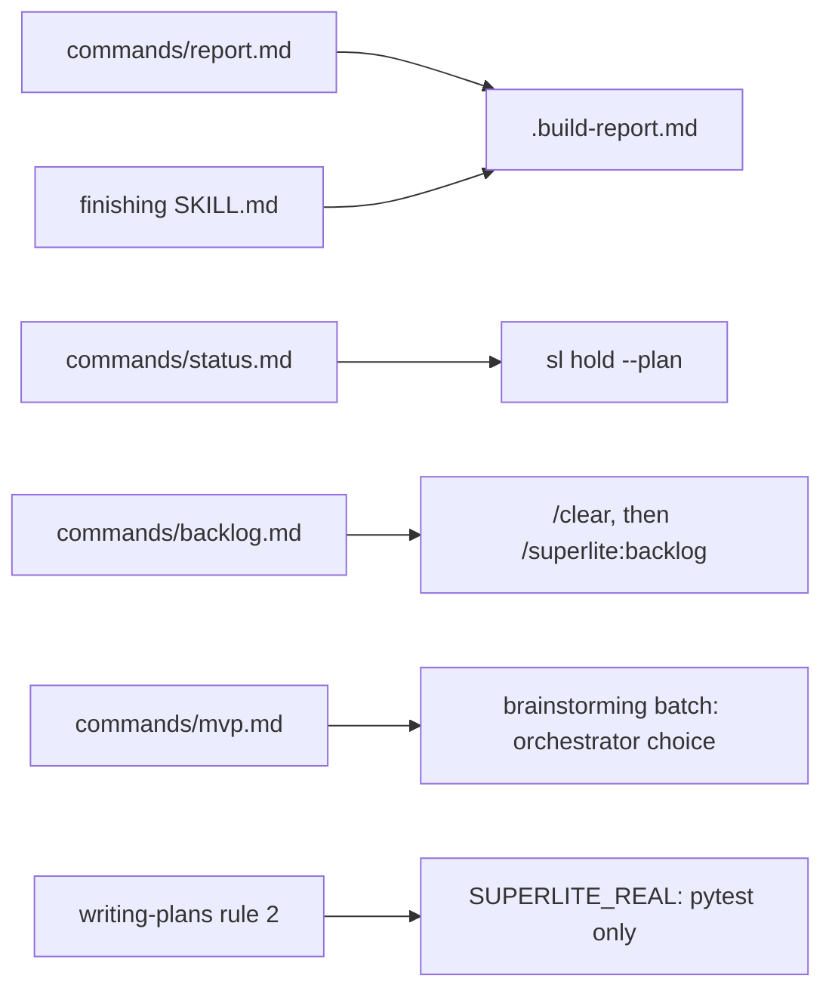
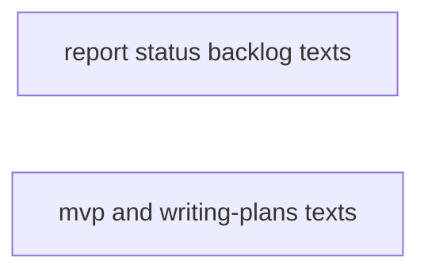

# Superlite: command and skill text fixes (B19)

**Goal:** fix #250 (report command and finishing skill name `<plan>.report.md`), #251 (`/superlite:status` does not list held tasks), #261 (`commands/mvp.md` asks the orchestrator choice as its own first question), #262 (writing-plans rule 2 names the `SUPERLITE_REAL` seam check for every language), #271 (backlog main after `/compact` re-injects every earlier superlite skill). Each fix ships with a regression test.
**Architecture:** text edits to four commands and two skills; one new test file per task.
**Tech stack:** Markdown; Python 3.10+ stdlib pytest tests (through `sl run_tests`).
**Spec:** this file, section Design; the issue bodies on GitHub are the source for each Expected line.
**Detail:** tests
**Target-min:** 11
**Wave0:** none
**Coverage:** off

Global constraints:
- Edit only the sentences each task's Notes name; every other line stays byte-identical. Keep LF line endings.
- A task changes no existing test file (another lead may own them): its tests go in the new file its Owns names.
- Run `sl` as an executable (`<abs>/sl ...`). Verify with `<abs>/sl run_tests --fast <test file> --task Tn --background`, then the printed `wait:` line. Never raw `pytest`, never the e2e or eval layers (coordinator's step).
- No version edits (the ship step bumps the version). Touch only the files your Owns names.

Ruling: coverage off and detail tests - bounded text fixes with known causes, each Expected line copied from its issue - cost if wrong: one NEEDS_CONTEXT per task.
Ruling: #271 (Max's decision) `commands/backlog.md` tells main to have the user run `/clear` and restart `/superlite:backlog` when the session already loaded another superlite skill or command, then end its turn; no `sl backlog status` warning (main cannot see the harness's injected skills from a script) - cost if wrong: a main that ignores the line still compacts to 85k.
Ruling: #261 `/superlite:mvp` loads `superlite:brainstorming` first, as `/superlite:feature` does (B13 spike: the standalone first-step question ended single-turn eval runs, 0 of 3); its one question batch carries the orchestrator choice; with AskUserQuestion withheld or headless it rules AI and goes on to the plan in the same turn; MVP steps 2-5 replace brainstorming's design and approval steps - cost if wrong: one extra skill load (about 2.5k) per MVP run.
Ruling: #261 no new eval case: `tests/scripts/test_evals_suite.py` pins the case set and the scaffold set and is outside this batch's files; follow-up issue - cost if wrong: MVP routing has only the text test.
Ruling: #250 the build report is named `<plan>.build-report.md` (the form `skills/subagent-driven-development/SKILL.md` and `test_docs_b10.py` use), and `commands/report.md` adds that `--list` and `--show` still read the older `<plan>.report.*` pair (`report.legacy_paths`) - cost if wrong: none.
Ruling: #251 `/superlite:status` runs `sl hold --plan <plan>` next to `sl budget` (prints `held Tn: reason` per held task or `held: none`) and reports each held task's id and reason inside the 15-line limit - cost if wrong: one extra line per held task.
Ruling: no probe adapter - prose files; the Review Focus cases run as named pytest cases - cost if wrong: no generated probes.



## Design

### 1. #250 build report name
`sl finish` writes `<plan>.build-report.md`/`.json` since 1.5.18; `commands/report.md` and `skills/finishing-a-development-branch/SKILL.md` name that pair; the report command adds the legacy read.

### 2. #251 held tasks in status
`commands/status.md` runs `sl hold --plan <plan>` when a plan exists and reports held tasks with id and reason.

### 3. #271 backlog main in a fresh session
`commands/backlog.md` opens with a fresh-session rule before step 1.

### 4. #261 MVP orchestrator choice
`commands/mvp.md` step 1 loads brainstorming first; its batch carries the choice; no stop when nobody can answer.

### 5. #262 seam check per stack
writing-plans rule 2 names the `SUPERLITE_REAL=1` rerun for pytest projects only and what other stacks use.

## File structure

- `commands/report.md`, `skills/finishing-a-development-branch/SKILL.md`, `commands/status.md`, `commands/backlog.md`, `tests/scripts/test_run_state_docs_b19.py` (T1).
- `commands/mvp.md`, `skills/writing-plans/SKILL.md`, `tests/scripts/test_mvp_plan_docs_b19.py` (T2).

## Task graph

```mermaid
%% schedule
gantt
  title Predicted schedule (mm:ss)
  dateFormat X
  axisFormat %M:%S
  section lane 1
  T1 report  finishing  status and backlog :t1, 0, 92s
  section lane 2
  T2 mvp and writing-plans texts :t2, 0, 92s
```





critical path: T1 (1.5 min) · peak width 2 · predicted build 1.5 min · predicted total ≈ 5.0 min (target ✓)

## Package: command and skill texts (prose the agent follows)

**Probe entry:** none (Ruling: no probe adapter).

### T1 report, finishing, status and backlog texts · Complexity 2 · Est. context 25k
**Owns:** commands/report.md, skills/finishing-a-development-branch/SKILL.md, commands/status.md, commands/backlog.md, tests/scripts/test_run_state_docs_b19.py
**Components:** 2
**LOC owned:** 45
**Tests:** fast
**Kind:** mechanical
**Model:** haiku
**Est. time:** 1.5 min (2 components, about 45 LOC, fast tests)
**Covers:** 1, 2, 3
**Notes:**
- `commands/report.md` line 6 becomes: ``Arguments: $ARGUMENTS. Every build keeps its report next to its plan: `<plan>.build-report.md` and `.build-report.json` (the latest is also `.superlite/report.md`). `sl report --list` and `--show` also read the `<plan>.report.md` and `.report.json` pair that older builds wrote.``
- `skills/finishing-a-development-branch/SKILL.md` line 26: replace ``name `<plan>.report.md` (next to the plan)`` with ``name `<plan>.build-report.md` (next to the plan)``.
- `commands/status.md`: the description line becomes `description: Show the superlite run state: mode, orchestrator, plan approval, task progress, held tasks, budget.`; the body line becomes: ``Show the current superlite state in under 15 lines. Run `sl orchestrator status` (mode and whether the plan is approved), `sl metrics --dir .superlite` (task progress and cost so far) and, if a plan exists, `sl budget --plan <plan>` and `sl hold --plan <plan>` (one `held Tn: reason` line per held task, or `held: none`). Report: orchestrator, approved or not, tasks done/running/waiting/held, each held task with its id and reason, cost and time so far, and the next step. Change nothing.``
- `commands/backlog.md`: insert one new paragraph, with a blank line before and after, between the `You are main ...` paragraph and step `1.`: ``Start in a fresh session. After each compaction Claude Code re-injects every skill this session loaded (85k measured), and main needs none of them. If this session already loaded another superlite skill or command (start, brainstorming, writing-plans, subagent-driven-development, finishing; the session-start text does not count), tell the user to run `/clear` and then `/superlite:backlog` again, and end your turn. Never load another superlite skill from main.``
**Test code (verbatim):**
```python
# tests/scripts/test_run_state_docs_b19.py
"""B19: report, finishing, status and backlog command texts (#250, #251, #271)."""
from pathlib import Path

ROOT = Path(__file__).resolve().parents[2]


def read(rel):
    return (ROOT / rel).read_text(encoding="utf-8")


def test_report_names_the_build_report_pair_and_the_legacy_read():
    t = read("commands/report.md")
    assert "`<plan>.build-report.md` and `.build-report.json`" in t
    assert "`<plan>.report.md` and `.report.json` pair that older builds wrote" in t
    assert t.index("build-report.md") < t.index("older builds wrote")


def test_finishing_names_the_build_report():
    t = read("skills/finishing-a-development-branch/SKILL.md")
    assert "name `<plan>.build-report.md` (next to the plan) as the full report" in t
    assert "<plan>.report.md" not in t


def test_status_lists_held_tasks():
    t = read("commands/status.md")
    assert "held tasks, budget." in t.splitlines()[1]
    assert "`sl hold --plan <plan>`" in t and "`held Tn: reason`" in t and "`held: none`" in t
    assert "each held task with its id and reason" in t
    assert "under 15 lines" in t and t.rstrip().endswith("Change nothing.")


def test_backlog_main_starts_in_a_fresh_session():
    t = read("commands/backlog.md")
    para = next(p for p in t.split("\n\n") if p.startswith("Start in a fresh session."))
    for s in ("re-injects", "`/clear`", "`/superlite:backlog` again", "end your turn", "Never load another superlite skill"):
        assert s in para, s
    assert t.index("Start in a fresh session.") < t.index("1. Run")
```
**Steps:** 1 write the test, 2 run: FAIL, 3 edit the four texts, 4 run: PASS (`test_run_state_docs_b19.py`, `test_backlog_docs.py`, `test_backlog_main_docs.py`, `test_docs_b10.py`)

### T2 mvp and writing-plans texts · Complexity 2 · Est. context 25k
**Owns:** commands/mvp.md, skills/writing-plans/SKILL.md, tests/scripts/test_mvp_plan_docs_b19.py
**Components:** 2
**LOC owned:** 40
**Tests:** fast
**Kind:** mechanical
**Model:** haiku
**Est. time:** 1.5 min (2 components, about 40 LOC, fast tests)
**Covers:** 4, 5
**Notes:**
- `commands/mvp.md` step 1 becomes: ``1. First, before you write the plan or ask anything, load `superlite:brainstorming` for its sizing and question rules: an MVP is never trivial, and its one question batch carries the orchestrator choice (human or AI) unless the user already said, plus whatever about the request is still unclear. Run `sl orchestrator set human|ai`. When AskUserQuestion is withheld or the run is headless, ask nothing: rule AI with a `Ruling:` line and go on to step 2 in the same turn. Steps 2 to 5 replace brainstorming's design and approval steps.``
- `commands/mvp.md` step 2: delete its last sentence `` Load `superlite:brainstorming` only for what is unclear.`` (with its leading space); the rest of step 2 stays.
- `skills/writing-plans/SKILL.md`, the line starting `2. **A task waits only when its tests execute another task's code.**`: replace the sentence ``Consumers' own tests still run against the real producer later, through the seam check (`SUPERLITE_REAL=1`).`` with ``On pytest projects the consumers' own tests still run against the real producer later, through the seam check (`SUPERLITE_REAL=1` swaps each fake for the real code). Other stacks have no such rerun: the fake stays in a test-support file, and the package's integration task runs the real seam.``
**Test code (verbatim):**
```python
# tests/scripts/test_mvp_plan_docs_b19.py
"""B19: MVP's orchestrator choice rides in brainstorming's batch; the seam rerun is pytest-only (#261, #262)."""
from pathlib import Path

ROOT = Path(__file__).resolve().parents[2]
MVP = (ROOT / "commands" / "mvp.md").read_text(encoding="utf-8")
PLANS = (ROOT / "skills" / "writing-plans" / "SKILL.md").read_text(encoding="utf-8")


def test_mvp_has_no_standalone_orchestrator_question():
    assert "Ask the orchestrator choice" not in MVP
    steps = [ln for ln in MVP.splitlines() if ln[:3] in {f"{n}. " for n in range(1, 10)}]
    assert len(steps) == 7
    first = steps[0]
    assert first.startswith("1. First, before you write the plan or ask anything, load `superlite:brainstorming`")
    for s in ("one question batch carries the orchestrator choice", "`sl orchestrator set human|ai`",
              "AskUserQuestion is withheld", "go on to step 2 in the same turn", "replace brainstorming's design and approval steps"):
        assert s in first, s
    assert MVP.count("superlite:brainstorming") == 1
    assert steps[1].startswith("2. Write the MVP plan")


def test_seam_check_rerun_is_pytest_only():
    rule = next(ln for ln in PLANS.splitlines() if ln.startswith("2. **A task waits only"))
    assert "On pytest projects" in rule and "`SUPERLITE_REAL=1` swaps each fake" in rule
    assert rule.index("On pytest projects") < rule.index("SUPERLITE_REAL")
    assert "Other stacks have no such rerun" in rule and "test-support file" in rule and "integration task runs the real seam" in rule
    assert "Consumers' own tests still run against the real producer later, through the seam check (`SUPERLITE_REAL=1`)." not in PLANS
```
**Steps:** 1 write the test, 2 run: FAIL, 3 edit the two texts, 4 run: PASS (`test_mvp_plan_docs_b19.py`, `test_coverage_docs.py`, `test_agent_mcp_tools.py`, `test_isolation_wording.py`)

## Review Focus

Package command and skill texts, app type docs the agent follows: protocol (commands named exactly as `sl` accepts them, step order). Specific risks: the MVP step list losing or renumbering a step (T2 `test_mvp_has_no_standalone_orchestrator_question`), the fresh-session rule landing after step 1 so main runs `status` first (T1 `test_backlog_main_starts_in_a_fresh_session`), existing backlog doc tests broken by the new paragraph (T1 step 4 runs them).

## Self-review

Coverage: #250 and #251 and #271 T1, #261 and #262 T2. No placeholders. No Consumes or Produces. Tasks share no file, so the graph has no edges.
