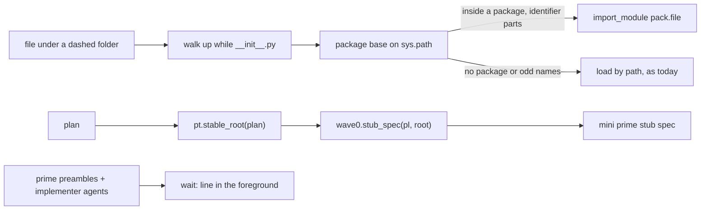
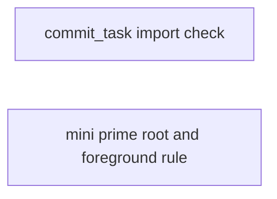

# Superlite: commit_task imports and mini prime batch (B17)

**Goal:** fix #252 (commit_task's import check cannot import a module inside a package under a dashed folder, such as `probes/pack/*.py`), #253 (`build_mini` builds its stub spec without `root`, so the mini prime lists files that already exist), #248 (the implementer primes and agent files lack the "run the `wait:` line in the foreground" rule from #237). Each fix ships with regression tests.
**Architecture:** edits to `skills/subagent-driven-development/scripts/commit_task.py` (`IMPORT_DRIVER`), `skills/subagent-driven-development/scripts/build_prime.py` (`build_mini`, the three preambles), `agents/implementer.md`, `agents/implementer-haiku.md`; one new test file per fix.
**Tech stack:** Python 3.10+ stdlib, pytest (through `sl run_tests`).
**Spec:** this file, section Design; the issue bodies on GitHub are the source for each Expected line.
**Detail:** contracts
**Target-min:** 11
**Wave0:** none

Global constraints:
- Code lines under `skills/subagent-driven-development/scripts/` carry the repo's trailing `# O(...)` complexity comment (the `IMPORT_DRIVER` string body is exempt, as today); tests do not. Follow each file's existing style.
- Stdlib only. Existing tests stay green; a task changes no existing test file (another lead may own them): new tests go in the new files its Owns names.
- Run `sl` as an executable (`<abs>/sl ...`). Verify with `<abs>/sl run_tests --fast <test files> --task Tn --background`, then run the printed `wait:` line in the foreground. Never raw `pytest`, never the e2e or eval layers (coordinator's step).
- No version edits (the ship step bumps the version). No edits to `docs/` (another lead may own them).
- Tests build their projects under `tmp_path`; they never write the real repo's `.superlite/`.

Ruling: detail contracts - small fixes in existing modules with known causes, tests named with exact inputs and outcomes - cost if wrong: one NEEDS_CONTEXT per task.
Ruling: #248 covers the three prime preambles in `build_prime.py` and both implementer agent files; the fixer and reviewer briefs (`agents/fixer-*.md`, `agents/package-reviewer.md`, `findings.py`'s fix brief) are outside B17's file list and become a follow-up - cost if wrong: fixers and reviewers can still background the `wait:` line until the follow-up ships.
Ruling: #253 and #248 both edit `build_prime.py`, so they are one task (T2) instead of two sequential ones - cost if wrong: one larger review diff.
Ruling: #252 the driver finds the package base (walk up from the file's folder while it holds `__init__.py`, never above the run root), appends it to `sys.path` (never ahead of the root, `src` and import roots, so no stdlib name is shadowed), and imports a file that sits inside a package by its dotted name from that base (relative imports work); a file outside any package keeps today's load by path - cost if wrong: a package name that an earlier `sys.path` entry also provides resolves to that entry.
Ruling: no probe adapter - script internals over local files; Review Focus cases run as named pytest cases - cost if wrong: no generated probes.



## Design

### 1. #252 import check inside packages
`IMPORT_DRIVER`'s path branch (a path part is not an identifier, e.g. `subagent-driven-development`) computes `base`: start at the file's folder; while that folder is not the run root and holds `__init__.py`, go one folder up. `base` is appended to `sys.path` once. When `base` differs from the file's folder (the file is inside a package) and every part of the path relative to `base` (without `.py`, without a trailing `__init__`) is an identifier, the driver imports the dotted name (`pack.file`). Otherwise it loads the file by path under its `_slcheck_` name, as today. Failure lines keep naming the file and the failing line.

### 2. #253 mini prime stub spec
`build_mini` calls `wave0.stub_spec(pl, pt.stable_root(plan))`, so the mini prime and the Wave 0 brief name the same stub files: an Owns file that already exists under the plan's stable root is left out, and a task whose stub files all exist is not listed.

### 3. #248 foreground verify rule
Each prime preamble (`PREAMBLE`, `PREAMBLE_SLIM`, `PREAMBLE_MINI`) gets the rule line `FG` (see T2), and both implementer agent files say to run the printed `wait:` line in the foreground and end the turn only after it reports.

## Coverage

| Category | State | Basis |
|---|---|---|
| Scope and success criteria | settled | three issues in Goal; each issue's Expected line |
| Domain and data model | n/a | no data shapes change |
| Persistence and migration | n/a | no stored files change |
| Interfaces and contracts | settled | `import_errors` and `build_mini` signatures unchanged |
| UI states | n/a | CLI text |
| Concurrency and state ownership | settled | T1 and T2 own disjoint files |
| Error handling and recovery | settled | import failures still reported per file and line |
| Security and privacy | n/a | local files only |
| Performance and limits | settled | one extra stat per folder level per checked file; mini prime stays under 8 KiB |
| Observability | n/a | no new output |
| Testing strategy | settled | new unit test file per task; unit layer by the coordinator |
| Compatibility | settled | files outside a package keep today's load by path |
| Rollout | ruled | one PR; version bump at ship |
| Research unknowns | n/a | causes named in the issues |

## File structure
- `skills/subagent-driven-development/scripts/commit_task.py`, `tests/scripts/test_commit_import_packages.py` (T1).
- `skills/subagent-driven-development/scripts/build_prime.py`, `agents/implementer.md`, `agents/implementer-haiku.md`, `tests/scripts/test_build_prime_stub_root.py`, `tests/scripts/test_foreground_verify_rule.py` (T2).

## Task graph

```mermaid
%% schedule
gantt
  title Predicted schedule (mm:ss)
  dateFormat X
  axisFormat %M:%S
  section lane 1
  T2 build_prime  mini stub spec with root :t2, 0, 106s
  section lane 2
  T1 commit_task  import check finds the p :t1, 0, 93s
```




critical path: T2 (1.8 min) · peak width 2 · predicted build 1.8 min · predicted total ≈ 5.3 min (target ✓)

## Package: superlite scripts (script internals over local files)
**Probe entry:** none (Ruling: no probe adapter).

### T1 commit_task: import check finds the package base · Complexity 3 · Est. context 36k
**Owns:** skills/subagent-driven-development/scripts/commit_task.py, tests/scripts/test_commit_import_packages.py
**Components:** 1
**LOC owned:** 110
**Tests:** fast
**Model:** sonnet
**Est. time:** 2.5 min (1 component, about 110 LOC, fast tests)
**Covers:** 1
**Consumes:** nothing executed from another task.
**Produces:** commit_task.import_errors(files, roots=None, root=".") -> list[tuple] (signature unchanged)
**Review Focus:** file: `test_real_probe_pack_imports` (the real repo: every `skills/subagent-driven-development/probes/pack/*.py`, `roots=[]`, `root=<repo root>` -> `[]`); file: `test_package_under_dashed_folder` (`tmp_path/d-x/probes/pack/__init__.py` empty, `_common.py` `P = 1`, `file.py` `from pack._common import P` -> `import_errors(["d-x/probes/pack/file.py"], [], root=tmp_path) == []`); file: `test_relative_import_in_package` (`d-x/lib/pkg/__init__.py`, `a.py` `X = 1`, `b.py` `from .a import X` -> `[]` for `d-x/lib/pkg/b.py`); file: `test_nested_package_base` (`d-x/top/pkg/__init__.py`, `d-x/top/pkg/sub/__init__.py`, `d-x/top/pkg/sub/n.py` `N = 2`, `d-x/top/pkg/sub/m.py` `from pkg.sub.n import N` -> `[]`); file: `test_package_init_itself` (`d-x/probes/pack/__init__.py` holding `from pack._common import P` -> `[]` for that `__init__.py`); state: `test_broken_import_in_package_still_reported` (`d-x/probes/pack/bad.py` line 1 `from pack._common import Missing` -> one entry, file `d-x/probes/pack/bad.py`, line 1, error starts `ImportError`); file: `test_plain_dashed_file_unchanged` (`d-x/tool.py` `import helper`, `d-x/helper.py` `H = 1`, no `__init__.py` -> `[]`); file: `test_dashed_package_name_falls_back` (`d-x/my-pkg/__init__.py`, `d-x/my-pkg/m.py` `import os` -> `[]`); state: `test_walk_stops_at_root` (`tmp_path/__init__.py` and `tmp_path/d-x/__init__.py` exist, `d-x/m.py` `M = 1` -> `[]`, no exception); protocol: `test_commit_task_commits_probe_like_package` (tmp git repo with `.superlite/`, a plan task T1 owning `d-x/probes/pack/__init__.py`, `d-x/probes/pack/_common.py`, `d-x/probes/pack/file.py` as above, `commit_task.py T1 --plan P` -> exit 0, stdout has no `No module named`).
**Test code:** new file; `from test_plan_tools import SCRIPTS`, `sys.path.insert(0, str(SCRIPTS))`, `import commit_task`; files written with a small `write(root, rel, text)` helper; the commit test follows `repo_with`, `task` and `commit` from `tests/scripts/test_commit_pix_v2.py` (import them, do not copy that file's tests).
**Steps:** 1 failing tests, 2 run: FAIL, 3 implement, 4 run: PASS (also `tests/scripts/test_commit_pix_v2.py`, `test_project_python_callers.py`, `test_commit_*.py` stay green).
**Notes:** Only the `else` branch of the driver's `try` changes (the `under` and `src` branches stay). Compare folders with `os.path.abspath`; the walk stops when the folder equals the root or its own parent. Append `base` only when it is not already in `sys.path`. Dotted parts are the path relative to `base` without `.py`, with a trailing `__init__` dropped. The module docstring or the driver's comment says that a file inside a package imports by its dotted name from the package base.

### T2 build_prime: mini stub spec with root, foreground verify rule · Complexity 2 · Est. context 32k
**Owns:** skills/subagent-driven-development/scripts/build_prime.py, agents/implementer.md, agents/implementer-haiku.md, tests/scripts/test_build_prime_stub_root.py, tests/scripts/test_foreground_verify_rule.py
**Components:** 2
**LOC owned:** 90
**Tests:** fast
**Model:** sonnet
**Est. time:** 2.5 min (2 components, about 90 LOC, fast tests)
**Covers:** 2, 3
**Consumes:** existing `wave0.stub_spec(plan, root: Path | None = None) -> str` · existing `plan_tools.stable_root(plan_path: str) -> Path`
**Produces:** build_prime.build_mini(plan, tier) -> bytes (signature unchanged) · build_prime.FG: str (the rule line)
**Review Focus:** file: `test_mini_stub_spec_skips_existing_file` (plan in `tmp_path` like `PLAN` in `tests/scripts/test_build_prime_mini.py` but T1 owns `pkg/a.py, pkg/b.py, tests/test_a.py`, `tmp_path/pkg/a.py` exists, `pkg/b.py` does not; tiers patched to haiku as that file's `mini()` does -> the `## Stub spec` section holds `pkg/b.py` and not `pkg/a.py`); file: `test_mini_stub_spec_drops_task_whose_files_exist` (both `pkg/a.py` and `pkg/b.py` exist -> the stub spec has no `id: T1` line); state: `test_mini_and_wave0_brief_same_stub_spec` (same plan, `pkg/a.py` exists -> the yaml between the mini prime's `` ```yaml `` fence and its closing fence equals `normalize(wave0.stub_spec(pl, pt.stable_root(plan)))`); protocol: `test_preambles_carry_foreground_rule` (`FG` is one line of each of `PREAMBLE`, `PREAMBLE_SLIM`, `PREAMBLE_MINI`); protocol: `test_built_primes_carry_foreground_rule` (`build_slim`, `build_mini` (tiers patched) and `build(plan, None, [])` on the tmp plan -> each decoded prime has `FG` as a line); protocol: `test_agents_run_wait_in_foreground` (`agents/implementer.md` and `agents/implementer-haiku.md` each hold `AGENT_RULE` and no longer hold `then the \`wait:\` line it prints (`).
**Test code:** two new files; `from test_plan_tools import SCRIPTS`, `sys.path.insert(0, str(SCRIPTS))`, `import build_prime, wave0, plan_tools as pt`; agent files read from `Path(__file__).resolve().parents[2] / "agents"`. Constants, verbatim: `FG = "- Run the verify command your task message names; start it with --background, then run its printed \`wait:\` line in the foreground (never as a background command) and end your turn only after that line reports."` and `AGENT_RULE = "then run the \`wait:\` line it prints (\`<abs sl> run_tests --wait <path>\`) in the foreground, never as a background command, and end your turn only after it reports; read only its summary."`
**Steps:** 1 failing tests, 2 run: FAIL, 3 implement, 4 run: PASS (also `tests/scripts/test_build_prime_mini.py`, `test_slim_prime.py`, `test_prime_root.py`, `test_docs_contract.py`, `test_implementer_seam_rule.py`, `test_wave0*.py` stay green).
**Notes:** `build_prime.FG` holds the `FG` line verbatim (the test compares against its own copy too). Insert it into each preamble right after the rule about fast tests (`PREAMBLE`, `PREAMBLE_SLIM`: after `- Run only fast, focused tests. ...`; `PREAMBLE_MINI`: after `- Test first, run only the fast focused tests, ...`), as literal text in the triple-quoted strings. In both agent files, the sentence `then the \`wait:\` line it prints (\`<abs sl> run_tests --wait <path>\`), and read only its summary.` becomes `AGENT_RULE`. `build_mini` passes `pt.stable_root(plan)` as `root` to `wave0.stub_spec`. The mini prime stays under 8192 bytes (`test_mini_prime_still_small`).

## Review Focus
Package superlite scripts: app type CLI internals; categories file (package folders, dashed paths, existing Owns files), state (sys.path order across files in one driver run), protocol (prime and agent rule text). Specific risks: a project package that shadows a stdlib module; a check that imports a module twice under two names; a mini prime that names files the Wave 0 brief does not; a rule line the agents never see because a preamble was missed. Each task lists its named cases.

## Self-review
Coverage: #252 T1, #253 and #248 T2. No placeholders. T1 and T2 share no file; no edges.
