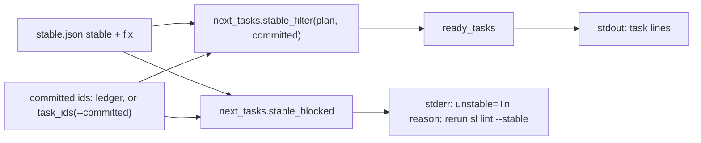
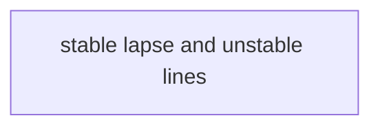

# Superlite: dispatch stable filter lapse batch (B22)

**Goal:** fix #293: once stable.json's `stable` tasks are committed, `dispatch` and `next_tasks` offer nothing, because `stable_filter` never releases a `fix` entry; a `fix` entry whose only reasons are `depends on unstable X` must lapse once every such X is committed (Max's decision), `--committed` must accept spaces and warn about unknown ids, and `dispatch` must say on stderr which graph-ready task stable.json still holds back and why.
**Architecture:** edits to `skills/subagent-driven-development/scripts/next_tasks.py` (`stable_filter`, new `task_ids`, `unknown_ids`, `lapsed_fix`, `stable_blocked`, `main`) and `skills/subagent-driven-development/scripts/dispatch.py` (`run`, module docstring); two new test files.
**Tech stack:** Python 3.10+ stdlib, pytest (through `sl run_tests`).
**Spec:** this file, section Design; issue #293's Expected lines are the source.
**Detail:** contracts
**Target-min:** 11
**Wave0:** none
**Coverage:** off

Global constraints:
- Code lines under `skills/subagent-driven-development/scripts/` carry the repo's trailing `# O(...)` complexity comment; tests do not. Follow each file's existing style.
- Stdlib only. Existing tests stay green; no existing test file changes (another lead may own them): new tests go in the new files Owns names.
- Run `sl` as an executable (`<abs>/sl ...`). Verify with `<abs>/sl run_tests --fast <test files> --task T1 --background`, then run the printed `wait:` line in the foreground. Never raw `pytest`, never the e2e or eval layers (coordinator's step).
- No version edits (the ship step bumps the version). No edits to `docs/` or any file outside Owns.
- Tests build their plans, ledgers and stable.json under `tmp_path`; they never write the real repo's `.superlite/`.

Ruling: one task owns both scripts - dispatch's new stderr lines run next_tasks' new code, so two tasks would be a strict chain with a second worker start - cost if wrong: about 2 min of lost parallelism.
Ruling: detail contracts - known cause, small edits, every test named with exact inputs and outcomes - cost if wrong: one NEEDS_CONTEXT.
Ruling: `nt.csv` stays comma-only (run_tests splits `--fast` paths with it, and a path may hold a space); task id lists use the new `task_ids` - cost if wrong: none.
Ruling: unknown-id warnings only for ids given by flag (`--committed`, `--running`), never for ledger commit lines; `T0` (the synthesized Wave 0) always counts as known - cost if wrong: a typo in a ledger line stays silent, as today.
Ruling: `next_tasks` prints the same `unstable=` stderr lines as `dispatch` (the reporter ran `next_tasks`) - cost if wrong: extra stderr lines nobody parses.
Ruling: a plan task in neither `stable` nor `fix` (added after the last `lint --stable`) is reported with reason `not in stable.json` and stays held - cost if wrong: none; rerunning lint releases it.
Ruling: no probe adapter - script internals over local files; Review Focus cases run as named pytest cases - cost if wrong: no generated probes.



## Design

### 1. Lapse
`lapsed_fix(fix, committed)` returns the ids of `fix` entries (`{"task": id, "reasons": [str]}`) whose `reasons` list is non-empty, every reason matches `^depends on unstable\s+(.+)$`, the ids named there (`[A-Z]{1,3}\d+[A-Za-z]?`, at least one per reason) are all in `committed`. Any other reason (a lint issue, `on flagged CHAIN`) keeps the entry held. Malformed entries (not a dict, missing or non-list reasons, non-str task) are skipped. `stable_filter(plan, committed=None)` returns `set(stable) | lapsed_fix(fix, committed)` minus `wave0_waiting(...)`, with the same None cases as today; with nothing committed its result is unchanged, so `build_prime` (no committed set) keeps today's output.

### 2. Held back by stable.json
`stable_blocked(plan, graph, committed, running, status=None, held=None)` returns `{task id: reason}` in graph order for every task the graph would release (not committed, not running, not draft-blocked, every dependency committed, not in `held`) that `stable_filter(plan, committed)` leaves out and `wave0_waiting` does not hold. Reason: the task's `fix` reasons joined with `; `, whitespace collapsed to single spaces; a task absent from both lists gets `not in stable.json`. No stable.json (or an unreadable one): `{}`. `dispatch.run` and `next_tasks.main` print one stderr line per entry, after any `held=` lines: `unstable=<id> <reason>; rerun sl lint --stable`.

### 3. Id lists
`task_ids(value)` splits on commas and whitespace, drops empties and repeats, keeps order; `None` or `""` gives `[]`. `unknown_ids(ids, graph)` returns, in order, the ids that are neither graph keys nor `T0`. `next_tasks.main` and `dispatch.run` parse `--committed` and `--running` with `task_ids` and print `warning: --<flag>: <id> is not a task of the plan` on stderr per unknown id (dispatch only for a flag it was given; ledger and pool values are not checked).

## File structure
- `skills/subagent-driven-development/scripts/next_tasks.py`: lapse, held-back reasons, id lists, CLI lines.
- `skills/subagent-driven-development/scripts/dispatch.py`: `run` uses the id lists and prints the `unstable=` lines; docstring names both.
- `tests/scripts/test_stable_lapse.py`: next_tasks unit and CLI cases.
- `tests/scripts/test_dispatch_unstable.py`: dispatch CLI cases.

## Task graph

```mermaid
%% schedule
gantt
  title Predicted schedule (mm:ss)
  dateFormat X
  axisFormat %M:%S
  section lane 1
  T1 next_tasks and dispatch  fix tasks la :t1, 0, 115s
```




critical path: T1 (1.9 min) · peak width 1 · predicted build 1.9 min · predicted total ≈ 5.4 min (target ✓)

## Package: superlite scripts (script internals over local files)
**Probe entry:** none (Ruling: no probe adapter).

### T1 next_tasks and dispatch: fix tasks lapse, held-back tasks named · Complexity 4 · Est. context 62k
**Owns:** skills/subagent-driven-development/scripts/next_tasks.py, skills/subagent-driven-development/scripts/dispatch.py, tests/scripts/test_stable_lapse.py, tests/scripts/test_dispatch_unstable.py
**Components:** 2
**LOC owned:** 230
**Tests:** fast
**Model:** sonnet
**Est. time:** 3.5 min (2 components, about 230 LOC, fast tests)
**Covers:** 1, 2, 3
**Consumes:** existing `next_tasks.wave0_waiting(sl_dir, committed=None) -> set`, `next_tasks.draft_blocked(graph, status) -> set`, `commit_task.committed_tasks(ledger) -> set`
**Produces:** next_tasks.task_ids(value: str | None) -> list[str] · next_tasks.unknown_ids(ids: list[str], graph: dict) -> list[str] · next_tasks.lapsed_fix(fix: list, committed) -> set[str] · next_tasks.stable_blocked(plan, graph: dict, committed, running, status: dict | None = None, held: dict | None = None) -> dict[str, str] · next_tasks.stable_filter(plan, committed=None) -> set | None (signature unchanged)
**Review Focus:** state: `test_task_ids_commas_and_spaces` (`task_ids("T1, T2 T3,,T4\tT5 T1") == ["T1", "T2", "T3", "T4", "T5"]`, `task_ids("") == []`, `task_ids(None) == []`); state: `test_unknown_ids` (`unknown_ids(["T1", "T0", "T99"], {"T1": []}) == ["T99"]`); state: `test_lapse_needs_every_dep` (`lapsed_fix([{"task": "T8", "reasons": ["depends on unstable T5, T6"]}], {"T5", "T6"}) == {"T8"}`, with `{"T5"}` -> `set()`); state: `test_own_issue_never_lapses` (reasons `["SIZE: T5 predicted 7 min > 6 max", "depends on unstable T4"]`, committed `{"T4"}` -> `set()`; reasons `["on flagged CHAIN"]` -> `set()`); encoding: `test_lapse_malformed_entries` (`[{"task": "T9", "reasons": []}, "junk", {"task": "T7", "reasons": ["depends on unstable"]}, {"task": "T6"}]`, committed `{"T1"}` -> `set()`); state: `test_stable_filter_releases_chain` (stable.json `{"stable": ["M1", "T2", "T3"], "fix": [{"task": "T8", "reasons": ["depends on unstable T5, T6"]}, {"task": "T15", "reasons": ["depends on unstable T8"]}]}` -> `stable_filter(p) == {"M1", "T2", "T3"}`, `stable_filter(p, {"T5", "T6"}) == {"M1", "T2", "T3", "T8"}`, `stable_filter(p, {"T5", "T6", "T8"})` holds T15); state: `test_lapsed_task_still_waits_for_wave0` (same stable.json plus `briefs/wave0.json` `{"id": "T0", "wait": ["T8"]}` -> `"T8" not in stable_filter(p, {"T5", "T6"})`, `"T8" in stable_filter(p, {"T0", "T5", "T6"})`); state: `test_stable_blocked_reasons` (graph `{"T1": [], "T2": [], "T3": ["T1", "T2"], "T4": ["T3"], "T9": []}`, stable.json `{"stable": ["T1"], "fix": [{"task": "T2", "reasons": ["T2: Owns has a  placeholder"]}, {"task": "T3", "reasons": ["depends on unstable T2"]}, {"task": "T4", "reasons": ["depends on unstable T3"]}]}` -> committed `[]`: `{"T2": "T2: Owns has a placeholder", "T9": "not in stable.json"}` with keys in that order; committed `["T1", "T2"]`: `{"T9": "not in stable.json"}`; running `["T9"]`: no T9; `held={"T2": "x"}`: no T2; `status={"T9": "draft"}`: no T9; no stable.json: `{}`); state: `test_stable_blocked_skips_wave0_wait` (stable `["T1"]`, wave0.json wait `["T1"]`, graph `{"T1": []}` -> `{}`); protocol: `test_next_tasks_cli_spaces_and_unstable` (the CLI plan below: `--committed "T1 T2"` as one argument -> stdout `T3`, no `unstable=` on stderr; `--committed T1` -> stdout empty, stderr holds `unstable=T2 T2: Owns has a placeholder; rerun sl lint --stable`; `--committed T1,T7` -> stderr holds `warning: --committed: T7 is not a task of the plan`; `--committed T0,T1` -> no `warning:`); protocol: `test_dispatch_offers_lapsed_fix_task` (CLI plan, ledger `- commit T1 abcdef1234 a\n- commit T2 abcdef1234 b\n` -> a stdout line starts `T3 `); protocol: `test_dispatch_prints_unstable_reason` (ledger commits T1 only -> no stdout line starts with `T`, stderr holds `unstable=T2 T2: Owns has a placeholder; rerun sl lint --stable`); protocol: `test_dispatch_committed_flag_spaces` (`--committed "T1 T2"` -> a line starts `T3 `; `--committed T1,T7` -> stderr holds `warning: --committed: T7 is not a task of the plan`); protocol: `test_dispatch_held_task_not_unstable` (ledger commits T1 and has `- Hold T2: waits` -> stderr holds `held=T2 waits` and not `unstable=T2`); protocol: `test_dispatch_without_stable_json_silent` (CLI plan, no stable.json, empty ledger -> no `unstable=` on stderr).
**Test code:** two new files; `from test_plan_tools import SCRIPTS, run`, `from test_stable_split import DISPATCH, NEXT_TASKS`, `sys.path.insert(0, str(SCRIPTS))`, `import next_tasks`. The CLI plan is written by a helper in each file to `tmp_path / "plan.md"`: a `# Plan` header with `**Goal:** g.` and `**Wave0:** none`, a ```` ```mermaid ```` block `flowchart LR` / `%% taskgraph` / `T1 --> T3` / `T2 --> T3` / `T3 --> T4`, then `### T1 a · Complexity 2 · Est. context 20k` .. `### T4 d`, each with `**Owns:** src/<letter>.py` and `**Est. time:** 2 min`; stable.json goes to `tmp_path / ".superlite" / "stable.json"` (the stable.json of `test_stable_blocked_reasons` without T9), the ledger to `tmp_path / ".superlite" / "progress.md"`. Dispatch runs as `run(DISPATCH, "--plan", p, "--pool", tmp_path / "pool.json", "--ledger", ledger, ..., cwd=tmp_path)`, as `tests/scripts/test_dispatch_committed_hold.py` does.
**Steps:** 1 failing tests, 2 run: FAIL, 3 implement, 4 run: PASS (also `tests/scripts/test_stable_split.py`, `test_wave0_gate.py`, `test_wave0_gate_committed.py`, `test_held_tasks.py`, `test_dispatch_*.py`, `test_lint_dispatch_now.py`, `test_session_state.py`, `test_fleet_dispatch_round.py` stay green).
**Notes:** Read `## Design` in the plan file first: it is the contract. Read stable.json once per call through a small reader shared by `stable_filter` and `stable_blocked` (same path and None cases as today's `stable_filter`). In `dispatch.run` print the `unstable=` lines right after the `held=` lines, from `nt.stable_blocked(plan, nt.taskgraph(plan), done, busy, nt.taskgraph_full(plan).get("status", {}), held)`; the warnings for unknown flag ids come first. The dispatch module docstring gains one line each for the lapse, the `unstable=` line and space-separated id lists.

## Review Focus
Package superlite scripts: app type CLI internals (scheduler filter); categories state (which tasks the filter releases, wave0 and hold interplay), encoding (id list separators, reason text), protocol (stdout task lines unchanged, new stderr lines). Specific risks: a fix entry with an own issue that lapses; a lapsed task that skips the Wave 0 wait; a held or running task reported as unstable; a stdout change that breaks `fleet spawn --for-dispatch` parsing.

## Self-review
Coverage: Expected lines 1-3 of #293 in Design 1-3, all in T1. No placeholders. One task, no edges.
