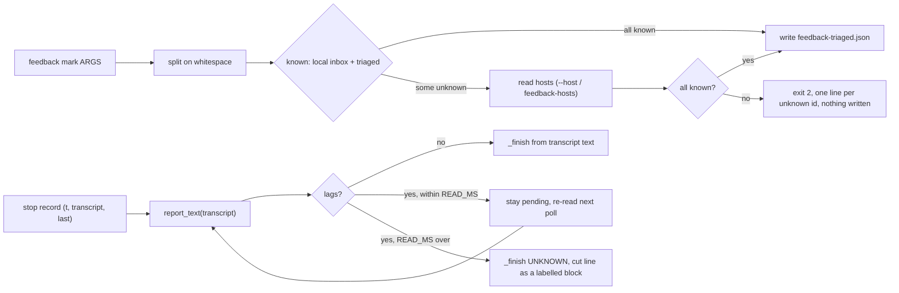
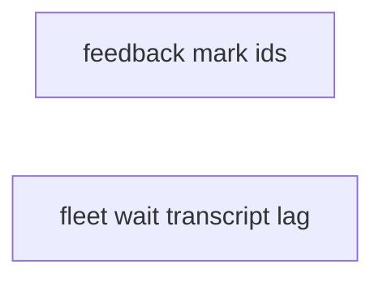

# Superlite: feedback mark ids and fleet wait transcript read batch (B18)

**Goal:** fix #264 (`fleet wait` takes the 160-char stop record `last` as the report when the transcript read comes back empty, so a final reviewer's CHANGES_REQUESTED with a json findings block is parsed as `findings=0`) and #270 (`sl feedback mark "id1 id2"` stores the space-joined string as one bogus id and accepts ids that are in no inbox). Each fix ships with regression tests.
**Architecture:** edits to `skills/subagent-driven-development/scripts/feedback.py` (`cmd_mark` splits, validates, and the `mark` parser gains `--host`) and `skills/subagent-driven-development/scripts/fleet_io.py` (`wait` re-reads a lagging transcript for `READ_MS`, then reports UNKNOWN; `_finish` writes the cut line only as a labelled block); one new test file per task, plus one replaced test in `tests/scripts/test_fleet_io.py`.
**Tech stack:** Python 3.10+ stdlib, pytest (through `sl run_tests`).
**Spec:** this file, section Design; the issue bodies on GitHub are the source for each Expected line.
**Detail:** contracts
**Target-min:** 11
**Wave0:** none

Global constraints:
- Code lines under `skills/subagent-driven-development/scripts/` carry the repo's trailing `# O(...)` complexity comment; tests do not. Follow each file's existing style.
- Stdlib only. Existing tests stay green except the one T2 replaces; new tests go in the new file its Owns names.
- Run `sl` as an executable (`<abs>/sl ...`). Verify with `<abs>/sl run_tests --fast <test files> --task Tn --background`, then run the printed `wait:` line in the foreground. Never raw `pytest`, never the e2e or eval layers (coordinator's step).
- No version edits (the ship step bumps the version). Only the files a task owns change.
- Tests build their state under `tmp_path` (conftest sets `SUPERLITE_HOME` per test); they never write the real `~/.superlite/` or the repo's `.superlite/`.

Ruling: detail contracts - fixes in existing modules with known causes; tests named with exact inputs and outcomes - cost if wrong: one NEEDS_CONTEXT per task.
Ruling: #270 the known ids are the local inbox, the ids already in `feedback-triaged.json` (re-marking is idempotent) and, only when an id is still unknown after those, the inbox of each host `triage` reads (`--host H`..., else `feedback-hosts`); an id found nowhere is rejected (exit 2, `error: unknown feedback id X (not in the inbox of this machine or of host(s) H, ...)` on stderr, one line per id) and nothing is written - remote entries stay markable as `AGENTS.md`'s triage flow needs - cost if wrong: marking a remote id while its host is unreachable is refused until the host answers.
Ruling: #270 each argument splits on whitespace only (`str.split()`), duplicates collapse; no argument left after the split is exit 2 `error: no feedback ids given` - cost if wrong: a comma-joined list is still one id, which validation now rejects.
Ruling: #264 a transcript read lags its stop record when the report text is empty, or when it holds no status (`fleet_report.parse(...)["status"] == "UNKNOWN"`) while the stop record's `last` does; `wait` re-reads it on every poll for `READ_MS = 10000` ms from the poll that first saw that stop record, keeping the worker pending meanwhile; still lagging after that, the worker finishes UNKNOWN (kept, not stopped) and the cut line appears only as a labelled block of the `.md` - cost if wrong: a reviewer whose transcript never flushes costs 10 s and a re-ask.
Ruling: #264 a stop record without a `transcript` value keeps today's behaviour (`last` is the text): there is nothing to re-read - cost if wrong: a hook that drops the path reintroduces the cut report.
Ruling: #264 T2 replaces `tests/scripts/test_fleet_io.py::test_report_empty_turn_returns_empty_and_wait_uses_last` (it pins the bug: wait taking `last` for an empty transcript turn) with `test_report_empty_turn_returns_empty_and_wait_reports_unknown`; test files of the two owned modules count as this batch's files - cost if wrong: a merge conflict with another lead touching that test file.
Ruling: no probe adapter - script internals over local files; Review Focus cases run as named pytest cases - cost if wrong: no generated probes.
LAYERS: unit

## Design

### 1. #270 feedback mark splits and validates ids
`cmd_mark` builds `ids = list(dict.fromkeys(x for arg in a.ids for x in arg.split()))`. Empty: exit 2 `error: no feedback ids given`. Known set: `{e["id"] for e in local_entries()} | triaged()`; ids not in it: read `remote_entries(h)` for each `h` in `hosts(a.host)` (one ssh per host, only in this case) and add their ids. Still unknown: one stderr line per id `error: unknown feedback id <id> (not in the inbox of this machine or of host(s) <h1>, <h2>)` (no hosts: `(not in the inbox of this machine)`), exit 2, the triaged file untouched. Otherwise write as today and print `feedback marked: <len(ids)> (<total> triaged in total)`. The `mark` parser gains `--host` (`action="append"`, same help as triage's). The module docstring's `mark` line names the split, the check and `--host`.

### 2. #264 fleet wait re-reads a lagging transcript
New `READ_MS = 10000` and `_lags(text, last, label) -> bool` (`not text.strip()`, or `parse(text)` UNKNOWN while `parse(last)` is not). In `wait`, per worker with a stop record `rec` that names a transcript: a cached text for `rec["t"]` that did not lag is reused (read once, as today); otherwise `report_text` runs again on this poll. Lagging and `now - first_seen < READ_MS`: the worker stays pending this poll (no `_finish`, no screen fallback, no settle timer). Lagging after the window: `_finish(sd, wid, w, text, "transcript", tail=_pane_tail(...), cut=rec.get("last", ""))`. `_finish` with `cut` writes the `.md` as `UNKNOWN (transcript empty or behind its stop record after 10 s: <transcript path>)`, blank line, the transcript text, blank line, `Stop record line (cut at 160 chars, not the report):`, the cut line, blank line, `Last pane lines:`, the tail; the status comes from the transcript text only (UNKNOWN), and the printed line ends ` (transcript unread)`. The module docstring says so in one sentence.

## Coverage

| Category | State | Basis |
|---|---|---|
| Scope and success criteria | settled | two issues in Goal; each issue's Expected line |
| Domain and data model | n/a | `feedback-triaged.json` and the report json keep their shapes |
| Persistence and migration | settled | a refused mark writes nothing; bogus ids already stored stay (re-mark accepts them) |
| Interfaces and contracts | settled | `mark` gains `--host`; `wait` and `_finish` keep their callers' signatures (new keyword only) |
| UI states | n/a | CLI text |
| Concurrency and state ownership | settled | T1 and T2 own disjoint files |
| Error handling and recovery | settled | exit 2 per unknown id; UNKNOWN keeps the worker for a re-ask |
| Security and privacy | n/a | local files and the existing ssh read |
| Performance and limits | settled | ssh only for unknown ids; at most READ_MS/poll extra transcript reads per stop |
| Observability | settled | stderr lines; `.md` header and ` (transcript unread)` |
| Testing strategy | settled | new unit test file per task; unit layer by the coordinator |
| Compatibility | settled | valid single ids mark as today; flushed transcripts report as today |
| Rollout | ruled | one PR; version bump at ship |
| Research unknowns | n/a | causes named in the issues |

## File structure
- `skills/subagent-driven-development/scripts/feedback.py`, `tests/scripts/test_feedback_mark.py` (T1).
- `skills/subagent-driven-development/scripts/fleet_io.py`, `tests/scripts/test_fleet_io_transcript_lag.py`, `tests/scripts/test_fleet_io.py` (one test replaced) (T2).

## Task graph

```mermaid
%% schedule
gantt
  title Predicted schedule (mm:ss)
  dateFormat X
  axisFormat %M:%S
  section lane 1
  T2 fleet wait  re-read a transcript that :t2, 0, 90s
  section lane 2
  T1 feedback mark  split arguments  rejec :t1, 0, 85s
```

critical path: T2 (1.5 min) · peak width 2 · predicted build 1.5 min · predicted total ≈ 5.0 min (target ✓)

## Package: superlite scripts (CLI internals over local files)
**Probe entry:** none (Ruling: no probe adapter).

### T1 feedback mark: split arguments, reject unknown ids · Complexity 3 · Est. context 34k
**Owns:** skills/subagent-driven-development/scripts/feedback.py, tests/scripts/test_feedback_mark.py
**Components:** 1
**LOC owned:** 110
**Tests:** fast
**Model:** sonnet
**Est. time:** 2 min (1 component, about 110 LOC, fast tests)
**Covers:** 1
**Consumes:** nothing executed from another task.
**Produces:** feedback.cmd_mark(a: argparse.Namespace) -> int (exit code; `a.ids: list[str]`, `a.host: list[str] | None`)
**Review Focus:** protocol: `test_mark_splits_a_space_joined_argument` (two `add` entries A, B; `mark "A B"` -> exit 0, `feedback-triaged.json` `{"ids": sorted([A, B])}`, stdout has `feedback marked: 2`); protocol: `test_mark_rejects_an_unknown_id` (one entry A; `mark A deadbeef0000` -> exit 2, stderr has `unknown feedback id deadbeef0000`, no `feedback-triaged.json`); state: `test_mark_typo_in_joined_argument_writes_nothing` (A marked earlier; `mark "B Bx"` -> exit 2, stderr names `Bx`, triaged file still `{"ids": [A]}`); encoding: `test_mark_blank_argument_is_usage_error` (`mark "  "` -> exit 2, stderr `no feedback ids given`); state: `test_mark_again_is_idempotent` (`mark A` twice -> both exit 0, triaged `{"ids": [A]}`); state: `test_mark_duplicates_collapse` (`mark "A A" A` -> stdout `feedback marked: 1`); file: `test_mark_accepts_an_id_from_a_host` (POSIX; fake ssh as in `test_feedback.py::test_triage_merges_remote_hosts_and_skips_unreachable` printing a remote entry `abcdefabcdef` for host `mini`; `mark abcdefabcdef --host mini` with `SUPERLITE_SSH` -> exit 0, id stored); file: `test_mark_reads_the_hosts_file` (POSIX; `feedback-hosts` lists `mini`, same fake ssh, no `--host` -> exit 0); file: `test_mark_local_ids_start_no_ssh` (POSIX; fake ssh that `touch`es `<tmp>/ssh-ran`; `mark A --host mini` -> exit 0, no `ssh-ran`); file: `test_mark_unreachable_host_rejects` (POSIX; fake ssh `exit 255`; `mark abcdefabcdef --host gone` -> exit 2, stderr has `unknown feedback id abcdefabcdef` and `gone`).
**Test code:** new file; `run(*args, cwd, env)` and `entries()` as in `tests/scripts/test_feedback.py` (subprocess on `feedback.py`, `SUPERLITE_HOME` from the conftest); `POSIX_ONLY = pytest.mark.skipif(os.name == "nt", ...)` on the ssh cases; triaged file `Path(os.environ["SUPERLITE_HOME"]) / "feedback-triaged.json"`.
**Steps:** 1 failing tests, 2 run: FAIL, 3 implement, 4 run: PASS (also `tests/scripts/test_feedback.py`, `test_feedback_auto.py`, `test_feedback_file.py` stay green).
**Notes:** `remote_entries` already prints the `host H unreachable ..., skipped` line; keep it. Hosts are read once per call, only when the local and triaged ids leave some id unknown.

### T2 fleet wait: re-read a transcript that lags its stop record · Complexity 5 · Est. context 46k
**Owns:** skills/subagent-driven-development/scripts/fleet_io.py, tests/scripts/test_fleet_io_transcript_lag.py, tests/scripts/test_fleet_io.py
**Components:** 1
**LOC owned:** 150
**Tests:** fast
**Model:** sonnet
**Est. time:** 3 min (1 component, about 150 LOC, fast tests)
**Covers:** 2
**Consumes:** existing `fleet_report.parse(text: str, label: str = "", allow_json: bool = True) -> dict` · existing `fleet_io.report_text(transcript) -> str`
**Produces:** fleet_io.READ_MS: int = 10000 · fleet_io._lags(text: str, last: str, label: str) -> bool · fleet_io.wait(sd, ids, timeout_ms, poll_s=2.0, clock=None, any_=False) -> list[dict] (signature unchanged)
**Review Focus:** state: `test_transcript_appearing_after_first_poll_is_the_report` (the `world` fixture of `test_fleet_io.py`, W1's `fleet.json` record given `"role": "final-reviewer", "one_turn": true` before `io.send` of T3, `io._stop_worker` patched to record calls; stop record `t = sent + 10`, `transcript` a path that does not exist yet, `last = "Verdict: CHANGES_REQUESTED"` cut; herdr `done`; `io.sleep` patched to also write the transcript on its first call, its text `Verdict: CHANGES_REQUESTED\n` plus a fenced json block `{"status": "CHANGES_REQUESTED", "findings": [{"file": "a.py", "line": 3, "problem": "p", "fix": "f", "tier": 1}]}` -> `wait(sd, ["W1"], 60000)` returns status `CHANGES_REQUESTED`, `findings == 1`, `T3.md` equals the full transcript text, stdout has no `(transcript unread)`, `_stop_worker` called once for W1); state: `test_stale_transcript_without_status_is_reread` (transcript at first poll holds the turn's earlier text `Reading the packet.` only, `last = "Verdict: APPROVED"`; the first sleep appends an assistant record `Verdict: APPROVED\nChecked: x` -> status `APPROVED`, `.md` is that text); state: `test_transcript_never_flushed_is_unknown_not_the_cut_line` (transcript missing for good, `last = "Verdict: CHANGES_REQUESTED - 3 findings ..."`, herdr `done`, timeout 60000 -> status `UNKNOWN`, `findings == 0`, `T3.md` starts `UNKNOWN (transcript empty or behind its stop record after 10 s:` and holds `Stop record line (cut at 160 chars, not the report):` then the cut line, `T3.json` status `UNKNOWN`, stdout line ends `(transcript unread)`, `_stop_worker` never called); numeric: `test_lag_window_is_read_ms` (same missing transcript, herdr `done`: `wait(sd, ["W1"], 60000)` returns UNKNOWN with the fake clock advanced by at least `READ_MS` and at most `READ_MS + 2000` ms; on a fresh send, `wait(sd, ["W1"], READ_MS - 1)` returns `[]` and prints `TIMEOUT W1`); protocol: `test_stop_without_transcript_uses_last` (stop record `transcript: ""`, `last = "Status: DONE"` -> status `DONE` at the first poll, as today); state: `test_flushed_transcript_read_once` (transcript complete at the first poll; `report_text` patched to count calls; two extra polls with herdr `working` for W2 -> one call for W1's stop record); protocol: `test_lags_rules` (direct: `_lags("", "x", "T3")` True; `_lags("Reading.", "Status: DONE", "T3")` True; `_lags("Reading.", "still busy", "T3")` False; `_lags("Status: DONE", "", "T3")` False).
**Test code:** new file; import the `world` fixture and helpers from `test_fleet_io` (`from test_fleet_io import world, transcript, FakeHerdr`), records written as `{"type": "user"|"assistant", "message": {"content": ...}}` json lines as there. In `test_fleet_io.py` replace `test_report_empty_turn_returns_empty_and_wait_uses_last` by `test_report_empty_turn_returns_empty_and_wait_reports_unknown`: same setup, `io.wait(world.sd, ["W1"], 30000)[0]["status"] == "UNKNOWN"` and `"Status: BLOCKED - from last"` appears in `T3.md` only after `Stop record line (cut at 160 chars, not the report):`.
**Steps:** 1 failing tests, 2 run: FAIL, 3 implement, 4 run: PASS (also `tests/scripts/test_fleet_io.py`, `test_fleet_io_roles.py`, `test_fleet_io_notify.py`, `test_fleet_dispatch_round.py`, `test_fleet_for_dispatch.py`, `test_backlog_run.py` stay green).
**Notes:** Keep `seen` keyed by worker id, holding the stop `t`, the first-seen clock, the text and whether it lagged; a newer stop record resets it. The lag check uses the worker's label (`(w.get("task") or wid).split(",")[0]`) as `parse`'s label, as `reported` does. While lagging inside the window `continue` before the herdr-state branches, so neither the `blocked` screen nor the settle fallback fires on a turn whose stop record exists. `_finish`'s new keyword `cut` implies the UNKNOWN header; its `tail` block stays as today.

## Review Focus
Package superlite scripts: app type CLI; categories protocol (exit codes, stderr text, report lines), state (triaged file untouched on refusal, `seen` cache per stop record, lag window), file (hosts file, ssh fake, missing transcript), encoding (whitespace-joined ids), numeric (window boundary). Specific risks: an unreachable host silently accepting an id; an ssh call for local ids; a cached lagging text never re-read; the cut `last` reaching `fleet_report.parse`; a one-turn reviewer stopped on UNKNOWN. Each task lists its named cases.

## Self-review
Coverage: #270 T1, #264 T2. No placeholders. T1 and T2 share no file; no edges.
