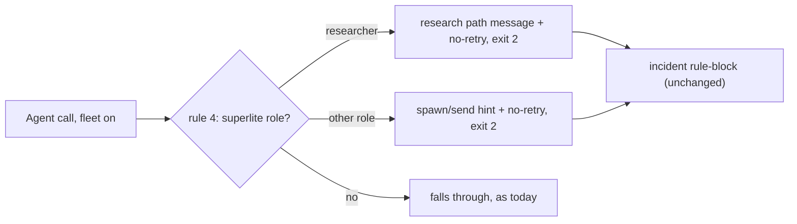
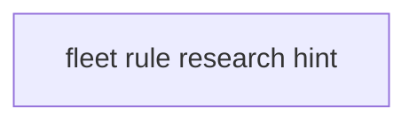

# Superlite: fleet rule names the research path and says no retry (B28)

**Goal:** fix #315: with fleet on, an in-process Agent call of `superlite:researcher` stays blocked (Max: "Name the fleet path in block"), and the block message now gives the whole research path and says the block repeats on every call, so the caller takes the fleet path instead of retrying the same call.
**Architecture:** one edit to rule 4 of `hooks/block-coordinator-edits` (a researcher-only message plus one no-retry sentence for every role, header comment updated); one new test file. `skills/subagent-driven-development/scripts/fleet_roles.py` is read by the new test, not changed.
**Tech stack:** bash 3.2 builtins (the hook), Python 3.10+ stdlib, pytest (through `sl run_tests`).
**Spec:** this file, section Design; issue #315's Expected line.
**Detail:** tests
**Target-min:** 11
**Wave0:** none

Global constraints:
- The hook stays bash 3.2 builtins only on this path (no spawn, no `${var,,}`); exit 2 with the message on stderr; the incident line stays byte-identical.
- Existing tests stay green; a task changes no existing test file (another lead may own them): new tests go in the new file its Owns names.
- Run `sl` as an executable (`<abs>/sl ...`). Verify with `<abs>/sl run_tests --fast <test files> --task Tn --background`, then run the printed `wait:` line in the foreground. Never raw `pytest`, never the e2e or eval layers (coordinator's step).
- No version edits (the ship step bumps the version). Only the files a task owns change.
- Tests build their state folders under `tmp_path`; they never write the real repo's `.superlite/`.

Ruling: keep the block for superlite:researcher and name the fleet path in it (Max's decision for #315) - cost if wrong: research still costs a worker start per prompt.
Ruling: cause from the piX B19 lead transcript (2026-11-07): two parallel researcher calls were blocked, each was retried once unchanged, then the lead read the code itself; the old message named spawn and send but not that the block repeats, nor `fleet wait` or where the answer lands - cost if wrong: callers still retry once.
Ruling: every role's message gains `It is blocked on every call while fleet is on: do not retry it.`; only the researcher gets the research path (brief file, spawn, send, wait, report path, PLAN before a plan exists) - cost if wrong: none beyond the text.
Ruling: the message uses the state folder `$sd` for the brief and report paths and keeps bare `sl` (every superlite session gets the absolute sl path at session start) - cost if wrong: a caller without that line resolves `sl` itself.
Ruling: fleet_roles.py unchanged; the new test pins every hook hint to `fleet_roles.launch` (role and tier round-trip to the blocked agent) - cost if wrong: none.
Ruling: no Explore or "read it yourself" hint in the message (Max chose the fleet path over an exemption) - cost if wrong: a caller reads code inline anyway, as the piX lead did.
Ruling: detail tests - one hook branch with exact text; verbatim test code - cost if wrong: one NEEDS_CONTEXT.
Ruling: no probe adapter - hook text over a local state folder; Review Focus cases run as named pytest cases - cost if wrong: no generated probes.
LAYERS: unit



## Design

Rule 4 of `hooks/block-coordinator-edits` keeps its role table and incident line. After the incident `printf`, it prints one of two messages and exits 2 (`$REPLY` is the agent name as called, `$sd` the state folder):

- `frole` = `research`: `Blocked: fleet is on, so $REPLY runs as a fleet worker, not an in-process Agent call. It is blocked on every call while fleet is on: do not retry it. Research path (fleet.md), one worker per prompt: write the prompt to $sd/briefs/<name>.md; sl fleet spawn --role research --plan PLAN prints Wn; sl fleet send Wn --brief $sd/briefs/<name>.md --plan PLAN; sl fleet wait Wn --plan PLAN (up to 9 min: Bash timeout 600000); the answer is in $sd/fleet/reports/<name>.md. PLAN is the plan file, or $sd before a plan exists. sl fleet off goes back to in-process agents.`
- any other role: `Blocked: fleet is on, so $REPLY runs as a fleet worker, not an in-process Agent call. It is blocked on every call while fleet is on: do not retry it. Use: sl fleet spawn --role $frole --plan PLAN, then sl fleet send Wn --brief <abs brief> --plan PLAN (fleet.md). sl fleet off goes back to in-process agents.`

The header comment's rule 4 says that the message names the no-retry rule, and for the researcher the full research path. Facts the text relies on: `fleet send --brief` labels by the file's stem (`fleet_io.send_brief`), `fleet wait` takes worker ids and defaults to `--timeout 540000`, a report lands in `<sd>/fleet/reports/<label>.md`, and `sl fleet ... --plan <state folder>` works without a plan file.

## Coverage

| Category | State | Basis |
|---|---|---|
| Scope and success criteria | settled | #315 Expected line; Max's decision |
| Domain and data model | n/a | no data shapes change |
| Persistence and migration | n/a | incident line unchanged |
| Interfaces and contracts | settled | exit 2 and the hint substrings existing tests read stay |
| UI states | n/a | hook text |
| Concurrency and state ownership | n/a | one task |
| Error handling and recovery | settled | fail-open paths untouched |
| Security and privacy | n/a | local state folder only |
| Performance and limits | settled | builtins only, no spawn |
| Observability | settled | incident unchanged |
| Testing strategy | settled | new unit test file; unit layer by the coordinator |
| Compatibility | settled | fleet off and non-superlite agents as today |
| Rollout | ruled | one PR; version bump at ship |
| Research unknowns | n/a | cause read from the piX transcript |

## File structure
- `hooks/block-coordinator-edits`, `tests/scripts/test_guard_fleet_research_hint.py` (T1).

## Task graph

```mermaid
%% schedule
gantt
  title Predicted schedule (mm:ss)
  dateFormat X
  axisFormat %M:%S
  section lane 1
  T1 fleet rule  research path and no-retr :t1, 0, 71s
```




critical path: T1 (1.2 min) · peak width 1 · predicted build 1.2 min · predicted total ≈ 4.7 min (target ✓)

## Package: superlite hooks (hook text over a local state folder)
**Probe entry:** none (Ruling: no probe adapter).

### T1 fleet rule: research path and no-retry in the block message · Complexity 2 · Est. context 34k
**Owns:** hooks/block-coordinator-edits, tests/scripts/test_guard_fleet_research_hint.py
**Components:** 1
**LOC owned:** 70
**Tests:** fast
**Model:** sonnet
**Est. time:** 2.0 min (1 component, about 70 LOC, fast tests)
**Covers:** Design
**Consumes:** existing `fleet_roles.launch(role: str, tier: str | None, cfg: dict) -> dict` · existing `routing.load_cfg() -> dict`
**Produces:** the two block messages of the Design section (text on stderr, exit 2)
**Review Focus:** protocol: `test_block_says_do_not_retry` (each of the 8 superlite agents -> exit 2, stderr holds the no-retry sentence); protocol: `test_researcher_block_names_full_research_path` (stderr holds each research-path part with the real state folder, no `<abs brief>`); encoding: `test_researcher_any_case_gets_research_path` (`Superlite:Researcher` -> research path, the name as called); protocol: `test_other_roles_keep_generic_hint` (fixer-opus, final-reviewer -> `<abs brief>`, no `Research path`); state: `test_incident_line_unchanged` (incident keys and target as before); protocol: `test_hint_round_trips_through_fleet_roles` (each role and tier: the hint's role and tier launch the blocked agent).
**Test code (verbatim):**
```python
import json
import re
import sys
from pathlib import Path

import pytest
from test_fleet_hooks import sd  # noqa: F401  (sd is a fixture)
from test_guard_fleet_agents import fleet, guard

SCRIPTS = Path(__file__).resolve().parents[2] / "skills" / "subagent-driven-development" / "scripts"
sys.path.insert(0, str(SCRIPTS))
import fleet_roles  # noqa: E402
import routing  # noqa: E402

AGENTS = ["superlite:implementer", "superlite:implementer-haiku", "superlite:fixer-sonnet",
          "superlite:fixer-sonnet-high", "superlite:fixer-opus", "superlite:package-reviewer",
          "superlite:final-reviewer", "superlite:researcher"]
NO_RETRY = "It is blocked on every call while fleet is on: do not retry it."
HINT = re.compile(r"sl fleet spawn --role (\S+)(?: --tier (\S+))? --plan PLAN")


@pytest.mark.parametrize("agent", AGENTS)
def test_block_says_do_not_retry(sd, agent):
    fleet(sd)
    r = guard(sd, agent)
    assert r.returncode == 2 and NO_RETRY in r.stderr


def test_researcher_block_names_full_research_path(sd):
    fleet(sd)
    r = guard(sd, "superlite:researcher")
    assert r.returncode == 2
    for part in ("superlite:researcher runs as a fleet worker",
                 "Research path (fleet.md), one worker per prompt",
                 f"write the prompt to {sd}/briefs/<name>.md;",
                 "sl fleet spawn --role research --plan PLAN prints Wn;",
                 f"sl fleet send Wn --brief {sd}/briefs/<name>.md --plan PLAN;",
                 "sl fleet wait Wn --plan PLAN (up to 9 min: Bash timeout 600000);",
                 f"the answer is in {sd}/fleet/reports/<name>.md.",
                 f"PLAN is the plan file, or {sd} before a plan exists.",
                 "sl fleet off goes back to in-process agents."):
        assert part in r.stderr, part
    assert "<abs brief>" not in r.stderr


def test_researcher_any_case_gets_research_path(sd):
    fleet(sd)
    r = guard(sd, "Superlite:Researcher")
    assert r.returncode == 2
    assert "Superlite:Researcher runs as a fleet worker" in r.stderr
    assert "sl fleet spawn --role research --plan PLAN prints Wn;" in r.stderr


@pytest.mark.parametrize("agent,hint", [("superlite:fixer-opus", "sl fleet spawn --role fixer --tier opus --plan PLAN"),
                                        ("superlite:final-reviewer", "sl fleet spawn --role final-reviewer --plan PLAN")])
def test_other_roles_keep_generic_hint(sd, agent, hint):
    fleet(sd)
    r = guard(sd, agent)
    assert r.returncode == 2 and hint in r.stderr
    assert "then sl fleet send Wn --brief <abs brief> --plan PLAN (fleet.md)." in r.stderr
    assert "Research path" not in r.stderr


def test_incident_line_unchanged(sd):
    fleet(sd)
    guard(sd, "superlite:researcher")
    inc = json.loads((sd / "incidents.jsonl").read_text().splitlines()[-1])
    assert inc == {"kind": "rule-block", "agent": "coordinator", "tool": "Agent",
                   "target": "superlite:researcher (fleet on)", "rule": "fleet", "cwd": str(sd.parent)}


@pytest.mark.parametrize("role,tier", [("implementer", None), ("implementer", "haiku"), ("fixer", "sonnet"),
                                       ("fixer", "sonnet-high"), ("fixer", "opus"), ("package-reviewer", None),
                                       ("final-reviewer", None), ("research", None)])
def test_hint_round_trips_through_fleet_roles(sd, role, tier):
    cfg = routing.load_cfg()
    agent = fleet_roles.launch(role, tier, cfg)["agent"]
    fleet(sd)
    m = HINT.search(guard(sd, agent).stderr)
    assert m, agent
    assert m.group(1) in fleet_roles.ROLES
    assert fleet_roles.launch(m.group(1), m.group(2), cfg)["agent"] == agent
```
**Steps:** 1 failing tests, 2 run: FAIL, 3 implement, 4 run: PASS (also `tests/scripts/test_guard_fleet_agents.py`, `test_fleet_hooks.py`, `test_fleet_roles_docs.py` stay green).
**Notes:** In rule 4, keep the `case "$fname"` table and the incident `printf` as they are; set `again="It is blocked on every call while fleet is on: do not retry it."` and branch on `[ "$frole" = research ]` for the two `printf '%s\n' ... >&2` lines of the Design section, then `exit 2`. Update the header comment's rule 4 (lines 16-18): the message says the block repeats on every call (no retry); a researcher's message gives the research path (brief under `<state folder>/briefs/`, spawn, send, `fleet wait Wn`, report under `<state folder>/fleet/reports/`).

## Review Focus
Package superlite hooks: app type CLI hook; categories protocol (exit code, stderr text, the hint substrings existing tests read), encoding (agent name case), state (incident line). Specific risks: the research message losing `fleet send Wn --brief` or `sl fleet off` (read by test_guard_fleet_agents); `$sd` printed relative; a spawn added to the hook path. Each case is named in T1.

## Self-review
Coverage: #315 T1. No placeholders. One task, no edges. Consumes are existing functions, checked: `fleet_roles.launch(r, t, routing.load_cfg())` gives each blocked agent.
