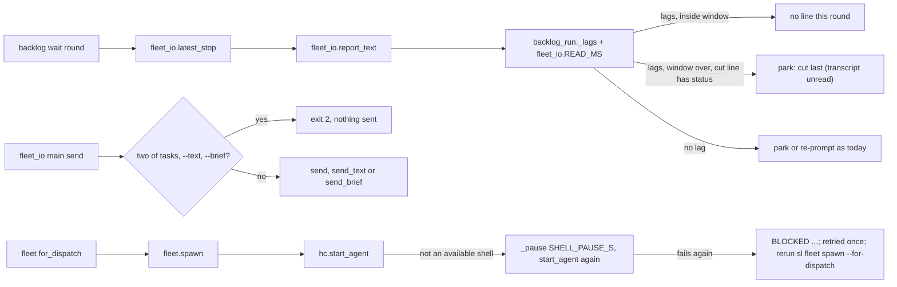
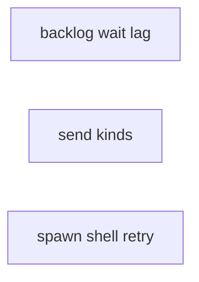

# Superlite: fleet send, spawn retry and backlog wait lag batch (B21)

**Goal:** fix #288 (`backlog wait` reads a lead's status once per stop record and has the unflushed-transcript race #264 fixed in `fleet wait`), #292 (`fleet send Wn Tn --text ...` sends only the text and silently drops the task) and #295 (`fleet spawn --for-dispatch` fails once after an evict because the freed pane is not a shell yet; no retry). Each fix ships with regression tests.
**Architecture:** edits to `skills/subagent-driven-development/scripts/backlog_run.py` (`_round`, a new `_lags`), `skills/subagent-driven-development/scripts/fleet_io.py` (`main`, send argument check) and `skills/subagent-driven-development/scripts/fleet.py` (`spawn` start retry, `for_dispatch` rerun hint); one new test file per fix.
**Tech stack:** Python 3.10+ stdlib, pytest (through `sl run_tests`).
**Spec:** this file, section Design; the issue bodies on GitHub are the source for each Expected line.
**Detail:** contracts
**Target-min:** 11
**Wave0:** none

Global constraints:
- Code lines under `skills/subagent-driven-development/scripts/` carry the repo's trailing `# O(...)` complexity comment; tests do not. Follow each file's existing style.
- Stdlib only. Existing tests stay green; a task changes no existing test file (another lead may own them): new tests go in the new file its Owns names.
- Run `sl` as an executable (`<abs>/sl ...`). Verify with `<abs>/sl run_tests --fast <test files> --task Tn --background`, then run the printed `wait:` line in the foreground. Never raw `pytest`, never the e2e or eval layers (coordinator's step).
- No version edits (the ship step bumps the version). No edits to `docs/` (another lead may own them).
- Tests build their state under `tmp_path`; they never write the real repo's `.superlite/`.

Ruling: detail contracts - small fixes in existing modules with known causes, tests named with exact inputs and outcomes - cost if wrong: one NEEDS_CONTEXT per task.
Ruling: #292 refuses task ids given together with --text or --brief (and --text with --brief) with exit 2, as Max decided - cost if wrong: a caller that relied on the silent drop now gets exit 2.
Ruling: #288 measures the re-read window from the stop record's own `t` (`now - t < fleet_io.READ_MS`), not from the first read, so it needs no state across `backlog wait` rounds or processes - cost if wrong: a wait started more than 10 s after a stop gets no window (the transcript is flushed by then).
Ruling: #288 tests the lag with backlog_run's own `STATUS` regex (NEEDS_DECISION counts, B14), in the shape of `fleet_io._lags`; `fleet_report.parse` does not know NEEDS_DECISION, so `fleet_io._lags` itself would misread a lead - cost if wrong: two lag tests to keep alike.
Ruling: #288 after the window, a transcript still behind a stop whose cut `last` line holds a status parks the batch with reason `<cut last> (transcript unread)` instead of re-prompting a lead that already ended with a status - cost if wrong: main reads one parked batch by hand.
Ruling: #295 retries `start_agent` on the same pane once, after `SHELL_PAUSE_S` (3 s), only when the herdr error message holds `not an available shell`; the plain `fleet spawn` path gets the retry too - cost if wrong: a pane that needs longer still blocks, now with a rerun hint.
Ruling: no probe adapter - script internals over local files and a fake herdr; Review Focus cases run as named pytest cases - cost if wrong: no generated probes.

## Design

### 1. #288 backlog wait re-reads a lagging transcript
`backlog_run._lags(text, last) -> bool` is True when `text` holds no `STATUS` match and either `text` is blank or `last` holds a `STATUS` match. In `_round`, for a running batch with a stop record, no fresh `question.json` and no `merged` (the order before the status check stays), when the record has a `transcript`: read the report text once (`fleet_io.report_text`, any exception reads as ""). When `_lags(text, rec["last"])`: while `_now_ms() - rec["t"] < fleet_io.READ_MS` the batch gets no line this round (it stays running, nothing is sent, `reprompted` unchanged); once the window is over and `last` holds a status, the batch parks with reason `<cut last> (transcript unread)`, where `<cut last>` is the existing 120-character collapsed `last`; a window over with no status in `last` goes on as today (re-prompt once, then park). A record without a transcript, and a transcript that does not lag, behave exactly as today (the existing `_stop_text` path). `fleet_io.READ_MS` is read only for a lagging transcript. The module docstring names the window in one line.

### 2. #292 fleet send refuses two message kinds
In `fleet_io.main`, the `send` command first counts the kinds given: task ids (`a.tasks` non-empty), `--text` (`a.text is not None`, an empty string counts) and `--brief` (`a.brief is not None`). Two or more print `error: send takes task ids, --text or --brief, not two of them` on stderr and return 2 before any herdr call, file check or state write. One kind runs exactly as today; none keeps today's `error: send needs task ids, --text or --brief`. The module docstring's send lines say the three are exclusive.

### 3. #295 spawn retries a pane that is not a shell yet
`fleet.SHELL_PAUSE_S = 3.0` and `fleet._pause(s) -> None` (calls `time.sleep(s)`; tests swap it). In `spawn`, when `hc.start_agent(name, pane, argv)` raises a `HerdrError` whose `message` holds `not an available shell`, spawn calls `_pause(SHELL_PAUSE_S)` and `hc.start_agent` once more on the same pane; a success goes on as a first-try success. A second failure of any kind takes today's handling (trust dialog, else `fail(f"startup: ...")`), and the reason then ends with `; retried once`. Other first errors are never retried and never pause. In `for_dispatch`, a `why` from `_spawn_quiet` that holds `not an available shell` gets `; rerun sl fleet spawn --for-dispatch` appended, so the line reads `BLOCKED: T2 not sent (W1 account claude3 startup: agent target pane w6:p1 is not an available shell; retried once; rerun sl fleet spawn --for-dispatch)`. The module docstring names the retry in one line.

## Coverage

| Category | State | Basis |
|---|---|---|
| Scope and success criteria | settled | three issues in Goal; each issue's Expected line; Max's decision for #292 |
| Domain and data model | n/a | no data shapes change |
| Persistence and migration | n/a | backlog.json and fleet.json keys unchanged |
| Interfaces and contracts | settled | CLI output lines in Design; `_lags`, `SHELL_PAUSE_S`, `_pause` new |
| UI states | n/a | CLI text |
| Concurrency and state ownership | settled | T1, T2, T3 own disjoint files |
| Error handling and recovery | settled | refusal exit 2; one retry then BLOCKED with a rerun hint; window then park |
| Security and privacy | n/a | local files only |
| Performance and limits | settled | one 3 s pause at most per spawn; one transcript read per lagging round |
| Observability | settled | `(transcript unread)`, `retried once`, rerun hint |
| Testing strategy | settled | new unit test file per task; unit layer by the coordinator |
| Compatibility | settled | single-kind sends, non-lagging stops and first-try spawns unchanged |
| Rollout | ruled | one PR; version bump at ship |
| Research unknowns | n/a | causes named in the issues |

## File structure
- `skills/subagent-driven-development/scripts/backlog_run.py`, `tests/scripts/test_backlog_wait_lag.py` (T1).
- `skills/subagent-driven-development/scripts/fleet_io.py`, `tests/scripts/test_fleet_send_kinds.py` (T2).
- `skills/subagent-driven-development/scripts/fleet.py`, `tests/scripts/test_fleet_spawn_shell_retry.py` (T3).

## Task graph

```mermaid
%% schedule
gantt
  title Predicted schedule (mm:ss)
  dateFormat X
  axisFormat %M:%S
  section lane 1
  T1 backlog_run  backlog wait re-reads a  :t1, 0, 86s
  section lane 2
  T3 fleet  spawn retries a pane that is n :t3, 0, 85s
  section lane 3
  T2 fleet_io  fleet send refuses two mess :t2, 0, 78s
```

critical path: T1 (1.4 min) · peak width 3 · predicted build 1.4 min · predicted total ≈ 4.9 min (target ✓)

## Package: superlite scripts (fleet and backlog CLI internals)
**Probe entry:** none (Ruling: no probe adapter).

### T1 backlog_run: backlog wait re-reads a lagging transcript · Complexity 4 · Est. context 36k
**Owns:** skills/subagent-driven-development/scripts/backlog_run.py, tests/scripts/test_backlog_wait_lag.py
**Components:** 1
**LOC owned:** 130
**Tests:** fast
**Model:** sonnet
**Est. time:** 2.5 min (1 component, about 130 LOC, fast tests)
**Covers:** 1
**Consumes:** existing `fleet_io.report_text(transcript) -> str`, `fleet_io.READ_MS: int` (faked in tests)
**Produces:** backlog_run._lags(text: str, last: str) -> bool
**Review Focus:** state: `test_empty_transcript_waits_inside_the_window` (`running(bk)`, stop `{"t": 2000, "last": "Outcome: BLOCKED, tui red Status: BLOCKED", "transcript": "/x/t.jsonl"}`, report_text -> `""`, READ_MS 10000, now 5000 -> `wait --timeout 0` == `(0, "TIMEOUT\n")`, batch running, `reprompted` False, no `text`, `stop` or `release` call); state: `test_behind_transcript_waits_inside_the_window` (report_text -> `"Working on T2."`, same stop -> TIMEOUT, no `text` call); state: `test_flushed_transcript_parks_on_the_next_round` (first round report_text `""` -> TIMEOUT; then report_text -> `"Outcome: BLOCKED\n\nStatus: BLOCKED"` -> `(0, "B1 parked: Outcome: BLOCKED, tui red Status: BLOCKED\n")`); state: `test_window_over_parks_transcript_unread` (now 12000, report_text `""` -> `(0, "B1 parked: Outcome: BLOCKED, tui red Status: BLOCKED (transcript unread)\n")`, reason equal, no `text` call, `("release", "B1")` and `("stop", ["W1"])` in calls); state: `test_window_over_without_status_reprompts_as_today` (now 12000, report_text `""`, last `"PONG"` -> TIMEOUT, `reprompted` True, one `text` call); state: `test_read_ms_comes_from_fleet_io` (fake READ_MS 2000, now 5000, t 2000, report_text `""` -> parks `(transcript unread)`); protocol: `test_needs_decision_text_is_no_lag` (report_text -> `"Status: NEEDS_DECISION"`, last the same, no question.json -> parks at once `B1 parked: Status: NEEDS_DECISION`); protocol: `test_cut_needs_decision_lags` (report_text `"Working."`, last `"Status: NEEDS_DECISION"`, now 5000 -> TIMEOUT); file: `test_report_text_error_reads_as_empty` (report_text raises `OSError` -> TIMEOUT inside the window); state: `test_no_transcript_is_unchanged` (stop `{"t": 2000, "last": "Status: BLOCKED"}`, fake fleet_io without READ_MS -> parks at once); unit: `test_lags_table` (`_lags("", "x")` True, `_lags("Status: DONE", "")` False, `_lags("work", "Status: BLOCKED")` True, `_lags("work", "PONG")` False, `_lags("work", "Status: NEEDS_DECISION")` True).
**Test code:** new file; `from test_backlog_run import bk, put, get, run, running` (`# noqa: F401`), `import sys`, `import backlog_run as br` (after `sys.path` from `test_plan_tools.SCRIPTS`, as `test_backlog_run.py` does); set fakes with `monkeypatch.setattr(sys.modules["fleet_io"], "report_text", ..., raising=False)` and `monkeypatch.setattr(sys.modules["fleet_io"], "READ_MS", 10000, raising=False)`; move the clock with `monkeypatch.setattr(br, "_now_ms", lambda: 12000)`; read calls from `bk.calls` as `test_backlog_run_lifecycle.py` does.
**Steps:** 1 failing tests, 2 run: FAIL, 3 implement, 4 run: PASS (also `tests/scripts/test_backlog_run.py`, `test_backlog_run_lifecycle.py` stay green).
**Notes:** Read section `### 1. #288 backlog wait re-reads a lagging transcript` under `## Design` in the plan file first: it is the contract. Keep `_stop_text` for the non-lagging path; put the lag branch just before `if STATUS.search(_stop_text(rec))`. The existing fake `fleet_io` has no `READ_MS`: touch it only when `_lags` is True.

### T2 fleet_io: fleet send refuses two message kinds · Complexity 2 · Est. context 30k
**Owns:** skills/subagent-driven-development/scripts/fleet_io.py, tests/scripts/test_fleet_send_kinds.py
**Components:** 1
**LOC owned:** 70
**Tests:** fast
**Model:** sonnet
**Est. time:** 2 min (1 component, about 70 LOC, fast tests)
**Covers:** 2
**Consumes:** nothing executed from another task.
**Produces:** fleet_io.main(argv) -> int (signature unchanged)
**Review Focus:** protocol: `test_tasks_with_text_is_refused` (`io.main(["send", "W1", "T3", "--text", "x", "--plan", str(world.plan)])` == 2, stderr == `"error: send takes task ids, --text or --brief, not two of them\n"`, no `prompt` in `world.fh.calls`, W1 state `ready`, pool W1 `busy` False); protocol: `test_tasks_with_brief_is_refused` (existing brief file, `["send", "W1", "T3", "--brief", str(b)]` -> 2, same stderr, no prompt); protocol: `test_text_with_brief_is_refused`; protocol: `test_all_three_is_refused`; encoding: `test_empty_text_counts` (`["send", "W1", "T3", "--text", ""]` -> 2); file: `test_refusal_comes_before_the_brief_check` (`["send", "W1", "T3", "--brief", "missing.md"]` -> 2 with the two-kinds error, not `brief not found`); protocol: `test_single_kinds_still_send` (`["send", "W1", "T3", "--plan", plan]` -> 0 and `W1 T3 sent`; `["send", "W2", "--text", "hi"]` -> 0; `["send", "W1", "--brief", str(b)]` after W1 is free again -> 0); protocol: `test_no_kind_keeps_its_error` (`["send", "W1"]` -> 2, stderr `error: send needs task ids, --text or --brief\n`).
**Test code:** new file; `from test_fleet_io import world` (`# noqa: F401`), `import fleet_io as io`, `json` for fleet.json and pool.json reads; a brief file under `world.sd / "briefs"`; use `capsys` for stderr.
**Steps:** 1 failing tests, 2 run: FAIL, 3 implement, 4 run: PASS (also `tests/scripts/test_fleet_io.py`, `test_fleet_io_roles.py`, `test_fleet_io_notify.py` stay green).
**Notes:** Read section `### 2. #292 fleet send refuses two message kinds` under `## Design` in the plan file first: it is the contract. The check sits inside the `try` block, before the `elif a.text is not None` branch, only for `a.cmd == "send"`.

### T3 fleet: spawn retries a pane that is not a shell yet · Complexity 4 · Est. context 38k
**Owns:** skills/subagent-driven-development/scripts/fleet.py, tests/scripts/test_fleet_spawn_shell_retry.py
**Components:** 1
**LOC owned:** 120
**Tests:** fast
**Model:** sonnet
**Est. time:** 2.5 min (1 component, about 120 LOC, fast tests)
**Covers:** 3
**Consumes:** nothing executed from another task.
**Produces:** fleet.SHELL_PAUSE_S: float · fleet._pause(s: float) -> None
**Review Focus:** state: `test_spawn_retries_once_after_a_pause` (`start_agent` raises `fh.HerdrError("agent_start_failed", "agent target pane w6:p1 is not an available shell")` on the first call only -> `fleet.spawn(world.sd, world.plan, "sonnet", world.proj)` returns W1, worker state `ready`, two `start_agent` calls, both with the same pane, pauses `== [fleet.SHELL_PAUSE_S]`); state: `test_second_shell_failure_blocks` (raises on every call -> `SystemExit` 3, stdout line starts `BLOCKED: W1 account ` and ends `startup: agent target pane w6:p1 is not an available shell; retried once`, two `start_agent` calls, one pause, a `close_pane` call); state: `test_other_startup_errors_are_not_retried` (`fh.start_error = "agent_not_ready"`, screen `"Select login method\n"` -> BLOCKED, one `start_agent` call, no pause, no `retried once`); state: `test_retry_then_trust_dialog` (first call shell error, second `agent_not_ready` with `fleet.TRUST` on screen, then READY -> spawn succeeds, `send_keys` `["Down", "Enter"]` called); protocol: `test_for_dispatch_names_the_rerun` (dwld lines `[("T2", FRESH), ("T3", FRESH)]`, the first two `start_agent` calls raise the shell error -> `_go` == 3, out[0] starts `BLOCKED: T2 not sent (` and ends `is not an available shell; retried once; rerun sl fleet spawn --for-dispatch)`, out[1:] == `["W2 T3 sent"]`); protocol: `test_for_dispatch_retry_success_sends` (first call only raises -> `_go` == 0, out == `["W1 T2 sent"]`); unit: `test_pause_defaults` (`fleet.SHELL_PAUSE_S == 3.0`; `_pause` calls `time.sleep` with its argument, checked by swapping `fleet.time` for a namespace recorder).
**Test code:** new file; `from test_fleet import world` and `from test_fleet_for_dispatch import dwld, FRESH, _go` (`# noqa: F401`), `import fleet, fleet_io`; record pauses with `monkeypatch.setattr(fleet, "_pause", pauses.append)`; wrap `world.fh.start_agent` with a function that raises `world.fh.HerdrError(code, message)` for scripted call numbers and else calls the original; skip the tests under `SUPERLITE_REAL=1` as `test_fleet_for_dispatch.py` does for scripted failures.
**Steps:** 1 failing tests, 2 run: FAIL, 3 implement, 4 run: PASS (also `tests/scripts/test_fleet.py`, `test_fleet_for_dispatch.py`, `test_fleet_roles_spawn.py`, `test_fleet_capacity.py` stay green).
**Notes:** Read section `### 3. #295 spawn retries a pane that is not a shell yet` under `## Design` in the plan file first: it is the contract. Wrap only the `hc.start_agent(name, pane, argv)` call inside the existing inner `try`; read the message as `getattr(e, "message", "") or ""`. The trust-dialog path keeps its screen read and keys. `for_dispatch` appends the hint where it prints the BLOCKED line.

## Review Focus
Package superlite scripts: app type CLI internals (fleet worker I/O, backlog runner); categories protocol (send arguments, BLOCKED and parked line shapes), state (re-read window across rounds, retry count, worker and batch state after a refusal or failure), file (transcript read errors, brief check order), encoding (empty text). Specific risks: a refusal that still sends or marks a worker busy; a retry that pauses on unrelated errors or loops; a lagging lead re-prompted although it ended with a status; existing fakes without `READ_MS`. Each task lists its named cases.

## Self-review
Coverage: #288 T1, #292 T2, #295 T3. No placeholders. T1, T2 and T3 share no file; no edges.
