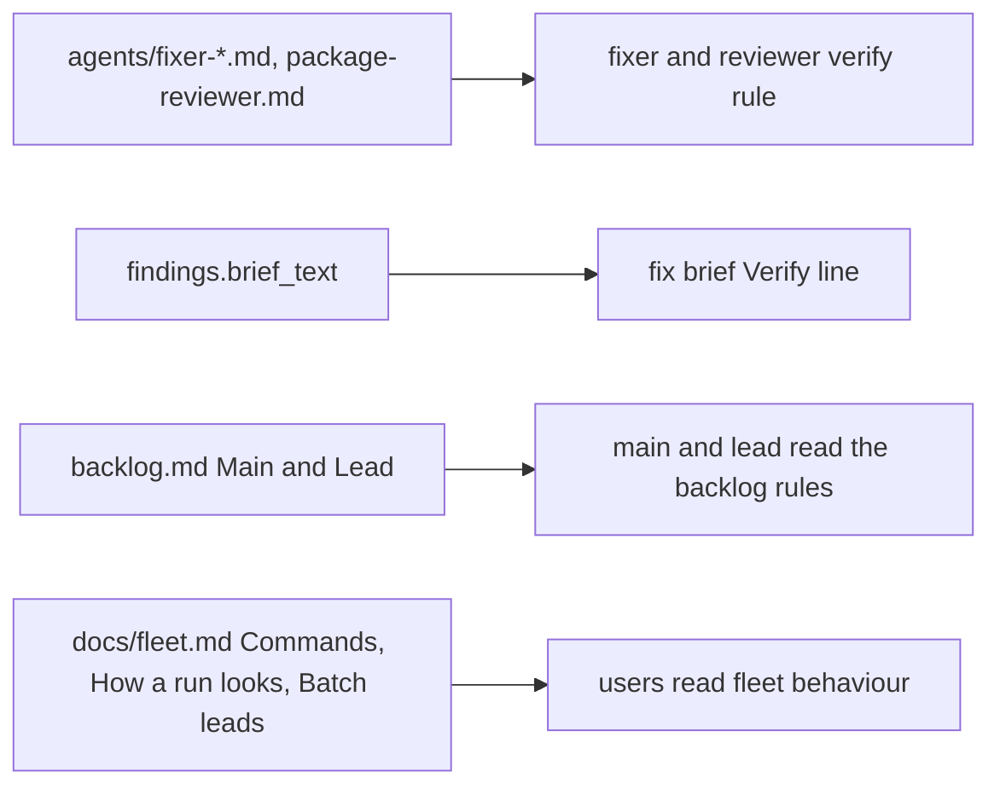
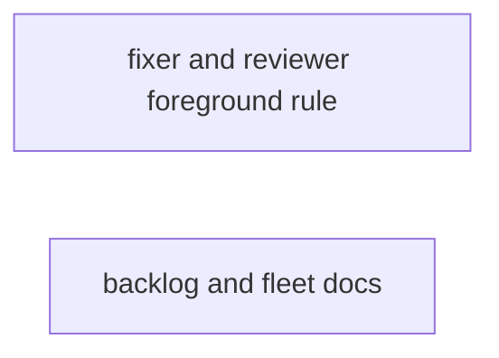

# Superlite: fixer and reviewer foreground-verify rule, backlog and fleet docs lag (B26)

**Goal:** fix #278 (fixer agents, the package reviewer and the `findings route` fix brief still say "then the `wait:` line it prints" without "in the foreground") and #274 (`skills/subagent-driven-development/backlog.md` ## Main and `docs/fleet.md` do not describe `ship B done`, several start ids, the status re-prompt, nor the later 1.5.25-1.5.33 changes whose home is those two files).
**Architecture:** text edits in `agents/fixer-sonnet.md`, `agents/fixer-sonnet-high.md`, `agents/fixer-opus.md`, `agents/package-reviewer.md`, the `brief_text` verify line of `skills/subagent-driven-development/scripts/findings.py` (T1); inserts into `skills/subagent-driven-development/backlog.md` and `docs/fleet.md` (T2); one new test file per task.
**Tech stack:** Markdown, Python 3.10+ stdlib, pytest (through `sl run_tests`).
**Spec:** this file, section Design; the issue bodies on GitHub are the source for each Expected line.
**Detail:** tests
**Target-min:** 11
**Wave0:** none
**Coverage:** off

Global constraints:
- Code lines under `skills/subagent-driven-development/scripts/` carry the repo's trailing `# O(...)` complexity comment; tests do not.
- Existing tests stay green; a task changes no existing test file: new tests go in the new file its Owns names.
- Insert text; never reword or drop an existing sentence except the one sentence a task names (existing docs tests pin many phrases).
- Run `sl` as an executable (`<abs>/sl ...`). Verify with `<abs>/sl run_tests --fast <test file> --task Tn --background`, then run the printed `wait:` line in the foreground. Never raw `pytest`, never the e2e or eval layers (coordinator's step).
- No version edits. Only the files a task owns change.

Ruling: #274 covers its body (the three 1.5.23 items in backlog.md ## Main and docs/fleet.md) plus every title topic whose home is one of those two files (fresh main session, plan shortening, fleet wait and backlog wait `(transcript unread)`, fleet send two-kinds refusal, spawn shell retry, held tasks); the title topics that live in docs/tools.md, docs/mvp-flow.md and SDD SKILL.md stay a follow-up (outside B26's files) - cost if wrong: #274 closes with those rows still lagging, named in notes.md.
Ruling: backlog.md's Lead section also names the strict question.json check (limits, park reason), since a lead writes that file - cost if wrong: one extra sentence.
Ruling: the same foreground wording in `skills/subagent-driven-development/fixing.md` and SDD `SKILL.md` step 3 stays a follow-up (outside B26's files) - cost if wrong: the coordinator text still says "the printed `wait:` line" without "in the foreground".
Ruling: both tasks are mechanical (exact text given, tests from an explicit list) - cost if wrong: a haiku miss goes to a sonnet fixer.
Ruling: no probe adapter - docs and agent text; checks run as named pytest cases - cost if wrong: no generated probes.
LAYERS: unit, headless, evals



## Design

### 1. #278 foreground verify for fixers and reviewers
The implementer agents already say `then run the \`wait:\` line it prints (\`<abs sl> run_tests --wait <path>\`) in the foreground, never as a background command, and end your turn only after it reports; read only its summary.` The three fixer agents and the package reviewer get that same clause in their focused-test line; `findings.brief_text` ends its Verify line with `then run the printed \`wait:\` line in the foreground (never as a background command) and end your turn only after it reports.`

### 2. #274 backlog and fleet docs
backlog.md ## Main gains the fresh-session rule, the plan shortening (step 2), several start ids (step 4), the re-prompt and lag window (step 5) and a new step 6 for `ship B done` (Hold work becomes 7); the Lead section names the strict question.json check. docs/fleet.md gains the send refusal, the spawn retry and the fleet wait `(transcript unread)` end (Commands), held tasks (How a run looks), the same main-side items (Batch leads, first paragraph), the re-prompt and question.json check (Escalation) and two smoke rows. Exact text is in T2's test constants.

## File structure
- `agents/fixer-sonnet.md`, `agents/fixer-sonnet-high.md`, `agents/fixer-opus.md`, `agents/package-reviewer.md`, `skills/subagent-driven-development/scripts/findings.py`, `tests/scripts/test_fixer_foreground_b26.py` (T1).
- `skills/subagent-driven-development/backlog.md`, `docs/fleet.md`, `tests/scripts/test_docs_b26.py` (T2).

## Task graph

```mermaid
%% schedule
gantt
  title Predicted schedule (mm:ss)
  dateFormat X
  axisFormat %M:%S
  section lane 1
  T2 backlog.md and docs/fleet.md name the :t2, 0, 82s
  section lane 2
  T1 fixer and reviewer agents  fix brief  :t1, 0, 66s
```




critical path: T2 (1.4 min) · peak width 2 · predicted build 1.4 min · predicted total ≈ 4.9 min (target ✓)

## Package: superlite agents and docs (text read by agents and users)
**Probe entry:** none (Ruling: no probe adapter).

### T1 fixer and reviewer agents, fix brief: run wait in the foreground · Complexity 1 · Est. context 26k
**Owns:** agents/fixer-sonnet.md, agents/fixer-sonnet-high.md, agents/fixer-opus.md, agents/package-reviewer.md, skills/subagent-driven-development/scripts/findings.py, tests/scripts/test_fixer_foreground_b26.py
**Components:** 1
**LOC owned:** 50
**Tests:** fast
**Kind:** mechanical
**Model:** haiku
**Est. time:** 1.5 min (1 component, about 50 LOC, fast tests)
**Covers:** 1
**Consumes:** existing `findings.brief_text(sl_path: str, plan: Path, task, items: list[dict], tier: int) -> str`
**Produces:** findings.brief_text Verify line (text)
**Review Focus:** protocol: `test_fixers_run_wait_in_foreground` (each fixer file holds `FIXER_LINE` and not `OLD`); protocol: `test_package_reviewer_runs_wait_in_foreground` (package-reviewer.md holds `REVIEWER_LINE`, not `OLD_REVIEWER`); protocol: `test_fix_brief_runs_wait_in_foreground` (`brief_text("/x/sl", Path("/p/plan.md"), task, [item], 1)` holds `BRIEF_VERIFY` as one line).
**Test code (verbatim):**
```python
"""Fixer agents, the package reviewer and the fix brief run the wait: line in the foreground (#278)."""
from __future__ import annotations

import sys
from pathlib import Path
from types import SimpleNamespace

from test_plan_tools import SCRIPTS

sys.path.insert(0, str(SCRIPTS))

import findings  # noqa: E402

AGENTS = Path(__file__).resolve().parents[2] / "agents"
RULE = "then run the `wait:` line it prints (`<abs sl> run_tests --wait <path>`) in the foreground, never as a background command, and end your turn only after it reports; read only its summary."
FIXER_LINE = "- Run only the touched test files, in the background: `<abs sl> run_tests --fast <touched test files> --background`, " + RULE + " Never run the full suite, raw `pytest` or `python`."
REVIEWER_LINE = "- Focused tests, in the background: `<abs sl> run_tests --fast PATHS --background`, " + RULE + " Do not run the full suite."
OLD = "then the `wait:` line it prints (`"
OLD_REVIEWER = "(the printed `wait:` line) for the summary"
BRIEF_VERIFY = "Verify: `/x/sl run_tests --fast <the test files you touched> --background`, then run the printed `wait:` line in the foreground (never as a background command) and end your turn only after it reports."


def test_fixers_run_wait_in_foreground():
    for name in ("fixer-sonnet.md", "fixer-sonnet-high.md", "fixer-opus.md"):
        text = (AGENTS / name).read_text(encoding="utf-8")
        assert FIXER_LINE in text.split("\n"), name
        assert OLD not in text, name


def test_package_reviewer_runs_wait_in_foreground():
    text = (AGENTS / "package-reviewer.md").read_text(encoding="utf-8")
    assert REVIEWER_LINE in text.split("\n")
    assert OLD_REVIEWER not in text


def test_fix_brief_runs_wait_in_foreground():
    task = SimpleNamespace(id="T1", owns=["a.py"])
    item = {"id": "F-T1-1", "file": "a.py", "line": 3, "problem": "p", "fix": "f", "tier": 1, "label": "FR1"}
    out = findings.brief_text("/x/sl", Path("/p/plan.md"), task, [item], 1)
    assert BRIEF_VERIFY in out.split("\n")
    assert "then the printed `run_tests --wait <path>` line" not in out
```
**Steps:** 1 failing tests, 2 run: FAIL, 3 edit, 4 run: PASS (also `tests/scripts/test_findings_route.py`, `test_foreground_verify_rule.py`, `test_fixer_commit_wording.py` stay green).
**Notes:** In each fixer file the one line starting `- Run only the touched test files` becomes `FIXER_LINE`; in package-reviewer.md the one line starting `- Focused tests, in the background:` becomes `REVIEWER_LINE`. In findings.py the two string pieces of the Verify line (`f"Verify: ... --background\`, then the printed "` and `"\`run_tests --wait <path>\` line."`) become `f"Verify: \`{sl_path} run_tests --fast <the test files you touched> --background\`, then run the printed "` and `"\`wait:\` line in the foreground (never as a background command) and end your turn only after it reports."`, each keeping its `# O(1)` comment.

### T2 backlog.md and docs/fleet.md name the 1.5.23-1.5.33 changes · Complexity 2 · Est. context 30k
**Owns:** skills/subagent-driven-development/backlog.md, docs/fleet.md, tests/scripts/test_docs_b26.py
**Components:** 2
**LOC owned:** 70
**Tests:** fast
**Kind:** mechanical
**Model:** haiku
**Est. time:** 2.0 min (2 components, about 70 LOC, fast tests)
**Covers:** 2
**Consumes:** nothing executed from another task.
**Produces:** backlog.md and docs/fleet.md text
**Review Focus:** protocol: `test_main_section_names_new_steps` (each `B_MAIN` text sits in backlog.md between `## Main` and `## Lead`); protocol: `test_main_steps_numbered` (`\n6. A batch whose lead` before `\n7. Hold work:`, no `\n6. Hold work:`); protocol: `test_lead_section_names_question_check` (`B_LEAD` after `## Lead`, before `## Permissions`); protocol: `test_fleet_sections_name_changes` (each `F_*` text in its section of docs/fleet.md); protocol: `test_fleet_rows_are_table_rows` (each row is one line of the Batch leads table with 3 cells).
**Test code (verbatim):**
```python
"""backlog.md (## Main, ## Lead) and docs/fleet.md name the 1.5.23-1.5.33 backlog and fleet changes (#274)."""
from __future__ import annotations

from test_plan_tools import ROOT

BACKLOG = (ROOT / "skills" / "subagent-driven-development" / "backlog.md").read_text(encoding="utf-8")
FLEET = (ROOT / "docs" / "fleet.md").read_text(encoding="utf-8")

B_FRESH = "Start main in a fresh session: one that already loaded another superlite skill or command (start, brainstorming, writing-plans, subagent-driven-development, finishing) tells the user to run `/clear` and `/superlite:backlog` again, and ends its turn."
B_PLAN = "Over-long question texts are cut, not refused: a header to 12, an option label to 60 and an option description to 200 characters (a ` (Recommended)` suffix kept), each cut named in a `shortened: \"<question>\" <field>: N -> M characters` line (at most 5, then `shortened: K more`); a question over 300 characters still fails the plan."
B_START = "4. `\"$SL\" backlog start [B ...] [--cap 2] [--model opus]`. Several ids (`start B7 B10`) are checked one by one: each refused batch prints its `BLOCKED:` reason first, the others still start, and the exit is 2 when any was refused. Exit 3 (Herdr missing) is BLOCKED."
B_REPROMPT = "A lead that stops without a Status line gets one re-prompt (no wait line); its next such stop parks the batch with `no status in stop text: <text>`, and `start` or `answer` resets the count. A stop whose transcript lags (blank, or without the status its cut `last` line holds) is re-read for 10 s from the stop; after that a cut line with a status parks the batch with `<cut line> (transcript unread)`, one without gets the re-prompt."
B_DONE = "6. A batch whose lead could not merge (its merge step was denied) is main's to ship: `maxapp ship -C <worktree>`, then `\"$SL\" backlog ship B done --pr N [--version X]` (main only, refused in any fleet worker; `gh pr view N` must read MERGED). It marks the batch shipped, records its PR and version, writes its summary, releases the ship lock and stops its lead."
B_MAIN = (B_FRESH, B_PLAN, B_START, B_REPROMPT, B_DONE)
B_LEAD = "`backlog wait` checks that file strictly and never cuts it: 1 to 4 distinct questions, each question 1 to 300 characters, a header of 1 to 12, 2 to 4 options with distinct labels of 1 to 60 and descriptions up to 200; an invalid file parks the batch with `invalid question.json: <errors>`."

F_SEND = "Two of task ids, `--text` and `--brief` in one call (an empty `--text` counts) exit 2 with `error: send takes task ids, --text or --brief, not two of them` on stderr, before anything is sent."
F_SPAWN = "A start that fails with `not an available shell` (a pane freed a moment ago) is retried once on the same pane after 3 s; a BLOCKED reason after that retry ends `; retried once`, and `--for-dispatch` adds `; rerun sl fleet spawn --for-dispatch` to its `BLOCKED: Tn not sent (...)` line."
F_WAIT = "A stop record whose transcript reads empty, or lacks the status its cut `last` line holds, is re-read for 10 s; after that the worker ends `UNKNOWN` with ` (transcript unread)` at the end of its line, is kept (not stopped), and its `.md` shows the cut line as a labelled block plus the last pane lines."
F_HOLD = "A task that waits on a human step is held with `sl hold Tn --reason R` (ledger line `- Hold Tn: R`) and released with `sl hold --release Tn`; `dispatch` never offers it and prints `held=Tn R` on stderr, and `/superlite:status` lists each held task with its id and reason."
F_MAIN = "Main starts in a fresh session: one that already loaded another superlite skill or command runs `/clear` first. `backlog plan` cuts an over-long question header (12), option label (60) and description (200) and names each cut in a `shortened:` line (at most 5, then `shortened: K more`). `start B7 B10` checks each id on its own: refusals print first, the others still start, exit 2 when any was refused. A batch whose lead's merge was denied is shipped by main: `maxapp ship -C <worktree>`, then `sl backlog ship B done --pr N [--version X]` (main only), which marks it shipped, writes its summary, releases the ship lock and stops its lead."
F_ESC = "A lead's `question.json` is checked strictly, never cut; an invalid one parks the batch with `invalid question.json: <errors>`. A lead that stops without a Status line gets one re-prompt; its next such stop parks the batch with `no status in stop text: <text>` (`start` and `answer` reset it). A stop record whose transcript lags is re-read for 10 s from the stop; then a cut `last` line holding a status parks the batch with `<cut line> (transcript unread)`."
F_ROW1 = "| Lead stops without a status | A lead ends its turn with no Status line, twice | the first stop prints nothing and re-prompts the lead; the second parks the batch with `no status in stop text: <text>` |"
F_ROW2 = "| Main ships a denied merge | The lead's `merge` was denied; main runs `maxapp ship -C <worktree>`, then `ship B done --pr N` | `status` shows the batch shipped with its PR; the ship lock is free |"


def section(text, start, end):
    i = text.index(start)
    return text[i:text.index(end, i + len(start))]


def test_main_section_names_new_steps():
    main = section(BACKLOG, "## Main", "## Lead")
    for s in B_MAIN:
        assert s in main, s[:60]


def test_main_steps_numbered():
    assert BACKLOG.index("\n6. A batch whose lead") < BACKLOG.index("\n7. Hold work:")
    assert "\n6. Hold work:" not in BACKLOG
    assert "`\"$SL\" backlog start [B] [--cap 2]" not in BACKLOG


def test_lead_section_names_question_check():
    assert B_LEAD in section(BACKLOG, "## Lead", "## Permissions")


def test_fleet_sections_name_changes():
    commands = section(FLEET, "## Commands", "## How a run looks")
    for s in (F_SEND, F_SPAWN, F_WAIT):
        assert s in commands, s[:60]
    assert F_HOLD in section(FLEET, "## How a run looks", "## Smoke test")
    leads = section(FLEET, "## Batch leads", "## Troubleshooting")
    for s in (F_MAIN, F_ESC):
        assert s in leads, s[:60]


def test_fleet_rows_are_table_rows():
    lines = section(FLEET, "## Batch leads", "## Troubleshooting").split("\n")
    for row in (F_ROW1, F_ROW2):
        assert row in lines
        assert row.count(" | ") == 2
    assert lines.index(F_ROW1) > lines.index(next(x for x in lines if x.startswith("| Two leads ship in turn |")))
```
**Steps:** 1 failing tests, 2 run: FAIL, 3 edit, 4 run: PASS (also `tests/scripts/test_fleet_b1_docs.py`, `test_fleet_roles_docs.py`, `test_backlog_docs.py`, `test_backlog_main_docs.py`, `test_docs_contract.py` stay green).
**Notes:** backlog.md ## Main: `B_FRESH` is a new paragraph line right after `Main keeps a lean context: ...`; `B_PLAN` is appended (after one space) to step 2; step 4 becomes `B_START` exactly; `B_REPROMPT` is appended (after one space) to step 5; `B_DONE` is a new line between step 5 and `6. Hold work:`, which becomes `7. Hold work:`. ## Lead: `B_LEAD` is appended (after one space) to the bullet `- Never ask the user. ...`. docs/fleet.md ## Commands: `F_SEND` appended to the `fleet send W1 T3 --plan PLAN` bullet, `F_SPAWN` to the `fleet spawn --tier sonnet` bullet, `F_WAIT` to the `fleet wait [--timeout 540000] [W1 ...]` bullet, each after one space. ## How a run looks: `F_HOLD` appended to its paragraph after one space. ## Batch leads: `F_MAIN` appended to the first paragraph (`/superlite:backlog` works ...), `F_ESC` to the `Escalation:` paragraph, `F_ROW1` and `F_ROW2` as new table rows right after the `| Two leads ship in turn |` row. In the Python constants `\"` is a plain `"` in the file and `$SL` stays literal.

## Review Focus
Package superlite agents and docs: app type docs and agent instructions; category protocol (the exact commands, flags, exit codes and stderr lines named match the shipped code). Specific risks: a doc line that drifts from the code's message (`BLOCKED:` refusals, `(transcript unread)`, `; retried once`); renumbered steps leaving a stale `6. Hold work`; an edit that rewords a sentence an existing docs test pins. Each task lists its named cases.

## Self-review
Coverage: #278 T1, #274 T2. No placeholders. T1 and T2 share no file; no edges.
