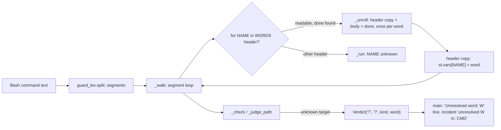
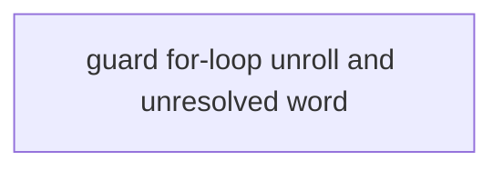

# Superlite: coordinator guard binds for-loop variables, names the unresolved word (B25)

**Goal:** fix #289: the coordinator guard (`guard_judge.py`) blocks `L=P/.superlite/linux; for v in 24 26; do echo hi > $L/node$v.log; done` because a `for` loop variable stays unknown; and an unknown-target block logs only the command, which the feedback entry cuts at 200 characters, so the cause is lost. After the fix the loop is judged once per word, and the block message and the incident name the word the guard could not resolve.
**Architecture:** edits to `skills/subagent-driven-development/scripts/guard_judge.py` only: `_walk` unrolls a readable `for NAME in WORDS; do ...; done` into one copy of its body per word, `_run` makes the variable of every other `for`/`select` header unknown, `Verdict` gains a `word` field (not compared) that every `_unknown` call fills, and `main` prints and logs it. One new test file.
**Tech stack:** Python 3.10+ stdlib, pytest (through `sl run_tests`).
**Spec:** this file, section Design; issue #289's Expected lines are the source.
**Detail:** contracts
**Target-min:** 11
**Wave0:** none

Global constraints:
- Every code line in `skills/subagent-driven-development/scripts/` carries the repo's trailing `# O(...)` complexity comment; tests do not. Follow the file's existing style (short comments after `|`).
- Stdlib only. Existing tests stay green and no existing test file changes (another lead may own them); new tests go in `tests/scripts/test_guard_for_loop_289.py`. If an existing test turns red, report it in DONE_WITH_CONCERNS instead of editing it.
- Run `sl` as an executable (`<abs>/sl ...`). Verify with `<abs>/sl run_tests --fast <test files> --task T1 --background`, then run the printed `wait:` line in the foreground. Never raw `pytest`, never the e2e or eval layers (coordinator's step).
- No version edits (the ship step bumps the version). Only the files T1 owns change.
- The guard fails closed: whenever this design leaves a case open, the variable is unknown (`None`) and the write blocks, as today.

Ruling: one task - both halves of #289 live in guard_judge.py, so two tasks would only run in sequence - cost if wrong: one larger review.
Ruling: detail contracts - a known cause in an existing module; the algorithm is spelled out in Design and the tests are named with exact inputs and outcomes - cost if wrong: one NEEDS_CONTEXT round.
Ruling: the loop is unrolled (body walked once per word, in order, with full shell state) instead of binding NAME to one value plus `st.multi` alternatives, because alternatives run with `persist=False` and drop `cd`, `eval` and derived assignments (`for d in src .superlite; do cd $d; ...`, `g=$f`), which would let a code write through that blocks today - cost if wrong: a long or nested loop spends the step budget sooner and blocks as unknown.
Ruling: `select` is never unrolled; its variable becomes unknown (the user's choice, or empty) - cost if wrong: a `select` loop still blocks, as today.
Ruling: a header whose words cannot all be read (glob, `$(...)`, unknown or reassigned variable, value with whitespace or glob characters, brace sequence, more than MAX_BRACE words, no `in`), or whose loop has no matching unquoted `done`, or whose `done` redirect uses NAME, makes NAME unknown; today such a loop kept NAME's stale earlier value (`f=.superlite/a; for f in src/*.py; do echo > $f; done` passed) - cost if wrong: none beyond today's blocks.
Ruling: `_walk` counts a block keyword after leading `do`/`then`/... words (`do for b in y`) and ignores quoted or dynamic keywords, the same rule the unroller uses to find `done`; today a nested header did not count, so the outer body's later lines lost their conditional state - cost if wrong: a few more `cd`s inside nested blocks count as conditional (stricter).
Ruling: the word is the target as the guard read it (known variables expanded, before the `$VAR/` cut); a `?` target reads `? (from <command>)`; the incident target of an unnamed verdict becomes `unresolved <word> in: <command>` so a 200-character cut keeps it; the protected message stays without a target line - cost if wrong: triage groups old and new incident texts apart once.
Ruling: no probe adapter - a pure library over a command string; Review Focus cases run as named pytest cases - cost if wrong: no generated probes.
Ruling: tests use the real guard_files and guard_tools (no fakes), like test_guard_false_blocks - cost if wrong: none.
LAYERS: unit

## Design

### 1. For-loop unrolling (#289, first Expected)
New helpers in guard_judge.py:
- `_lead(seg) -> int`: index of the first word after the leading LEAD_KW words (`do`, `then`, `!`, ...) that are neither dynamic nor quoted (missing `quoted` entries count as False).
- `_opens(seg) -> bool`: the word at `_lead(seg)` exists, is not dynamic, not quoted, and is in OPEN_KW. `_closes(seg) -> bool`: `seg.words[0]` exists, is not dynamic, not quoted, and is in CLOSE_KW.
- `_loop_values(seg, k, st, ctx) -> list[str] | None`: the words of the header from index `k` (after `in`) as the values bash binds, or None when any is unreadable. Per word, with its glob flag `g` (from `seg.globs`, missing = ""), `dyn` and `quoted`: flag `g` or `u` -> None; flag `b` -> its `_braces(word)` alternatives (None -> None), each read as an unquoted literal; a dynamic word -> None when it uses a variable listed in `st.multi` (`\$\{?NAME\b`) or when it is quoted and starts with `~`, else `_expand(word, st, ctx)`; a literal unquoted word that is `~` or starts with `~/` -> `ctx.home + word[1:]`; any other literal stays as written. A value holding `$`, a backtick, whitespace, `*`, `?` or `[` -> None (bash splits and globs an unquoted `$NAME` later). More than MAX_BRACE values -> None. No values -> None.
- `_unroll(segs, i, st, ctx) -> tuple[int, list, dict] | None`: for the header `segs[i]`: `p = _lead(seg)`; it needs `words[p] == "for"`, `words[p+1]` a NAME (`^[A-Za-z_][A-Za-z0-9_]*$`), `words[p+2] == "in"`, none of those three dynamic or quoted; the header has no bodies, no subshell, no redirects, no heredocs; `_loop_values(seg, p + 3, st, ctx)` is a list; scanning `segs[i+1:]` with depth 1 (`_opens` +1, then `_closes` -1), the segment where depth reaches 0 is `segs[end]` and its first word is `done`; no redirect target of `segs[end]` uses NAME (`\$\{?NAME\b`). Else None. On success it returns `(end, new, binds)`: `new` is, per value in order, a header copy (`dataclasses.replace` of the header with `words = words[:p] + ["for", NAME, "in", value]`, `dyn`, `quoted`, `globs` cut to `p` plus four False/False/"" entries, `sep` kept), then `segs[i+1:end]` (the same objects), then `segs[end]` for the last value and a copy of it with `sep=";"` for the others. `binds` maps `id(header copy)` to `(NAME, value)`.

`_walk` changes:
- It works on `segs = list(segs)` (the caller's list is never changed) and keeps `heads = {}`.
- At the top of each `while i < n` round, before the pipeline scan: when `id(segs[i])` is not in `heads` and `_unroll(segs, i, st, ctx)` returns `(end, new, binds)`, it sets `segs[i:end + 1] = new`, `heads.update(binds)`, `n = len(segs)`. A header after a `|` is never unrolled (it falls to `_run`).
- In the per-segment loop, after the `if not inn: continue` line, a segment whose id is in `heads` calls `_tick(ctx)`, sets `st.vars[NAME] = value`, leaves `u_ok, u_fail = inn, inn` when `i == j`, and is not passed to `_run` or `_alternatives`.
- Its block depth uses `_opens(seg)` for +1 and `_closes(seg)` for -1 instead of `w0`.

`_run` change: after the LEAD_KW loop, when `words[i]` is `for` or `select`, not dynamic, and `words[i+1]` is a NAME, it calls `_assign(st, words[i+1], None)` and returns None (the existing `NO_CMD_KW` return still covers a header without a NAME). The assignment branch moves into `_assign(st, name, new)`, unchanged in behaviour, except that an old value already listed in `st.multi[name]` is not appended again.

The module docstring's walk paragraph says that a readable `for NAME in WORDS` loop is walked once per word with NAME bound to it, and every other loop variable is unknown.

### 2. The unresolved word (#289, second Expected)
- `Verdict` gains `word: str = field(default="", compare=False)`: for an unknown target (`rel == "?"`), the word the guard could not resolve. Existing `Verdict("?", "?", "code") == v` comparisons keep working.
- `_unknown(ctx, word)` passes it on in both kinds (protected and code). Every call names one: `_check` the target after `_expand`, before the `$VAR/` cut (`$L/node$v.log`), and `? (from <ctx.cmd>)` when that text is `?` (`ctx.cmd` = the command's base name, set in `_run_words` after `_unwrap`; `? (from the command)` when unset); `_check_flagged` its `t`; `_judge_path` its `path`; `_walk_text` past MAX_DEPTH `nesting deeper than 8`; `_shell` and `_source_or_eval` a process substitution the word itself (`<(curl -s x)`), a piped program `program piped into <words[0]>`; `judge` on `_Unknown("budget")` `step or time budget`, on `_Unknown("path")` `a path with a NUL`.
- `main`, for a verdict that names no target (`rel` `?` or `.`) with a word: the incident target is `f"unresolved {_flat(v.word)} in: {cmd}"` (then cut by `_incident` as today); for a non-protected kind it prints `Unresolved word: <_flat(word, 500)>` right before the `Blocked command:` line, which stays last. Without a word (the `.` whole-tree verdict) both stay as today. The protected message still names no target.

## Coverage

| Category | State | Basis |
|---|---|---|
| Scope and success criteria | settled | #289 Expected lines; Max's decision: bind NAME to each word, judge per value |
| Domain and data model | settled | `Verdict.word`, not compared |
| Persistence and migration | n/a | incident rows keep their keys |
| Interfaces and contracts | settled | `judge` and `main` signatures unchanged |
| UI states | n/a | hook stderr text |
| Concurrency and state ownership | n/a | one task |
| Error handling and recovery | settled | unreadable loops fail closed (unknown) |
| Security and privacy | settled | unrolling keeps cd, eval and derived assignments per value; protected files still win |
| Performance and limits | settled | MAX_BRACE values per header; step budget covers nesting |
| Observability | settled | `Unresolved word:` line, incident prefix |
| Testing strategy | settled | new unit test file; unit layer by the coordinator |
| Compatibility | settled | blocks named as before keep their lines; `Blocked command:` stays last |
| Rollout | ruled | one PR; version bump at ship |
| Research unknowns | n/a | cause named in the issue, reproduced on 1.5.31 |

## File structure
- `skills/subagent-driven-development/scripts/guard_judge.py`, `tests/scripts/test_guard_for_loop_289.py` (T1).

## Task graph

```mermaid
%% schedule
gantt
  title Predicted schedule (mm:ss)
  dateFormat X
  axisFormat %M:%S
  section lane 1
  T1 guard_judge  unroll readable for loop :t1, 0, 110s
```

critical path: T1 (1.8 min) · peak width 1 · predicted build 1.8 min · predicted total ≈ 5.3 min (target ✓)

## Package: coordinator guard (library over a command string)
**Probe entry:** none (Ruling: no probe adapter).

### T1 guard_judge: unroll readable for loops, name the unresolved word · Complexity 6 · Est. context 55k
**Owns:** skills/subagent-driven-development/scripts/guard_judge.py, tests/scripts/test_guard_for_loop_289.py
**Components:** 2
**LOC owned:** 230
**Tests:** fast
**Model:** sonnet
**Est. time:** 3.5 min (2 components, about 230 LOC, fast tests)
**Covers:** 1, 2
**Consumes:** existing `guard_lex.split(text: str) -> list[Segment]` · existing `guard_types.Segment` (dataclass: words, dyn, redirects, heredocs, bodies, subshell, sep, quoted, globs)
**Produces:** guard_judge.judge(command: str, cwd: str, project: str, mode: str, sds: tuple = ()) -> Verdict | None (signature unchanged; `Verdict.word` added, see Design 2)
**Review Focus:** all cases use a fixture `P` = resolved `tmp_path / "p"` holding `src/`, `docs/plans/`, `.superlite/linux/`, `.superlite/fixes/`; `{P}` is that path; `judge(cmd, cwd or P, P, mode)` with mode `active` unless named.
state: `test_issue_case_passes` (`L={P}/.superlite/linux; for v in 24 26; do echo hi > $L/node$v.log; done` -> None; also mode `human` -> None);
state: `test_newline_loop_passes` (`L={P}/.superlite\nfor v in a b\ndo\n  echo hi > $L/$v.log\ndone` -> None);
state: `test_values_from_vars_and_braces_pass` (parametrized: `D=.superlite; for f in $D/a $D/b; do touch $f; done`, `for v in {24,26}; do echo hi > .superlite/node$v.log; done`, `for d in ~/x; do echo > $d/f; done` -> None);
deep: `test_nested_loops_pass` (`for a in x y; do for b in p q; do echo > .superlite/$a-$b.log; done; done` -> None);
protocol: `test_loop_output_redirects_pass` (parametrized: `for v in a b; do echo $v; done | sort > .superlite/o.txt`, `for v in a b; do echo $v; done > .superlite/o.txt` -> None);
state: `test_each_value_is_judged` (parametrized: `for v in .superlite/a src/x.py; do echo > $v; done` and the values swapped -> `rel == "src/x.py"`, kind `code`);
state: `test_derived_assignment_judged_per_value` (parametrized: `for f in .superlite/a src/x.py; do g=$f; echo > $g; done`, the values swapped, and `for f in .superlite/a src/x.py; do eval "g=$f"; echo > $g; done` with both orders -> `rel == "src/x.py"`, kind `code`);
state: `test_cd_judged_per_value` (cwd `{P}/.superlite`; parametrized: `for d in fixes ../src; do cd $d; echo > x; done` and `for d in ../src fixes; do cd $d; echo > x; done` -> `rel == "src/x"`, kind `code`);
state: `test_body_reassigns_loop_var` (`for v in .superlite/a; do v=src/x; echo > $v; done` -> `rel == "src/x"`);
protocol: `test_quoted_done_is_no_keyword` (`for v in src/x .superlite/a; do\n"done"\necho > $v\ndone` -> `rel == "src/x"`; the quoted `"done"` is a segment of its own and closes nothing);
state: `test_protected_value_blocks` (mode `idle`: `for f in .superlite/a .superlite/orchestrator.json; do echo > $f; done` -> kind `protected`);
state: `test_stale_value_not_reused` (`f=.superlite/a; for f in src/*.py; do echo > $f; done` -> `Verdict("?", "?", "code")`);
encoding: `test_unreadable_list_is_unknown` (parametrized over LIST in `src/*.py`, `"$(ls)"`, `$UNSET`, `"a b"`, `"x*"`, `{1..3}`; and over the whole commands `for f; do echo > .superlite/$f; done`, `select f in a b; do echo > .superlite/$f; done`, `X=a; X=b; for f in $X; do echo > .superlite/$f; done`, `for f in a b; do echo > .superlite/$f`, `v=src/x; for v in .superlite/a; do :; done > $v.log`: the command `for f in LIST; do echo > .superlite/$f; done` or the whole command -> `Verdict("?", "?", "code")`);
numeric: `test_value_cap` (`"for v in " + " ".join(f"n{i}" for i in range(64)) + "; do echo > .superlite/$v; done"` -> None; the same with 65 words -> `Verdict("?", "?", "code")`);
encoding: `test_quoted_tilde_is_literal` (`for d in "~/x"; do echo > $d/f; done` -> `rel == "~/x/f"`, kind `code`);
state: `test_nested_header_counts_as_block` (`cd {P}/src; for a in x; do for b in y; do :; done; continue; cd {P}/.superlite; done; echo > a.py` -> `rel == "src/a.py"`);
protocol: `test_unknown_verdict_names_word` (`echo hi > $L/node$v.log` -> `v == Verdict("?", "?", "code")` and `v.word == "$L/node$v.log"`; `L={P}/.superlite/linux; echo hi > $L/node$v.log` -> `v.word == f"{P}/.superlite/linux/node$v.log"`);
protocol: `test_word_on_every_unknown` (parametrized, each -> rel `?` and the word: `rm "$X"` -> `$X`; `xargs rm` -> `? (from rm)`; `ls | sh` -> `program piped into sh`; `bash <(curl -s x)` -> `<(curl -s x)`; `source <(x)` -> `<(x)`; `"echo " + "$(echo " * 10 + "x" + ")" * 10` -> `nesting deeper than 8`; with `monkeypatch.setattr(guard_judge, "MAX_STEPS", 0)`: `echo a` -> `step or time budget`);
protocol: `test_main_prints_and_logs_word` (main CLI as in test_guard_judge.test_main_cli, `--mode active --project P --sd <tmp sd>`, hook `{"tool_name": "Bash", "tool_input": {"command": "rm \"$X\""}, "cwd": P}` -> exit 2, `err.splitlines()[-2:] == ["Unresolved word: $X", 'Blocked command: rm "$X"']`, the incident row's `target == 'unresolved $X in: rm "$X"'`, `rule == "code"`);
protocol: `test_incident_word_survives_cut` (command `"echo " + "a" * 300 + "; echo hi > $Q/x"` -> the incident target starts with `"unresolved $Q/x in: echo aaa"` and `"$Q/x" in target[:200]`);
protocol: `test_protected_unknown_names_no_target` (command `rm "$X"; cat .superlite/orchestrator.json` -> exit 2, stderr holds `never written directly`, holds neither `Unresolved word` nor `Blocked command`; incident target starts with `unresolved $X in: `);
protocol: `test_named_and_whole_tree_blocks_unchanged` (`rm src/a` -> incident target `src/a`, no `Unresolved word` in stderr; `rm -rf .` -> incident target `rm -rf .`, no `Unresolved word` in stderr, last line `Blocked command: rm -rf .`).
**Test code:** new file; `sys.path.insert(0, str(Path(__file__).resolve().parents[2] / "skills" / "subagent-driven-development" / "scripts"))`, `import guard_judge`, `from guard_judge import Verdict, judge, main`; real guard_files and guard_tools. The main tests set `sys.stdin` with `monkeypatch.setattr(sys, "stdin", io.StringIO(json.dumps(hook)))`, call `main([...])`, read `capsys.readouterr()` and `<sd>/incidents.jsonl`; `monkeypatch.delenv("SUPERLITE_FLEET_PARENT_DIR", raising=False)` and `SUPERLITE_GUARD_NONCE` likewise.
**Steps:** 1 failing tests, 2 run: FAIL, 3 implement, 4 run: PASS (also every `tests/scripts/test_guard_*.py`, `tests/scripts/test_block_coordinator_edits.py`, `tests/scripts/test_lead_guard_190.py`, `tests/scripts/test_inline_worktree_guard.py`, `tests/scripts/test_orchestrator_worktree_guard.py` stay green).
**Notes:** `dataclasses.replace` copies a Segment (import `field` and `replace` from dataclasses). `_tick` per header copy keeps nested loops inside MAX_STEPS. The unroller never edits the lexer's Segment objects. The second loop in `_walk_text` (re-walk when the directories change) stays as it is: it calls `_walk` with the original segments, which unrolls again.

## Review Focus
Package coordinator guard: app type library (a shell-command judge); categories state (variables and directories across iterations), deep (nested loops, the step budget), encoding (quotes, globs, braces, tilde), protocol (block message lines, incident text), numeric (the MAX_BRACE cap). Specific risks: a loop whose unrolled body misses a value that writes code (cd, eval, derived assignment, `"done"`); a stale earlier value judged instead of the loop's; a `done` redirect evaluated with the wrong value; a quoted glob value judged as a literal path; the `Blocked command:` line no longer last. T1 lists the named cases.

## Self-review
Coverage: #289 both Expected lines in T1 (sections 1 and 2). No placeholders. One task, no edges.
