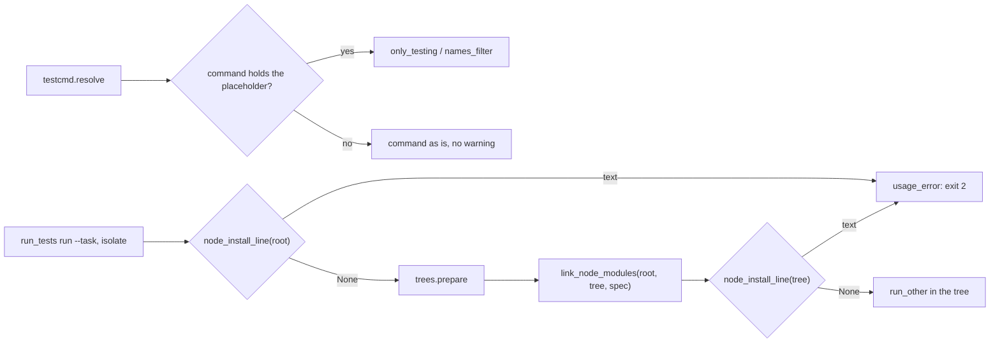
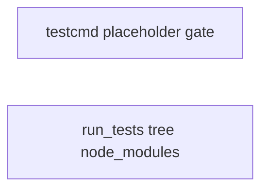

# Superlite: Node task trees get node_modules, testcmd warns only for {only_testing} (B24)

**Goal:** fix #283 (an isolated `--task` tree of a Node project has no `node_modules`, so `vitest: not found`) and #291 (`testcmd.resolve` prints the Xcode `-only-testing` warning on `--fast` runs of non-Swift projects). Each fix ships with regression tests.
**Architecture:** edits to `skills/subagent-driven-development/scripts/testcmd.py` (`resolve` expands a placeholder only when the command holds it) and `skills/subagent-driven-development/scripts/run_tests.py` (new `link_node_modules`, the Node guard also checks the task tree, new `usage_error`); one new test file per task.
**Tech stack:** Python 3.10+ stdlib, pytest (through `sl run_tests`).
**Spec:** this file, section Design; the issue bodies on GitHub are the source for each Expected line.
**Detail:** contracts
**Target-min:** 11
**Wave0:** none

Global constraints:
- Code lines under `skills/subagent-driven-development/scripts/` carry the repo's trailing `# O(...)` complexity comment; tests do not. Follow each file's existing style.
- Stdlib only. Existing tests stay green; a task changes no existing test file (another lead may own them): new tests go in the new file its Owns names.
- Run `sl` as an executable (`<abs>/sl ...`). Verify with `<abs>/sl run_tests --fast <test files> --task Tn --background`, then run the printed `wait:` line in the foreground. Never raw `pytest`, never the e2e or eval layers (coordinator's step).
- No version edits (the ship step bumps the version). Only the files a task owns change.
- Tests build their projects under `tmp_path`; they never write the real repo's `.superlite/`. Tests that run `run_tests` unset `SUPERLITE_FLEET_ROLE`, `SUPERLITE_FLEET_PARENT_DIR` and `SUPERLITE_STATE_DIR` (`monkeypatch.delenv(..., raising=False)`, or popped from a subprocess env).

Ruling: detail contracts - fixes in existing modules with known causes; tests named with exact inputs and outcomes - cost if wrong: one NEEDS_CONTEXT per task.
Ruling: #283 follows Max's decision (symlink to the run root's node_modules): the link is relative (`../../../node_modules` for `.superlite/trees/Tn`), so a moved checkout keeps it - cost if wrong: none, the tree lives inside the run root.
Ruling: #283 links only when the run root holds `package.json` (a file) and a `node_modules` folder, the spec has no `setup` command, and the tree has no `node_modules` entry or only a symlink that does not resolve to the root's; a real tree `node_modules` (file or folder) is never touched - cost if wrong: a project whose `setup` is not an install (`cp .env.example .env`) gets no link and stops at the tree guard, which names the install.
Ruling: #283 no link when a `setup` command exists, because `npm ci` in the tree would empty the run root's `node_modules` through the link - cost if wrong: as above.
Ruling: #283 the link does not depend on the runner word (a `make test` that runs vitest links too); the guard after it does, as `node_install_line` already rules - cost if wrong: a non-Node project with a stray `package.json` and `node_modules` gets an unused link in its tree.
Ruling: #283 after linking, `run` calls `node_install_line(tree, spec)`; a text is the same usage error as the root's (exit 2, summary error, no incident), naming the tree - this is the issue's second Expected option, reached only when the link failed (an `OSError`, e.g. Windows without symlink rights) - cost if wrong: none beyond the text.
Ruling: #283 a new `usage_error(a, label, reason) -> int` replaces the four exit-2 blocks in `run` that print `0 0 0 0.0` (plan not found, Node guard, missing path, and the new tree guard); behaviour unchanged - one place instead of four copies - cost if wrong: an existing branch's text changes, caught by the existing tests.
Ruling: #291 `resolve` expands `{names}` and `{only_testing}` only when the command holds them; a full run with `{only_testing}` still expands it to the empty string - cost if wrong: none.
Ruling: no probe adapter - script internals over local files; Review Focus cases run as named pytest cases - cost if wrong: no generated probes.
LAYERS: unit

## Design

### 1. #291 placeholders expand only when present
In `testcmd.resolve`, `names_filter(paths)` runs only when `"{names}" in command` and `only_testing(paths, root)` only when `"{only_testing}" in command`; otherwise the command stays as it is. `only_testing` itself is unchanged, so an Xcode template still warns for a file that declares no suite.

### 2. #283 isolated Node task tree
`run_tests.link_node_modules(root, tree, spec)` (rules in the Rulings above) creates `tree/node_modules` as a relative directory symlink to `root/node_modules`, replacing a symlink in the tree that does not resolve to the root's, and returns True when it created one; it returns False when it leaves the tree as it is or `os.symlink` raises `OSError`. In `run`'s isolate branch, right after `trees.prepare`, `run` calls `link_node_modules(Path.cwd(), tree, spec)`, then `node_install_line(tree, spec)`; a text goes to `usage_error`. `trees.clean` already removes a link without following it; a test pins that the root's `node_modules` survives.

## Coverage

| Category | State | Basis |
|---|---|---|
| Scope and success criteria | settled | two issues in Goal; each issue's Expected line |
| Domain and data model | n/a | no data shapes change |
| Persistence and migration | n/a | summary keys unchanged |
| Interfaces and contracts | settled | `resolve` and `run` signatures unchanged; two new functions with Produces lines |
| UI states | n/a | CLI text |
| Concurrency and state ownership | settled | T1 and T2 own disjoint files; a tree is prepared under its lock |
| Error handling and recovery | settled | link failure falls through to the tree guard (exit 2, names the install) |
| Security and privacy | n/a | local files only |
| Performance and limits | settled | a few stats and one symlink per task run |
| Observability | settled | stderr line and summary `error` |
| Testing strategy | settled | new unit test file per task; unit layer by the coordinator |
| Compatibility | settled | non-Node trees and non-Swift templates unchanged; Xcode templates warn as today |
| Rollout | ruled | one PR; version bump at ship |
| Research unknowns | n/a | causes named in the issues |

## File structure
- `skills/subagent-driven-development/scripts/testcmd.py`, `tests/scripts/test_testcmd_placeholder_gate.py` (T1).
- `skills/subagent-driven-development/scripts/run_tests.py`, `tests/scripts/test_run_tests_tree_node_modules.py` (T2).

## Task graph

critical path: T2 (1.5 min) · peak width 2 · predicted build 1.5 min · predicted total ≈ 5.0 min (target ✓)

## Package: superlite scripts (script internals over local files)
**Probe entry:** none (Ruling: no probe adapter).

### T1 testcmd: expand {names} and {only_testing} only when present · Complexity 2 · Est. context 30k
**Owns:** skills/subagent-driven-development/scripts/testcmd.py, tests/scripts/test_testcmd_placeholder_gate.py
**Components:** 1
**LOC owned:** 70
**Tests:** fast
**Kind:** mechanical
**Model:** haiku
**Est. time:** 1.5 min (1 component, about 70 LOC, fast tests)
**Covers:** 1
**Consumes:** nothing executed from another task.
**Produces:** testcmd.resolve(root=".", paths=()) -> dict | None (signature unchanged)
**Review Focus:** encoding: `test_node_fast_no_only_testing_warning` (tmp project `package.json` `{"scripts": {"test": "vitest"}, "devDependencies": {"vitest": "1"}}`, empty `src/a.test.ts`; `testcmd.resolve(tmp_path, ["src/a.test.ts"])` -> `capsys` stderr is `""`, `"src/a.test.ts" in spec["command"]`); encoding: `test_cli_fast_node_stderr_clean` (same project; `subprocess.run([sys.executable, str(SCRIPTS / "testcmd.py"), "--root", str(tmp_path), "--fast", "src/a.test.ts"])` -> exit 0, `"-only-testing" not in stderr`, `"declares no test suite" not in stderr`); encoding: `test_names_template_no_warning` (`.superlite/test-cmd.json` `{"language": "swift", "test": "swift test", "test_file": "swift test --filter {names}"}`, empty `Tests/AppTests/FooTests.swift`; resolve with that path -> command `"swift test --filter FooTests"`, stderr `""`); encoding: `test_only_testing_template_still_warns` (`{"language": "swift", "test": "xcodebuild test -scheme X {only_testing}"}`, empty `Tests/AppTests/Empty.swift`; resolve with that path -> command `"xcodebuild test -scheme X -only-testing:AppTests/Empty"`, stderr holds `testcmd: Tests/AppTests/Empty.swift declares no test suite; using -only-testing:AppTests/Empty`); encoding: `test_full_run_blanks_only_testing` (same config, `testcmd.resolve(tmp_path)` -> `"{only_testing}" not in command`, command `"xcodebuild test -scheme X "`).
**Test code:** new file; `SCRIPTS = Path(__file__).resolve().parents[2] / "skills" / "subagent-driven-development" / "scripts"`, `sys.path.insert(0, str(SCRIPTS))`, `import testcmd`; `tmp_path` is no git repo, so `main_checkout_config` finds nothing.
**Steps:** 1 failing tests, 2 run: FAIL, 3 implement, 4 run: PASS (also `tests/scripts/test_testcmd.py`, `test_testcmd_xcode.py`, `test_testcmd_xcode_suites.py` stay green).
**Notes:** One line in `resolve` becomes two guarded replaces (`if "{names}" in command: ...`, `if "{only_testing}" in command: ...`). Nothing else changes.

### T2 run_tests: isolated Node task tree links the root's node_modules · Complexity 4 · Est. context 42k
**Owns:** skills/subagent-driven-development/scripts/run_tests.py, tests/scripts/test_run_tests_tree_node_modules.py
**Components:** 1
**LOC owned:** 190
**Tests:** fast
**Model:** sonnet
**Est. time:** 3 min (1 component, about 190 LOC, fast tests)
**Covers:** 2
**Consumes:** existing `trees.prepare(root, task, owns) -> Path` · existing `trees.clean(root) -> int` · existing `run_tests.node_install_line(root: Path, spec: dict) -> str | None`
**Produces:** run_tests.link_node_modules(root: Path, tree: Path, spec: dict) -> bool · run_tests.usage_error(a, label: str, reason: str) -> int
e.g. `link_node_modules(Path("/p"), Path("/p/.superlite/trees/T1"), {"setup": ""})` with `/p/package.json` and a `/p/node_modules` folder, no tree `node_modules` -> `True`, `os.readlink("/p/.superlite/trees/T1/node_modules") == "../../../node_modules"`
e.g. the same call again -> `False` (link already resolves to the root's)
e.g. the same with spec `{"setup": "npm ci"}` -> `False`, no link
**Review Focus:** file: `test_task_tree_links_root_node_modules` (git repo under `tmp_path` like `tests/scripts/test_trees.py`'s `repo` fixture, plus a committed `package.json` `{"devDependencies": {"vitest": "1"}}`, `.gitignore` `node_modules/`, `node_modules/marker.txt` `"root"`, `plan.md` whose T1 owns `src/a.test.ts`; `testcmd.resolve` monkeypatched to an isolate spec `{"language": "typescript", "python": False, "isolate": True, "junit": "", "env": {}, "setup": "", "source": "test", "command": "python3 -c \"open('seen.txt','w').write(open('node_modules/marker.txt').read()); print('Tests  1 passed (1)')\""}`; `run_tests.main(["--fast", "src/a.test.ts", "--task", "T1", "--plan", "plan.md", "--summary", ".superlite/test-summary.json", "--log", ".superlite/incidents.jsonl", "--ledger", ".superlite/progress.md"])` -> 0, `tree/node_modules` is a symlink, `os.readlink` -> `"../../../node_modules"`, `tree/seen.txt` reads `"root"`); state: `test_second_run_keeps_link` (run twice -> both 0, link unchanged); state: `test_stale_link_replaced` (tree `node_modules` a symlink to `tmp_path / "gone"` before the second run -> replaced, `seen.txt` reads `"root"`); state: `test_real_tree_node_modules_kept` (a real `tree/node_modules/marker.txt` `"tree"` before the second run -> still a folder, not a link, `seen.txt` reads `"tree"`); state: `test_setup_command_no_link` (direct call, spec `{"setup": "npm ci"}` -> `False`, no `tree/node_modules`); file: `test_no_package_json_no_link` (direct call, root without `package.json` -> `False`, no link); file: `test_no_root_node_modules_no_link` (direct call, no root `node_modules` -> `False`); protocol: `test_link_failure_tree_guard_names_tree` (posix only; `os.symlink` monkeypatched to raise `OSError`; spec command `"npm test"`, committed `bun.lock`, fake `npm` on `PATH` writing `ran.txt` -> exit 2, stderr holds `run_tests: node_modules missing in <tree>: run bun install --frozen-lockfile first` (`<tree>` = `str(tmp_path.resolve() / ".superlite/trees/T1")`), `.superlite/test-summary.json` `error` equals that text, no `test-failure` and no `no-result` in `.superlite/incidents.jsonl`, no `ran.txt` in the tree); file: `test_trees_clean_keeps_root_node_modules` (after the first case, `trees.clean(tmp_path)` -> `node_modules/marker.txt` still reads `"root"`); protocol: `test_usage_error_shape` (direct `usage_error(a, "fast", "boom")` with `a.summary` under `tmp_path`, `a.run_id = None` -> returns 2, stderr `run_tests: boom`, stdout `0 0 0 0.0`, summary `error` `"boom"`).
**Test code:** new file; `from test_plan_tools import SCRIPTS` as `tests/scripts/test_trees.py` does; in-process `run_tests.main` with `monkeypatch.chdir(repo)`; the fake `npm` is a `#!/bin/sh` script (`chmod 0o755`) prepended to `PATH` with `monkeypatch.setenv`; mark the PATH test `pytest.mark.skipif(os.name == "nt", ...)`.
**Steps:** 1 failing tests, 2 run: FAIL, 3 implement, 4 run: PASS (also `tests/scripts/test_run_tests_*.py` and `tests/scripts/test_trees.py` stay green).
**Notes:** The link target is `os.path.relpath(root / "node_modules", tree)` from resolved paths; a tree symlink counts as right when `(tree / "node_modules").resolve() == (root / "node_modules").resolve()`; a dangling or wrong one is unlinked first. `usage_error` mirrors today's blocks: `print(f"run_tests: {reason}", file=sys.stderr)`, `write_summary(a.summary, label, zero counts, [], 0.0, error=reason)`, `publish_summary(a)`, `print("0 0 0 0.0")`, return 2. Name the tree guard in the module docstring next to the root guard.

## Review Focus
Package superlite scripts: app type CLI internals; categories file (symlink, package.json, node_modules forms), state (reuse, stale link, real folder, setup), protocol (exit codes, stderr and summary text), encoding (placeholder expansion). Specific risks: a link that lets a tree `npm ci` or `trees clean` delete the root's `node_modules`; a real tree `node_modules` replaced; an Xcode template that stops warning; an incident logged for the usage error. Each task lists its named cases.

## Self-review
Coverage: #291 T1, #283 T2. No placeholders. T1 and T2 share no file; no edges (T2's tests fake `testcmd.resolve`).
