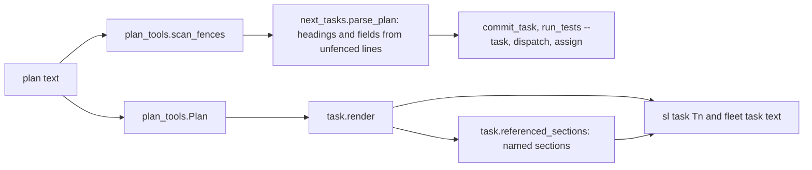
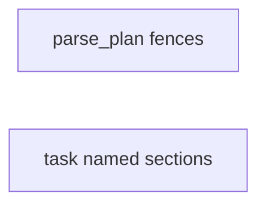

# Superlite: plan parser fences and task sections batch (B15)

**Goal:** fix #263 (`next_tasks.parse_plan`, the parser behind `commit_task`, `run_tests --task`, `dispatch` and `assign`, reads `### T` headings and `**Owns:**` lines inside fenced code blocks, so a task quoting a mini plan loses its real Owns) and #268 (`sl task Tn` omits the plan sections the task block names, such as a shared helper section). Each fix ships with regression tests.
**Architecture:** edits to `skills/subagent-driven-development/scripts/next_tasks.py` (`parse_plan`, `_field`) and `skills/subagent-driven-development/scripts/task.py` (`render`, new `referenced_sections`); one new test file per fix.
**Tech stack:** Python 3.10+ stdlib, pytest (through `sl run_tests`).
**Spec:** this file, section Design; the issue bodies on GitHub are the source for each Expected line.
**Detail:** contracts
**Target-min:** 11
**Wave0:** none

Global constraints:
- Code lines under `skills/subagent-driven-development/scripts/` carry the repo's trailing `# O(...)` complexity comment; tests do not. Follow each file's existing style.
- Stdlib only. Existing tests stay green; a task changes no existing test file (another lead may own them): new tests go in the new file its Owns names.
- Run `sl` as an executable (`<abs>/sl ...`). Verify with `<abs>/sl run_tests --fast <test files> --task Tn --background`, then run the printed `wait:` line in the foreground. Never raw `pytest`, never the e2e or eval layers (coordinator's step).
- No version edits (the ship step bumps the version). No edits to `docs/` (another lead may own them).
- Tests build their plans and repos under `tmp_path`; they never write the real repo's `.superlite/`.

Ruling: detail contracts - small fixes in existing modules with known causes, tests named with exact inputs and outcomes - cost if wrong: one NEEDS_CONTEXT per task.
Ruling: #263 reuses `plan_tools.scan_fences` (the fence flags lint and `sl task` already use) instead of a second fence scanner, so `parse_plan` and `plan_tools.Plan` agree on what is fenced, an unterminated fence included - cost if wrong: an unterminated fence hides the tasks after it from commit_task too, as it already does from lint.
Ruling: #268 takes the issue's first option (the output includes the named sections); no lint warning - cost if wrong: a reference the matcher misses (a paraphrase) still never reaches the implementer.
Ruling: #268 a one-word heading (`## Design`) counts only when named explicitly (`Design section`, `section Design`, `§ Design`, `## Design`), because field values such as `**Kind:** design` would otherwise pull it into every task; a heading of two or more words counts wherever its phrase appears - cost if wrong: a one-word section named in passing is not printed.
Ruling: no probe adapter - script internals over local files; Review Focus cases run as named pytest cases - cost if wrong: no generated probes.



## Design

### 1. #263 fence-aware plan parser
`parse_plan` computes the fence flags of the plan's lines once with `plan_tools.scan_fences` (imported through `sibling("plan_tools")`). A fenced line never starts a task and never ends one: it only joins the current task's body. `info["body"]` keeps every line verbatim, fenced ones included. The `**Owns:**` field, `Est. time`, `Est. context` and the `**Owns:**` marker test for non-`T` ids read only the body's unfenced lines. `_field(body, name)` keeps its signature and skips lines inside fences of `body`.

### 2. #268 sections a task names
`task.referenced_sections(plan, task)` returns, in plan order, the text of each plan section the task block names. A section starts at an unfenced `##` or `###` heading that is not a task heading, and runs up to the line before the next unfenced heading of the same or a higher level, or the next task heading, or the end of the plan; its text is those lines verbatim, trailing blank lines dropped. Sections whose body is blank, and the plan-skeleton headings Coverage, Task graph, Predicted schedule, Review Focus and Self-review, are never returned. A section inside another returned section is dropped (printed once, with its parent).
The heading's phrase: the heading text without `#` marks, backticks, a leading section number (`2.`, `3.1`) and a trailing `:`, lowercased, whitespace collapsed. The task's text: its block's unfenced lines with backticks and `*` removed, lowercased, whitespace collapsed. A phrase of two or more words is named when it occurs at word boundaries (a plural `s` on either side allowed); a one-word phrase only in the explicit forms of the ruling above. `render` appends, after `## Consumed interfaces`, the line `## Plan sections this task names` and then each returned section, separated by blank lines; with none, the output is unchanged.

## Coverage

| Category | State | Basis |
|---|---|---|
| Scope and success criteria | settled | two issues in Goal; each issue's Expected line |
| Domain and data model | n/a | no data shapes change |
| Persistence and migration | n/a | no stored files change |
| Interfaces and contracts | settled | `parse_plan`, `_field`, `render` signatures unchanged; `referenced_sections` new |
| UI states | n/a | CLI text |
| Concurrency and state ownership | settled | T1 and T2 own disjoint files |
| Error handling and recovery | settled | unterminated fence: same flags as lint |
| Security and privacy | n/a | local files only |
| Performance and limits | settled | one extra pass over the plan lines; sections bounded by the plan size |
| Observability | n/a | no new output beyond the sections |
| Testing strategy | settled | new unit test file per task; unit layer by the coordinator |
| Compatibility | settled | plans without fences or named sections parse and render as today |
| Rollout | ruled | one PR; version bump at ship |
| Research unknowns | n/a | causes named in the issues |

## File structure
- `skills/subagent-driven-development/scripts/next_tasks.py`, `tests/scripts/test_parse_plan_fences.py` (T1).
- `skills/subagent-driven-development/scripts/task.py`, `tests/scripts/test_task_sections.py` (T2).

## Task graph

```mermaid
%% schedule
gantt
  title Predicted schedule (mm:ss)
  dateFormat X
  axisFormat %M:%S
  section lane 1
  T2 task  sl task prints the plan section :t2, 0, 93s
  section lane 2
  T1 next_tasks  parse_plan ignores fenced :t1, 0, 86s
```




critical path: T2 (1.6 min) · peak width 2 · predicted build 1.6 min · predicted total ≈ 5.1 min (target ✓)

## Package: superlite scripts (script internals over local files)
**Probe entry:** none (Ruling: no probe adapter).

### T1 next_tasks: parse_plan ignores fenced headings and fields · Complexity 3 · Est. context 34k
**Owns:** skills/subagent-driven-development/scripts/next_tasks.py, tests/scripts/test_parse_plan_fences.py
**Components:** 1
**LOC owned:** 120
**Tests:** fast
**Model:** sonnet
**Est. time:** 2.5 min (1 component, about 120 LOC, fast tests)
**Covers:** 1
**Consumes:** nothing executed from another task.
**Produces:** next_tasks.parse_plan(plan) -> dict (signature unchanged) · next_tasks._field(body, name) -> str (signature unchanged)
**Review Focus:** state: `test_fenced_task_heading_keeps_real_task` (T1 block: `**Owns:** src/a.py`, then a ```` ```markdown ```` fence holding `### T1 fake` and `**Owns:** fake.py` -> `parse_plan(p)["T1"]["owns"] == ["src/a.py"]`, title unchanged); state: `test_fenced_owns_before_real_owns` (fence holding `**Owns:** fake.py` above the real `**Owns:** src/a.py` -> owns `["src/a.py"]`); state: `test_fenced_other_id_is_no_task` (fence in T1 holding `### T9 fake` and `**Owns:** fake.py` -> `"T9" not in parse_plan(p)`); state: `test_fenced_comment_heading_does_not_end_task` (a ```` ```bash ```` fence holding `# setup` and `## notes`, real `**Owns:** src/a.py` after the fence -> owns `["src/a.py"]`); encoding: `test_tilde_and_long_fences` (a `~~~` fence and a ```` ```` ```` fence that holds a ```` ``` ```` line, each holding `**Owns:** fake.py` -> owns `["src/a.py"]`); state: `test_est_time_ignores_fence` (no Est. time in the heading, fenced `**Est. time:** 9 min`, real `**Est. time:** 2.5 min` after it -> `est_time == 2.5`); file: `test_body_keeps_fenced_lines` (`info["body"]` holds the fenced `### T1 fake` line); file: `test_field_skips_fenced_lines` (`_field("```\n**Owns:** x.py\n```\n**Owns:** y.py", "Owns") == "y.py"`, and `== ""` when the only Owns line is fenced); file: `test_unterminated_fence_matches_plan_tools` (T1 with an unclosed fence, then `### T2` -> `set(parse_plan(p)) == {t.id for t in plan_tools.Plan.load(p).tasks}`); protocol: `test_commit_task_commits_real_owns` (tmp git repo from `make_repo`, `plan.md` replaced by a plan whose T1 owns `src/a.py` and quotes a mini plan `### T1 fake` / `**Owns:** fake.py` in a fence, plan committed; write `src/a.py` -> `commit_task T1 --plan plan.md` exit 0, the checkpoint entry's files hold `src/a.py`).
**Test code:** new file; `from test_run_scripts import SCRIPTS, ENV, git, make_repo, run, write`, `sys.path.insert(0, str(SCRIPTS))`, `import next_tasks as nt, plan_tools`; plans written to `tmp_path / "plan.md"`; the commit test runs `run("commit_task", "T1", "--plan", "plan.md", cwd=repo, env={**ENV, "SUPERLITE_AUTOCOMMIT": "0"})` and reads `.superlite/checkpoints.json` `entries` as `tests/scripts/test_commit_scope_batch.py` does (import nothing else from it).
**Steps:** 1 failing tests, 2 run: FAIL, 3 implement, 4 run: PASS (also `tests/scripts/test_run_scripts.py`, `test_0_3_1_scripts.py`, `test_commit_*.py`, `test_batching.py` stay green).
**Notes:** Read section `### 1. #263 fence-aware plan parser` under `## Design` in the plan file first: it is the contract. Use the flags from `pt.scan_fences(lines)` for the whole plan in `parse_plan` (one pass); `_field` runs `scan_fences` on `body.split("\n")` itself. Only `_TASK_HEADING` and the `_HEADING` end-of-task check skip fenced lines; everything else in the loop stays. The module docstring says that headings and fields inside fenced blocks are ignored.

### T2 task: sl task prints the plan sections the task names · Complexity 4 · Est. context 36k
**Owns:** skills/subagent-driven-development/scripts/task.py, tests/scripts/test_task_sections.py
**Components:** 1
**LOC owned:** 170
**Tests:** fast
**Model:** sonnet
**Est. time:** 3 min (1 component, about 170 LOC, fast tests)
**Covers:** 2
**Consumes:** existing `plan_tools.Plan(text: str, path: Path | None = None)` (`.lines`, `.fenced`, `.tasks`, `Task.line`, `Task.text`)
**Produces:** task.referenced_sections(plan, task) -> list[str] · task.render(plan, tid) -> str (signature unchanged)
**Review Focus:** state: `test_multiword_heading_named` (plan `## Shared helper` with body ``` `fmt_row(cells) -> str` joins with " | ". ```, T2 text `Use the shared helper fmt_row.` -> `render(plan, "T2")` holds `## Plan sections this task names` and the section text verbatim); encoding: `test_backticks_case_and_number` (`### 2. The \`fmt_row\` Helper:` named by `the fmt_row helper` -> returned); encoding: `test_plural_either_side` (`## Shared helpers` named by `shared helper`, and `## Shared helper` named by `shared helpers` -> returned); state: `test_one_word_needs_explicit_form` (`## Design` section; a task holding only `**Kind:** design` -> `[]`; tasks saying `see the Design section`, `section Design`, `§ Design`, `## Design` -> returned each); state: `test_unnamed_section_absent` (`## Wire format` not named -> `[]` and `render` output equals the old output, no `## Plan sections` line); state: `test_skeleton_headings_skipped` (plan `## Review Focus` and `## Coverage` sections, task with a `**Review Focus:**` field and the words `coverage table` -> `[]`); file: `test_section_ends_at_task_heading` (`## Package A` with preamble `Shared: X = 1` then `### T1 ...` -> the returned text is `## Package A\nShared: X = 1`, no `### T1` line); file: `test_subsection_once_with_parent` (`## Notes` holding `### Retry policy`; a task naming `notes section` and `retry policy` -> one entry, the `## Notes` text including the subsection; naming only `retry policy` -> only the `### Retry policy` text); file: `test_empty_preamble_skipped` (`## Package B` directly followed by `### T3` and named by `package b` -> `[]`); encoding: `test_fenced_heading_and_mention_ignored` (a fenced `## Shared helper` line is no section; a mention `shared helper` only inside the task's fence does not name a real `## Shared helper`); protocol: `test_cli_prints_sections` (`task.main(["T2", "--plan", str(p)])` returns 0 and stdout ends with the section text plus `\n`); protocol: `test_consumed_interfaces_kept` (a task with a Consumes line keeps `## Consumed interfaces` before `## Plan sections this task names`).
**Test code:** new file; `from test_plan_tools import SCRIPTS`, `sys.path.insert(0, str(SCRIPTS))`, `import task, plan_tools as pt`; plans built with `pt.Plan(text)` or written to `tmp_path / "plan.md"` for the CLI test; no taskgraph needed (`render` does not read it).
**Steps:** 1 failing tests, 2 run: FAIL, 3 implement, 4 run: PASS (also `tests/scripts/test_fleet_io.py`, `test_fleet_io_roles.py`, `test_slim_prime.py`, `test_coordinator_target.py` and every test that imports `task` stay green).
**Notes:** Read section `### 2. #268 sections a task names` under `## Design` in the plan file first: it is the contract. Task headings are the lines `{t.line for t in plan.tasks}`; heading levels come from `^(#{1,6})\s`. Section phrases and the task text are normalized as in Design 2; word boundaries are `(?<![\w-])` and `(?![\w-])`. Skeleton phrases: `coverage`, `task graph`, `predicted schedule`, `review focus`, `self-review`, `self review`. The module docstring names the new output part.

## Review Focus
Package superlite scripts: app type CLI internals (plan parser); categories state (fence state across task boundaries, section ranges), encoding (fence kinds and lengths, heading normalization), file (body text kept verbatim), protocol (commit_task and `sl task` output). Specific risks: an unterminated fence that `parse_plan` and `plan_tools.Plan` read differently; a field value or skeleton heading that pulls a large section into every task; a section printed twice. Each task lists its named cases.

## Self-review
Coverage: #263 T1, #268 T2. No placeholders. T1 and T2 share no file; no edges.
