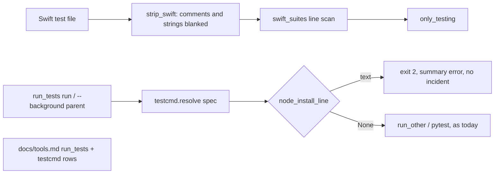
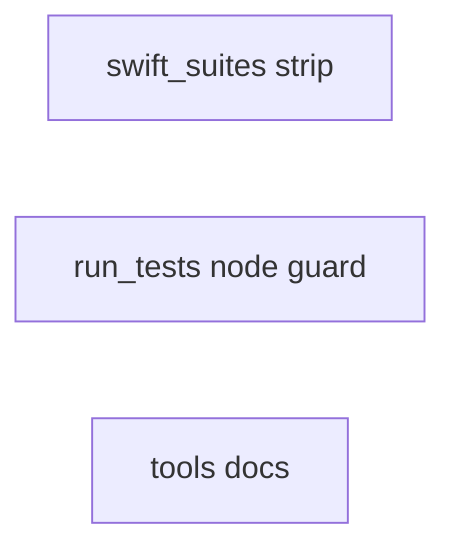

# Superlite: run_tests Node guard, Swift suite scan, tools docs batch (B16)

**Goal:** fix #258 (`testcmd.swift_suites` ends a type's block at a column-0 `}` inside a multi-line string or block comment), #269 (`run_tests` runs a Node test command before `node_modules` exists and logs stale test-failure incidents), #259 (`docs/tools.md` misses the 1.5.21 `run_tests` changes: unit stamp, usage error, no-count stop). Each fix ships with regression tests.
**Architecture:** edits to `skills/subagent-driven-development/scripts/testcmd.py` (new `strip_swift`, used by `swift_suites`), `skills/subagent-driven-development/scripts/run_tests.py` (new `node_install_line`, checked in `run` and in the `--background` parent), `docs/tools.md` (the `run_tests` and `testcmd` rows); one new test file per task.
**Tech stack:** Python 3.10+ stdlib, pytest (through `sl run_tests`).
**Spec:** this file, section Design; the issue bodies on GitHub are the source for each Expected line.
**Detail:** contracts
**Target-min:** 11
**Wave0:** none

Global constraints:
- Code lines under `skills/subagent-driven-development/scripts/` carry the repo's trailing `# O(...)` complexity comment; tests do not. Follow each file's existing style.
- Stdlib only. Existing tests stay green; a task changes no existing test file (another lead may own them): new tests go in the new file its Owns names.
- Run `sl` as an executable (`<abs>/sl ...`). Verify with `<abs>/sl run_tests --fast <test files> --task Tn --background`, then run the printed `wait:` line in the foreground. Never raw `pytest`, never the e2e or eval layers (coordinator's step).
- No version edits (the ship step bumps the version). Only the files a task owns change.
- Tests build their projects under `tmp_path`; they never write the real repo's `.superlite/`.

Ruling: detail contracts - fixes in existing modules with known causes; tests named with exact inputs and outcomes - cost if wrong: one NEEDS_CONTEXT per task.
Ruling: #258 blanks comments and string literal contents to spaces before the scan (newlines kept, string delimiters kept), instead of teaching the block scan about strings - one pre-pass, the scan stays line-based - cost if wrong: a Swift construct the scanner does not know (a `/.../` regex literal holding `"`) blanks code until the line or string ends.
Ruling: #269 a Node runner is the command's first word after leading `NAME=value` words, one of `npm npx pnpm yarn bun bunx vitest jest mocha`; the check applies only when `package.json` at the run root declares a non-empty `dependencies` or `devDependencies`, the spec has no `setup` command (it may install), no `node_modules` folder exists and no Yarn PnP file (`.pnp.cjs`, `.pnp.js`) exists - cost if wrong: a Node script run through another wrapper (`cd web && npm test`) still runs without the guard.
Ruling: #269 the install command comes from `wave0.LOCKFILES` (first Node lockfile present, `uv.lock` skipped), else `npm install`; the message is `node_modules missing in <root>: run <command> first` - cost if wrong: `--frozen-lockfile` variants fail on a lockfile out of date, which the user then sees from the install itself.
Ruling: #269 the `--background` parent refuses the same way (exit 2, no `summary:` line), like the missing pytest path (#235) - cost if wrong: none beyond the text.
Ruling: #259 T3 also documents the #269 usage error and the #258 blanking, so docs match the shipped code; T3 has no edge (its test reads docs, runs no code) - cost if wrong: doc wording drifts from the code's message, caught by review.
Ruling: no probe adapter - script internals over local files; Review Focus cases run as named pytest cases - cost if wrong: no generated probes.
LAYERS: unit

## Design

### 1. #258 Swift suite scan ignores comments and strings
`testcmd.strip_swift(text)` returns `text` with the same length and the same characters at every `\n` and `\r` position; every other character inside a comment (`//` to the line end; `/* */`, nested, as Swift nests them) becomes a space, comment delimiters included; inside a string literal every content character becomes a space while the delimiters stay (`"`, `"""`, and the `#` runs of a raw string `#"..."#`, `##"""..."""##`). A non-raw string treats `\` plus the next character as content (so `\"` never closes it); a single-line `"..."` string also ends at the line end. A raw string closes only at its quote plus the same number of `#`. A `#` not followed by `#`s and a `"` is code (`#if`, `#endif`, `#available`). An unterminated comment or string blanks to the end of the text, without an exception. `swift_suites` scans `strip_swift(text).splitlines()` instead of `text.splitlines()`; nothing else in it changes.

### 2. #269 Node runner without node_modules
`run_tests.node_install_line(root, spec)` returns the usage-error text or None (rules in the Rulings above). `run` calls it right after `testcmd.resolve` (after the `spec is None` branch) with `Path.cwd()`: on a text it prints `run_tests: <text>` on stderr, writes the summary with `error=<text>`, publishes it, prints `0 0 0 0.0` and returns 2; no incident, no ledger line. The `--background` parent resolves the spec (fast paths as today; a full run: `testcmd.resolve(".")`) and returns 2 with the same stderr line, before `start_background`. The module docstring names the new usage error.

### 3. #259 tools docs
The `run_tests` row of `docs/tools.md` gains the unit stamp, the missing `--fast` path usage error, the no-count `no-result` stop and the Node usage error; the `testcmd` row gains the comment and string blanking (exact text in T3).

## Coverage

| Category | State | Basis |
|---|---|---|
| Scope and success criteria | settled | three issues in Goal; each issue's Expected line |
| Domain and data model | n/a | no data shapes change |
| Persistence and migration | n/a | summary keys unchanged |
| Interfaces and contracts | settled | `swift_suites` and `run` signatures unchanged; two new functions with Produces lines |
| UI states | n/a | CLI text |
| Concurrency and state ownership | settled | T1, T2, T3 own disjoint files |
| Error handling and recovery | settled | Node guard is exit 2 with a summary error; unterminated Swift literals do not raise |
| Security and privacy | n/a | local files only |
| Performance and limits | settled | one linear pass per Swift file; a few stats per run |
| Observability | settled | stderr line and summary `error` |
| Testing strategy | settled | new unit test file per task; unit layer by the coordinator |
| Compatibility | settled | Swift files without such literals scan as today; projects with node_modules run as today |
| Rollout | ruled | one PR; version bump at ship |
| Research unknowns | n/a | causes named in the issues |

## File structure
- `skills/subagent-driven-development/scripts/testcmd.py`, `tests/scripts/test_testcmd_swift_strip.py` (T1).
- `skills/subagent-driven-development/scripts/run_tests.py`, `tests/scripts/test_run_tests_node_modules.py` (T2).
- `docs/tools.md`, `tests/scripts/test_docs_b16.py` (T3).

## Task graph

```mermaid
%% schedule
gantt
  title Predicted schedule (mm:ss)
  dateFormat X
  axisFormat %M:%S
  section lane 1
  T1 testcmd  swift_suites skips comments  :t1, 0, 93s
  section lane 2
  T2 run_tests  Node runner without node_m :t2, 0, 93s
  section lane 3
  T3 docs/tools.md  run_tests and testcmd  :t3, 0, 74s
```

critical path: T1 (1.5 min) · peak width 3 · predicted build 1.5 min · predicted total ≈ 5.0 min (target ✓)

## Package: superlite scripts (script internals over local files)
**Probe entry:** none (Ruling: no probe adapter).

### T1 testcmd: swift_suites skips comments and strings · Complexity 4 · Est. context 36k
**Owns:** skills/subagent-driven-development/scripts/testcmd.py, tests/scripts/test_testcmd_swift_strip.py
**Components:** 1
**LOC owned:** 140
**Tests:** fast
**Model:** sonnet
**Est. time:** 2.5 min (1 component, about 140 LOC, fast tests)
**Covers:** 1
**Consumes:** nothing executed from another task.
**Produces:** testcmd.strip_swift(text: str) -> str · testcmd.swift_suites(text: str) -> list[str] (signature unchanged)
**Review Focus:** encoding: `test_brace_in_multiline_string_keeps_suite` (`import Testing\n\nstruct ParserTests {\n    let s = """\n}\n"""\n    @Test func parse() {}\n}\n` -> `["ParserTests"]`); encoding: `test_brace_in_block_comment_keeps_suite` (same file with the string replaced by `/*\n}\n*/` -> `["ParserTests"]`); deep: `test_nested_block_comment` (`/* a /* b */\n}\n*/` in place of it -> `["ParserTests"]`); encoding: `test_raw_multiline_string` (`let s = #"""\n"""\n}\n"""#` in place of it -> `["ParserTests"]`); encoding: `test_trailing_line_comment_not_one_line_type` (`struct ParserTests { // {}\n    @Test func parse() {}\n}\n` -> `["ParserTests"]`); state: `test_suite_inside_comment_ignored` (`/*\nstruct FakeTests {\n    @Test func fake() {}\n}\n*/\nstruct RealTests {\n    @Test func real() {}\n}\n` -> `["RealTests"]`); state: `test_free_test_inside_string_ignored` (`let doc = """\n@Test func fake() {}\n"""\n@Test func real() {}\n` -> `["real()"]`); encoding: `test_attribute_string_with_brace` (`@Suite("Parser } tests")\nstruct ParserTests {\n    @Test func parse() {}\n}\n` -> `["ParserTests"]`); encoding: `test_hash_directive_is_code` (`#if DEBUG\nstruct ParserTests {\n    @Test func parse() {}\n}\n#endif\n` -> `["ParserTests"]`); encoding: `test_strip_keeps_shape` (`src = 'let s = "a \\"}\\" \\(f("x")) b" // note }\nlet t = 1\n'` -> `len(out) == len(src)`, `out.count("\n") == 2`, `out.splitlines()[1] == "let t = 1"`, `"note" not in out`, `out.startswith('let s = "')`); state: `test_unterminated_comment_no_raise` (`struct A {\n/* never closed\n    @Test func x() {}\n}\n` -> `[]`, no exception); file: `test_only_testing_reads_stripped_suite` (a `Tests/AppTests/ParserTests.swift` under `tmp_path` holding the first case's text -> `only_testing(["Tests/AppTests/ParserTests.swift"], tmp_path) == "-only-testing:AppTests/ParserTests"`).
**Test code:** new file; `SCRIPTS = Path(__file__).resolve().parents[2] / "skills" / "subagent-driven-development" / "scripts"`, `sys.path.insert(0, str(SCRIPTS))`, `import testcmd`.
**Steps:** 1 failing tests, 2 run: FAIL, 3 implement, 4 run: PASS (also `tests/scripts/test_testcmd_xcode_suites.py`, `test_testcmd_xcode.py`, `test_testcmd.py` stay green).
**Notes:** One left-to-right pass with a small state (code, line comment, block comment depth, string kind and `#` count). `swift_suites` changes in one line (`lines = strip_swift(text).splitlines()`); its suite names are code, so they survive the blanking. Mention the blanking in the module docstring's Library line.

### T2 run_tests: Node runner without node_modules is a usage error · Complexity 4 · Est. context 40k
**Owns:** skills/subagent-driven-development/scripts/run_tests.py, tests/scripts/test_run_tests_node_modules.py
**Components:** 1
**LOC owned:** 140
**Tests:** fast
**Model:** sonnet
**Est. time:** 2.5 min (1 component, about 140 LOC, fast tests)
**Covers:** 2
**Consumes:** existing `wave0.LOCKFILES: list[tuple[str, str]]` · existing `testcmd.resolve(root=".", paths=()) -> dict | None`
**Produces:** run_tests.node_install_line(root: Path, spec: dict) -> str | None
e.g. `node_install_line(Path("/p"), {"python": False, "command": "npm test", "setup": "", "language": "typescript"})` with `/p/package.json` `{"devDependencies": {"vitest": "1"}}` and `/p/bun.lock`, no `/p/node_modules` -> `"node_modules missing in /p: run bun install --frozen-lockfile first"`
e.g. the same with a `/p/node_modules` folder -> `None`
e.g. the same with `{"python": True, "command": None, ...}` -> `None`
**Review Focus:** protocol: `test_missing_node_modules_is_usage_error` (tmp project: `package.json` `{"scripts": {"test": "vitest"}, "devDependencies": {"vitest": "1"}}`, `bun.lock`, `.superlite/`; a fake `npm` on `PATH` that writes `ran.txt`; `run_tests.py --full` -> exit 2, stderr has `run_tests: node_modules missing in <tmp>: run bun install --frozen-lockfile first`, stdout `0 0 0 0.0`, `.superlite/test-summary.json` `error` equals that text, no `test-failure` or `no-result` entry in `.superlite/incidents.jsonl`, no `- tests` line in the ledger, no `ran.txt`); protocol: `test_fast_run_same_usage_error` (same project, `--fast src/a.test.ts` with that file present -> exit 2, same stderr line); file: `test_install_command_per_lockfile` (parametrized direct calls: `package-lock.json` -> `npm ci`, `pnpm-lock.yaml` -> `pnpm install --frozen-lockfile`, `yarn.lock` -> `yarn install --frozen-lockfile`, `bun.lockb` -> `bun install --frozen-lockfile`, none -> `npm install`; text `node_modules missing in <root>: run <cmd> first`); state: `test_node_modules_present_runs` (same project plus a `node_modules/` folder; fake `npm` prints `Tests  1 passed (1)` -> exit 0, `ran.txt` exists); state: `test_no_dependencies_no_check` (`package.json` with only `scripts.test` -> `None`); state: `test_setup_skips_check` (spec `setup` `"npm ci"` -> `None`); file: `test_yarn_pnp_skips_check` (`.pnp.cjs` present -> `None`); protocol: `test_non_node_command_skips` (spec command `cargo test`, package.json with deps -> `None`); protocol: `test_env_prefix_still_node` (spec command `CI=1 npm test` -> the text); protocol: `test_background_parent_refuses` (the first project, `--full --background` -> exit 2, `summary:` not in stdout, no `.superlite/test-summary.latest`).
**Test code:** new file; run the script as `subprocess.run([sys.executable, str(RUN_TESTS), *args], cwd=root, env=env, capture_output=True, text=True, timeout=120)` as `tests/scripts/test_run_tests_resolve.py` does, with `env = {**os.environ, "PATH": f"{tmp_path / 'bin'}{os.pathsep}{os.environ['PATH']}"}` and `SUPERLITE_FLEET_ROLE`, `SUPERLITE_FLEET_PARENT_DIR`, `SUPERLITE_STATE_DIR` popped; the fake `npm` is a `#!/bin/sh` script (`chmod 0o755`) that runs `touch ran.txt` and `echo "Tests  1 passed (1)"`; mark the PATH tests `pytest.mark.skipif(os.name == "nt", ...)`. Direct calls import `run_tests` from `SCRIPTS` and pass spec dicts shaped like `testcmd.resolve`'s.
**Steps:** 1 failing tests, 2 run: FAIL, 3 implement, 4 run: PASS (also `tests/scripts/test_run_tests_*.py` stay green).
**Notes:** Import `wave0` inside `node_install_line` (lazy). Read `package.json` with `json`; unreadable or not an object -> `None`. First word: `shlex.split(command)` with leading `NAME=value` words dropped (a `shlex` error -> `None`). Root in the text is `str(root)` as passed (`run` passes `Path.cwd()`). The usage-error branch in `run` sits after `spec is None` and before the isolate branch; it mirrors the `missing_line` branch (no `add_incidents`, no `append_ledger`).

### T3 docs/tools.md: run_tests and testcmd rows · Complexity 1 · Est. context 26k
**Owns:** docs/tools.md, tests/scripts/test_docs_b16.py
**Components:** 1
**LOC owned:** 30
**Tests:** fast
**Kind:** mechanical
**Model:** haiku
**Est. time:** 1.5 min (1 component, about 30 LOC, fast tests)
**Covers:** 3
**Consumes:** nothing executed from another task.
**Produces:** docs/tools.md rows (text)
**Review Focus:** protocol: `test_run_tests_row_names_unit_stamp` (the `run_tests` row holds `RT_ADD`); protocol: `test_testcmd_row_names_blanking` (the `testcmd` row holds `TC_ADD`); protocol: `test_rows_stay_one_line` (each of the two rows is one line starting `| \`run_tests\` |` / `| \`testcmd\` |` and ending ` |`).
**Test code:** new file; `TOOLS = (Path(__file__).resolve().parents[2] / "docs" / "tools.md").read_text(encoding="utf-8")`; `row(name)` returns the one line starting with `` f"| `{name}` |" ``. Constants, verbatim:
`RT_ADD = "; a green \`--full\` run (no \`--task\`, no \`--fast\`, the default pytest runner, from a git toplevel holding \`scripts/test_layers.py\`) stamps the unit layer itself (\`run_tests: unit layer stamped\`); a missing pytest \`--fast\` path is a usage error (exit 2, \`test path not found: P (cwd C, root R)\`, no incident); a non-Python run that exits 0 with no test count (xcodebuild \`Executed 0 tests\`) is a \`no-result\` stop (exit 1, \`no tests ran: ...\`); a Node runner (\`npm\`, \`npx\`, \`pnpm\`, \`yarn\`, \`bun\`, \`bunx\`, \`vitest\`, \`jest\`, \`mocha\`) whose \`package.json\` declares dependencies, with no \`node_modules\`, no Yarn PnP file and no \`setup\` command, is a usage error (exit 2, \`node_modules missing in <root>: run <install> first\`, the install command for the lockfile, else \`npm install\`; no incident)"`
`TC_ADD = "; \`swift_suites\` blanks comments (\`//\`, nested \`/* */\`) and string literals (\`\"...\"\`, \`\"\"\"...\"\"\"\`, raw \`#\"...\"#\`) before it looks for suites, so a column-0 \`}\` inside one never ends a type"`
**Steps:** 1 failing tests, 2 run: FAIL, 3 edit the two rows, 4 run: PASS (also `tests/scripts/test_docs_contract.py`, `test_docs_b10.py`, `test_backlog_main_docs.py`, `test_backlog_user_docs.py` stay green).
**Notes:** Insert `RT_ADD` right before ` |` that ends the `run_tests` row (after `(runs from the folder holding \`.superlite/\`, note on stderr)`), and `TC_ADD` right after `Wave 0 (T0) runs it as the check that \`run_tests\` detects the stack` and before that row's closing ` |` (drop the period before it, so the row reads `...detects the stack; \`swift_suites\` blanks ... a type. |`; the test checks `TC_ADD` only). The texts hold no `|`. No other row changes.

## Review Focus
Package superlite scripts: app type CLI internals; categories encoding (Swift string and comment forms), deep (nested comments), state (which spec takes the Node guard), protocol (exit codes, stderr and summary text), file (lockfiles, node_modules, PnP files). Specific risks: a raw string closing on a `"` without its `#`s; a `\"` closing a string; a guard that blocks a project with no dependencies or one that installs in `setup`; an incident logged for the usage error. Each task lists its named cases.

## Self-review
Coverage: #258 T1, #269 T2, #259 T3. No placeholders. T1, T2 and T3 share no file; no edges.
